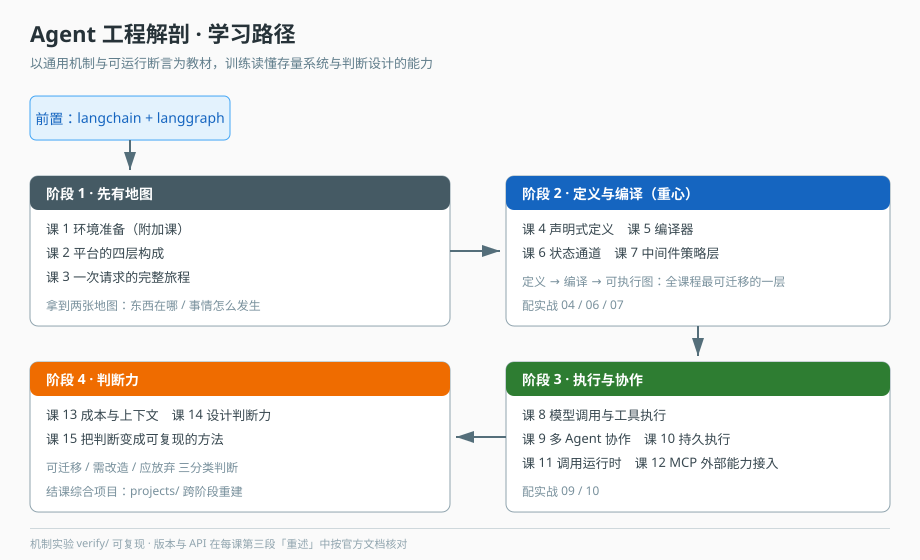

# Agent 工程解剖 学习路径总览

> 本文件是活文档，随学习进度动态调整。阶段依赖图统一用 SVG。

## 🎯 学习目标

- **目标类型**：理解概念（偏设计判断）
- **目标说明**：能读懂一个真实的 AI Agent 生产系统，说清它的分层、编译、状态、策略与持久执行设计，并判断哪些设计可迁移到自己的项目、哪些只是特定约束下的历史包袱。

> 学习目标是全局基准。本课程不追求"会用某个 API"，追求的是"看到一份陌生的 Agent 代码库，能在两小时内画出它的骨架并指出风险点"。

## 前置依赖

| 教程 | 为什么是前置 |
|---|---|
| `langchain/` | 需要知道 Prompt / Model / Tool / Runnable 是什么，否则读不懂课 8 的模型调用层 |
| `langgraph/` | 需要知道 StateGraph / Annotation / checkpoint / interrupt，否则第 5–10 课全是天书 |

> 本课程**不教** LangChain / LangGraph 基础。缺失部分请回前置教程。

## 故事主线

- **主角**：一次 Agent 请求（从"用户按下发送"到"答案流式返回"）
- **冲突**：单个 Agent 能在 notebook 里跑通，但要让它在真实平台上承载多租户、可中断、可恢复、可观测、可扩展——每加一个要求，架构就被迫做一次妥协
- **收束**：学完能回答"一个玩具 Agent 要变成生产系统，到底要补哪些工程骨架，每个骨架解决什么、代价是什么"

> 整个课程是这条故事线的展开：阶段 1 拿到地图，阶段 2 看"怎么被定义出来"，阶段 3 看"怎么被跑起来"，阶段 4 回过头做判断。

## 学习路径图

> 看图：从左上"拿到地图"进入，沿箭头到"看它怎么被定义"，再往下"看它怎么被跑起来"，最后右下是"回头看、做判断"。四个阶段不是四个独立主题，是同一次请求的四次追问。

## 可执行基座

| 项 | 值 |
|---|---|
| 机制实验 | [`verify/`](./verify/README.md)：三个脚本段、14 个断言，覆盖 15 课的核心机制 |
| 结课项目 | [`projects/数据库变更审批助手/实现/`](./projects/数据库变更审批助手/实现/README.md)：跑通"挂起 → 进程退出 → 新进程恢复" |
| 运行时 | Node 22 + `@langchain/langgraph` 1.6.0 + `@langchain/core` 1.3.2 + zod 4 |
| 官方依据 | LangGraph JS / LangChain JS / MCP 规范（每课「📖 文档核对」标注来源与时点） |

> 本课程没有"必须先有的外部仓库"。所有实验都在内存里完成，`npm run core|run|map` 三行命令即可复现课文里的每段输出。版本差异在每课第三段「重述」中处理，不要求与任何特定系统对齐。

## 阶段总览

### 阶段 1：先有地图（预计 1 周）

- **目标**：建立对目标系统的空间感与时间感——知道东西在哪、一次请求怎么走。
- **学习重点**：四层职责划分；73 个模块的依赖方向；在 32 万行里定位代码的三条起手式；一次请求从 HTTP 入口到图执行再到流式回传的完整链路。
- **必须掌握**：能画出四层职责图；能用四条定位起手式（契约名 / 测试反推 / 不变量注释 / 写入点反查）或 spec 反推在 5 分钟内定位任一 Agent 相关实现；能说清一次请求经过哪些层。
- **对应课**：课 1（环境准备）、课 2、课 3

### 阶段 2：定义与编译（预计 2 周）

- **目标**：看懂"声明式定义 → 编译成可执行图"这条主线，这是全课程最可迁移的一层。
- **学习重点**：一份 Agent 定义由什么构成；定义与实例为何分离；编译器 76 行怎么决定走 Swarm 还是子图；状态为什么分 10 个通道；中间件为什么是策略层而不是 if 判断。
- **必须掌握**：能说清"定义与图分离"换来什么、代价是什么；能为一个自定义能力写出中间件策略；能解释 channels reducer 在并发下的行为。
- **对应课**：课 4、课 5、课 6、课 7

### 阶段 3：执行与协作（预计 2 周）

- **目标**：看懂"跑起来"这一层的四个难题——模型调用与工具执行的边界、多 Agent 怎么协作、人不在场时怎么办、能力不够时怎么向外借。
- **学习重点**：工具来源与执行边界如何分离；工具选择先于绑定的不变量；子图 / Swarm / runtime 三种协作形态的判据；checkpoint + interrupt 如何实现"等人不占线程"；调用账本如何支撑可观测与计费；接外部 MCP 服务端时消费方要承担哪些防御责任。
- **必须掌握**：能为一个多 Agent 需求选出正确形态并说出理由；能解释为什么轮询等审批是错的；能说清 Invocation 状态机与幂等边界；能说清能力部分失败时系统应如何降级。
- **对应课**：课 8、课 9、课 10、课 11、课 12

### 阶段 4：判断力（预计 1 周）

- **目标**：从"读懂它"转为"判断它"——哪些可迁移、哪些是包袱、自己的项目该怎么补，并把判断固化成可复用方法。
- **学习重点**：上下文压缩与沙箱的工程取舍；可迁移设计清单；如何识别历史包袱并理解其成因；用测试当可执行文档的方法；三分类判断法与约束还原法。
- **必须掌握**：能对一份 Agent 设计给出"可迁移 / 需改造 / 应放弃"的三分类判断并说明依据；能独立走完约束还原四步；能产出带优先级的迁移决策清单。
- **对应课**：课 13、课 14、课 15

## 子教程

无。本课程为单角色主题（后端 / Agent 开发者），不拆子教程。

## 当前进度

- [ ] 阶段 1：先有地图（未开始）
- [ ] 阶段 2：定义与编译（未开始）
- [ ] 阶段 3：执行与协作（未开始）
- [ ] 阶段 4：判断力（未开始）
