# Agent 工程解剖 · 课程手册（最终交付）

> **本手册是全课程的收口文件**：一张全局地图 + 15 课各自最关键的结论 + 一个能跑的结课项目。
> 4 阶段 15 课 ✅ 全部完成 ｜ 知识点 **50 / 50** ✅ ｜ 结课项目 ✅ 挂起→进程退出→新进程恢复已实测
> 生成日期：2026-11-02 ｜ 学习目标：**理解概念（偏设计判断）** ｜ 可执行基座：`verify/` + Node 22 + `@langchain/langgraph` 1.6.0

## 这份手册怎么用

它不是第 16 课，不重讲任何内容。它做五件事：给一张地图、把 15 课各压成几行结论、保留每课的入口要素与图、指向能真跑的工程、给出两份实战索引。

| 你的目的 | 看哪里 |
|---------|--------|
| 快速回忆全课讲了什么 | [一、全课程地图](#一全课程地图) → [四、15 课速览](#四15-课速览每课最硬的一条) |
| 忘了某课的细节 | 按阶段找到该课，看「本质 / 处境 / 全局图 / 地图 / 知识点结论」，再点课全文 |
| 只想知道最该记住的几条 | [三、七条元结论](#三七条元结论) |
| 想动手把知识焊成能力 | [五、结课综合实战项目](#五结课综合实战项目数据库变更审批助手) → [六、应用实战](#六应用实战) |
| 想自己复现课文里的输出 | [七、可执行基座](#七可执行基座怎么自己复现) ｜ [`verify/README.md`](./verify/README.md) |
| 想知道这套机制内部长什么样 | 每课「知识点结论」后的课全文链接 |
| 线上出问题了 | 本手册只到"该查哪一步"；逐症状排障见 [09-排障速查手册](./09-排障速查手册.md) |

> ⚠️ **每课章节是"复习用压缩版"**，不是原文。所有推导过程、实验输出、伪代码与完整代码都在课全文里，每课章节开头都有直达链接。

---

## 一、全课程地图

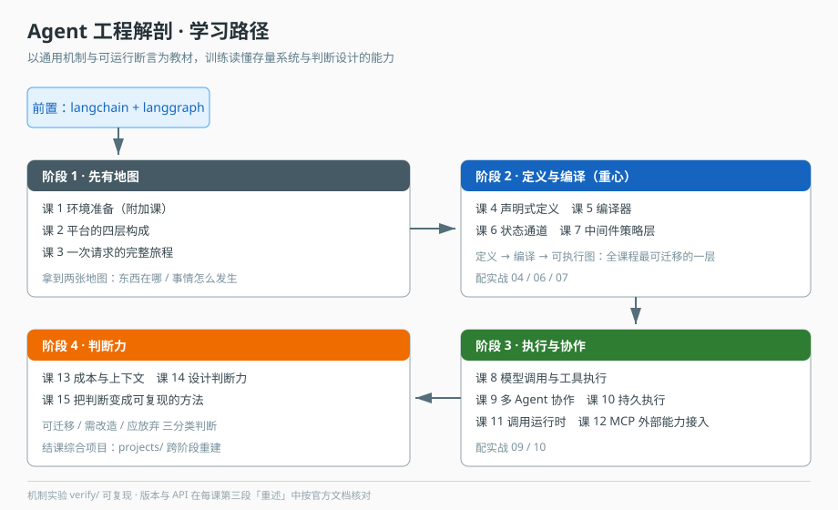

> 看图：从左上"拿到地图"进入，沿箭头到"看它怎么被定义"，再往下"看它怎么被跑起来"，最后右下是"回头看、做判断"。四个阶段不是四个独立主题，是同一次请求的四次追问。

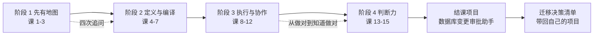

| 块 | 解决什么 | 入口 |
|----|---------|------|
| 4 阶段 15 课 | 从"我会用框架"到"我能给一套陌生 Agent 系统画出骨架并指出风险" | [02-课程目录](./02-课程目录.md) |
| 结课项目 | 跨 4 阶段、直连 16 个知识点的可运行工程 | [projects/数据库变更审批助手/README.md](./projects/数据库变更审批助手/README.md) |
| 应用实战 5 篇 | 每课知识点在真实场景里"从幼稚到像样"的演进 | [应用实战/INDEX.md](./应用实战/INDEX.md) |
| 机制实验 | 课文每段输出的可复现来源（三脚本 14 段） | [verify/README.md](./verify/README.md) |
| 实战经验 / 排障手册 / 场景解法库 | 会踩什么坑、崩了怎么止血、新需求怎么设计 | [08-实战经验](./08-实战经验.md) ｜ [09-排障速查](./09-排障速查手册.md) ｜ [场景解法库](./场景解法库/INDEX.md) |

**故事主线**：主角是**一次 Agent 请求**——从"用户按下发送"到"答案流式返回"。冲突是：单个 Agent 能在 notebook 里跑通，但要让它在真实平台上承载多租户、可中断、可恢复、可观测、可扩展，每加一个要求，架构就被迫做一次妥协。收束是：学完能回答"一个玩具 Agent 要变成生产系统，到底要补哪些工程骨架，每个骨架解决什么、代价是什么"。

### 阶段总览

| 阶段 | 主题 | 本阶段回答 | 必须掌握 | 对应课 |
|------|------|-----------|---------|--------|
| 1 | 先有地图 | 东西在哪、一次请求怎么走 | 能画出四层职责图；能用四条起手式在陌生仓库定位实现；能说清一次请求经过哪些层 | 课 1-3 |
| 2 | 定义与编译 | 声明怎么变成能跑的图 | 能说清"定义与图分离"换来什么、代价什么；能写中间件策略；能解释通道 reducer 在并发下的行为 | 课 4-7 |
| 3 | 执行与协作 | 怎么跑起来、怎么不跑飞 | 能为多 Agent 需求选形态并说清理由；能解释为什么轮询等审批是错的；能说清 Invocation 状态机与幂等边界 | 课 8-12 |
| 4 | 判断力 | 哪些能带走、哪些只是包袱 | 能给出"可迁移 / 需改造 / 应放弃"三分类判断并说明依据；能独立走完约束还原四步 | 课 13-15 |

**四个阶段的递进关系**（一句话）：阶段 1 让你**看得见**结构，阶段 2 让你**看得懂**它是怎么被造出来的，阶段 3 让你**看得清**它跑起来会遇到什么，阶段 4 让你**说得准**哪条该带走。

---

## 二、覆盖边界（明确不讲）

配合 [01-学习路径总览.md](./01-学习路径总览.md) 的声明，以下内容本课程不展开：

- **LangChain / LangGraph 的 API 用法**：前置教程已覆盖；本课程只在需要时点名 API，不教怎么用
- **平台部署运维**：容器编排、多租户运维、容量规划不在范围内
- **某一家产品的实现细节**：本课程拿机制说话，不拿私有目录结构当教材
- **前端 / 控制台交互**：只在"账本面要展示什么"这个层面提及

---

## 三、七条元结论

> 15 课压到最后，真正能迁移到下一个项目的只有这七条。每条都能在课里找到证据与实测。

**1. 分层不是分目录，是分"输入输出"。** 判断一段代码属于哪一层，不看它在哪个文件夹，看它读什么、写什么。四层（定义 / 编译 / 执行 / 账本）之所以站得住，是因为每层的输入输出都能一句话说清。分层的真正目的是**给"改动"一个坐标系**——每个需求先回答"这是哪一层的改动"，搜索范围立刻从几十万行缩到一个子集。

**2. 依赖规则的实质是"禁止回流"，不是"禁止跨层"。** 编译面引用执行面的工具**类型**是合理的（编译产物里要放工具节点），真正该禁的是三条反向：`execute → compile`、`execute → account`、`compile → account`。把规则写成"白名单"会误伤正常设计，写成"禁回流"才既可执行又不冤。这条判据本身就是一次教学：**约束要精确到"实际想禁止的那件事"**。

**3. 定义是数据，不是代码——而"冻结"必须连数组一起复制。** 只 `Object.freeze` 外层对象时，`tools` 仍是同一个数组引用，运行时 `push` 一下就改了"不可变的定义"。正确做法是 `Object.freeze({ ...def, tools: [...def.tools] })`。同理，校验要分两级：结构校验（schema 能查）与语义校验（schema 查不出，如"审批名单引用了未声明的工具"）——只做前者会漏掉真正会炸的那类错误。

**4. 编译即翻译，钩子变节点，而且这件事没有"缓存"可言。** 0 个钩子编译出 2 个节点、2 个钩子编译出 4 个节点——因为图自带 `__start__` / `__end__` 虚节点，加减不是线性直觉。编译必须是纯函数（无 fetch / 无数据库），否则"编译期"就偷偷做了 IO，可测试性立刻崩塌。本项目**显式不缓存**，每次重编：换来的是一致性，代价是每次都要付编译开销。

**5. 状态不是一个大袋子，是"一组各有归约规则的通道"。** 追加型（messages / result）并发写不丢，取新型（title / approval）只留最后一个——两种语义各自正确，混进一个大对象才被迫二选一。最贵的一条推论：**环境信息（密钥、租户、连接）绝不能写进持久化状态**，否则污染历史、泄露密钥、破坏回放；它应该在读时投影。

**6. 两层权限，缺一层就是假安全。** 中间件层拦"模型主动越权"（返回拒绝，执行器根本没被调用）；执行器内部拦"绕过中间件直调"（任何路径都过闸）。只做前者的系统，在有人写一行 `backend.write()` 的时候全线失守——**真正的越权往往来自自家代码，不是模型**。

**7. 挂起态的唯一可靠判据是"图说还有下一步"。** `graph.getState(cfg).next` 非空才是真挂起；`pendingWrites`（框架根本不写）与 `tasks[].interrupts`（跨进程读不到）都不可靠。加上三条官方硬语义——恢复时被中断节点**从头重跑**（`interrupt` 之前的副作用必须幂等）、同节点多次 `interrupt` 的恢复值**按索引匹配**（不能条件性跳过）、`new Command({ resume })` 是**唯一**可作 `invoke` 输入的 Command 形式——这四条凑齐，才算能写"等人不占线程"的代码。

---

## 四、15 课速览：每课最硬的一条

> 每课给：定位与文档核对留痕 → 本课目标 → 入口要素（本质 / 处境）→ 一眼全局图 → 本课地图 → 知识点结论 → 收束 → 一图总结 → 常见误区 → 课全文。
> 图、一句话本质、核对留痕均为课内原文搬运，未改写。

### 阶段 1：先有地图（课 1-3）

> [阶段概览](stages/1-先有地图/overview.md)

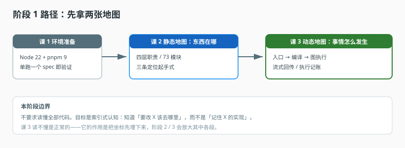


#### 课 1：环境准备

> 所属：阶段 1：先有地图 ｜ [课全文](stages/1-先有地图/lessons/01-环境准备.md)

> 定位：阶段 1《先有地图》｜ 本课类型：环境准备（附加课，不计入每阶段 2–4 课配额）
> 已有环境？→ 直接做每项的「验证」命令，全绿就跳到下一课。
> 📖 结论已按官方文档核对（核对于 2026-11 ｜ 来源：[LangGraph JS 安装页](https://docs.langchain.com/oss/javascript/langgraph/install)、[Node.js 发布计划](https://nodejs.org/en/about/previous-releases)）

##### 最小环境集

本课程后续要用的环境与版本：

- **Node.js 22.x**（LangGraph JS 的运行时基线；本课程按 22.22.2 实测）
- **npm 10.x**（随 Node 附带，够用）
- **TypeScript 5.9**（`tsc --noEmit` 做类型检查，不需要构建）
- **tsx 4.x**（直接跑 `.ts`，省掉编译步骤）
- **`@langchain/langgraph` 1.6.0** + **`@langchain/core` 1.3.2**（课程所有机制实验的运行时）
- **`zod` 4.x**（定义校验用）

> **不装**：数据库 / 消息队列 / 对象存储 / Docker / 云账号。
> 本课程的全部实验都在内存里跑完，一个 `npm install` 就够了。

##### 验证清单

| 项 | 验证命令 | 预期 |
|----|----------|------|
| Node | `node -v` | `v22.x` |
| npm | `npm -v` | `10.x` |
| TypeScript | `npx tsc -v` | `Version 5.9.x` |
| tsx 能跑 TS | 建 `t.ts` 写 `console.log("ok")`，`npx tsx t.ts` | 输出 `ok` |
| LangGraph 可导入 | `node -e "import('@langchain/langgraph').then(m=>console.log(typeof m.StateGraph))"` | `function` |

> ✅ 验证命令实测于 2026-11-02（Node v22.22.2 / npm 10.9.7）：

```text
$ node -v
v22.22.2
$ npm -v
10.9.7
$ npx tsc -v
Version 5.9.3
$ npx tsx t.ts
ok
$ node -e "import('@langchain/langgraph').then(m=>console.log(typeof m.StateGraph))"
function
```

> 关于 `pnpm -v`：本机未装 pnpm（`command not found`），本课程全程用 npm + tsx，不依赖 pnpm workspace。这不是退让——课程要验的是机制，不是包管理器；真需要 monorepo 的场景，用一个根 `package.json` 加 `workspaces` 字段就够。

#### 课 2：平台的四层构成

> 所属：阶段 1：先有地图 ｜ [课全文](stages/1-先有地图/lessons/02-平台的四层构成.md)

> 定位：阶段 1《先有地图》｜ 水平：进阶 ｜ 本课知识点：四层职责划分、模块地图与依赖方向、大型代码库里定位实现
> 故事情节：主角（一次请求）还没出场，先拿到一张"这座城市的地图"——知道哪条街是干什么的。
> 📖 结论已按官方文档核对（核对于 2026-11 ｜ 来源：[LangGraph JS 文档](https://langchain-ai.github.io/langgraphjs/)、[LangChain JS Middleware](https://js.langchain.com/docs/concepts/middleware)）

##### 本课目标

- 画出定义面 / 编译面 / 执行面 / 账本面四层职责图，说出每层的输入与输出
- 说清模块该往哪一层贴、依赖为什么必须单向，以及这条规则怎么被机器检查
- 掌握三条定位起手式，能在陌生大仓库里 5 分钟内找到任一 Agent 相关实现

##### 入口要素：本质与处境

> 📌 **一句话本质**：本课把"一个看不懂的大仓库"变成"一张能看的地图"，让你从"哪里是哪里"开始，而不是从"这一行在干什么"开始。

> ⚖️ **处境对照**：不这么做 → 靠逐行读，三周后细节装满脑子但问题依旧答不上；这么做 → 先花半天建立分层索引，之后每次定位都"按图索骥"，几分钟锁定目标文件。

##### 一眼全局图

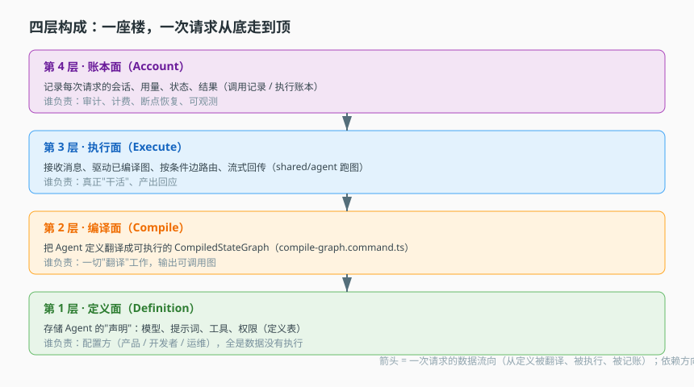

> 看图：这是一座四层楼的房子。底层是"定义"，顶上是"账本"；一次请求从下往上走，每一层负责不同的事。本课先带你认识这四层分别"住着谁"。

##### 本课地图

| 步 | 这一步要解决什么（人话） | 对应知识点 |
|:--:|------------------------|-----------|
| 1 | 先把四层各是什么、谁写谁读搞清楚 | 知识点 1：四层职责划分 |
| 2 | 再把几十个模块往这四层里贴，看依赖怎么流 | 知识点 2：模块地图与依赖方向 |
| 3 | 最后学会在大仓库里"按名字定位" | 知识点 3：大型代码库里定位实现 |

##### 知识点结论（每点一句）

| 知识点 | 一句话记住 |
|---|---|
| 1：四层职责划分 | 四层 = 说清要什么 → 翻成图 → 跑起来 → 记下账；判断归属看输入输出。 |
| 2：模块地图与依赖方向 | 模块有分类、依赖有方向；想反向依赖就下沉公共层，别靠自觉、靠检查。 |
| 3：大型代码库里定位实现 | 按类型名搜、按测试反推、按不变量注释搜、按写入点反查；索引只加速。 |

##### 收束结论

你现在有了三样东西：一张四层地图（定义 / 编译 / 执行 / 账本）、一份依赖规则（单向 + 机器检查）、一套定位起手式（四条搜索方法）。改模型去定义面、想看怎么被翻译成图去编译面、想追一次请求的执行去执行面、想查谁在什么时候调用了什么去账本面。

> 📍 **全局定位**：地图是后续所有课的"坐标系"。
> 🔗 **下一步**：地图有了，但你还不知道"一次请求到底从哪儿走到哪儿"。下一课把主角送上主干道——从 HTTP 入口一路走到流式返回，你会在这条路上把四个楼层真正"走"一遍。

##### 一图总结

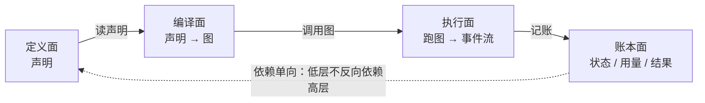

> 与课首图的分工：课首"一眼全局图"是问题视角（给没学过的人看"为什么要分四层"）；此处是知识视角（给刚学完的人复习四层关系）。

##### 常见误区

1. **"四层是四个文件夹"**：四层是职责分类，目录只是大致对应且会交叉。判断属于哪层，看"它在解决什么阶段的问题"。
2. **"所有模块都要读一遍"**：只抓骨架层（每层 1–2 个关键模块），外围用到时再回来。
3. **"依赖方向靠自觉"**：必须用静态检查强制，否则约定会失效。
4. **"定位必须依赖索引"**：四条起手式在任何仓库都能跑。

#### 课 3：一次请求的完整旅程

> 所属：阶段 1：先有地图 ｜ [课全文](stages/1-先有地图/lessons/03-一次请求的完整旅程.md)

> 定位：阶段 1《先有地图》｜ 水平：进阶 ｜ 本课知识点：入口到图调用、图内状态流转、流式回传、执行记账
> 故事情节：主角登场。一次"用户按下发送"的请求，从 HTTP 入口一路走到流式返回。
> 📖 结论已按官方文档核对（核对于 2026-11 ｜ 来源：[LangGraph 流式](https://docs.langchain.com/oss/javascript/langgraph/streaming)、[事件流](https://docs.langchain.com/oss/javascript/langgraph/event-streaming)、[Graph API](https://docs.langchain.com/oss/javascript/langgraph/graph-api)）

##### 本课目标

- 说清一次请求从 HTTP 入口到图调用的每一步，以及 CQRS 在这里解决了什么问题
- 说清图内消息如何追加、条件边如何路由出"模型 ↔ 工具"循环
- 说清流式为什么用 SSE，以及事件从哪里发出
- 说清账本为什么在"流程结束"才落定状态

##### 入口要素：本质与处境

> 📌 **一句话本质**：本课把"一次看不见的网络请求"沿主干道重走一遍，让你在关键岔路口看到它在哪转弯、在哪暂停、在哪记下这一笔。

> ⚖️ **处境对照**：不这么做 → 你只有"请求发出 / 响应返回"两个黑盒端点，出问题时只能说"好像卡住了"；这么做 → 你有一条可复述的完整链路，能说出"卡在账本那儿了，不是执行的问题"。

##### 一眼全局图

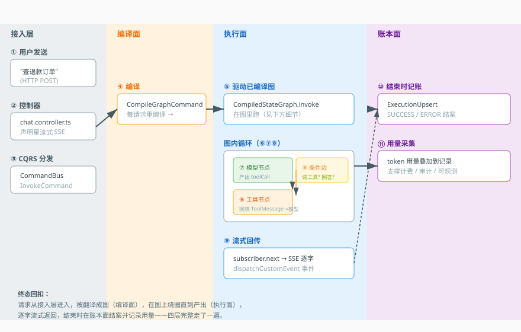

> 看图：从最上面的"用户输入"开始，沿着带编号的箭头一步步往下走。箭头遇到"暂停"的地方会停住等人确认，最后字体逐字往上流——这就是一次请求的完整主干。

##### 本课地图

| 步 | 这一步要解决什么（人话） | 对应知识点 |
|:--:|------------------------|-----------|
| 1 | 请求从 HTTP 进来，怎么被引导到图调用 | 知识点 1：入口到图调用 |
| 2 | 图上消息怎么流动、边怎么选路 | 知识点 2：图内状态流转 |
| 3 | 结果怎么逐字流回前端 | 知识点 3：流式回传 |
| 4 | 什么时候记账、记什么 | 知识点 4：执行记账 |

##### 知识点结论（每点一句）

| 知识点 | 一句话记住 |
|---|---|
| 1：入口到图调用 | 前台承诺流式 → 派工单 → 办事员先编译后执行；编译是翻译，不缓存。 |
| 2：图内状态流转 | 消息只追加、条件边决定绕不绕、工具结果必须回到模型。 |
| 3：流式回传 | 事件带类型、单向用 SSE、错误走事件、分片要缓冲。 |
| 4：执行记账 | 开始创建拿 id、过程累加用量、结束落定状态、异常也要落。 |

##### 收束结论

你现在能完整复述一次请求的一生：从前台进来 → 派工单 → 编译成图 → 在图上绕圈直到产出 → 流式推回前端 → 在账本里盖章。

> 📍 **全局定位**：这是主干道全景。你还不需要看懂每一步的细节——这一步的目的是把"坐标"埋下来。
> 🔗 **下一步**：主干道里很长一段发生在"编译"和"图运行时"里。下一阶段我们把前两个楼层放大：定义是怎么写的、编译又是怎么把它翻译成图的。

##### 一图总结

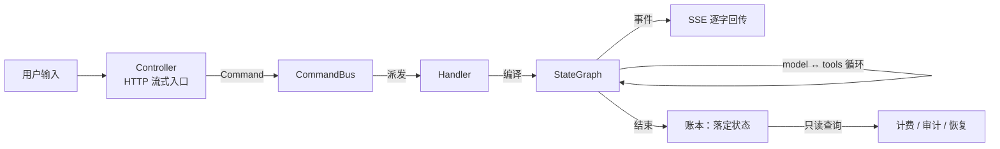

> 课首图是问题视角（为什么不是直进直出）；此图是知识视角（五类机制的衔接）。

##### 常见误区

1. **"一次请求是直进直出"**：它经历翻译、路由、循环、流式、记账多类机制。
2. **"编译好的图会被缓存复用"**：不缓存，每次请求重新构建——这是取舍，要意识到成本。
3. **"账本每步都写库"**：可累加量增量写，终态量结尾写一次。
4. **"流式只是前端体验"**：它降低误操作率，是可靠性的一部分。
5. **"网络分片等于事件分片"**：必须自己缓冲拼帧。

### 阶段 2：定义与编译（课 4-7）

> [阶段概览](stages/2-定义与编译/overview.md)

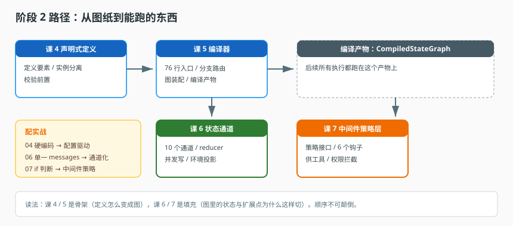


#### 课 4：声明式定义

> 所属：阶段 2：定义与编译 ｜ [课全文](stages/2-定义与编译/lessons/04-声明式定义.md)

> 定位：阶段 2《定义与编译》｜ 水平：进阶 ｜ 本课知识点：一份定义包含什么、定义与实例分离、校验前置
> 故事情节：主角要被"造出来"了。第一次看到：造一个 Agent 不需要写代码，只需要一份定义。
> 配应用实战：[实战 04](应用实战/04-把硬编码Agent改成配置驱动.md)
> 📖 结论已按官方文档核对（核对于 2026-11 ｜ 来源：[LangGraph Graph API](https://docs.langchain.com/oss/javascript/langgraph/graph-api)、[应用结构](https://docs.langchain.com/oss/javascript/langgraph/application-structure)）

##### 本课目标

- 列出一份 Agent 定义的全部要素，说清哪些进定义、哪些必须留代码
- 说清草稿 / 发布 / 固定版本三种状态各自解决什么问题
- 区分校验期与运行期的职责，说清为什么校验要前置、以及它查不到什么

##### 入口要素：本质与处境

> 📌 **一句话本质**：把"Agent 长什么样"从代码里抽出来，变成一份可存储、可版本化、可校验的声明（definition），代码只负责"怎么把声明跑起来"。

> ⚖️ **处境对照**：不这么做 → 每次需求变更改 N 处代码、重新发版、无法灰度、无法回滚；这么做 → 改一份 JSON、走一次校验、发一个版本号，代码一行不动。

##### 一眼全局图

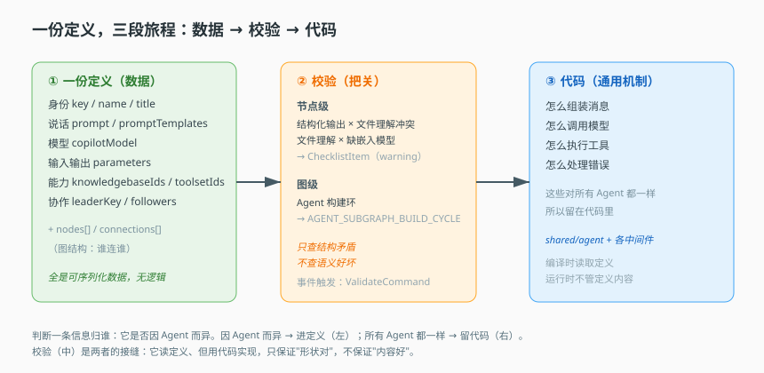

> 看图：左边是"一份定义"（数据），中间是"校验"（把关），右边是"编译"（翻译）。代码只在最右端——负责把声明变成能跑的机器。定义本身不包含任何可执行逻辑。

##### 本课地图

| 步 | 这一步要解决什么（人话） | 对应知识点 |
|:--:|------------------------|-----------|
| 1 | 一份定义里到底装了什么、什么装不进去 | 知识点 1：一份定义包含什么 |
| 2 | 为什么"定义"和"运行实例"要分开，版本怎么起作用 | 知识点 2：定义与实例分离 |
| 3 | 定义写错了在哪一步被发现，为什么不能等到运行 | 知识点 3：校验前置 |

##### 知识点结论（每点一句）

| 知识点 | 一句话记住 |
|---|---|
| 1：一份定义包含什么 | 定义 = 六组字段 + 一张图；判断归谁看"是否因 Agent 而异"；分支走图，不写 if。 |
| 2：定义与实例分离 | 定义是模板、实例是快照；草稿叠在发布上，版本号让历史可证。 |
| 3：校验前置 | 校验前置 = 把结构性矛盾列成清单；它管形状，不管语义；清单优于异常。 |

##### 收束结论

到这里，你已经知道 Agent 是"一份数据"：六组字段加一张图，分草稿和发布两种状态，改完先过校验。

> 📍 **全局定位**：这是阶段 2 的第一块基石——**定义与图分离**。后面三课都建立在这个前提上。
> 🔗 **下一步**：定义只是图纸。下一课看这张图纸怎么被翻译成一台能跑的机器，以及"入口为什么可以薄到只有几十行"。

##### 一图总结

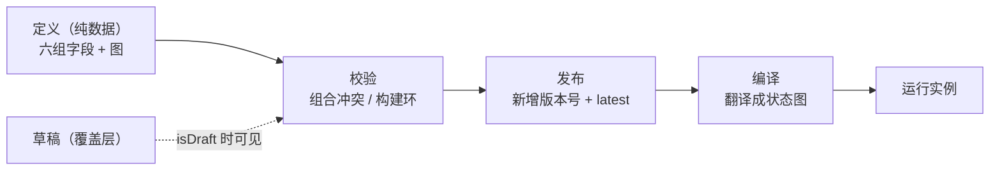

> 课首图是"结构视角"（定义/校验/编译三段）；此图是"状态视角"（同一份定义如何经过校验、发布、编译变成运行实例）。

##### 常见误区

1. **"定义越全越好，能写的都写进定义"**：不要在定义里塞条件逻辑。一旦能写 if，就失去版本化与可校验性。
2. **"校验通过就等于没问题"**：它只覆盖结构性矛盾。
3. **"草稿和发布是两份数据"**：同一实体的两个字段，草稿是叠加层。
4. **"图校验会查所有合法性问题"**：核心只有构建环。

#### 课 5：编译器

> 所属：阶段 2：定义与编译 ｜ [课全文](stages/2-定义与编译/lessons/05-编译器.md)

> 定位：阶段 2《定义与编译》｜ 水平：进阶 ｜ 本课知识点：编译入口与分支路由、原生子图构建、编译产物
> 故事情节：定义只是一张图纸，这一课看"图纸怎么变成能跑的东西"。
> 📖 结论已按官方文档核对（核对于 2026-11 ｜ 来源：[LangGraph Graph API](https://docs.langchain.com/oss/javascript/langgraph/graph-api)、[子图](https://docs.langchain.com/oss/javascript/langgraph/use-subgraphs)）

##### 本课目标

- 说清编译入口如何用一个条件决定走"多 Agent 协作"还是"单 Agent"
- 画出状态图的装配顺序，说清钩子如何变成节点、顺序如何被保证
- 说清编译产物的四个关键参数，以及"没有缓存"的含义与代价
- 说清编译失败为什么要清理现场

##### 入口要素：本质与处境

> 📌 **一句话本质**：编译面做的事只有一件——**把定义（数据）翻译成状态图（可执行对象）**。它不做业务判断，不跑模型，不调工具。

> ⚖️ **处境对照**：不这么做 → 每个 Agent 都要手写一份建图代码，改一次定义就要改一次代码；这么做 → 建图逻辑收敛成一个编译器，定义怎么变都只是"输入变了"。

##### 一眼全局图

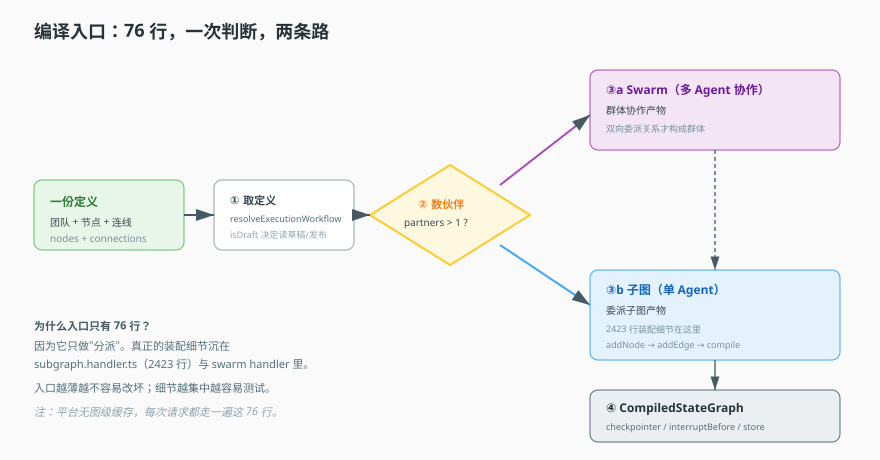

> 看图：左边进来一份定义，中间是一个菱形判断（伙伴数 > 1？），右上是协作分支、右下是子图分支。两条路最后都汇到同一个产物：可执行图。整张图只有一次判断——这就是"入口很薄"的全部原因。

##### 本课地图

| 步 | 这一步要解决什么（人话） | 对应知识点 |
|:--:|--------------------------|-----------|
| 1 | 入口到底怎么判断走哪条路 | 知识点 1：编译入口与分支路由 |
| 2 | 单 Agent 的图是怎么搭起来的，钩子插在哪 | 知识点 2：原生子图构建 |
| 3 | 搭完得到什么、能复用吗、失败怎么暴露 | 知识点 3：编译产物 |

##### 知识点结论（每点一句）

| 知识点 | 一句话记住 |
|---|---|
| 1：编译入口与分支路由 | 取定义 → 找双向伙伴 → 数到 2 以上走群体 → 否则单图；一行判断定全局。 |
| 2：原生子图构建 | 装节点 → 连边 → 装岔道 → compile；钩子是节点不是回调，进出反向。 |
| 3：编译产物 | 产物带四个参数；不缓存是取舍；失败先清场再报。 |

##### 收束结论

编译面是"中间那一层"：入口只做分派，构建器负责搭图，产物是一个带检查点的可执行图。它把"数据"和"行为"之间那道坎，用一次翻译跨过去了。

> 📍 **全局定位**：这一课是阶段 2 的枢纽——上游接定义（课 4），下游接状态（课 6）与中间件（课 7）。
> 🔗 **下一步**：图搭好了，但图要"记住东西"。下一课拆开图的内部结构：状态通道各是什么、谁在写、并发写会怎样。

##### 一图总结

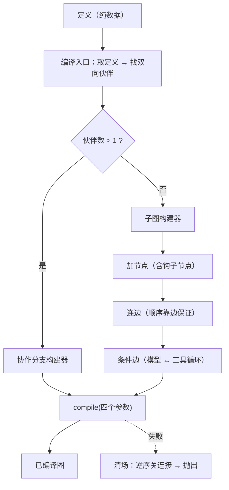

> 课首图是"一次判断"的极简视角；此图是"两支汇流 + 失败路径"的完整视角。

##### 常见误区

1. **"编译入口自己建图"**：只分派。
2. **"中间件是运行时回调"**：编译期展开成节点。
3. **"编好的图会缓存"**：没有，每次请求重编。
4. **"before/after 顺序对称"**：退出反序。
5. **"不传 interrupt_before 会报错"**：静默失效，必须测试盯住。

#### 课 6：状态通道

> 所属：阶段 2：定义与编译 ｜ [课全文](stages/2-定义与编译/lessons/06-状态通道.md)

> 定位：阶段 2《定义与编译》｜ 水平：进阶 ｜ 本课知识点：通道划分、reducer 与并发、运行时注入、状态到参数
> 故事情节：图有了，但图要"记住东西"。主角的短期记忆如何组织，决定了它能走多远。
> 配应用实战：[实战 06](应用实战/06-从单一messages到通道化状态.md)
> 📖 结论已按官方文档核对（核对于 2026-11 ｜ 来源：[LangGraph Graph API（状态与 reducer）](https://docs.langchain.com/oss/javascript/langgraph/graph-api)、[LangChain 短期记忆](https://docs.langchain.com/oss/javascript/langchain/short-term-memory)）

##### 本课目标

- 说清为什么要分通道而不是一个大对象，并列出各类通道的用途
- 解释 reducer 的行为，说清并发写同一通道时什么时候会丢数据
- 说清环境信息为什么不能写进持久化状态，以及"读时投影"的含义
- 说清状态值如何变成提示词里可用的参数

##### 入口要素：本质与处境

> 📌 **一句话本质**：状态不是一个大袋子，而是**一组各自有归约规则的通道**。分通道，是为了让不同来源、不同生命周期的数据互不污染。

> ⚖️ **处境对照**：不这么做 → 所有数据挤在 messages 里，摘要、标题、临时变量互相踩；这么做 → 每种数据有自己的通道和自己的合并规则，加新功能不再需要改老逻辑。

##### 一眼全局图

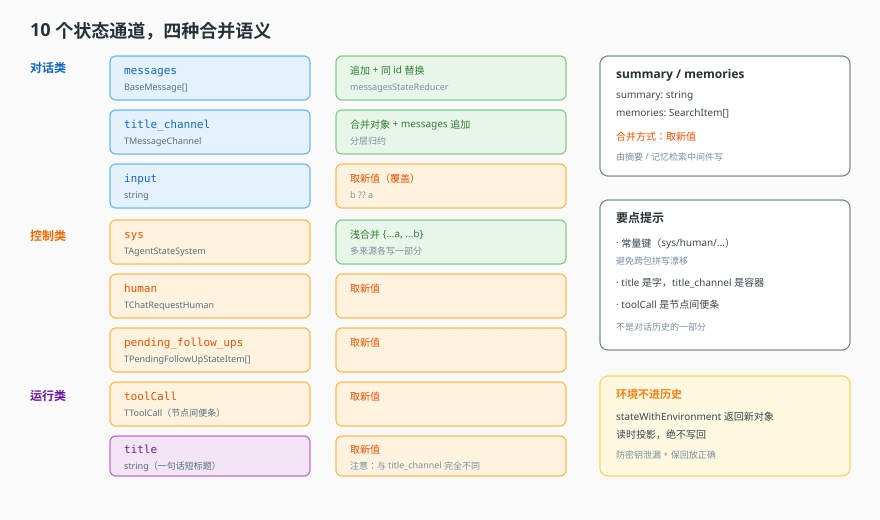

> 看图：左边是各类通道（分三类：对话类、控制类、运行类），每个通道右侧标注它的合并方式（追加 / 覆盖 / 合并）。中间那个"超步合并"是整个机制的核心——每次节点执行完，所有通道按自己的规则合并一次。

##### 本课地图

| 步 | 这一步要解决什么（人话） | 对应知识点 |
|:--:|--------------------------|-----------|
| 1 | 通道该怎么划分、谁在写 | 知识点 1：通道划分 |
| 2 | 两个人同时写一个通道会怎样 | 知识点 2：reducer 与并发 |
| 3 | 环境变量为什么不能写进历史 | 知识点 3：运行时注入 |
| 4 | 状态里的值怎么变成提示词参数 | 知识点 4：状态到参数 |

##### 知识点结论（每点一句）

| 知识点 | 一句话记住 |
|---|---|
| 1：通道划分 | 四种语义（追加 / 取新 / 浅合并 / 分层归约）；按生命周期分三类；常量键防拼错。 |
| 2：reducer 与并发 | reducer 是每次写入的归一化；追加保历史、取新只留最新、分层归约别丢内层。 |
| 3：运行时注入 | 环境是滤镜不是底片——读时叠加，绝不回写。 |
| 4：状态到参数 | 先叠环境、消息转文本、结构转 JSON；隔离靠命名空间，转换只读。 |

##### 收束结论

状态不是一个大袋子，而是有明确归约规则的一组通道：对话追加、控制取新、环境合并、参数翻译。分通道的本质是**让"数据怎么合并"成为结构的一部分，而不是每个节点各自记得**。

> 📍 **全局定位**：这是阶段 2 的第二块基石——**状态分通道**。它决定了阶段 3 里多 Agent 协作时"数据会不会串台"。
> 🔗 **下一步**：状态解决了"记住什么"，下一课解决"外挂了什么"——中间件策略层，工具、权限、上下文注入都在那里。

##### 一图总结

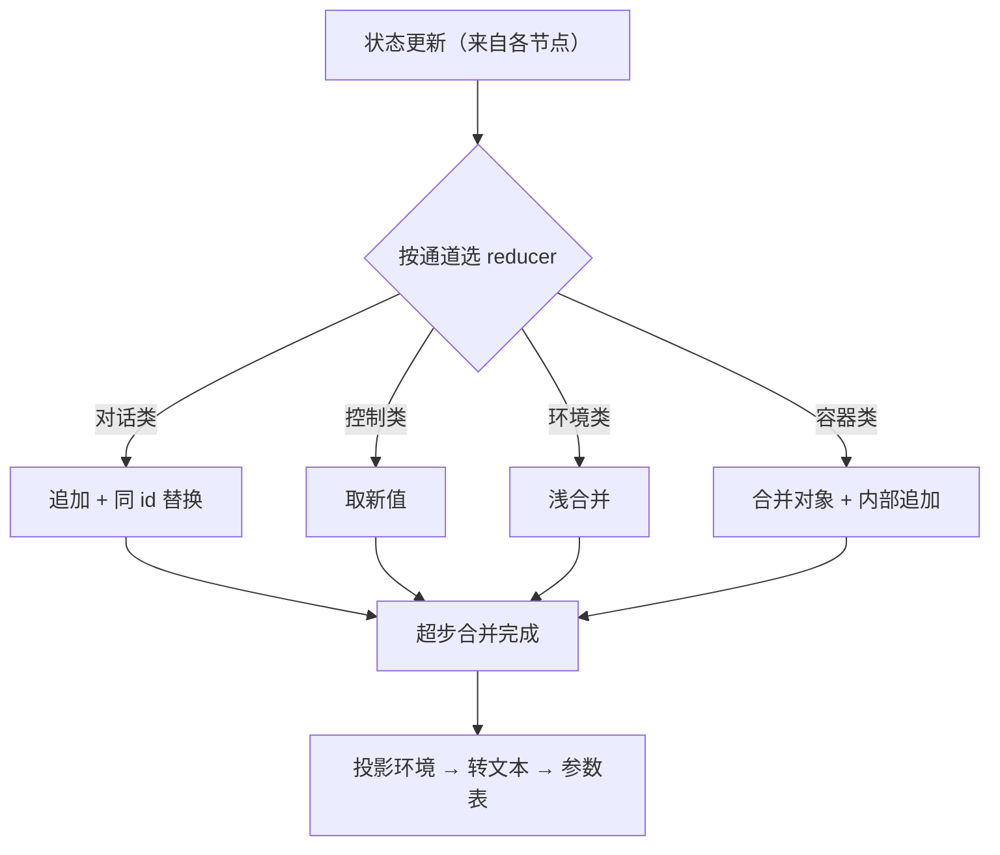

> 课首图是"结构视角"（通道分类）；此图是"处理视角"（一次更新如何被路由到对应 reducer）。

##### 常见误区

1. **"状态就是一个大对象"**：是多个通道，各有 reducer。
2. **"并发写一定安全"**：取决于通道类型，取新型会丢数据（这是设计）。
3. **"环境变量存进状态更方便"**：污染历史、泄露密钥、破坏回放。
4. **"名字相近的通道差不多"**：类型可能完全不同。
5. **"reducer 只在并发时生效"**：每次写入都走。

#### 课 7：中间件策略层

> 所属：阶段 2：定义与编译 ｜ [课全文](stages/2-定义与编译/lessons/07-中间件策略层.md)

> 定位：阶段 2《定义与编译》｜ 水平：进阶 ｜ 本课知识点：策略接口、六个钩子职责、中间件与工具、权限为何在这里
> 故事情节：主角需要外挂能力——工具、权限、上下文注入。系统没有用 if 堆，而是开了一层策略层。
> 配应用实战：[实战 07](应用实战/07-把if判断抽成中间件策略.md)
> 📖 结论已按官方文档核对（核对于 2026-11 ｜ 来源：[LangChain 中间件](https://docs.langchain.com/oss/javascript/langchain/middleware)、[内置中间件](https://docs.langchain.com/oss/javascript/langchain/middleware/built-in)）

##### 本课目标

- 写出一个最小中间件策略实现，并说清三个成员各自的职责
- 为每种需求选出正确的钩子，并说清执行顺序为什么是"进正序、出反序"
- 说清中间件如何供给工具，以及"静态清单"与"运行时实例"为什么要分开
- 解释权限为什么拦在中间件层，以及这条防线为何不完整

##### 入口要素：本质与处境

> 📌 **一句话本质**：把"每种能力的接入方式"从"主干上的 if"改成"可插拔的策略对象"——主干只负责按顺序调用，不关心具体是谁。

> ⚖️ **处境对照**：不这么做 → 能力数量增长时组合爆炸（6 个 if 有 64 种路径），测试覆盖不住；这么做 → 每个能力独立成一个策略，加第 7 个不影响前 6 个。

##### 一眼全局图

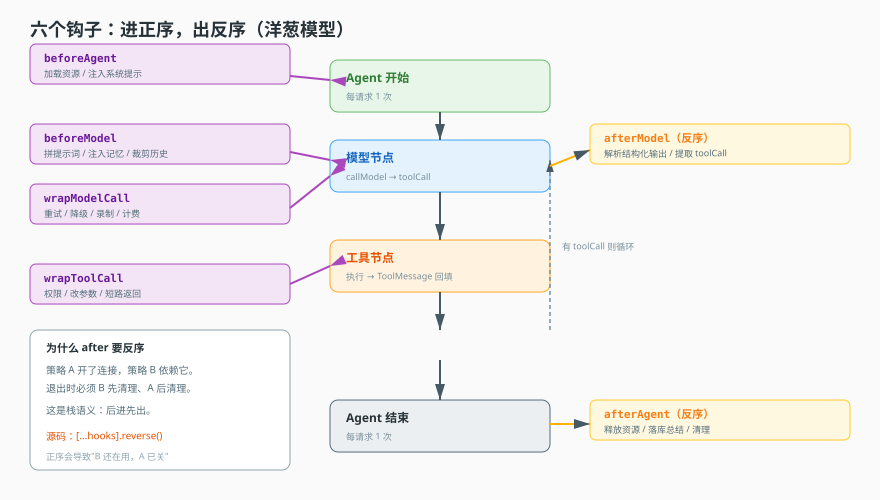

> 看图：中间是一条 Agent 执行链（Agent 开始 → 模型调用 → 工具调用 → Agent 结束），上下两侧是 6 个钩子的插入位置。每个位置可以有多个策略排队，去程正序、回程反序。

##### 本课地图

| 步 | 这一步要解决什么（人话） | 对应知识点 |
|:--:|--------------------------|-----------|
| 1 | 一个策略长什么样、怎么被找到 | 知识点 1：策略接口 |
| 2 | 6 个钩子分别管哪一段 | 知识点 2：六个钩子职责 |
| 3 | 中间件怎么"变出"工具 | 知识点 3：中间件与工具 |
| 4 | 权限为什么拦在这里，又为什么拦不全 | 知识点 4：权限为何在这里 |

##### 知识点结论（每点一句）

| 知识点 | 一句话记住 |
|---|---|
| 1：策略接口 | 策略三件套：meta 自我介绍、静态清单给人看、工厂生产实例；工厂要便宜、策略要无状态。 |
| 2：六个钩子职责 | 两整体 + 三模型 + 一工具；进正序、出反序；wrap 可改可短路。 |
| 3：中间件与工具 | 静态清单是上限，运行时工具是实际；元数据随工具走，单例约束装配期拦。 |
| 4：权限为何在这里 | 中间件层管"看得见"，执行层管"做得到"；权限注入实例，不靠参数传递。 |

##### 收束结论

中间件策略层是"外挂接口"：一个三成员接口、6 个插入位置。它不只做日志埋点，还承担工具供给、权限拦截、上下文注入。

> 📍 **全局定位**：这是阶段 2 的最后一块基石——**扩展走策略层**。它直接决定了阶段 3 要讲的"多 Agent 协作时权限怎么管"。
> 🔗 **下一步**：本课留了一个悬念——中间件层的权限只控制"看得见"，不控制"做得到"。阶段 3 会从执行侧再讲一次授权，把这条防线补完。

##### 一图总结

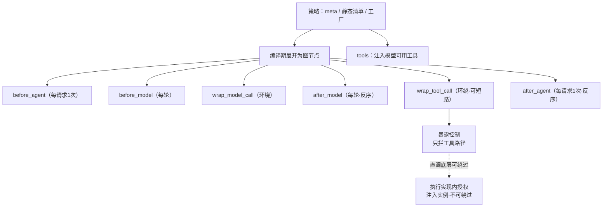

> 课首图是"位置视角"（6 个钩子插在哪）；此图是"组装视角"（策略如何变成节点 + 工具 + 两层权限）。

##### 常见误区

1. **"中间件就是日志埋点"**：它还供给工具、拦权限、注入上下文。
2. **"after 钩子和 before 同序"**：反序（洋葱模型）。
3. **"get_tool_names 等于可用工具"**：只是静态上限。
4. **"deny 就是安全边界"**：只控制工具路径，直调可绕过。
5. **"权限做成参数更灵活"**：参数可被覆盖，必须注入实例。

### 阶段 3：执行与协作（课 8-12）

> [阶段概览](stages/3-执行与协作/overview.md)

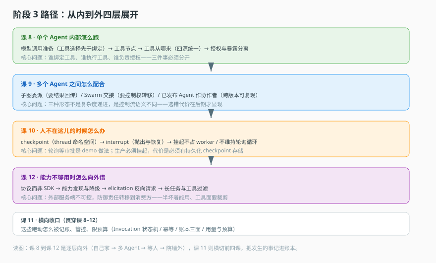


#### 课 8：模型调用与工具执行

> 所属：阶段 3：执行与协作 ｜ [课全文](stages/3-执行与协作/lessons/08-模型调用与工具执行.md)

> 定位：阶段 3《执行与协作》｜ 水平：进阶 ｜ 本课知识点：模型调用准备、工具节点、工具从哪来、授权与暴露分离
> 故事情节：主角第一次真正"动手"——它不再只是说话，而是要让模型在一个受限的工具集里做选择，并真的执行。
> 📖 结论已按官方文档核对（核对于 2026-11 ｜ 来源：[LangChain 工具](https://docs.langchain.com/oss/javascript/langchain/tools)、[LangGraph Graph API](https://docs.langchain.com/oss/javascript/langgraph/graph-api)）

##### 本课目标

- 说清"先选工具、再绑模型"为什么顺序不能反，以及"每次调用一份快照"解决什么问题
- 说清 ToolNode 如何并行执行工具调用、如何按 `tool_call_id` 把结果回填给正确的位置
- 说清四种工具来源（内置 / MCP / OpenAPI / OData）如何统一成一个抽象
- 说清"暴露面"（模型看得见什么）与"执行面"（真正能不能做）为什么要分成两层

##### 入口要素：本质与处境

> 📌 **一句话本质**：模型是"会说话的选择器"，平台是"负责任的门卫"。模型负责说"我要这么干"，平台负责在动手之前把一切约束定死、并在执行时守住边界。

> ⚖️ **处境对照**：**不设这道边界**，模型看到的工具就等于能调的工具——越权查询要等结果送到用户眼前、或者等事后审计翻日志才发现，此时数据已经出圈，回滚不了；**清单先裁剪、执行再校验**，越权调用在动手那一刻被拒，最坏后果只是这一轮对话报一个"无权执行"，数据没动过。代价是每次调用多一次校验（一次内存判定，量级远小于一次模型往返 ⏳）。

##### 一眼全局图

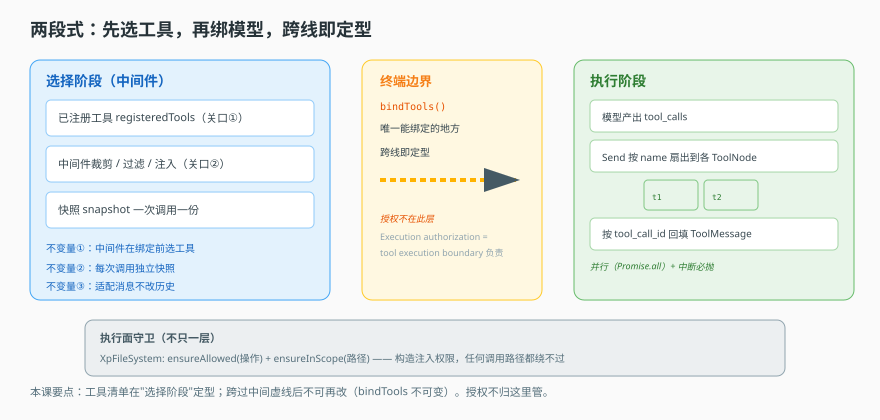

> 看图：左边是"模型"这一侧——它看得到一份裁剪过的工具清单，产出 tool_call。中间是"准备"这一层——把这份选择固化成一份快照，谁都改不了。右边是"执行"这一层——真正动手前还要过权限校验。整张图的要点：**清单是裁剪的、准备是固化的、执行是守门的**。

##### 本课地图

| 步 | 这一步要解决什么（人话） | 对应知识点 |
|:--:|--------------------------|-----------|
| 1 | 模型调用前，把"用什么、绑谁、发什么"定死 | 知识点 1：模型调用准备 |
| 2 | 模型说"调这个工具"，谁来真执行、怎么并行 | 知识点 2：工具节点 |
| 3 | 这些工具从哪来的，凭什么能统一 | 知识点 3：工具从哪来 |
| 4 | 真正动手前，凭什么判断"这次允许" | 知识点 4：授权与暴露分离 |

##### 知识点结论（每点一句）

| 知识点 | 一句话记住 |
|---|---|
| 1：模型调用准备 | 先选后绑、一次一快照、适配不改史。 |
| 2：工具节点 | 只认最后一条 AI、并行执行、按 id 回填；断点穿透、错误喂回。 |
| 3：工具从哪来 | 四源四路，一个出口；按集授权，按集回收。 |
| 4：授权与暴露分离 | 暴露面裁剪所见，执行面守住所能；一个工具声明可能永远不执行。 |

##### 收束结论

一个模型调用之所以安全，不是因为它"听懂了约束"，而是因为"能看"被裁剪、"能做"被守门、中间还有一份不可变的快照兜住重试与降级。

> 📍 **全局定位**：这一课把"工具"从"会动的函数"升格成"有边界的资源"。
> 🔗 **下一步**：单个 Agent 内部可控了，多 Agent 场景呢？——进入课 9。

##### 一图总结

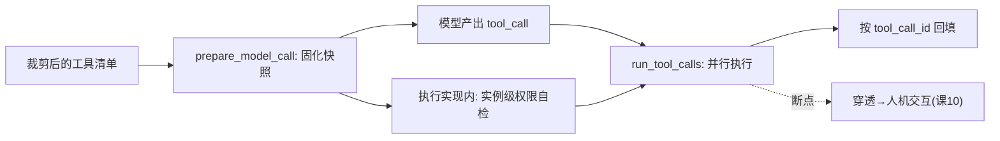

##### 常见误区

1. **"绑定后还能加工具"**：不可变，加=换模型。
2. **"重试会重新选工具"**：快照让重试用同一份。
3. **"工具按返回顺序回填"**：按 `tool_call_id` 认领。
4. **"所有异常都喂回模型"**：人机交互断点必须穿透。
5. **"deny 工具就安全"**：绕过工具直调底层照样能执行。

#### 课 9：多Agent协作

> 所属：阶段 3：执行与协作 ｜ [课全文](stages/3-执行与协作/lessons/09-多Agent协作.md)

> 定位：阶段 3《执行与协作》｜ 水平：进阶 ｜ 本课知识点：子图委派、已发布 Agent 作协作者、Swarm 交接、选型判据
> 故事情节：一个 Agent 忙不过来了。系统给了三种"分工方式"，选错会让后期维护很痛。
> 配应用实战：[实战 09](应用实战/09-从单Agent到主管工人.md)
> 📖 结论已按官方文档核对（核对于 2026-11 ｜ 来源：[LangGraph 子图](https://docs.langchain.com/oss/javascript/langgraph/use-subgraphs)、[工作流与 Agent](https://docs.langchain.com/oss/javascript/langgraph/workflows-agents)）

##### 本课目标

- 画出于子图委派的父子调用与返回路径
- 说清固定版本调用如何保证可复现
- 说清 Swarm 交接与"返回结果"的本质区别
- 给定需求，能选出形态并说出代价

##### 入口要素：本质与处境

> 📌 **一句话本质**：多 Agent 协作的三种形态，本质区别只有一点——**控制权归谁、结果往哪放**。

> ⚖️ **处境对照**：**不分家**，工具全塞进一个 Agent——第 47 个工具进来后，每次请求都要为用不到的工具描述付 token，模型在相似名字之间犹豫，选错率上升且很难定位是哪一步错的；**按控制流语义分家**，每个 Agent 只带自己那几个工具，主管拿回结果再决定下一步。代价是多一层调用编排，排查链路变长（一次请求要跨两个以上的执行单元看日志）。

##### 一眼全局图

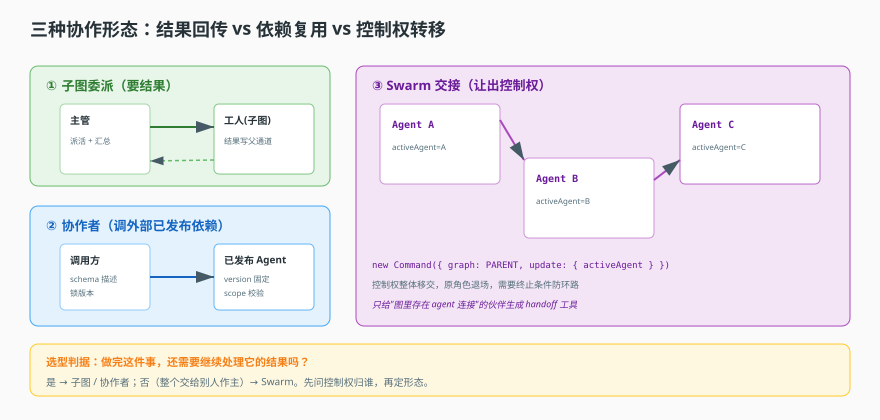

> 看图：三种形态沿"结果往哪放、控制权给谁"这条轴展开。子图（左）把结果塞回父通道、父继续；协作者（中）用一个 schema 描述一个外部已发布的 Agent；Swarm（右）交接后 activeAgent 换成下一个、流程不再回退。

##### 本课地图

| 步 | 这一步要解决什么（人话） | 对应知识点 |
|:--:|--------------------------|-----------|
| 1 | 怎么把一个 Agent 当"工具"派活并拿回结果 | 知识点 1：子图委派 |
| 2 | 怎么调用"已发布、别人维护"的 Agent | 知识点 2：已发布 Agent 作协作者 |
| 3 | 怎么把一段对话"整个"交给下一个角色 | 知识点 3：Swarm 交接 |
| 4 | 遇到具体需求该选哪个 | 知识点 4：选型判据 |

##### 知识点结论（每点一句）

| 知识点 | 一句话记住 |
|---|---|
| 1：子图委派 | 子图 = 把子 Agent 当一个"能回传结果的工具"；子写子、结果写父。 |
| 2：已发布 Agent 作协作者 | 协作者 = 已发布的公共服务；schema 描述、路由执行；锁版本保复现、验 scope 控授权。 |
| 3：Swarm 交接 | Swarm = 整段交接：Command.PARENT + activeAgent；交出去了就不回头。 |
| 4：选型判据 | 回传→子图、转接→Swarm、跨系统→runtime；按语义选，不按复杂度选。 |

##### 收束结论

三种协作形态不是复杂度等级，而是三种控制流。选错会让"结果拿不回来"或"角色互相抢话"。

> 📍 **全局定位**：单 Agent 可控之后，多 Agent 的分工方式决定了协作的维护成本。
> 🔗 **下一步**：多 Agent 协作里，经常需要等待——下一课讲等待的工程化。

##### 一图总结

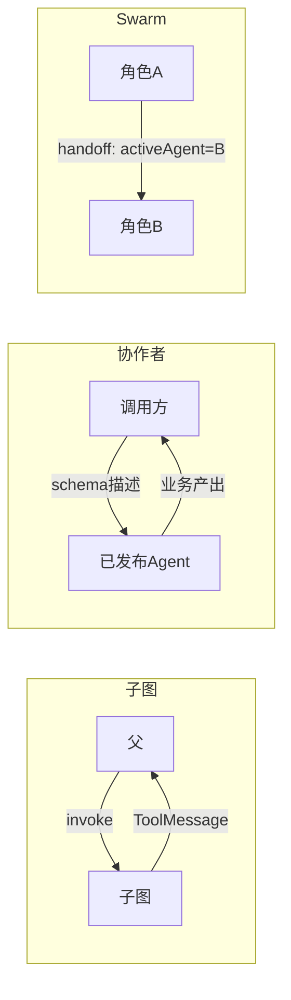

##### 常见误区

1. **"按复杂度选形态"**：按"结果/控制权"。
2. **"子图能当 Swarm 用"**：子图要回传，不会交出去就不回来。
3. **"人工交接能无限链"**：需终止条件。
4. **"任意 Agent 都能交接"**：只能转给图里连了 agent 关系的伙伴。

#### 课 10：持久执行

> 所属：阶段 3：执行与协作 ｜ [课全文](stages/3-执行与协作/lessons/10-持久执行.md)

> 定位：阶段 3《执行与协作》｜ 水平：进阶 ｜ 本课知识点：checkpoint、interrupt 等人工、为什么不轮询、取消与终态
> 故事情节：主角遇到第一个"人不在场"的场景——需要审批。它能停下来等，而且不占任何资源。
> 配应用实战：[实战 10：审批不丢状态](应用实战/10-审批不丢状态.md)
> 📖 结论已按官方文档核对（核对于 2026-11 ｜ 来源：[LangGraph 中断](https://docs.langchain.com/oss/javascript/langgraph/interrupts)、[持久化](https://docs.langchain.com/oss/javascript/langgraph/persistence)、[持久执行](https://docs.langchain.com/oss/javascript/langgraph/durable-execution)）
> 核对要点三条（课文已据此表述）：(1) 恢复时被中断节点**从头重跑**，interrupt 之前的副作用必须幂等；(2) 同节点多次 interrupt 的恢复值**按索引匹配**，调用顺序不可变；(3) `new Command({ resume })` 是**唯一**可作为 invoke 输入的 Command 形式（`Command({ update })` 用作输入会从最新 checkpoint 续跑而非重开）。

##### 本课目标

- 说清 thread 与 checkpoint 的命名空间关系
- 说清 `interrupt` 抛出与恢复的完整路径
- 用资源账算清轮询的代价，解释为何必须挂起
- 说清协作式取消与终态幂等

##### 入口要素：本质与处境

> 📌 **一句话本质**：持久执行 = 把"执行到哪了"变成一个**可持久化、可恢复的数据结构**，于是等待不再占用任何运行时资源，进程重启也不丢进度。

> ⚖️ **处境对照**：不这么做 → 等待期间占 worker、重启丢进度、审批结果无处落；这么做 → 零资源等待、重启续跑、审批结果有明确落点。

##### 一眼全局图

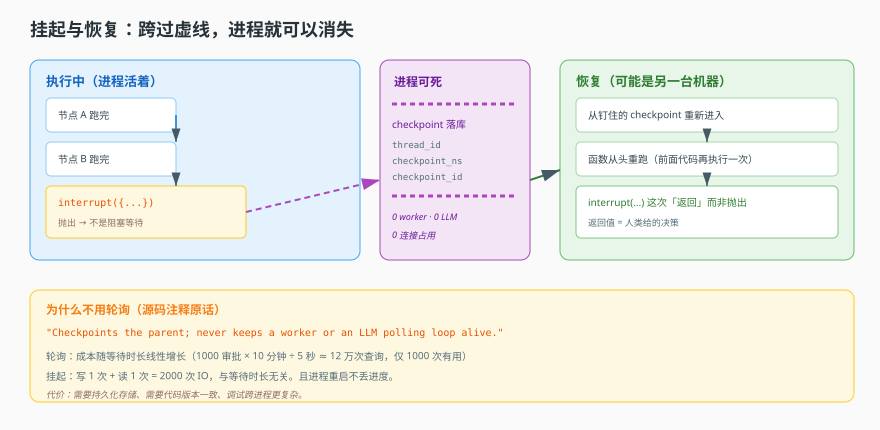

> 看图：左边是执行中的图跑到一半，在某个节点调用了 `interrupt`（一个"抛出"的动作）；中间这条虚线是"进程可以死掉"的边界，checkpoint 已落库；右边是恢复时从那个 checkpoint 重新进入，`interrupt` 的返回值变成"人类给的决策"。整张图的重点是中间那条线：**跨过它，进程的存在不再被需要**。

##### 本课地图

| 步 | 这一步要解决什么（人话） | 对应知识点 |
|:--:|--------------------------|-----------|
| 1 | "执行到哪了"这份状态长什么样、存在哪 | 知识点 1：checkpoint |
| 2 | 怎么停下来、怎么被恢复、恢复时拿到什么 | 知识点 2：interrupt 等人工 |
| 3 | 为什么不能用轮询等 | 知识点 3：为什么不轮询 |
| 4 | 用户中途取消怎么办、怎么保证不重复 | 知识点 4：取消与终态 |

##### 知识点结论（每点一句）

| 知识点 | 一句话记住 |
|---|---|
| 1：checkpoint | 三层定位、钉住锚点、从锚点续跑。 |
| 2：interrupt 等人工 | 抛出去不阻塞、恢复要重跑、答案必须对上问题编号。 |
| 3：为什么不轮询 | 轮询成本随等待时长线性涨；挂起用一次持久化换零占用。 |
| 4：取消与终态 | 取消靠广播不靠强杀、终态三取一、重复取消静默通过。 |

##### 收束结论

持久执行把"执行到哪"变成可持久化的数据：三层定位的 checkpoint、抛出去不阻塞的 interrupt、成本与等待时长无关的挂起、广播式幂等取消。

> 📍 **全局定位**：这是"生产级"与"demo 级"的分界线。
> 🔗 **下一步**：能停下来等人，下一步就是**让人真正介入**——不只是"批不批"，而是"修改参数再继续"（课 11/12 会展开控制权相关机制）。

##### 一图总结

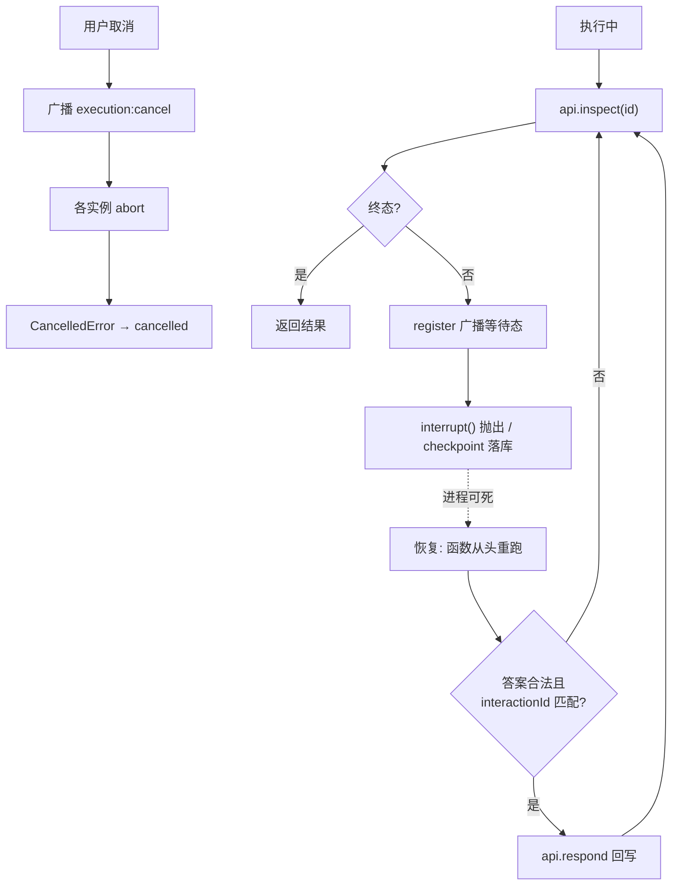

##### 常见误区

1. **"一个会话一个 checkpoint"**：三层命名空间，子图各有。
2. **"interrupt 阻塞等待"**：抛出，进程可死。
3. **"恢复从 interrupt 那行继续"**：函数从头重跑。
4. **"sleep 不占资源"**：worker 槽位不释放。
5. **"取消要清 checkpoint"**：审计与回放需要，不能删。

#### 课 11：调用运行时

> 所属：阶段 3：执行与协作 ｜ [课全文](stages/3-执行与协作/lessons/11-调用运行时.md)

> 定位：阶段 3《执行与协作》｜ 水平：进阶 ｜ 本课知识点：Invocation 生命周期、授权与幂等、执行账本、用量与预算
> 故事情节：主角跑了很多次。平台需要回答三个问题：谁发起的、跑到哪了、花了多少。
> 📖 结论已按官方文档核对（核对于 2026-11 ｜ 来源：[LangGraph 持久化](https://docs.langchain.com/oss/javascript/langgraph/persistence)、[Checkpointer 接口](https://docs.langchain.com/oss/javascript/langgraph/checkpointers)）
> 说明：本课的「账本三面」「幂等双分支」「fail-closed 预算」属平台自建能力，官方文档只覆盖 checkpoint 落盘那一层；其余为工程归纳，已按通用实践核查。

##### 本课目标

- 画出 Invocation 状态机并说出合法迁移
- 说清 `callId` 如何防止重复执行
- 说清账本面三个只读面各自的用途边界
- 说出 token 采集点位置与预算护栏应放在哪

##### 入口要素：本质与处境

> 📌 **一句话本质**：调用运行时把"一次 Agent 调用"当成一个有生命周期、有身份、有账目的资源来管理，而不是一个副作用随机的函数调用。

> ⚖️ **处境对照**：不这么做 → 重试翻倍计费、预算失控、出问题查不出是谁调的；这么做 → 有幂等键、有状态机、有账本、有闸门。

##### 一眼全局图

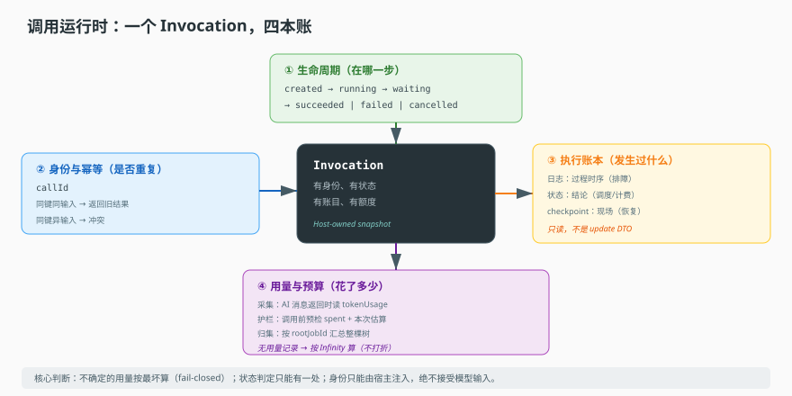

> 看图：中间是 Invocation 实体，四方向是四方信息——状态（在哪一步）、身份与幂等键（是不是重复）、账本（发生过什么）、用量（花了多少）。四方构成"可观测、可计费、可追责"。

##### 本课地图

| 步 | 这一步要解决什么（人话） | 对应知识点 |
|:--:|--------------------------|-----------|
| 1 | 一次调用有哪些状态、什么迁移合法 | 知识点 1：Invocation 生命周期 |
| 2 | 怎么保证"同一个请求不跑两遍" | 知识点 2：授权与幂等 |
| 3 | 出问题时去哪查"发生了什么" | 知识点 3：执行账本 |
| 4 | 花了多少、什么时候该拦 | 知识点 4：用量与预算 |

##### 知识点结论（每点一句）

| 知识点 | 一句话记住 |
|---|---|
| 1：Invocation 生命周期 | 终态三取一、`unknown` 非终态但别再等、判定只能有一处。 |
| 2：授权与幂等 | 同键同输入→返回旧结果；同键异输入→冲突；身份只由宿主注入。 |
| 3：执行账本 | 日志讲故事、状态说结论、checkpoint 存现场；读模型与写模型分开。 |
| 4：用量与预算 | AI 消息采集、调用前预检、无记录按最坏算、硬中断、按 root 归集。 |

##### 收束结论

调用运行时把一次 Agent 调用包装成有身份、有状态、有账目、有额度的实体：状态机给结论、幂等键防重复、账本三面分工、用量采集加预算硬拦。

> 📍 **全局定位**：前几课讲"怎么跑对"，这一课讲"怎么知道它跑得对、跑几次、花多少"。没有它，前面全是黑盒。
> 🔗 **下一步**：自家系统可控了，把视角推到边界之外——能力来自不可控的外部服务的场景（课 12）。

##### 一图总结

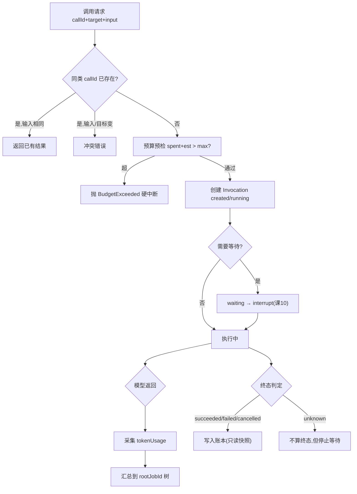

##### 常见误区

1. **"unknown 是终态"**：不是，但"别再等"。
2. **"幂等是重复请求报错"**：返回第一次结果。
3. **"状态谁都能改"**：账本只读，否则失去证据价值。
4. **"没用量记录等于免费"**：按最坏算，否则漏账。
5. **"超预算提示模型省"**：必须硬中断。

#### 课 12：MCP外部能力接入

> 所属：阶段 3：执行与协作 ｜ [课全文](stages/3-执行与协作/lessons/12-MCP外部能力接入.md)

> 定位：阶段 3《执行与协作》｜ 水平：进阶 ｜ 本课知识点：MCP 为什么是协议而非 SDK、能力发现与降级、elicitation 反向请求、长任务与工具过滤
> 故事情节：主角要用的能力不在自己家里。它第一次伸手去够外面的世界，发现"外面"既不可控也不可靠。
> 📖 结论已按官方文档核对（核对于 2026-11 ｜ 来源：[MCP 规范](https://modelcontextprotocol.io/specification/2025-06-18)、[MCP 架构](https://modelcontextprotocol.io/docs/learn/architecture)）

##### 本课目标

- 说清 MCP 与"写个 SDK 调远程 API"的本质区别，以及这个区别带来的工程后果
- 说清能力发现为何必须能容忍部分失败，以及降级后系统应该怎么表现
- 说清 MCP 的 elicitation 为什么是"反向请求"，它与课 10 的 interrupt 有何不同
- 说清长任务提交、工具过滤在多工具场景下各自防住了什么

##### 入口要素：本质与处境

> 📌 **一句话本质**：接一个不是自己实现的系统，核心能力是**防御**——假设对方不读你的心智，也不永远可靠，做好发现、降级、反向请求、过滤四件事。

> ⚖️ **处境对照**：不防御 → 一个工具坏了拖垮整个调用；对方要你转达问题时无从下手；几十个工具全塞给模型，模型挑花眼。

##### 一眼全局图

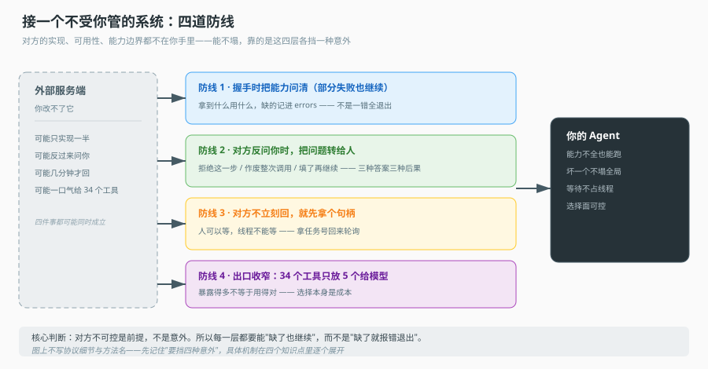

> 看图：左边是你改不了的外部服务端，右边是只拿了有限信息的你的 Agent，中间四道横杠就是这一课的四个知识点，各挡一种意外——问能力（缺了也继续）、代问人（对方反过来求你）、拿句柄（对方不立刻回）、收出口（对方给太多）。整张图的要点：**对方不可控是前提，不是意外**。

##### 本课地图

| 步 | 这一步要解决什么（人话） | 对应知识点 |
|:--:|--------------------------|-----------|
| 1 | MCP 与 SDK 的本质区别、带来的后果 | 知识点 1：协议/传输/代价 |
| 2 | 连上后怎么知道对方有啥、坏了怎么办 | 知识点 2：能力发现与降级 |
| 3 | 对方反过来"让我的用户做点事"怎么办 | 知识点 3：elicitation 反向请求 |
| 4 | 对方慢、且给一堆工具，怎么管 | 知识点 4：长任务与工具过滤 |

##### 知识点结论（每点一句）

| 知识点 | 一句话记住 |
|---|---|
| 1：MCP 是协议而非 SDK | 协议两端独立演进、传输可换、消费方要防御。 |
| 2：能力发现与降级 | 逐类探测、独立容错、有什么用什么、缺的进 errors。 |
| 3：elicitation 反向请求 | 反向请求、两种形态、三态结果（accept/decline/cancel）、与 interrupt 不同。 |
| 4：长任务与工具过滤 | 慢的任务拿句柄间隔查；多的工具按白名单裁；判据看等待对象可不可控。 |

##### 收束结论

借一个不可控的外部能力，靠的不是"对方靠谱"，而是四道防御：协议协商不预设信任、能力发现容忍部分失败、反向请求能正确转达与带回、长任务与工具数量被主动管理。

> 📍 **全局定位**：到这里，阶段 3 的"协作"才完整——从单 Agent 内部，到多 Agent 之间，到跨系统边界。
> 🔗 **下一步**：进入阶段 4《判断力》。

##### 一图总结

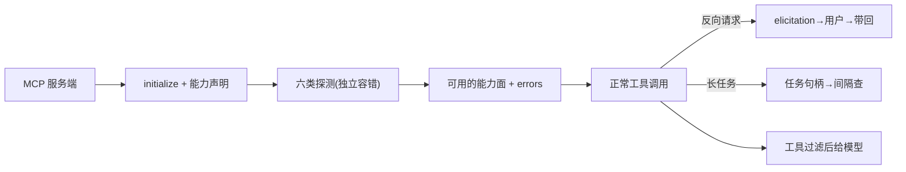

##### 常见误区

1. **"MCP 就是 RPC 封装"**：是协议，两端独立演进、会话协商。
2. **"一类能力坏就整体退出"**：应隔离、降级、记录。
3. **"decline 与 cancel 等价"**：一个拒绝一步、一个作废整单。
4. **"等外部任务也不能轮询"**：对象是服务端任务可查，与人不同。
5. **"工具全塞更好"**：多则质量降、token 涨，是正确性问题。

### 阶段 4：判断力（课 13-15）

> [阶段概览](stages/4-判断力/overview.md)

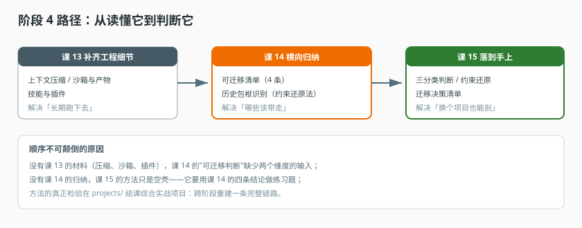


#### 课 13：成本与上下文

> 所属：阶段 4：判断力 ｜ [课全文](stages/4-判断力/lessons/13-成本与上下文.md)

> 定位：阶段 4《判断力》｜ 水平：进阶 ｜ 本课知识点：上下文压缩、沙箱与产物、技能与插件
> 故事情节：主角跑得久了，上下文越来越长、产物越来越多。这一课看系统如何给自己"减肥"。
> 📖 结论已按官方文档核对（核对于 2026-11 ｜ 来源：[LangChain 上下文工程](https://docs.langchain.com/oss/javascript/langchain/context-engineering)、[LangChain 短期记忆](https://docs.langchain.com/oss/javascript/langchain/short-term-memory)）

##### 本课目标

- 说出上下文压缩的触发时机、三种策略各自的代价，以及"哪些内容绝对不能压"
- 说清沙箱的三层隔离边界，以及产物回收为什么必须有"启动时清扫"
- 用一条判据区分"该做成技能"还是"该做成插件"，并说清两者的版本兼容策略

##### 入口要素：本质与处境

> 📌 **一句话本质**：Agent 跑得越久，"记住的东西"和"留下的东西"都会线性增长，而系统必须把它们约束在有界范围内——一个管内存里的上下文，一个管磁盘上的产物。

> ⚖️ **处境对照**：不这么做 → 要么撞上窗口上限直接报错，要么为了不报错而静默丢失关键信息，要么磁盘被残留文件吃满；这么做 → 上下文与产物都有明确上限，且"丢了什么"可查。

##### 一眼全局图

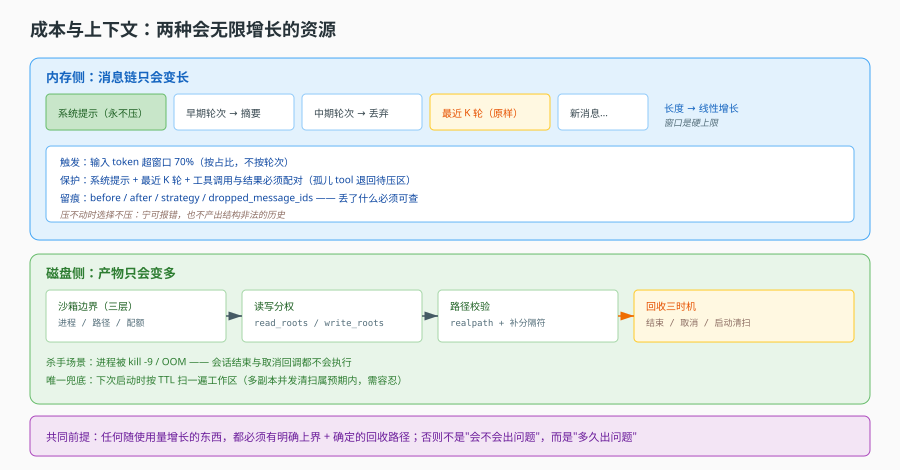

> 看图：上半部分是上下文（一条会不断变长的消息链），压缩在"快到窗口上限"时把它折叠成"摘要 + 保留段"；下半部分是沙箱（一个受限目录），产物在任务结束时被回收，异常残留由启动清扫兜底。两者是同一个问题在两种资源上的投影。

##### 本课地图

| 步 | 这一步要解决什么（人话） | 对应知识点 |
|:--:|--------------------------|-----------|
| 1 | 上下文快满了怎么办，丢了什么要能说清 | 知识点 1：上下文压缩 |
| 2 | Agent 能碰哪些文件，产物什么时候清 | 知识点 2：沙箱与产物 |
| 3 | 新能力该做成"配置"还是"代码" | 知识点 3：技能与插件 |

##### 知识点结论（每点一句）

| 知识点 | 一句话记住 |
|---|---|
| 1：上下文压缩 | 按占比触发、配轮次兜底；保系统提示与最近轮、配对不拆；压不动就不压，压过必须留痕。 |
| 2：沙箱与产物 | 进程、路径、配额三层齐；读写分权、realpath 归一、末尾补分隔符；三个回收时机里，启动清扫是唯一能救崩溃残留的。 |
| 3：技能与插件 | 改数据是技能、改逻辑是插件；技能只加字段不删不改，插件声明契约版本、加载失败要降级并可见。 |

##### 收束结论

这一课讲的是"长期运行"的三个约束：内存有界（压缩）、磁盘有界（沙箱与回收）、扩展有界（技能与插件）。它们共同的前提是——**任何会随使用量增长的东西，都必须有一个明确的上界和回收路径**。

> 📍 **全局定位**：前 12 课讲怎么把事做成，这一课讲怎么长期做下去。它也是阶段 4 的起点：从这里开始，"该怎么设计"逐渐取代"它是怎么实现的"。
> 🔗 **下一步**：课 14 会把前三阶段的设计横向摊开，逐条判断哪些能带走、哪些只属于这里。

##### 一图总结

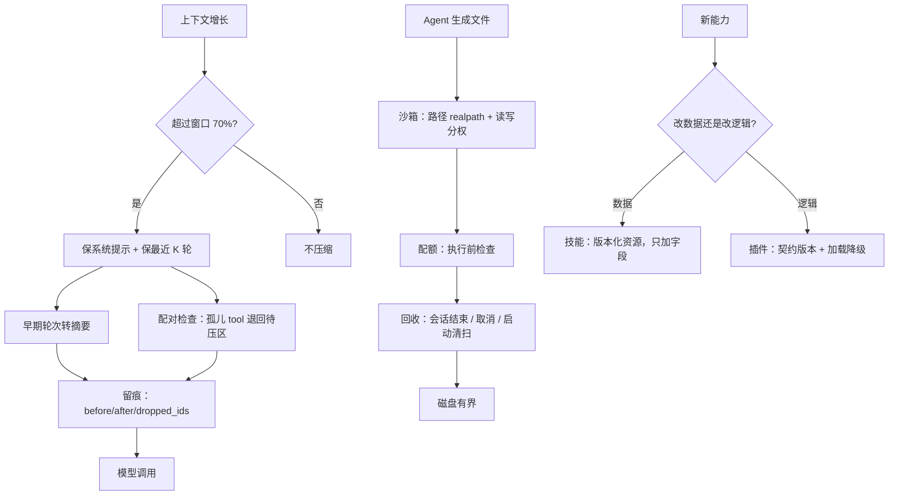

> 课首图是"两个资源各一条链"；此图是"三条上界机制 + 各自的兜底分支"。

##### 常见误区

1. **"压缩等于截断"**：截断最容易切断工具配对。
2. **"按轮次触发压缩"**：轮次与 token 不成正比，必须按占比并配兜底。
3. **"压完不用记录"**：没有丢弃清单，失忆类投诉无法定位。
4. **"有容器就有沙箱"**：路径与配额仍需自己做。
5. **"任务结束会清理就够了"**：强杀场景只能靠启动清扫。
6. **"技能可以带脚本"**：会让技能退化成部署单元。
7. **"插件加载失败就应启动失败"**：应降级 + 暴露失败清单。

#### 课 14：设计判断力

> 所属：阶段 4：判断力 ｜ [课全文](stages/4-判断力/lessons/14-设计判断力.md)

> 定位：阶段 4《判断力》｜ 水平：进阶 ｜ 本课知识点：可迁移清单、历史包袱识别、可测试性
> 故事情节：主角走完全程，回过头问：这一路哪些该带走，哪些只属于这里？
> 📖 官方文档核对：本课为设计判断方法论（迁移信号 / 约束还原 / 可测试性），**无可对照的官方规范**，按闸门规则属豁免项；文中涉及的框架能力事实已按 [LangGraph Graph API](https://docs.langchain.com/oss/javascript/langgraph/graph-api) 核对（核对于 2026-11），判断结论为方法论归纳，**置信度：中**（依赖具体项目约束，不可直接套用）。

##### 本课目标

- 列出四条可迁移设计，并为每条说出适用条件与**必须付的代价**
- 用"约束还原法"解释一段旧代码为何长成那样，而不是简单判优劣
- 说清测试在架构判断中的两个用途：反推行为、固化不变量

##### 入口要素：本质与处境

> 📌 **一句话本质**：可迁移的不是"代码结构"，而是"问题与约束的对应关系"。脱离约束谈架构，学得越多，错得越狠。

> ⚖️ **处境对照**：不这么做 → 把每一条设计都当最佳实践照搬，用框架复杂度换掉业务进度；这么做 → 每条设计先问三个问题（解决什么通用问题、依赖什么约束、代价是什么），通过的才迁移。

##### 一眼全局图

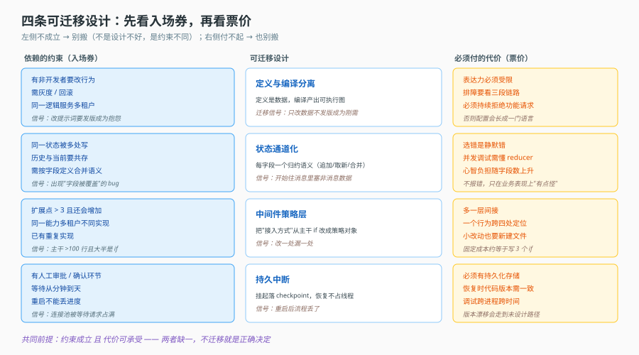

> 看图：中间四条是可迁移设计，左边是它们各自依赖的约束（不成立就别搬），右边是各自必须付的代价（付不起也别搬）。判断一次要同时看左右两侧——只看左边会高估，只看右边会低估。

##### 本课地图

| 步 | 这一步要解决什么（人话） | 对应知识点 |
|:--:|--------------------------|-----------|
| 1 | 哪四条值得带走，各自的入场券和票价是什么 | 知识点 1：可迁移清单 |
| 2 | 一段"看着奇怪"的代码，怎么读出它当时的处境 | 知识点 2：历史包袱识别 |
| 3 | 测试除了防 bug，还能怎么帮你判断架构 | 知识点 3：可测试性 |

##### 知识点结论（每点一句）

| 知识点 | 一句话记住 |
|---|---|
| 1：可迁移清单 | 四条设计各有入场券与票价：定义分离要"多人改行为"、通道化要"多路写"、策略层要"扩展点>3"、持久中断要"人等不起"；条件不成立或代价付不起，都是不迁移的正当理由。 |
| 2：历史包袱识别 | 先查版本再下结论；"作者没想到"可以重构，"当时做不到"只能等约束变化；结论要给出触发条件，而不是一句"过时了"。 |
| 3：可测试性 | 纯函数多写、装配中等、端到端最少；测试名即规格、不变量注释配测试；测不出来先改结构，别先怪测试难写。 |

##### 收束结论

这一课做了三件事：给出四条可迁移设计的入场券与票价；给出读懂旧代码的方法（约束还原）；给出把判断固化的手段（测试）。三者合起来是一句话——**判断的依据是可观测的现状与可查证的证据，不是"这样更专业"**。

> 📍 **全局定位**：这是全课程的"横向收口"。前 13 课纵向拆解一套系统，这一课把它横过来，逐条问"这条能不能带走"。
> 🔗 **下一步**：课 15 把这三件事整理成一套固定流程（三分类判断法 + 约束还原四步 + 迁移决策清单），让你换一个陌生项目也能照做。

##### 一图总结

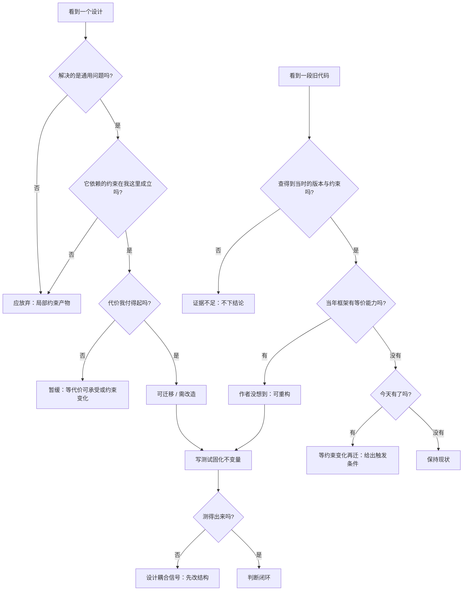

> 课首图是"四条设计的条件/代价对照"；此图是"两套判断流程"：左支判该不该迁移，右支判旧代码该不该动。

##### 常见误区

1. **"好设计就该用"**：每条都有入场券与票价。
2. **"可迁移等于通用"**：四条全是条件适用。
3. **"用了旧 API 就是技术债"**：可能当年只有那个 API。
4. **"结论是该不该重写"**：应是"迁移的触发条件是什么"。
5. **"测试只防回归"**：它还是行为文档与架构探针。
6. **"测不出来就先不测"**：测不出来是重构信号。

#### 课 15：把判断变成可复现的方法

> 所属：阶段 4：判断力 ｜ [课全文](stages/4-判断力/lessons/15-把判断变成可复现的方法.md)

> 定位：阶段 4《判断力》｜ 水平：进阶 ｜ 本课知识点：三分类判断法、约束还原法的操作步骤、迁移决策清单
> 故事情节：主角走完全程，最后要学会的不是"记住这套架构"，而是"换一个陌生项目，也能这样剖开它"。
> 📖 官方文档核对：本课为方法论收口（三分类 / 约束还原 / 迁移清单），**无官方规范可对照**，属闸门豁免项；流程中的校验规则（证据门禁、触发条件必填）为本课程自定义，已在 `verify/verify-run.ts` 实测（核对于 2026-11）。

##### 本课目标

- 掌握一套可复用的判断流程：拿到陌生 Agent 系统 → 画出骨架 → 逐层判定可迁移性
- 能用约束还原法解释任意一段"看起来奇怪"的代码，而不是凭直觉判优劣
- 完成一份迁移决策清单，为自己的项目产出"采纳 / 改造 / 放弃"三分类结论

> 本课是阶段 4 的方法论收口课。真正的工程级演练在 [projects/](projects/) 的结课综合实战项目中，那是一次跨阶段的完整重建，不是本课的延伸练习。

##### 入口要素：本质与处境

> 📌 **一句话本质**：方法的价值在于——让你面对陌生系统时，步骤是固定的、证据是查得到的、结论是可复核的。判断不再依赖"我见没见过这种写法"。

> ⚖️ **处境对照**：不这么做 → 靠观感下结论，好坏全凭当日状态与见闻；这么做 → 每步都有产出（骨架 / 分类 / 清单），每一步都能被另一个人复核。

##### 一眼全局图

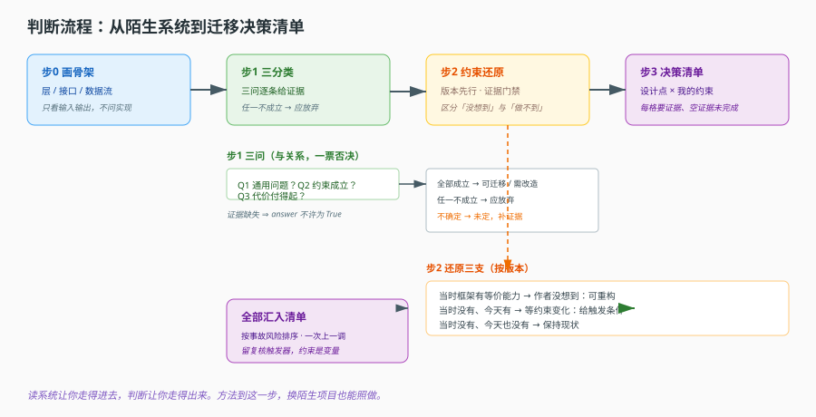

> 看图：整个流程是一条流水线——画骨架 → 逐层三分类 → 对号入座做迁移决策 → 产出带优先级与判据的清单。每一步的输出都是下一步的输入，没有人能跳步。

##### 本课地图

| 步 | 这一步要解决什么（人话） | 对应知识点 |
|:--:|--------------------------|-----------|
| 1 | 面对陌生系统，先画一张什么样的骨架 | 知识点 1：三分类判断法前置 —— 画骨架 |
| 2 | 每个设计点用哪三个问题判定 | 知识点 1：三分类判断法 |
| 3 | 一段奇怪代码，四步还原它当时的处境 | 知识点 2：约束还原法 |
| 4 | 把所有结论落成一张可执行的清单 | 知识点 3：迁移决策清单 |

##### 知识点结论（每点一句）

| 知识点 | 一句话记住 |
|---|---|
| 1：三分类判断法 | 先画骨架锚定层，三问逐条给证据，任一不成立即放弃；三问全过再看"照用还是改造"。 |
| 2：约束还原法的操作步骤 | 版本先行、证据门禁；"做不到"要等约束变化，"没想到"才可重构；结论给触发条件，不给情绪。 |
| 3：迁移决策清单 | 清单每格要证据、空证据等于没做完；先事故后优化、一次上一调；不迁移也是合法且可写进清单的结论。 |

##### 收束结论

四课加起来是一条完整的方法链：

- 阶段 1–3 给你**纵向**能力：看懂任意一个 Agent 系统怎么被定义、编译、执行。
- 课 13 补两块工程细节（上下文、沙箱、扩展）。
- 课 14 给**横向**判据：四条最可迁移的设计，各自的入场券与票价。
- 课 15 把判据装配成流程：骨架 → 三分类 → 还原 → 清单。

一句话收束：**读系统的能力让你走得进去，判断的能力让你走得出来**。前者是"它是什么"，后者是"我该怎么办"。两样都到，才算真正解剖完一个系统。

> 📍 **全局定位**：这是《Agent 工程解剖》的最后一课，也是唯一一门"只给方法、不引新机制"的课。方法的真正检验在 `projects/` 结课综合实战——那里你要用本文一切，重建一条从定义到中断恢复的最小链路。
> 🔗 **下一步**：前往 [结课综合实战项目](projects/数据库变更审批助手/README.md)，用 16 个知识点的地图，把本课程的能力落成一段真正能跑的代码。

##### 一图总结

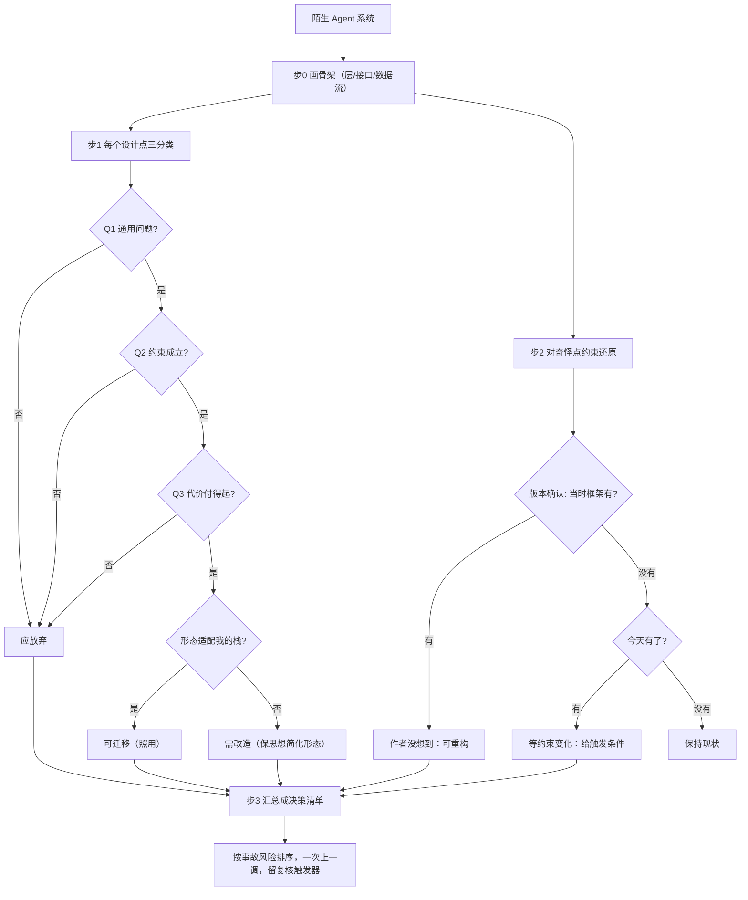

> 课首图是"四步流水线"；此图是"每步内部的分支"——三问一票否决、还原按版本分三支、全部汇入清单。

##### 常见误区

1. **"先看细节再判断"**：先画骨架，信息才不淹没结构。
2. **"主流模式就可迁移"**：主流≠匹配，要看约束。
3. **"三问大概感觉一下"**：每问都要证据，证据缺失即未完成。
4. **"两个成立就能搬"**：三问是与关系，一票否决。
5. **"结论是过时/先进"**：结论要给触发条件。
6. **"一次全采纳"**：一次一条，验证再上。
7. **"不迁移就是白学"**：能判断不抄正是掌握。

---

## 五、结课综合实战项目：数据库变更审批助手

> 完整材料：[projects/数据库变更审批助手/README.md](./projects/数据库变更审批助手/README.md) ｜ 可运行实现：[实现/README.md](./projects/数据库变更审批助手/实现/README.md)

### 需求

一句话：**给"改生产库表结构"这件事装一个 AI 助手——它生成变更方案、判断风险、危险操作必须等人批，人不在时进程可以退出，人回来接着跑。**

目标不是做一个能跑的 demo，而是把前三个阶段拆开讲的骨架**焊在一起**：定义面写声明、编译面出图、执行面守边界、账本面记账，缺一个就不成立。

### 覆盖知识点地图（跨 4 阶段，直连 16 个）

| 知识点 | 阶段 / 课 | 在项目里落在哪 |
|---|---|---|
| 定义即数据 | 阶段 2 · 课 4 | `src/definition/agent-definition.ts` |
| 两级校验（结构 + 语义） | 阶段 2 · 课 4 | 同上，`validate()` |
| 钩子变节点 | 阶段 2 · 课 5 | `src/compile/compiler.ts` |
| 编译期纯函数 | 阶段 2 · 课 5 | 同上，无 IO |
| 通道归约语义 | 阶段 2 · 课 6 | `plan` / `approval` 两个通道 |
| 取新型通道的正确用法 | 阶段 2 · 课 6 | `approval` 只留最后一次决策 |
| 策略洋葱 | 阶段 2 · 课 7 | `src/execute/tools.ts` 的包装顺序 |
| 中间件层拦越权 | 阶段 2 · 课 7 | 执行前拒绝，执行器未被调用 |
| 执行器内部再校验 | 阶段 3 · 课 8 | `executeSql` 内部过闸 |
| 并行 + 按 id 回填 | 阶段 3 · 课 8 | 多工具调用结果不错位 |
| 子图 vs Swarm 判据 | 阶段 3 · 课 9 | 选子图（要拿回结果） |
| checkpoint 挂起 | 阶段 3 · 课 10 | `FileSaver` 落盘 |
| interrupt 等人工 | 阶段 3 · 课 10 | `approve` 节点 |
| 挂起态判据 | 阶段 3 · 课 10 | `getState().next` 非空 |
| 幂等与账本 | 阶段 3 · 课 11 | `src/account/runtime.ts` |
| 沙箱路径边界 | 阶段 4 · 课 13 | 产物写入限定目录 |

### 设计决策摘要（两个真权衡点）

**决策 1：等审批用 interrupt 挂起，而不是轮询。** 候选是"起个循环查审批表"与"checkpoint + interrupt"。选后者：进程可以退出，人回来用 `new Command({ resume })` 接着跑；代价是要接受"被中断节点从头重跑"，因此 `interrupt` 之前不能有不可重入的副作用（项目里把"写审计日志"挪到了 interrupt 之后）。什么时候该改选：审批延迟在秒级、且执行器本身很轻，轮询的复杂度更低。

**决策 2：工具统一 provider，而不是逐工具定义。** 候选是"每个工具写一份 schema + 实现"与"一个 provider 统一产出"。选后者：授权按集合做（`grantedTools`），暴露按集合裁剪，执行再按集合校验——三处口径一致。代价是 provider 层要做类型擦除，单个工具的强类型提示会弱一些。什么时候该改选：工具总数少于 5 个、且参数结构差异极大时，逐工具定义反而更清楚。

### 反例对照

项目里给了"看起来能跑但其实很糟"的版本与逐条对比（≥3 条差异，每条说清为什么糟）：把审批写成 `await sleep(60_000)` 轮询、把租户 ID 塞进状态、把权限判断只放在中间件层。详见 [反例对照.md](./projects/数据库变更审批助手/反例对照.md)。

### 怎么跑

```bash
cd projects/数据库变更审批助手/实现
npm install
npx tsx verify.ts    # 10 项静态断言
npx tsx verify2.ts   # A/B/C/D 四个场景，含"挂起 → 进程退出 → 新进程恢复"
```

实测输出（Node v22.22.2 / `@langchain/langgraph` 1.6.0）已写入 [实现/README.md](./projects/数据库变更审批助手/实现/README.md)，可自行复现。

### 验收清单

见 [验收清单.md](./projects/数据库变更审批助手/验收清单.md)，逐项可勾选。核心三条：挂起后 `getState().next` 非空 ｜ 新进程能 resume 且不重复执行已完成的节点 ｜ 越权调用在执行器内部被拒且账本留痕。

---

## 六、应用实战

5 篇，每篇是一次"从幼稚到像样"的演进，跟着走一遍能把该课知识点焊进真实用法。一键入口：[应用实战/INDEX.md](./应用实战/INDEX.md)。

| 课 | 实战 | 场景 | 演进两跳 |
|---|---|---|---|
| 课 4 | [实战 04](./应用实战/04-把硬编码Agent改成配置驱动.md) | 把硬编码 Agent 改成配置驱动 | 硬编码 → 新增 Agent 要改代码 → 定义即数据 |
| 课 6 | [实战 06](./应用实战/06-从单一messages到通道化状态.md) | 单一 messages 改通道化 | 混装一个字段 → 压缩/摘要互相踩 → 分通道 |
| 课 7 | [实战 07](./应用实战/07-把if判断抽成中间件策略.md) | if 判断改中间件 | 散落 if → 改一处漏一处 → 策略层 |
| 课 9 | [实战 09](./应用实战/09-从单Agent到主管工人.md) | 单 Agent 改主管-工人 | 单 Agent 塞满工具 → 上下文爆炸 → 委派 |
| 课 10 | [实战 10](./应用实战/10-审批不丢状态.md) | 审批不丢状态 | 内存等 → 重启丢失 → checkpoint + interrupt |

> 不配实战的课（课 1/2/3/5/8/11/12/13/14/15）不是缺漏：按判定规则，**不配是常态**。理由逐条写在 [00-学习档案.md](./00-学习档案.md) 的「应用实战判定」段。

---

## 七、可执行基座：怎么自己复现

课文里每一段"实测输出"都来自课程自带的机制实验工程，不需要克隆任何外部仓库。

```bash
cd verify
npm install
npm run check   # tsc --noEmit
npm run core    # 课 4 / 5 / 6 / 7 + 课 10 的 interrupt 形状
npm run run     # 课 8 / 9 / 11 / 12 / 13 / 15
npx tsx verify-map.ts   # 课 2 / 3 / 14
```

| 项 | 值 |
|---|---|
| 运行时 | Node 22（实测 22.22.2） |
| 依赖 | `@langchain/langgraph` 1.6.0 / `@langchain/core` 1.3.2 / `zod` 4 |
| 覆盖 | 三脚本 14 段，覆盖 15 课的核心断言 |
| 模型 | 用桩模型（真模型输出每次都不同，无法作为可复现证据——这一点在 `verify/README.md` 里写明） |

> 没有实测的地方一律标 `⚠️ 未实测（原因）`，不假装跑过。这条纪律也适用于本手册：手册里没有新增任何未实测的数据。

---

## 八、收口：这套东西怎么用在你自己的项目上

三条从课 14 / 课 15 提炼的可操作路径：

1. **拿到陌生 Agent 代码库**：先画骨架（四层 + 依赖方向），再用四条起手式定位（契约名 / 测试反推 / 不变量注释 / 写入点反查），两小时内应该能指着图说出"改模型去哪、加工具去哪、查调用去哪"。
2. **看到一个写得奇怪的实现**：先做约束还原（版本先行 → 证据门禁 → "做不到"还是"没想到"），再决定是"照用 / 改造 / 放弃"。**"没想到"才可重构，"做不到"要等约束变化**。
3. **要给自己项目补骨架**：按"先事故后优化、一次上一调"排序，把结论落成带判据与触发条件的清单。**不迁移也是合法结论**，写进清单比硬上更有价值。

> 📍 全课程到此结束。想继续深入：`应用实战/` 练手 → `projects/` 做一遍完整重建 → 回到自己项目按上文三条路径实操。
