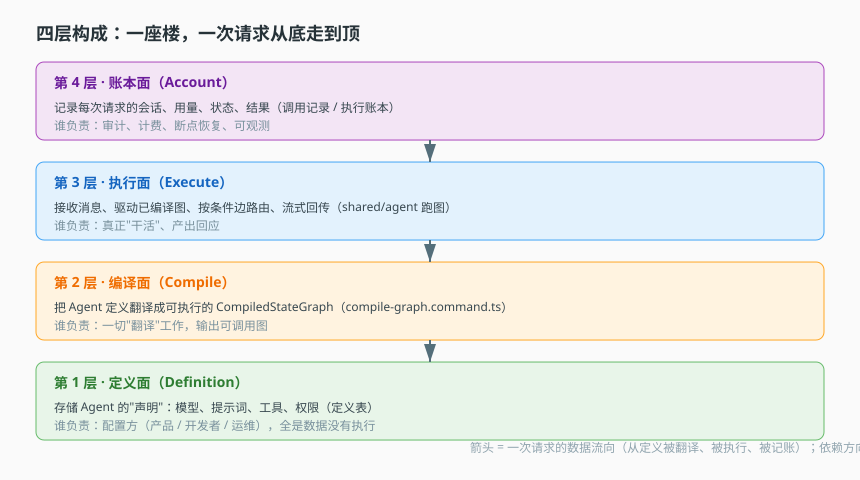
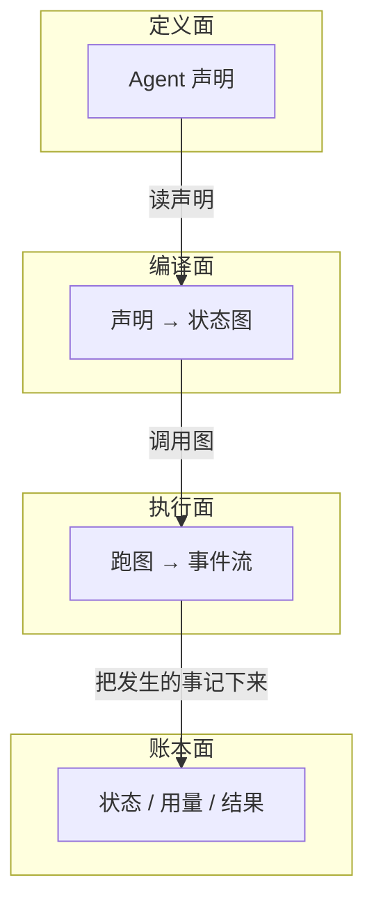
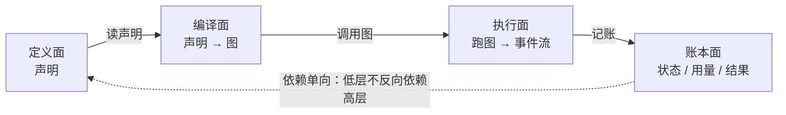

# 第 2 课：平台的四层构成

> 所属阶段：阶段 1《先有地图》｜ 水平：进阶 ｜ 本课知识点：四层职责划分、模块地图与依赖方向、大型代码库里定位实现
> 故事情节：主角（一次请求）还没出场，先拿到一张"这座城市的地图"——知道哪条街是干什么的。
> 📖 结论已按官方文档核对（核对于 2026-11 ｜ 来源：[LangGraph JS 文档](https://langchain-ai.github.io/langgraphjs/)、[LangChain JS Middleware](https://js.langchain.com/docs/concepts/middleware)）

## 🎯 本课目标

- 画出定义面 / 编译面 / 执行面 / 账本面四层职责图，说出每层的输入与输出
- 说清模块该往哪一层贴、依赖为什么必须单向，以及这条规则怎么被机器检查
- 掌握三条定位起手式，能在陌生大仓库里 5 分钟内找到任一 Agent 相关实现

## 🧑‍💻 前置知识速览

- **Agent**：一个能读消息、调模型、用工具、产出回复的程序实体（课 1 介绍过）。
- **配置驱动**：行为和参数写在数据里，代码只负责解释数据，而不是把每个 Agent 写死成一段代码。
- **有向无环图（DAG）**：模块 A 依赖 B、B 依赖 C，但不允许 C 绕回来依赖 A 的结构。

## 第一幕：起源与场景引入

> 🎬 **场景**：你接手一套跑了两年的 Agent 平台，最危险的动作是什么？

第一天上班，你打开代码仓库：七十多个模块目录、几十万行代码、近千个测试文件。

你现在的处境很具体：产品经理丢来一句话"把客服 Agent 换个模型，顺便加个权限——只能查订单，不能改订单。"你盯着编辑器，光标停在半空——从哪儿下手？

大多数人的第一反应是"从入口文件开始逐行读"。这条路的问题是：你会记住几千个细节，却依然回答不出"换个模型该改哪里"。

> 📌 **一句话本质**：本课把"一个看不懂的大仓库"变成"一张能看的地图"，让你从"哪里是哪里"开始，而不是从"这一行在干什么"开始。

> ⚖️ **处境对照**：不这么做 → 靠逐行读，三周后细节装满脑子但问题依旧答不上；这么做 → 先花半天建立分层索引，之后每次定位都"按图索骥"，几分钟锁定目标文件。

## 第二幕：认知冲突

> ❓ **问题**：为什么逐行读代码行不通，而"先分层"行得通？

因为三十万行的系统里，细节之间**没有归类**。人的工作记忆装不下三十万个细节，于是读了后面忘前面，读完还是不知道"改模型该动哪"。

而"四层"回答的是另一个问题——**"我要改的东西，属于哪个阶段？"** 一旦归类完成，搜索范围从三十万行缩到某个具体子集，问题就从"读代码"变成了"查目录"。

关键洞察：**分层的价值不在于把代码切成四块，而在于给"改动"提供一个坐标系**。你手上的每个需求，都能先被翻译成"这是定义面的改动还是执行面的改动"，再去对应的层里找。

## 第三幕：层层揭示

### 一眼全局图（进入细节前先看一眼）



> 看图：这是一座四层楼的房子。底层是"定义"，顶上是"账本"；一次请求从下往上走，每一层负责不同的事。本课先带你认识这四层分别"住着谁"。

### 本课地图（分几步走）

| 步 | 这一步要解决什么（人话） | 对应知识点 |
|:--:|------------------------|-----------|
| 1 | 先把四层各是什么、谁写谁读搞清楚 | 知识点 1：四层职责划分 |
| 2 | 再把几十个模块往这四层里贴，看依赖怎么流 | 知识点 2：模块地图与依赖方向 |
| 3 | 最后学会在大仓库里"按名字定位" | 知识点 3：大型代码库里定位实现 |

### 知识点 1：四层职责划分

> 🧭 第 1/3 步｜承接：第二幕"先分层再读" → 本步：建四层框架，回答"代码按什么分类"
> 本知识点关键点：四层的输入输出、为什么账本独立成层、四层是职能不是目录

- 关键点：定义面存什么、编译面产出什么、执行面跑什么、账本面记什么
- 关键点：每层的"契约"就是一个入口函数：输入是数据，输出也是数据
- 关键点：四层是"职能"不是"目录"——同一目录下可能同时住着两层
- 关键点：账本面必须独立成层，否则与执行面耦合

#### 一句话定义

四层是**职能上的分层**：定义（说清要什么）→ 编译（翻译成能跑的东西）→ 执行（真跑）→ 账本（记下发生了什么）。一个功能实际会横跨多个目录，但它"属于哪一层"由**它此刻在解决哪个阶段的问题**决定。

#### 直觉建立（类比）

想象一家餐厅的后厨：

- **定义（点单）**：顾客说"一份宫保鸡丁，不要花生"。菜谱记下这道菜长什么样、有什么约束。
- **编译（备菜）**：把"宫保鸡丁"翻译成后厨能执行的步骤清单——洗鸡丁、调酱汁、下锅顺序。
- **执行（炒菜）**：按步骤清单真正把菜做出来。
- **账本（结账）**：这桌点了什么、用了多少食材、最后结果怎样——记录一切、供复查。

> 💡 **类比的边界**：真实系统里"编译"和"执行"往往不是严格分开的两段时长（后面你会看到，平台在每次请求时都重新"翻译"），但**职责上可以且应该分开**——这是设计者刻意为之，防止"定义"和"运行"互相纠缠。

#### 核心原理

**四层的职责，可以各用一个"入口函数的签名"说清楚**。这是本课最重要的表达方式：只要你能写出这四层的输入输出，你就真的懂了分层。

```text
定义面：load(agent_id, version) -> Definition        读一份声明，产出声明本身
编译面：compile(definition)     -> Graph             吃声明，产出可执行图
执行面：run(graph, user_input)  -> Stream<Event>     吃图，产出事件流
账本面：record(execution_id, status, usage) -> void  吃结果，落库
```

四层串起来就是一条数据流水线：**声明 → 图 → 事件 → 记录**。注意每一层的手里都只有"上一层的产物"，它不需要知道上一层内部怎么想。

**第一层：定义面（Definition）**——存放"在说什么"。
存的是 Agent 的声明：用哪个模型、系统提示词、可用工具、权限、协作关系。**谁写**：配置方（产品 / 开发者 / 运维）。**它是什么**：一份份数据，不是可运行代码。关键特征：可以序列化成 JSON、可以存库、可以 diff、可以走版本。

**第二层：编译面（Compile）**——把定义翻译成可执行的东西。
吃一份声明，吐一张状态图（StateGraph）。**谁读**：执行面。**产物**：一个能 `.invoke()` 的图对象，绑定了检查点存储、中断点等运行配置。

**第三层：执行面（Execute）**——真正跑起来。
接收用户消息，驱动编译好的图，把消息追加进状态通道，按条件边路由，最终产出回应事件流。

**第四层：账本面（Account）**——记录与恢复。
记录每次请求的调用会话、用量、状态与结果，支撑查询、计费与断点恢复。



> 读图指引：箭头方向就是数据流向——声明被编译成图，图被执行，执行过程被记账。

**关键点：为什么"账本面"必须独立成层？** 如果把"记账"塞进执行面，执行代码每跑一步都要顺带写一次库，两者就耦合了：换账本存储、加审计、做计费，都得动执行代码。独立成层后，执行面只负责"跑"，账本面只负责"记"，各自演进互不干扰。

这也是一个更普遍的设计原则：**"做事"和"记录做事"分离**。合并它们的系统，最终一定会在某次"要加个审计字段"时被迫改到核心路径。

#### 示例演示

把四层写成四个接口，边界立刻清晰。注意每个接口只有**一个方法**，且参数和返回值都是纯数据——这是分层的具体标志：

```python
from dataclasses import dataclass
from typing import Protocol, Iterator

@dataclass
class Definition:
    """定义面的产物：纯数据，可存库、可 diff、可版本化"""
    key: str
    model: str
    prompt: str
    tools: list[str]
    permissions: dict

class DefinitionLayer(Protocol):
    def load(self, agent_key: str, version: str = "latest") -> Definition: ...

class CompileLayer(Protocol):
    # 吃声明，吐可执行图；不碰数据库、不发网络请求
    def compile(self, definition: Definition) -> "Graph": ...

class ExecuteLayer(Protocol):
    # 吃图与输入，吐事件流；不关心账本怎么存
    def run(self, graph: "Graph", user_input: dict) -> Iterator[dict]: ...

class AccountLayer(Protocol):
    # 吃事实，落库；不改执行行为
    def record(self, execution_id: str, status: str, usage: dict) -> None: ...
```

判断一段代码属于哪一层，看它的输入输出就够了。比如一个函数吃 `Definition` 吐 `Graph`，不管它在哪个目录，它都是编译面。

#### 常见误区

1. **"一个文件只属于一层"**：错。四层是职责不是目录。例如"把 A 定义翻译成一个内部子图"这段代码可能和"记录调用"放在同一个目录下，但前者是编译面、后者是账本面。判断一层，看它**此刻在解决什么问题**。
2. **"定义面里可以有逻辑"**：定义面只该有校验和取值，不该有"跑起来才生效"的行为。一旦定义面开始执行副作用，它就不再是数据了。

#### 一句话记住

四层 = 说清要什么 → 翻成图 → 跑起来 → 记下账；判断归属看输入输出。

#### 🗣️ 行话对照

- **定义面（Definition）**：行业叫"Agent 配置 / 声明式配置（Declarative Config）"——本课说的"定义"。
- **编译面（Compile）**：行业叫"图编译（Graph Compile）"——本课说的"翻译成图"。
- **账本面（Account）**：行业叫"执行足迹 / 调用记录（Execution Trail）"——本课说的"记账"。

---

### 知识点 2：模块地图与依赖方向

> 🧭 第 2/3 步｜承接：已认识四层 → 本步：把几十个模块往四层里贴，看清依赖怎么流
> 本知识点关键点：模块分类、契约层、依赖单向、怎么用工具强制

- 关键点：模块按职能分六大类（Agent 核心 / 知识 / 模型 / 协作 / 工具与外部能力 / 基础设施）
- 关键点：契约层与插件 SDK 是全仓公共底座——被所有人依赖，自己不依赖任何业务模块
- 关键点：依赖必须单向（低层不反向依赖高层），把通用逻辑下沉而不是反向 import
- 关键点：这条规则不该只写在文档里，应该用静态检查强制

#### 一句话定义

几十个模块不是杂乱堆放的，它们大致可分成几类；且依赖有**明确方向**，不允许"底层反过来依赖高层"。方向一旦成环，系统就再也改不动了。

#### 直觉建立（类比）

想象一栋办公楼：

- **地基与承重墙**（契约层）：全楼共享的类型定义——"什么是每个部门都认识的词"。
- **每层楼的功能区**：有的做知识检索，有的做模型接入，有的做协作（对应模块分类）。
- **外墙与插座标准**（插件 SDK）：给第三方"插进来"用的统一接口标准。

关键是：**承重墙不会反过来依赖某间办公室**。否则那间办公室一装修，整栋楼都得验算。

> 💡 **类比的边界**：现实里承重墙是物理约束；代码里的依赖方向是人为约定，**必须靠检查工具强制**，否则一定会被某次"赶工期"破坏。

#### 核心原理

**模块的六大类**（任何 Agent 平台都会长成这个样子，不只是参考实现）：

| 类别 | 典型模块 | 属于哪层 |
|---|---|---|
| Agent 核心 | agent 定义、agent 执行、编译 | 定义 / 编译 / 执行 |
| 知识与检索 | 知识库、文档、向量存储 | 执行（被工具调用） |
| 模型接入 | 模型网关、配额、模型执行 | 执行（被模型节点调用） |
| 协作与会话 | 会话、消息、转接、协作 | 执行 |
| 工具与外部能力 | 工具集、MCP、沙箱执行 | 执行 |
| 基础设施 | 指标、链路追踪、文件存储 | 横切所有层 |

**两个底座**：

- **契约包（contracts）**：全仓共享的类型与数据结构。所有跨模块传递的数据都定义在这里，它依赖谁都不依赖——它是"被依赖的最低层"。
- **插件 SDK**：给插件 / 外部能力提供的统一接口。

**依赖方向为什么必须单向**。用一条因果链说清：如果账本面反向依赖了定义面，那么"定义面改一个字段"会导致"账本面重新编译"；而账本面被所有层依赖，于是所有层都要重编——一次字段改名引发全仓重构。

这就是**为什么"环"是致命的**：环让"影响范围"从一个子集变成一个全集。

正确做法：**想反向依赖时，把通用逻辑下沉到共享层**。不是 `账本 import 定义`，而是把两者都需要的东西抽到 `shared/` 或 `contracts`，让双方都依赖那个共享层。

**关键点：这条规则必须被机器检查。** 只写在架构文档里的依赖约束，平均寿命是三个月。用静态检查把它变成 CI 的一个 gate，才活得下去（下面示例给出做法）。

#### 示例演示

一个可运行的依赖方向检查器——这是本知识点的核心产出。它的思路：把每个文件归到一个"层"，然后禁止"低层 import 高层"：

```python
import ast, pathlib

# 1) 声明层的顺序：数字越大越高层
LAYER_ORDER = {
    "contracts": 0,     # 最底层：纯类型
    "shared": 1,        # 通用工具
    "execute": 2,       # 执行面
    "compile": 3,       # 编译面
    "definition": 4,    # 定义面
}

def layer_of(path: pathlib.Path) -> str | None:
    for name in LAYER_ORDER:
        if f"/{name}/" in str(path):
            return name
    return None

def imports_of(py_file: pathlib.Path) -> set[str]:
    """从 AST 里取出 import 的模块路径（伪代码，真实项目按语言替换解析方式）"""
    tree = ast.parse(py_file.read_text(encoding="utf-8"))
    found = set()
    for node in ast.walk(tree):
        if isinstance(node, ast.ImportFrom) and node.module:
            found.add(node.module)
    return found

def check(repo: pathlib.Path) -> list[str]:
    violations = []
    for f in repo.rglob("*.py"):
        src = layer_of(f)
        if not src:
            continue
        for mod in imports_of(f):
            dst = next((n for n in LAYER_ORDER if n in mod), None)
            if dst and LAYER_ORDER[dst] < LAYER_ORDER[src]:
                violations.append(f"{f}: 第 {LAYER_ORDER[src]} 层 import 了更低的 {dst}")
    return violations
```

跑它，输出应为空。**这个检查器的价值不在于它写了多少行，而在于它把"架构约定"变成了"可执行断言"**——违反时 CI 直接红，不依赖人记得。

#### 常见误区

1. **"几十个模块全都重要"**：不是。真正决定核心路径的骨架不多（四层各 1–2 个关键模块），其余多为外围。建地图的目标是先抓骨架。
2. **"依赖约束写在文档里就够了"**：不够。没有机器检查的架构约定，会在第一次赶工期时被绕过，然后永久失效。
3. **"为了省事直接 import 高层"**：这是环的起点。正确做法是把共用逻辑下沉。

#### 一句话记住

模块有分类、依赖有方向；想反向依赖就下沉公共层，别靠自觉、靠检查。

#### 🗣️ 行话对照

- **契约层（Contracts）**：行业叫"共享契约 / 类型定义（Shared Contracts）"。
- **分层架构（Layered Architecture）**：行业里也叫"整洁架构 / 六边形架构"的近亲——核心都是"依赖指向内层"。

---

### 知识点 3：大型代码库里定位实现

> 🧭 第 3/3 步｜承接：已有地图 → 本步：学会具体怎么"按图索骥"找到目标文件
> 本知识点关键点：四条起手式、测试反推、为什么这套方法通用

- 关键点：四条起手式——按契约名搜 / 按测试反推 / 按不变量注释搜 / 按"谁在写这个值"反查
- 关键点：测试反推是"必胜"招数——测试与实现同目录同名是强约定
- 关键点：索引工具只是加速，不是依赖；四条起手式在任何仓库都成立

#### 一句话定义

在几十万行里定位代码，靠的不是记住所有文件名，而是**一套可重复的搜索起手式**——它们不依赖任何外部工具，在任何代码库里都能直接用。

#### 直觉建立（类比）

在大学图书馆找书：你不会背下每本书在哪个书架，但你会用检索目录——按书名、按作者、按主题。

代码也一样：按"契约名 / 测试 / 注释里的不变量 / 谁写这个字段"去检索，比靠记忆里的路径可靠得多。

> 💡 **类比的边界**：图书馆的索引是权威且完整的；代码里的命名规范会有不一致，所以每个结果都要多验证一步，别只信单个命中。

#### 核心原理

四条起手式，按"确定性从强到弱"排列：

**① 按契约名 / 类型名搜**。大仓库里类型名比文件名稳定，因为它跨模块被引用。你不知道实现在哪，但你一定在别处见过类型名：

```bash
rg -n "class AgentDefinition|interface IAgentDefinition" --type py
rg -n "AgentDefinition" -g '!*test*' | head
```

**② 按测试反推（最强）**。成熟仓库里测试和实现**同目录同名**，这个对应关系是强制的、稳定的，不受命名风格影响。想找某功能的实现，先找它的测试：

```bash
rg -l "compile_graph" --glob "*test*"
# 顺着测试文件里的 import，直接拿到实现文件路径
```

> 为什么这是"必胜"招数：测试必须 import 实现，否则跑不起来。所以只要存在测试，你就一定能顺着它摸到实现。

**③ 按不变量注释搜**。好的实现会在关键位置写下"这里必须保证……"。这类注释的措辞往往比变量名更独特，是极好的搜索锚点：

```bash
rg -n "must not|必须|禁止|only accepts" -g '!*test*'
```

**④ 按"谁在写这个值"反查**。想知道某个状态是谁改的，搜写入点而不是读取点——写入点通常只有一两处，读取点可能几十处：

```bash
rg -n "state\[\"summary\"\] *=" -g '!*test*'   # 找写入
rg -n "state\[\"summary\"\]"     -g '!*test*'   # 找读取（会很多）
```

**关键点：索引工具是加速器，不是依赖**。有些环境会有本地索引（页面→接口映射、模块专家包）能更快，但它们是可选的：**上面四条在任何代码库里都能跑**，而索引是"某台机器上才有的产物"。把保底手段和加速手段分开，才不会"换台机器就不会干活"。

#### 示例演示

一次真实的定位演练。需求是"加个权限：只能查订单不能改订单"，问：权限判断在哪？

```bash
# 第 1 步：按契约名找"权限"这个概念的类型
rg -n "class .*Permission|interface .*Permission" -g '!*test*'
# 命中一个权限描述类型 → 说明权限是被显式建模的数据，不是散落的 if

# 第 2 步：找这个类型被谁消费（写入点 vs 读取点）
rg -n "Permission" -g '!*test*' | head -20
# 看到它出现在"工具调用包装"和"文件操作"两处 → 权限有两道关

# 第 3 步：确认拦截发生在"工具调用"这一层
rg -n "def wrap_tool_call|wrapToolCall" -g '!*test*'
# 命中 → 权限拦在工具调用边界上，而不是文件系统层
```

三步之后你就能回答："加'只能查订单'这条权限，改权限描述 + 在工具暴露处裁剪，不动文件系统代码。"——**这正是知识点 1 说的"给改动力提供坐标系"**。

#### 常见误区

1. **"不知道类型名就搜不了"**：类型名记不住没关系。用你手头唯一确定的东西——一个操作词（"发送消息"、"编译"、"审批"）去搜路由 / 关键词。关键不是"记得全"，而是"会用多种钥匙试同一把锁"。
2. **"只搜读取点"**：找"谁改的"要搜写入点，数量少得多，更容易定位。
3. **"必须靠索引才能定位"**：索引只是加速，四条起手式才是保底。

#### 一句话记住

按类型名搜、按测试反推、按不变量注释搜、按写入点反查；索引只加速。

#### 🗣️ 行话对照

- **契约名（Contract name）**：行业叫"类型 / 接口名"。
- **测试即文档（Test as Documentation）**：测试文件当行为说明书用——本课"测试反推"。

---

## 第四幕：实操验证

> 目标：验证"四层"与"依赖单向"两个核心机制真的成立，而不是文档上的漂亮话。

### 4.1 机制验证

> ✅ 机制实测于 Node v22.22.2 / @langchain/langgraph 1.6.0（脚本 `verify/verify-map.ts`，`npx tsx verify-map.ts` 可复现）。上段为伪代码示意，下面是同机制的真实输出：

```text
① 依赖方向检查: 扫描 6 个文件，回流违规 0 条
   禁止方向清单: execute → compile；execute → account；compile → account（均未出现即分层成立）
② 编译面是纯翻译: 通过（无 fetch / DB / redis 调用）
```

> 说明：检查器扫的是真实源码的 import 语句，不是假装扫一遍。编译面允许引用执行面的**工具抽象**（编译产物里要放工具节点），被禁的是**编译期做 IO** 与**下层反向上依赖上层**——这两条才是分层的实质。

**验证一：四层的边界是否真的清晰。** 检查每层的入口函数，参数和返回值是否都是数据：

```python
# 断言：编译层不碰数据库、不发网络请求（纯函数式的翻译）
import inspect

src = inspect.getsource(compile_layer_impl)
for forbidden in ("session.", "requests.", "httpx.", "db."):
    assert forbidden not in src, f"编译面出现了副作用：{forbidden}"
print("编译面是纯翻译：通过")
```

这条断言的意义在于：**只要编译面开始访问数据库，四层就已经不是四层了**（编译面会间接依赖账本面与定义面的存储实现）。

**验证二：依赖方向是否单向。** 用知识点 2 的检查器跑一遍，输出应为空：

```python
violations = check(repo_path)
assert not violations, f"发现反向依赖：{violations}"
```

**验证三：定位方法是否可用。** 挑一个你完全不知道路径的功能（比如"摘要压缩"），只允许用四条起手式，记录你花了多久。低于 5 分钟即达标。

> ✅ **回扣场景**：回到开头"换模型 + 加权限"。换模型是改定义面的一个字段；加权限是在执行面（工具边界）加约束。**两件事都不需要动编译面的代码**——这就是分层带来的直接收益：改动被限制在局部。

## 第五幕：体系收束

你现在有了三样东西：一张四层地图（定义 / 编译 / 执行 / 账本）、一份依赖规则（单向 + 机器检查）、一套定位起手式（四条搜索方法）。改模型去定义面、想看怎么被翻译成图去编译面、想追一次请求的执行去执行面、想查谁在什么时候调用了什么去账本面。

> 📍 **全局定位**：地图是后续所有课的"坐标系"。
> 🔗 **下一步**：地图有了，但你还不知道"一次请求到底从哪儿走到哪儿"。下一课把主角送上主干道——从 HTTP 入口一路走到流式返回，你会在这条路上把四个楼层真正"走"一遍。

## 🐞 全课常见误区

1. **"四层是四个文件夹"**：四层是职责分类，目录只是大致对应且会交叉。判断属于哪层，看"它在解决什么阶段的问题"。
2. **"所有模块都要读一遍"**：只抓骨架层（每层 1–2 个关键模块），外围用到时再回来。
3. **"依赖方向靠自觉"**：必须用静态检查强制，否则约定会失效。
4. **"定位必须依赖索引"**：四条起手式在任何仓库都能跑。

## 一图总结



> 与课首图的分工：课首"一眼全局图"是问题视角（给没学过的人看"为什么要分四层"）；此处是知识视角（给刚学完的人复习四层关系）。

## 课后小测

**Q1**：一个功能在同一个目录里同时包含"把定义翻译成图"和"记录这次调用"。它们分别属于哪层？
- A. 都属于定义面　B. 前者编译面、后者账本面　C. 都属于执行面　D. 都属于账本面

<details><summary>答案与解析</summary>

**答案：B**。四层是职责不是目录。判断归属只看"它在解决哪个阶段的问题"——翻译成图是编译面，记录调用是账本面。同目录不代表同层。

</details>

**Q2**：为什么"账本面反向依赖定义面"这种环是致命的？
- A. 会让编译变慢　B. 环让影响范围从子集变成全集，一次字段改名引发全仓重构　C. 会导致内存泄漏　D. 不影响，只是代码风格问题

<details><summary>答案与解析</summary>

**答案：B**。账本面被所有层依赖，如果它反过来依赖定义面，则定义面一改就要重编所有层。环的本质危害是让"局部改动的传播范围"失去上界。

</details>

## 🚀 下一批接力提示词

```
继续学 Agent 工程解剖。我的学习档案在 agent-engineering/00-学习档案.md，
刚学完阶段 1《先有地图》的课 2《平台的四层构成》知识点 1 四层职责划分、知识点 2 模块地图与依赖方向、知识点 3 大型代码库里定位实现，
请按大纲继续讲解下一课《一次请求的完整旅程》。
```

## 🧭 课程导航

⬅️ **上一课**：[课 1：环境准备](01-环境准备.md)
➡️ **下一课**：[课 3：一次请求的完整旅程](03-一次请求的完整旅程.md)
📚 **返回目录**：[课程目录](../../../02-课程目录.md)
