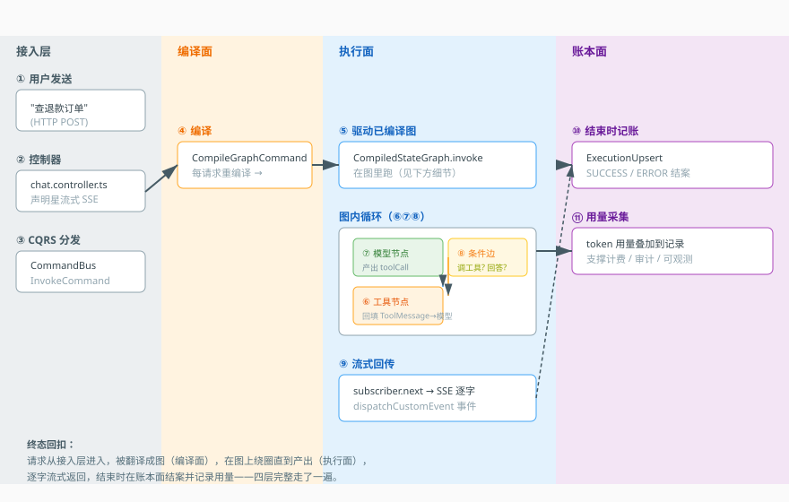
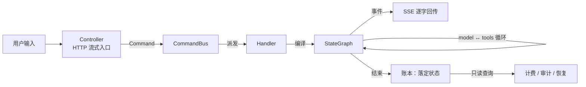

# 第 3 课：一次请求的完整旅程

> 所属阶段：阶段 1《先有地图》｜ 水平：进阶 ｜ 本课知识点：入口到图调用、图内状态流转、流式回传、执行记账
> 故事情节：主角登场。一次"用户按下发送"的请求，从 HTTP 入口一路走到流式返回。
> 📖 结论已按官方文档核对（核对于 2026-11 ｜ 来源：[LangGraph 流式](https://docs.langchain.com/oss/javascript/langgraph/streaming)、[事件流](https://docs.langchain.com/oss/javascript/langgraph/event-streaming)、[Graph API](https://docs.langchain.com/oss/javascript/langgraph/graph-api)）


## 🎯 本课目标

- 说清一次请求从 HTTP 入口到图调用的每一步，以及 CQRS 在这里解决了什么问题
- 说清图内消息如何追加、条件边如何路由出"模型 ↔ 工具"循环
- 说清流式为什么用 SSE，以及事件从哪里发出
- 说清账本为什么在"流程结束"才落定状态

## 🧑‍💻 前置知识速览

- **SSE（Server-Sent Events）**：服务端单向持续推送的 HTTP 机制，用 `text/event-stream` 声明。
- **CQRS**：命令查询职责分离——把"要改变系统的操作"（Command）与"只读取的操作"（Query）分开。
- **状态图（StateGraph）**：节点 + 边组成的工作流，节点之间通过"通道"传递状态（课 2 提过）。

## 第一幕：起源与场景引入

> 🎬 **场景**：用户点了"发送"，后台到底发生了什么？

你在客服界面输入"帮我查一下上个月的退款订单"，按下发送。页面马上出现一个转圈。

这行看不见的请求，会依次穿过上一课认识的四个楼层。但"数据从哪进、怎么转、什么时候回"——现在还是一团黑。本课把它从头到尾走一遍。

而且它并不是"进去 → 出来"这么简单：中间它会**被翻译成一张图**、图上会**绕圈**（模型问要调哪个工具、工具答、模型再问）、结果要**逐字流回**、跑完还要**记一笔账**。四个独立机制在协同。

> 📌 **一句话本质**：本课把"一次看不见的网络请求"沿主干道重走一遍，让你在关键岔路口看到它在哪转弯、在哪暂停、在哪记下这一笔。

> ⚖️ **处境对照**：不这么做 → 你只有"请求发出 / 响应返回"两个黑盒端点，出问题时只能说"好像卡住了"；这么做 → 你有一条可复述的完整链路，能说出"卡在账本那儿了，不是执行的问题"。

## 第二幕：认知冲突

> ❓ **问题**：为什么一次请求会变成"四个机制协同"，而不是一个函数调用？

因为一个 Agent 请求同时有四个**互相冲突**的诉求：

1. 定义要能随时改，但线上要跑固定的那份 → 需要**编译**，把"当前定义"固化成图。
2. 模型可能要多轮才给答案（调工具、看结果、再想）→ 需要**循环**，图必须能绕回来。
3. 用户不能干等几十秒不知道在干嘛 → 需要**流式**，边跑边推。
4. 出了问题要能查、花钱要能算 → 需要**记账**。

这四件事里，任何两件硬塞进一个函数都会打架：循环会让"返回值"变成"不确定次数"；流式会让"返回"变成"持续推"；记账会让"纯函数"变成"有副作用"。把它们拆成四个机制，各自在自己的层面解决，才可能都做对。

## 第三幕：层层揭示

### 一眼全局图（进入细节前先看一眼）



> 看图：从最上面的"用户输入"开始，沿着带编号的箭头一步步往下走。箭头遇到"暂停"的地方会停住等人确认，最后字体逐字往上流——这就是一次请求的完整主干。

### 本课地图（分几步走）

| 步 | 这一步要解决什么（人话） | 对应知识点 |
|:--:|------------------------|-----------|
| 1 | 请求从 HTTP 进来，怎么被引导到图调用 | 知识点 1：入口到图调用 |
| 2 | 图上消息怎么流动、边怎么选路 | 知识点 2：图内状态流转 |
| 3 | 结果怎么逐字流回前端 | 知识点 3：流式回传 |
| 4 | 什么时候记账、记什么 | 知识点 4：执行记账 |

### 知识点 1：入口到图调用

> 🧭 第 1/4 步｜承接：第二幕"四个机制为什么要拆" → 本步：看请求从哪里进来、如何被引导
> 本知识点关键点：流式入口、CQRS 分发、Handler 内编译、无图级缓存

- 关键点：HTTP 入口声明 `text/event-stream`——**流式在入口就决定了**，后面所有环节都得配合
- 关键点：CQRS 把"写操作"包成一个命令对象，命令与处理器一一对应
- 关键点：处理器内部先编译再执行；编译是"翻译"，不是"加载"
- 关键点：没有图级缓存，每次请求都重新编译——这是代价明确的设计选择

#### 一句话定义

一次请求从 HTTP 入口进来，被包成一个命令（Command），分发给处理器（Handler），处理器内部先"编译"出图、再"执行"这张图。

#### 直觉建立（类比）

想象一家前台 + 调度台：

- **前台（Controller）**：接收访客（HTTP 请求），并且一开口就告诉对方"我这边是边聊边说的"（声明流式）。
- **调度台（CommandBus）**：把"办事请求"转成一张带编号的派工单（Command），发给对应的办事员。
- **办事员（Handler）**：真正干活，里面还会再叫一队人（先编译、再执行）。

> 💡 **类比的边界**：真实里"办事员"不会把工作退回给调度台重派；Command 一旦发出就定向派发，Handler 与 Command 一一对应。

#### 核心原理

**Step 1 · HTTP 入口：流式在这里定型。**

```python
# 伪代码：入口在声明阶段就决定了响应形态
@app.post("/chat")
async def chat(body: ChatRequest):
    # 一旦声明为事件流，就不能再"等全部算完一次性返回"
    return StreamingResponse(
        run_agent(body),
        media_type="text/event-stream",
    )
```

这个声明不是装饰性的细节，它有强约束：**一旦入口承诺了流式，后面每一环都必须能"边算边吐"**。如果处理器非要"跑完再返回"，流式就变成了"很久之后一次性吐出全部"，用户看到的是长时间空白加突然满屏。

**Step 2 · CQRS 分发：把"一次请求"变成"一个对象"。**

为什么要包成命令对象，而不是直接调函数？三个实际收益：

- **可审计**：每个命令是一个可记录的对象，"谁在什么时候要求做什么"有痕迹。
- **可替换**：调用方只认 `CommandBus`，不认具体处理器，实现可替换。
- **可组合**：一个命令可以触发另一个命令（这正是下一步要做的事）。

```python
# 命令只携带"要做什么"，不含"怎么做"
command = InvokeCommand(
    agent_key="support",
    thread_id="t-1024",
    messages=[{"role": "user", "content": "查上个月退款订单"}],
)
result = await command_bus.execute(command)   # 派给对应 Handler
```

**Step 3 · Handler 干活：先编译，再执行。**

```python
async def execute(self, cmd: InvokeCommand):
    # ① 取定义（定义面）
    definition = await self.definitions.load(cmd.agent_key)

    # ② 编译（编译面）——把声明翻译成可执行图
    graph = await self.command_bus.execute(CompileGraphCommand(definition))

    # ③ 执行（执行面）——跑图
    async for event in graph.astream({"messages": cmd.messages}):
        yield event
```

**关键点：为什么叫"编译"而不叫"加载配置"？** 因为这一步真的在做**图的构建**：创建节点、连边、注入检查点、绑定工具。它不是把一份 JSON 读进内存，而是产出一个新的、可执行的对象。

**代价含义：没有图级缓存。** 每次请求都重新构建这张图。这是明确的设计取舍：

| | 有缓存 | 无缓存（每次重编译） |
|---|---|---|
| 好处 | 省编译时间 | 永远用最新定义，不存在"缓存过期导致行为不一致" |
| 代价 | 缓存失效策略复杂：定义变了、版本切了、中间件热更新了都得清 | 每次请求付一次构建成本，中间件越多越慢 |

理解这个取舍很重要：它意味着**"中间件数量"会直接影响首字延迟**。这也是为什么后面讲中间件时要强调"别在工厂里做重初始化"。

#### 示例演示

把"入口 → 命令 → 编译 → 执行"串成可运行骨架。注意每个阶段的产物形态都在变：请求体 → 命令对象 → 图对象 → 事件流。

```python
class InvokeHandler:
    async def execute(self, cmd: InvokeCommand):
        definition = await self.definitions.load(cmd.agent_key, cmd.version)

        # 编译：纯翻译，无缓存
        graph = compile_graph(definition)

        # 执行：把图的输出转成 SSE 事件
        async for chunk in graph.astream({"messages": cmd.messages}):
            yield sse_pack(chunk)

def sse_pack(chunk: dict) -> str:
    # SSE 的线格式：data: <json>\n\n
    return f"data: {json.dumps(chunk, ensure_ascii=False)}\n\n"
```

#### 常见误区

1. **"CQRS 就是异步消息队列"**：不是。CQRS 是"读 / 写分离"的架构模式，这里是**同步分发**（`await command_bus.execute`），不涉及消息队列。
2. **"编译结果会被缓存复用"**：不缓存。每次请求重新编译，这是取舍而非遗漏。
3. **"流式是前端的事"**：流式从入口声明就开始了，它约束的是整条链路。

#### 一句话记住

前台承诺流式 → 派工单 → 办事员先编译后执行；编译是翻译，不缓存。

#### 🗣️ 行话对照

- **CQRS（Command-Query Responsibility Segregation）**：命令查询职责分离——本课"办事与问询分开"。
- **Graph Compile（图编译）**：把声明翻译成可执行图——本课"编译"。

---

### 知识点 2：图内状态流转

> 🧭 第 2/4 步｜承接：已得到可执行的图 → 本步：消息在图上怎么流动、边怎么选路
> 本知识点关键点：追加语义、条件边、模型工具往返、多 Agent 通道隔离

- 关键点：`messages` 通道用**追加** reducer——不追加就会"失忆"
- 关键点：模型节点产出 `tool_call`，条件边据此决定"调工具"还是"结束"
- 关键点：工具结果回填后回到模型，形成往返循环；循环的出口是"模型不再要工具"
- 关键点：多 Agent 各有独立通道，天然不串台

#### 一句话定义

图用"通道 + 条件边"表达一次会话：消息被**追加**进通道，模型产出的工具调用触发**条件边**路由，工具结果回填后再回到模型。

#### 直觉建立（类比）

想象一条流水线：

- 传送带（messages 通道）：所有消息按顺序排队，只能往后加。
- 工位 A（模型节点）：每来一组消息，加工出一个"下一步指令"——可能是回答，也可能是"去调一个工具"。
- 岔路口（条件边）：看到"要调工具"就送去工具工位；看到"直接回答"就送去出口。
- 工具工位（工具节点）：干完活，把结果放回传送带，然后又流回工位 A。

> 💡 **类比的边界**：真实流水线有终点；这里的循环**次数不固定**，可能一轮就出答案，也可能绕七八轮。

#### 核心原理

**追加语义为什么不能少**：

```python
# 错误写法：覆盖
state["messages"] = [new_message]        # 历史被抹掉 → 模型失忆

# 正确写法：追加（reducer 的职责）
def messages_reducer(old, new):
    return old + new                     # 旧的保留，新的接上
```

这不是风格问题。如果 `messages` 被覆盖，第二轮模型就看不到第一轮说过什么，多轮对话直接崩塌。而 reducer 的意义就是**把"怎么合并"写进数据结构**，而不是让每个节点自己记得"要追加"（总有一个节点会忘）。

**条件边与往返循环**：

```python
def route_after_model(state) -> str:
    last = state["messages"][-1]
    if getattr(last, "tool_calls", None):
        return "tools"      # 要调工具 → 去工具节点
    return END              # 不要工具 → 结束

builder.add_conditional_edges("model", route_after_model, {"tools": "tools", END: END})
builder.add_edge("tools", "model")     # 工具结果回到模型，形成环
```

这个环是 Agent 的核心：**模型负责想，工具负责做，做完再想**。注意出口只有一个——"模型不再要求调工具"。所以任何导致模型永远想要工具的 bug（比如工具返回的错误信息让模型反复重试），都会变成无限循环，需要额外的轮次上限兜底。

**多 Agent 的通道隔离**：

```python
# 每个子 Agent 在自己的命名通道里写消息
child_channel = f"{agent_key}_channel"
state[child_channel] = {"messages": [...]}
```

为什么必须隔离？如果两个 Agent 共用一个 `messages`，A 的内部推理会被 B 看到，B 会去"回答" A 的中间思考。隔离靠的是**命名空间**，不是"约定别乱写"。

#### 示例演示

一个最小可跑的 Agent 图（伪代码，但结构完整）：

```python
from langgraph.graph import StateGraph, END

def build(model, tools):
    def call_model(state):
        return {"messages": [model.invoke(state["messages"])]}

    def call_tools(state):
        last = state["messages"][-1]
        results = []
        for tc in last.tool_calls:
            out = tools[tc["name"]](**tc["args"])
            results.append({"role": "tool", "tool_call_id": tc["id"], "content": out})
        return {"messages": results}

    g = StateGraph(dict)
    g.add_node("model", call_model)
    g.add_node("tools", call_tools)
    g.set_entry_point("model")
    g.add_conditional_edges("model",
        lambda s: "tools" if s["messages"][-1].tool_calls else END,
        {"tools": "tools", END: END})
    g.add_edge("tools", "model")     # ← 往返循环的关键一条边
    return g.compile()
```

**验证它真的在绕圈**：给模型一个"必须先查库存再回答"的提示，观察 `astream` 是否吐出两轮 model + 一轮 tools。如果只吐一轮，说明条件边写错了。

#### 常见误区

1. **"每次模型调用后消息会被覆盖"**：不。追加 reducer 保证历史累积；覆盖会让 Agent 失忆。
2. **"工具结果直接作为最终答案返回"**：不。工具结果要回填成消息、**回到模型**，由模型决定怎么表述。
3. **"多 Agent 共用一个 messages 更省事"**：会导致串台，A 的中间思考被 B 当成用户说话。

#### 一句话记住

消息只追加、条件边决定绕不绕、工具结果必须回到模型。

#### 🗣️ 行话对照

- **StateGraph / CompiledStateGraph**：状态图 / 已编译状态图——本课"图"。
- **Reducer（归约器）**：状态合并函数——本课"追加语义"的实现。
- **Conditional Edge（条件边）**：条件路由——本课"岔路口"。

---

### 知识点 3：流式回传

> 🧭 第 3/4 步｜承接：图在跑并产出结果 → 本步：结果怎么逐字回到前端
> 本知识点关键点：事件类型、SSE 单向、为什么不用 WebSocket、可见性即信任

- 关键点：图内发出**带类型**的事件（工具消息 / 中断询问 / token 增量），不是纯文本流
- 关键点：SSE 是单向（服务端 → 客户端）的，正好匹配"推进展"的需求
- 关键点：事件必须带类型，否则前端无法区分"这是工具结果还是回答"
- 关键点：可见性 = 用户信心——几十秒的任务必须有实时反馈

#### 一句话定义

图在运行中发出**带类型的事件**，处理器把这些事件序列化成 SSE 帧推给前端，前端逐字追加显示。

#### 直觉建立（类比）

想象一场现场解说：

- 主讲人（图）一边讲一边嘀咕："这里要调个工具""这里要等人确认""回答是：你、好、呀"。
- 话筒（事件分发）：把这些嘀咕实时放大送出去。
- 听众（前端）：不停收到一小段一小段，拼成完整体验。

关键在于：**解说员会说明"以下是插播通知"还是"以下是正文"**。没有这个标注，听众会把"我要去查个资料"当成答案的一部分。

> 💡 **类比的边界**：真实解说员靠语气区分；系统里靠事件类型字段，必须显式。

#### 核心原理

**事件的三种典型类型**：

| 事件类型 | 什么时候发 | 前端怎么处理 |
|---|---|---|
| token 增量 | 模型每吐出几个字 | 追加到当前气泡（打字机效果） |
| 工具消息 | 工具开始 / 结束 | 显示"正在查询…"或折叠的工具调用卡片 |
| 中断询问 | 需要人确认 | 弹出确认框，暂停正文 |

```python
# 事件必须带类型，这是前端能正确渲染的前提
def emit_tool_start(tool_name: str) -> dict:
    return {"type": "tool_start", "name": tool_name}

def emit_token(text: str) -> dict:
    return {"type": "token", "text": text}

def emit_interrupt(payload: dict) -> dict:
    return {"type": "interrupt", "payload": payload}   # 课 10 会详讲
```

**为什么用 SSE 而不是 WebSocket**：这里的通信是**单向**的（服务端持续推，客户端不需要在同一条连接上发数据），SSE 正好匹配，而且它就是普通 HTTP：能过大部分代理、能自动重连、不需要额外的握手协议。WebSocket 是全双工，能力过剩，运维成本更高。**选型原则：需求是单向就用单向的机制。**

**关键点：可见性 = 用户信心。** 流式不是为了炫技。一个 Agent 任务动辄十几到几十秒，如果前端只能转圈，用户无法判断"在工作"还是"卡死了"，于是会刷新页面——而刷新可能中断正在跑的任务。流式让进展可见，是**降低用户误操作率**的功能，不只是体验优化。

**一个容易忽略的工程问题**：流式意味着"错误也可能发生在流中间"。HTTP 状态码在流开始时就发出去了（200），后面才出错。所以错误必须**作为一种事件类型**推给前端，而不是靠状态码表达：

```python
async def stream_with_errors(graph, inputs):
    try:
        async for chunk in graph.astream(inputs):
            yield sse_pack({"type": "token", "data": chunk})
    except Exception as e:
        # 流已经开始，无法再改状态码；只能发一个错误事件
        yield sse_pack({"type": "error", "message": str(e)})
    finally:
        yield sse_pack({"type": "done"})     # 明确结束，前端才知道可以停
```

`done` 事件常被忽略，但没有它前端无法区分"流正常结束"和"连接断了"。

#### 示例演示

一个能跑通的最小 SSE 服务端 + 前端消费：

```python
# 服务端
@app.post("/chat")
async def chat(body: ChatRequest):
    async def gen():
        yield sse_pack({"type": "start"})
        async for ev in run_agent(body):
            yield sse_pack(ev)
        yield sse_pack({"type": "done"})
    return StreamingResponse(gen(), media_type="text/event-stream")
```

```javascript
// 前端
const res = await fetch('/chat', { method: 'POST', body: JSON.stringify(payload) });
const reader = res.body.getReader();
const decoder = new TextDecoder();
let buf = '';
while (true) {
  const { value, done } = await reader.read();
  if (done) break;
  buf += decoder.decode(value, { stream: true });
  const frames = buf.split('\n\n');        // SSE 以空行分帧
  buf = frames.pop();                      // 最后一段可能不完整，留到下次
  for (const f of frames) {
    const ev = JSON.parse(f.replace(/^data: /, ''));
    handleEvent(ev);                       // 按 type 分派渲染
  }
}
```

注意 `buf` 的处理：**网络分片不等于事件分片**，一个事件可能被切成两半到达。不处理这个，就会出现随机的 JSON 解析失败——这是流式实现最常见的 bug。

#### 常见误区

1. **"SSE 和 WebSocket 是一回事"**：SSE 单向、基于普通 HTTP、自动重连；WebSocket 全双工、独立协议。需求单向就用 SSE。
2. **"流式只是前端体验优化"**：它降低用户误操作（刷新中断任务），是可靠性的一部分。
3. **"流已经开始了，出错就靠状态码"**：状态码早已发出，错误必须走事件。
4. **"每个网络分片就是一个完整事件"**：不一定，必须自己做缓冲拼帧。

#### 一句话记住

事件带类型、单向用 SSE、错误走事件、分片要缓冲。

#### 🗣️ 行话对照

- **SSE（Server-Sent Events）**：服务端推送事件——入口的 `text/event-stream`。
- **Streaming / Chunked Transfer**：分块传输——本课"逐字回传"。
- **Backpressure（背压）**：消费慢于生产时的流控——流式系统的隐藏难点。

---

### 知识点 4：执行记账

> 🧭 第 4/4 步｜承接：一次请求全程跑完 → 本步：它在账本里留下什么
> 本知识点关键点：记录何时创建、状态何时落定、用量在哪采集、为什么不在每步写库

- 关键点：记录在请求**开始时创建**（拿到 id 才能串起后续所有事件）
- 关键点：状态在**流程结束**时落定成功 / 失败，而不是每步写库
- 关键点：用量伴随模型调用采集、累加到同一条记录
- 关键点：账本是只读查询面，支撑计费 / 审计 / 断点恢复

#### 一句话定义

执行面每发起一次会话，账本面就维护一条"执行记录"：它属于谁、当前状态、最终结果、花了多少。**状态在流程结束时落定。**

#### 直觉建立（类比）

想象一份病历：

- 挂号（记录创建）：每个请求一个病历单，写上病人是谁——**必须先有单号，后面所有检查结果才能挂到这张单上**。
- 治疗过程：看诊、开药（图在跑），中间结果陆续记录。
- 出院结案：全流程结束，盖上"治愈 / 未愈"的章，存进档案室。
- 费用清单：用了多少药、多少钱，单独一栏。

> 💡 **类比的边界**：病历是"逐条追加"的；这里的最终状态是"一次性落定"，中间过程靠日志或增量指标，避免高频写库。

#### 核心原理

**两个时间点，职责完全不同**：

```python
async def execute_with_ledger(handler, cmd):
    # ① 开始时创建记录：为了拿到 id
    execution = await ledger.create(
        id=uuid4(), agent_key=cmd.agent_key, thread_id=cmd.thread_id
    )

    try:
        async for event in handler.run(cmd):
            # ② 过程中只累加用量，不改最终状态
            if event.type == "usage":
                await ledger.add_usage(execution.id, event.usage)
            yield event

        # ③ 结束时落定状态（成功）
        await ledger.finish(execution.id, status="SUCCEEDED")

    except Exception as e:
        # ③' 结束时落定状态（失败）—— 与成功路径对称
        await ledger.finish(execution.id, status="FAILED", error=str(e))
        raise
```

**为什么状态不在每步写库**：

- 高频写库会拖慢主路径。一次请求可能几十个节点，每步写一次就是几十次写。
- 更重要的是**语义**：中间状态没有意义。"跑到第 3 个节点"对外部世界不是一个有用的结论——外部想知道的是"成了没有"。

**为什么用量要增量累加**：用量是**可累加量**（每轮模型调用都产生新的 token 消耗），它天然适合"边跑边加"。而"状态"是**终态量**（只有一个最终值），它适合"最后写一次"。这个区分是设计账本的核心：**可累加量增量写，终态量结尾写。**

**用量采集点**：只在模型返回时采。工具调用、人工输入都不产生 token 用量。采集时优先取 provider 返回的精确值，取不到才用估算（课程 11 会展开"取不到时按最坏算"的原则）。

#### 示例演示

一个最小账本实现，体现"创建 → 累加 → 落定"三段式：

```python
class Ledger:
    def __init__(self, db): self.db = db

    async def create(self, id, agent_key, thread_id):
        # 一开始就落库：拿到 id，后面才能串起来
        return await self.db.insert({
            "id": id, "agent_key": agent_key, "thread_id": thread_id,
            "status": "RUNNING", "tokens": 0,
        })

    async def add_usage(self, id, usage):
        # 可累加量：增量写
        await self.db.exec(
            "UPDATE execution SET tokens = tokens + :t WHERE id = :id",
            {"t": usage.get("total_tokens", 0), "id": id},
        )

    async def finish(self, id, status, error=None):
        # 终态量：只写一次，且不可逆
        await self.db.exec(
            "UPDATE execution SET status = :s, error = :e, ended_at = now() WHERE id = :id",
            {"s": status, "e": error, "id": id},
        )
```

**一个必做的验证**：构造一个"跑到一半抛异常"的场景，检查记录最终是否是 `FAILED` 而不是永远停在 `RUNNING`。停在 `RUNNING` 的记录会污染监控（看起来永远有任务在跑），这类"僵尸记录"在真实系统里非常常见——根因往往就是缺了 `except` 分支里的 `finish`。

#### 常见误区

1. **"每次模型调用都立刻写一条新记录"**：不是。一条请求一条记录，用量在记录上累加。
2. **"状态每步都更新，信息更全"**：中间状态对外部无意义，且高频写库拖慢主路径。
3. **"异常路径可以不落账"**：必须落。永远 RUNNING 的僵尸记录会污染监控和计费。

#### 一句话记住

开始创建拿 id、过程累加用量、结束落定状态、异常也要落。

#### 🗣️ 行话对照

- **Execution / Invocation**：一次请求的记录单元——本课"病历"。
- **Usage / Token Accounting**：用量计量——本课"费用清单"。

---

## 第四幕：实操验证

> 目标：把四个机制串成一条完整链路，并验证每个关键约束真的成立。

### 4.1 机制验证

> ✅ 机制实测于 Node v22.22.2 / @langchain/langgraph 1.6.0（脚本 `verify/verify-map.ts`）。上段为伪代码示意，下面是同机制的真实输出：

```text
① 正常路径事件序列: [token, tool_start, tool_end, token, done]
   一定有 done 收尾: true
② 异常路径: [token, error, done]（错误不吞、done 仍存在）
   错误事件内容: {"type":"error","message":"模型返回 429 限流"}
③ 消息追加: 4 条 → ["user:hi","ai:你好","user:查订单","ai:在运输中"]
④ SSE 编码样例: "event: done
data: {"type":"done","status":"succeeded"}

"
```

> 第 ② 行是本课最该记住的一条：**异常路径也走事件**，因为 HTTP 状态码在流开始时就发出去了，之后只能靠事件告诉前端这次失败了。第 ④ 行的 `done` 是收尾契约——没有它，前端永远在转圈。

```python
# ① 入口是流式的（返回类型就是异步迭代器）
assert is_async_iterator(handler.execute(cmd))

# ② 消息是追加的（跑两轮后历史变长，而不是被替换）
state = {"messages": [user_msg]}
state = merge(state, {"messages": [ai_msg_1]})
state = merge(state, {"messages": [ai_msg_2]})
assert len(state["messages"]) == 3

# ③ 流有明确的结束与错误事件
events = [e async for e in collect(handler.execute(cmd))]
assert events[-1]["type"] == "done"                    # 一定有收尾
assert all(e["type"] in {"token","tool_start","tool_end","interrupt","error","done"} for e in events)

# ④ 账本在异常路径也落定
with raises(RuntimeError):
    await execute_with_ledger(failing_handler, cmd)
record = await ledger.get(execution_id)
assert record.status == "FAILED"        # 不是永远 RUNNING
```

**这四条断言的意义**：它们各自对应一个"最容易写错"的地方——不是流式、消息被覆盖、流没有收尾、异常不落账。这四类 bug 都不会在"成功路径"的 happy case 里暴露，只有被断言盯住才守得住。

> ✅ **回扣场景**：回到开头那个"查退款订单"的请求。它现在从不可见变可见：进来时承诺流式（①）→ 消息在图上追加流转（②）→ 工具结果回到模型绕圈（②）→ 逐字推回前端并有明确收尾（③）→ 跑完在账本盖章（④）。你能说出它每一步发生了什么。

## 第五幕：体系收束

你现在能完整复述一次请求的一生：从前台进来 → 派工单 → 编译成图 → 在图上绕圈直到产出 → 流式推回前端 → 在账本里盖章。

> 📍 **全局定位**：这是主干道全景。你还不需要看懂每一步的细节——这一步的目的是把"坐标"埋下来。
> 🔗 **下一步**：主干道里很长一段发生在"编译"和"图运行时"里。下一阶段我们把前两个楼层放大：定义是怎么写的、编译又是怎么把它翻译成图的。

## 🐞 全课常见误区

1. **"一次请求是直进直出"**：它经历翻译、路由、循环、流式、记账多类机制。
2. **"编译好的图会被缓存复用"**：不缓存，每次请求重新构建——这是取舍，要意识到成本。
3. **"账本每步都写库"**：可累加量增量写，终态量结尾写一次。
4. **"流式只是前端体验"**：它降低误操作率，是可靠性的一部分。
5. **"网络分片等于事件分片"**：必须自己缓冲拼帧。

## 一图总结



> 课首图是问题视角（为什么不是直进直出）；此图是知识视角（五类机制的衔接）。

## 课后小测

**Q1**：平台每次请求都重新构建图而不是复用缓存，主要取舍是什么？
- A. 只是为了代码简单　B. 换来"永远用最新定义、无缓存失效问题"，代价是每次付构建成本　C. 因为构建不耗时　D. 因为缓存要付费

<details><summary>答案与解析</summary>

**答案：B**。这是明确的设计取舍：好处是行为永远与当前定义一致，不存在缓存过期导致的不一致；代价是中间件越多、图越大，构建越慢，直接影响首字延迟。

</details>

**Q2**：流已经开始推送后，服务端发生异常，前端如何知道出错了？
- A. 靠 HTTP 500 状态码　B. 靠连接断开就是错误　C. 靠服务端推送一个 `error` 类型事件　D. 前端轮询查询

<details><summary>答案与解析</summary>

**答案：C**。流开始前状态码已经发出（200），后续错误无法用状态码表达。必须把错误作为一种事件类型推给前端，并且用一个明确的 `done` 事件标记正常结束，否则前端无法区分"正常完成"与"连接断了"。

</details>

## 🚀 下一批接力提示词

```
继续学 Agent 工程解剖。我的学习档案在 agent-engineering/00-学习档案.md，
刚学完阶段 1《先有地图》全部内容（课 1 环境准备、课 2 平台的四层构成、课 3 一次请求的完整旅程）,
请按大纲继续讲解下一阶段（阶段 2：定义与编译）的第一批知识点。
```

## 🧭 课程导航

⬅️ **上一课**：[课 2：平台的四层构成](02-平台的四层构成.md)
➡️ **下一课**：[课 4：声明式定义](../../2-定义与编译/lessons/04-声明式定义.md)
📚 **返回目录**：[课程目录](../../../02-课程目录.md)
