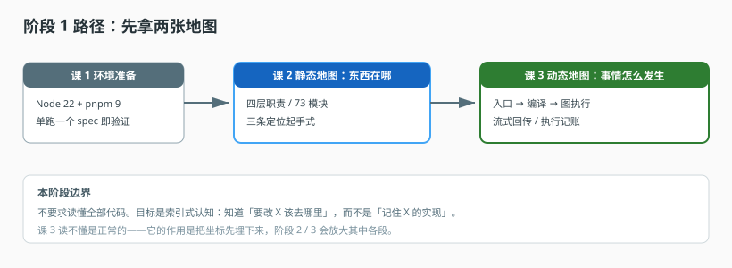

# 阶段 1：先有地图

> 所属课程：Agent 工程解剖 ｜ 故事章节：先知道自己在哪 ｜ 上一阶段：无 ｜ [返回总览](../../01-学习路径总览.md)

## 🎯 本阶段目标

- 建立对目标系统的空间感：知道四层各自负责什么，改动该落在哪一层。
- 建立时间感：能完整叙述一次 Agent 请求从 HTTP 入口到流式返回经过哪些环节。
- 具备独立定位能力：给定一个现象（如"工具没被调用"），能在 5 分钟内找到相关实现。

## 📍 学习重点

- 读陌生代码库最忌讳"从入口开始逐行读"——先拿地图，再按需下钻，是本阶段要建立的第一个习惯。
- 四层划分（定义面 / 编译面 / 执行面 / 账本面）不是官方术语，是本课程为了讲清职责边界而做的归纳；它对应真实的目录与依赖方向。
- 一次请求的旅程是本课程的"主干道"。后面每个阶段都是对这条主干道上某一段的放大。第 3 课读不懂没关系，它的作用是先埋下坐标。

## ✅ 必须掌握的知识点

| 知识点 | 所属课 | 学完应能 |
|--------|--------|----------|
| 环境准备（附加课） | 课 1 | 单跑一个 spec 并看到真实输出；知道全栈启动是可选项 |
| 四层职责划分 | 课 2 | 画出四层职责图，说出每层的输入输出 |
| 模块地图与依赖方向 | 课 2 | 说出 73 个模块里哪些是核心、依赖为何单向 |
| 32 万行里定位代码 | 课 2 | 用四条起手式（契约名 / 测试反推 / 不变量注释 / 写入点反查）定位任一实现（索引为可选加速） |
| 入口到图调用 | 课 3 | 说清从 HTTP 到 `CompiledStateGraph.invoke` 的每一步 |
| 图内状态流转 | 课 3 | 说清 messages 如何追加、条件边如何路由 |
| 流式回传 | 课 3 | 说清事件类型与前端收到的时机 |
| 执行记账 | 课 3 | 说清 Invocation 何时落库、用量在哪里采集 |

## ⚠️ 本阶段边界（防劝退）

课 2 会用一个"七十多个模块、几十万行"的平台当例子。**不要求读懂全部代码**——本阶段目标是建立索引式认知：知道"要改 X 该去哪里"，而不是"记住 X 的实现"。逐行通读不是本课程的方法，遇到细节一律先跳过、记下位置，等对应课再回来看。

## 📖 本阶段在故事主线中的章节定位

主角（一次 Agent 请求）还没登场，本阶段先解决"我在哪"的问题。

设想一个具体处境：你被派去接手一套跑了两年、32 万行的 Agent 平台。第一天打开仓库，73 个模块平铺在眼前，你不知道该从哪个文件读起。此时最危险的动作是"从入口 main 开始逐行读"——三周后你会记住一堆细节，却仍然答不出"要加一个工具该改哪里"。

本阶段就是这三天的地图课：课 2 给你空间坐标（东西在哪），课 3 给你时间坐标（事情怎么发生）。两张图到手后，主角才正式登场——从阶段 2 开始，我们逐段放大这条主干道。

> 章节作用：**不给结论，只给坐标**。本阶段的所有知识点都是"知道在哪"，不是"理解为什么"。读不懂第 3 课的细节是正常状态。

## 🗺️ 本阶段路径图

> 看图：先装环境（课 1），再拿两张地图——静态的"东西在哪"（课 2）和动态的"事情怎么发生"（课 3）。两张图都到手，才进入阶段 2。

## 本阶段产出

- [ ] [lessons/01-环境准备.md](lessons/01-环境准备.md)
- [ ] [lessons/02-平台的四层构成.md](lessons/02-平台的四层构成.md)
- [ ] [lessons/03-一次请求的完整旅程.md](lessons/03-一次请求的完整旅程.md)
