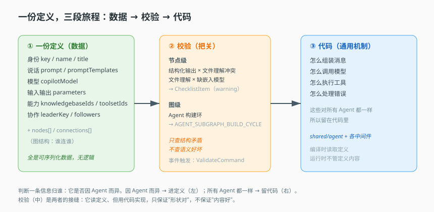
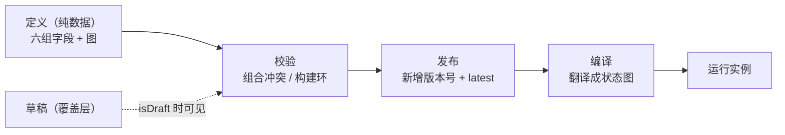

# 第 4 课：声明式定义

> 所属阶段：阶段 2《定义与编译》｜ 水平：进阶 ｜ 本课知识点：一份定义包含什么、定义与实例分离、校验前置
> 故事情节：主角要被"造出来"了。第一次看到：造一个 Agent 不需要写代码，只需要一份定义。
> 配应用实战：[实战 04](../../../应用实战/04-把硬编码Agent改成配置驱动.md)
> 📖 结论已按官方文档核对（核对于 2026-11 ｜ 来源：[LangGraph Graph API](https://docs.langchain.com/oss/javascript/langgraph/graph-api)、[应用结构](https://docs.langchain.com/oss/javascript/langgraph/application-structure)）


## 🎯 本课目标

- 列出一份 Agent 定义的全部要素，说清哪些进定义、哪些必须留代码
- 说清草稿 / 发布 / 固定版本三种状态各自解决什么问题
- 区分校验期与运行期的职责，说清为什么校验要前置、以及它查不到什么

## 🧑‍💻 前置知识速览

- **声明式 vs 命令式**：声明式说"要什么结果"，命令式说"怎么一步步做"。
- **序列化**：把内存里的数据结构变成可存库、可传输的文本（如 JSON）。
- **幂等**：同样的输入反复执行，结果一致。

## 第一幕：起源与场景引入

> 🎬 **场景**：产品经理的第二次改需求，让你意识到问题不在代码写得好不好

产品经理走过来说："客服 Agent 的模型换成新的，另外加个权限——只能查订单，不能改订单。"

你打开代码，发现模型名硬编码在三个文件里，权限判断散在五个 `if` 里。你花半天改完。一周后他又来："再加个审批环节。"你默默算了算，这次要改七处。

这不是"代码写得烂"，而是**架构选择出了问题**：Agent 的"是什么"和"怎么跑"粘在一起了。本课讲的是最重要的一个决定——**Agent 是数据，不是代码**。

> 📌 **一句话本质**：把"Agent 长什么样"从代码里抽出来，变成一份可存储、可版本化、可校验的声明（definition），代码只负责"怎么把声明跑起来"。

> ⚖️ **处境对照**：不这么做 → 每次需求变更改 N 处代码、重新发版、无法灰度、无法回滚；这么做 → 改一份 JSON、走一次校验、发一个版本号，代码一行不动。

## 第二幕：认知冲突

> ❓ **问题**：一份"定义"凭什么能描述一个会思考、会调工具的 Agent？

直觉上，"智能"应该由代码写出来。但把 Agent 需要的信息摊开看：用什么模型、说什么话（提示词）、能用哪些工具、按什么流程走（图连接）——**这些全是"取值"**。

真正需要代码的只有两件事：怎么调用模型、怎么执行工具。而这两件事对**所有** Agent 都一样。

所以分界线很清楚：**差异用数据表达，共性用代码实现**。这就是声明式定义成立的根基。

这里有个隐性的判断标准，值得记住：**"是否因 Agent 而异"**。因 Agent 而异 → 进定义；所有 Agent 都一样 → 留代码。这条标准能帮你回答后面所有"这个该放哪"的问题。

## 第三幕：层层揭示

### 一眼全局图（进入细节前先看一眼）



> 看图：左边是"一份定义"（数据），中间是"校验"（把关），右边是"编译"（翻译）。代码只在最右端——负责把声明变成能跑的机器。定义本身不包含任何可执行逻辑。

### 本课地图（分几步走）

| 步 | 这一步要解决什么（人话） | 对应知识点 |
|:--:|------------------------|-----------|
| 1 | 一份定义里到底装了什么、什么装不进去 | 知识点 1：一份定义包含什么 |
| 2 | 为什么"定义"和"运行实例"要分开，版本怎么起作用 | 知识点 2：定义与实例分离 |
| 3 | 定义写错了在哪一步被发现，为什么不能等到运行 | 知识点 3：校验前置 |

### 知识点 1：一份定义包含什么

> 🧭 第 1/3 步｜承接：第二幕"差异用数据表达" → 本步：看这份数据的具体形状
> 本知识点关键点：六组要素、定义与代码的边界、为什么定义里不能有 if

- 关键点：六组要素——身份、说话、模型、输入输出、能力、协作
- 关键点：判断归谁只有一条标准：**是否因 Agent 而异**
- 关键点：定义可以含"图"（节点 + 连接），但图的类型有语义（委派 vs 顺序流转）
- 关键点：定义里绝不能有条件逻辑，否则退化成代码

#### 一句话定义

一份 Agent 定义 = 一组描述"这个 Agent 是什么"的字段 + 一张描述"消息在哪些角色之间怎么走"的图（节点 + 连接）。

#### 直觉建立（类比）

想象一份**菜品标准卡**：

- 菜名、口味、配料表、分量（对应身份、提示词、工具、模型）。
- 出餐流程图：先切配 → 再炒制 → 最后装盘（对应图的节点与连接）。
- 但"怎么开火""怎么握锅"不在卡片上——那是厨师的基本功（对应通用代码）。

> 💡 **类比的边界**：菜品卡是给同一家店的厨师看的；这里的定义要给**任意多个租户、多个模型供应商**共用，所以字段必须严格（有类型、有校验），不能是自由文本。

#### 核心原理

六组要素，每组的共性是"它只是一个值"：

| 组 | 代表字段 | 作用 | 为什么是值 |
|---|---|---|---|
| 身份 | key / name / title / description | 我是谁，怎么被引用 | 全是字符串 |
| 说话 | prompt / promptTemplates | 系统提示词与可复用片段 | 全是文本 |
| 模型 | model / modelId | 用哪个模型跑 | 一个标识 |
| 输入输出 | parameters / outputVariables | 接什么变量、吐什么结果 | 变量名 + 默认值 |
| 能力 | knowledgebaseIds / toolsetIds | 能查什么、能用什么工具 | id 数组 |
| 协作 | teamId / leaderKey / followers | 和谁组成团队 | id 引用 |

**什么必须留代码**：怎么组装消息、怎么发起模型调用、怎么执行工具、怎么处理错误。这些是**通用机制**，与具体 Agent 无关。

**为什么定义里不能有 if-else**：这是本课最容易低估的一条。一旦定义允许条件逻辑，三个后果同时发生：

- **版本化失效**：你无法再比较两个版本"差在哪"，因为差异是一段代码而不是一个值。
- **校验失效**：校验器没法静态分析"这段逻辑对不对"。
- **跨租户复用失效**：不同租户拿到的行为可能完全不同，你无法承诺"这份定义跑出来是这样"。

需要分支时，用**图的连接结构**表达——让"选哪条路"成为图结构问题，而不是藏在字段里的脚本。

**图里"连接的类型"是有语义的**：

```jsonc
{
  "connections": [
    { "key": "delegate", "type": "agent", "from": "primary", "to": "reviewer" },
    { "key": "next",     "type": "edge",  "from": "step_a",  "to": "step_b"  }
  ]
}
```

- `type: "agent"` = "委派给另一个 Agent"。这个语义在课 5 会直接决定走"多 Agent 协作"还是"单 Agent"分支。
- `type: "edge"` = 普通的顺序流转。

一个字段的取值改变了整个编译路线——这就是"图结构即语义"。

#### 示例演示

一份完整的定义骨架，注意它**通篇没有逻辑**，只有值：

```python
from dataclasses import dataclass, field

@dataclass
class AgentDefinition:
    # ① 身份
    key: str
    name: str
    title: str = ""

    # ② 说话
    prompt: str = ""
    prompt_templates: dict[str, str] = field(default_factory=dict)

    # ③ 模型
    model: str = "gpt-4o"

    # ④ 输入输出
    parameters: list[dict] = field(default_factory=list)      # [{name, type, default}]
    output_variables: list[str] = field(default_factory=list)

    # ⑤ 能力
    knowledgebase_ids: list[str] = field(default_factory=list)
    toolset_ids: list[str] = field(default_factory=list)

    # ⑥ 协作 + 图
    leader_key: str | None = None
    nodes: list[dict] = field(default_factory=list)            # [{key, type}]
    connections: list[dict] = field(default_factory=list)      # [{from, to, type}]
```

**反面示例，看清"越界"长什么样**：

```python
# ❌ 错误：把条件逻辑写进定义
"prompt": "你是客服。{ '如果用户是VIP就用亲切语气，否则用标准语气' }"

# ✅ 正确：用图表达分支，每个分支有自己固定的 prompt
"nodes": [
    {"key": "vip_flow",    "type": "agent", "prompt": "亲切语气..."},
    {"key": "normal_flow", "type": "agent", "prompt": "标准语气..."}
],
"connections": [{"from": "router", "to": "vip_flow", "type": "edge", "when": "user.vip"}]
```

#### 常见误区

1. **"定义就是提示词"**：远不止。提示词只是六组里的一组；模型、工具、图连接缺一样都跑不起来。
2. **"定义里可以写 if-else"**：不能。要做分支就用图的连接结构表达，否则定义退化成代码，版本化和校验全部失效。
3. **"所有图连接都一样"**：`type` 有语义。委派（agent）和顺序（edge）在编译时走完全不同的路径。

#### 一句话记住

定义 = 六组字段 + 一张图；判断归谁看"是否因 Agent 而异"；分支走图，不写 if。

#### 🗣️ 行话对照

- **声明式定义（Declarative Definition）**：行业叫"配置即代码 / 声明式配置"——本课"定义"。
- **Draft（草稿）**：行业叫"工作副本 / 未发布版本"。

---

### 知识点 2：定义与实例分离

> 🧭 第 2/3 步｜承接：已知定义长什么样 → 本步：为什么"同一份定义"能对应"多个运行实例"
> 本知识点关键点：草稿 vs 发布、草稿是覆盖层、固定版本的价值、多租户落点

- 关键点：草稿与发布是**同一实体的两个字段**，靠 `isDraft` 切换读取
- 关键点：草稿是**覆盖层**（叠加在已发布图上），不是另一份完整数据
- 关键点：固定版本的价值不在"能选旧版"，而在"能证明当时跑的是什么"
- 关键点：租户隔离靠数据模型 + 唯一约束，不靠应用层 if

#### 一句话定义

"定义"是可以被反复修改的**模板**；"实例"是某一时刻被冻结的**快照**。两者分离，才可能既让人随便改，又让线上稳定跑。

#### 直觉建立（类比）

合同模板与已签合同：

- 模板（草稿）你可以天天改，改坏了也不影响别人。
- 一旦签了（发布），它就冻结成一个版本，编号存档。
- 出了纠纷，你调出"2026 年 3 月版"那份，而不是"现在最新的模板"——否则条款早变了，无法对账。

> 💡 **类比的边界**：合同签了不能改，但这里的已发布版本可以"再发新版"；旧版依然保留供追溯。

#### 核心原理

**三种状态，各解决一个不同的问题**：

| 状态 | 数据 | 解决什么 | 谁在用 |
|---|---|---|---|
| 草稿 | `draft` 字段 | 边改边预览，不影响线上 | 配置界面 / 调试 |
| 已发布（最新） | `graph` + `latest=true` | 线上跑的就是这一份 | 线上请求 |
| 固定版本 | `graph` + 特定 `version` | 复现历史、灰度回滚 | 排障 / 审计 / A-B |

**草稿是"覆盖层"**，典型实现是浅合并：

```python
def resolve(agent, is_draft: bool):
    if not is_draft:
        return agent["graph"]                       # 线上只读发布态
    # 草稿叠加在发布态之上：只覆盖它改动过的字段
    return {**agent["graph"], **agent["draft"]}
```

这解释了一个常见困惑："为什么改草稿不会破坏线上？"因为线上走 `is_draft=False` 分支，**根本读不到 draft 字段**。安全来自分支，不来自"用户小心"。

**固定版本为什么重要**——重点不在"能回滚"（很多人以为就这个），而在**排障可复现**：

> 线上出了问题，你打开系统，发现"重现不出来"。为什么？因为定义在这期间被改过。固定版本让你能精确取出"当时跑的那一份"。

这也解释了一个设计约束：**调用方必须能锁定版本**。如果调用只认"最新版"，那么任何一次配置修改都会静默改变线上行为——而修改者可能完全不知道有人依赖这个 Agent。

**多租户隔离落在数据模型上**：

```python
# 唯一约束让"同 slug 不同租户 = 不同实体"成为数据库保证
UNIQUE (tenant_id, organization_id, slug, version, latest)
```

为什么不用应用层 `if tenant_id == current` 判断？因为应用层判断会漏（新写的查询可能忘记加条件），而**数据库约束不会漏**。隔离应该做成"结构上不可能越界"，而不是"记得不要越界"。

#### 示例演示

一个完整可运行的"草稿/发布"模型：

```python
class AgentStore:
    def __init__(self, rows):      # rows: 模拟数据库
        self.rows = rows

    def get(self, tenant, slug, version="latest", is_draft=False):
        # ① 先按唯一键定位到具体实体（租户 + slug + 版本）
        rows = [r for r in self.rows
                if r["tenant"] == tenant and r["slug"] == slug]
        if not rows:
            raise KeyError(f"{tenant}/{slug} not found")

        row = max(rows, key=lambda r: r["version"]) if version == "latest" \
              else next(r for r in rows if r["version"] == version)

        # ② 草稿只在 is_draft 时可见，且是覆盖层
        if is_draft and row.get("draft"):
            return {**row["graph"], **row["draft"]}
        return row["graph"]

    def publish(self, tenant, slug, draft) -> str:
        graph = {**self.get(tenant, slug, is_draft=True)}   # 把当前草稿固化成发布态
        new_version = self._next_version(tenant, slug)
        self.rows.append({"tenant": tenant, "slug": slug,
                          "version": new_version, "graph": graph, "draft": None})
        return new_version
```

**验证覆盖层语义**：

```python
store = AgentStore([{"tenant": "t1", "slug": "support", "version": "1",
                     "graph": {"model": "gpt-4o", "tools": ["read"]},
                     "draft": {"model": "gpt-5"}}])

assert store.get("t1", "support")["model"] == "gpt-4o"              # 线上看不到草稿
assert store.get("t1", "support", is_draft=True)["model"] == "gpt-5" # 草稿可见
assert store.get("t1", "support", is_draft=True)["tools"] == ["read"] # 未改字段继承发布态
```

最后一条断言最关键：**草稿只覆盖改过的字段，其余继承发布态**。如果实现成"草稿独立完整"，那么一个只改了模型的草稿会让所有工具消失。

#### 常见误区

1. **"草稿和发布是两条独立记录"**：不是。是同一实体的两个字段，共享版本、租户等信息。分离的是**状态**，不是**实体**。
2. **"发布就是把 draft 复制到 graph"**：语义接近，但关键是发布时必须**落一个新版本号**并调整 latest 标记，否则无法追溯。
3. **"固定版本只是能回滚"**：它的核心价值是让"当时跑的是什么"可证明。

#### 一句话记住

定义是模板、实例是快照；草稿叠在发布上，版本号让历史可证。

#### 🗣️ 行话对照

- **固定版本（Pinned Version）**：行业叫"版本锁定 / 快照引用"。
- **多租户（Multi-tenancy）**：行业叫"租户隔离"。
- **Overlay（覆盖层）**：草稿相对发布态的关系——本课"叠加而非替换"。

---

### 知识点 3：校验前置

> 🧭 第 3/3 步｜承接：定义有了状态、会被反复改 → 本步：改错了谁先发现
> 本知识点关键点：两类校验器、为什么必须查环、清单而非异常、校验的边界

- 关键点：节点级校验查**配置之间的矛盾**，产出清单（多为 warning，不阻断保存）
- 关键点：图级校验的核心职责是**构建环检测**，因为编译是递归的
- 关键点：校验以"收集清单"的方式返回，而不是抛异常——因为它是体检报告，不是门禁
- 关键点：校验只覆盖结构性矛盾，不覆盖语义正确性（提示词质量、工具是否真可用）

#### 一句话定义

校验前置 = 在**保存 / 发布之前**，用一组校验器把"能提前发现的问题"全部找出来，而不是等到运行时崩溃。

#### 直觉建立（类比）

登机前的安检：

- 安检（校验）在登机口之前完成，发现违禁品当场拦下。
- 取消安检、让乘客先上飞机、飞到一半发现有人带了危险品——代价是整架飞机。
- 但安检替代不了"飞行中的监控"：有些问题只有真飞起来才暴露。

> 💡 **类比的边界**：安检是强制的、会阻断；这里的校验器多数只给 `warning`，它更像"体检报告"，提示风险但不禁止你生活。

#### 核心原理

**两类校验器，职责完全不同**：

**① 节点级校验：查配置之间的矛盾。**
它逐个节点检查"字段组合是否会互相冲突"。典型例子：

- 开了"结构化输出"，同时开了"文件理解" → 冲突（文件理解工具会被跳过，结构化输出拿不到文件内容）。
- 开了"文件理解"，但租户没配嵌入模型 → 不可用（功能会静默失效）。

注意这两类结果的差别：前者是"你选了两个互相排斥的选项"，后者是"你选的功能缺依赖"。**校验器的价值恰恰在于它能说出"这两个字段放在一起会怎样"——这是人读文档读不出来的组合知识。**

**② 图级校验：查构建环。**

```python
def detect_cycles(edges: list[tuple[str, str]]) -> list[list[str]]:
    """找 Agent 之间的构建环：A 委派给 B，B 又委派回 A。"""
    graph = {}
    for src, dst in edges:
        graph.setdefault(src, []).append(dst)

    cycles, stack, on_stack = [], [], set()

    def dfs(node):
        stack.append(node)
        on_stack.add(node)
        for nxt in graph.get(node, []):
            if nxt not in on_stack and nxt not in visited:
                dfs(nxt)
            elif nxt in on_stack:
                # 找到一个环：从它在栈中的位置截到栈顶
                cycles.append(stack[stack.index(nxt):] + [nxt])
        stack.pop()
        on_stack.discard(node)
        visited.add(node)

    visited = set()
    for n in list(graph):
        if n not in visited:
            dfs(n)
    return cycles
```

**为什么只查环就够（而不用查所有图合法性）**：因为编译是**递归**的。A 委派给 B 时要编译 B，B 又委派回 A 就再编译 A——无限递归，直接爆栈。这是唯一会让编译**当场崩溃**的结构问题，必须在编译前拦住。

而"孤立节点""连了不存在的节点"这类问题，会导致编译时找不到目标而抛异常——它们不会爆栈，属于"编译期自然暴露"，不需要专门的环检测。

**为什么用"清单"而不是"异常"**：这是刻意的设计选择。

- 如果校验抛异常，用户只能看到**第一个**问题，修完再提交，再看到第二个——修三轮才通过。
- 用清单，一次看到所有问题，一次改完。

所以校验器返回 `list[ChecklistItem]`，每项带 `level`（error / warning）。只有**结构性错误**（如引用了不存在的 Agent）才抛异常，因为它无法继续。

**校验的边界，必须说清楚**：

| 阶段 | 能发现什么 | 发现不了什么 |
|---|---|---|
| 校验期 | 配置冲突、构建环、缺依赖 | 提示词质量、工具是否真可用、模型是否真能调通 |
| 运行期 | 模型报错、工具超时、权限拒绝 | 结构性矛盾（此时已太晚） |

**为什么不能只留一个**：只留校验期 → 运行时错误无人兜底；只留运行期 → 一个配置冲突要等线上请求才暴露，代价是用户看到报错。两者互补。

"校验通过"绝不等于"没问题"——这是一个高频误判，会让人以为改坏了图会有人拦，实际上不会。

#### 示例演示

一个可运行的校验器框架，体现"清单 + 分级"：

```python
from dataclasses import dataclass
from enum import Enum

class Level(str, Enum):
    ERROR = "error"
    WARN = "warn"

@dataclass
class Item:
    code: str
    level: Level
    node_key: str
    message: str

def validate_node(node: dict) -> list[Item]:
    items = []
    # 组合冲突：两个互斥的开关同时打开
    if node.get("structured_output") and node.get("file_understanding"):
        items.append(Item(
            code="STRUCTURED_OUTPUT_FILE_CONFLICT",
            level=Level.WARN,
            node_key=node["key"],
            message="文件理解工具会被跳过，结构化输出拿不到文件内容",
        ))
    return items

def validate_graph(defn: dict) -> list[Item]:
    # 只收集 agent 类型的委派边，因为递归编译只沿着委派发生
    edges = [(c["from"], c["to"]) for c in defn["connections"] if c["type"] == "agent"]
    return [
        Item(code="BUILD_CYCLE", level=Level.ERROR,
             node_key=cycle[0], message=f"构建环：{' → '.join(cycle)}")
        for cycle in detect_cycles(edges)
    ]

def validate_all(defn: dict) -> list[Item]:
    items = []
    for node in defn["nodes"]:
        items += validate_node(node)      # 逐节点
    items += validate_graph(defn)         # 整图
    return items
```

**验证"清单而非异常"**：构造一份同时有 2 个配置冲突 + 1 个环的定义，运行 `validate_all`，应返回 3 项而不是抛在第 1 项。这是本知识点的行为契约。

#### 常见误区

1. **"校验失败会阻止保存"**：多数不会。清单带 `level`，warning 是提示。只有结构性错误（如找不到 Agent）才阻断。
2. **"图校验会检查孤立节点、非法连接"**：它的核心职责是**构建环**。别把"我以为它查"当成"它查了"。
3. **"校验通过就等于没问题"**：它只管结构性矛盾，管不了提示词质量和工具可用性。

#### 一句话记住

校验前置 = 把结构性矛盾列成清单；它管形状，不管语义；清单优于异常。

#### 🗣️ 行话对照

- **Checklist / Static Check**：静态检查、Lint 结果——本课"清单"。
- **Build Cycle**：构建环、循环依赖——本课"环检测"。

---

## 第四幕：实操验证

> 目标：验证"定义是纯数据"、"草稿是覆盖层"、"校验返回清单"三条契约。

### 4.1 机制验证

> ✅ 机制实测于 Node v22.22.2 / @langchain/langgraph 1.6.0（脚本 `verify/verify-core.ts`，`npm run core` 可复现）。上段为伪代码示意，下面是同机制的真实输出：

```text
① 定义可序列化: 180 字节 JSON，不报错
② toRuntime 冻结: isFrozen=true | 数组是同引用=false
   运行时副本改 tools 不影响定义: true
③ 非法定义一次报出 4 条问题：
   - key: Too small: expected string to have >=1 characters
   - version: Too small: expected number to be >0
   - prompt: Invalid input: expected string, received undefined
   - model: Invalid input: expected object, received undefined
④ 语义校验（schema 通过但业务不成立）: 审批策略引用了未声明的工具：「dropTable」
```

> 第 ② 行的 `数组是同引用=false` 是关键细节：只 `Object.freeze` 外层对象是不够的，`tools` 数组仍是同一个引用，运行时 push 一下就把定义改了。所以冻结必须连数组一起复制。第 ③ 与 ④ 的分工说明「校验」不是一件事：③ 是结构校验（schema 能查），④ 是语义校验（schema 查不出，得自己写规则）。

```python
# ① 定义可序列化（纯数据的第一判据）
defn = AgentDefinition(key="support", name="客服", model="gpt-4o")
json.dumps(asdict(defn))          # 不报错 = 它是数据，不是代码

# ② 草稿是覆盖层，不是完整替换
store = build_store_with_draft()
assert store.get("t1", "support")["model"] == "gpt-4o"
assert store.get("t1", "support", is_draft=True)["model"] == "gpt-5"
assert store.get("t1", "support", is_draft=True)["tools"] == ["read"]   # 未改字段继承

# ③ 校验返回清单，不抛异常
items = validate_all(bad_definition_with_conflict_and_cycle())
assert len(items) >= 2                       # 一次拿到多个问题
assert any(i.code == "BUILD_CYCLE" for i in items)
```

**三条断言的实战意义**：①保证你能把定义存库/发消息；②保证改草稿不会意外清空未改字段（这是最隐蔽的 bug 类型）；③保证用户不用"修一个、提交一次、再发现下一个"。

> ✅ **回扣场景**：回到开头"换模型 + 加权限"。换模型 = 改定义里 `model` 一个字段；加权限 = 往图/权限字段里加约束并过校验。**两件事都不需要动"怎么调模型"的代码**——这就是声明式的直接收益。

## 第五幕：体系收束

到这里，你已经知道 Agent 是"一份数据"：六组字段加一张图，分草稿和发布两种状态，改完先过校验。

> 📍 **全局定位**：这是阶段 2 的第一块基石——**定义与图分离**。后面三课都建立在这个前提上。
> 🔗 **下一步**：定义只是图纸。下一课看这张图纸怎么被翻译成一台能跑的机器，以及"入口为什么可以薄到只有几十行"。

## 🐞 全课常见误区

1. **"定义越全越好，能写的都写进定义"**：不要在定义里塞条件逻辑。一旦能写 if，就失去版本化与可校验性。
2. **"校验通过就等于没问题"**：它只覆盖结构性矛盾。
3. **"草稿和发布是两份数据"**：同一实体的两个字段，草稿是叠加层。
4. **"图校验会查所有合法性问题"**：核心只有构建环。

## 一图总结



> 课首图是"结构视角"（定义/校验/编译三段）；此图是"状态视角"（同一份定义如何经过校验、发布、编译变成运行实例）。

## 课后小测

**Q1**：产品经理要求"当用户是 VIP 时走 A 提示词，否则走 B"。按本课原则该怎么落？
- A. 在定义里写 if-else　B. 用图的连接结构表达两条分支　C. 复制两个 Agent　D. 改成代码硬编码

<details><summary>答案与解析</summary>

**答案：B**。定义里不能有条件逻辑，否则退化为代码、失去版本化与可校验性。分支应该用图的 `connections` 表达，让"选哪条路"成为图结构问题。

</details>

**Q2**：为什么图级校验的核心职责是"构建环检测"而不是"检查所有图合法性"？
- A. 因为环最严重　B. 因为编译是递归的，成环会无限递归爆栈，是唯一让编译当场崩溃的结构问题　C. 其他问题不存在　D. 性能考虑

<details><summary>答案与解析</summary>

**答案：B**。委派编译会递归调用自身，成环即无限递归。孤立节点、非法引用等问题会在编译时自然暴露（找不到目标而抛错），不会爆栈，因此不需要专门的环检测。

</details>

## 🚀 下一批接力提示词

```
继续学 Agent 工程解剖。我的学习档案在 agent-engineering/00-学习档案.md，
刚学完阶段 2 的课 4《声明式定义》知识点 1 一份定义包含什么、知识点 2 定义与实例分离、知识点 3 校验前置，
请按大纲继续讲解下一课《编译器》。
```

## 🧭 课程导航

⬅️ **上一课**：[课 3：一次请求的完整旅程](../../1-先有地图/lessons/03-一次请求的完整旅程.md)
➡️ **下一课**：[课 5：编译器](05-编译器.md)
📚 **返回目录**：[课程目录](../../../02-课程目录.md)
