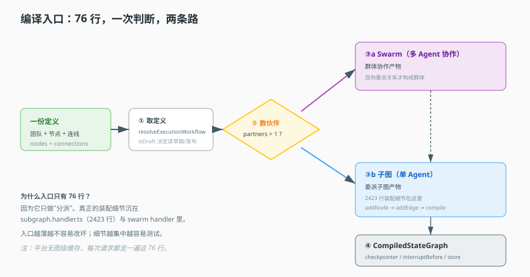
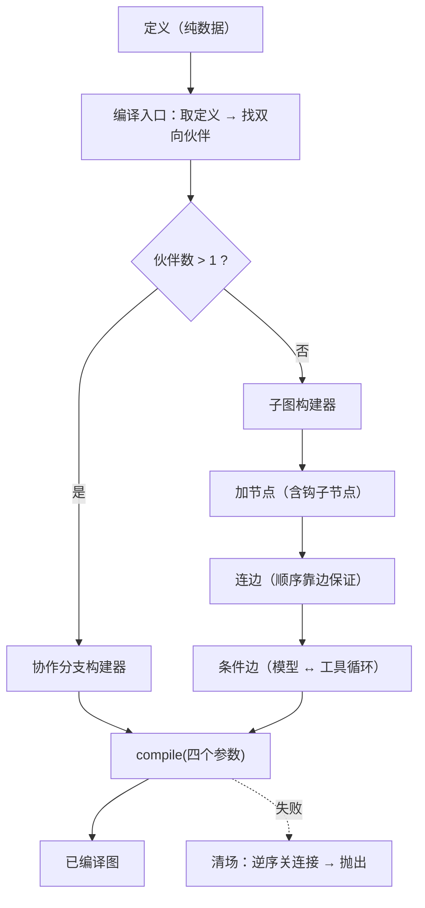

# 第 5 课：编译器

> 所属阶段：阶段 2《定义与编译》｜ 水平：进阶 ｜ 本课知识点：编译入口与分支路由、原生子图构建、编译产物
> 故事情节：定义只是一张图纸，这一课看"图纸怎么变成能跑的东西"。
> 📖 结论已按官方文档核对（核对于 2026-11 ｜ 来源：[LangGraph Graph API](https://docs.langchain.com/oss/javascript/langgraph/graph-api)、[子图](https://docs.langchain.com/oss/javascript/langgraph/use-subgraphs)）


## 🎯 本课目标

- 说清编译入口如何用一个条件决定走"多 Agent 协作"还是"单 Agent"
- 画出状态图的装配顺序，说清钩子如何变成节点、顺序如何被保证
- 说清编译产物的四个关键参数，以及"没有缓存"的含义与代价
- 说清编译失败为什么要清理现场

## 🧑‍💻 前置知识速览

- **状态图（StateGraph）**：节点 + 边 + 条件的可执行图。
- **递归编译**：编译 A 时发现 A 委派给 B，于是去编译 B（课 4 讲的构建环就是防这个）。
- **洋葱模型**：进去的顺序和出来的顺序相反，像穿过一层层洋葱。

## 第一幕：起源与场景引入

> 🎬 **场景**：一个只有几十行的文件，凭什么决定整个平台的运行方式？

你在源码里数了一下编译入口：去掉 import 和空行，真正干活的不到 40 行。

但就是这 40 行，决定了：一次请求是走"多个 Agent 协作"，还是走"单个 Agent 干活"。这是整个平台最贵的分组判断，却写在最短的文件里。

而另一边，真正搭图的那个文件有两千多行。

> 📌 **一句话本质**：编译面做的事只有一件——**把定义（数据）翻译成状态图（可执行对象）**。它不做业务判断，不跑模型，不调工具。

> ⚖️ **处境对照**：不这么做 → 每个 Agent 都要手写一份建图代码，改一次定义就要改一次代码；这么做 → 建图逻辑收敛成一个编译器，定义怎么变都只是"输入变了"。

## 第二幕：认知冲突

> ❓ **问题**：既然装配那么复杂（两千多行），为什么入口可以薄到几十行？

因为**复杂度被挪走了，不是被消灭了**。入口只负责"分派"——判断该走哪条路，然后把活交给对应的构建器。真正的装配细节沉在子图构建器里。

这种"入口极薄、执行极厚"的切分不是巧合，而是三个考虑：

- **入口越薄越不容易被改坏**。分派逻辑是全局性的，改错了影响所有 Agent。
- **细节越集中越容易单独测试**。装配逻辑可以对着一个定义单独跑，不需要启动整个服务。
- **分支点越少越好**。如果入口里有五个 if，你就得测 2⁵ 种组合；只有一个 if，就测两种。

## 第三幕：层层揭示

### 一眼全局图（进入细节前先看一眼）



> 看图：左边进来一份定义，中间是一个菱形判断（伙伴数 > 1？），右上是协作分支、右下是子图分支。两条路最后都汇到同一个产物：可执行图。整张图只有一次判断——这就是"入口很薄"的全部原因。

### 本课地图（分几步走）

| 步 | 这一步要解决什么（人话） | 对应知识点 |
|:--:|--------------------------|-----------|
| 1 | 入口到底怎么判断走哪条路 | 知识点 1：编译入口与分支路由 |
| 2 | 单 Agent 的图是怎么搭起来的，钩子插在哪 | 知识点 2：原生子图构建 |
| 3 | 搭完得到什么、能复用吗、失败怎么暴露 | 知识点 3：编译产物 |

### 知识点 1：编译入口与分支路由

> 🧭 第 1/3 步｜承接：第二幕"为什么入口能这么薄" → 本步：看它到底做了什么判断
> 本知识点关键点：四步结构、伙伴判定的语义、为什么是 >1 不是 >0

- 关键点：四步——取定义 → 找伙伴 → 分派 → 返回产物
- 关键点：判定条件是"伙伴数 > 1"，不是 "> 0"
- 关键点："伙伴"的定义是**双向委派关系**（A 委派 B 且 B 委派 A），且递归收集
- 关键点：编译做成命令而非普通函数，是为了解耦与可审计

#### 一句话定义

编译入口就是一个**路由器**：拿到定义，判断这个 Agent 有没有"伙伴"——有就走多 Agent 协作分支，没有就走单 Agent 子图分支。

#### 直觉建立（类比）

想象医院的分诊台：

- 病人进来（定义进来），护士只做一件事：**判断该去哪个科室**。
- 有多个专家要会诊 → 送"多学科会诊"。
- 一个医生能处理 → 送普通门诊。
- 分诊台本身不治病——它只负责"分对门"。

> 💡 **类比的边界**：分诊台判断依据是病情；这里判断依据是**图的连接结构**，是静态的、可提前算出来的。

#### 核心原理

**四步结构**：

```python
async def execute(cmd: CompileCommand):
    # ① 取定义（可能是草稿，也可能是某个固定版本）
    definition = await resolve(cmd.agent_key, cmd.version, cmd.is_draft)
    if not definition:
        raise NotFound(f"agent {cmd.agent_key} not found")

    # ② 找伙伴（递归收集双向委派关系）
    partners = find_partners(definition, definition.leader_key)

    # ③ 分派
    if len(partners) > 1:
        graph = await build_collaboration(definition, partners)
    else:
        graph = await build_subgraph(definition)

    # ④ 返回
    return {"graph": graph, "definition": definition}
```

**"伙伴"到底在算什么**：不是"所有和我相连的 Agent"，而是"**和我互相委派**的 Agent"：

```python
def find_partners(defn, agent_key, collected=None, excluded=None):
    collected = collected or []
    excluded = excluded or set()

    # 只沿"委派"这种边找，且必须是双向：A→B 且 B→A
    for c in defn["connections"]:
        if c["type"] != "agent":
            continue
        if c["to"] != agent_key or c["from"] == excluded:
            continue
        # 检查反向边是否存在
        has_reverse = any(x["type"] == "agent"
                          and x["from"] == agent_key and x["to"] == c["from"]
                          for x in defn["connections"])
        if not has_reverse:
            continue

        partner = c["from"]
        if partner not in collected:
            collected.append(partner)
            # 递归：伙伴的伙伴也是伙伴
            find_partners(defn, partner, collected, excluded | {agent_key})

    return collected
```

**为什么必须是双向**：单向的"我委派给你"是**上下级关系**（我是主管，你是下属），这种关系用子图表达就够了——主管调一个子任务，拿回结果，继续。而"我们互相委派"才是**对等协作**：A 觉得这事该 B 判断，B 觉得该 A 判断，控制权在两者之间流转（课 9 的 Swarm）。

**为什么是 `> 1` 而不是 `> 0`**：这是最容易读错的一处。

- `partners.length === 1`：只有一个伙伴 → A↔B 一对一 → 退化成"两个角色轮流说话"，用子图 + 转接就够，不需要群体机制。
- `partners.length > 1`：至少三个参与者 → 才构成"群体"，需要一套"当前谁在台前"的状态（`activeAgent`）。

所以这一行判断的真正含义是：**"这场对话有几个参与者"决定了要不要引入群体机制。**

**为什么编译做成命令而不是普通函数**：因为它会被多个地方触发（请求路径、子图递归、工作流编译）。用命令总线分发，让"编译"这件事可被审计、可被替换、可被拦截——如果写成 `new GraphBuilder().build()`，每个调用点都直接依赖了具体实现。

#### 示例演示

一个可运行的分派器 + 一个能验证行为的测试：

```python
def route(defn, agent_key):
    partners = find_partners(defn, agent_key)
    return ("collaboration", partners) if len(partners) > 1 else ("subgraph", partners)

# 场景 A：单向委派（主管 → 下属）
single = {
    "connections": [
        {"from": "leader", "to": "worker", "type": "agent"},
        {"from": "worker", "to": "leader", "type": "edge"},   # 只有回程边，不是委派
    ]
}
assert route(single, "leader") == ("subgraph", [])

# 场景 B：三向互委派（A↔B、B↔C）
group = {
    "connections": [
        {"from": "a", "to": "b", "type": "agent"}, {"from": "b", "to": "a", "type": "agent"},
        {"from": "b", "to": "c", "type": "agent"}, {"from": "c", "to": "b", "type": "agent"},
    ]
}
kind, partners = route(group, "b")
assert kind == "collaboration" and set(partners) == {"a", "c"}
```

第二个场景同时验证了"递归收集"：从 `b` 出发，`a` 和 `c` 都是伙伴。

#### 常见误区

1. **"伙伴数 > 0 就走协作分支"**：是 `> 1`。一个伙伴是上下级，不是群体。
2. **"伙伴就是所有相连的 Agent"**：必须是**双向委派**。单向的是委派关系，不是伙伴。
3. **"编译入口自己建图"**：它只分派，建图在子图构建器里。

#### 一句话记住

取定义 → 找双向伙伴 → 数到 2 以上走群体 → 否则单图；一行判断定全局。

#### 🗣️ 行话对照

- **Swarm / Multi-Agent Collaboration**：多 Agent 协作、群体——本课"协作分支"。
- **Subgraph**：子图、嵌套图——本课"单 Agent 分支"。

---

### 知识点 2：原生子图构建

> 🧭 第 2/3 步｜承接：已进入子图分支 → 本步：图怎么一块块搭起来
> 本知识点关键点：装配顺序、钩子变节点、顺序靠边保证、洋葱模型

- 关键点：装配顺序——先建图 → 加节点 → 连边 → 加条件边 → compile
- 关键点：**钩子在编译期被展开成独立节点**，不是运行时回调——这是本课最重要的认知
- 关键点：顺序不是靠"调用先后"保证，而是靠**显式的边**
- 关键点：进正序、出反序（洋葱模型），反序是为了资源清理的依赖关系

#### 一句话定义

子图构建就是把"节点 + 边"按顺序声明出来，最后 `compile()` 成一个可执行图对象。中间件钩子在这一步被"实体化"成图上的正式节点。

#### 直觉建立（类比）

搭一条流水线：

- 先装工位（加节点）：模型工位、工具工位，还有若干个"检查站"（钩子节点）。
- 再接传送带（连边）：从 A 工位送到 B 工位。
- 再装岔道（条件边）：根据产品类型决定去哪。
- 最后通电（compile）。

> 💡 **类比的边界**：真实流水线的检查站是外挂的（检测设备装在旁边）；这里的"检查站"是**图上的正式节点**，会被明确地接到传送带上——这个差别正是本课最关键的认知。

#### 核心原理

**装配顺序**：

```text
new StateGraph(状态定义)
  ↓
add_node(...)          # 模型节点、工具节点、各类钩子节点
  ↓
add_edge(...)          # 顺序连接
  ↓
add_conditional_edges() # 条件分岔（要不要调工具）
  ↓
compile({ checkpointer, interrupt_before, name, store })
```

**钩子如何变成节点**——这是最关键的一段。一个 `after_model` 钩子不是"注册一个回调"，而是**被包成一个可执行的图节点**：

```python
def expand_hooks(builder, hooks, kind):
    """把一批钩子展开成节点，并按序串边。"""
    keys = []
    for i, hook in enumerate(hooks):
        key = f"{kind}_{hook.name}_{i}"          # 节点在图里必须有唯一名字
        builder.add_node(key, wrap(hook))         # 钩子 → 可执行节点
        keys.append(key)

    # 关键：顺序靠显式的边保证，不靠注册顺序
    for a, b in zip(keys, keys[1:]):
        builder.add_edge(a, b)

    return keys   # 返回首尾，供上层接线
```

**为什么必须显式连边**：这是一种防御性设计。如果顺序只靠"注册时的先后"，那么任何一次代码重构（比如把钩子收集挪到别处）都可能悄悄改变执行顺序，而且**不会报错**——只是行为变了。显式连边让顺序成为图结构的一部分，看得见、测得出。

**洋葱模型的实现**：

```python
before_hooks = collect("before_model")              # 正序进入
after_hooks  = list(reversed(collect("after_model")))  # 反序退出
```

**为什么必须反序**：假设策略 A 在进入时"打开一个连接"，策略 B 在进入时"基于 A 的连接做点事"。退出时 B 必须先清理（它还依赖 A），A 才能后清理。这就是**栈的语义：后进先出**。

搞成正序，就会出现"B 还在用，A 已经把连接关了"——这类 bug 极难查，因为它在大多数情况下不报错，只在特定并发下崩溃。

**模型节点与工具节点的职责切分**：模型节点的产物是"意图"（`tool_call`），工具节点负责"执行"并把结果回填成消息。**模型不执行、工具不思考**——边界非常干净。这个干净不是审美，而是可测试性的前提：你可以单独测工具节点（给一个 tool_call，看它返回什么），不需要跑模型。

#### 示例演示

一个可运行的装配器，把"钩子变节点 + 正序反序"表达完整：

```python
class GraphBuilder:
    def __init__(self):
        self.nodes, self.edges, self.conditional = {}, [], []

    def add_node(self, key, fn): self.nodes[key] = fn
    def add_edge(self, a, b): self.edges.append((a, b))

    def add_conditional_edges(self, src, fn, mapping):
        self.conditional.append((src, fn, mapping))

    def compile(self, **opts):
        return CompiledGraph(self.nodes, self.edges, self.conditional, opts)


def build_subgraph(definition, hooks):
    b = GraphBuilder()
    b.add_node("model", call_model)
    b.add_node("tools", call_tools)

    # 进入：正序
    prev = "START"
    for key in expand_hooks(b, hooks["before_model"], "before_model"):
        b.add_edge(prev, key); prev = key
    b.add_edge(prev, "model")

    # 退出：反序（洋葱模型）
    prev = "model"
    for key in expand_hooks(b, list(reversed(hooks["after_model"])), "after_model"):
        b.add_edge(prev, key); prev = key
    b.add_conditional_edges(prev, route_after_model, {"tools": "tools", "END": "END"})
    b.add_edge("tools", "model")      # 往返循环

    return b.compile(checkpointer=..., interrupt_before=..., name=definition["key"])
```

**验证洋葱模型**：注册三个钩子，每个钩子在进入/退出时各打一条日志，期望输出：

```text
enter A → enter B → enter C → [模型] → exit C → exit B → exit A
```

如果退出是 A→B→C，说明反序没做对。

**验证"钩子确实是节点"**：编译后检查图里的节点数量，应等于 `基础节点 + 钩子数`。如果钩子没有变成节点，节点数不会随钩子增加而增加。

#### 常见误区

1. **"中间件是运行时回调，不影响图结构"**：错。它在编译期被展开成节点，直接改变节点数与边。
2. **"before 和 after 顺序对称"**：不对。进入正序、退出反序。搞反会导致清理顺序错误。
3. **"顺序靠注册先后保证"**：靠显式的边。注册顺序可以被重构悄悄改变。

#### 一句话记住

装节点 → 连边 → 装岔道 → compile；钩子是节点不是回调，进出反向。

#### 🗣️ 行话对照

- **StateGraph**：有向图工作流——本课"图"。
- **Onion Model / Around Advice**：洋葱模型、环绕通知——本课"进正序出反序"。

---

### 知识点 3：编译产物

> 🧭 第 3/3 步｜承接：图搭完了 → 本步：产物是什么、能不能重复用、坏了怎么报
> 本知识点关键点：四个关键参数、无缓存的含义、失败要清场

- 关键点：产物是"已编译图"，绑定 checkpointer（断点）、interrupt_before（中断点）、name、store（长期存储）
- 关键点：四个参数缺一个，对应的一类能力就静默失效
- 关键点：**没有图级缓存**，每次请求重新编译——代价明确
- 关键点：编译有副作用（可能打开连接），失败必须先清理再抛

#### 一句话定义

编译产物是一个已编译图对象——可以直接 `.invoke()` / `.astream()`，并且绑定了检查点存储、中断配置和长期存储。

#### 直觉建立（类比）

从图纸到一台整机：

- 图纸（定义）不是机器，不能直接干活。
- 装配完（compile）得到一台机器，通电就能跑。
- 但机器是"按当前图纸造的"——图纸一改，旧机器就过时了，得重造。

> 💡 **类比的边界**：真实工厂会留机器备用；这里平台**不留**——每次用都重造。这很反直觉，但对理解性能至关重要。

#### 核心原理

**四个参数，各自的"缺了会怎样"**：

| 参数 | 作用 | 不传的后果 |
|---|---|---|
| `checkpointer` | 每步保存状态，支持断点续跑 | 中断后无法恢复，等人确认的流程直接失效 |
| `interrupt_before` | 在这些节点前暂停 | 人工审批类流程静默跳过（更危险：不报错） |
| `name` | 图名（通常用 Agent key） | 调试/追踪时看不出是哪个 Agent，日志无法归因 |
| `store` | 跨会话长期存储 | 记忆类功能静默失效 |

注意其中两个是"静默失效"：**`interrupt_before` 不传不会报错，它只是不暂停**。所以生产环境里必须有用例专门断言"这个流程真的停了"。

```python
compiled = builder.compile(
    checkpointer=checkpointer,          # 断点
    interrupt_before=["human_review"],  # 中断点
    name=definition["key"],             # 身份
    store=long_term_store,              # 长期记忆
)
```

**"没有缓存"这件事要说透**：

```text
每次请求 → 重新编译 → 得到新的图对象
```

好处：永远用最新定义，不存在"缓存过期导致行为不一致"。
代价：编译成本**每次请求都付**。中间件越多、图越大，编译越慢，而这直接体现为**首字延迟**。

所以这条设计选择的实践含义是：如果首字延迟成为瓶颈，优化方向不是"加缓存"（那会引入一致性问题），而是**让编译本身变快**（减少不必要的工作、避免在钩子工厂里做重初始化）。

**失败要清场**：

```python
try:
    compiled = builder.compile(...)
except Exception as e:
    await close_toolsets()      # 编译过程中可能已打开 MCP 连接 / 文件句柄
    raise e
```

**为什么必须先关再抛**：编译不是纯函数——它可能为了拿到工具清单而连上远程服务。如果失败就直接抛，这些连接会泄漏，累积到一定量后整个服务无法建立新连接。这类泄漏通常在"频繁编译失败"的场景下才会暴露，非常难查。

原则：**任何"有副作用的构建过程"，失败路径也必须清理。**

#### 示例演示

一个带资源清理的编译器，展示"失败不留现场"：

```python
class Compiler:
    def __init__(self, toolset_factory):
        self.toolset_factory = toolset_factory

    async def compile(self, definition):
        opened = []
        try:
            # ① 可能打开远程连接（有副作用）
            for tid in definition["toolset_ids"]:
                opened.append(await self.toolset_factory.open(tid))

            # ② 装配
            builder = build_subgraph(definition, hooks=collect_hooks(definition))
            return builder.compile(
                checkpointer=self.checkpointer,
                interrupt_before=definition.get("interrupt_before", []),
                name=definition["key"],
                store=self.store,
            )
        except Exception:
            # ③ 失败清场：逆序关闭，与"洋葱模型"同理
            for ts in reversed(opened):
                await ts.close()
            raise
```

注意 `reversed(opened)`：关闭顺序和打开顺序相反，同样是栈语义。虽然对连接池影响不大，但保持一致能避免"某个资源依赖另一个资源"时出错。

#### 常见误区

1. **"编译一次就能一直复用"**：不缓存。每次请求重新编译。
2. **"编译失败直接抛就行"**：会泄漏连接。必须先清理。
3. **"不传 interrupt_before 会报错"**：不会，它静默跳过。这类"不报错的失效"必须用测试盯住。

#### 一句话记住

产物带四个参数；不缓存是取舍；失败先清场再报。

#### 🗣️ 行话对照

- **CompiledStateGraph**：可执行图、已编译工作流——本课"编译产物"。
- **Checkpointer**：检查点保存器、断点续跑。

---

## 第四幕：实操验证

> 目标：验证"分派条件"、"钩子变节点"、"无缓存"、"失败清场"四条契约。

### 4.1 机制验证

> ✅ 机制实测于 Node v22.22.2 / @langchain/langgraph 1.6.0（脚本 `verify/verify-core.ts`）。上段为伪代码示意，下面是同机制的真实输出：

```text
① 钩子变节点: 0 钩子→2 节点, 2 钩子→4 节点
② 编译是纯翻译: 编译两次后定义未变=true
③ 不缓存: 两次 compile 是同一实例=false（false = 每次重编）
```

> 第 ① 行的 +2 不是巧合：图里本来就有 `__start__` 与 `__end__` 两个虚节点，每加一个钩子就真多一个节点——这就是钩子变成节点的物证。第 ③ 行是本项目的刻意选择：不缓存编译产物，代价是首字延迟，收益是行为永远等于当前定义。

```python
# ① 分派条件：一个伙伴不算群体
assert route(one_way_delegation, "leader")[0] == "subgraph"
assert route(mutual_delegation_group, "b")[0] == "collaboration"

# ② 钩子确实变成节点（节点数随钩子增加）
g1 = build_subgraph(defn, hooks={"before_model": [], "after_model": []})
g2 = build_subgraph(defn, hooks={"before_model": [h1, h2], "after_model": [h3]})
assert len(g2.nodes) == len(g1.nodes) + 3

# ③ 洋葱顺序：退出必须反序
trace = run_and_trace(g2)
assert trace == ["enter:h1", "enter:h2", "model", "exit:h3", "exit:h2", "exit:h1"][:len(trace)]

# ④ 失败清场：连接必须被关闭
compiler = Compiler(failing_toolset_factory())
with raises(Exception):
    await compiler.compile(defn_with_toolset)
assert failing_toolset_factory.opened_connections == 0     # 没有泄漏
```

第 ④ 条尤其值得写进 CI：**资源泄漏不会让功能坏掉，只会让它"三个月后突然连不上"**。

> ✅ **回扣场景**：现在你能回答"为什么改一个模型配置不用改代码"——因为模型名是定义的输入，编译把它翻译成图；代码只负责翻译，不关心翻译的是什么。

## 第五幕：体系收束

编译面是"中间那一层"：入口只做分派，构建器负责搭图，产物是一个带检查点的可执行图。它把"数据"和"行为"之间那道坎，用一次翻译跨过去了。

> 📍 **全局定位**：这一课是阶段 2 的枢纽——上游接定义（课 4），下游接状态（课 6）与中间件（课 7）。
> 🔗 **下一步**：图搭好了，但图要"记住东西"。下一课拆开图的内部结构：状态通道各是什么、谁在写、并发写会怎样。

## 🐞 全课常见误区

1. **"编译入口自己建图"**：只分派。
2. **"中间件是运行时回调"**：编译期展开成节点。
3. **"编好的图会缓存"**：没有，每次请求重编。
4. **"before/after 顺序对称"**：退出反序。
5. **"不传 interrupt_before 会报错"**：静默失效，必须测试盯住。

## 一图总结



> 课首图是"一次判断"的极简视角；此图是"两支汇流 + 失败路径"的完整视角。

## 课后小测

**Q1**：判定"伙伴数 > 1"才走协作分支，为什么不是 "> 0"？
- A. 性能考虑　B. 单个伙伴是上下级委派关系，不足以构成需要"当前角色"状态的群体　C. 历史遗留 bug　D. 防止无限递归

<details><summary>答案与解析</summary>

**答案：B**。伙伴指双向委派关系。只有 1 个伙伴时是 A↔B 一对一，用子图 + 转接即可；≥2 个才构成群体，才需要 `activeAgent` 这类状态。

</details>

**Q2**：一个装了 8 个中间件的 Agent，它的图会怎样变化？
- A. 不变，中间件是运行时回调　B. 增加节点，每个钩子在编译期展开成独立节点　C. 减少　D. 取决于模型

<details><summary>答案与解析</summary>

**答案：B**。钩子在编译期被包装成独立图节点，并靠显式 `add_edge` 串起来。中间件越多，图的节点越多，编译成本也越高（因为无缓存）。

</details>

## 🚀 下一批接力提示词

```
继续学 Agent 工程解剖。我的学习档案在 agent-engineering/00-学习档案.md，
刚学完阶段 2 的课 5《编译器》知识点 1 编译入口与分支路由、知识点 2 原生子图构建、知识点 3 编译产物，
请按大纲继续讲解下一课《状态通道》。
```

## 🧭 课程导航

⬅️ **上一课**：[课 4：声明式定义](04-声明式定义.md)
➡️ **下一课**：[课 6：状态通道](06-状态通道.md)
📚 **返回目录**：[课程目录](../../../02-课程目录.md)
