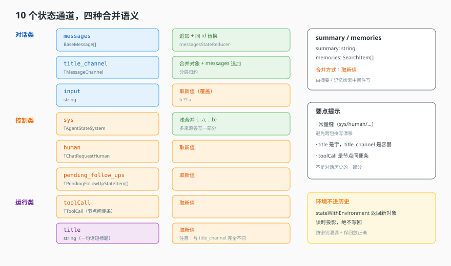
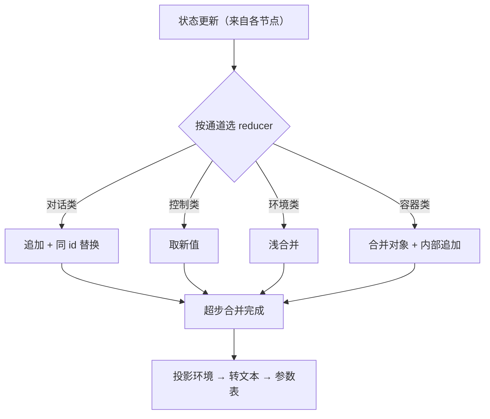

# 第 6 课：状态通道

> 所属阶段：阶段 2《定义与编译》｜ 水平：进阶 ｜ 本课知识点：通道划分、reducer 与并发、运行时注入、状态到参数
> 故事情节：图有了，但图要"记住东西"。主角的短期记忆如何组织，决定了它能走多远。
> 配应用实战：[实战 06](../../../应用实战/06-从单一messages到通道化状态.md)
> 📖 结论已按官方文档核对（核对于 2026-11 ｜ 来源：[LangGraph Graph API（状态与 reducer）](https://docs.langchain.com/oss/javascript/langgraph/graph-api)、[LangChain 短期记忆](https://docs.langchain.com/oss/javascript/langchain/short-term-memory)）


## 🎯 本课目标

- 说清为什么要分通道而不是一个大对象，并列出各类通道的用途
- 解释 reducer 的行为，说清并发写同一通道时什么时候会丢数据
- 说清环境信息为什么不能写进持久化状态，以及"读时投影"的含义
- 说清状态值如何变成提示词里可用的参数

## 🧑‍💻 前置知识速览

- **状态（State）**：图在节点之间传递的数据容器。
- **归约（Reduce）**：把多个值合并成一个值的规则（如"追加"、"取最新"）。
- **记忆化 / 持久化**：把状态存下来，以便下次继续或事后回放。

## 第一幕：起源与场景引入

> 🎬 **场景**：一切都塞进 messages，第三周就崩了

你第一版写得很简单：所有东西都塞进 `messages`——用户说话、模型回答、工具结果，全在一条数组里。

第三周问题来了：

- 你想给对话起个短标题，结果塞进去后它成了对话的一部分，模型开始"回答"这个标题。
- 你想做摘要压缩，旧的摘要和新的消息混在一起，越压越乱。
- 你想传一个临时变量给下一个节点，塞进去后它永远留在了历史里。

你意识到：**"记住什么"和"记住的东西怎么组织"是两件事**。本课讲后者。

> 📌 **一句话本质**：状态不是一个大袋子，而是**一组各自有归约规则的通道**。分通道，是为了让不同来源、不同生命周期的数据互不污染。

> ⚖️ **处境对照**：不这么做 → 所有数据挤在 messages 里，摘要、标题、临时变量互相踩；这么做 → 每种数据有自己的通道和自己的合并规则，加新功能不再需要改老逻辑。

## 第二幕：认知冲突

> ❓ **问题**：既然分通道更麻烦，为什么不直接用一个对象，想放什么放什么？

因为状态是**被并发写入**的。图里多个节点可能在同一轮（同一超步）内各自产出状态更新。如果用一个大对象，最后一次写入会把别人的写覆盖掉。

而"通道 + reducer"解决的正是这个问题：每个通道声明"当新值和旧值都到了，怎么合并"。合并规则**写在数据结构里**，而不是散在业务代码里——这一点很关键：散在业务代码里的合并逻辑，一定有某个节点会忘记写。

还有一个更隐蔽的好处：**分通道让"谁有权写什么"变得可见**。看通道列表就知道系统里有哪些类信息在流动；如果全塞进一个对象，你只能靠读所有代码才知道有哪些数据。

## 第三幕：层层揭示

### 一眼全局图（进入细节前先看一眼）



> 看图：左边是各类通道（分三类：对话类、控制类、运行类），每个通道右侧标注它的合并方式（追加 / 覆盖 / 合并）。中间那个"超步合并"是整个机制的核心——每次节点执行完，所有通道按自己的规则合并一次。

### 本课地图（分几步走）

| 步 | 这一步要解决什么（人话） | 对应知识点 |
|:--:|--------------------------|-----------|
| 1 | 通道该怎么划分、谁在写 | 知识点 1：通道划分 |
| 2 | 两个人同时写一个通道会怎样 | 知识点 2：reducer 与并发 |
| 3 | 环境变量为什么不能写进历史 | 知识点 3：运行时注入 |
| 4 | 状态里的值怎么变成提示词参数 | 知识点 4：状态到参数 |

### 知识点 1：通道划分

> 🧭 第 1/4 步｜承接：第二幕"为什么要分" → 本步：分成哪几类、各自干什么
> 本知识点关键点：四种合并语义、常量键、名字相近的通道易混

- 关键点：通道按"生命周期"分成对话类、控制类、运行类
- 关键点：只有**四种**合并语义——追加、取新、浅合并、浅合并 + 子归约
- 关键点：名字相近但类型不同的通道是最常见的 bug 源（如"标题"与"标题对话容器"）
- 关键点：用常量键而非字面量——拼错字面量不报错，只是读不到值

#### 一句话定义

状态定义就是这张图的"schema"：它声明了这张图能记住哪几样东西，以及每样东西怎么合并。

#### 直觉建立（类比）

想象一个剧组的**场记板**：

- 台词本（对话通道）：按顺序记所有对话，只能往后加。
- 当前场景（输入通道）：只记"这一条输入"，下一条来了就换掉。
- 环境信息（系统通道）：拍摄时间、天气、机位——多个来源各写各的，最后合成一份。
- 场记备注（人工通道）：导演临时说的话，最新的覆盖旧的。
- 分场标题（标题通道）：一句话概括这场戏。
- 分场台词（标题对话容器）：这场戏里单独的那本台词。

> 💡 **类比的边界**：剧组的场记板是给人看的；这里每个格子是给**程序读写**的，所以必须明确声明"同一个格子被两个人同时写怎么办"。

#### 核心原理

**四种合并语义，覆盖所有需求**：

| 语义 | 例子 | 什么时候用 | 并发写两个值的结果 |
|---|---|---|---|
| 追加 | 对话历史 | 需要保留全部轨迹 | 两条都保留 |
| 取新 | 当前输入、标题、摘要 | 只关心最新值 | 只有一个（另一个丢失） |
| 浅合并 | 环境信息 | 多个来源各写一部分字段 | 双方字段都在（同名后者覆盖） |
| 浅合并 + 子归约 | 标题对话容器 | 对象合并，但内部消息要追加 | 字段合并 + 消息累积 |

`state/summary/输入` 归到"取新"类；对话归到"追加"类；`sys` 归到"浅合并"类。

**按生命周期分三类**，这个视角比"记住通道名"有用得多：

| 类别 | 生命周期 | 典型通道 | 特征 |
|---|---|---|---|
| 对话类 | 全程累积 | 对话历史、摘要 | 只增不减，或只保留最新一份概括 |
| 控制类 | 单轮有效 | 当前输入、工具调用意图、待跟进项 | 下一轮就该被新值替换 |
| 运行类 | 环境相关 | 环境变量、记忆检索结果 | 每轮重新计算，不该持久化 |

**为什么要用常量键**：同一个字符串会在多个地方出现（状态定义、中间件读值、节点写值）。用常量，改一处全生效；用字面量，总有一处会拼错，而且**拼错不报错，只是读到 undefined**——这类 bug 表现为"功能时好时坏"，极难排查。

```python
# ✅ 常量：拼错立刻 AttributeError
STATE_SYS = "sys"
STATE_HUMAN = "human"
state[STATE_SYS]

# ❌ 字面量：拼错静默失败
state["sys "]      # 多了一个空格，读不到，但不报错
```

**最容易混的一处**：名字只差一个后缀的两个通道。

- `title`：一个字符串——一句话的短标题。语义是"取新"。
- `title_channel`：一个**消息容器**（有自己的一组消息和归约规则）。语义是"合并 + 内部追加"。

为什么要两个？因为"生成标题"这件事本身可能需要一轮对话（问模型："请给这段对话起个标题"）。这轮对话**不能污染主对话历史**，所以要单独的容器。

搞混的后果：往字符串通道塞消息数组，然后在别处读到 `undefined`；或者往容器通道塞字符串，导致内部消息归约崩掉。

#### 示例演示

用 Python 把四种语义各写一遍，这是最直观的方式：

```python
from typing import Any, Callable

# ① 追加
def append_reducer(old: list, new: list) -> list:
    return (old or []) + (new or [])

# ② 取新（新值优先，允许 new 为 None 时保留旧值）
def replace_reducer(old: Any, new: Any) -> Any:
    return new if new is not None else old

# ③ 浅合并
def merge_reducer(old: dict, new: dict) -> dict:
    return {**(old or {}), **(new or {})}

# ④ 浅合并 + 子归约
def nested_reducer(old: dict, new: dict) -> dict:
    if not new:
        return old
    return {
        **old, **new,
        # 关键：内部 messages 仍走追加，不被 b 覆盖
        "messages": append_reducer(old.get("messages", []), new.get("messages", [])),
    }

STATE_CHANNELS: dict[str, Callable] = {
    "messages":     append_reducer,
    "summary":      replace_reducer,
    "sys":          merge_reducer,
    "title_channel": nested_reducer,
}
```

`nested_reducer` 那行注释是本知识点的核心：**分层归约**——外层合并、内层追加。写成 `{**old, **new}` 就丢了内层的追加语义，标题对话的历史会被第二次写覆盖。

#### 常见误区

1. **"名字相近的通道差不多"**：一个是字符串、一个是容器。类型完全不同。
2. **"所有通道都是追加"**：只有对话类（和容器内部的 messages）是追加，控制类多半取新值。
3. **"用字面量更直观"**：拼错不报错，只静默读不到值。用常量。

#### 一句话记住

四种语义（追加 / 取新 / 浅合并 / 分层归约）；按生命周期分三类；常量键防拼错。

#### 🗣️ 行话对照

- **Channel**：通道、状态字段——本课"通道"。
- **Annotation / Schema**：声明通道的方式——本课"状态定义"。

---

### 知识点 2：reducer 与并发

> 🧭 第 2/4 步｜承接：知道每个通道怎么合并 → 本步：并发写时到底发生什么
> 本知识点关键点：追加的隐藏语义、并发三态、丢数据何时是 bug 何时是设计

- 关键点：追加 reducer 通常还带**去重/替换**（同 id 的消息被替换而不是重复追加）
- 关键点：并发写同一通道时，reducer 决定"合并"还是"覆盖"
- 关键点：取新型通道丢数据**不是 bug 是设计**；往取新型通道传需要累积的信息才是 bug
- 关键点：reducer 不是只在并发时生效，它**每次状态更新都走**

#### 一句话定义

reducer 就是"当旧值 a 和新值 b 同时存在时，返回什么"——它是状态合并的唯一契约，也是并发安全的唯一保障。

#### 直觉建立（类比）

两个人同时往白板上写：

- 规则是"接着往后写"（追加）：两人的内容都能留下。
- 规则是"擦掉重写"（覆盖）：后写的抹掉先写的。
- 规则是"各写自己的便签、贴到同一块板"（浅合并）：两边信息都在。

> 💡 **类比的边界**：白板是物理的，谁先谁后有肉眼可见的顺序；图里是靠"超步"批量合并，合并顺序由框架保证，不靠人工协调。

#### 核心原理

**追加的隐藏语义：去重**。追加不是简单的 `old + new`，通常还会检查消息 id：

```python
def messages_reducer(old: list, new: list) -> list:
    """追加 + 同 id 替换。"""
    result = list(old or [])
    index = {m["id"]: i for i, m in enumerate(result) if "id" in m}
    for msg in new or []:
        mid = msg.get("id")
        if mid and mid in index:
            result[index[mid]] = msg        # 同 id：替换，原地更新
        else:
            index[mid] = len(result) if mid else None
            result.append(msg)              # 新 id：追加
    return result
```

为什么必须有"同 id 替换"？因为**流式输出**：模型一边生成一边更新同一条消息。如果每次增量都 append，一条回答会被拆成几十条消息，模型下一轮看到的就是一堆碎片。

**并发写的三种结果**：

| 通道类型 | 两个值同时到 | 结果 | 是否合理 |
|---|---|---|---|
| 追加 | a 和 b | 两条都保留 | ✅ 合理 |
| 取新 | a 和 b | 只有一个（另一个丢失） | ✅ 合理（这就是语义） |
| 浅合并 | a 和 b | 双方字段都在（同名键后者胜） | ⚠️ 取决于是否有同名键 |

**关键认知：取新型通道丢数据不是 bug**。`title` 就该只有一个值，`summary` 就该是最新摘要。

真正的 bug 是**往取新型通道传需要累积的信息**。比如你想记录"这个会话里用户提过的所有要求"，塞进取新通道，结果只剩最后一条——这不是 reducer 的错，是通道选错了。

**reducer 不是只在并发时生效**：单线程、单节点、顺序执行时，每次状态更新也走 reducer。所以它更像是"每次写入的归一化函数"，而不只是"并发冲突解决方案"。理解这一点，你就不会写出"我以为顺序执行就不会走 reducer"的代码。

#### 示例演示

一个能暴露"丢数据"的测试——这是最有价值的示范，因为它捕获的是设计错误：

```python
def test_replace_channel_loses_history():
    """取新型通道不保留历史——这是设计，不是 bug。"""
    state = {"summary": "旧摘要"}
    state["summary"] = replace_reducer(state["summary"], "新摘要")
    assert state["summary"] == "新摘要"
    # 旧摘要已经没了。如果你需要保留历史，必须换通道：
    # "summary_history": append_reducer

def test_append_channel_keeps_both():
    state = {"messages": [{"id": "1", "content": "hi"}]}
    state["messages"] = messages_reducer(
        state["messages"], [{"id": "1", "content": "hi (updated)"}]
    )
    assert len(state["messages"]) == 1                  # 同 id 被替换
    assert state["messages"][0]["content"] == "hi (updated)"

def test_nested_reducer_does_not_drop_inner_messages():
    old = {"title_channel": {"system": "s", "messages": [{"id": "m1"}]}}
    new = {"title_channel": {"messages": [{"id": "m2"}]}}
    merged = nested_reducer(old["title_channel"], new["title_channel"])
    assert [m["id"] for m in merged["messages"]] == ["m1", "m2"]   # 内层追加生效
```

第三个测试防的是最常见的实现错误：把分层归约写成普通浅合并，导致内层消息被覆盖。

#### 常见误区

1. **"reducer 只在并发时起作用"**：每次更新都走。
2. **"往取新通道累加多轮数据"**：做不到，会被覆盖。要累积就换通道或改 reducer。
3. **"追加就是 concat"**：通常还带去重/替换，否则流式输出会产生碎片消息。

#### 一句话记住

reducer 是每次写入的归一化；追加保历史、取新只留最新、分层归约别丢内层。

#### 🗣️ 行话对照

- **Reducer**：归约器、状态合并函数。
- **Superstep**：超步——图执行的一轮，每轮结束合并所有通道。

---

### 知识点 3：运行时注入

> 🧭 第 3/4 步｜承接：状态会被持久化 → 本步：哪些东西绝不能写进去
> 本知识点关键点：读时投影、三个不能写回的理由、注入时机

- 关键点：环境信息通过**投影函数**在读取时叠加，产出新对象，绝不回写入参
- 关键点：三个不能写回的理由——安全（密钥）、正确性（历史应记录当时）、一致性（回放应反映当前）
- 关键点：这是"读时投影"，不是"写时快照"
- 关键点：注入时机是"每次用到才叠加"，不是启动时一次

#### 一句话定义

运行时注入指：在**读状态的那一刻**，把当前环境（变量、配置）叠加到状态之上，形成一个临时视图，而不写回持久化状态。

#### 直觉建立（类比）

看照片时戴不同的滤镜：

- 照片本身（历史状态）不变。
- 你今天戴暖色滤镜（当前环境），看到的色调变了。
- 明天换冷色滤镜，同一张照片又是另一个样子。
- 但照片文件一个字节都没改。

> 💡 **类比的边界**：滤镜只改颜色；这里的环境变量可以往状态里"增加键"（如 `env.API_KEY`），是结构性的叠加。

#### 核心原理

```python
def with_environment(state: dict, environment: dict | None) -> dict:
    """纯函数：返回新对象，不修改入参。"""
    if not environment or not environment.get("variables"):
        return state

    env_view = {v["name"]: v["value"] for v in environment["variables"]}
    return {**state, "env": env_view}      # 原状态展开 + 叠加 env
```

**为什么不能写回历史——三个理由，各自对应一类事故**：

**① 安全**。环境变量可能含密钥、租户配置、内部地址。写进历史状态就会被：持久化到检查点（落库）、被日志打印、被导出的对话带走。一次"为了调试临时打印 state"，就把密钥写进了日志系统。

**② 正确性**。历史应该记录"当时发生了什么"，而不是"现在的环境是什么"。如果写回，那么回放一段三天前的会话，会把今天的 API Key 混进当时的上下文——你无法再回答"当时它为什么那么答"。

**③ 一致性**。同一段历史，在不同环境下回放应该得到不同结果（因为环境变了），这是**特性**而非 bug。写时快照会把这个特性永久固化掉。

**读时投影 vs 写时快照**——这是本知识点的核心区分：

| | 写时快照 | 读时投影 |
|---|---|---|
| 什么时候定 | 写入那一刻固化成数据 | 每次读取时计算 |
| 环境变了会怎样 | 历史里的值不变（可能已失效） | 立即反映新环境 |
| 适合什么 | 需要永久留证的数据 | 多租户、动态配置 |

对多租户系统，后者是唯一正确的选择：同一份 Agent 定义被多个租户使用，环境（密钥、模型供应商、配额）各不相同，绝不能固化。

#### 示例演示

一个能验证"纯函数"的测试——这是本知识点最重要的行为契约：

```python
def test_projection_does_not_mutate():
    original = {"messages": [{"id": "1"}], "summary": "s"}
    snapshot = json.dumps(original, sort_keys=True)     # 留证

    projected = with_environment(original, {"variables": [{"name": "API_KEY", "value": "sk-1"}]})

    assert json.dumps(original, sort_keys=True) == snapshot   # 入参一个字节没变
    assert projected["env"]["API_KEY"] == "sk-1"              # 投影里有
    assert projected is not original                          # 是新对象

def test_projection_reflects_current_env():
    state = {"messages": []}
    a = with_environment(state, {"variables": [{"name": "MODE", "value": "test"}]})
    b = with_environment(state, {"variables": [{"name": "MODE", "value": "prod"}]})
    assert a["env"]["MODE"] == "test"
    assert b["env"]["MODE"] == "prod"        # 同一份历史，不同环境得到不同视图
```

第二个测试正是"一致性"那条理由的可执行表达。

#### 常见误区

1. **"环境变量应该存进 state 里，方便到处用"**：绝对不能。会污染历史、泄漏密钥、破坏回放。
2. **"注入一次就固定了"**：每次读取时投影，环境变了立即反映。
3. **"投影函数可以就地修改 state 省内存"**：绝对不行。一旦就地修改，"历史不可变"这个前提就没了。

#### 一句话记住

环境是滤镜不是底片——读时叠加，绝不回写。

#### 🗣️ 行话对照

- **Projection**：投影、派生视图。
- **Pure Function**：纯函数——同样输入得同样输出，且不修改入参。

---

### 知识点 4：状态到参数

> 🧭 第 4/4 步｜承接：状态有了、环境也叠上了 → 本步：它怎么变成提示词里的占位符
> 本知识点关键点：转换规则、为什么消息要特殊处理、隔离靠命名空间

- 关键点：转换分三步——先叠环境、再逐个转换、标量原样保留
- 关键点：消息数组必须转成"角色: 内容"的文本，否则模板渲染出对象
- 关键点：其他数组/对象转 JSON 或递归处理
- 关键点：多 Agent 的隔离靠**命名空间**（各自的通道键），不靠重命名

#### 一句话定义

把"状态对象"翻译成"提示词模板可用的参数表"——让 `{input}` 这样的占位符能被真实值替换。

#### 直觉建立（类比）

填表：

- 表格（模板）上写着"姓名：____""日期：____"。
- 你手上有一堆资料（状态）。
- 填表动作就是把资料对应地填进空格。
- 但资料不能直接塞——日期要格式化、附件要装订（数组要转文本），否则表格放不下。

> 💡 **类比的边界**：填表是人工的、一次性的；这里是程序每次调用模型前自动做的，且必须可预测（同样的状态永远得到同样的参数）。

#### 核心原理

```python
def state_to_parameters(state: dict, environment: dict | None = None) -> dict:
    view = with_environment(state, environment)        # ① 先叠环境
    params = dict(view)

    for key, value in view.items():
        if value is None:
            continue
        if isinstance(value, list):
            if key == "messages":
                params[key] = to_transcript(value)     # 消息 → "角色: 内容" 文本
            else:
                params[key] = "\n\n".join(
                    v if isinstance(v, str) else json.dumps(v, ensure_ascii=False)
                    for v in value
                )
        elif isinstance(value, dict):
            params[key] = {
                k: (to_transcript(v) if k == "messages" else v)
                for k, v in value.items()
            }
        # 标量原样保留
    return params


def to_transcript(messages: list) -> str:
    return "\n".join(f"{m.get('role', 'user')}: {m.get('content', '')}" for m in messages)
```

**三条规则的因果链**：

| 值类型 | 转换 | 不转会怎样 |
|---|---|---|
| 标量 | 原样 | — |
| 消息数组 | 转对话文本 | 模板渲染出 `[object Object]`，模型看不懂 |
| 其他数组/对象 | 转 JSON / 递归 | 同上，或者 Python repr 泄漏进提示词（带单引号，模型容易误读） |

**为什么 `messages` 必须特殊处理**：因为模型需要的不是"消息对象数组"，而是"一段可以当上下文读的文本"。而且格式必须稳定——`role: content` 这种形式模型训练时见过，理解得最好。

**命名冲突靠作用域隔离**：

```python
# 多 Agent 场景：每个子 Agent 的消息在自己的命名通道里
"messages"                # 主 Agent
"reviewer_channel": {...} # 子 Agent，内部也有 messages
```

为什么不用"重命名"（比如 `reviewer_messages`）？因为子 Agent 的图要能复用同一套节点逻辑——节点里只写 `state["messages"]`，具体是哪个 Agent 的，由"它拿到哪个子状态"决定。这是**作用域**的思想：同一段代码在不同作用域下看到不同的 `messages`。

**只读翻译**：`state_to_parameters` 不改状态，只产出参数表，所以可以安全地反复调用（比如同一轮里既渲染系统提示词又渲染用户模板）。

#### 示例演示

一个完整的端到端小例子：

```python
state = {
    "messages": [
        {"role": "user", "content": "帮我查退款"},
        {"role": "assistant", "content": "好的，请提供订单号"},
    ],
    "summary": "用户在咨询退款",
    "sys": {"lang": "zh"},
}
env = {"variables": [{"name": "TENANT", "value": "acme"}]}

params = state_to_parameters(state, env)

# 模板里就能直接用：
template = """
租户：{env[TENANT]}
摘要：{summary}

历史：
{messages}

用户最新问题：{input}
"""
# messages → "user: 帮我查退款\nassistant: 好的，请提供订单号"
```

**一个必测的边界**：`state` 里出现 `None` 值或空数组时，`state_to_parameters` 不应崩，也不应在参数表里留下 `None`（否则模板渲染出 "None" 字样）。上面的 `if value is None: continue` 就是为此。

#### 常见误区

1. **"状态里的对象可以直接插进提示词"**：必须先转字符串，否则渲染出对象表示。
2. **"多 Agent 的 messages 会互相覆盖"**：不会。各在自己的命名通道下，天然隔离。
3. **"转换函数会顺手优化一下状态"**：不能。它必须是只读的，否则"同样的状态得到同样的参数"这个前提就破了。

#### 一句话记住

先叠环境、消息转文本、结构转 JSON；隔离靠命名空间，转换只读。

#### 🗣️ 行话对照

- **Transcript / Buffer String**：把消息数组转成文本——本课 `to_transcript`。
- **Parameters / Template Variables**：提示词模板变量——本课"参数表"。

---

## 第四幕：实操验证

> 目标：验证"四种归约语义"、"投影是纯函数"、"转换只读"三条契约。

### 4.1 机制验证

> ✅ 机制实测于 Node v22.22.2 / @langchain/langgraph 1.6.0（脚本 `verify/verify-core.ts`）。上段为伪代码示意，下面是同机制的真实输出：

```text
① messages（追加）→ ["第一句","第二句"]
   title（取新）→ "新标题"
   result（追加）→ ["r1","r2"]
② 并发写: log=["a","b"]（两条都在）| winner="b"（只留一个）
③ 读时投影: 状态里没有 tenant=true，投影后参数里有=true
```

> 第 ② 行是通道设计的存在理由：同一个图里，`log` 通道并发写不丢，`winner` 通道并发写只留最后一个。**这不是 bug，是两种语义各自正确**。把它们塞进同一个大对象，就只能二选一——那才是 bug。

```python
# ① 四种语义各自的行为
assert append_reducer([1], [2]) == [1, 2]
assert replace_reducer("old", "new") == "new"
assert merge_reducer({"a": 1}, {"b": 2}) == {"a": 1, "b": 2}
assert nested_reducer({"messages": [1]}, {"messages": [2]})["messages"] == [1, 2]

# ② 同 id 消息被替换，不重复追加
msgs = messages_reducer([{"id": "1", "content": "a"}], [{"id": "1", "content": "b"}])
assert len(msgs) == 1 and msgs[0]["content"] == "b"

# ③ 投影是纯函数（入参不变、返回新对象）
orig = {"messages": []}
after = with_environment(orig, {"variables": [{"name": "K", "value": "V"}]})
assert orig == {"messages": []} and after is not orig

# ④ 转换不改状态，且消息变文本
state = {"messages": [{"role": "user", "content": "hi"}]}
params = state_to_parameters(state)
assert isinstance(params["messages"], str) and "user: hi" in params["messages"]
assert isinstance(state["messages"], list)          # 原状态未被改动
```

**这四条断言分别盯住**：语义正确、流式不产生碎片、密钥不进历史、模板能渲染。都是"错了不会立刻报错"的地方。

> ✅ **回扣场景**：回到开头"标题被模型当成对话回答"的问题——根因是标题应该写进"取新值的字符串通道"，而不是塞进"追加的对话通道"。一句话的修复，背后是通道语义的理解。

## 第五幕：体系收束

状态不是一个大袋子，而是有明确归约规则的一组通道：对话追加、控制取新、环境合并、参数翻译。分通道的本质是**让"数据怎么合并"成为结构的一部分，而不是每个节点各自记得**。

> 📍 **全局定位**：这是阶段 2 的第二块基石——**状态分通道**。它决定了阶段 3 里多 Agent 协作时"数据会不会串台"。
> 🔗 **下一步**：状态解决了"记住什么"，下一课解决"外挂了什么"——中间件策略层，工具、权限、上下文注入都在那里。

## 🐞 全课常见误区

1. **"状态就是一个大对象"**：是多个通道，各有 reducer。
2. **"并发写一定安全"**：取决于通道类型，取新型会丢数据（这是设计）。
3. **"环境变量存进状态更方便"**：污染历史、泄露密钥、破坏回放。
4. **"名字相近的通道差不多"**：类型可能完全不同。
5. **"reducer 只在并发时生效"**：每次写入都走。

## 一图总结



> 课首图是"结构视角"（通道分类）；此图是"处理视角"（一次更新如何被路由到对应 reducer）。

## 课后小测

**Q1**：你想让 Agent 记住"本轮对话的临时标签"，每轮都会变。该用哪种通道语义？
- A. 追加　B. 取新值　C. 浅合并　D. 分层归约

<details><summary>答案与解析</summary>

**答案：B**。"每轮都会变、只保留最新"正是取新值语义。用追加会让历史无限膨胀；用浅合并会残留旧值。

</details>

**Q2**：环境变量被写进持久化状态，最严重的后果是什么？
- A. 性能下降　B. 密钥泄漏 + 历史回放时环境错乱　C. 编译失败　D. 通道数量变多

<details><summary>答案与解析</summary>

**答案：B**。环境可能含密钥与租户配置，写进历史会被持久化、被日志带走；同时回放历史会话会带上错误环境，破坏可复现性。这就是投影必须"读时计算、不回写"的原因。

</details>

## 🚀 下一批接力提示词

```
继续学 Agent 工程解剖。我的学习档案在 agent-engineering/00-学习档案.md，
刚学完阶段 2 的课 6《状态通道》知识点 1 通道划分、知识点 2 reducer 与并发、知识点 3 运行时注入、知识点 4 状态到参数，
请按大纲继续讲解下一课《中间件策略层》。
```

## 🧭 课程导航

⬅️ **上一课**：[课 5：编译器](05-编译器.md)
➡️ **下一课**：[课 7：中间件策略层](07-中间件策略层.md)
📚 **返回目录**：[课程目录](../../../02-课程目录.md)
