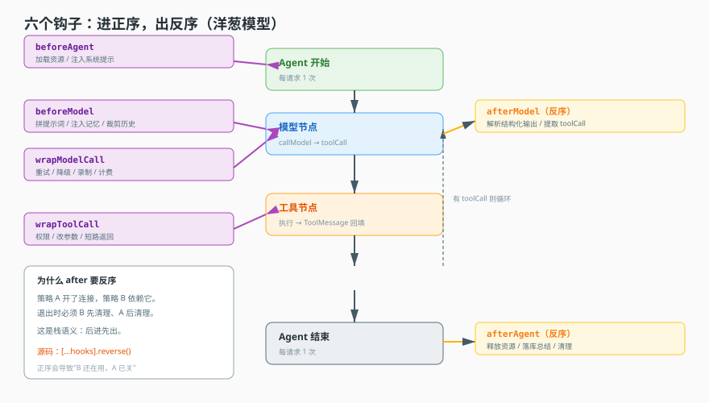
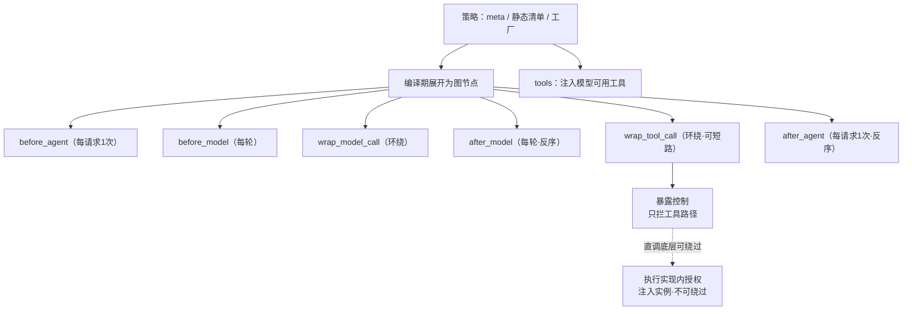

# 第 7 课：中间件策略层

> 所属阶段：阶段 2《定义与编译》｜ 水平：进阶 ｜ 本课知识点：策略接口、六个钩子职责、中间件与工具、权限为何在这里
> 故事情节：主角需要外挂能力——工具、权限、上下文注入。系统没有用 if 堆，而是开了一层策略层。
> 配应用实战：[实战 07](../../../应用实战/07-把if判断抽成中间件策略.md)
> 📖 结论已按官方文档核对（核对于 2026-11 ｜ 来源：[LangChain 中间件](https://docs.langchain.com/oss/javascript/langchain/middleware)、[内置中间件](https://docs.langchain.com/oss/javascript/langchain/middleware/built-in)）


## 🎯 本课目标

- 写出一个最小中间件策略实现，并说清三个成员各自的职责
- 为每种需求选出正确的钩子，并说清执行顺序为什么是"进正序、出反序"
- 说清中间件如何供给工具，以及"静态清单"与"运行时实例"为什么要分开
- 解释权限为什么拦在中间件层，以及这条防线为何不完整

## 🧑‍💻 前置知识速览

- **策略模式**：把"可变的行为"抽成对象，调用方按接口使用，不关心具体实现。
- **钩子（Hook）**：框架在关键位置预留的插入点（课 5 讲过它在编译期变成节点）。
- **环绕执行（Around）**：可以"包住"一次调用，在前后都插逻辑，甚至选择不执行。

## 第一幕：起源与场景引入

> 🎬 **场景**：第 6 个 if 之后，你开始害怕打开那个文件

最初只有一行：如果开了"文件理解"，就加一个读文件的工具。

后来：开了文件理解加工具、开了结构化输出就去掉某些工具、有记忆就注入记忆、有技能就注册技能、租户 A 要审计、租户 B 要限流……

等你回过神来，那个文件里有 **6 个 `if`，每个都掺着工具注册、提示词拼接、权限判断**。你想加第 7 个能力，得先读懂前面 6 个会不会互相影响。

而且更糟的是：这 6 个 if **不是独立的**，它们有 64 种组合路径，而你只测了 3 种。

> 📌 **一句话本质**：把"每种能力的接入方式"从"主干上的 if"改成"可插拔的策略对象"——主干只负责按顺序调用，不关心具体是谁。

> ⚖️ **处境对照**：不这么做 → 能力数量增长时组合爆炸（6 个 if 有 64 种路径），测试覆盖不住；这么做 → 每个能力独立成一个策略，加第 7 个不影响前 6 个。

## 第二幕：认知冲突

> ❓ **问题**：为什么是"策略 + 钩子"，而不是"继承一个基类重写方法"？

继承的问题在于**位置固定**：基类只给你几个固定方法。你想插在"模型调用前"和"工具调用后"这两个位置，就得想办法绕——重写父类方法时塞进去，但那会让"位置"变成隐式的、靠阅读父类代码才能理解的东西。

而钩子是**按位置开的口**：系统在关键位置预留了插槽，你只需要实现关心的那个，其余不管。

更关键的是：这些钩子在编译期被展开成图节点（课 5 讲过），所以"插在哪个位置"是**图结构层面**的保证，而不是靠"调用顺序碰运气"。这是钩子相对继承的本质优势——**位置变成了结构，而不是约定**。

## 第三幕：层层揭示

### 一眼全局图（进入细节前先看一眼）



> 看图：中间是一条 Agent 执行链（Agent 开始 → 模型调用 → 工具调用 → Agent 结束），上下两侧是 6 个钩子的插入位置。每个位置可以有多个策略排队，去程正序、回程反序。

### 本课地图（分几步走）

| 步 | 这一步要解决什么（人话） | 对应知识点 |
|:--:|--------------------------|-----------|
| 1 | 一个策略长什么样、怎么被找到 | 知识点 1：策略接口 |
| 2 | 6 个钩子分别管哪一段 | 知识点 2：六个钩子职责 |
| 3 | 中间件怎么"变出"工具 | 知识点 3：中间件与工具 |
| 4 | 权限为什么拦在这里，又为什么拦不全 | 知识点 4：权限为何在这里 |

### 知识点 1：策略接口

> 🧭 第 1/4 步｜承接：第二幕"为什么是策略" → 本步：策略的具体形状
> 本知识点关键点：三个成员、静态与动态分离、注册表查找、无状态原则

- 关键点：接口只有三个成员——`meta`（自我介绍）、`get_tool_names`（静态清单，可选）、`create_middleware`（生产运行时实例）
- 关键点：`get_tool_names` 单独存在，是为了"不创建实例也能显示能力摘要"
- 关键点：注册表按 provider 查找，同一 provider 可在不同组织有不同实现
- 关键点：工厂可能被反复调用，**不要在里面做"只该执行一次"的初始化**

#### 一句话定义

一个中间件策略 = 一份自我介绍 + 可选的静态工具名清单 + 一个能生产运行时中间件的工厂。

#### 直觉建立（类比）

外包团队登记表：

- `meta`：你们团队叫什么、图标是什么、能干什么（给人看的摘要）。
- `get_tool_names`：你们**能提供**哪些服务（不用真派人就能列出来）。
- `create_middleware`：真要干活时，派出来的人和具体做法。

> 💡 **类比的边界**：外包团队是长期存在的；这里的工厂每次编译都可能被调用，产出一个**新的**运行时实例。

#### 核心原理

```python
from dataclasses import dataclass
from typing import Protocol

@dataclass
class MiddlewareMeta:
    name: str
    label: dict[str, str]        # {"en_US": ..., "zh_Hans": ...}
    description: dict[str, str]
    icon: str = ""

class MiddlewareStrategy(Protocol):
    meta: MiddlewareMeta

    def get_tool_names(self) -> list[str]:
        """静态清单：界面显示'能提供哪些工具'时用，不创建实例、无副作用。"""
        ...

    async def create_middleware(self, options: dict, context: dict) -> dict:
        """生产运行时中间件：可能打开连接、读配置，有副作用。"""
        ...
```

**为什么把 `get_tool_names` 单独拿出来**——这是本知识点最值得琢磨的设计。

界面要显示"这个中间件能提供哪些工具"。如果只能靠 `create_middleware` 拿，会带来三个问题：

- 为了**显示**而创建实例，等于为了渲染一个列表而去连数据库。
- 创建实例可能有副作用（打开连接、读文件），渲染列表不该有副作用。
- 一个管理界面上可能有几十个中间件，逐个创建会非常慢。

所以给一个纯静态的清单方法：**声明与实例化分离**。这个思路和课 8 会讲的"暴露面与执行面分离"是同一个思想的不同应用。

**注册表按 provider 查找**：

```python
class Registry:
    def __init__(self):
        self._items: dict[str, MiddlewareStrategy] = {}

    def register(self, provider: str, strategy: MiddlewareStrategy):
        self._items[provider] = strategy

    def get(self, provider: str, organization_id: str | None = None) -> MiddlewareStrategy:
        # 同一 provider 在不同组织可以是不同实现（企业定制）
        key = f"{organization_id}:{provider}" if organization_id else provider
        if key in self._items:
            return self._items[key]
        if provider in self._items:
            return self._items[provider]        # 回落到通用实现
        raise KeyError(f"middleware provider not found: {provider}")
```

**工厂可能被反复调用**：因为平台不做图级缓存（课 5），每次请求都重新编译，于是 `create_middleware` 每次请求都被调用一次。这意味着：

- 不要在工厂里做"只应执行一次"的初始化（比如往全局数组里 append）。
- 工厂应该便宜。重活放到"第一次真正用到"时做，或放到外部缓存。

这是"无状态策略 + 有状态实例"的分工：**策略对象是无状态的（可复用），它生产的中间件实例是有状态的（每次新建）**。

#### 示例演示

一个最小但完整的策略实现：

```python
class AuditStrategy:
    meta = MiddlewareMeta(
        name="audit",
        label={"en_US": "Audit", "zh_Hans": "审计"},
        description={"en_US": "Log every model call", "zh_Hans": "记录每次模型调用"},
    )

    def get_tool_names(self) -> list[str]:
        return []          # 本中间件不提供工具

    async def create_middleware(self, options, context):
        prefix = options.get("prefix", "[audit]")     # 每次新建，读当前配置

        async def before_model(state, runtime):
            print(f"{prefix} before model, execution={runtime['execution_id']}")
            return None           # 不修改状态

        return {"before_model": before_model}
```

注意 `prefix` 是在工厂里读的：如果配置改了，下一次编译就拿新值——这正是"无缓存"带来的好处（也是"工厂要便宜"的原因）。

#### 常见误区

1. **"策略必须实现三个方法"**：`get_tool_names` 是可选的。不提供工具的策略可以不实现。
2. **"`create_middleware` 只调用一次"**：每次编译都可能新建实例。别在工厂里做一次性初始化。
3. **"策略对象可以有状态"**：策略应无状态、可复用；状态放在它生产的实例里。

#### 一句话记住

策略三件套：meta 自我介绍、静态清单给人看、工厂生产实例；工厂要便宜、策略要无状态。

#### 🗣️ 行话对照

- **Strategy**：策略、扩展点实现。
- **Registry**：注册表、服务注册中心。
- **Provider**：提供方标识——本课"中间件类型名"。

---

### 知识点 2：六个钩子职责

> 🧭 第 2/4 步｜承接：策略有了 → 本步：它到底能插在哪 6 个位置
> 本知识点关键点：各钩子的频率、执行顺序、wrapToolCall 的两种用法

- 关键点：两个管 Agent 整体（首尾，每请求一次）
- 关键点：三个管模型调用（前、环绕、后，每轮一次）
- 关键点：一个管工具调用（环绕），能改参数也能**短路返回**
- 关键点：进入正序、退出反序（洋葱模型），反序是为了依赖关系

#### 一句话定义

六个钩子就是六个"可插入的位置"：两个管 Agent 整体（首尾），三个管模型调用（前、包裹、后），一个管工具调用（包裹）。

#### 直觉建立（类比）

一次出差：

- `before_agent`：出发前（订票、报备）——整趟行程前一次。
- `before_model`：每次开会前（准备材料）。
- `wrap_model_call`：会议本身（你可以"替他开"，也可以"旁听记录"）。
- `after_model`：每次开完会后（整理纪要）。
- `wrap_tool_call`：每次让对方办事时（可以改要求，也可以直接代他办完）。
- `after_agent`：回来后（报销、总结）——整趟行程后一次。

> 💡 **类比的边界**：出差是线性的；这里的 `before_model` / `after_model` 会在"模型 ↔ 工具"循环里**反复触发**（每轮一次），不是只执行一次。

#### 核心原理

**六个钩子的定位与频率**：

| 钩子 | 触发频率 | 典型用途 |
|---|---|---|
| `before_agent` | 每请求 1 次 | 加载资源、初始化上下文、注入系统提示 |
| `before_model` | 每轮模型调用前 | 拼提示词、注入记忆、裁剪历史 |
| `wrap_model_call` | 包裹每次模型调用 | 重试、降级、录制、计费 |
| `after_model` | 每轮模型调用后 | 解析结构化输出、提取工具调用意图、审计 |
| `wrap_tool_call` | 包裹每次工具调用 | 权限检查、改参数、短路返回、结果改写 |
| `after_agent` | 每请求 1 次 | 释放资源、落库总结、清理临时文件 |

**执行顺序的真相**：

```text
before_agent[0] → before_agent[1] → ... → agent_loop
    ↓
  before_model[0] → before_model[1] → ... → 模型节点
    ↓
  after_model[N-1] → ... → after_model[0]        ← 反序！
    ↓
  （若有工具调用）工具节点 → 回到 before_model
    ↓
after_agent[N-1] → ... → after_agent[0]          ← 反序
```

**为什么必须反序**——用依赖关系说清：

假设策略 A 在进入时"打开一个连接"，策略 B 在进入时"基于 A 的连接做点事"。那么退出时，B 必须先清理（它还依赖 A），A 才能后清理。这就是**栈的语义：后进先出**。

搞成正序的后果是"B 还在用，A 已经把连接关了"。这类 bug 的恶劣之处在于：**它在串行、低负载时通常不报错**，只在特定时序下崩溃，而且崩溃点离真正的原因很远。

**`wrap_tool_call` 的两种用法**——这是最灵活的钩子：

```python
# 用法一：改参数后放行（加安全约束）
async def wrap_tool_call(request, handler):
    if request["name"] == "write_file":
        request["args"]["path"] = sanitize(request["args"]["path"])
    return await handler(request)

# 用法二：短路返回（不真调工具）
async def wrap_tool_call(request, handler):
    if request["name"] == "delete_order" and not allowed(request):
        return {
            "role": "tool",
            "tool_call_id": request["tool_call"]["id"],
            "content": "已拒绝：无权限",
        }
    return await handler(request)
```

短路返回是权限拦截的基础：**不执行，直接给模型一个"被拒绝"的结果**。注意它必须返回一条结构合法的工具消息（带 `tool_call_id`），否则模型会因为"找不到工具结果"而报错或胡编。

**一个容易忽略的语义细节**：`wrap_model_call` 可以**选择不调用 handler**——比如命中缓存就直接返回。这也是"降级"的实现方式（主模型超时就不调了，直接返回备用模型的答案）。但一旦这么做，`after_model` 会不会执行？取决于框架实现——**这种"环绕与前后钩子的交互"必须在自己的框架里明确测过**，不能假设。

#### 示例演示

一个完整的两策略协作示例，验证顺序：

```python
async def setup(hooks):
    log = []

    async def a_before(state, rt):
        log.append("A:enter")
        return None
    async def a_after(state, rt):
        log.append("A:exit")
        return None
    async def b_before(state, rt):
        log.append("B:enter")
        return None
    async def b_after(state, rt):
        log.append("B:exit")
        return None

    hooks.register("before_model", a_before)
    hooks.register("before_model", b_before)
    hooks.register("after_model", a_after)
    hooks.register("after_model", b_after)
    return log

log = await setup(hooks)
await run_one_turn(hooks, model=lambda msgs: "ok")

assert log == ["A:enter", "B:enter", "B:exit", "A:exit"]
#                    ↑ 正序进入           ↑ 反序退出
```

这条断言就是洋葱模型的**可执行规格**。把它放进 CI，任何人改错顺序都会立刻红。

#### 常见误区

1. **"after 按 before 的顺序执行"**：反序。这是洋葱模型的核心。
2. **"before_agent 每轮都执行"**：每请求一次。每轮执行的是 `before_model`。
3. **"wrap_tool_call 短路返回可以不返回标准结构"**：必须返回带 `tool_call_id` 的工具消息。
4. **"wrap_model_call 不调用 handler 就不会有后续钩子"**：不能假设，必须在自己框架里验证。

#### 一句话记住

两整体 + 三模型 + 一工具；进正序、出反序；wrap 可改可短路。

#### 🗣️ 行话对照

- **Hook**：生命周期回调、拦截器。
- **Around Advice**：环绕通知——本课 `wrap_*`。

---

### 知识点 3：中间件与工具

> 🧭 第 3/4 步｜承接：钩子能插入了 → 本步：中间件怎么"变出"工具
> 本知识点关键点：两种声明、元数据继承、单例约束、为什么装配期检查

- 关键点：中间件通过返回对象的 `tools` 字段声明自己提供的工具
- 关键点：静态清单给人看，运行时实例给图用——两者可能不一致（权限/配置过滤）
- 关键点：元数据继承让"这个工具来自哪个中间件"可见，便于追责
- 关键点：单例约束无法用类型表达，必须在**装配期**检查

#### 一句话定义

中间件不仅能"插入逻辑"，还能"供给工具"——它产出的工具会合并进模型可用的工具列表。

#### 直觉建立（类比）

外包团队自带工具箱：

- 登记表上写"我们能做 A、B、C"（`get_tool_names`）——给甲方看的清单，不需要真派人。
- 真派团队来时，他们带上自己的工具（`create_middleware` 返回的 `tools`）。
- 工具上都贴"来自 XX 团队"的标签（元数据继承），方便追责。

> 💡 **类比的边界**：真实里工具可能被多个团队共用；这里每个中间件产出的工具是独立的，冲突需要显式处理。

#### 核心原理

**两种声明，用途完全不同**：

| 方式 | 时机 | 用途 | 副作用 |
|---|---|---|---|
| `get_tool_names()` | 纯静态 | 界面显示能力清单 | 无 |
| `create_middleware().tools` | 编译时 | 真正注入图 | 可能有 |

它们**可能不一致**，而且这是合理的：静态清单说"我能提供 10 个工具"，运行时因为租户没配某个服务，只注入了 6 个。所以：

```python
# ✅ 正确理解
visible = strategy.get_tool_names()          # "能提供"（静态，给人看）
actual  = [t.name for t in middleware.tools] # "这次真给了"（动态，给图用）

# ❌ 错误假设
assert visible == actual    # 不保证！权限、配置、租户都可能过滤
```

这个区分很重要，因为很多 bug 源于"以为静态清单就是实际可用集"。

**元数据继承**：工具被注入时，应带上"来源中间件"的信息：

```python
def with_origin(tool, strategy_meta):
    return {
        **tool,
        "meta": {
            **tool.get("meta", {}),
            "origin": strategy_meta.name,       # 来自哪个中间件
            "icon": strategy_meta.icon,         # 界面统一显示
        },
    }
```

为什么重要？考虑一个场景：界面上一堆工具，用户问"这个 `read_file` 是谁给的？能不能关掉？"——如果工具没有来源标记，你只能去读所有中间件的代码。

**单例约束必须在装配期检查**：某些中间件在一个 Agent 里只能存在一个。比如"技能管理"中间件——它管理一组技能的归属，如果装两个，技能该归谁就不确定了。

这类约束**无法用类型系统表达**（类型只知道"这是一个策略"，不知道"这种策略只能有一个"），只能在装配时检查：

```python
SINGLETON_PROVIDERS = {"skills", "file_memory"}

def assemble(strategies):
    seen = {}
    for s in strategies:
        name = s.meta.name
        if name in SINGLETON_PROVIDERS and name in seen:
            raise ConfigError(f"{name} 是单例中间件，不能在同一个 Agent 中重复装配")
        seen[name] = s
    return [s.create_middleware(...) for s in strategies]
```

**为什么在装配期而不是运行时**：等到运行时才发现"装了两个"，图已经建好、请求已经进来，只能报错给用户。装配期检查能在编译阶段就拦下——这时候用户还在配置界面，改起来没成本。

#### 示例演示

一个中间件提供工具并带元数据：

```python
class FileToolsStrategy:
    meta = MiddlewareMeta(name="file_tools", label={"zh_Hans": "文件工具"},
                          description={"zh_Hans": "读写工作目录"})

    def get_tool_names(self):
        return ["read_file", "write_file"]          # 静态：能提供两个

    async def create_middleware(self, options, context):
        root = options["root"]
        allowed = set(options.get("allow_ops", ["read"]))

        tools = [{"name": "read_file", "args": {"path": "str"}}]
        if "write" in allowed:                       # 动态：按配置过滤
            tools.append({"name": "write_file", "args": {"path": "str", "content": "str"}})

        return {
            "tools": [with_origin(t, self.meta) for t in tools],
            "before_model": inject_file_list(root),
        }
```

**验证"静态 ≠ 动态"**：

```python
s = FileToolsStrategy()
mw = await s.create_middleware({"root": "/data", "allow_ops": ["read"]}, {})
assert s.get_tool_names() == ["read_file", "write_file"]     # 静态说两个
assert [t["name"] for t in mw["tools"]] == ["read_file"]     # 实际只给一个
```

这个测试看起来在测"不相等"，实际上在**固化一个契约**：静态清单是"能力上限"，不是"实际可用集"。

#### 常见误区

1. **"`get_tool_names` 返回的就是实际可用的工具"**：只是静态清单，可能被权限/配置过滤。
2. **"中间件可以随便装多个"**：部分有单例约束，重复装配会在装配期报错。
3. **"工具不需要来源标记"**：没有来源标记，界面无法归因，排障时读遍所有中间件。

#### 一句话记住

静态清单是上限，运行时工具是实际；元数据随工具走，单例约束装配期拦。

#### 🗣️ 行话对照

- **Tool**：工具、function calling。
- **Metadata Propagation**：元数据传播——本课"来源继承"。
- **Singleton Constraint**：单例约束。

---

### 知识点 4：权限为何在这里

> 🧭 第 4/4 步｜承接：中间件能供给工具 → 本步：那它能不能"管住"工具
> 本知识点关键点：拦截时机、绕过路径、deny+interrupt 的真实语义、两层分工

- 关键点：权限在**工具调用边界**拦截，控制"模型能看见/能调用什么"
- 关键点：直接调底层 API 会**绕过** deny——因为拦截在"工具调用"，不在"能力本身"
- 关键点：`deny + interrupt` 是**双重拦截**，不是"deny 优先、用户可放行"
- 关键点：正确分工——中间件层做"暴露控制"，执行实现内部做"执行授权"

#### 一句话定义

权限拦在中间件层，是因为中间件掌握"工具暴露"这一环；但它只拦得住"经过工具的调用"，拦不住"绕过工具直调底层"。

#### 直觉建立（类比）

公司门禁：

- 门禁（中间件层）拦住"从大门进的人"。
- 但如果有人从**窗户**（直接调底层 API）进去，门禁根本不知道。
- 所以门禁是"主要通道的控制"，不是"绝对的安全边界"。
- 真正的安全要在**每个房间自己上锁**（执行实现内部授权）。

> 💡 **类比的边界**：现实里窗户也会装报警器；代码里"直调底层"往往没有任何告警，这是最危险的地方。

#### 核心原理

**拦截发生在哪**：权限判断挂在工具调用边界（`wrap_tool_call` 或工具暴露阶段）。它检查的是"模型请求调用工具 X"这个动作。

**为什么能绕过**：

```python
# 路径一：模型走工具 → 被拦截 ✅
await call_tool("write_file", {"path": "/etc/passwd"})    # wrap_tool_call 检查 → deny

# 路径二：业务代码直接调底层 → 完全不经过 wrap_tool_call ❌
await fs.write("/etc/passwd", "...")                      # 无拦截
```

这就是本课最重要的一条认知：**工具层权限是"暴露控制"，不是"执行授权"**。

为什么会有人写出路径二？通常不是恶意，而是"为了省事"：某个业务节点已经有合法的文件句柄，直接写比走工具链更简单。而这类代码在 review 时看起来完全正常——它没有"绕过权限"的意图，只是不知道有这道防线。

**`deny + interrupt` 的真实语义**：很多人以为是"先 deny，除非用户批准"。实际是**双重拦截**：

- `deny` 先把工具从模型可见/可调用集合里去掉。
- `interrupt` 又在这个点插入一个人工确认中断。

结果是**两道关卡**，不是"一道关卡带例外"。这个区别意味着：配置了 deny 之后，`interrupt` 并不能"放行"，它只是额外多问一次。**如果你想要"默认拒绝但可批准"，需要的是另一套策略**（比如"不 deny，只 interrupt，由批准决定"）。

**正确分工，两层各管什么**：

| 层 | 职责 | 拦得住什么 | 拦不住什么 |
|---|---|---|---|
| 中间件层 | 暴露控制（模型看得见哪些工具） | 模型主动越权尝试 | 代码绕过工具直调底层 |
| 执行实现内部 | 执行授权（这次操作允不允许） | 任何调用路径（含直调） | "合规操作做坏事" |

注意第二层最后一点：执行层能保证"这次写文件是被允许的"，但保证不了"这个文件该不该写"。**业务正确性不在权限层职责内**。

**为什么不能只做一层**：

- 只做中间件层 → 直调绕过。
- 只做执行层 → 模型会看到一堆用不了的工具，浪费 token、降低选择质量，且用户会疑惑"为什么点了没反应"。

两层配合才是完整的：中间件层"少给"（减少无效尝试），执行层"严查"（守住底线）。

#### 示例演示

两层的完整实现，重点看"执行层如何不依赖调用方"：

```python
# ===== 中间件层：暴露控制 =====
async def wrap_tool_call(request, handler, policy):
    decision = policy.decide(request["name"], request["args"])

    if decision == "deny":
        return tool_error(request, "已拒绝：该操作不在允许范围")
    if decision == "ask":
        approved = await interrupt({"type": "approval", "request": request})
        if not approved:
            return tool_error(request, "用户拒绝")
    return await handler(request)          # allow


# ===== 执行层：执行授权（权限注入实例，不靠调用方传） =====
class GuardedFS:
    def __init__(self, allowed_ops: set[str], allowed_roots: list[str]):
        self.ops = allowed_ops
        self.roots = [os.path.realpath(r) for r in allowed_roots]

    def _check(self, op: str, path: str):
        if op not in self.ops:
            raise PermissionError(f"{op} not allowed")
        real = os.path.realpath(path)
        # 必须用 realpath 比较：否则 ../ 和符号链接能绕过
        if not any(real == r or real.startswith(r + os.sep) for r in self.roots):
            raise PermissionError(f"{real} out of scope")

    async def write(self, path: str, content: str):
        self._check("write", path)
        return await fs.write(path, content)
```

`GuardedFS` 的关键设计：**权限是实例的一部分，不是方法参数**。任何人拿到这个实例（哪怕是绕过工具的代码），都无法跳过 `_check`。而如果写成 `write(path, content, allowed_roots=...)`，调用方就能自己传一个宽松的值——那就不叫权限了。

**一个必须测的绕过场景**：

```python
def test_path_traversal_is_blocked():
    fs = GuardedFS(allowed_ops={"read"}, allowed_roots=["/data"])
    with raises(PermissionError):
        asyncio.run(fs.read("/data/../../../etc/passwd"))   # ../ 逃逸
    with raises(PermissionError):
        asyncio.run(fs.read("/data/link_to_etc"))           # 符号链接（指向 /etc）
```

这两条用例对应真实世界最常见的两种文件系统逃逸。**用 `startswith` 比较字符串而不做 realpath 归一化，这两条都会失败**。

#### 常见误区

1. **"配了 deny 就绝对安全"**：绕过工具直调底层仍可执行。deny 只控制"经过工具的路径"。
2. **"deny + interrupt 是 deny 优先、用户可放行"**：是双重拦截，两关都要过。
3. **"权限可以做成函数参数传入"**：参数能被调用方覆盖，必须注入实例。
4. **"执行层权限能保证业务正确"**：只能保证"操作类型与范围"，管不了"该不该"。

#### 一句话记住

中间件层管"看得见"，执行层管"做得到"；权限注入实例，不靠参数传递。

#### 🗣️ 行话对照

- **Permission / Access Control**：权限、访问控制。
- **Exposure Control**：暴露控制、能力裁剪。
- **Path Traversal**：路径逃逸——`../` 与符号链接。

---

## 第四幕：实操验证

> 目标：验证"洋葱顺序"、"静态≠动态"、"两层防护各自有效"三条契约。

### 4.1 机制验证

> ✅ 机制实测于 Node v22.22.2 / @langchain/langgraph 1.6.0（脚本 `verify/verify-core.ts`）。上段为伪代码示意，下面是同机制的真实输出：

```text
① 洋葱顺序: ["A:enter","B:enter","C:enter","C:exit","B:exit","A:exit"]
② 中间件拦截: 已拒绝：策略不允许写系统目录（执行器未被调用）
③ 执行器拦截（直调也过闸）: PermissionError: 未授权 write（/data/x.txt）
④ 静态清单 3 个，实际暴露 1 个: ["read_file"]
```

> ② 与 ③ 必须分开看：② 拦的是模型主动越权（它想调，策略说不），③ 拦的是有人绕过策略直调（代码里直接 fs.write）。只做 ② 会给团队一个假安全感——真正的越权往往来自自家代码，不是模型。

```python
# ① 洋葱顺序（进正序、出反序）
log = await setup_and_run(three_strategies)
assert log == ["A:enter", "B:enter", "C:enter", "C:exit", "B:exit", "A:exit"]

# ② 静态清单是上限，不等于实际可用
s = FileToolsStrategy()
assert set(s.get_tool_names()) >= {t["name"] for t in (await s.create_middleware(
    {"root": "/d", "allow_ops": ["read"]}, {}))["tools"]}

# ③ 中间件层能拦住模型越权
res = await wrap_tool_call({"name": "write_file", "args": {"path": "/etc/x"}},
                           handler=should_not_be_called, policy=deny_policy)
assert "已拒绝" in res["content"]

# ④ 执行层能拦住绕过工具的直调
fs = GuardedFS(allowed_ops={"read"}, allowed_roots=["/data"])
with raises(PermissionError):
    await fs.write("/data/x.txt", "boom")      # 未授权 write
```

第 ③ 与第 ④ 条必须**分开测**——它们是两道独立的防线。只测 ③ 会给你"很安全"的错觉，而 ④ 才是最后一道。

> ✅ **回扣场景**：回到开头那 6 个 if。现在可以把它们逐个改写成策略：文件理解 → 一个策略（`before_agent` 注入 + `tools` 供给）；结构化输出 → 一个策略（`after_model` 解析）；记忆 → 一个策略（`before_model` 注入）。主干从"6 个 if"变成"一个循环"，加第 7 个能力只需新增一个文件。

## 第五幕：体系收束

中间件策略层是"外挂接口"：一个三成员接口、6 个插入位置。它不只做日志埋点，还承担工具供给、权限拦截、上下文注入。

> 📍 **全局定位**：这是阶段 2 的最后一块基石——**扩展走策略层**。它直接决定了阶段 3 要讲的"多 Agent 协作时权限怎么管"。
> 🔗 **下一步**：本课留了一个悬念——中间件层的权限只控制"看得见"，不控制"做得到"。阶段 3 会从执行侧再讲一次授权，把这条防线补完。

## 🐞 全课常见误区

1. **"中间件就是日志埋点"**：它还供给工具、拦权限、注入上下文。
2. **"after 钩子和 before 同序"**：反序（洋葱模型）。
3. **"get_tool_names 等于可用工具"**：只是静态上限。
4. **"deny 就是安全边界"**：只控制工具路径，直调可绕过。
5. **"权限做成参数更灵活"**：参数可被覆盖，必须注入实例。

## 一图总结



> 课首图是"位置视角"（6 个钩子插在哪）；此图是"组装视角"（策略如何变成节点 + 工具 + 两层权限）。

## 课后小测

**Q1**：需要在每次模型返回后解析结构化输出，该用哪个钩子？
- A. `before_agent`　B. `before_model`　C. `after_model`　D. `wrap_tool_call`

<details><summary>答案与解析</summary>

**答案：C**。`after_model` 在每轮模型调用后触发，是解析输出的正确位置。`before_agent` 每请求才一次，粒度不对。

</details>

**Q2**：为让"权限无法被绕过"，下面的做法哪个是有效的？
- A. 在工具调用处检查参数里的 allowed_roots　B. 权限作为方法参数传入　C. 把权限注入到执行器实例，每次操作前自检　D. 只在提示词里告诉模型不要越权

<details><summary>答案与解析</summary>

**答案：C**。A 和 B 都能被调用方构造宽松的值绕过；D 只是提示，模型可能不遵守。只有"权限是实例的一部分"才能保证任何调用路径都过检查。

</details>

## 🚀 下一批接力提示词

```
继续学 Agent 工程解剖。我的学习档案在 agent-engineering/00-学习档案.md，
阶段 2《定义与编译》已全部学完（课 4 声明式定义、课 5 编译器、课 6 状态通道、课 7 中间件策略层），
请按大纲继续讲解阶段 3《执行与协作》的第一批知识点。
```

## 🧭 课程导航

⬅️ **上一课**：[课 6：状态通道](06-状态通道.md)
➡️ **下一课**：[课 8：模型调用与工具执行](../../3-执行与协作/lessons/08-模型调用与工具执行.md)
📚 **返回目录**：[课程目录](../../../02-课程目录.md)
