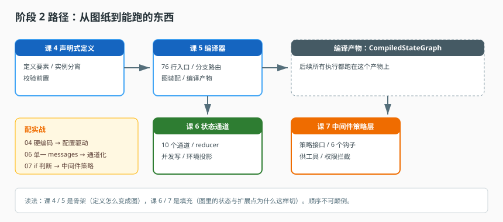

# 阶段 2：定义与编译

> 所属课程：Agent 工程解剖 ｜ 故事章节：它怎么被造出来 ｜ 上一阶段：[阶段 1](../1-先有地图/overview.md) ｜ [返回总览](../../01-学习路径总览.md)

## 🎯 本阶段目标

- 看懂"声明式定义 → 编译 → 可执行图"这条主线，这是全课程最可迁移的设计。
- 能为自己的项目判断：该不该把 Agent 做成配置驱动，代价是什么。
- 能读懂并写出一个中间件策略，理解它为什么比 if 判断更适合作为扩展点。

## 📍 学习重点

- **本阶段是全课程的重心**。阶段 3、4 的东西都建立在这里的四个决定之上：定义与图分离、状态分通道、扩展走策略层、校验前置。
- 编译面只有 76 行的入口文件，是本课程性价比最高的一段阅读材料——它把"定义的复杂性"和"执行的复杂性"彻底切开了。
- 中间件在本系统里承担了远超"日志埋点"的职责：工具供给、权限拦截、上下文注入、结构化输出都在这一层。理解这一点，才能理解为什么它必须是接口而不是 if。

## ✅ 必须掌握的知识点

| 知识点 | 所属课 | 学完应能 |
|--------|--------|----------|
| 一份定义包含什么 | 课 4 | 列出定义要素，说清哪些进定义、哪些留代码 |
| 定义与实例分离 | 课 4 | 说清草稿 / 发布 / 固定版本三种状态的意义 |
| 校验前置 | 课 4 | 区分编译期校验与运行期校验的职责 |
| 编译入口与分支路由 | 课 5 | 说清伙伴数如何决定 Swarm 或子图 |
| 原生子图构建 | 课 5 | 画出 StateGraph 装配顺序与钩子注入点 |
| 编译产物 | 课 5 | 说清 `CompiledStateGraph` 的复用与失效 |
| 通道划分 | 课 6 | 说出 10 个通道各自的写者与用途 |
| reducer 与并发 | 课 6 | 解释并发写同一通道时会发生什么 |
| 运行时注入 | 课 6 | 说清环境投影为何不能污染历史 |
| 状态到参数 | 课 6 | 说清状态值如何变成节点入参、结果如何回写 |
| 策略接口 | 课 7 | 写出一个最小策略实现 |
| 六个钩子职责 | 课 7 | 为每种需求选出正确钩子 |
| 中间件与工具 | 课 7 | 说清中间件如何供给工具及元数据继承 |
| 权限为何在这里 | 课 7 | 解释"拦在中间件层"与"拦在工具边界"的分工 |

## 📖 本阶段在故事主线中的章节定位

主角（一次 Agent 请求）的孕育期。这一章回答：一个请求在被执行之前，是被谁"造"出来的。

具体处境：产品经理说"把这个客服 Agent 的模型换成新的，顺便让它只能查订单、不能改订单"。你打开代码，发现模型名硬编码在三个文件里、权限判断散在五个 if 里。改完这一版，下周再来一个"再加个审批环节"，你就要再改五个地方。

本阶段要建立的认知是：**一个 Agent 应该由一份声明来定义，由编译器翻译成可执行的图**。这是全课程最可迁移的一段设计——不是因为它复杂，而是因为它把一个会不断膨胀的耦合问题，切成了两个各自简单的部分。

> 章节作用：**本课程的重心**。阶段 3 讲的执行、阶段 4 讲的判断，都建立在这里的四个决定上：定义与图分离、状态分通道、扩展走策略层、校验前置。这一章没读透，后面只能记住现象，理解不了成因。

## 🗺️ 本阶段路径图

> 看图：先看"定义长什么样"（课 4），再看"定义怎么变成图"（课 5），然后拆开图里的两个内部结构——状态（课 6）和扩展点（课 7）。前两课是骨架，后两课是填充。

## 本阶段产出

- [x] [lessons/04-声明式定义.md](lessons/04-声明式定义.md)
- [x] [lessons/05-编译器.md](lessons/05-编译器.md)
- [x] [lessons/06-状态通道.md](lessons/06-状态通道.md)
- [x] [lessons/07-中间件策略层.md](lessons/07-中间件策略层.md)
- [x] 应用实战 04 / 06 / 07（随课生成）
