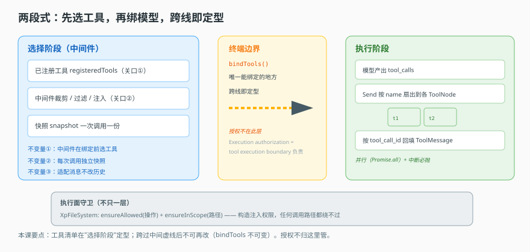
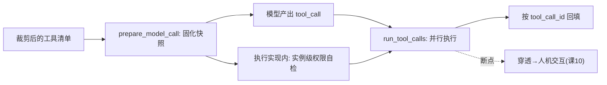

# 第 8 课：模型调用与工具执行

> 所属阶段：阶段 3《执行与协作》｜ 水平：进阶 ｜ 本课知识点：模型调用准备、工具节点、工具从哪来、授权与暴露分离
> 故事情节：主角第一次真正"动手"——它不再只是说话，而是要让模型在一个受限的工具集里做选择，并真的执行。
> 📖 结论已按官方文档核对（核对于 2026-11 ｜ 来源：[LangChain 工具](https://docs.langchain.com/oss/javascript/langchain/tools)、[LangGraph Graph API](https://docs.langchain.com/oss/javascript/langgraph/graph-api)）


## 🎯 本课目标

- 说清"先选工具、再绑模型"为什么顺序不能反，以及"每次调用一份快照"解决什么问题
- 说清 ToolNode 如何并行执行工具调用、如何按 `tool_call_id` 把结果回填给正确的位置
- 说清四种工具来源（内置 / MCP / OpenAPI / OData）如何统一成一个抽象
- 说清"暴露面"（模型看得见什么）与"执行面"（真正能不能做）为什么要分成两层

## 🧑‍💻 前置知识速览（给还没懂这些的读者）

本课假设你已经了解：

- **工具（Tool）**：一个可被模型调用的函数，带名字、描述、输入 schema（课 4 讲过）。
- **tool_call**：模型输出里的一个意图——"我要调用某某工具，参数是这些"。
- **编译期 vs 运行时**：编译期指代码写死的、可静态分析的东西；运行时指程序跑起来才发生的事。

## 第一幕：起源与场景引入

> 🎬 **场景**：模型说"我要查订单"，结果查的是别人家的订单

你让你的 Agent 调用一个查订单工具。模型确实调了，但参数里塞了一个**不在允许名单里的用户 ID**，于是它查到了别人的订单，还把结果讲给了当前用户。

这不是模型故意的。问题在于**执行之前没人拦**。工具清单、参数范围、调用身份，全都应该在"真正执行"之前确定下来。一旦到了执行那一步，再想拦就晚了。

这一课讲的，就是"从工具清单到真正执行"之间所有应该发生的检查。

> 📌 **一句话本质**：模型是"会说话的选择器"，平台是"负责任的门卫"。模型负责说"我要这么干"，平台负责在动手之前把一切约束定死、并在执行时守住边界。

> ⚖️ **处境对照**：**不设这道边界**，模型看到的工具就等于能调的工具——越权查询要等结果送到用户眼前、或者等事后审计翻日志才发现，此时数据已经出圈，回滚不了；**清单先裁剪、执行再校验**，越权调用在动手那一刻被拒，最坏后果只是这一轮对话报一个"无权执行"，数据没动过。代价是每次调用多一次校验（一次内存判定，量级远小于一次模型往返 ⏳）。

## 第二幕：认知冲突

> ❓ **问题**：工具调用，到底难在哪？

直觉上，"模型输出一个 tool_call，程序执行它"很简单。但真实系统里它是三条会互相干扰的约束：

1. **能看**：模型只能看到被允许展示的工具 schema（看不到的就没法调）。
2. **能选**：模型在可见工具里做选择，一个调用对应最后那条 AI 消息里的若干 tool_call。
3. **能做**：真正执行时还要校验——这个调用身份、这个路径、这次操作允不允许。

如果这三件事没有清晰的边界，就会出现开头那种"模型看得到、选得了、做成了本不该做成的事"。

关键洞察：**"能看"不等于"能做"**。只控制"能看"，模型依然可能通过别的路径（比如让某个工具干一件不相关的事）达成越权。所以必须分两层守。

## 第三幕：层层揭示

### 一眼全局图（进入细节前先看一眼）



> 看图：左边是"模型"这一侧——它看得到一份裁剪过的工具清单，产出 tool_call。中间是"准备"这一层——把这份选择固化成一份快照，谁都改不了。右边是"执行"这一层——真正动手前还要过权限校验。整张图的要点：**清单是裁剪的、准备是固化的、执行是守门的**。

### 本课地图（分几步走）

| 步 | 这一步要解决什么（人话） | 对应知识点 |
|:--:|--------------------------|-----------|
| 1 | 模型调用前，把"用什么、绑谁、发什么"定死 | 知识点 1：模型调用准备 |
| 2 | 模型说"调这个工具"，谁来真执行、怎么并行 | 知识点 2：工具节点 |
| 3 | 这些工具从哪来的，凭什么能统一 | 知识点 3：工具从哪来 |
| 4 | 真正动手前，凭什么判断"这次允许" | 知识点 4：授权与暴露分离 |

### 知识点 1：模型调用准备

> 🧭 第 1/4 步｜承接：第二幕"能看能做要分开" → 本步：先选后绑、一份快照
> 本知识点关键点：顺序、快照、适配不改史

- 关键点：必须先选工具、再绑模型——顺序反了会怎样
- 关键点：每次调用一份快照；重试与降级共用这份快照
- 关键点：按模型能力适配消息，但不改写历史

#### 一句话定义

模型调用准备 = 把"这次调用允许哪些工具、用哪个模型、发什么消息"三件事，在绑定之前一次性固化下来，形成一份只读快照。

#### 直觉建立（类比）

想象**给考生发准考证**：

- 先确定"这场考试准许带哪些文具"（选工具）。
- 再发证、封口（绑定）。
- 封口后再想加一支笔，只能重走流程换一张证。
- 而且"带什么"的记录是**每场单独一份**，不是全年通用。

> 💡 **类比的边界**：准考证是纸；代码里的"绑定"不可变——`bindTools` 返回新对象，旧对象不动。

#### 核心原理

用伪代码表达这套"固化"逻辑（它不是某一份源码逐行照抄，而是这类系统共有的骨架）：

```python
def prepare_model_call(request, registry):
    # 1. 先选工具：从"已注册"里选，不看全局
    selected = [t for t in request.allowed_tool_keys
                if t in registry.registered]        # 只有注册过的才可能被选

    # 2. 固化成一份快照——之后重试、降级都只用这一份
    snapshot = freeze({
        "tools": selected,                             # 深拷贝，不再引用可变对象
        "model": request.model_key,
        "messages": request.messages,                  # 见第 3 点
    })

    # 3. 绑定：这才是真正"封口"的动作（bindTools 返回新对象）
    bound = bind_tools(snapshot.model, snapshot.tools)
    return bound, snapshot
```

三条不变量是这类系统的共同底线，用一句话各说清一条：

**① 先选后绑。** 选择发生在一个"已注册工具"的关口上，绑定（`bindTools`）把选择固化为模型可调用的形态。如果先绑再选，就会出现"绑定时觉得工具 A 存在、执行时它不在"这类和时间竞态相关的问题。强制先选后绑，加工具就只能发生在选择阶段。

**② 一次一快照、重试共享。** 现代大模型调用必然要处理失败与降级（换个模型、换个 provider）。问题是：**第一次调用失败后重试，工具清单会不会变？** 如果重试时重新跑一遍选择逻辑，而选择逻辑依赖缓存或租户配置，重试可能拿到另一套工具——于是"同一个问题，第一次说没权限，重试又说可以"。快照解决的就是这个：重试、降级统一用第一次固化好的那份。

**③ 适配不改史。** 不同模型能力不同（有的不支持多模态、有的没有 system role）。调用前要把消息调整成"这个模型能理解的形态"。关键约束是：**这是生成一个新数组，原始历史不动**。为什么？因为历史是审计与回放的依据——如果为了适配某个模型就改掉历史，那么这段会话的回放结果就永远依赖"当时用的是哪个模型"，再也无法复现。

#### 示例演示

伪代码示范如何「固化」而不是「反复重新选择」，以及如何在入口收口：

```python
def prepare_model_call(request, registry):
    # 把"选择"从执行流程中剥离、只做一次
    selected = select_tools(registry, request.allowed_tool_keys)

    # 快照：冻结引用，使重试与降级稳定
    snapshot = FreezeDict({
        "tools": selected,
        "model": request.model_key,
        "messages": prepare_messages_for_model(request.messages, request.model_key),
    })

    return bind_tools(request.model_key, snapshot["tools"]), snapshot
```

要点：`select_tools` 只在本函数内调用一次；`FreezeDict` 从结构上阻止后续修改；`prepare_messages_for_model` 返回新数组，不改 `request.messages` 本体。

#### 常见误区

1. **"绑定了工具之后还能再加"**：不能。`bindTools` 不可变，加了等同于换模型，必须先走选择。
2. **"重试会重新选一次工具"**：不该。快照就是为让重试用同一份。
3. **"按模型能力适配就是改写消息"**：是生成新数组，历史不动。

#### 一句话记住

先选后绑、一次一快照、适配不改史。

#### 🗣️ 行话对照

- **Snapshot（快照）**：不可变的调用参数合集——出现在"固化选择"。

---

### 知识点 2：工具节点

> 🧭 第 2/4 步｜承接：清单定型、模型产出 tool_call → 本步：谁去真的执行
> 本知识点关键点：输入约定、并行与回填、扇出、错误与中断的区别

- 关键点：工具节点只读最后一条 AI 消息里的 tool_calls
- 关键点：多个 tool_call 并行执行，结果靠 `tool_call_id` 配对，与返回顺序无关
- 关键点：一工具一节点，用 Send 按名字扇出——是并行与隔离的基础
- 关键点：普通异常转成"错误消息"喂回模型；但"要人介入"的信号必须抛出

#### 一句话定义

工具节点 = 一个"读模型意图 → 执行 → 把结果包成消息塞回对话"的适配器。它不理解业务，只负责协议转换与并发调度。

#### 直觉建立（类比）

想象**工单派发台**：

- 主管（模型）在工单上写"查订单 #123"和"查物流 #123"（两个 tool_call）。
- 派发台（工具节点）把两张单一**起**发出去（并行），不等第一张回来再发第二张。
- 结果回来按**工单编号**（tool_call_id）贴回对应位置，不按回来先后。
- 某张办不成，不会停工，回一张"办不成，原因 X"的条子（错误消息）。

> 💡 **类比的边界**：`Promise.all` 是同时发起，并发上限由运行环境与工具自身决定。

#### 核心原理

**输入约定**——只认对话里最后那条 AI 消息：

```ts
const last = messages[messages.length - 1]
if (last.kind !== 'ai') throw new Error('ToolNode only accepts AIMessages as input.')
const calls = last.tool_calls ?? []
```

为什么非要最后一条 AI 消息？因为 tool_call 只会出现在 AI 消息里，而"当前这一步该执行谁"就是最近那次模型输出的意图。对着一条人类消息去执行工具，是没有意义的。

**并行执行**——所有调用一起跑，结果按 id 回填：

```ts
const results = await Promise.all(calls.map(async (call) => {
    const tool = tools.find((t) => t.name === call.name)
    if (!tool) return unknownToolError(call)          // 未知名 → 错误消息

    try {
        const output = await tool.invoke(call.args)
        return toToolMessage(output, call.id)          // id 配对
    } catch (e) {
        if (isHumanSignal(e)) throw e                  // 见下面【错误/中断之分】
        return errorToolMessage(call.id, e)            // 转错误喂回模型
    }
}))
```

两个关键点：

- **并行**：`Promise.all`，不是逐个 await。耗时的工具不会拖慢其余工具。
- **按 id 回填**：`tool_call_id` 是模型认领结果的唯一依据。所以"结果返回顺序与请求顺序不一致"完全没关系——模型靠 id 找到自己高亮的那块。

**扇出：一工具一节点**。平台往往不是建"一个大工具执行器装所有工具"，而是**每个工具一个节点**，再用"路由"按名字分发：

```ts
function routeToTool(toolCall, toolNames, fallbackNode) {
    return toolNames.has(toolCall.name)
        ? new Send(toolCall.name, { toolCall })        // 分发给那个工具自己的节点
        : new Send(fallbackNode, { toolCall })         // 未知名 → 统一错误节点
}
```

为什么要一工具一节点，而不是一个大节点？三个实际好处：

- **隔离**：每个工具可单独设权限、单独设置人机交互、单独中断，互不影响。
- **并行基础**：`Send` 天然可发往多个目标，为"同时执行多个工具"提供图层面的支持。
- **兜底**：未知工具名能精确路由到"未知工具错误节点"，而不是撞进某个随意节点。
  （这正呼应上一课"分而治之"的思路：把不同职责拆成独立的图节点。）

**错误与中断的区别**——这是最容易混的一点。

| 情况 | 处理 | 为什么 |
|---|---|---|
| 工具抛普通异常 | 转成"错误消息"喂回模型 | 模型能看着错误自我修正 |
| 工具抛"需人工介入"信号 | **必须重新抛出** | 这是断点，不是错误 |

一个断点信号（如 `GraphInterrupt`）代表"这一步要继续得有人来"。它不该被当成普通错误喂回模型——模型没有能力"修复"一个需要人来做决定的问题，勉强喂回去只会让模型瞎编一个"我已经处理好了"。所以必须让它穿透出来，触发上层的人机交互流程（这会在课 10 展开）。

```ts
catch (e) {
    if (isBreakpoint(e)) throw e       // 穿透，触发人机交互
    return errorMessage(call.id, e)    // 普通错误，喂回模型
}
```

#### 示例演示

一个可独立运行的伪代码示范（重点：`Promise.all` 并行 + id 回填 + 断点穿透）：

```python
async def run_tool_calls(messages, tools):
    last = messages[-1]
    if last["role"] != "assistant":
        raise ValueError("ToolNode 只处理 AI 消息")

    async def one(call):
        tool = tools.get(call["name"])
        if tool is None:
            return {"role": "tool", "tool_call_id": call["id"],
                    "content": "unknown tool"}
        try:
            out = await tool(call["arguments"])
            return {"role": "tool", "tool_call_id": call["id"],
                    "content": out}
        except BreakpointSignal as e:
            raise e                      # 人机交互断点，穿透
        except Exception as e:
            return {"role": "tool", "tool_call_id": call["id"],
                    "content": f"Error: {e}. Please fix."}

    return await asyncio.gather(*(one(c) for c in last["tool_calls"]))
```

#### 常见误区

1. **"工具节点可以读任意消息"**：只读最后一条 AI 消息。
2. **"工具按返回顺序回填"**：按 `tool_call_id` 认领，与顺序无关。
3. **"所有异常都喂回模型"**：人机交互断点必须穿透，喂回去会诱导模型瞎编。

#### 一句话记住

只认最后一条 AI、并行执行、按 id 回填；断点穿透、错误喂回。

#### 🗣️ 行话对照

- **ToolNode（工具节点）**：工具执行适配器——出现在"派发与回填"。
- **Breakpoint（断点）**：需人工介入的信号——与普通"错误"区分。

---

### 知识点 3：工具从哪来

> 🧭 第 3/4 步｜承接：会执行工具了 → 本步：这些工具是谁造出来的
> 本知识点关键点：四源并存、统一出口、toolset 层级

- 关键点：四种来源——内置 / MCP / OpenAPI / OData
- 关键点：来源不同，但到模型面前必须是同一种 schema
- 关键点：按"集"（toolset）组织，而非散装注册

#### 一句话定义

`toolset` 是一个"工具容器"抽象：不管工具来自本地代码、远程 MCP 服务、OpenAPI 文档还是 OData 元数据，装进同一个容器后就都能被同一套逻辑实例化、裁剪、暴露。

#### 直觉建立（类比）

想象**充电宝收纳盒**：

- 有原装充电宝（内置，本地函数）。
- 有共享柜借的（MCP，远程服务）。
- 有按说明书自组的（OpenAPI，接口描述）。
- 有按标准件拼的（OData，元数据）。

但收纳盒只认"能插 USB-C"这一个标准——装进去就一样用。

> 💡 **类比的边界**：充电宝插上就一样用；工具还需要 schema 描述，不同来源的 schema 生成方式差别很大。

#### 核心原理

**四种来源**：

| 来源 | 工具从哪来 | 关键差异 |
|---|---|---|
| 内置（builtin） | 本地代码里的函数 | 编译期内置，最可控、最可预期 |
| MCP | 远程 MCP 服务端 | 运行时才发现有哪些工具，能力可协商（课 12 详述） |
| OpenAPI | OpenAPI 文档 | 从接口描述生成 schema |
| OData | OData 元数据 | 从元数据生成 schema |

**为什么必须统一**——因为模型那一侧只认一种东西：

```
{ name, description, paramsSchema }
```

不管工具来自本地函数还是远程服务，到了"喂给模型做选择"这一步必须长得一模一样。如果不统一，就会出现"内置工具有 A 字段、MCP 工具没有 B 字段"的差异，最终泄漏成模型侧的怪异行为——比如某些工具的参数描述是空的，模型就只能瞎猜参数，猜错就白跑一趟。

**toolset 与 tool 的层级**：

```
toolset（一份配置 + 一个来源 + 一组工具）
  └── tool[]（具体可调用的函数）
```

为什么按"集"组织，而不是散装注册？三个现实原因：

- **配置是集的**：一个 MCP 服务端有一组连接配置，不可能给每个工具单独填一遍。
- **授权是集的**：Agent 定义里授权给"哪些工具集"（一个数组），按集授权最自然。
- **生命周期是集的**：MCP 连接要建一次、关一次，回收也是按集做。

此外，**不同来源暴露时机不同**是理解本课的关键：

- 内置工具：编译期就存在，模型一开始就能看到。
- MCP 工具：运行时连上服务端、发一次"能力列表"请求才知道有哪些。

这个"运行时才发现"的差异，决定了课 12 整课的内容——外部能力不可控。

#### 示例演示

伪代码：用一个容器抽象收住不同来源，并统一产出模型可读的 schema。

```python
class Toolset:
    def __init__(self, kind, config):
        self.kind = kind          # "builtin" | "mcp" | "openapi" | "odata"
        self.config = config      # 连接/文档/元数据
        self._tools = None

    async def init_tools(self):
        # 每种来源各自拿工具，但对外产出统一形态
        if self.kind == "mcp":
            self._tools = await self._fetch_mcp_tool_schemas()
        elif self.kind == "builtin":
            self._tools = list(self.config)
        ...
        return self._tools

    def to_model_schema(self, tool_name):
        t = self._tools[tool_name]
        return {"name": t.name, "description": t.desc, "params": t.params_schema}
```

#### 常见误区

1. **"MCP 工具与内置工具走两套逻辑"**：在容器之上是同一套，差异被收在来源层。
2. **"工具可以单个注册进 Agent"**：Agent 授权给的是"工具集"（数组），不是散装。
3. **"toolset 只是一个配置对象"**：它还要负责实例化与资源回收。

#### 一句话记住

四源四路，一个出口；按集授权，按集回收。

#### 🗣️ 行话对照

- **Toolset（工具集）**：工具容器——出现在"按集组织"。

---

### 知识点 4：授权与暴露分离

> 🧭 第 4/4 步｜承接：工具有了、能执行了 → 本步：凭什么"能执行"就等于"该执行"
> 本知识点关键点：暴露面、执行面、为什么不能只守一层、两层的成本

- 关键点：暴露面 = 模型能看到哪些工具 schema（裁剪）
- 关键点：执行面 = 真正调用前校验这次操作允不允许（守门）
- 关键点：只在暴露面拦很危险——绕过工具直调底层即可越权
- 关键点：两层的成本是一次额外校验，换来"任何调用路径都覆盖"

#### 一句话定义

暴露面管"模型看得见什么"，执行面管"这次操作真的能不能做"。前者是裁剪，后者是守门。

#### 直觉建立（类比）

想象**公司资料室**：

- 暴露面：门口贴"实习生不得进入 A 区"——这是告示，靠人自觉（可能被无视）。
- 执行面：A 区的门要刷卡，卡里没权限就进不去——这是硬约束。
- 只贴告示不装门禁：实习生绕后门就进去了。
- 只装门禁不贴告示：实习生会在门口反复试卡。

> 💡 **类比的边界**：物理门禁绕不过；代码里"绕开工具直调底层"往往一行 `os.write` 就够——所以执行面必须自己守住。

#### 核心原理

**暴露面**管"模型能看到的工具清单"。它是裁剪的：从工具集里筛出该给模型看的那部分。模型看不到的工具，就没法主动去调。这层挡的是"模型主动越权"。

**执行面**管"真正动手那一刻的校验"。它不信任模型，也不信任上层任何代码——哪怕有人绕过工具直接调用底层，执行面也要自己判断这次操作允不允许。

关键结论写在类型上：**权限在构造时注入，不在每次调用时传入**。

```ts
class Router {
  // 权限在构造时定死：allowedOps / allowedScope
  constructor(permission, base) {
    this.allowedOps = permission.operations   // 允哪些操作
    this.allowedPaths = permission.scope       // 允哪些路径
    this.base = base
  }

  // 每次调用先自检，再动手
  async write(file, content) {
    this.assertAllowed('write')                       // ① 操作在不在允许集
    const p = path.resolve(this.base, file)
    this.assertInScope(p)                             // ② 路径在不在允许范围
    await fs.writeFile(p, content)
    return this.url(file)
  }
}
```

设计要点：一个实例从被构造出来起，**就只能做它被允许的事**。任何人拿到这个实例（哪怕是恶意代码、哪怕绕过了工具），都不可能跳过 `assertAllowed`。因为权限不是参数，而是这个对象的一部分。

**两层各能拦什么**：

| 层 | 能拦 | 拦不住 |
|---|---|---|
| 暴露面（工具清单） | 模型主动尝试越权（看不到就调不了） | 代码里绕过工具直调底层 |
| 执行面（守卫实例） | 任何调用路径（含直调） | "合规执行被允许操作做坏事" |

注意第二层最后一点：执行面能保证"这次写文件是被允许的"，但保证不了"这个文件该不该写"。**业务正确性不在权限层职责内**——这常被误解。

**为什么只在暴露面拦很危险**：真实代码里"绕过工具直调底层"极其常见。举个模式：

```ts
// 某处业务代码为了省事，绕过工具直接写文件
await fs.writeFile(`/tmp/${id}.json`, payload)   // 不经工具、不经裁剪
```

这行代码在暴露面眼里"不存在"（它根本不是一个工具），所以"deny 了写文件工具"对它毫无约束。但如果写的是守卫实例的方法，那 `assertAllowed` 至少会拦一下。

**两层的成本**：多一次校验（构造时一次 + 每次调用两次自检），换来"所有路径都被覆盖"。在文件系统这类高频低耗操作上几乎无感；但在极热路径上，开发者会想省掉自检——这正是越权漏洞的来源。

**极端例子**：一个工具可以只有"声明"而没有"可执行体"——它的 schema 给模型看，名字给路由识别，但函数体永远抛错。真正的执行走另一条通道。这展示了暴露与执行可以分离到极致：模型看到的是"这个工具存在"的表象，实际动作发生在别处。

#### 示例演示

伪代码：权限注入实例 + 双层保护的骨架。

```python
class FileRouter:
    def __init__(self, allowed_ops, allowed_paths):
        self.op = set(allowed_ops)
        self.paths = allowed_paths

    def _check(self, op, p):
        if op not in self.op:
            raise PermissionError(f"{op} not allowed")
        if self.paths and not any(p.startswith(s) for s in self.paths):
            raise PermissionError(f"{p} out of scope")

    def write(self, file): 
        p = join(BASE, file)
        self._check("write", p)      # 先自检
        write_file(p)
```

调用方拿到的是已经限权的实例，不是"能传权限进去的函数"：

```python
rw = FileRouter(allowed_ops={"read","write"}, allowed_paths=["./data"])
# 任何代码拿到 rw，都只能读写 ./data，绕不过 _check
```

#### 常见误区

1. **"deny 了工具就安全了"**：绕过工具直调底层照样能执行。
2. **"权限层能保证业务正确"**：只能保证操作类型与范围，管不了"该不该"。
3. **"工具函数体就是执行边界"**：不是。要把权限注入对象实例，才构成边界。

#### 一句话记住

暴露面裁剪所见，执行面守住所能；一个工具声明可能永远不执行。

#### 🗣️ 行话对照

- **Exposure/Guard（暴露面/守卫）**：裁剪所见 vs 守住所能——出现在"双层防护"。

---

## 第四幕：实操验证

> 目标：把本课四个知识点串成一条可独立运行的流程，验证"先选后绑 → 并行执行 → 一致 schema → 双层守门"。

### 4.1 机制验证

> ✅ 机制实测于 Node v22.22.2 / @langchain/langgraph 1.6.0（脚本 `verify/verify-run.ts`，`npm run run` 可复现）。上段为伪代码示意，下面是同机制的真实输出：

```text
① 并行执行: 两个工具（60ms + 10ms）总耗时 61ms（串行应 ≥70ms）
② 单点失败不拖垮: [{"tool_call_id":"call_A","content":"slow_ok 结果"},{"tool_call_id":"call_B","content":"ERROR: fast_fail 故意失败（网络超时）"}]
③ 按 id 回填而非按返回顺序: 结果顺序=[call_A, call_B]，B 先返回但归位到 call_B
④ 快照不可变: isFrozen=true，长度 2
```

> 第 ① 行的 61ms 证明并行（串行会 ≥70ms）。第 ③ 行是按 `tool_call_id` 认领的直接证据：`fast_fail` 先返回（10ms < 60ms），但它的结果没有顶到第一位——如果按返回顺序回填，模型会收到错位的结果，且这个错**不会报错**，只会让模型答非所问。

一条伪代码流程，把四件事连起来：

```python
async def agent_step(messages, request, registry):
    # 知识点1：先选后绑 + 快照
    from src.model_call import prepare_model_call
    bound, snapshot = prepare_model_call(request, registry)

    # 让模型产出 tool_call（用固化好的快照）
    reply = await bound.invoke(snapshot["messages"])

    # 知识点2：并行执行工具，按 id 回填
    tool_results = await run_tool_calls(messages + [reply], snapshot["tools"])

    # 知识点4：执行面在工具实现内部已自检（FileRouter），
    # 这里无需再拦，因为它绕不过实例权限
    return tool_results
```

把这份伪代码落到你熟悉的框架（LangChain / 自研 Agent 循环），并跟踪一次真实调用，确认：

- 工具清单来自 `request.allowed_tool_keys`，而不是全局所有工具。
- 两个 tool_call 同时执行（看日志时间戳）。
- 一个工具抛错时，另一个不受影响，错误被回填给模型。
- 想在执行面再加限制，只能改实例的权限，改了之后所有调用路径立即生效。

## 第五幕：体系收束

一个模型调用之所以安全，不是因为它"听懂了约束"，而是因为"能看"被裁剪、"能做"被守门、中间还有一份不可变的快照兜住重试与降级。

> 📍 **全局定位**：这一课把"工具"从"会动的函数"升格成"有边界的资源"。
> 🔗 **下一步**：单个 Agent 内部可控了，多 Agent 场景呢？——进入课 9。

## 🐞 全课常见误区

1. **"绑定后还能加工具"**：不可变，加=换模型。
2. **"重试会重新选工具"**：快照让重试用同一份。
3. **"工具按返回顺序回填"**：按 `tool_call_id` 认领。
4. **"所有异常都喂回模型"**：人机交互断点必须穿透。
5. **"deny 工具就安全"**：绕过工具直调底层照样能执行。

## 一图总结



## 课后小测

**Q1**：为什么第一次调用失败后重试，不应重新选择工具？
- A. 重选太慢　B. 重选可能拿到另一套工具，导致"同一问题第一次没权限重试又可以"这类难复现的 bug　C. 工具不能重复选择　D. 重试必须用新模型

<details><summary>答案与解析</summary>

**答案：B**。快照的意义就是让重试与降级共享第一次固化好的工具清单，避免因选择逻辑依赖缓存/配置而出现"重试变了"。

</details>

**Q2**：工具执行时抛出"人机交互断点"，应该怎么处理？
- A. 当成错误喂回模型　B. 直接丢弃　C. 必须重新抛出，让上层进入人机交互　D. 重试一次

<details><summary>答案与解析</summary>

**答案：C**。断点代表"要继续必须有人的决定"，模型没有能力修复。喂回去只会诱导模型瞎编"我已处理"。必须穿透到上层的人机交互流程。

</details>

## 🚀 下一批接力提示词

```
继续学 Agent 工程解剖。我的学习档案在 agent-engineering/00-学习档案.md，
刚学完阶段 3 的课 8《模型调用与工具执行》四个知识点，
请按大纲继续讲解下一课《多 Agent 协作》。
```

## 🧭 课程导航

⬅️ **上一课**：[课 7：中间件策略层](../../2-定义与编译/lessons/07-中间件策略层.md)
➡️ **下一课**：[课 9：多 Agent 协作](09-多Agent协作.md)
📚 **返回目录**：[课程目录](../../../02-课程目录.md)
