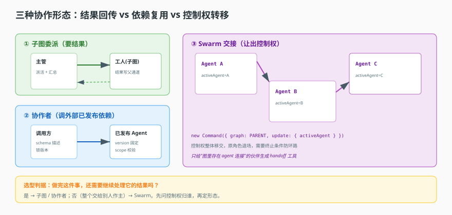
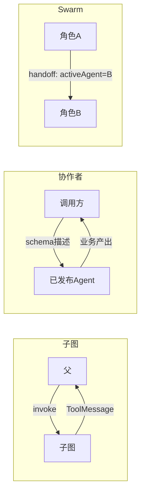

# 第 9 课：多 Agent 协作

> 所属阶段：阶段 3《执行与协作》｜ 水平：进阶 ｜ 本课知识点：子图委派、已发布 Agent 作协作者、Swarm 交接、选型判据
> 故事情节：一个 Agent 忙不过来了。系统给了三种"分工方式"，选错会让后期维护很痛。
> 配应用实战：[实战 09](../../../应用实战/09-从单Agent到主管工人.md)
> 📖 结论已按官方文档核对（核对于 2026-11 ｜ 来源：[LangGraph 子图](https://docs.langchain.com/oss/javascript/langgraph/use-subgraphs)、[工作流与 Agent](https://docs.langchain.com/oss/javascript/langgraph/workflows-agents)）


## 🎯 本课目标

- 画出于子图委派的父子调用与返回路径
- 说清固定版本调用如何保证可复现
- 说清 Swarm 交接与"返回结果"的本质区别
- 给定需求，能选出形态并说出代价

## 🧑‍💻 前置知识速览

- **子图**：一个被整体塞进父图的子 Agent（课 7 提过）。
- **工具 schema**：{ name, description, paramsSchema }，模型靠它理解"我能调什么"（课 8 知识点 3）。
- **版本（version）**：Agent 配置的发布版本号（课 4 讲过 latest / 具体版本）。

## 第一幕：起源与场景引入

> 🎬 **场景**：第 47 个工具，Agent 开始"答非所问"

你给单 Agent 塞的工具越来越多：查订单、查物流、算运费、退换货、查库存…到第 47 个时，模型开始频繁在无关工具间"犹豫"，上下文里躺满没用到的工具描述，一次请求的 token 直线上升。

你隐约觉得该"分家"了，但分法有好几种，你拿不准。本课就是关于这三种分法——它们不是复杂度的三个台阶，而是**控制流语义完全不同**的三种东西。这是最容易误读的地方，也是真正决定后期维护成本的地方。

> 📌 **一句话本质**：多 Agent 协作的三种形态，本质区别只有一点——**控制权归谁、结果往哪放**。

> ⚖️ **处境对照**：**不分家**，工具全塞进一个 Agent——第 47 个工具进来后，每次请求都要为用不到的工具描述付 token，模型在相似名字之间犹豫，选错率上升且很难定位是哪一步错的；**按控制流语义分家**，每个 Agent 只带自己那几个工具，主管拿回结果再决定下一步。代价是多一层调用编排，排查链路变长（一次请求要跨两个以上的执行单元看日志）。

## 第二幕：认知冲突

> ❓ **问题**：三种形态都叫"多个 Agent 协作"，为什么行为天差地别？

因为它们回答的是三个不同的问题：

- 子图问：**"我能不能把一件事派出去，等它做完把结果拿回来？"** —— 聚焦"任务分派 + 结果回传"。
- 协作者问：**"我能不能调用一个已发布、别人也维护的 Agent 干活？"** ——聚焦"能力复用 + 版本固定"。
- Swarm 问：**"我能不能把这件事整个交给另一个角色，它作主、我不再插手？"** ——聚焦"角色交接 + 控制权转移"。

看清楚了，就明白"返回结果"与"交接"的区别：子图的子 Agent 完成后**还要回来**（父继续处理）；Swarm 交接后**不再回头**（控制权已换人）。

## 第三幕：层层揭示

### 一眼全局图（进入细节前先看一眼）



> 看图：三种形态沿"结果往哪放、控制权给谁"这条轴展开。子图（左）把结果塞回父通道、父继续；协作者（中）用一个 schema 描述一个外部已发布的 Agent；Swarm（右）交接后 activeAgent 换成下一个、流程不再回退。

### 本课地图（分几步走）

| 步 | 这一步要解决什么（人话） | 对应知识点 |
|:--:|--------------------------|-----------|
| 1 | 怎么把一个 Agent 当"工具"派活并拿回结果 | 知识点 1：子图委派 |
| 2 | 怎么调用"已发布、别人维护"的 Agent | 知识点 2：已发布 Agent 作协作者 |
| 3 | 怎么把一段对话"整个"交给下一个角色 | 知识点 3：Swarm 交接 |
| 4 | 遇到具体需求该选哪个 | 知识点 4：选型判据 |

### 知识点 1：子图委派

> 🧭 第 1/4 步｜承接：第二幕"子图是分派+回传" → 本步：回传怎么实现
> 本知识点关键点：作为工具调用、状态隔离、失败传播

- 关键点：子图被包装成工具调用——参数进、结果（ToolMessage）出
- 关键点：状态隔离靠独立通道；结果写回父的通道
- 关键点：子图失败会抛异常向上传播，父决定怎么接

#### 一句话定义

子图委派 = 把一个子 Agent 包成"工具"塞进父的可用工具集。调用它像调用工具：传参进去，拿回一个 ToolMessage。它是**结果回传**语义——父还要接着处理。

#### 直觉建立（类比）

想象**老板把活儿外包给承包商**：

- 老板（父）把需求写清楚：查这单物流到哪了（传参）。
- 承包商（子图）去干，干完交回一张单子（ToolMessage）。
- 老板拿到单子继续往下处理（父接着跑）——**这件事还是老板在管**。
- 承包商干到一半搞不定，回来说"这单接不了"（失败传播），老板再想办法。

> 💡 **类比的边界**：一个子图就是一个完整的子 Agent 生命周期，不是一群人。

#### 核心原理

子图作为工具，本质是一个带独立通道的子图节点：

```python
def make_agent_tool(name, child_graph, caller):
    """把一个子 Agent 包装成一个父可调用的工具。"""
    def tool(params: dict) -> dict:
        # 在子图自己的通道上执行，不碰父的 messages
        result = run_subgraph(child_graph, input=params, caller=caller)
        # 结果包成一条 ToolMessage，写回【父】的通道
        return {"__leader_channel__": make_tool_message(result)}
    return Tool(name=name, invoke=tool)
```

两个关键设计，都要从"控制权"角度理解：

**状态隔离**。子 Agent 的中间产物写在自己的通道里，父的 `messages` 全程不被污染。这保证两件事：一是父的上下文不会被子的一堆内部调用撑爆；二是子跑完，父拿到的是一份干净的结果，而不是一叠子的中间记录。

**结果回传**。子跑完后，把一条 `ToolMessage` 写进父的通道（`leader` 通道）。于是父 Agent 看到的就是"我调了个工具，它返回了这个"，不需要知道子内部有几个节点、几层分支。**父眼里，子就是一把工具**。

**失败传播**。子内部失败会抛异常，不吞。父怎么接，取决于父的处理策略——是捕获后重试、换一个子 Agent、还是整个失败。关键点：**失败不会自动被吞掉**。

#### 示例演示

一个自包含的伪代码示范（父子通道 + 结果回填）：

```python
class Subgraph:
    def __init__(self, graph, node_key):
        self.graph = graph
        self.channel = f"__sub_{node_key}__"   # 独立通道

    async def run(self, params):
        # 子的事件全写自己的 channel
        try:
            out = await self.graph.invoke(params)
            return {"role": "tool",
                    "content": json.dumps(out),
                    "tool_call_id": f"call_{self.node_key}"}
        except Exception as e:
            # 失败向上抛，父决定怎么办
            raise SubgraphFailed(self.node_key, e) from e
```

#### 常见误区

1. **"子图是嵌入，父子共用一套状态"**：不。子有自己的通道，隔离是结构保证的。
2. **"子图失败父会自动重试"**：不。失败抛上来，怎么接由父的导航逻辑决定。

#### 一句话记住

子图 = 把子 Agent 当一个"能回传结果的工具"；子写子、结果写父。

#### 🗣️ 行话对照

- **Subgraph（子图）**：被整体嵌入执行的子 Agent——出现在"当作工具调用"。
- **Channel（通道）**：结果/中间数据的容器——出现在"状态隔离"。

---

### 知识点 2：已发布 Agent 作协作者

> 🧭 第 2/4 步｜承接：子图是"自己派活" → 本步：调用"别人已发布、自己也不改"的 Agent
> 本知识点关键点：包装层、固定版本、授权传递、恢复路径

- 关键点：协作者是已发布的 Agent，通过一个工具 schema 暴露给调用方
- 关键点：固定版本调用保证可复现
- 关键点：授权在跨 Agent 调用时如何传递
- 关键点：父被中断后，已发布子 Agent 如何续跑

#### 一句话定义

协作者 = 把"另一个已发布的 Agent（可能别人维护、有版本号）"当作一个能力暴露给当前 Agent，像调用公共服务一样调用它。

godaddy
#### 直觉建立（类比）

想象**公司内部的服务市场**：

- 别人的团队发布了一个"订单分析"服务，版本 2.3，长期稳定。
- 你不用看它内部怎么写，只需要知道它接受什么参数、返回什么（schema）。
- 你调它，结果按它的契约返回。
- 它升级到 3.0 你也不受影响，因为你锁的是 2.3；想升级时再显式改。

> 💡 **类比的边界**：服务市场是团队间信任；协作者甚至可跨组织，所以授权必须显式。

#### 核心原理

**包装层：把已发布 Agent 变成工具 schema。**

```python
def collaborator_tool(agent_ref):
    """把一个已发布的 Agent 暴露成一个工具形貌（给模型看）。"""
    return Tool(
        name=agent_ref.slug,                       # 模型靠 name 认人
        description=agent_ref.summary,             # 模型靠 description 判断该不该委托
        params_schema={
            "type": "object",
            "properties": {
                "input": {"type": "string",
                          "description": "要委托给这个 Agent 的完整任务描述"}
            },
            "required": ["input"],
            "additionalProperties": False,   # 严格：只接受声明的参数
        },
        # 注意：这里没有 invoke 实现体，见下文
    )
```

**「声明与执行分离」在此处的极致体现**（呼应课 8 知识点 4）：这个工具 schema 的"可执行体"往往永远不直接执行——它存在的意义只是 `name` + `description` 给模型看，让模型知道"我可以委托给订单分析"。真正的执行走**另一条路由**：当模型调用了这个工具名，运行时拦下这个调用、按调用方身份去启动协作者的真实执行。

```python
def on_collaborator_called(call, state):
    # ① 这个调用方是否有资格调用该协作者（scope 校验发生在触发时）
    if not authorized_call(call.caller, call.name):
        raise PermissionError("invalid scope")
    # ② 以协作者被锁定的版本启动真实执行
    return launch_agent(call.name, call.arguments["input"],
                        version=call.pinned_version)
```

**固定版本与可复现**：协作者是**已发布**的 Agent，有 `version` / `latest`。调用方锁定的是某一个版本。为什么能保证可复现：

- 排障时，"当时调的那个版本"可查，不会因协作者后来改版而变。
- 灰度/回滚时，可指定旧版本而不影响其他调用方。
- 你依赖的是"那份定义当时的形态"，而不是一个"现在还在变的服务"。

```python
def launch_agent(slug, task, version="latest"):
    published = get_published(slug)
    target = published.latest if version == "latest" else version
    return run_definition(published.definition(target), task)  # 锁定版本的定义
```

**授权如何传递**：跨 Agent 调用不是"无身份调用"。调用方触发协作者时带上自己的执行上下文（execution id）。授权校验发生在**触发时**——scope 不匹配就拒绝。**并非任何 Agent 都能调用任何协作者**，调用资格要过校验。

**父被中断后子如何续跑**：如果父执行中被中断（课 10 详述），它已派出去的协作者子调用不会凭空消失——恢复时基于持久化执行记录找到进度。这是"持久执行"的种子：协作者的存在让"父的中断"从"一次失败"变成"一个可恢复的中间状态"。

#### 示例演示

伪代码：协作者 = schema 描述 + 路由执行 + 锁版本 + 校验授权。

```python
def register_collaborator(parent, agent_ref, caller):
    t = collaborator_tool(agent_ref)                  # ① 包装成工具形貌
    parent.tools[t.name] = {
        "tool": t,
        "on_call": lambda call, st: (
            assert_scope(call.caller, parent, t.name)          # ③ 校验授权
            and launch_agent(t.name, call.args["input"],
                             version=parent.pinned.get(t.name, "latest"))  # ② 锁版本
        ),
    }
```

#### 常见误区

1. **"协作者执行就是调用它的 tool 函数"**：不。tool 函数体可能是抛错声明，真执行走另一个 handler 路由。
2. **"协作者是开发期的，上线前要写死"**：它是已发布、有版本的、可复现的依赖。

#### 一句话记住

协作者 = 已发布的公共服务；schema 描述、路由执行；锁版本保复现、验 scope 控授权。

#### 🗣️ 行话对照

- **Collaborator（协作者）**：子 Agent 依赖——出现在"能力复用"。
- **Pinned Version（锁定版本）**：固定版本调用——出现在"可复现"。

---

### 知识点 3：Swarm 交接

> 🧭 第 3/4 步｜承接：子图把活派出去还拿回结果 → 本步：Swarm 是"整个对话交给下一个角色"
> 本知识点关键点：handoff 语义、activeAgent、环路与终止

- 关键点：handoff 工具语义是"转移控制权"——不是一个"返回结果"
- 关键点：交接后控制权不回来，与"返回结果"本质不同
- 关键点：交接环路依赖终止条件

#### 一句话定义

Swarm 交接 = 当前角色用 handoff 工具把**整段对话的控制权**交给另一个角色。它不返回结果给调用者，而是让调用者"退场"。

#### 直觉建立（类比）

想象**客服转接**：

- 一线客服（A）判断这问题该转技术组。
- 点击转接（handoff），系统标记"当前客服 = 技术组"（activeAgent 更新）。
- 用户继续说，技术组接着处理——**一线客服已退出对话**。
- 技术上技术组也能再转回来（A→B→A），但要再次触发转接，不会自动闪回。

> 💡 **类比的边界**：客服转接有人工判断；这里的 handoff 是模型调用一个工具自动触发的。

#### 核心原理

handoff 工具的语义是"控制权转移"，不是"返回结果"。用伪代码表达：

```python
def make_handoff_tool(target_agent):
    def handoff(_, state):
        return Command(
            graph="PARENT",          # 指令发到整个 swarm，不是当前角色自己
            update={"activeAgent": target_agent},   # 控制权转移的标志
        )
    return Tool(name=f"transfer_to_{target_agent}", invoke=handoff)
```

**为什么它是"交接"而不是"返回结果"**，三个关键：

- **作用到父（整个 swarm）**：`Command.PARENT` 表示这个指令要影响整个接管流程，不是只改当前角色。
- **改"当前角色"状态**：`update.activeAgent` 修改的是"现在谁在台前"这个状态。swarm 的执行逻辑一看到 activeAgent 变了，就切换当前执行的角色。
- **不再回退**：上一角色"退场"。若 B 想让 A 再说，必须再次 handoff，不会自动回到 A。

对比"返回结果"（子图）：子 Agent 完成时把 ToolMessage 塞回父通道、父继续——控制权在父。而 Swarm 交接后控制权在**新角色**手里，父（swarm 本体）只按 activeAgent 路由下一轮。

**环路风险与终止条件**：A 转给 B、B 转回 A、A 又转给 B……必须有终止条件（达到一定次数或无可进展时结束），否则两个模型互相推诿会一直转下去。生产环境必须关注：**交接要能停**。

**交接对象还受图结构约束**：不是任意两个 Agent 都能互转——handoff 工具只生成给"图里确实存在协作连接（agent 类型关系）"的伙伴。

```python
def handoff_tools_for(member, connections):
    partners = {c.to for c in connections if c.type == "agent" and c.from == member}
    return [make_handoff_tool(p) for p in partners]   # 只连"连长"的伙伴
```

这本身就限制了环路范围：没有协作连接的两个角色根本交接不了。

#### 示例演示

伪代码：Swarm 交接的最小骨架。

```python
class Swarm:
    def __init__(self, agents, connections):
        self.agents = agents
        # 每个角色只拿到"能交接给谁"的工具
        for m in agents:
            m.tools += handoff_tools_for(m, connections)

    async def run(self, state):
        while True:
            active = state["activeAgent"]
            reply = await self.agents[active].step(state)
            if "activeAgent" in reply.state:      # handoff 触发
                state["activeAgent"] = reply.state["activeAgent"]
                continue                          # 控制权已转移
            if self.exceeded(state): break        # 终止条件（次数/无进展）
        return state
```

#### 常见误区

1. **"Swarm 交接后会返回结果给调用方"**：不会。控制权转交，原角色退场。
2. **"交接可以无限链下去"**：需终止条件防死循环。
3. **"任意 Agent 之间都能交接"**：只能转给图里有 agent 关系的伙伴。

#### 一句话记住

Swarm = 整段交接：Command.PARENT + activeAgent；交出去了就不回头。

#### 🗣️ 行话对照

- **Handoff（交接）**：转移整段对话控制权——出现在"角色转交"。
- **ActiveAgent（当前角色）**：swarm 的执行指示器——出现在`activeAgent` 通道。

---

### 知识点 4：选型判据

> 🧭 第 4/4 步｜承接：三种形态语义清楚 → 本步：具体需求怎么选
> 本知识点关键点：回传→子图、转移→Swarm、跨进程→runtime、混合

- 关键点：要结果回传 → 子图
- 关键点：要控制权转移 → Swarm
- 关键点：跨服务 / 跨进程 → runtime（MCP / 远程调用）
- 关键点：最常踩的坑是把三种当"复杂度台阶"一字排开

#### 一句话定义

选型看的是"结果往哪放、控制权给谁"，不是"需求大小"。

#### 直觉建立（类比）

选工具不看你要办的事"大不大"，看你要"借物"还是"转手"：

- 你要的是**做一件事并拿回结果** → 外包（子图）。
- 你要的是**整个事交给别的人管** → 转接（Swarm）。
- 你要的是**别家系统里的一个能力** → 集成（runtime / MCP）。

> 💡 **类比的边界**：现实里"外包"也可能切一段全程托管，但系统里边界清晰得多。

#### 核心原理

决策表（按"结果"与"控制权"两个维度）：

| 你的需求 | 形态 | 结果往哪放 | 控制权归谁 |
|---|---|---|---|
| 分派一件事，做完了要结果回来继续处理 | 子图 | 父通道（ToolMessage） | 父 |
| 调一个已发布的外界 Agent 干一件事 | 协作者 | 业务产出（可能异步/独立） | 调用方，但独立执行 |
| 一段对话整体交给某个角色做主 | Swarm | 不返回，继续对话 | 新角色 |
| 借用另一个系统/服务的能力 | runtime / MCP | 服务端约定 | 服务端 |

**决策时的三个自问**：

1. 我做完这件事，还要不要拿到结果继续？→ 要，选子图；不要，看 2。
2. 这个"角色"是不是最终要接管对话？→ 是，选 Swarm。
3. 能力是不是在另一个系统/进程里，而且我控制不了它的实现？→ 是，选 runtime/MCP（课 12）。

**最常踩的坑**：把三种形态当"复杂度的三个台阶"按序选用（小就用子图、中就用协作者、大就用 Swarm）。这忽略了它们语义不同——一个需求是"派活回传"，用 Swarm 交给别人，结果拿不回来；一个需求是"角色转接"，用子图，结果两个角色抢着说话。

**混合**：真实系统往往混用。例如：父用子图把子任务分给多个子 Agent；其中某个子 Agent 内部又用 Swarm 完成一段多角色对话。关键是每个连接点都明确"这端是回传/复用/转接中的哪一种"。

#### 示例演示

伪代码：一个"主管 + 工人"的典型混合骨架。

```python
class Supervisor:
    def __init__(self, workers, agent_tool):
        self.workers = workers
        self.agent_tool = agent_tool      # 子图工具（回传）

    async def handle(self, user_state):
        task = parse_task(user_state["input"])
        # 把任务封装成对"订单分析"子 Agent 的调用（子图，回传）
        result = await self.agent_tool.invoke({"input": task})
        # 拿到结果继续处理
        return compose_reply(result)
```

#### 常见误区

1. **"按复杂度选形态"**：按"结果/控制权"选，不按复杂度。
2. **"子图可以当 Swarm 用，多派几个就是多角色"**：子图是回传，不会"交出去不回来"。
3. **"跨系统也嵌一个子图"**：SYSTEM 边界外的能力走 runtime/MCP，不是子图。

#### 一句话记住

回传→子图、转接→Swarm、跨系统→runtime；按语义选，不按复杂度选。

#### 🗣️ 行话对照

- **Routing（路由/分流）**：按语义选形态——出现在"决策自问"。

---

## 第四幕：实操验证

> 目标：把三种形态分别落地成可运行的原型，验证它们的控制流差异。

### 4.1 机制验证

> ✅ 机制实测于 Node v22.22.2 / @langchain/langgraph 1.6.0（脚本 `verify/verify-run.ts`）。上段为伪代码示意，下面是同机制的真实输出：

```text
① 子图委派: activeAgent=leader（父仍掌权）| 消息=["[子图] 分析完成","[父] 收到子图结果，继续下一步"]
② Swarm 交接: activeAgent=tech（已转移）| 消息=["[front] 已交接给 tech","[tech] 接手处理"]
③ 协作者授权（先验 scope）: PermissionError: scope admin:all 未授权
```

> ① 与 ② 的差别只在最后一行：子图跑完，`activeAgent` 还是 `leader`；Swarm 交接完，`activeAgent` 变成 `tech`。这一个字段就是结果拿得回来 / 控制权交出去的全部区别——选型时先问我要结果还是要它接手，而不是先问哪个更复杂。

分别实现最小三者，并用"谁在说话、结果给谁"两个观察点验证：

```python
# ① 子图：观察"父是否拿回结果并继续"
sub = Subgraph(child_graph, node_key="order_analysis")
r = await sub.run({"input": "查这单物流到哪了"})
assert r["role"] == "tool"                # 结果以工具消息回传

# ② Swarm：观察 activeAgent 是否切换、结果是否"不返回"
swarm = Swarm(agents=[front, tech], connections=[front_tech])
final = await swarm.run({"activeAgent": "front", "input": "转技术组"})
assert final["activeAgent"] == "tech"     # 控制权已转移

# ③ 不可用协作者：触发时校验授权，非法 scope 应拒绝
with pytest.raises(PermissionError):
    on_collaborator_called(call_with_invalid_scope, state)
```

关键断言：子图拿回结果（父继续）；Swarm 不拿回、activeAgent 切换；协作者独立执行且先验 scope。

## 第五幕：体系收束

三种协作形态不是复杂度等级，而是三种控制流。选错会让"结果拿不回来"或"角色互相抢话"。

> 📍 **全局定位**：单 Agent 可控之后，多 Agent 的分工方式决定了协作的维护成本。
> 🔗 **下一步**：多 Agent 协作里，经常需要等待——下一课讲等待的工程化。

## 🐞 全课常见误区

1. **"按复杂度选形态"**：按"结果/控制权"。
2. **"子图能当 Swarm 用"**：子图要回传，不会交出去就不回来。
3. **"人工交接能无限链"**：需终止条件。
4. **"任意 Agent 都能交接"**：只能转给图里连了 agent 关系的伙伴。

## 一图总结



## 课后小测

**Q1**：一个需求是"让另一个团队维护的订单分析 Agent 做分析，我等着拿结构化结果"。选哪种？
- A. 子图　B. 协作者　C. Swarm　D. 任意

<details><summary>答案与解析</summary>

**答案：B**。调用的是**已发布、别人维护**的 Agent，且要拿回结果——正是协作者的定位（能力复用 + 固定版本）。若是同一个系统内的子图，则 A 更贴切。

</details>

**Q2**：Swarm 交接的本质区别是什么？
- A. 更慢　B. 控制权转移、原角色退场，不返回结果　C. 能拿到结构化结果　D. 自动回退

<details><summary>答案与解析</summary>

**答案：B**。交接通过 `Command.PARENT` + `activeAgent` 实现控制权转移，原角色不再回来，也不返回结果给调用方。

</details>

## 🚀 下一批接力提示词

```
继续学 Agent 工程解剖。我的学习档案在 agent-engineering/00-学习档案.md，
刚学完阶段 3 的课 9《多 Agent 协作》四个知识点，
请按大纲继续讲解下一课《持久执行》。
```

## 🧭 课程导航

⬅️ **上一课**：[课 8：模型调用与工具执行](08-模型调用与工具执行.md)
➡️ **下一课**：[课 10：持久执行](10-持久执行.md)
📚 **返回目录**：[课程目录](../../../02-课程目录.md)
