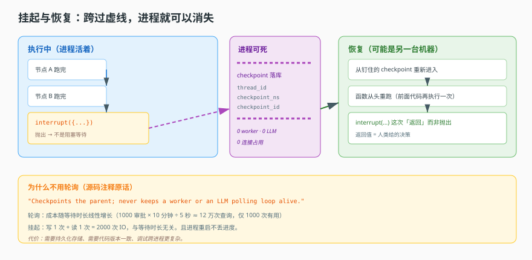
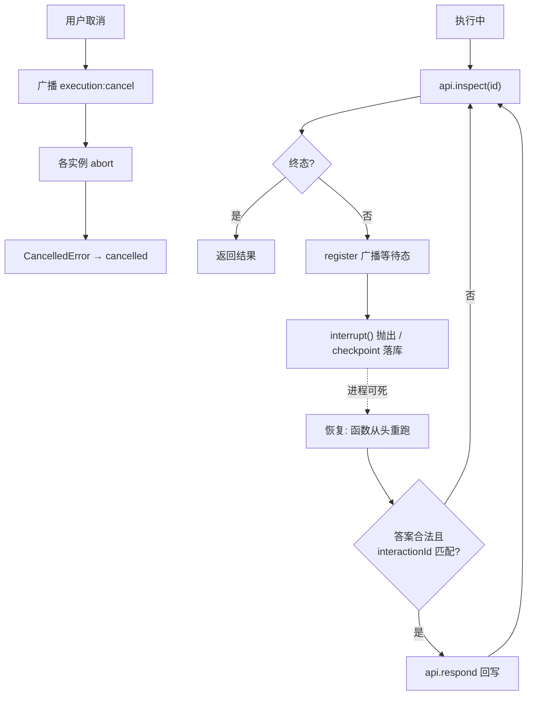

# 第 10 课：持久执行

> 所属阶段：阶段 3《执行与协作》｜ 水平：进阶 ｜ 本课知识点：checkpoint、interrupt 等人工、为什么不轮询、取消与终态
> 故事情节：主角遇到第一个"人不在场"的场景——需要审批。它能停下来等，而且不占任何资源。
> 配应用实战：[实战 10：审批不丢状态](../../../应用实战/10-审批不丢状态.md)
> 📖 结论已按官方文档核对（核对于 2026-11 ｜ 来源：[LangGraph 中断](https://docs.langchain.com/oss/javascript/langgraph/interrupts)、[持久化](https://docs.langchain.com/oss/javascript/langgraph/persistence)、[持久执行](https://docs.langchain.com/oss/javascript/langgraph/durable-execution)）
> 核对要点三条（课文已据此表述）：(1) 恢复时被中断节点**从头重跑**，interrupt 之前的副作用必须幂等；(2) 同节点多次 interrupt 的恢复值**按索引匹配**，调用顺序不可变；(3) `new Command({ resume })` 是**唯一**可作为 invoke 输入的 Command 形式（`Command({ update })` 用作输入会从最新 checkpoint 续跑而非重开）。


## 🎯 本课目标

- 说清 thread 与 checkpoint 的命名空间关系
- 说清 `interrupt` 抛出与恢复的完整路径
- 用资源账算清轮询的代价，解释为何必须挂起
- 说清协作式取消与终态幂等

## 🧑‍💻 前置知识速览

- **图执行**：Agent 内部作为一个有向图跑，节点间的通信靠"通道"（课 6 / 8）。
- **边上/边下**：一个任务可能被切分到多个图里执行（课 9）。

## 第一幕：起源与场景引入

> 🎬 **场景**：审批等了 40 分钟，回来发现进度全没了

你的 Agent 干到一半需要人批一下"要不要下这笔单"。你在代码里写了：

```ts
await sleep(60_000)   // 等审批
```

demo 跑得很顺。上线第一周出事了：审批人开会去了，40 分钟才回来点通过。这 40 分钟里那个 worker 一直占着——**它没在干活，但也没法接别的活**。更糟的是，中间服务重启了一次，醒来后内存里所有进度都不见了。审批人点通过，系统回他"找不到这个任务"。

这就是本课的分水岭：**demo 里"等待"是 `sleep`，生产里"等待"必须是"挂起"**。区别在于——挂起的时候，这套状态被写进了数据库，进程可以消失。

> 📌 **一句话本质**：持久执行 = 把"执行到哪了"变成一个**可持久化、可恢复的数据结构**，于是等待不再占用任何运行时资源，进程重启也不丢进度。

> ⚖️ **处境对照**：不这么做 → 等待期间占 worker、重启丢进度、审批结果无处落；这么做 → 零资源等待、重启续跑、审批结果有明确落点。

## 第二幕：认知冲突

> ❓ **问题**：既然"等"这么麻烦，为什么不能干脆轮询？每隔 5 秒查一下不就行了？

先说结论：轮询在 demo 规模下完全能跑，问题出在**成本随等待时长线性增长**。

算一笔账。假设 1000 个并发审批，平均等 10 分钟，轮询间隔 5 秒：

```
每次轮询：占一个 worker 时间片 + 一次 DB/缓存查询
1000 × (10 × 60 ÷ 5) = 12 万次查询
```

这 12 万次里，真正有用的可能只有 1000 次（每个审批最终只通过一次），剩下 11.9 万次都在问"好了吗"，答案是"没有"。

而挂起模式的数量级完全不同：写一次 checkpoint（1 次写），恢复时读一次（1 次读）。同样是 1000 个审批，**2000 次 IO**，与等待时长无关。

这不是优化，是**复杂度量级的变化**：轮询是 O(等待时长)，挂起是 O(1)。

另外，"轮询"在很多实现里不是查库，而是**让 Agent 自己循环**——反复问模型"好了吗"。那就每次都在烧 token，成本直接乘一个数量级。

## 第三幕：层层揭示

### 一眼全局图（进入细节前先看一眼）



> 看图：左边是执行中的图跑到一半，在某个节点调用了 `interrupt`（一个"抛出"的动作）；中间这条虚线是"进程可以死掉"的边界，checkpoint 已落库；右边是恢复时从那个 checkpoint 重新进入，`interrupt` 的返回值变成"人类给的决策"。整张图的重点是中间那条线：**跨过它，进程的存在不再被需要**。

### 本课地图（分几步走）

| 步 | 这一步要解决什么（人话） | 对应知识点 |
|:--:|--------------------------|-----------|
| 1 | "执行到哪了"这份状态长什么样、存在哪 | 知识点 1：checkpoint |
| 2 | 怎么停下来、怎么被恢复、恢复时拿到什么 | 知识点 2：interrupt 等人工 |
| 3 | 为什么不能用轮询等 | 知识点 3：为什么不轮询 |
| 4 | 用户中途取消怎么办、怎么保证不重复 | 知识点 4：取消与终态 |

### 知识点 1：checkpoint

> 🧭 第 1/4 步｜承接：第二幕"挂起比轮询便宜一个量级" → 本步：挂起靠什么存
> 本知识点关键点：三层命名空间、一个 checkpoint 存了什么、从哪继续

- 关键点：`thread_id` / `checkpoint_ns` / `checkpoint_id` 三层定位——不是"一个会话一条记录"
- 关键点：一个 checkpoint 里存通道值 + 待执行节点 + 元信息
- 关键点：恢复时从"消息气泡锚定的那个" checkpoint 继续

#### 一句话定义

checkpoint = 图执行到某一刻的**完整快照**：所有通道的当前值、下一个该跑哪个节点、以及它属于哪条执行线。它是"执行到哪里"这件事的唯一事实来源。

#### 直觉建立（类比）

想象**游戏存档**：

- 一个 `thread_id` 是"一个存档位"（一段对话）。
- 主线和支线——`checkpoint_ns`（命名空间）区分"这是主线进度"还是"支线进度"。
- `checkpoint_id` 是"第几号存档"，同一个 namespace 里可以有很多（每跑一步存一次）。

有了三层，你才能精确说"恢复到主线的第 37 号存档"，而不是笼统的"恢复这段对话"。

> 💡 **类比的边界**：游戏存档通常手动存；这里每步自动存，所以叫 checkpoint。

#### 核心原理

**为什么必须是三层**——因为一个会话里不止一条执行线。子图（课 9）会开自己的命名空间；一个父图在某个节点里调用了子图，子图内部进度和父的进度是**两条独立的线**，混在一起会互相覆盖。

用伪代码表达这个查询与"钉住"过程：

```python
def find_recovery_points(thread):
    """按三层定位找一个 thread 下可恢复的 checkpoint，并"钉住"每条线的按最新点。"""
    rows = checkpoint_store.query(
        thread_id=thread.id, tenant=thread.tenant
    ).order_by("checkpoint_id", desc)   # 每行含 thread_id / checkpoint_ns / checkpoint_id

    pinned = {thread.checkpoint_ns: thread}              # 父先钉住
    for row in rows:
        if row.checkpoint_ns not in pinned:
            pinned[row.checkpoint_ns] = row              # 每个命名空间只钉最新那一个
    return pinned
```

两层逻辑：

- **查询粒度**是 "这个 thread 下所有命名空间的最新 checkpoint"——不是一个 thread 一条。
- **钉住**（pin）：为每个命名空间记住"最新的那一个"。为什么需要钉住？因为消息气泡要能**回放**——用户点开历史回复，系统要能精确回到"生成这条回复时的那份状态"。只记 `thread_id`，回放会拿到线程最新状态，而不是那条消息当时的状态。

一个时序约束（很重要）：**在任务全部完成的屏障处钉住，而不是在请求分支时钉**。因为"分支时"有些任务可能还没跑完，钉到中间态会让回放结果错乱。

**一个 checkpoint 里存什么**：

| 内容 | 作用 | 少了会怎样 |
|---|---|---|
| 通道值（messages 等） | 恢复时的上下文 | 模型不记得之前说过什么 |
| 待执行节点（next） | 知道该从哪继续 | 只能从头重跑 |
| 元信息（ns / id / 父引用） | 定位与回放 | 找不到、回放错位 |

**checkpointer 是可关的**（可选能力）。存在 `disableCheckpointer` 说明持久化是可选设计而非硬编码：某些纯无状态场景关掉能省 IO。

#### 示例演示

伪代码示范三层定位与钉住：

```python
def recover(thread, message):
    # 找到这条消息生成时的那一刻（消息气泡锚定），而不是线程最新
    point = pinned_for(message.checkpoint_ns)   # ns + 当时的 checkpoint_id
    state = load_checkpoint(thread.id, point.ns, point.id)
    return resume(state)
```

#### 常见误区

1. **"一个会话一个 checkpoint"**：是三层（thread / ns / id），子图各有。
2. **"恢复从最新开始"**：要从**消息锚定的那个**开始，否则回放错位。
3. **"checkpoint 只存消息"**：还存待执行节点和元信息。

#### 一句话记住

三层定位、钉住锚点、从锚点续跑。

#### 🗣️ 行话对照

- **Checkpoint（检查点）**：状态快照/断点——出现在"可持久化执行"。
- **Namespace（命名空间）**：执行线编号——出现在 `checkpoint_ns`。

---

### 知识点 2：interrupt 等人工

> 🧭 第 2/4 步｜承接：状态能存了 → 本步：怎么停下来、怎么被叫醒
> 本知识点关键点：循环结构、决策载荷校验、返回值语义

- 关键点：等待循环：查状态 → 注册 → 抛 interrupt → 恢复后校验 → 回写响应
- 关键点：决策载荷必须 `interactionId` 匹配——防"给的是另一个问题的答案"
- 关键点：`interrupt` 是"抛出去"不是"等回来"；恢复时函数从头重跑

#### 一句话定义

`interrupt` 是一个"抛异常式等待"：调用它时，图的执行被中止、状态被 checkpoint 化；恢复时，同一个函数**从头重新执行**，而 `interrupt(...)` 这一行不再是"抛"，而是"返回人类给的答案"。

#### 直觉建立（类比）

想象**填表后离柜**：

- 你把表单交给窗口（`interrupt` 抛出请求载荷）。
- 你离开柜台去做别的事（进程可死，不占资源）。
- 叫号了，你回柜台——但注意：你不是从"交表单那一刻"继续，而是**重新走一遍流程**，只是这次窗口直接给你答案。

这个"从头重跑"是 `interrupt` 最反直觉的地方。

> 💡 **类比的边界**：叫号是排队；恢复可能是另一个进程、另一台机器、甚至几天后。

#### 核心原理

抽象出的等待循环（伪代码，反映了这类系统的共同骨架）：

```python
def await_agent_invocation(api, invocation_id, register=None):
    while True:
        current = api.inspect(invocation_id)          # ① 查当前状态
        if is_terminal(current.status) or current.status == "unknown":
            return current                            # 入点时已是终态/查不到 → 直接返回
        if register: register(current)                # ② 把"在等什么"登记出去

        # ③ 抛 interrupt 载荷；恢复时这里返回人类给的决策
        resumed = interrupt({
            "type": "agent_invocation",
            "invocation_id": invocation_id,
            "status": current.status,
        })

        # ④ 若正在等一个具体问题，校验答案是否对上问题编号
        if current.interaction:
            ok = validate(resumed) and resumed.interaction_id == current.interaction.id
            if ok:
                api.respond(invocation_id, resumed.interaction_id, resumed.response)
            # 不匹配 → 什么都不做，进入下一轮：再查、再抛
```

**第 ① 步：查状态（短路）**。`inspect` 问"被调用的 Agent 现在什么状态"。如果已是终态或 `unknown`，直接返回——**不需要等**。这避免"明明已完成还白等一次"。

**第 ② 步：注册**。把当前状态登记出去（让外部知道"现在在等什么"）。它可选——某些内部调用不需要广播。

**第 ③ 步：抛 interrupt**。载荷携带想让人知道的上下文。第一次执行到这行不返回，控制权抛出去；恢复时整个函数被重新调用，这行**返回**了恢复方给的值。

**第 ④ 步：校验（全流程最关键）**。恢复值必须同时满足：schema 合法 + `interaction_id` 与当前等的那一个**匹配**。

为什么必须校验 id？考虑：Agent 先问"要不要查订单"，再问"要不要下补单"。用户先回答了第一个，但系统已推进到第二个。若不校验 id，那个"同意查订单"的答案会被当成"同意下补单"——**危险的错配**。`interaction_id` 就是"问题编号"，答案只能配上之前的问题。

**非法恢复怎么办**：没有 else。不匹配就**什么都不做**，进入下一轮：再 `inspect`、大概率状态没变、再次 `interrupt`。相当于"你没答对，再问一次"。这个设计选择"静默重问"而非报错，因为它假设恢复方可能是人（可能点错、可能网络重试）。

**`interrupt` 前代码会重跑**：因为函数从头重跑，`interrupt` 之前的代码会重新执行。所以前面的代码必须幂等或便宜。上面伪代码里 `inspect` 就在 `interrupt` 前，每次恢复会重新查——刻意的（要拿最新状态），但意味着一次调用可能查多次。

#### 示例演示

伪代码：一个可运行的"等待 + 校验"循环。

```python
def await_approval(api, invocation_id):
    while True:
        st = api.inspect(invocation_id)
        if st.status in ("succeeded", "failed", "cancelled"):
            return st
        decision = interrupt({"type": "agent_invocation", "id": invocation_id, "status": st.status})
        if st.interaction and decision.get("interaction_id") == st.interaction.id:
            api.respond(invocation_id, decision["interaction_id"], decision["response"])
        # 不匹配 => 下轮重查重抛
```

#### 常见误区

1. **"interrupt 会阻塞在这里等"**：不。它是抛出去，进程可死。
2. **"恢复是接着 interrupt 那行往下走"**：不。函数从头重跑，那行改为返回。
3. **"只要 schema 合法就能恢复"**：还要 `interaction_id` 匹配，否则答非所问。

#### 一句话记住

抛出去不阻塞、恢复要重跑、答案必须对上问题编号。

#### 🗣️ 行话对照

- **Interrupt（中断）**：挂起点/断点续跑——出现在"等人工"。
- **Interaction ID**：待答问题编号——出现在"决策匹配"。

---

### 知识点 3：为什么不轮询

> 🧭 第 3/4 步｜承接：interrupt 会真的"停下来" → 本步：为什么不能"假装停下来其实在转圈"
> 本知识点关键点：注释原话、三种资源、失败恢复差异、挂起的代价

- 关键点：源码注释原话——"checkpoints the parent; never keeps a worker or an LLM polling loop alive."
- 关键点：轮询占用的三种资源（worker 时间片 / 连接 / 计费）
- 关键点：挂起与轮询在失败恢复上的差异（重启后能不能续）
- 关键点：挂起模式的代价——必须有持久化 checkpoint 存储

#### 一句话定义

轮询是"用资源换简单"：实现简单，但成本随等待时长线性增长。挂起是"用一次持久化换零占用"：实现复杂，但成本与等待时长无关。

#### 直觉建立（类比）

想象**等快递**的两种方式：

- 轮询：每 5 分钟下楼看一眼快递柜。等 10 小时就是 120 趟。
- 挂起：留手机号，快递到短信通知。等 10 小时一趟不用跑。

"留手机号"是注册回调；"每 5 分钟下楼"是轮询。区别不在快慢，在**你有没有为"等待"这件事本身付出代价**。

> 💡 **类比的边界**：系统里每次轮询都是真金白银。

#### 核心原理

**三种被占用的资源**：

| 资源 | 轮询时 | 挂起时 |
|---|---|---|
| worker/线程 | 每个等待者占一个执行槽，`sleep` 不释放 | 0（进程可死） |
| 连接 | 长连接轮询占 TCP/HTTP 连接与池位 | 0（连接可断） |
| 计费 | 轮询里带 LLM 调用则每次烧 token | 0（不调模型） |

第三项最隐蔽——很多"轮询"实现是让 Agent 自己循环 (`while not_approved: ask_or_check; sleep`)。注释 `never keeps a worker or an LLM polling loop alive` 里的 `LLM polling loop` 精确指它。一个等 40 分钟的审批，可能烧几十次模型调用，全用来确认"还没好"。

**失败恢复的差异**——这条比成本更致命：

| | 轮询 | 挂起 |
|---|---|---|
| 进程重启 | 内存状态丢失，等待者消失 | 从 checkpoint 恢复接着等 |
| 机器迁移 | 等待者绑原机器 | 换机器照样恢复 |
| 部署发布 | 等待中的请求被打断 | 不受影响 |

这就是开头"审批人点了通过系统说找不到"的根因：**进度只活在内存里**。

**挂起的代价**——诚实说清：

- 必须有持久化存储，基础设施依赖一个"每步一次写"的库。
- 恢复要能重建执行环境（同样的代码版本）。代码在等待期间改了，恢复可能对着旧 checkpoint 跑新逻辑，这是真实风险。
- 调试变复杂：一次执行跨多个进程、多个时间点，日志不连续。

所以挂起不是免费。但对任何"等人"的场景，轮询的代价一定更高——因为等人时长**不可控**。

#### 示例演示

伪代码对比两种写法的资源占用：

```python
# 轮询：等待者占着执行槽
while not approved(order_id):
    check_db(order_id)     # 12万次几乎无用
    time.sleep(5)

# 挂起：进程释放，事件驱动
record = checkpoint_before_interrupt(...)
decision = interrupt({...})        # 恢复时返回，进程可能早没了
if decision.approved: place_order(order_id)
```

#### 常见误区

1. **"sleep 一下不算占资源"**：占。worker 槽位不释放。
2. **"轮询只是查库很便宜"**：若循环里带模型调用，成本高一数量级。
3. **"挂起没有代价"**：有。需持久化存储、版本一致性、调试更难。

#### 一句话记住

轮询成本随等待时长线性涨；挂起用一次持久化换零占用。

#### 🗣️ 行话对照

- **Polling（轮询）**：拉模式——出现在 `while+sleep` 循环。
- **Suspend（挂起）**：挂起/休眠——出现在 `interrupt`+checkpoint。

---

### 知识点 4：取消与终态

> 🧭 第 4/4 步｜承接：能挂起、能恢复 → 本步：用户中途反悔怎么办
> 本知识点关键点：协作式取消的信号路径、终态幂等、清理边界

- 关键点：协作式取消不是"强杀"，而是广播一个"请停"信号，各实例自己 abort
- 关键点：终态定义 succeeded / failed / cancelled，重复取消不报错（幂等）
- 关键点：清理边界——内存里的 controller 要注销，持久化的 checkpoint 不该删

#### 一句话定义

协作式取消 = 不强行杀掉执行，而是**广播一个取消信号**，让持有该执行的实例自己中断。终态是"结束了"的三种状态，进入后不可再变。

#### 直觉建立（类比）

想象**叫停一场演出**：

- 强杀：直接拉电闸。灯灭、可能伤人、道具散一地。
- 协作式：通过对讲机通知"这场停"，各岗位按流程收尾。

后者慢一点，但**现场可控**。对讲机（广播）意味着不管哪个岗位在哪个房间都能收到。

> 💡 **类比的边界**：演出停就是停了；系统里的取消还要考虑"已发出的下游调用怎么办"。

#### 核心原理

抽象出的协作式取消（伪代码）：

```python
class CancelCoordinator:
    def __init__(self):
        self._controllers = {}            # execution_id -> AbortController
        self._channel = "execution:cancel"

    def register(self, execution_id, controller):
        self._controllers[execution_id] = controller

    async def cancel(self, ids, reason=None):
        ids = list(dict.fromkeys(x for x in ids if x))     # ① 去重
        publish(self._channel, {"execution_ids": ids, "reason": reason})  # ② 广播
        self._apply(ids, reason)          # ③ 本实例也执行

    def _apply(self, ids, reason):
        for eid in ids:
            ctrl = self._controllers.get(eid)
            if not ctrl: continue         # ④ 没有 → 跳过（幂等第一层）
            if not ctrl.aborted: ctrl.abort(make_cancelled(reason))  # ⑤ 已 abort 不再 abort
            del self._controllers[eid]    # ⑥ 注销内存态
```

五个设计要点：

**① 去重**：同一个执行被重复取消，只处理一次。

**② 广播 + ③ 本地执行**：`publish` 之后再**自己调一次** `apply`。为什么？发布者所在实例可能就是持有该执行的实例，单机 Map 找不到别的实例的 controller，必须靠广播让持有者自己响应。显式本地再调一次是防御写法。

**④ `if not ctrl: continue`**：找不到就跳过，不报错。这是幂等第一层——取消一个已结束/不存在的执行，静默通过。

**⑤ `if not ctrl.aborted`**：已 abort 的不再 abort。幂等第二层。

**终态的定义**：

```
IS_TERMINAL(s) = s in { "succeeded", "failed", "cancelled" }
```

`cancelled` 是三种终态之一，与成功、失败同级——不是"特殊中间状态"。一旦 cancelled，之后任何"恢复"都没意义（知识点 2 循环第一行靠它短路）。

**取消如何变成终态**：abort 触发中断 → 执行层捕获异常并映射成状态：

```python
except CancelledError as e:
    return {"status": "cancelled", "error": str(e)}
```

**清理边界**——两个方向：

| 该清理 | 不该清理 |
|---|---|
| 内存里的 controller（`del controllers[eid]`） | 已落库的 checkpoint |
| 相关连接、临时文件 | 执行记录（审计需要） |
| | 已发出的下游请求（让它自己超时/取消） |

为什么 checkpoint 不该删：它是"发生了什么"的证据。取消不代表历史不存在——回放、审计、排障都需要。删了就没法回答"它到底跑到哪一步被取消的"。

#### 示例演示

伪代码验证广播与幂等：

```python
c = CancelCoordinator()
c.register("exec-1", controller1)
await c.cancel(["exec-1", "exec-1"])     # 去重 + 已 abort 不重复
# 重复取消一个不存在的执行：
await c.cancel(["exec-none"])            # 静默通过，不报错
```

#### 常见误区

1. **"取消就是强杀进程"**：是广播 + 各自 abort，让执行自己收尾。
2. **"重复取消会报错"**：跳过，不报错（幂等）。
3. **"取消后要清 checkpoint"**：不该删，审计与回放需要。

#### 一句话记住

取消靠广播不靠强杀、终态三取一、重复取消静默通过。

#### 🗣️ 行话对照

- **Cooperative Cancellation（协作式取消）**：优雅停止——出现在「广播+abort」。
- **Idempotency（幂等）**：重复结果不变——出现在 `if not aborted`。

---

## 第四幕：实操验证

### 4.1 机制验证

> ✅ 机制实测于 Node v22.22.2 / @langchain/langgraph 1.6.0（脚本 `verify/verify-core.ts`；跨进程版本见 `projects/数据库变更审批助手/实现/README.md`）。上段为伪代码示意，下面是同机制的真实输出：

```text
① 首次 invoke 返回 __interrupt__: [{"id":"644ad570","value":{"kind":"approval_required","tool":"executeSql"}}]
   挂起后 next 非空: ["approve"]
② resume 后 approved=true | 节点执行轨迹=["节点进入（每次恢复都会重跑这一行）","节点进入（每次恢复都会重跑这一行）","拿到决策: approve"]
③ 结论: 节点进入被记录了 2 次（= 首次 + 恢复次数），interrupt 之前的代码确实重跑了
```

> 第 ③ 行是本课最贵的一课：**节点进入打印了两次**。这不是框架的 bug，是持久执行的代价——框架不可能冻结一个运行中的调用栈再跨进程还原，它只能重放节点 + 把恢复值喂给 `interrupt`。所以 `interrupt` 之前的任何写库、发消息、扣款，都必须幂等。
> 另外注意 ① 里的 `next` 非空——这是**唯一可靠的挂起判据**。`pendingWrites` 与 `tasks[].interrupts` 在跨进程场景都读不到，本项目的实现（`src/account/file-saver.ts`）踩过这个坑后改用 `getState().next`。

> 目标：跑通"挂起 → 杀进程 → 恢复 → 只执行一次"的最小闭环。

```python
# ① 进入挂起：写 checkpoint，进程可死
state = prepare(checkpoint_store)
suspended = interrupt({"type": "approval", "interaction_id": "it-1"})

# ② 模拟进程被 kill：略（checkpoint 已在库）

# ③ 恢复：用户给决策，interactionId 匹配才回写
def resume(api, invocation_id, user_decision):
    st = api.inspect(invocation_id)
    if st.interaction and user_decision.get("interaction_id") == st.interaction.id:
        api.respond(invocation_id, st.interaction.id, user_decision["response"])
    else:
        # 不匹配 -> 重新进入等待（静默重问）
        return await_approval(api, invocation_id)
```

**关键断言**：恢复后，`interrupt` **之前的副作用不重复执行**（把副作用放 `interrupt` 之后且只在决策 approved 时执行）；`interaction_id` 不匹配时系统静默重问而非报错。

> ✅ **回扣场景**：回到开头"审批 40 分钟、重启丢进度"。正确做法：审批点用等待循环挂起（写 checkpoint），审批人点通过后从 checkpoint 恢复，`interrupt` 返回值变成决策。这 40 分钟里 worker 不占、模型不调、重启不丢。

## 第五幕：体系收束

持久执行把"执行到哪"变成可持久化的数据：三层定位的 checkpoint、抛出去不阻塞的 interrupt、成本与等待时长无关的挂起、广播式幂等取消。

> 📍 **全局定位**：这是"生产级"与"demo 级"的分界线。
> 🔗 **下一步**：能停下来等人，下一步就是**让人真正介入**——不只是"批不批"，而是"修改参数再继续"（课 11/12 会展开控制权相关机制）。

## 🐞 常见误区

1. **"一个会话一个 checkpoint"**：三层命名空间，子图各有。
2. **"interrupt 阻塞等待"**：抛出，进程可死。
3. **"恢复从 interrupt 那行继续"**：函数从头重跑。
4. **"sleep 不占资源"**：worker 槽位不释放。
5. **"取消要清 checkpoint"**：审计与回放需要，不能删。

## 一图总结



## 课后小测

**Q1**：`awaitAgentInvocation` 恢复时，传入的 `interactionId` 与当前等待不匹配，会发生什么？
- A. 抛异常　B. 静默进入下一轮、再次 interrupt　C. 随机匹配　D. 直接失败

<details><summary>答案与解析</summary>

**答案：B**。校验条件没有 else：不匹配就什么都不做，`while True` 继续下一轮——再 `inspect`、状态没变、再次 `interrupt`。这是"答错了再问一次"，比报错更容忍人工操作失误。

</details>

**Q2**：为什么取消要经过广播，而不是直接 abort 本地那个 controller？
- A. 为了日志　B. 真正执行的可能在另一个实例，本地 Map 找不到它的 controller　C. 更快　D. 为了持久化

<details><summary>答案与解析</summary>

**答案：B**。用户点取消的请求可能落在实例 A，而执行跑在实例 B。`controllers` 是进程内 Map，A 里没有 B 的 controller。广播让所有实例收到、各自去找自己持有的执行。

</details>

## 🚀 下一批接力提示词

```
继续学 Agent 工程解剖。我的学习档案在 agent-engineering/00-学习档案.md，
刚学完阶段 3 的课 10《持久执行》四个知识点，
请按大纲继续讲解下一课《调用运行时》。
```

## 🧭 课程导航

⬅️ **上一课**：[课 9：多 Agent 协作](09-多Agent协作.md)
➡️ **下一课**：[课 11：调用运行时](11-调用运行时.md)
📚 **返回目录**：[课程目录](../../../02-课程目录.md)
