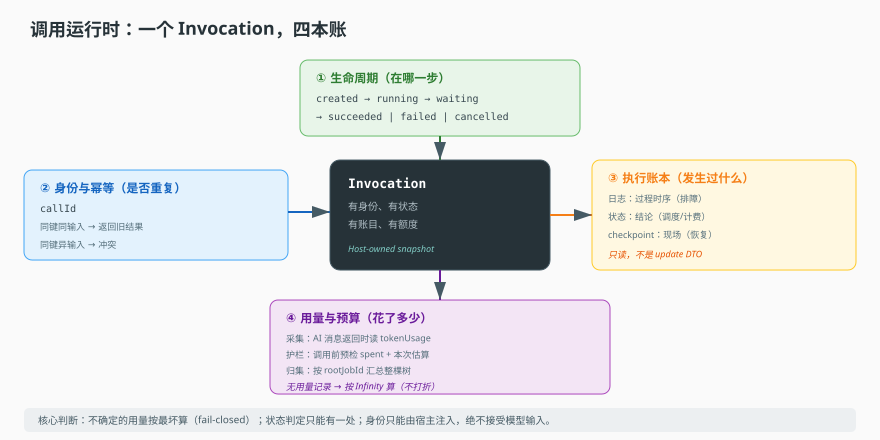
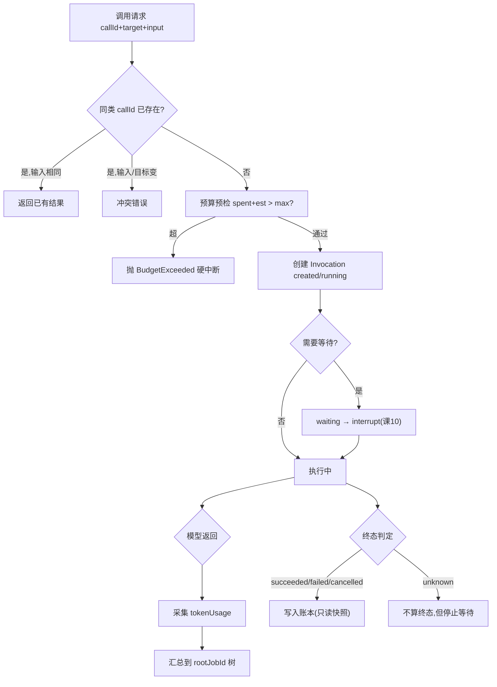

# 第 11 课：调用运行时

> 所属阶段：阶段 3《执行与协作》｜ 水平：进阶 ｜ 本课知识点：Invocation 生命周期、授权与幂等、执行账本、用量与预算
> 故事情节：主角跑了很多次。平台需要回答三个问题：谁发起的、跑到哪了、花了多少。
> 📖 结论已按官方文档核对（核对于 2026-11 ｜ 来源：[LangGraph 持久化](https://docs.langchain.com/oss/javascript/langgraph/persistence)、[Checkpointer 接口](https://docs.langchain.com/oss/javascript/langgraph/checkpointers)）
> 说明：本课的「账本三面」「幂等双分支」「fail-closed 预算」属平台自建能力，官方文档只覆盖 checkpoint 落盘那一层；其余为工程归纳，已按通用实践核查。


## 🎯 本课目标

- 画出 Invocation 状态机并说出合法迁移
- 说清 `callId` 如何防止重复执行
- 说清账本面三个只读面各自的用途边界
- 说出 token 采集点位置与预算护栏应放在哪

## 🧑‍💻 前置知识速览

- **调用（Invocation）**：一次"让 Agent 干活"的会话，本课称之为 Invocation。
- **图执行与通道**：课 6 / 8 讲过的执行基础。
- **interrupt / checkpoint**：课 10 讲的挂起与恢复机制。

## 第一幕：起源与场景引入

> 🎬 **场景**：一张 3 万元的账单，和一次"没花钱"的重试

财务月底发来一张账：模型用量 3.2 万元，比上月涨了 4 倍。你查下去，发现两个独立漏洞。

第一个：**重试重复计费**。网关超时重发了同一个请求，系统老老实实跑了两遍，两遍都调模型、都收费。用户只看到一条回复——另一份算在账上但没人看见。

第二个：**没有预算闸门**。有个批量任务写错了循环条件，反复调用模型处理同一批文档，疯狂跑了 6 小时，没人拦——因为系统里根本没有"花到多少就停"的概念。

这两个漏洞都不在"Agent 会不会思考"的范围内。它们是**运行时的账**——谁发起的、跑了几次、花了多少。这就是本课。

> 📌 **一句话本质**：调用运行时把"一次 Agent 调用"当成一个有生命周期、有身份、有账目的资源来管理，而不是一个副作用随机的函数调用。

> ⚖️ **处境对照**：不这么做 → 重试翻倍计费、预算失控、出问题查不出是谁调的；这么做 → 有幂等键、有状态机、有账本、有闸门。

## 第二幕：认知冲突

> ❓ **问题**：为什么不能把"调用一个 Agent"就当成"调一个函数"？

因为函数调用是**同步、无状态、无身份**的，而 Agent 调用恰恰三条都不满足：

| 函数调用 | Agent 调用 |
|---|---|
| 立刻返回或抛错 | 可能跑几十分钟，中间要等人（课 10） |
| 无身份 | 必须知道谁发起、哪个租户、有没有权限 |
| 重试安全（纯函数） | 重试会重复计费、重复产生副作用 |
| 成本为零 | 每次都可能烧钱 |

所以它必须被"包装"成一个**有身份的实体**，这就是 Invocation。有了这个实体，才能谈"它现在什么状态""这次是不是重复""它花了多少"。

## 第三幕：层层揭示

### 一眼全局图（进入细节前先看一眼）



> 看图：中间是 Invocation 实体，四方向是四方信息——状态（在哪一步）、身份与幂等键（是不是重复）、账本（发生过什么）、用量（花了多少）。四方构成"可观测、可计费、可追责"。

### 本课地图（分几步走）

| 步 | 这一步要解决什么（人话） | 对应知识点 |
|:--:|--------------------------|-----------|
| 1 | 一次调用有哪些状态、什么迁移合法 | 知识点 1：Invocation 生命周期 |
| 2 | 怎么保证"同一个请求不跑两遍" | 知识点 2：授权与幂等 |
| 3 | 出问题时去哪查"发生了什么" | 知识点 3：执行账本 |
| 4 | 花了多少、什么时候该拦 | 知识点 4：用量与预算 |

### 知识点 1：Invocation 生命周期

> 🧭 第 1/4 步｜承接：第二幕"必须有身份和状态" → 本步：状态有哪些、怎么迁移
> 本知识点关键点：状态集合、终态幂等、unknown 的含义

- 关键点：状态集合与合法迁移（创建/等待/完成/失败/取消）
- 关键点：终态判定 succeeded / failed / cancelled，一旦进入不可逆
- 关键点：`unknown` 的含义——**不是终态**，且处理方式特殊

#### 一句话定义

Invocation 生命周期 = 一次调用从"被创建"到"终结"的状态序列。状态的存在让"它现在怎么样了"这个问题有确定答案。

#### 直觉建立（类比）

想象**快递单**：

- 下单（created）、揽收（running）、途中可能"等收件人确认地址"（waiting）、最后签收（succeeded）或被拒收（failed）或被取消（cancelled）。
- 每个状态都对应"下一步能变成什么"——签收后不能再变"在途"。
- 有个特殊状态叫"查不到"（unknown）：物流系统挂了，不知道现在在哪。这**不是"已签收"**。

> 💡 **类比的边界**：快递单给人看；这里的状态要机器可判定，供程序与计费读。

#### 核心原理

**终态的唯一定义**：

```ts
function isTerminal(status) {
  return status === 'succeeded' || status === 'failed' || status === 'cancelled'
}
```

关键在于它检查的是"**确认完成**"，不是"看起来停了"。

**`unknown` 非终态，这是刻意的**。注意上面没有 `unknown`，而课 10 的等待循环是：

```ts
if (isTerminal(current.status) || current.status === 'unknown') return current
```

两个地方，两种处理，为什么不一致？

| 函数 | 回答的问题 | 对 `unknown` 的态度 |
|---|---|---|
| `isTerminal` | 是否**确认结束** | 不算终态 |
| `awaitAgentInvocation` | 是否**还要继续等** | 当成"可返回" |

- `isTerminal` 答的是"是不是确认结束了"。`unknown` 不是"确认结束"，所以不能算终态——否则计费系统会把未知当已完成记账。
- `awaitAgentInvocation` 答的是"我还要不要继续等"。`unknown` 意味着"查不到这个调用"，继续等没意义——返回。

所以：**"不知道"不等于"结束"，但"不知道"意味着"别再等了"**。混开会造成两种事故：把未知当完成（漏计费/误报成功），或对着未知死等（挂死）。

**状态迁移的合法性**（从用法反推）：

```
created/running ──→ waiting ──→ running ──→ succeeded
     │                │            │
     └────────────────┴────────────┴──→ failed
     │                │            │
     └────────────────┴────────────┴──→ cancelled
```

要点：

- `waiting` 不是终态，可回到 `running`（审批通过后继续跑）。
- 进入三个终态后，任何迁出非法。
- 终态幂等：重复 fail / cancel 不报错、不改状态（呼应课 10 的 `if !aborted`）。

**状态判定必须集中一处**：终态定义一分散，就会出现"这里觉得结束、那边觉得没结束"。计费按 A 判、调度按 B 判，两边打架。所以终态判定必须是唯一函数。

#### 示例演示

伪代码示范状态机 + unknown 的处理：

```python
def advance(state, next_status):
    if is_terminal(state['status']):
        raise IllegalTransition(f"cannot move from terminal {state['status']}")
    # waiting <-> running 允许；终态唯一出口
    return {**state, 'status': next_status}

def should_stop_waiting(st):
    return is_terminal(st['status']) or st['status'] == 'unknown'
```

#### 常见误区

1. **"unknown 就是失败"**：不是，它是"查不到"。既不该当成功记账，也不该当失败告警。
2. **"waiting 是终态"**：不是，它要能回到 running。
3. **"状态判定各模块各写一份"**：必须唯一，否则计费与调度会打架。

#### 一句话记住

终态三取一、`unknown` 非终态但别再等、判定只能有一处。

#### 🗣️ 行话对照

- **Lifecycle（生命周期）**：状态机——出现在 `isTerminal`。
- **Terminal State（终态）**：不可再迁出的状态——出现在 `successed|failed|cancelled`。

---

### 知识点 2：授权与幂等

> 🧭 第 2/4 步｜承接：状态能追踪 → 本步：怎么保证"同一个请求不跑两遍"
> 本知识点关键点：`callId` 作用域、四元组、锁版本、重复请求返回什么

- 关键点：幂等键叫 `callId`，作用域是"captured scope 内"（最长 1024 字符）
- 关键点：作用域四元组（谁 / 租户 / 哪个 Agent / 哪个版本）——**同键不同输入是冲突**
- 关键点：固定版本（revision）让幂等判断稳定——版本变了就是不同目标
- 关键点：重复请求返回已有结果，而不是报错（那才是"幂等"）

#### 一句话定义

幂等 = 同一个幂等键重复提交，系统只执行一次，后续请求返回**第一次的结果**（而不是报错、也不重跑）。

#### 直觉建立（类比）

想象**银行转账的单据编号**：

- 你填一张单子，编号 `A-1024`。
- 柜台办完，系统记账。
- 你怕没办成，又递一张同编号单子——柜台一查"`A-1024` 办过了"，直接把结果给你，**不会再转一次**。
- 但如果你拿 `A-1024` 把金额从 100 改成 1 万？那不叫同一笔——必须报冲突。

> 💡 **类比的边界**：银行靠人比对；这里靠"键+输入指纹"，自动比对。

#### 核心原理

**幂等键的定义**（关键三句约束）：

```ts
interface InvocationRequest {
  target: Target
  /**
   * Idempotency key within the captured scope (max 1024 chars).
   * Reuse for the same request; changed input or target is a conflict.
   */
  callId: string
  input: {...}
}
```

注释三句话，逐句是设计约束：

- `Idempotency key within the captured scope`——作用域是"捕获的 scope"，不是全局。
- `Reuse for the same request`——同一请求复用同一键。
- `changed input or target is a conflict`——**输入或目标变了，就是冲突**。

最后这句是精髓：键相同但内容不同，不能"以第一次为准"糊过去（那会静默丢掉用户真正想做的事），也不能"再跑一次"（那就不是幂等）。只能报冲突。

**为什么需要作用域**：`callId` 是调用方生成的。两个不同租户都用 `call-001`，全局去重会误伤。所以去重范围必须限定在 scope 内。

**scope 是谁**（四元组）：

```
（tenantId + organizationId + userId）   谁
  × target.bindingId                      调哪个 Agent
  × target.revision                       哪个版本
  × callId                                这次请求编号
```

**固定版本对幂等的影响**：`target.revision` 是"配置版本"（与"调用修订号"不同）。如果幂等只看 `callId` 不看版本，那么"用同一键调 v1、后来调 v2"会被判成同一请求而返回 v1 结果——用户以为调了新版本，实际拿到旧的。所以冲突语义明确包含"目标变了"。

**重复请求返回什么**（幂等的正确形态）：

```ts
const existing = await findOne({ where: { requestId: candidate.requestId } })
if (existing) return existing   // 返回第一次的结果，不报错、不重跑
```

注意这里用 `requestId`（业务侧请求标识），SDK 层叫 `callId`——名字不同但角色一致：都是幂等键。读代码按语义认、别按名字认。

#### 示例演示

伪代码示范幂等 + 冲突 + 授权：

```python
def submit(request, store, scope):
    existing = store.find_one(request_id=request.call_id, scope=scope)
    if existing:
        # 校验是不是同一个输入
        if existing.input_hash == hash(request.input) and existing.target == request.target:
            return existing.result            # 返回第一次结果
        raise Conflict("same key, different input or target")
    assert_authorized(scope, request.target)  # 谁在调、调哪个目标
    return store.create_and_run(request, scope)
```

#### 常见误区

1. **"幂等是重复请求报错"**：错，是返回第一次结果。
2. **"callId 全局唯一"**：作用域内唯一，跨租户可重名。
3. **"只看 callId 就够"**：还要看输入、目标版本，变了就是冲突。
4. **"身份让模型自己说"**：绝对不行，身份只由宿主注入——`never accept identities from model input`。

#### 一句话记住

同键同输入→返回旧结果；同键异输入→冲突；身份只由宿主注入。

#### 🗣️ 行话对照

- **Idempotency Key（幂等键）**：去重键/请求指纹——出现在 `callId`、`requestId`。
- **Conflict（冲突）**：同键不同内容——出现在 `changed input or target is a conflict`。

---

### 知识点 3：执行账本

> 🧭 第 3/4 步｜承接：能防重复 → 本步：出问题时去哪儿查
> 本知识点关键点：三个面的职责、只读的理由、跨进程一致性

- 关键点：日志 / 状态 / checkpoint 三者职责不同——不是一份数据的三种副本
- 关键点：账本面是只读的——写入口只有运行时一处
- 关键点：跨进程查询靠持久化存储 + 一致性读

#### 一句话定义

执行账本 = "一次调用到底发生了什么"的记录集合。它不是一份数据，而是**三份职责不同的数据**：日志讲故事、状态说结论、checkpoint 存现场。

#### 直觉建立（类比）

想象**医院的三种记录**：

- 病历（日志）：按时间记"几点做了什么检查、几点给药"，用来复盘过程。
- 出院小结（状态）：一句话结论"治愈/转院/死亡"，用来统计计费。
- 影像原片（checkpoint）：原始数据，用来重新判读。

三种都在，谁也不能替代谁。你不能用小结复盘过程，也不能用病历重做影像判读。

> 💡 **类比的边界**：医院记录给人看；这里给程序查、计费算、恢复用。

#### 核心原理

**三者的职责边界**：

| 面 | 回答问题 | 写者 | 典型消费者 |
|---|---|---|---|
| 日志 | 过程中发生了什么（时序） | 运行时逐步追加 | 排障、审计 |
| 状态 | 现在是什么状态（结论） | 运行时状态迁移 | 调度、计费、前端 |
| checkpoint | 现场长什么样（快照） | 图执行每步 | 恢复、回放 |

**为什么账本面必须只读**——这是权限设计问题，不是技术限制。

如果任何模块都能改"状态"，会出现：某个中间件为让流程继续把状态改成 succeeded；某个重试逻辑把 failed 改回 running 却不清理已产生的副作用。结果账本不再是"发生过什么"，而是"某个模块希望发生什么"——**失去证据价值**。

所以在类型上，这个快照是"宿主拥有的、只读的"实体，**不能用来更新**。想改状态必须走运行时的专门方法（如 `fail()` / `cancel()`），内部才有状态迁移校验。

这也是个好模式：**读模型和写模型分成两个类型**。读模型随便传，写模型必须过校验。

**跨进程一致性**：挂起后进程可死（课 10），那"另一个进程来查账本"怎么保证看到最新？账本落在共享存储（DB）而非内存，查询直接读库，天然跨进程。代价是：每次查询是 DB 往返；需处理"正在写"的中间态，关键写入路径用事务/锁（如悲观锁）防并发写坏。

**账本与可观测性的区别**：账本是**业务事实**（这次成没成、花多少），可观测性（metrics/traces）是**系统健康**（QPS、P99、错误率）。你不能用 P99 回答"这次调用为什么失败"，也不能用单次日志算整体错误率。

#### 示例演示

伪代码"写模型与读模型分离"：

```python
class InvocationReader:      # 读模型：可到处传
    def snapshot(self, eid): return query_checkpoint(eid, mode="replica")
    def history(self, eid):  return query_logs(eid)

class InvocationWriter:      # 写模型：内部校验，不直接暴露
    def mark(self, eid, status):
        guard_terminal_state(eid)          # 状态机校验
        return store_update(eid, status)
```

#### 常见误区

1. **"日志、状态、checkpoint 一份数据三种视图"**：职责不同，不能互替。
2. **"状态谁都能改，方便"**：能改就失去证据价值。
3. **"账本查内存最快"**：跨进程场景必须落库。

#### 一句话记住

日志讲故事、状态说结论、checkpoint 存现场；读模型与写模型分开。

#### 🗣️ 行话对照

- **Ledger（账本）**：审计日志/事件溯源——出现在 `Invocation` 快照。
- **Read Model（读模型）**：只读视图——出现在读/写模型分离。

---

### 知识点 4：用量与预算

> 🧭 第 4/4 步｜承接：知道发生了什么 → 本步：知道花了多少、什么时候该拦
> 本知识点关键点：采集点、护栏落点、超预算中断方式、多 Agent 归集

- 关键点：token 采集点在**模型节点返回时**——从 AI 消息的 `llmOutput.tokenUsage` 或 `usage_metadata` 读
- 关键点：护栏落点选"调用前预检 + 落库"这层，而不是模型层
- 关键点：超预算用**硬中断**（抛错），不是软提示（让模型自己省）
- 关键点：无用量记录**不能当免费**——这是防"漏账"的关键判断

#### 一句话定义

用量与预算 = 把每次模型调用的 token 消耗记录下来、汇总起来，并在"再花就要超了"之前拦住。

#### 直觉建立（类比）

想象**公司打车报销**：

- 每打一次车，行程单自动生成（用量采集）。
- 月底汇总（归集）。
- **事前额度**：你额度 2000，第 1900 就提醒，到 2000 不能叫车（护栏）。

只做月底汇总，那叫"知道花超了"，不叫"控制成本"。

> 💡 **类比的边界**：额度硬性；预算里 token 数调用前往往只能估。

#### 核心原理

**采集点**：只在 AI 消息返回时采，先后两个来源（优先精确，兜底估算）：

```python
def token_usage(message):
    if not is_ai_message(message): return None          # 只有模型返回才有用量
    raw = message.llmOutput
    if raw:
        u = raw.get("tokenUsage") or raw.get("estimatedTokenUsage")   # provider 原始
        if u: return normalize(u)
    meta = message.usage_metadata                        # LangChain 标准化字段
    if meta: return normalize(meta)
    return None
```

**三个要点**：

- **只在 AI 消息上采**：工具/人类消息没有用量。
- **两个来源、优先级明确**：先看 provider 原始（更精确），再看标准化字段。不同 provider 格式不同。
- **`estimatedTokenUsage` 兜底**：有些 provider 不给精确数，只能估。这解释了"估算"出现的语境。

**护栏落点**：调用前预检，不是事后统计。

```python
def guard(record, store):
    budget = record.spend_envelope
    if not budget: return
    history = store.query(job_id=record.id) | store.query(job__root_job_id=record.id)
    spent = 0
    for h in history:
        est = h.tokenUsage.estimatedTokens or h.tokenUsage.totalTokens
        # 无法确认的调用，不能安全当作免费
        spent += est if (isinstance(est, number) and est > 0) else INF  # ← 关键
    if spent + record.estimated_tokens > budget.max_tokens \
       or history_count + 1 > budget.max_calls:
        raise BudgetExceeded()
```

**那条 `Infinity` 是本课最锋利的一句**：`没有用量记录的调用，不能安全地当成免费`。把老数据/跑一半没用量数据的调用算成 0，会让预算看起来比实际宽裕——这是漏账。用 `Infinity` 意思是"无法确认就直接判超，宁可拦住也不放过"。这是 **fail-closed（失败关闭）**：不确定时选更安全的一侧。

**超预算用硬中断**：`raise BudgetExceeded()`，不是返回提示让模型省。模型没成本概念，让其"省着用"反而可能花更多 token 想怎么省。成本控制必须外部强制。

**多 Agent 归集**：查询条件 `job_id = 本任务 OR job.root_job_id = 本任务`。第二条收集所有子任务的用量——子 Agent 的 job 指向同一 root，所以都算在这个 root 的账上。**多 Agent 归属统一账**：靠 rootJobId 形成树，预算在根校验，树上每节点消耗同一份额度。

**预算两个维度**：次数（`max_calls`）与 token（`max_tokens`）。只看 token，可被"碎调用"绕开（每调用一次极便宜但极频繁）；只看次数，可被"超长上下文单次"绕开。两个都要才防"以一种消耗换另一种"。

#### 示例演示

伪代码验证采集点与 fail-closed：

```python
u = token_usage(ai_msg)          # 采集点：AI 消息返回时
record.estimate = u              # 计入本次估算
guard(record, store)             # 调用前预检，超即抛错
```

#### 常见误区

1. **"没用量记录就是没花钱"**：不能。当未知处理，按最坏情况算。
2. **"超预算提示模型省一点"**：模型不懂成本，必须硬拦。
3. **"只统计 token 就够"**：还要看调用次数，否则被碎调用绕开。
4. **"子 Agent 用量独立算"**：归集到 root，否则预算可被拆散规避。

#### 一句话记住

AI 消息采集、调用前预检、无记录按最坏算、硬中断、按 root 归集。

#### 🗣️ 行话对照

- **Spend Envelope（花费信封）**：预算上限/配额——出现在 `spend_envelope`。
- **Fail-closed（失败关闭）**：不确定时选更安全一侧——出现在 `Infinity` 兜底。

---

## 第四幕：实操验证

> 目标：把四本账串成一条可观察的流程。

### 4.1 机制验证

> ✅ 机制实测于 Node v22.22.2（脚本 `verify/verify-run.ts`）。上段为伪代码示意，下面是同机制的真实输出：

```text
① 幂等-同键同输入: duplicated=true | 同一账本=true
② 幂等-同键异输入: requestId 冲突：req-1 已用于不同输入
③ finish 终态幂等: 二次 finish 未覆盖状态，仍为 succeeded
④ 异常路径也落定: 异常后状态=failed（不是永远 RUNNING）
⑤ 预算-正常: {"ok":true,"remaining":300}
⑥ 预算-fail-closed: {"ok":false,"reason":"用量记录异常，按 fail-closed 拒绝"}
```

> ③ 与 ④ 是一对：③ 说明重复 finish 不覆盖终态，④ 说明异常路径也必须 finish。少了 ④，一次崩溃就会留下一条永远 RUNNING 的僵尸账本——它不会报警，只会让当前并发数慢慢变成假数。⑥ 是 fail-closed 的含义：**读不到用量不等于没用量**，宁可拒一次，不可放过一次。

```python
# ① 生命周期：创建 → 等待 → 完成
r = Invocation.create(scope, call_id, target)
advance(r, "running"); advance(r, "waiting"); advance(r, "succeeded")
assert is_terminal(r.status)

# ② 幂等：同键重复提交返回第一次结果
first = submit(req, store, scope)
again = submit(req, store, scope)      # same input
assert again.result == first.result

# ③ 账本：读模型随处可用，写模型校验状态机
snap = InvocationReader().snapshot(r.id)
InvocationWriter().mark(r.id, "cancelled")     # 合法
# try: InvocationWriter().mark(r.id, "running")  # 终态不可迁出 -> 异常

# ④ 预算：无用量记录按 Infinity 算
guard_without_usage(store, r)          # 应抛 BudgetExceeded（fail-closed）
```

> ✅ **回扣场景**：① 重复计费 → `callId` 幂等 + "已存在返回"，重试不跑第二遍；② 预算失控 → `spend_envelope` 调用前预检，循环到额度抛错。都不是"模型更聪明"能解决的，只能靠运行时机制。

## 第五幕：体系收束

调用运行时把一次 Agent 调用包装成有身份、有状态、有账目、有额度的实体：状态机给结论、幂等键防重复、账本三面分工、用量采集加预算硬拦。

> 📍 **全局定位**：前几课讲"怎么跑对"，这一课讲"怎么知道它跑得对、跑几次、花多少"。没有它，前面全是黑盒。
> 🔗 **下一步**：自家系统可控了，把视角推到边界之外——能力来自不可控的外部服务的场景（课 12）。

## 🐞 常见误区

1. **"unknown 是终态"**：不是，但"别再等"。
2. **"幂等是重复请求报错"**：返回第一次结果。
3. **"状态谁都能改"**：账本只读，否则失去证据价值。
4. **"没用量记录等于免费"**：按最坏算，否则漏账。
5. **"超预算提示模型省"**：必须硬中断。

## 一图总结



## 课后小测

**Q1**：一个历史调用没有 token 用量记录，预算计算时怎么处理？
- A. 按 0 算　B. 网站上平均　C. 按 Infinity 算（判超）　D. 跳过

<details><summary>答案与解析</summary>

**答案：C**。`没有用量记录的调用，不能安全地当成免费`。按 0 或平均会低估、让预算显得宽裕（漏账）。`Infinity` 是 fail-closed：不确定时选更安全一侧。

</details>

**Q2**：`isTerminal` 不把 `unknown` 当终态，但等待循环遇 `unknown` 就返回，为何不矛盾？
- A. 是 bug　B. 两者语义不同：前者判"是否确认结束"，后者判"是否还要等"　C. 一个同步一个异步　D. 取决于调用方

<details><summary>答案与解析</summary>

**答案：B**。确认结束必须确切（否则漏计费/误报），所以 unknown 不算终态；是否还要等，在查不到时无意义，所以直接返回。"不知道"≠"结束"，但意味着"别再等"。

</details>

## 🚀 下一批接力提示词

```
继续学 Agent 工程解剖。我的学习档案在 agent-engineering/00-学习档案.md，
刚学完阶段 3 的课 11《调用运行时》四个知识点，
请按大纲继续讲解下一课《MCP 外部能力接入》。
```

## 🧭 课程导航

⬅️ **上一课**：[课 10：持久执行](10-持久执行.md)
➡️ **下一课**：[课 12：MCP 外部能力接入](12-MCP外部能力接入.md)
📚 **返回目录**：[课程目录](../../../02-课程目录.md)
