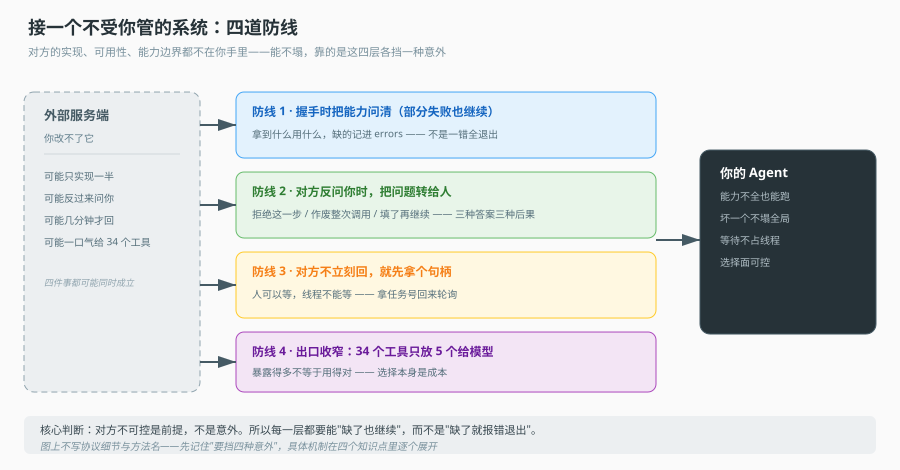
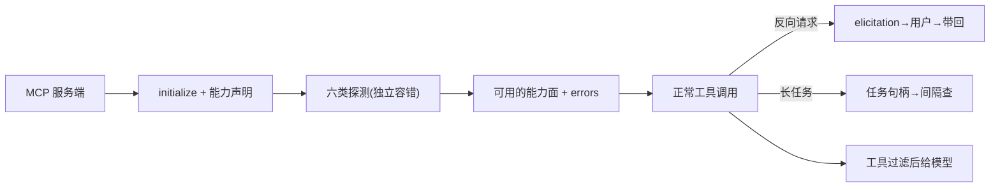

# 第 12 课：MCP 外部能力接入

> 所属阶段：阶段 3《执行与协作》｜ 水平：进阶 ｜ 本课知识点：MCP 为什么是协议而非 SDK、能力发现与降级、elicitation 反向请求、长任务与工具过滤
> 故事情节：主角要用的能力不在自己家里。它第一次伸手去够外面的世界，发现"外面"既不可控也不可靠。
> 📖 结论已按官方文档核对（核对于 2026-11 ｜ 来源：[MCP 规范](https://modelcontextprotocol.io/specification/2025-06-18)、[MCP 架构](https://modelcontextprotocol.io/docs/learn/architecture)）


## 🎯 本课目标

- 说清 MCP 与"写个 SDK 调远程 API"的本质区别，以及这个区别带来的工程后果
- 说清能力发现为何必须能容忍部分失败，以及降级后系统应该怎么表现
- 说清 MCP 的 elicitation 为什么是"反向请求"，它与课 10 的 interrupt 有何不同
- 说清长任务提交、工具过滤在多工具场景下各自防住了什么

## 🧑‍💻 前置知识速览

- **工具集（Toolset）与四源统一**：课 8 讲了内置/MCP/OpenAPI/OData 四种来源如何统一。
- **interrupt / 挂起等待**：课 10 的准备。
- **协议 vs SDK**：协议是双方协商、互不信任；SDK 是单方定义、双方信任。

## 第一幕：起源与场景引入

> 🎬 **场景**：你第一次用一个"你控制不了"的服务

在课 8，平台把 MCP 工具适配成了自己的统一 schema。但那是从**平台内部**看。现在你从**消费方**看：你的 Agent 接上一个"别人家的 MCP 服务端"。

这个服务端有三个你控制不了的点：

1. 它有哪些工具，你**连上之前不知道**（运行时才发现）。
2. 它可能**半坏**：10 个工具里 3 个报错，整体不能因此崩。
3. 它可能**反过来找你要东西**：比如弹一个"去买单确认"的流程，要你转给用户。

"借别人的能力"，就要接受它不可控、可能半坏、可能反客为主。

> 📌 **一句话本质**：接一个不是自己实现的系统，核心能力是**防御**——假设对方不读你的心智，也不永远可靠，做好发现、降级、反向请求、过滤四件事。

> ⚖️ **处境对照**：不防御 → 一个工具坏了拖垮整个调用；对方要你转达问题时无从下手；几十个工具全塞给模型，模型挑花眼。

## 第二幕：认知冲突

> ❓ **问题**：MCP 和"我在代码里 import 一个 SDK 调远程 API"到底有什么不同？

直觉上都是"跨网络能力"，但工程语义差很远。

| | 自己写 SDK 调 REST | 接 MCP |
|---|---|---|
| 契约定义 | 你自己定，双方按你的文档实现 | 双方协商，服务端自己声明 |
| 能力发现 | 你 import 什么就知道什么 | 连上才知道，运行时可变 |
| 信任假设 | 你信任对方按你文档来 | 不信任，假设对方随时变 |
| 演进 | 你发新 SDK，对方升级 | 两端独立演进，协议保持不变 |

关键差异：**协议让两端可以独立演进、互不透明**。服务端不需要知道你是谁、你用它的哪个版本。代价就是"不可控"——能力、schema、可用性都不在你手里。

所以本课后三个知识点全是同一件事：**如何在不可控的前提下保持正确**。发现要容忍部分失败（知识点 2），对方可能反客为主（知识点 3），工具数量和任务形态要自己管理（知识点 4）。

## 第三幕：层层揭示

### 一眼全局图（进入细节前先看一眼）



> 看图：左边是你改不了的外部服务端，右边是只拿了有限信息的你的 Agent，中间四道横杠就是这一课的四个知识点，各挡一种意外——问能力（缺了也继续）、代问人（对方反过来求你）、拿句柄（对方不立刻回）、收出口（对方给太多）。整张图的要点：**对方不可控是前提，不是意外**。

### 本课地图（分几步走）

| 步 | 这一步要解决什么（人话） | 对应知识点 |
|:--:|--------------------------|-----------|
| 1 | MCP 与 SDK 的本质区别、带来的后果 | 知识点 1：协议/传输/代价 |
| 2 | 连上后怎么知道对方有啥、坏了怎么办 | 知识点 2：能力发现与降级 |
| 3 | 对方反过来"让我的用户做点事"怎么办 | 知识点 3：elicitation 反向请求 |
| 4 | 对方慢、且给一堆工具，怎么管 | 知识点 4：长任务与工具过滤 |

### 知识点 1：MCP 是协议而非 SDK

> 🧭 第 1/4 步｜承接：第二幕"不可控" → 本步：不可控从哪来
> 本知识点关键点：协议语义、传输解耦、消费方防御责任

- 关键点：MCP 是客户端/服务端协议（initialize → 能力声明 → 会话），不是一个 RPC 封装
- 关键点：传输层可替换（sse / stdio 并存），协议与传输解耦是跨进程、跨厂商的前提
- 关键点：代价是"不可控"，消费方必须承担防御责任

#### 一句话定义

MCP 是一份**两边都遵守的协议**，不是"客户端 import 服务端 SDK"。因为双方各自演进、互不依赖，能力只能在会话建立时协商出来。

#### 直觉建立（类比）

想象**不同语言的两个系统对接**——不共享代码，只共享一份"口头协议"（JSON-RPC 消息格式）。一个系统升级了内部实现，另一个完全不用改，只要消息协议没变。

> 💡 **类比的边界**：真实 REST 也有 openapi 描述；但 MCP 把"能力声明"做成了每个会话的运行时事件，更强调动态。

#### 核心原理

**协议流程骨架**：

```
client ── initialize  ──► server     # 自我介绍 + 能力握手
client ◄── capabilities ── server    # 服务端声明它支持什么
client ── 业务消息（工具调用/资源读/等）──► server
```

**传输层可替换**：同一份协议可以跑在 SSE 上，也可以跑在 stdio 上。这带来一个工程结果——**协议与传输解耦**。一个 MCP 客户端库可以同时支持"本机起一个子进程"（stdio）和"连一个远程服务"（sse），代码里只是换传输实现，协议处理逻辑不变。

```ts
// 抽象：只认"发一条消息、收一条消息"
interface Transport { request(msg): Promise<Message> }
// 实现一：本机进程
class StdioTransport implements Transport { ... }
// 实现二：远程 SSE
class SSETransport implements Transport {
  constructor(readonly url: string) {}
  ...
}
```

**消费方的防御**——这是"协议而非 SDK"的直接后果。SDK 模式下，你信任对方按你的接口实现；协议模式下，你要假设对方：

- 暴露的能力会变（上次有 `tools/list` 这次没有？）。
- 单个工具的 schema 可能不完整或错误。
- 调用可能长时间不返回，甚至永不返回。
- 会主动发起需要用户介入的流程。

所以后三个知识点，每个都是针对上面一条的防御手段。

#### 示例演示

伪代码：一个最小 MCP 客户端握手 + 能力发现骨架。

```python
async def initialize(transport):
    resp = await transport.request({"method": "initialize", "params": {...}})
    server_caps = resp["result"]["capabilities"]
    return server_caps     # 服务端支持什么，以它说的为准
```

#### 常见误区

1. **"MCP 就是远程调用封装"**：它是协议，两端独立演进、运行时会话协商。
2. **"换传输要改协议逻辑"**：协议与传输解耦，换传输不碰协议处理。
3. **"服务端能力稳定可依赖"**：不可控，消费方必须防御。

#### 一句话记住

协议两端独立演进、传输可换、消费方要防御。

#### 🗣️ 行话对照

- **Protocol（协议）**：双方协商的规则——出现在「initialize 握手」。
- **Transport（传输）**：承载协议的通道——出现在 sse/stdio 可替换。

---

### 知识点 2：能力发现与降级

> 🧭 第 2/4 步｜承接：握到手了 → 本步：它到底有啥、坏了怎么扛
> 本知识点关键点：六类能力、capture 包装、部分失败语义、taskSupport

- 关键点：发现范围六类：tools / resources / resourceTemplates / prompts / apps / completions
- 关键点：capture() 包装——每类能力独立容错，一类失败不拖垮其余
- 关键点：部分失败的语义——"有什么用什么 + 缺的写进 errors"
- 关键点：`taskSupport(tool)` 从工具元数据里"读"任务支持能力，不是事先约定的

#### 一句话定义

能力发现 = 连上服务端后，逐个询问它支持哪几类能力；发现必须容忍单类失败，返回"真实可用的能力面 + 失败的清单"。

#### 直觉建立（类比）

想象**饭店点菜**：

- 你问服务员"你们有什么菜"（tools list）。
- 又问她"能不能做包间预定"（资源/模板等）。
- 她说"菜有，但包间预定系统今儿坏了"。
- 你不会因为"包间预定查不到"就转身走——你会「有什么点什么，坏的那个你知道就行」。

> 💡 **类比的边界**：真实点菜是人在扛；这里是每类能力各自 try/catch。

#### 核心原理

**发现哪些能力**：一个 MCP 服务端可能支持的不止"工具"，还有资源、提示词、应用、补全。消费方要分别探测，得到一份"能力地图"。

**capture 包装**：每类能力的探测都要独立容错——一类失败只是那类"不可用"，不能拖垮整次发现。

```python
async def capture(server, kind, fetch):
    try:
        items = await fetch(server)          # 探测某一类（如 tools）
        return items, None
    except Exception as e:
        return None, e                        # 单独记失败，不影响其他类
```

然后逐类收集：

```python
async def discover(server):
    result, errors = {}, []
    for kind, fetch in SIX_KINDS:             # tools/resources/templates/prompts/apps/completions
        items, err = await capture(server, kind, fetch)
        if err: errors.append(f"{kind}: {err}")
        elif items is not None: result[kind] = items
    return result, errors                      # 有什么用什么，缺的写在 errors
```

**部分失败的语义**：返回的是"有就用 + 缺的记下来"，不是"整体失败"。这个选择让上层能看到**降级后的真实能力面**——当一个工具坏了，上层还能用其余工具完成部分任务，而不是整个调用失败。

**`taskSupport(tool)`**：能力也可能是从工具自身的元数据里读出来的，而非事先约定。比如"这个工具支不支持异步任务"可能藏在工具的 `execution` 字段里。读元数据而不是写死在代码里，是为了跟随服务端演进。

```python
def task_support(tool):
    return tool.get("execution", {}).get("task_support", False)
```

#### 示例演示

伪代码验证"部分失败不拖垮整体"：

```python
result, errors = await discover(server)
# 若 tools 成功、resources 失败：
assert "tools" in result          # 工具还能用
assert any("resources" in e for e in errors)   # 失败被记录
```

#### 常见误区

1. **"一类能力失败就整体退出"**：不应该，capture 让它隔离。
2. **"发现的都是稳定的"**：运行时可变，每次会话都可能不同。
3. **"taskSupport 是写死的"**：从元数据读，跟随服务端演进。

#### 一句话记住

逐类探测、独立容错、有什么用什么、缺的进 errors。

#### 🗣️ 行话对照

- **Capability Discovery（能力发现）**：运行时查询能力——出现在 `tools/list`。
- **Graceful Degradation（优雅降级）**：能力残缺仍可用——出现在 capture 结果。

---

### 知识点 3：elicitation 反向请求

> 🧭 第 3/4 步｜承接：对方有啥知道了 → 本步：对方反过来要你做点事
> 本知识点关键点：方向反转、两形态、三态结果、与 interrupt 区别

- 关键点：方向反转——elicitation 是服务端要求客户端**向用户提问**
- 关键点：两种形态——form 模式（带 requestedSchema 渲染表单）与 url 模式（跳转外部页）
- 关键点：三态结果 accept / decline / cancel
- 关键点：与课 10 的 interrupt 不同——interrupt 是本系统图暂停；elicitation 是外部服务发起的反向请求

#### 一句话定义

elicitation 是"反向请求"：平时是你调服务端，这里是服务端反过来要求你转达一个问题给用户、拿到答案再回给它。比如下单可能要求"用户确认付款"。

#### 直觉建立（类比）

想象**银行柜台流程**：

- 平时你要求柜员办业务（正向调用）。
- 但有些业务，柜员会反过来要求："这一步需要你本人输密码确认"——把"提问"抛回给你，等你的动作。
- 你可以同意（accept）、也可以拒绝（decline）、也可以整单作废（cancel）。

> 💡 **类比的边界**：银行人工确认；selicitation 是协议定义的消息，自动识别。

#### 核心原理

**方向反转**。之前所有请求都是"客户端 → 服务端"；elicitation 是"服务端 → 客户端：请你去问终端用户"。这意味消费方要有能力把"外部的一个问题"转达给"本系统的用户"，再把答案带回给服务端。

**两种形态**：

```python
# form 模式：服务端给一个 schema，客户端负责渲染表单给用户填
elicitation = {"type": "form", "requestedSchema": {...}}

# url 模式：服务端给一个链接 + id，用户跳出去做，做好再回来
elicitation = {"type": "url", "elicitationId": "...", "url": "https://external/confirm"}
```

**三态结果**：

```python
# 用户的选择会回给服务端
respond(elicitation_id, "accept",  payload)   # 同意（可能带数据）
respond(elicitation_id, "decline", None)      # 拒绝（≠ 作废）
respond(elicitation_id, "cancel",  None)      # 作废整个流程
```

注意 decline 与 cancel 的语义不同：**decline 是"这一步拒绝"**，流程可能还能走别的路；**cancel 是"整单作废"**。上层处理路径不同，不能混。

**与课 10 的 interrupt 对比**：

| | interrupt（课 10） | elicitation（本课） |
|---|---|---|
| 发起方 | 本系统图执行 | 外部 MCP 服务端 |
| 何时发生 | 图里任何挂起点 | 任意工具调用中间 |
| 恢复入口 | 本系统 checkpoint 恢复 | 需回给服务端，可能异步 |
| 责任方 | 平台自己 | 消费方（要转达给用户再带回） |
| 超时归属 | 平台 | 通常服务端，但消费方可设上限 |

关键不是"都停下来等"，而是**谁发起的、怎么恢复**。

#### 示例演示

伪代码：处理一次 elicitation。

```python
async def run_agent_step(env, call):
    while True:
        result = await call.service(env.agent, env.messages)
        if result.source == "elicitation":
            # 服务端要用户做一件事：转达给本系统用户
            decision, payload = await env.present_to_user(result.elicitation)
            call.respond(result.elicitation_id, decision, payload)
            continue                            # 继续等结果
        return result                           # 正常业务结果
```

#### 常见误区

1. **"elicitation 是普通回调"**：是反向请求——外部要求你向用户提问。
2. **"decline 和 cancel 一样"**：decline 拒绝一步、cancel 作废整单。
3. **"和 interrupt 没区别"**：发起方、恢复入口、责任方都不同。

#### 一句话记住

反向请求、两种形态、三态结果（accept/decline/cancel）、与 interrupt 不同。

#### 🗣️ 行话对照

- **Elicitation（征求）**：外部系统向用户征求意见——出现在 form/url 两形态。
- **Reverse Request（反向请求）**：服务端向客户端发起的对话——区别于正向调用。

---

### 知识点 4：长任务与工具过滤

> 🧭 第 4/4 步｜承接：会被反向请求 → 本步：对方慢、且给一堆工具怎么管
> 本知识点关键点：任务句柄、与"不轮询"的区分、工具过滤

- 关键点：长任务提交——工具调用可能不立即返回，而是返回任务句柄 + 状态轮询
- 关键点：与课 10"为什么不该轮询"看似矛盾、实则不同——判据是"等待对象是否可控"
- 关键点：工具过滤——一个服务端可能暴露几十上百个工具，不能全塞给模型
- 关键点：为什么必须过滤——工具数量直接影响模型选择质量与 token 消耗，这是正确性问题

#### 一句话定义

长任务与工具过滤处理的是同一件事的两面：**对方要么很慢，要么给得太多**。前者用任务句柄接下，后者用过滤裁剪掉。

#### 直觉建立（类比）

想象**外卖**：

- 慢：店家大半天都不出餐。你不会一直攥着手机盯进度条（polling），你会下单后拿等等通知——拿到"单号"（任务句柄），过会儿再查一次（间隔查询）。
- 多：菜单有 200 个菜。你不会把 200 个菜名全报给点菜的人，你只把"这家能做"的十几道推荐出来（过滤）。

> 💡 **类比的边界**：点菜推荐是人做的；系统里过滤是白名单/规则。

#### 核心原理

**长任务提交**。有些 MCP 工具不立即返回结果，而是返回一个"任务句柄"，真正的结果要等一段时间。消费方的正确做法是：拿到句柄、放回去继续、隔一会儿查状态：

```python
task = await tool.invoke({"job": "big_analysis"})
# 返回的不是完成结果，而是一个可查询的任务
while True:
    st = await query_task(task.id)
    if st.status in ("succeeded", "failed"):
        return st.result
    sleep(poll_interval)
```

**与课 10"为什么不轮询"看似矛盾，实则判据不同**：

| | 课 10：等人（interrupt） | 本课：等外部任务（句柄轮询） |
|---|---|---|
| 等待对象 | 人的决策（不可控、时长不定） | 外部任务（有状态机、服务端负责） |
| 进程 | 不该占、挂起 | 可短期轮询，通常运行时不阻塞其他事 |
| 结论 | 别 poll 人 | 可以查任务状态 |

核心判据是"**等待的对象是否可控**"：人不可控，所以不能占着轮询；外部任务有明确状态机、且有服务端在推进，可以间隔查。二者不是矛盾，是对"waiting for what"的回答不同。

**工具过滤**。一个服务端可能暴露几十上百个工具，但模型一次不需要全部。全部塞进去会有两个问题：

- **选择质量下降**：工具越多，模型越容易在无关工具间摇摆。
- **token 消耗上升**：每个工具的描述都要占上下文。

过滤按白名单/规则裁剪：

```python
def filter_tools(all_tools, allowlist, domain_rules):
    # 先按白名单，再按规则（如只保留与当前任务域相关的）
    picked = [t for t in all_tools if t.name in allowlist]
    return [t for t in picked if domain_rules.accept(t)]
```

**为什么这是正确性问题而非性能优化**：不裁剪，模型会给工具填错参数、调错工具、甚至"发明"一个不存在的参数。它影响的是"能不能做对"，不只是"快不快"。

#### 示例演示

伪代码验证两个判据：

```python
# 长任务：拿到任务句柄，间隔查询
res = await tool.invoke({"job": "big"})
if res.is_task():
    while (st := await query_task(res.task_id)).not_done():
        pass
    return st.result

# 过滤：只给模型少量相关工具
tools = filter_tools(server.all_tools, allowlist=MY_ALLOWLIST, rules=domain_rules)
assert len(tools) <= 8     # 可控数量
```

#### 常见误区

1. **"等外部任务也不能轮询"**：等待对象是服务端推进的任务，可间隔查，与人不同。
2. **"工具全塞给模型更好"**：多则选择质量降、token 升。
3. **"过滤是性能优化"**：是正确性问题——影响能不能做对。

#### 一句话记住

慢的任务拿句柄间隔查；多的工具按白名单裁；判据看等待对象可不可控。

#### 🗣️ 行话对照

- **Task Handle（任务句柄）**：长任务的查询凭证——出现在轮询状态。
- **Tool Whitelist（工具白名单）**：裁剪工具的规则集——出现在 filter_tools。

---

## 第四幕：实操验证

> 目标：把四道防线连起来，验证"接一个不可控外部服务"时的防御行为。

### 4.1 机制验证

> ✅ 机制实测于 Node v22.22.2（脚本 `verify/verify-run.ts`）。上段为伪代码示意，下面是同机制的真实输出：

```text
① 降级: 可用=[tools,prompts] 失败=[resources: 协商失败（记录并降级）]（整体未退出）
② elicitation: accept→继续本次调用 | decline→跳过这一步，调用继续（这一步不满足） | cancel→作废整个调用
③ 长任务: {"taskId":"task-1","status":"completed","polls":3}（对外部任务可轮询，对人不行）
④ 工具过滤: 34 个 → 5 个（上限 8）
```

> ② 是这一课最容易被写错的地方：`decline` 与 `cancel` 不是同义词。`decline` 只否掉**这一步**，整条调用还能继续；`cancel` 是把**整个调用**作废。混用会让用户拒绝填一个可选字段变成任务失败。
> ③ 注意口径差别：**对人不能轮询，对外部任务可以**。前者是人不会自己变，后者是任务状态会自己变。

```python
# ① 握手 + 能力发现（容忍部分失败）
caps, errors = await discover(server)
assert "tools" in caps                      # 工具可用
assert errors                                # 某类失败被记录

# ② 反向请求处理
outcome = await run_agent_step(env, call_with_elicitation)
assert outcome.decision in ("accept", "decline", "cancel")

# ③ 长任务间隔查询
res = await call_task_service(...)
if res.is_task():
    final = await await_task(res.task_id)   # 内部间隔查询

# ④ 工具过滤数量可控
tools = filter_tools(server.all_tools, allowlist, domain_rules)
assert len(tools) <= 8
```

关键：单测里注入"某类能力必失败"和"某个工具必超时"，确认整体流程仍能完成、且失败被记录，而不是整体崩溃。

## 第五幕：体系收束

借一个不可控的外部能力，靠的不是"对方靠谱"，而是四道防御：协议协商不预设信任、能力发现容忍部分失败、反向请求能正确转达与带回、长任务与工具数量被主动管理。

> 📍 **全局定位**：到这里，阶段 3 的"协作"才完整——从单 Agent 内部，到多 Agent 之间，到跨系统边界。
> 🔗 **下一步**：进入阶段 4《判断力》。

## 🐞 常见误区

1. **"MCP 就是 RPC 封装"**：是协议，两端独立演进、会话协商。
2. **"一类能力坏就整体退出"**：应隔离、降级、记录。
3. **"decline 与 cancel 等价"**：一个拒绝一步、一个作废整单。
4. **"等外部任务也不能轮询"**：对象是服务端任务可查，与人不同。
5. **"工具全塞更好"**：多则质量降、token 涨，是正确性问题。

## 一图总结



## 课后小测

**Q1**：MCP 的 elicitation 与课 10 的 interrupt，最关键的区别是什么？
- A. 都会暂停　B. 发起方不同：一个是本系统图暂停，一个是外部服务端反向要求向用户提问　C. 一个快一个慢　D. 没有区别

<details><summary>答案与解析</summary>

**答案：B**。interrupt 是本系统图执行的挂起、由平台自己恢复；elicitation 是外部服务端发起的反向请求，消费方要负责转达给用户并把答案带回。

</details>

**Q2**：一个 MCP 服务端暴露了 80 个工具，为什么要过滤后再喂给模型？
- A. 只是为了让请求更快　B. 工具多会让模型选择质量下降且 token 消耗上升，这是正确性问题　C. 服务端要求　D. 协议限制

<details><summary>答案与解析</summary>

**答案：B**。工具数量影响"能不能做对"（选择质量）与 token 成本，而非单纯性能。不裁剪模型可能调错工具、填错参数。

</details>

## 🚀 下一批接力提示词

```
继续学 Agent 工程解剖。我的学习档案在 agent-engineering/00-学习档案.md，
刚学完阶段 3 的课 12《MCP 外部能力接入》四个知识点，
请按大纲进入阶段 4《判断力》。
```

## 🧭 课程导航

⬅️ **上一课**：[课 11：调用运行时](11-调用运行时.md)
📚 **返回目录**：[课程目录](../../../02-课程目录.md)
