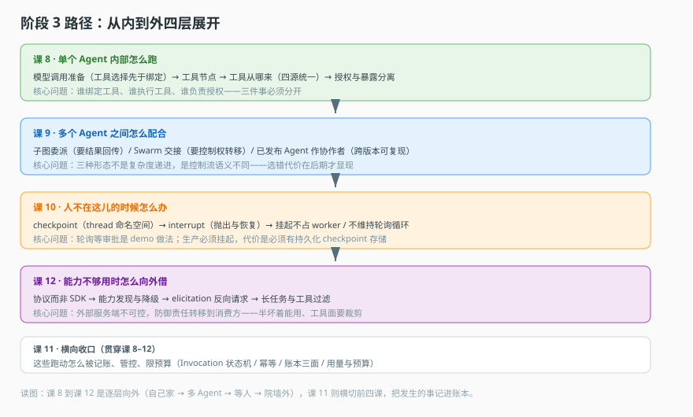

# 阶段 3：执行与协作

> 所属课程：Agent 工程解剖 ｜ 故事章节：它怎么被跑起来 ｜ 上一阶段：[阶段 2](../2-定义与编译/overview.md) ｜ [返回总览](../../01-学习路径总览.md)

## 🎯 本阶段目标

- 看懂执行层的四个真实难题：模型与工具的边界、多 Agent 协作形态、人不在场时的等待、跨系统能力的接入。
- 能为一个多 Agent 需求做出形态选择（子图 / Swarm / runtime），并说明理由与代价。
- 理解"持久执行"为什么是生产 Agent 与玩具 Agent 的分水岭。
- 理解为什么"接外部能力"比"用自家工具"多出一层防御责任。

## 📍 学习重点

- 执行层最容易出错的地方不是"逻辑写错"，而是"边界没划清"：谁能绑定工具、谁能执行工具、谁负责授权。第 8 课整课在讲这三件事为什么必须分开。
- 多 Agent 不是"多个 Agent 一起干活"这么简单。三种形态（子图委派 / 已发布 Agent 作协作者 / Swarm 交接）的控制流、状态隔离、失败恢复完全不同，选错形态的代价在后期才会显现。
- 第 10 课的 `interrupt` 是全课程最有"啊哈"感的一段：源码注释一句话点破"绝不占用 worker，也不维持轮询循环"。这一句是生产级与 demo 级的分界。
- 前四课都在讲"自己家的事"，第 12 课把视角翻到院墙外：接一个外部 MCP 服务端时，能力、schema、可用性都不在你手里。**防御责任随之转移给消费方**——能力发现要能容忍部分失败，工具面要主动裁剪，服务端还可能反过来要求你向人提问。

## ✅ 必须掌握的知识点

| 知识点 | 所属课 | 学完应能 |
|--------|--------|----------|
| 模型调用准备 | 课 8 | 说清"工具选择先于绑定"这条不变量防住了什么 |
| 工具节点 | 课 8 | 说清并行工具执行与结果回填的时机 |
| 工具从哪来 | 课 8 | 说清四种工具来源如何统一成一套 schema |
| 授权与暴露分离 | 课 8 | 解释为什么"暴露给模型"不等于"允许执行" |
| 子图委派 | 课 9 | 画出父子图的调用与返回路径 |
| 已发布 Agent 作协作者 | 课 9 | 说清固定版本调用如何保证可复现 |
| Swarm 交接 | 课 9 | 说清控制权转移与"返回结果"的本质区别 |
| 选型判据 | 课 9 | 给定需求能选出形态并说出代价 |
| checkpoint | 课 10 | 说清 thread 与 checkpoint 的命名空间关系 |
| interrupt 等人工 | 课 10 | 说清抛出与恢复的完整路径 |
| 为什么不轮询 | 课 10 | 用资源账算清轮询的代价 |
| 取消与终态 | 课 10 | 说清协作式取消与终态幂等 |
| Invocation 生命周期 | 课 11 | 画出状态机并说出合法迁移 |
| 授权与幂等 | 课 11 | 说清 request_id 如何防重复执行 |
| 执行账本 | 课 11 | 说清日志 / 状态 / checkpoint 三者的只读面 |
| 用量与预算 | 课 11 | 说出 token 采集点与预算护栏的落点 |
| MCP 为什么是协议 | 课 12 | 说清协议与 SDK 的本质区别及工程后果 |
| 能力发现与降级 | 课 12 | 说清部分失败时系统该如何表现 |
| elicitation 反向请求 | 课 12 | 说清 form / url 两态与 interrupt 的区别 |
| 长任务与工具过滤 | 课 12 | 说清何时该轮询、为什么必须裁剪工具面 |

## 📖 本阶段在故事主线中的章节定位

主角（一次 Agent 请求）正式登场，从"被造好"走到"被跑起来"，再走到"跑不完也得有个交代"。

这一章的冲突最尖锐：单个 Agent 在本地跑通很容易，三十行 while 循环就够。但一旦要求"线上跑、多租户、可能等人工审批三小时、出错能查、超预算能停"，那三十行会迅速长成一团无法维护的逻辑。三个具体裂缝会依次出现：

一是边界裂缝。工具能暴露给模型，不代表模型就能执行它；能执行，不代表该在当前租户下执行。这三件事混在一起，越权就是这样发生的（课 8）。

二是形态裂缝。业务要求"先让调研 Agent 查资料，再让写作 Agent 写报告"，你手上有子图、已发布 Agent 作协作者、Swarm 交接三种做法，选错的代价要到三个月后才显现——状态串台、失败无法隔离、恢复点找不到（课 9）。

三是时间裂缝，也是最容易低估的一条。审批要等人，而人等不了进程。轮询看似能解决，实际上把 worker 一直占着，行情好的时候一个下午就能把并发打满（课 10）。

四是信任裂缝。前三层裂缝都在自己能改的范围内，这一层不是——外部 MCP 服务端的能力、schema、可用性都不由你决定。它可能只暴露一半能力就"半坏"着，可能一个服务端塞给你上百个工具，还可能在你调工具调到一半时反过来要求你向人提问（课 12）。前三层考的是设计能力，这一层考的是防御能力。

> 章节作用：从"内部的单个 Agent"到"多个 Agent 之间"再到"人不在这儿的时候"，最后到"院墙之外"，四层向外展开。课 11 把前三层发生的事都记进账本——那是后面可观测与计费的地基；课 12 则提醒：账本记不下外面发生的事，所以边界必须自己守住。

## 🗺️ 本阶段路径图

> 看图：课 8 讲"单个 Agent 内部怎么跑"，课 9 讲"多个 Agent 之间怎么配合"，课 10 讲"人不在这儿的时候怎么办"，课 11 讲"这些跑动怎么被记账和管控"，课 12 讲"能力不够用时怎么向外借"。五课是从内到外的一层层展开。

## 本阶段产出

- [x] [lessons/08-模型调用与工具执行.md](lessons/08-模型调用与工具执行.md)
- [x] [lessons/09-多Agent协作.md](lessons/09-多Agent协作.md)
- [ ] [lessons/10-持久执行.md](lessons/10-持久执行.md)
- [ ] [lessons/11-调用运行时.md](lessons/11-调用运行时.md)
- [ ] [lessons/12-MCP外部能力接入.md](lessons/12-MCP外部能力接入.md)
- [x] 应用实战 09（已生成）
