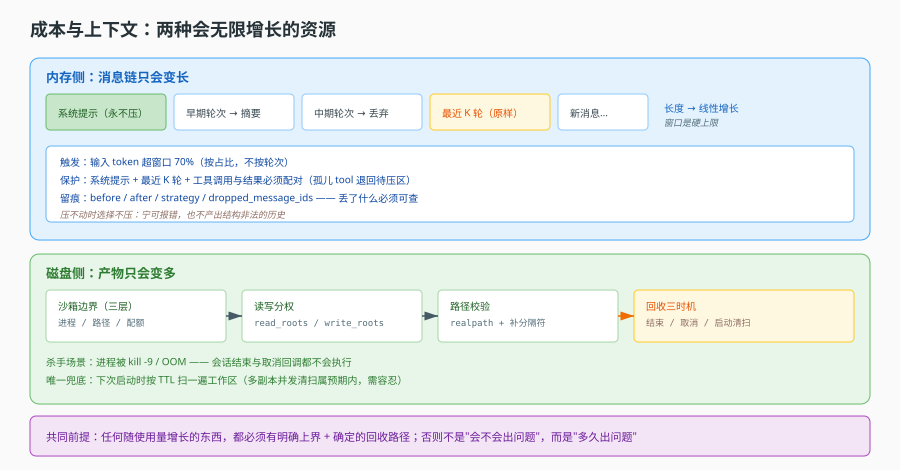
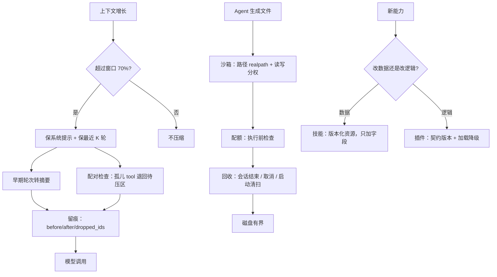

# 第 13 课：成本与上下文

> 所属阶段：阶段 4《判断力》｜ 水平：进阶 ｜ 本课知识点：上下文压缩、沙箱与产物、技能与插件
> 故事情节：主角跑得久了，上下文越来越长、产物越来越多。这一课看系统如何给自己"减肥"。
> 📖 结论已按官方文档核对（核对于 2026-11 ｜ 来源：[LangChain 上下文工程](https://docs.langchain.com/oss/javascript/langchain/context-engineering)、[LangChain 短期记忆](https://docs.langchain.com/oss/javascript/langchain/short-term-memory)）


## 🎯 本课目标

- 说出上下文压缩的触发时机、三种策略各自的代价，以及"哪些内容绝对不能压"
- 说清沙箱的三层隔离边界，以及产物回收为什么必须有"启动时清扫"
- 用一条判据区分"该做成技能"还是"该做成插件"，并说清两者的版本兼容策略

## 🧑‍💻 前置知识速览

- **上下文窗口（Context Window）**：模型一次能接收的最大 token 数，输入 + 输出共享这个额度。
- **Token**：模型处理文本的最小单位，中文大致 1 字 ≈ 1~2 token，英文 1 词 ≈ 1.3 token。
- **沙箱（Sandbox）**：给程序一个受限的运行环境，让它只能碰允许碰的东西。

## 第一幕：起源与场景引入

> 🎬 **场景**：第 47 轮对话，模型突然开始"失忆"

一个客服 Agent 上线三周，投诉开始出现：

- 用户说"就按刚才那个订单改"，模型回答"请问您指的是哪个订单"——**20 轮前说过的话，它不记得了**。
- 另一个会话直接报错：`context_length_exceeded`。
- 还有一类更隐蔽：模型把 30 轮前的**旧工具结果**当成了当前事实，给出了过期价格。

你打开日志，发现这个会话已经累积了 18 万 token 的历史：每一轮的工具返回（一份 300 行的订单 JSON）都被完整保留着。

同时另一条线索也在报警：这个 Agent 会在沙箱里生成报表文件。三个月下来，`/tmp/agent-workspace` 占了 40 GB，其中大部分是**失败任务的残留**——任务崩了，文件没人清。

> 📌 **一句话本质**：Agent 跑得越久，"记住的东西"和"留下的东西"都会线性增长，而系统必须把它们约束在有界范围内——一个管内存里的上下文，一个管磁盘上的产物。

> ⚖️ **处境对照**：不这么做 → 要么撞上窗口上限直接报错，要么为了不报错而静默丢失关键信息，要么磁盘被残留文件吃满；这么做 → 上下文与产物都有明确上限，且"丢了什么"可查。

## 第二幕：认知冲突

> ❓ **问题**：为什么"快满了就截断"不是正确答案？

因为截断会**切断因果关系**。

考虑这样一段历史：

```text
[user]      帮我查一下订单 A 的物流
[assistant] (tool_call: query_order, id=call_1)
[tool]      {"id":"A","status":"已发货", ...300 行...}
[assistant] 订单 A 已发货，预计明天到
[user]      那 B 呢？
```

如果截断点正好落在 `[tool]` 与 `[assistant]` 之间，模型会看到一条**没有结果的工具调用**——多数模型会因此报错，或者更糟：自己编一个结果。

如果截断点落在 `[user] 那 B 呢？` 之前，模型就完全不知道用户问的是 B——这就是"失忆"投诉的来源。

所以压缩的核心矛盾不是"怎么变短"，而是**"变短之后，剩下的部分还能不能自洽"**。这就要求压缩必须理解结构（谁和谁是一对），而不只是数长度。

## 第三幕：层层揭示

### 一眼全局图（进入细节前先看一眼）



> 看图：上半部分是上下文（一条会不断变长的消息链），压缩在"快到窗口上限"时把它折叠成"摘要 + 保留段"；下半部分是沙箱（一个受限目录），产物在任务结束时被回收，异常残留由启动清扫兜底。两者是同一个问题在两种资源上的投影。

### 本课地图（分几步走）

| 步 | 这一步要解决什么（人话） | 对应知识点 |
|:--:|--------------------------|-----------|
| 1 | 上下文快满了怎么办，丢了什么要能说清 | 知识点 1：上下文压缩 |
| 2 | Agent 能碰哪些文件，产物什么时候清 | 知识点 2：沙箱与产物 |
| 3 | 新能力该做成"配置"还是"代码" | 知识点 3：技能与插件 |

### 知识点 1：上下文压缩

> 🧭 第 1/3 步｜承接：第二幕"截断会切断因果" → 本步：怎么压才不断因果
> 本知识点关键点：阈值选择、三种策略、保留清单、配对保护、可观测

- 关键点：按 **token 占比**触发比按轮次触发更准，但必须配一个轮次兜底
- 关键点：三种策略各有代价——摘要失真、截断丢信息、丢弃中间轮丢过程
- 关键点：系统提示与最近若干轮不可压，工具调用与结果**必须成对**
- 关键点：压缩是"有损且不可逆"，必须留事件记录，否则排障时无法解释"模型为什么忘了"

#### 一句话定义

上下文压缩是在窗口快满之前，主动把旧内容替换成更短的等价物，同时保证剩下的历史**结构自洽**。

#### 直觉建立（类比）

一场三小时的会议，你不能全程录音回放（窗口装不下），只能：

- 保留**会议目标**（开场那句"今天要定什么"）——这是系统提示，不能压。
- 保留**最近十分钟**的逐字记录——这是当前正在讨论的内容，压了就接不上。
- 中间的阶段换成**纪要**——"10:30 确认了预算上限 50 万"，保留结论、丢掉过程。
- 纪要里不能出现"某人说了某句话但没说完"——**半截的因果关系比没有更糟**。

> 💡 **类比的边界**：会议纪要由人写，会主动判断什么重要；这里的摘要是模型生成的，它会漏、会错，所以必须留原始记录供追溯。

#### 核心原理

**① 触发阈值：为什么按 token 而非按轮次**

轮次与长度不成正比。同样一轮，可能是"好的"三个字，也可能是一份 300 行 JSON。按轮次触发（比如"每 20 轮压一次"）会出现两种失效：

- 20 轮全是长工具结果 → 第 8 轮就爆了，压缩还没触发。
- 20 轮全是寒暄 → 白白压了一次，损失信息还多花一次模型调用。

按占比触发（如"输入 token 超过窗口的 70%"）能适配任意内容密度。但要有兜底：**单条消息本身超长时，占比判断来不及**（一条 20 万 token 的工具结果进来，压缩前就已经超限），所以还要有"单条超长 → 立即压缩/截断该条"的分支。

留 30% 余量的原因：压缩本身要调模型（消耗输出 token），而且压缩后的下一轮还要有空间放新内容。取 70% 是个常见起点，真正该按"最大单轮增量"来定——如果历史上一轮最多涨 8%，那至少留 8%。

**② 三种策略与各自代价**

| 策略 | 做法 | 保留什么 | 代价 |
|---|---|---|---|
| 摘要（Summarize） | 让模型把旧段落改写成短文本 | 语义、结论 | 二次调用成本；细节失真；不可逆 |
| 截断（Truncate） | 直接砍掉某段 | 无 | 丢信息；可能切断配对 |
| 丢弃中间轮（Drop Middle） | 保头（系统提示）+ 保尾（最近 N 轮） | 契约与当前上下文 | 丢过程；模型不知道"中间发生过什么" |

实务上三者是组合使用，不是三选一：

```text
系统提示（永不压）
  ↓
早期轮次 → 摘要成一段"背景"
  ↓
中期轮次 → 丢弃（连同其工具结果一起丢）
  ↓
最近 K 轮 → 原样保留
```

**③ 哪些绝对不能压**

- **系统提示**：它是行为契约（角色、禁令、输出格式）。压掉一句"不允许修改订单"，整个权限设计就塌了。
- **最近 K 轮**：当前任务的上下文。压了就等于让模型"刚说完就忘"。
- **工具调用与结果的配对**：一条带 `tool_calls` 的 assistant 消息，必须和每个 `tool_call_id` 对应的 tool 消息同生共死。拆开的后果是模型看到"我调了工具但没有结果"，常见反应是重试（浪费）或编造（更糟）。

**④ 可观测：压缩必须留痕**

压缩是唯一一种"系统主动让模型变笨"的操作，所以它必须可解释。至少要记四个字段：

```python
@dataclass
class CompressionEvent:
    before_tokens: int
    after_tokens: int
    strategy: str                 # summarize / truncate / drop_middle
    dropped_message_ids: list[str]  # 具体丢了哪些，排障时能对照
    kept_tail_turns: int
```

没有 `dropped_message_ids`，用户投诉"它忘了我说的话"时，你只能猜。有了它，你能直接回答"那句话在第 12 轮，被 15:03 那次压缩丢了"。

#### 示例演示

一个能保护配对关系的最小实现：

```python
def compress(messages, *, budget_tokens, keep_tail=6, counter=count_tokens):
    """把历史压到 budget 以内，保证：系统提示保留、最近 keep_tail 轮保留、工具配对不拆。"""
    if counter(messages) <= budget_tokens:
        return messages, None                      # 没超，不动

    system = [m for m in messages if m["role"] == "system"]
    dialog = [m for m in messages if m["role"] != "system"]

    # ① 先按"轮"切：以 user 消息为界，一轮 = user + 后续 assistant/tool
    turns = split_turns(dialog)
    tail = turns[-keep_tail:]
    head = turns[:-keep_tail]

    # ② 配对完整性检查：尾段第一条若是 tool，说明它对应的 assistant 被切走了
    while tail and tail[0][0]["role"] == "tool":
        head.append(tail.pop(0))                   # 把孤儿 tool 还给 head 一起处理
    if not tail:                                   # 极端情况：全被还回去了
        return messages, None                      # 宁可这次不压，也不产出非法历史

    # ③ 头部转摘要（丢弃过程，保留结论）
    summary_text = summarize(head)                 # 一次模型调用
    summary = [{"role": "system", "name": "history_summary", "content": summary_text}]

    kept = system + summary + [m for turn in tail for m in turn]
    event = CompressionEvent(
        before_tokens=counter(messages),
        after_tokens=counter(kept),
        strategy="summarize",
        dropped_message_ids=[m.get("id") for turn in head for m in turn],
        kept_tail_turns=len(tail),
    )
    return kept, event
```

三处值得注意的设计：

- **第 ② 步的 while 循环**：这是"配对保护"的落点。它宁可把孤儿 tool 退回待摘要区，也不让非法结构进入结果。
- **`return messages, None` 的兜底**：压不动的时候**选择不压**，而不是产出一个结构错误的历史。让这次请求去撞上限报错，好过让模型在错误历史里胡编。
- **摘要用 `role=system` 并带 `name`**：让它明确区别于"用户说过的话"。如果伪装成 user 消息，模型可能把它当作用户的新指令。

一条必须写的测试：

```python
def test_tool_pair_is_never_split():
    msgs = [
        {"role": "system", "content": "你是客服"},
        {"role": "user", "content": "查订单 A"},
        {"role": "assistant", "tool_calls": [{"id": "call_1", "name": "query_order"}]},
        {"role": "tool", "tool_call_id": "call_1", "content": "{...}"},
        *[{"role": "user", "content": f"第{i}问"} for i in range(10)],
    ]
    kept, _ = compress(msgs, budget_tokens=1, keep_tail=2)
    ids = {m.get("tool_call_id") for m in kept if m["role"] == "tool"}
    calls = {c["id"] for m in kept if m.get("tool_calls") for c in m["tool_calls"]}
    assert ids == calls        # 要么都在，要么都不在
```

#### 常见误区

1. **"压缩就是截断"**：截断只是三种策略里最粗暴的一种，且最容易切断配对。
2. **"压缩后 token 一定更少"**：摘要本身要花输出 token；如果只压了两轮，可能净亏。
3. **"系统提示也可以一起压"**：它是契约，压了等于改产品行为。
4. **"压完不用记录"**：不留痕的压缩会让每一次"模型失忆"投诉都变成无法定位的悬案。

#### 一句话记住

按占比触发、配轮次兜底；保系统提示与最近轮、配对不拆；压不动就不压，压过必须留痕。

#### 🗣️ 行话对照

- **Context Window**：上下文窗口、上下文长度上限。
- **Summarization / Compaction**：摘要压缩、上下文折叠。
- **Token Budget**：token 预算。

---

### 知识点 2：沙箱与产物

> 🧭 第 2/3 步｜承接：内存里的上下文管住了 → 本步：磁盘上的东西怎么管
> 本知识点关键点：三层边界、读写分离授权、三个回收时机、拦截点位置

- 关键点：隔离要分三层看——进程级、路径级、配额级，缺一层就有绕过路径
- 关键点：读与写要**分开授权**（只读挂载 vs 可写工作区），否则"能读"自动等于"能改"
- 关键点：产物回收有三个时机，**启动时清扫**最容易被漏，而它决定磁盘会不会慢性涨满
- 关键点：路径校验必须在"真正打开文件"那一层，不能只在工具入口

#### 一句话定义

沙箱是给 Agent 的一个受限文件系统视图——它只能看到被允许的路径、只能用被允许的方式操作；产物是它在这个视图里生成的文件，必须有确定的回收时机。

#### 直觉建立（类比）

酒店长包房：

- **房间**（可写工作区）：你可以在里面随便摆东西，退房时清空。
- **大堂与餐厅**（只读挂载）：你能去、能看，但不能改装修。
- **房卡权限**（路径授权）：你的卡只能开自己那间，开不了别人的。
- **退房清扫**（产物回收）：正常退房一次清；**没退成的那间**（崩溃残留）需要客房部每天巡查时发现。

> 💡 **类比的边界**：酒店有物理边界，代码里的"边界"全靠字符串比较——一次 `../` 或一个符号链接就能翻墙，所以校验方式比边界本身更关键。

#### 核心原理

**① 三层隔离，缺一层都不算隔离**

| 层 | 管什么 | 漏了会怎样 |
|---|---|---|
| 进程级 | 能不能执行任意命令、能不能访问网络 | Agent 生成的脚本可以直接 `curl` 外网、`rm -rf` 宿主机 |
| 路径级 | 能读写哪些目录 | 能读到 `/etc/passwd`、别的租户的工作区 |
| 配额级 | 能写多少、跑多久 | 写满磁盘、死循环占满 CPU |

三层是"与"的关系：只做路径级，进程仍可逃逸（子进程不受父进程的路径检查约束）；只做进程级，容器里的 root 仍能写满自己的磁盘把节点拖垮。

**② 读写分离授权**

一个常见的错误是把授权写成"允许访问 `/data`"，于是读和写都放行了。正确的形态是两份清单：

```python
sandbox = Sandbox(
    read_roots=["/data/shared", "/data/ws/u123"],   # 只读：共享资料 + 自己的工作区
    write_roots=["/data/ws/u123"],                  # 可写：只有自己的工作区
)
```

这样"查阅共享知识库"和"污染共享知识库"被拆成两种能力。**共享目录默认只读**是一条值得固化的默认值。

**③ 三个回收时机**

| 时机 | 触发 | 漏了会怎样 |
|---|---|---|
| 会话正常结束 | 请求返回前 | 每轮都留一点，累积最快 |
| 超时 / 取消 | 控制信号 | 长任务被取消时最容易被跳过（异常路径） |
| **启动时清扫** | 服务启动 | **崩溃残留永不回收，磁盘慢性涨满** |

第三个是"兜底中的兜底"。理由是：前两个都在进程内执行，进程被 `kill -9` 或 OOM 杀掉时，清理代码根本没机会跑。所以必须有一个"不依赖上一个进程配合"的机制——启动时扫一遍工作区，把超过 TTL 的目录删掉。

```python
async def sweep_on_startup(root: str, ttl_seconds: int):
    """进程被杀时清理逻辑不会执行，只能靠下次启动兜底。"""
    now = time.time()
    for entry in os.scandir(root):
        if not entry.is_dir():
            continue
        try:
            if now - entry.stat().st_mtime > ttl_seconds:
                shutil.rmtree(entry.path, ignore_errors=True)
        except FileNotFoundError:
            continue        # 已被别的实例清掉，正常
```

注意 `ignore_errors=True` 与 `FileNotFoundError` 的处理：多副本部署时两个实例可能同时扫到同一个目录，这种竞争是**预期内**的，不该让启动失败。

**④ 拦截点必须靠里**

路径校验有两个位置可选：工具入口（`read_file` 工具的参数校验）与真正的文件打开处（`Sandbox.open`）。只在工具入口校验，任何"直接调 Sandbox 之外的文件 API"的代码都能绕过——这和课 7 讲的"权限注入实例"是同一个道理。

```python
class Sandbox:
    def __init__(self, read_roots, write_roots):
        # 关键：先归一化再保存，避免后续每次比较都留隐患
        self.read_roots = [os.path.realpath(r) for r in read_roots]
        self.write_roots = [os.path.realpath(r) for r in write_roots]

    def _resolve(self, path: str, *, write: bool) -> str:
        real = os.path.realpath(path)          # 消掉 ../ 与符号链接
        roots = self.write_roots if write else self.read_roots
        for root in roots:
            if real == root or real.startswith(root + os.sep):
                return real
        raise PermissionError(f"{real} 不在允许范围（write={write}）")

    async def open(self, path: str, mode: str = "r"):
        real = self._resolve(path, write=("w" in mode or "a" in mode))
        return await aiofiles.open(real, mode)
```

`real == root or real.startswith(root + os.sep)` 这两段不能省：只写 `startswith(root)` 会让 `/data/ws/u123-evil` 被判定为在 `/data/ws/u123` 之内。

#### 示例演示

一个带配额的沙箱，重点看"配额在执行前检查、而不是写失败后补救"：

```python
class Quota:
    def __init__(self, max_bytes: int, max_files: int):
        self.max_bytes, self.max_files = max_bytes, max_files

    def check(self, root: str, incoming: int):
        used_bytes = used_files = 0
        for dirpath, _, filenames in os.walk(root):
            used_files += len(filenames)
            for f in filenames:
                used_bytes += os.path.getsize(os.path.join(dirpath, f))
        if used_files + 1 > self.max_files:
            raise QuotaExceeded(f"文件数超限 {self.max_files}")
        if used_bytes + incoming > self.max_bytes:
            raise QuotaExceeded(f"容量超限 {self.max_bytes}")
```

为什么在执行前检查：写到一半才发现超限，工作区里就留下了**半个文件**。这种半成品在后续读取时会被当成合法产物，产生难以解释的"数据损坏"。

#### 常见误区

1. **"用了容器就等于有沙箱"**：容器解决进程级，路径与配额仍需自己做。
2. **"能读的目录就能写"**：读写必须分开授权，否则共享资料会被污染。
3. **"任务结束时会清理就够"**：进程被强杀时清理不执行，必须有启动清扫。
4. **"工具入口校验过就行"**：任何绕过工具的直调路径都不经过它。
5. **"路径比较用 startswith 就安全"**：必须 realpath 归一化 + 补分隔符，否则 `../`、符号链接、前缀同名字目录都能绕过。

#### 一句话记住

进程、路径、配额三层齐；读写分权、realpath 归一、末尾补分隔符；三个回收时机里，启动清扫是唯一能救崩溃残留的。

#### 🗣️ 行话对照

- **Sandbox**：沙箱、隔离运行环境。
- **Mount (ro/rw)**：挂载（只读 / 可读写）。
- **Artifact**：产物——任务生成的文件。
- **TTL Sweep**：过期清扫。

---

### 知识点 3：技能与插件

> 🧭 第 3/3 步｜承接：资源有界了 → 本步：新能力该以什么形态进来
> 本知识点关键点：改数据还是改逻辑、技能为何不含服务端代码、插件加载要能降级、版本兼容两套策略

- 关键点：判据只有一条——**这次改动改的是数据，还是逻辑**
- 关键点：技能是"版本化资源"，一旦含服务端代码就退化成"部署单元"
- 关键点：插件加载必须容忍单个失败，不能让一个坏插件拖垮整个平台启动
- 关键点：技能靠"加字段"向前兼容，插件必须声明契约版本并在加载时校验

#### 一句话定义

技能是"用数据描述的可版本化能力包"，插件是"用代码实现、需要被加载的扩展点"；分界线是这次改动动的是数据还是逻辑。

#### 直觉建立（类比）

一家餐厅：

- **换菜单**（技能）：改的是纸上的内容——新增一道菜、调价格、改推荐语。厨师不用重新培训，明天就能上。
- **加设备**（插件）：改的是厨房的能力——装一台新烤箱。要动电、要占地方、装错了整间厨房可能跳闸。

判据很自然：**这件事能不能只靠"告诉厨师一个新配方"完成？** 能，就是技能；需要新设备，就是插件。

> 💡 **类比的边界**：菜单改错了可以立刻换回来；插件装错了可能导致服务起不来，所以插件的加载必须有隔离与降级。

#### 核心原理

**① 为什么技能不能含服务端代码**

一旦技能包里带可执行代码，它就同时具备两个身份：配置（在界面上编辑、随时回滚）与部署单元（要过 CI、要发版、要重启）。这两套生命周期**无法共存**：

- 配置可以一天改十次，代码发布不行。
- 配置回滚是一行数据库更新，代码回滚要重新部署。
- 配置由运营改，代码由开发改——权限模型不同。

所以边界要划死：**技能只描述"用什么提示词、挂哪些工具、按什么流程编排"，不描述"怎么执行一个新协议"**。后者是插件。

**② 插件的加载要能降级**

```python
def load_plugins(entries: list[PluginEntry], contract: str) -> list[Plugin]:
    loaded, failed = [], []
    for e in entries:
        try:
            if e.contract_version.split(".")[0] != contract.split(".")[0]:
                raise IncompatibleContract(e.name, e.contract_version, contract)
            plugin = e.factory()                  # 可能抛异常（缺依赖、配置错）
            plugin.activate()
            loaded.append(plugin)
        except Exception as exc:                  # 注意：故意捕获宽异常
            failed.append({"name": e.name, "error": str(exc)})
            log.error("plugin %s 加载失败：%s", e.name, exc)
    return loaded, failed
```

这里的 `except Exception` 是**有意为之**，与"不要吞异常"的常规建议相反。理由：插件是第三方代码，它的失败模式不可穷举（缺依赖、版本冲突、配置错误、网络超时都可能在 `activate()` 里发生）。一个插件挂了就让整个平台起不来，是把可控故障放大成全面故障。

代价是可能掩盖真实 bug——所以必须把 `failed` 清单**暴露到健康检查接口**，让"降级运行"这件事可见，而不是静默少了一半能力。

**③ 判据表**

| 问题 | 是 → 技能 | 是 → 插件 |
|---|---|---|
| 改动内容是提示词、工具清单、流程编排？ | ✅ | |
| 需要新增一种协议 / 执行器 / 存储后端？ | | ✅ |
| 改完需要重启服务吗？ | 不需要 | 需要 |
| 由运营在界面上改，还是开发发版？ | 运营 | 开发 |
| 回滚是"切版本"还是"重新部署"？ | 切版本 | 重新部署 |

一个常被搞混的中间地带：**"自定义工具"**。如果工具是"调用一个已有的 HTTP 接口"，那是数据（技能里写 URL 与参数映射）；如果工具需要"在服务端跑一段自定义逻辑"，那是代码（插件）。

**④ 版本兼容：两套不同的策略**

- **技能**：靠"加字段"向前兼容。新增字段必须有默认值，旧技能包缺这个字段时按默认值跑。**不要删字段、不要改字段语义**。
- **插件**：必须声明契约版本（如 `contract_version: "2.1"`），加载时校验主版本号一致。主版本不同直接拒载——因为契约变了，插件调用的方法签名可能已经不存在。

主版本相同即视为兼容，是"语义化版本"的常规约定；但要注意它只保证**接口存在**，不保证**行为一致**。所以插件还应有自己的契约测试，随平台升级一起跑。

#### 示例演示

技能的清单文件（纯数据，可版本化）：

```yaml
# skill: order-refund
name: 订单退款
version: 3
contract: skill/v2
prompt: |
  你是退款专员。只有 order.status=已签收 且 金额 < 500 时可直接退款，
  其余情况必须转人工。
tools:
  - query_order
  - refund_order
flow:
  - step: check
    tool: query_order
  - step: decide
    when: "amount < 500 and status == '已签收'"
    tool: refund_order
defaults:                      # 新增字段必须给默认值（向前兼容）
  max_retry: 2
```

插件的注册与版本校验：

```python
@dataclass
class PluginEntry:
    name: str
    contract_version: str       # 例如 "2.1"
    factory: Callable[[], "Plugin"]

PLATFORM_CONTRACT = "2.4"

def assert_compatible(entry: PluginEntry):
    host_major = PLATFORM_CONTRACT.split(".")[0]
    plug_major = entry.contract_version.split(".")[0]
    if host_major != plug_major:
        raise IncompatibleContract(
            f"{entry.name} 需要 contract {entry.contract_version}，平台为 {PLATFORM_CONTRACT}"
        )
```

一个值得测的场景：**插件的 `activate()` 抛异常时，平台仍能启动**。

```python
def test_broken_plugin_does_not_block_startup():
    entries = [
        PluginEntry("good", "2.0", lambda: GoodPlugin()),
        PluginEntry("bad", "2.0", lambda: (_ for _ in ()).throw(RuntimeError("boom"))),
    ]
    loaded, failed = load_plugins(entries, PLATFORM_CONTRACT)
    assert [p.name for p in loaded] == ["good"]
    assert failed[0]["name"] == "bad"
```

#### 常见误区

1. **"技能里放点脚本更灵活"**：一旦含代码，技能就变成了部署单元，失去"随时改、随时回滚"的价值。
2. **"插件加载失败应该让服务起不来"**：那是把可控故障放大成全面故障；正确做法是降级 + 暴露。
3. **"技能和插件的区别在于文件格式"**：区别在"改数据还是改逻辑"，与 YAML/JSON/代码无关。
4. **"主版本一致就一定兼容"**：只保证接口存在，行为一致要靠契约测试。
5. **"技能可以随便删字段"**：旧技能包会因缺字段而崩，向前兼容靠"只加不改不删"。

#### 一句话记住

改数据是技能、改逻辑是插件；技能只加字段不删不改，插件声明契约版本、加载失败要降级并可见。

#### 🗣️ 行话对照

- **Skill**：技能——可版本化的能力包。
- **Plugin**：插件——需要加载的代码扩展点。
- **Contract Version**：契约版本。
- **Graceful Degradation**：优雅降级。

---

## 第四幕：实操验证

> 目标：验证"压缩不破坏结构"、"沙箱拦得住逃逸"、"单插件失败不影响启动"三条契约。

### 4.1 机制验证

> ✅ 机制实测于 Node v22.22.2（脚本 `verify/verify-run.ts`）。上段为伪代码示意，下面是同机制的真实输出：

```text
① 压缩: 24 条 → 4 条（确实变小=true）| 系统提示仍在=true
② 配对检查（截断后）: {"paired":true,"orphans":[]}
   对照-故意只留 tool 结果: {"paired":false,"orphans":["tc_9"]}
③ 沙箱 /data/ws/u1/../../etc/passwd → PermissionError: /data/etc/passwd 不在允许范围（write=false）
③ 沙箱 /data/ws/u1-evil/x → PermissionError: /data/ws/u1-evil/x 不在允许范围（write=false）
③ 沙箱 /data/shared/doc.md → PermissionError: /data/shared/doc.md 不在允许范围（write=true）
   正常路径放行: /data/ws/u1/a.txt
④ 插件加载: {"loaded":["good"],"failed":[{"name":"bad","reason":"契约校验失败"}]}（平台仍能启动）
```

> ② 的第二行是对照组：**故意只留一条 tool 结果**，`orphans` 立刻报出 `tc_9`。这就是配对不能拆的检测手段——压缩算法写错时，它不会报错，只会让模型看到一个没有来由的工具结果。
> ③ 的三个用例必须全过：`../` 是最常见的，`u1-evil`（前缀同名）和符号链接才是生产里真被利用的两个。

```python
# ① 压缩：配对不拆 + 系统提示保留
kept, event = compress(long_history, budget_tokens=2000, keep_tail=4)
assert all(m["role"] == "system" for m in kept[:1])           # 系统提示仍在
assert tool_calls_match_results(kept)                          # 配对完整
assert event.before_tokens > event.after_tokens                # 确实变小了

# ② 压缩：压不动时不产出非法历史
kept, event = compress(all_tool_messages, budget_tokens=10, keep_tail=1)
assert event is None or tool_calls_match_results(kept)

# ③ 沙箱：三种逃逸都被拦
sb = Sandbox(read_roots=["/data/ws/u1"], write_roots=["/data/ws/u1"])
for bad in ["/data/ws/u1/../../etc/passwd",       # ../
            "/data/ws/u1/link_to_etc/passwd",     # 符号链接
            "/data/ws/u1-evil/x"]:                # 前缀同名
    with raises(PermissionError):
        sb._resolve(bad, write=False)

# ④ 沙箱：只读目录不可写
with raises(PermissionError):
    sb._resolve("/data/shared/doc.md", write=True)

# ⑤ 插件：坏插件不阻断启动，且失败可见
loaded, failed = load_plugins([good, bad], PLATFORM_CONTRACT)
assert len(loaded) == 1 and failed[0]["name"] == "bad"
```

第 ③ 条的三个用例必须全过。常见的半成品只测第一个（`../`），而符号链接和前缀同名恰恰是生产环境里更常见的绕过方式。

> ✅ **回扣场景**：回到开头的三个投诉。"模型失忆"对应压缩留痕（能查出哪次压缩丢了哪条）；`context_length_exceeded` 对应占比触发 + 单条超长兜底；40 GB 残留对应启动清扫。三个现象，三处机制。

## 第五幕：体系收束

这一课讲的是"长期运行"的三个约束：内存有界（压缩）、磁盘有界（沙箱与回收）、扩展有界（技能与插件）。它们共同的前提是——**任何会随使用量增长的东西，都必须有一个明确的上界和回收路径**。

> 📍 **全局定位**：前 12 课讲怎么把事做成，这一课讲怎么长期做下去。它也是阶段 4 的起点：从这里开始，"该怎么设计"逐渐取代"它是怎么实现的"。
> 🔗 **下一步**：课 14 会把前三阶段的设计横向摊开，逐条判断哪些能带走、哪些只属于这里。

## 🐞 全课常见误区

1. **"压缩等于截断"**：截断最容易切断工具配对。
2. **"按轮次触发压缩"**：轮次与 token 不成正比，必须按占比并配兜底。
3. **"压完不用记录"**：没有丢弃清单，失忆类投诉无法定位。
4. **"有容器就有沙箱"**：路径与配额仍需自己做。
5. **"任务结束会清理就够了"**：强杀场景只能靠启动清扫。
6. **"技能可以带脚本"**：会让技能退化成部署单元。
7. **"插件加载失败就应启动失败"**：应降级 + 暴露失败清单。

## 一图总结



> 课首图是"两个资源各一条链"；此图是"三条上界机制 + 各自的兜底分支"。

## 课后小测

**Q1**：一个会话的历史里有一段 `assistant(tool_calls=[call_1])` 紧跟 `tool(tool_call_id=call_1)`。压缩时把前者摘要掉、后者保留，会发生什么？
- A. 无影响　B. 模型看到孤儿工具结果，可能编造或报错　C. 只是浪费 token　D. 自动重试工具

<details><summary>答案与解析</summary>

**答案：B**。工具结果失去了对应的调用记录，模型无法判断这条结果的来源与用途，常见反应是编造一条"我当时调用了"或直接报结构错误。压缩必须保证配对同生共死。

</details>

**Q2**：服务被 `kill -9` 后，工作区里留下了 2 GB 的失败任务文件。哪个机制能回收它们？
- A. 会话结束清理　B. 取消回调　C. 启动时按 TTL 清扫　D. 配额检查

<details><summary>答案与解析</summary>

**答案：C**。前两者都在进程内执行，进程被强杀时没有机会运行。只有"下次启动扫一遍"不依赖上一个进程配合。

</details>

## 🚀 下一批接力提示词

```
继续学 Agent 工程解剖。我的学习档案在 agent-engineering/00-学习档案.md，
阶段 4《判断力》已完成课 13（上下文压缩 / 沙箱与产物 / 技能与插件），
请继续讲阶段 4 的课 14《设计判断力》，重点是四条可迁移设计的适用条件与代价。
```

## 🧭 课程导航

⬅️ **上一课**：[课 12：MCP 外部能力接入](../../3-执行与协作/lessons/12-MCP外部能力接入.md)
➡️ **下一课**：[课 14：设计判断力](14-设计判断力.md)
📚 **返回目录**：[课程目录](../../../02-课程目录.md)
