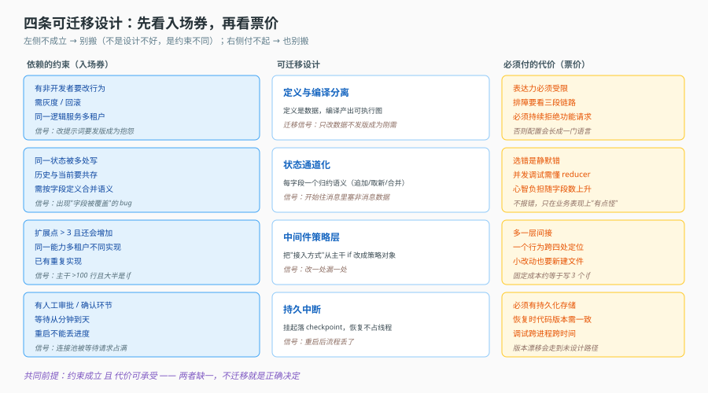
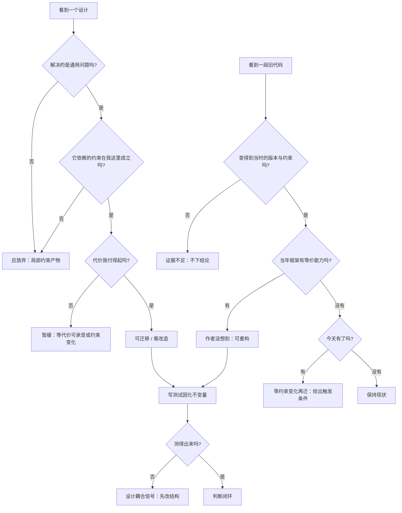

# 第 14 课：设计判断力

> 所属阶段：阶段 4《判断力》｜ 水平：进阶 ｜ 本课知识点：可迁移清单、历史包袱识别、可测试性
> 故事情节：主角走完全程，回过头问：这一路哪些该带走，哪些只属于这里？
> 📖 官方文档核对：本课为设计判断方法论（迁移信号 / 约束还原 / 可测试性），**无可对照的官方规范**，按闸门规则属豁免项；文中涉及的框架能力事实已按 [LangGraph Graph API](https://docs.langchain.com/oss/javascript/langgraph/graph-api) 核对（核对于 2026-11），判断结论为方法论归纳，**置信度：中**（依赖具体项目约束，不可直接套用）。


## 🎯 本课目标

- 列出四条可迁移设计，并为每条说出适用条件与**必须付的代价**
- 用"约束还原法"解释一段旧代码为何长成那样，而不是简单判优劣
- 说清测试在架构判断中的两个用途：反推行为、固化不变量

## 🧑‍💻 前置知识速览

- **可迁移（Transferable）**：换一个项目、换一套技术栈仍然成立的设计思想。
- **历史包袱（Legacy Baggage）**：在旧约束下做出的合理选择，今天看起来"多余"但迁移成本高。
- **不变量（Invariant）**：任何时刻都必须成立的条件，比如"状态里不存在孤儿工具结果"。

## 第一幕：起源与场景引入

> 🎬 **场景**：学完这套架构，回到自己的项目，第一个念头是"全都要"

十四课下来，你脑子里的"好东西"已经堆成一座山：定义与编译分离、状态通道、中间件策略、持久中断、审计账本、流式事件协议……

于是你打开自己那个只有 3 个 Agent、日请求 200 次的项目，开始动手：

- 先加定义层——于是要写校验、要写版本、要写发布流程。**一周过去，还在写"发布"这个功能本身。**
- 再加状态通道——于是每个字段都要想清楚归约语义。**写错一个 reducer，debug 了两天。**
- 再加中间件策略——于是最直白的一个"加个工具"的需求，现在要写一个类、注册、再在三个地方对上名字。**改一次，绕五个文件。**

三个月后，项目多了 8000 行框架代码，功能一个没多。这正是"高估可迁移性"的代价：**把别人约束下长出来的复杂度，搬进了一个没有那些约束的项目。**

> 📌 **一句话本质**：可迁移的不是"代码结构"，而是"问题与约束的对应关系"。脱离约束谈架构，学得越多，错得越狠。

> ⚖️ **处境对照**：不这么做 → 把每一条设计都当最佳实践照搬，用框架复杂度换掉业务进度；这么做 → 每条设计先问三个问题（解决什么通用问题、依赖什么约束、代价是什么），通过的才迁移。

## 第二幕：认知冲突

> ❓ **问题**：为什么"看起来很优雅"不能作为可迁移的判据？

因为**优雅往往是约束被满足后的副产品，不是设计本身的属性**。

举一个具体的：定义与编译分离，在你有多租户、需要版本回滚时，是优雅的——因为"数据能独立演进"这件事恰好是你要的。但在一个单租户、一天发一次版的项目里，同一套设计会让你为了改一句提示词去走一遍"发布流程"——**它此时是不优雅的**。

同一份代码，两种评价。差别不在代码，在约束。

所以判断必须换一个问法：不问"这个设计好不好"，而问"**它依赖的约束，在我这里成立吗？**"

这个转向的难点在于：约束通常是隐形的。没人会在 README 里写"我们因为要支持 200 个租户的灰度，所以做了版本化"。你得自己从代码里把它挖出来——这就是"约束还原法"。

## 第三幕：层层揭示

### 一眼全局图（进入细节前先看一眼）



> 看图：中间四条是可迁移设计，左边是它们各自依赖的约束（不成立就别搬），右边是各自必须付的代价（付不起也别搬）。判断一次要同时看左右两侧——只看左边会高估，只看右边会低估。

### 本课地图（分几步走）

| 步 | 这一步要解决什么（人话） | 对应知识点 |
|:--:|--------------------------|-----------|
| 1 | 哪四条值得带走，各自的入场券和票价是什么 | 知识点 1：可迁移清单 |
| 2 | 一段"看着奇怪"的代码，怎么读出它当时的处境 | 知识点 2：历史包袱识别 |
| 3 | 测试除了防 bug，还能怎么帮你判断架构 | 知识点 3：可测试性 |

### 知识点 1：可迁移清单

> 🧭 第 1/3 步｜承接：第二幕"优雅不是判据" → 本步：四条设计与它们的条件、代价
> 本知识点关键点：四条各自的适用条件、代价、"什么信号出现才该迁移"

- 关键点：**定义与编译分离**——适用：多租户 / 需版本化 / 非开发者要改行为；代价：表达力受限、调试链变长
- 关键点：**状态通道化**——适用：多路写入 / 需要摘要与历史共存；代价：心智负担与 reducer 调试成本
- 关键点：**中间件策略层**——适用：扩展点 > 3 个且会持续增加；代价：多一层间接，定位要跨文件
- 关键点：**持久中断**——适用：流程里有人工环节且等待时间不可控；代价：必须有持久化存储、代码版本要一致
- 关键点：每条都要能回答"什么信号出现时我才该迁移"，否则就是凭感觉抄

#### 一句话定义

可迁移清单是四条"结构级"设计——它们解决的是通用问题，但要付确定代价，所以迁移的前提是"你的约束成立且代价付得起"。

#### 直觉建立（类比）

四件专业装备：

- **登山绳**（定义与编译分离）：你要爬岩壁才带。走平地带着它，只会缠住脚。
- **多路水管**（状态通道）：家里有三个水龙头同时用水才需要分路。只有一个龙头，分路只是多了一堆接头。
- **配电箱**（中间件策略层）：房间多、电器多才需要单独回路。一个房间一盏灯，直接接线更快。
- **急救包**（持久中断）：会去无人区才带。城市里带它不算错，但要记得它会占地方、会过期。

> 💡 **类比的边界**：装备带错了只是累；架构搬错了会**反向约束业务**——比如为了维持"定义即数据"，硬把一个必须写代码的能力塞进配置，最后配置里长出表达式引擎。

#### 核心原理

**① 定义与编译分离**

解决的问题：让"行为"变成可独立演进的数据，从而支持多人协作改、灰度、回滚。

| 项 | 内容 |
|---|---|
| 适用条件 | 有非开发者要改行为；需按版本回滚或灰度；同一套逻辑要服务多个租户 |
| 代价 | 定义格式的表达力必须受限（否则退化成编程语言）；排查问题要从"定义 → 编译产物 → 运行时"三段看 |
| 迁移信号 | "改一句提示词要发版"成为高频抱怨；或"上线后发现问题只能 git revert"已经发生过 |
| 不该迁移 | 单团队、日发布、无灰度需求——这时"定义"只是一层多余的间接 |

**代价的具体表现**：定义格式一旦允许条件分支，就会有人写出嵌套 if；一旦允许循环，就有人写 for。三年后你的"配置"变成一门没有调试器的语言。所以这条设计的隐性成本是**你必须持续拒绝功能请求**。

**② 状态通道化**

解决的问题：不同生命周期的数据混在一个字段里，会互相踩（比如摘要压掉历史，同时把当前任务参数也压掉了）。

| 项 | 内容 |
|---|---|
| 适用条件 | 同一状态被多处写；需要"历史"与"当前"共存；需要按字段定义合并语义 |
| 代价 | 每个字段都要选定归约语义（追加/取新/合并），选错是**静默错**；并发调试要理解 reducer |
| 迁移信号 | 出现"某个字段被覆盖了"的 bug；或开始往消息数组里塞非消息数据 |
| 不该迁移 | 全部状态确实只有一个消费者、一个写者——单字段足够 |

**为什么选错是"静默错"**：把该追加的写成取新，历史会悄悄消失；把该取新的写成追加，同一份数据会重复几十遍。两者都不报错，只在业务表现上"有点怪"。这类 bug 的定位成本，就是这条设计的主要代价。

**③ 中间件策略层**

解决的问题：能力数量增长时，主干上的 if 组合爆炸。

| 项 | 内容 |
|---|---|
| 适用条件 | 扩展点 > 3 个，且预期还会增加；有"同一能力在不同租户有不同实现"的需求 |
| 代价 | 多一层间接：一个行为要跨"策略定义 → 注册 → 编译展开 → 运行时"四处定位；小改动也要新建文件 |
| 迁移信号 | 主干函数超过 100 行且大半是 if；或出现"改一处漏一处"（同一个能力在两个地方各写一遍） |
| 不该迁移 | 扩展点 ≤ 2 个且稳定——一个 if 比一个策略类清楚 |

这里有个反直觉的阈值：**为什么是"> 3"而不是"> 1"**。因为策略层的固定成本是"一个接口 + 一套注册 + 一处装配"，大约等于写 3 个 if 的成本。少于 3 个扩展点时，你付出的是净亏损。

**④ 持久中断**

解决的问题：流程中有人工环节，等待时间从分钟到天，不能占着线程/进程。

| 项 | 内容 |
|---|---|
| 适用条件 | 有人工审批/确认环节；等待时间不可控（分钟到天）；进程重启不能丢进度 |
| 代价 | 必须有持久化存储（checkpoint）；恢复时代码版本必须与挂起时一致；调试要跨进程、跨时间 |
| 迁移信号 | 出现"审批等太久，服务重启后流程丢了"；或连接池被等待中的请求占满 |
| 不该迁移 | 人工环节在秒级（同步等一会儿就行）；或无状态、可随时重跑的任务 |

**"代码版本必须一致"是最容易被低估的代价**：挂起时执行的代码是 v1，恢复时部署的是 v2，如果 v2 改了 interrupt 之后的逻辑，恢复会走到一条"从未被设计过"的路径上。这就是为什么很多系统在挂起期间**锁定版本**——它不只是为了可追溯，也是为了恢复能正确执行。

**⑤ 一张判断表**

| 你的现状 | 该迁移哪条 | 明确不要迁 |
|---|---|---|
| 3 个 Agent、日请求 200、单人开发 | 无。先把业务跑通 | 定义层、策略层、通道化全都不必 |
| 10 个 Agent、多租户、运营要自己改提示词 | 定义与编译分离 | 持久中断（若无人审环节） |
| 一个长流程 Agent，中间要等财务审批 2 天 | 持久中断 | 策略层（若能力只有 2 个） |
| 能力从 4 个涨到 15 个，主干已 300 行 | 中间件策略层 + 状态通道化 | 定义层（若仍只有开发改配置） |

#### 示例演示

把"是否迁移"写成一个可执行的判断，而不是靠讨论：

```python
from dataclasses import dataclass

@dataclass
class Signal:
    """迁移信号：每一条都对应一个可观测的现状，而不是主观感受。"""
    name: str
    present: bool
    evidence: str = ""

def should_migrate_middleware(signals: dict[str, Signal]) -> tuple[bool, str]:
    extension_points = signals["extension_points"]
    if not extension_points.present:
        return False, "扩展点数量未知，先数一遍再判断"

    n = int(extension_points.evidence)
    if n <= 3:
        return False, f"扩展点仅 {n} 个：策略层的固定成本高于收益"

    duplicated = signals["duplicated_logic"].present
    if not duplicated:
        return False, f"扩展点 {n} 个，但尚无重复实现：先重构函数，观察是否继续增长"

    return True, f"扩展点 {n} 个且已出现重复实现：策略层能同时解决组合爆炸与重复"
```

用三条现状驱动结论：

```python
case_a = {
    "extension_points": Signal("扩展点", True, "2"),
    "duplicated_logic": Signal("重复实现", True),
}
print(should_migrate_middleware(case_a))
# (False, '扩展点仅 2 个：策略层的固定成本高于收益')

case_b = {
    "extension_points": Signal("扩展点", True, "11"),
    "duplicated_logic": Signal("重复实现", True),
}
print(should_migrate_middleware(case_b))
# (True, '扩展点 11 个且已出现重复实现：策略层能同时解决组合爆炸与重复')
```

这个函数的价值不在代码，在它**强迫你把"我觉得该重构了"翻译成两个可数的量**。团队争论"要不要上策略层"时，通常吵的是感受；能数出 11 个扩展点和 3 处重复实现时，结论自己就出来了。

#### 常见误区

1. **"好设计就应该用"**：好设计都有入场券（约束）和票价（代价），两者都合适才叫好。
2. **"先上框架，业务后补"**：框架复杂度会反向约束业务，尤其在需求还没稳定时。
3. **"可迁移 = 通用 = 任何项目都适用"**：四条全是条件适用，没有一条无条件成立。
4. **"迁移是一次性动作"**：正确做法是先迁一条、验证一季、再考虑下一条（课 15 会展开）。
5. **"代价只是开发成本"**：更贵的是持续性代价——每次改动都要多绕一层、每次排障都要多看一段。

#### 一句话记住

四条设计各有入场券与票价：定义分离要"多人改行为"、通道化要"多路写"、策略层要"扩展点>3"、持久中断要"人等不起"；条件不成立或代价付不起，都是不迁移的正当理由。

#### 🗣️ 行话对照

- **Transferable Design**：可迁移设计。
- **Over-engineering**：过度设计——在约束不成立时引入复杂度。
- **Accidental Complexity**：偶然复杂度——由实现方式（而非问题本身）带来的复杂度。

---

### 知识点 2：历史包袱识别

> 🧭 第 2/3 步｜承接：会判断该不该搬 → 本步：怎么读懂"别人已经搬过、但看起来奇怪"的代码
> 本知识点关键点：旧形态长什么样、为什么当时只能这样、约束还原四步、结论的正确表述

- 关键点：典型形态——不调用框架预置能力，自己拼图拼状态，且用了**已被新版本移除的 API**
- 关键点：这类代码多半是"当时框架给不了"的补偿，不是"作者不会用框架"
- 关键点：约束还原四步——找框架当时的边界、找业务约束、找依赖版本、对比今天变了什么
- 关键点：结论必须写成"因为 X 约束，所以选 Y，代价是 Z"，而不是"这段代码过时了"

#### 一句话定义

历史包袱识别是：看到一段"看起来落后"的代码，先还原它当时的约束，再判断它是"作者没想到"还是"当时做不到"。

#### 直觉建立（类比）

看到一座老房子的墙厚 60 厘米：

- 外行的结论："太浪费材料了。"
- 懂行的还原：这房子建于没有集中供暖的年代，厚墙是**保温手段**；今天有暖气了，但拆墙要动结构。

两种结论的差别不在观察力，在**是否知道当时的约束**。代码同理：看到手写的状态字典，先别急着说"为什么不用注解"，先问"当年有注解吗"。

> 💡 **类比的边界**：房子的约束写在建筑年代里，代码的约束常常一点痕迹都没有——需要从依赖版本、注释、测试里反推。

#### 核心原理

**① 典型形态：自建 ReAct 图**

一个"看起来奇怪"的实现通常长这样（旧形态用字典声明状态，新形态用类型注解）：

```python
# ---------- 旧形态：手写 channels 字典 ----------
old_graph = StateGraph(
    state_schema={
        "messages": {"value": operator.add, "default": lambda: []},
        "step": {"value": lambda _old, new: new, "default": lambda: 0},
        "scratchpad": {"value": lambda _old, new: new, "default": lambda: {}},
    }
)

# ---------- 新形态：注解式 schema ----------
class AgentState(TypedDict):
    messages: Annotated[list, operator.add]
    step: int
    scratchpad: dict

new_graph = StateGraph(AgentState)
```

两者语义等价，但旧形态把"字段名、归约函数、默认值"三件事塞进一个字典字面量，**没有类型检查**——少写一个键，运行时才炸。新形态让字段成为类型的一部分，IDE 与类型检查器能提前发现。

**② 为什么当时只能这样写**

因为旧形态支持**动态字段**：不同 Agent 装配的中间件会追加自己的状态通道，字段集合在编译期才确定，静态注解无法表达"运行时才知道有哪些字段"。

这是一个非常重要的判断分岔：

| 结论 | 依据 | 处置 |
|---|---|---|
| 作者没想到 | 当年框架已有等价能力，只是没用 | 可以重构，收益明确 |
| 当时做不到 | 当年框架缺这个能力，只能自建 | 别动，除非业务约束也变了 |

**误判成第一种的代价**：你会把一段承载了隐性需求的代码"简化"掉，然后发现某个租户的动态通道没了。

**③ 约束还原四步**

| 步 | 做什么 | 怎么取证 |
|---|---|---|
| 1 | 找框架当时的边界 | 查依赖版本对应文档：这个 API 那时存在吗？ |
| 2 | 找业务约束 | 注释里的 "must"/"never"、测试名、目录命名（如 `multi-tenant`） |
| 3 | 找依赖版本 | 锁文件、`package.json` / `pyproject.toml` 的版本范围 |
| 4 | 对比今天变了什么 | 框架补了什么能力？业务约束还在吗？ |

第 1 步和第 3 步常被跳过，而它们恰恰是"当时做不到"的唯一硬证据。**没有版本证据的"过时"判断，都是猜。**

**④ 结论的正确表述**

```text
❌ 这段代码过时了，应该用新版 API 重写。
✅ 因为当年需要在编译期动态拼装状态通道（字段由装配的中间件决定），
   静态 schema 无法表达，所以选了字典式声明，代价是丢掉类型检查。
   今天的框架已支持动态 schema 扩展，迁移的触发条件是"中间件组合趋于稳定"——
   不稳定时迁移反而会把灵活性换掉。
```

差别在哪：第二种表述**给出了迁移的触发条件**，所以它是一个可执行的判断；第一种只是评价，听完你还是不知道该不该动。

#### 示例演示

一个把"约束还原"落成检查清单的工具：

```python
@dataclass
class LegacyReview:
    file: str
    suspicious_pattern: str          # 例如 "手写 channels 字典"
    framework_capability_at_the_time: bool | None = None   # 当时有等价能力吗
    business_constraint: str = ""
    dependency_version: str = ""
    capability_today: bool | None = None

    def verdict(self) -> str:
        if self.framework_capability_at_the_time is None:
            return "证据不足：先查依赖版本与对应文档，不要下结论"
        if self.framework_capability_at_the_time:
            return "作者没想到：可重构，收益来自去掉重复实现"
        if self.capability_today:
            return f"当时做不到，今天能做：等「{self.business_constraint}」不再成立再迁"
        return "当时做不到，今天也做不到：保持现状，别动"
```

用它评估那段旧代码：

```python
review = LegacyReview(
    file="graph/agent_executor.py",
    suspicious_pattern="手写 channels 字典",
    framework_capability_at_the_time=False,     # 当年无动态 schema 扩展
    business_constraint="中间件组合由租户配置决定，编译期才确定字段",
    dependency_version="langgraph 0.4.x",
    capability_today=True,
)
print(review.verdict())
# 当时做不到，今天能做：等「中间件组合由租户配置决定，编译期才确定字段」不再成立再迁
```

注意 `framework_capability_at_the_time=None` 这一支：**证据不足时必须停下**。这是本工具最重要的设计——它阻止你在没查版本的情况下给出"过时"结论。

#### 常见误区

1. **"用了旧 API 就是技术债"**：也可能是"当年只有这个 API"。
2. **"重写总比维护好"**：重写会丢掉代码里未被文档记录的隐性需求。
3. **"读代码就能判断当时约束"**：约束大多不在代码里，要靠版本与注释反推。
4. **"结论就是该不该重写"**：结论应是"迁移的触发条件是什么"。
5. **" depreciated 就等于必须改"**：废弃只说明未来会移除，不说明现在改划算。

#### 一句话记住

先查版本再下结论；"作者没想到"可以重构，"当时做不到"只能等约束变化；结论要给出触发条件，而不是一句"过时了"。

#### 🗣️ 行话对照

- **Legacy / Tech Debt**：历史包袱、技术债。
- **Constraint Reconstruction**：约束还原。
- **Deprecation**：废弃——标记为将来移除，不等于立即不可用。

---

### 知识点 3：可测试性

> 🧭 第 3/3 步｜承接：能读懂旧代码 → 本步：怎么用测试把判断固化下来
> 本知识点关键点：测试的三个层次、测试当行为文档、不变量注释与测试的配合、测试为什么是架构信号

- 关键点：测试分三层——纯函数 / 图装配 / 端到端，各层解决不同问题，混着写会又慢又脆
- 关键点：读测试比读实现更快理解边界，因为测试写的是"输入 → 期望"
- 关键点：不变量应同时出现在注释与测试里，注释给人看，测试给机器守
- 关键点：**测试写不出来，往往是设计的耦合信号**，不是"测试难写"

#### 一句话定义

可测试性是"能否用一段不需要外部依赖的代码，验证某个行为或某个不变量"——它既是质量手段，也是架构判断的探针。

#### 直觉建立（类比）

体检：

- **抽血**（纯函数测试）：几秒钟，查具体指标。
- **心电图**（装配测试）：几分钟，看整体节律对不对。
- **住院观察**（端到端测试）：一整天，看真实生活下有没有问题。

三者不能互相替代：抽血查不出心律不齐，住院观察也不该用来查血糖（太慢太贵）。测试分层也是这个道理——**慢的层少写，快的层多写**。

> 💡 **类比的边界**：体检是检查"已存在的身体"，测试还会反过来影响"身体怎么长"——写不出测试，常常意味着结构该改了。

#### 核心原理

**① 三个层次，各管什么**

| 层 | 测什么 | 依赖 | 速度 | 占比建议 |
|---|---|---|---|---|
| 纯函数 | reducer、校验器、编译器的路由判断 | 无 | 毫秒 | 最多 |
| 图装配 | 节点与边是否正确连起来、钩子是否展开成节点 | 内存图 | 百毫秒 | 中等 |
| 端到端 | 一次真实请求从入口到输出 | 模型 / 存储 / 网络 | 秒到分钟 | 最少 |

最常见的失衡是"全靠端到端"：跑一次要 40 秒，CI 排 20 分钟，于是大家开始跳过测试。**根因不是纪律问题，是分层缺失**——把本该用纯函数测的逻辑，都放到了端到端里。

**② 测试是行为文档**

读实现要理解"它怎么做的"，读测试直接看到"它保证什么"：

```python
def test_replace_reducer_drops_history():
    """取名语义：新值整体替换，历史不留。这是设计，不是 bug。"""
    state = {"title": "旧标题"}
    assert replace_reducer(state, "title", "新标题") == {"title": "新标题"}

def test_append_reducer_replaces_same_id():
    """同 id 的消息是替换而非追加——流式输出不会产生碎片。"""
    msgs = [{"id": "m1", "content": "你"}]
    out = append_reducer({"messages": msgs}, "messages", [{"id": "m1", "content": "你好"}])
    assert len(out["messages"]) == 1
    assert out["messages"][0]["content"] == "你好"
```

这两个测试名就是两句规格。新人接手时，读完这两个函数就懂了两条归约语义——比读三百行 reducer 实现快得多。

**③ 不变量：注释与测试成对出现**

```python
# 不变量：任何时刻，history 里不存在没有对应 tool_call 的 tool 结果。
# 违反后果：模型看到孤儿结果，会编造或报结构错误。
def assert_no_orphan_tool_messages(messages):
    call_ids = {c["id"] for m in messages if m.get("tool_calls") for c in m["tool_calls"]}
    result_ids = {m["tool_call_id"] for m in messages if m["role"] == "tool"}
    assert result_ids <= call_ids, f"孤儿工具结果：{result_ids - call_ids}"
```

注释负责"为什么"，测试负责"是否仍然成立"。只有注释没有测试，三年后没人知道它还在不在守；只有测试没有注释，失败时没人知道该修哪边。

**④ 写不出测试 = 设计信号**

这是本知识点最实用的一条。三种典型症状：

| 症状 | 说明什么 | 该怎么改 |
|---|---|---|
| 测一个函数要先 mock 七个东西 | 依赖太多，职责不清 | 把纯逻辑从 IO 中拆出来 |
| 断言只能写"不报错" | 输出不可观测 | 让函数返回结构化结果，而不是直接产生副作用 |
| 测一个能力要在五个文件里改注册 | 装配靠隐式约定 | 把注册集中到一处，或改成声明式 |

第二种尤其常见：一个函数"处理完直接写数据库"，测试只能验证"没抛异常"。把"算出要写什么"与"真的去写"拆开，前者立刻变成可断言的纯函数——**这一步拆分往往同时改善了架构**。

#### 示例演示

给"编译器路由"写纯函数测试（这是课 5 的核心判断，最适合用测试固化）：

```python
def find_partners(definition, node_key):
    """返回与 node_key 存在双向委派的伙伴节点集合（不含自己）。"""
    ...

def route(definition, node_key):
    partners = find_partners(definition, node_key)
    if len(partners) > 1:
        return "collaboration"      # 群体协作：需要 activeAgent
    if len(partners) == 1:
        return "subgraph"           # 上下级委派：子图即可
    return "solo"

# ---- 测试把"为什么是 >1 而不是 >0"变成可执行规格 ----
def test_single_partner_uses_subgraph():
    d = graph_with_delegation("a", to="b")          # a 单向委派给 b
    assert route(d, "a") == "subgraph"

def test_mutual_delegation_uses_collaboration():
    d = graph_with_mutual("a", "b", "c")            # 三方互委派
    assert route(d, "a") == "collaboration"

def test_self_delegation_is_not_a_partner():
    d = graph_with_delegation("a", to="a")          # 自己委派自己
    assert route(d, "a") == "solo"                  # 不能把自己算成伙伴
```

第三条测试最有价值：它固化了一个容易写错的边界（`find_partners` 必须排除自身）。这类边界用端到端测几乎测不出来，用纯函数测只要三行。

#### 常见误区

1. **"测试越多越好"**：重复覆盖同一逻辑的测试只增加维护成本。
2. **"端到端最真实所以最重要"**：它最慢最脆，应最少。
3. **"测试只防回归"**：它还承担行为文档与架构探针的作用。
4. **"测不出来就先不测"**：测不出来本身就是该重构的信号。
5. **"不变量写在注释里就够了"**：没有测试守护的注释会随时间失真。

#### 一句话记住

纯函数多写、装配中等、端到端最少；测试名即规格、不变量注释配测试；测不出来先改结构，别先怪测试难写。

#### 🗣️ 行话对照

- **Unit / Integration / E2E**：单元 / 集成 / 端到端测试。
- **Test as Documentation**：测试即文档。
- **Invariant**：不变量。

---

## 第四幕：实操验证

> 目标：验证"四条判断能落地"、"约束还原有证据"、"测试能固化不变量"三件事。

### 4.1 机制验证

> ✅ 机制实测于 Node v22.22.2（脚本 `verify/verify-map.ts`）。上段为伪代码示意，下面是同机制的真实输出：

```text
① 迁移判断:
   2 个扩展点 + 无重复 → [false,"扩展点少且无重复，迁移收益低于成本"]
   11 个扩展点 + 有重复 → [true,"扩展点多或已有重复，抽层能收敛改动面"]
② 约束还原（无证据）: 证据不足：缺少当时的提交上下文与设计文档，无法还原约束
   约束还原（当时做不到、今天能做）: 当时框架能力不支持，今天已支持 → 等下一次触碰该模块时再改，不立即重写
③ 不变量检查（孤儿工具结果被检出）: 不变量被破坏：tool 消息 call_9 找不到对应的 tool_call
```

> ② 的第一行是本课最该学的输出：**证据不足是一个合法结论**。多数架构评审失败，不是因为判断错，是因为没人愿意说这句话，于是用猜测代替证据。

```python
# ① 迁移判断：三个不同现状给出三个不同结论
assert should_migrate_middleware(case_a)[0] is False      # 2 个扩展点 → 不迁
assert should_migrate_middleware(case_b)[0] is True       # 11 个 + 重复 → 迁

# ② 约束还原：证据不足时必须拒绝下结论
r = LegacyReview(file="x.py", suspicious_pattern="手写 channels")
assert "证据不足" in r.verdict()

# ③ 约束还原：当时做不到、今天能做 → 给出触发条件而非"立即重写"
r.framework_capability_at_the_time = False
r.capability_today = True
assert "等" in r.verdict() and "不再成立" in r.verdict()

# ④ 不变量：孤儿工具结果能被检出
with raises(AssertionError):
    assert_no_orphan_tool_messages([
        {"role": "tool", "tool_call_id": "call_9", "content": "无主结果"}
    ])

# ⑤ 路由边界：自己不算伙伴
assert route(graph_with_delegation("a", to="a"), "a") == "solo"
```

第 ② 条最值得坚持：它把"我不知道"变成了一个**合法且必须的输出**。多数架构讨论失败，就是因为没人愿意说这句。

> ✅ **回扣场景**：回到开头那个"全都要"的项目。用本课的三件工具复盘：迁移信号表告诉你四条全都不成立（3 个 Agent、单人开发、日发版）；约束还原告诉你那 8000 行框架代码是"在没有约束的地方抄了别人约束下的解法"；可测试性告诉你——如果你当初先写测试，会发现那些抽象根本没有可断言的行为。

## 第五幕：体系收束

这一课做了三件事：给出四条可迁移设计的入场券与票价；给出读懂旧代码的方法（约束还原）；给出把判断固化的手段（测试）。三者合起来是一句话——**判断的依据是可观测的现状与可查证的证据，不是"这样更专业"**。

> 📍 **全局定位**：这是全课程的"横向收口"。前 13 课纵向拆解一套系统，这一课把它横过来，逐条问"这条能不能带走"。
> 🔗 **下一步**：课 15 把这三件事整理成一套固定流程（三分类判断法 + 约束还原四步 + 迁移决策清单），让你换一个陌生项目也能照做。

## 🐞 全课常见误区

1. **"好设计就该用"**：每条都有入场券与票价。
2. **"可迁移等于通用"**：四条全是条件适用。
3. **"用了旧 API 就是技术债"**：可能当年只有那个 API。
4. **"结论是该不该重写"**：应是"迁移的触发条件是什么"。
5. **"测试只防回归"**：它还是行为文档与架构探针。
6. **"测不出来就先不测"**：测不出来是重构信号。

## 一图总结



> 课首图是"四条设计的条件/代价对照"；此图是"两套判断流程"：左支判该不该迁移，右支判旧代码该不该动。

## 课后小测

**Q1**：你的项目有 3 个 Agent、单人开发、每天发版，运营从不改提示词。有人建议上"定义与编译分离"，最该先问什么？
- A. 定义格式用什么 Schema　B. 我的约束（多人改行为 / 灰度 / 回滚）成立吗　C. 编译性能够不够　D. 要不要做版本号

<details><summary>答案与解析</summary>

**答案：B**。这条设计的入场券是"有非开发者要改行为 / 需灰度回滚"。约束不成立时，后面三个问题都没有意义——你会为一个不存在的需求设计版本号与发布流程。

</details>

**Q2**：一段代码用了框架已移除的 API，`git blame` 显示写于两年前。最稳妥的下一步是？
- A. 立即重写　B. 加注释说明已废弃　C. 查当年依赖版本与对应文档，确认当时是否有等价能力　D. 直接删掉那段代码

<details><summary>答案与解析</summary>

**答案：C**。没有版本证据的"过时"判断都是猜。确认"当时做不到"之后，还要看今天的业务约束是否变化，才能得出"等什么条件再迁"。

</details>

## 🚀 下一批接力提示词

```
继续学 Agent 工程解剖。我的学习档案在 agent-engineering/00-学习档案.md，
阶段 4《判断力》已完成课 14（可迁移清单 / 历史包袱识别 / 可测试性），
请继续讲最后一课 15《把判断变成可复现的方法》，重点是三分类判断法与迁移决策清单。
```

## 🧭 课程导航

⬅️ **上一课**：[课 13：成本与上下文](13-成本与上下文.md)
➡️ **下一课**：[课 15：把判断变成可复现的方法](15-把判断变成可复现的方法.md)
📚 **返回目录**：[课程目录](../../../02-课程目录.md)
