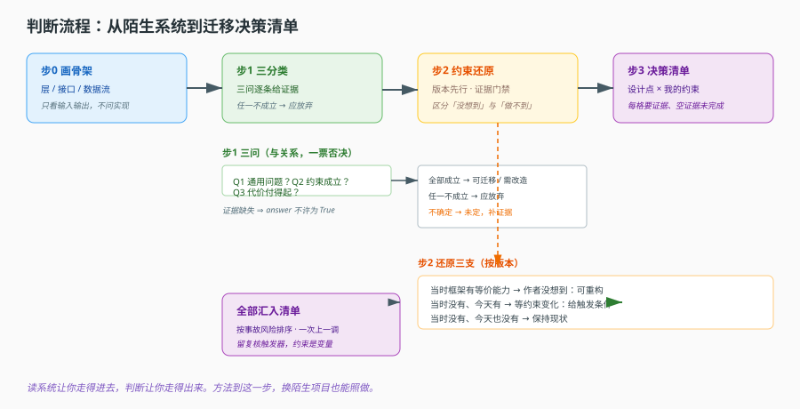
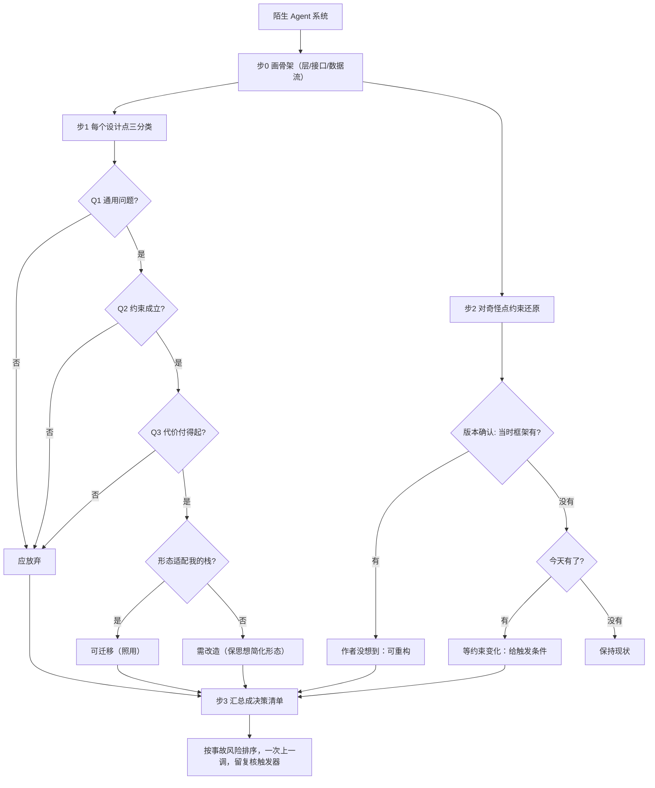

# 第 15 课：把判断变成可复现的方法

> 所属阶段：阶段 4《判断力》｜ 水平：进阶 ｜ 本课知识点：三分类判断法、约束还原法的操作步骤、迁移决策清单
> 故事情节：主角走完全程，最后要学会的不是"记住这套架构"，而是"换一个陌生项目，也能这样剖开它"。
> 📖 官方文档核对：本课为方法论收口（三分类 / 约束还原 / 迁移清单），**无官方规范可对照**，属闸门豁免项；流程中的校验规则（证据门禁、触发条件必填）为本课程自定义，已在 `verify/verify-run.ts` 实测（核对于 2026-11）。


## 🎯 本课目标

- 掌握一套可复用的判断流程：拿到陌生 Agent 系统 → 画出骨架 → 逐层判定可迁移性
- 能用约束还原法解释任意一段"看起来奇怪"的代码，而不是凭直觉判优劣
- 完成一份迁移决策清单，为自己的项目产出"采纳 / 改造 / 放弃"三分类结论

> 本课是阶段 4 的方法论收口课。真正的工程级演练在 [projects/](../../../projects/) 的结课综合实战项目中，那是一次跨阶段的完整重建，不是本课的延伸练习。

## 🧑‍💻 前置知识速览

- **三分类**：可迁移（换项目照用）/ 需改造（思想可用、形态要变）/ 应放弃（特定约束下的产物）。
- **约束还原**：从代码反推它当时的框架能力边界、业务约束、依赖版本。
- **迁移决策清单**：把每个设计点与"我的项目是否成立"逐条对照的表格。

## 第一幕：起源与场景引入

> 🎬 **场景**：你终于要面对一套陌生的 Agent 系统了

不是课程里那个标本系统——是另一个团队写的、你从没读过的一套系统。没注释、没文档、commit 历史混乱，只有 30 万行代码和一个"能跑"的事实。

上一课你学会了"约束还原""可迁移清单"。但那一课给的是一堆**零件**，没有装配说明。真正的问题来了：**面对一个完全陌生的系统，第一步做什么、第二步做什么？**

多数人没有这套流程，于是按观感行事：看到一个"不错"的模式，就抄回自己项目；看到一个"过时"的写法，就想删掉。结果抄来的东西在自己的约束下水土不服，删掉的其实承载着隐性需求。

> 📌 **一句话本质**：方法的价值在于——让你面对陌生系统时，步骤是固定的、证据是查得到的、结论是可复核的。判断不再依赖"我见没见过这种写法"。

> ⚖️ **处境对照**：不这么做 → 靠观感下结论，好坏全凭当日状态与见闻；这么做 → 每步都有产出（骨架 / 分类 / 清单），每一步都能被另一个人复核。

## 第二幕：认知冲突

> ❓ **问题**：为什么"看懂一个系统"不等于"做得出判断"？

因为**看懂是因果链条，判断是在链条上选点**。

"看懂"是回答"它为什么这样"——这是纵向的，读完一个模块就知道它的因果。但"判断"要回答"这条要不要搬"，这是横向的——**你得同时掌握两个系统**：别人的（它依赖什么约束），和你自己的（我的约束是什么）。只看懂别人那一侧，是做不出判断的，只会得出"很好/很烂"这种单点评价。

这就是为什么很多人"读了很多架构"却做不出决策：他们只积累了对别人系统的纵向理解，从没把自己的约束量化。

认知的转变是：**判断的前提不是"我更懂架构"，而是"我更懂自己的约束"**。摸清自己的约束，比读懂别人的代码更稀缺。

## 第三幕：层层揭示

### 一眼全局图（进入细节前先看一眼）



> 看图：整个流程是一条流水线——画骨架 → 逐层三分类 → 对号入座做迁移决策 → 产出带优先级与判据的清单。每一步的输出都是下一步的输入，没有人能跳步。

### 本课地图（分几步走）

| 步 | 这一步要解决什么（人话） | 对应知识点 |
|:--:|--------------------------|-----------|
| 1 | 面对陌生系统，先画一张什么样的骨架 | 知识点 1：三分类判断法前置 —— 画骨架 |
| 2 | 每个设计点用哪三个问题判定 | 知识点 1：三分类判断法 |
| 3 | 一段奇怪代码，四步还原它当时的处境 | 知识点 2：约束还原法 |
| 4 | 把所有结论落成一张可执行的清单 | 知识点 3：迁移决策清单 |

### 知识点 1：三分类判断法

> 🧭 第 1/4 步｜承接：第二幕"判断要靠自己的约束" → 本步：判断前先画骨架，再逐层三分类
> 本知识点关键点：骨架画法、三分类边界、三问、为什么优雅不是判据、误判的代价

- 关键点：先画骨架再判断——骨架是"层、接口、数据流"，不是"类与文件"
- 关键点：三分类边界——可迁移（换项目照用）/ 需改造（思想可用、形态要变）/ 应放弃（特定约束产物）
- 关键点：判定三问——解决通用问题吗？依赖的约束成立吗？代价付得起吗？
- 关键点：优雅是约束被满足的副产品，不是设计属性
- 关键点：误判两个方向的代价——高估引入无用复杂度，低估重复造轮子

#### 一句话定义

三分类判断是一种把"感觉好不好"翻译成"该不该搬"的判定：每个设计点，通过三个可数的问题，落到可迁移 / 需改造 / 应放弃之一。

#### 直觉建立（类比）

二手家具店：

- **可迁移**：换成别家房子也一样实用的书架——通用需求 + 你屋里放得下。
- **需改造**：尺寸只差三厘米的衣柜——家具本身不错，但要改尺寸、刷漆才能放进你家。
- **应放弃**：为旧户型定制的转角柜——那户型你根本没有，买了只会占地方。

> 💡 **类比的边界**：家具不合适一眼看得出；代码的约束是隐形的，所以才需要强制回答三个问题，而不是凭第一眼。

#### 核心原理

**① 先画骨架（判断的前置）**

面对陌生系统，先不要读细节，画一张只有"层、接口、数据流"的骨架（对应本课程的阶段 1 地图课）：

```python
def draw_skeleton(repo: str) -> Skeleton:
    """返回：层列表 + 层间接口 + 全局数据流。只问输入输出，不问实现。"""
    layers = []
    for path in modules(repo):
        role = ask_input_output(repo, path)   # 它吃什么、产出什么
        # 看不到的，先标记 unknown，不要猜
        layers.append(Layer(path=path, role=role or "unknown"))
    return Skeleton(layers=layers)
```

**骨架是"判断的坐标系"**：没有它，你会逐模块地"觉得好/觉得烂"，然后凭印象排优先级。有了它，你能说"我判断的是 execution 层"还是"definition 层"，让讨论锚定在具体层上，而不是发散到"整体设计"。

骨架三要素：**层**（设计的主体）、**接口**（层之间的契约，判断迁移时接口比实现更重要）、**数据流**（一件事怎么穿过各层，判断"这条设计是局部的还是贯穿的"）。

**② 三分类的边界**

| 分类 | 定义 | 例子 | 我的处置 |
|---|---|---|---|
| 可迁移 | 解决通用问题、约束在我这成立、代价付得起 | 状态通道化（若你确实多路写状态） | 照用，但先迁一条 |
| 需改造 | 思想通用，但形态依赖某一套约束 | 某种审计记账模式，你的量级不需要那么重 | 保留思想，简化形态 |
| 应放弃 | 完全依赖特定约束 | 为那套自建 ReAct 图服务的兼容层 | 不搬；只在约束变化时重审 |

边界判定要靠三问，而不是"这个模式熟不熟"。

**③ 三个可数的问题**（判定不是讨论，是回答填空题）

```text
Q1 它解决的是通用问题，还是局部问题？
   —— 判断依据：如果移除它，只有这个系统受影响，还是好多系统受影响？
Q2 它依赖的约束，在我的项目里成立吗？
   —— 判断依据：查版本、查业务量、查团队结构，不确定就是"不成立"。
Q3 它的代价，我付得起吗？
   —— 判断依据：它不是一次性，是持续性代价；把维护成本算进去。
```

Q2 是最致命的：约束成立与否**决定前两问都成立时该不该搬**。多数过度设计，都是 Q2 没被认真回答——用"这模式很主流"跳过了"我有没有这种约束"。

**④ 为什么优雅不是判据**

上一课讲过：优雅往往来自约束被满足。同一套定义与编译分离，在多租户项目里是优雅，在单租户项目里是把简单事做复杂的样板。**评价"设计本身"之前，先评价"约束是否匹配"**——所谓优雅，多数时候是你和它的约束刚好对上。

**⑤ 误判两个方向的代价**

| 误判方向 | 结果 | 具体损失 |
|---|---|---|
| 高估可迁移（搬了不该搬的） | 无用复杂度 | 为了维护抽象多写代码；功能迭代被框架约束拖慢；新人学习成本高 |
| 低估可迁移（放弃了该搬的） | 重复造轮子 | 在 5 个项目里各写一套同样的状态处理；每套都有各自的坑 |

这提醒我们：**两种错误都不是"更好的判断能力"能避免的**，只有靠强制三问。因为"高估"往往出现在你很兴奋时（看到好设计），"低估"往往出现在你很急时（先跑通再说）。流程正是用来对冲这两种情绪的。

#### 示例演示

把三问做成一个强制流程，每问都要求给出证据字段：

```python
@dataclass
class Criterion:
    question: str
    answer: bool | None
    evidence: str = ""          # 证据：证据缺失 = answer 不许为 True

THREE_QUESTIONS = [
    Criterion("解决的是通用问题吗？", None, ""),
    Criterion("它依赖的约束在我这成立吗？", None, ""),
    Criterion("它的代价付得起吗？", None, ""),
]

def classify(design: Design) -> str:
    for c in THREE_QUESTIONS:
        if c.answer is None or (c.answer and not c.evidence):
            return "未定：证据不足，先补证据再判定"      # 证据缺失强制停止
    q1, q2, q3 = [c.answer for c in THREE_QUESTIONS]
    if not (q1 and q2 and q3):
        return "应放弃"          # 任一不成立即放弃
    # 三问都通过，再分"照用"还是"需改造"
    return "可迁移" if design.fits_my_stack else "需改造"
```

`not (q1 and q2 and q3)` 的写法是有意的：**三问是"与"关系，一票否决**。任何一个不成立，都不该搬；只有全部成立，才进入"照用 vs 改造"的判断。常见的错误写法是"两个成立就行"，那会让"代价付不起"被"蛮通用的"掩盖。

#### 常见误区

1. **"先看代码细节再判断"**：细节会淹没结构，先画骨架。
2. **"这个模式主流所以可迁移"**：主流只说明很多人在用，不说明你的约束匹配。
3. **"三问大概有个感觉就行"**：必须有证据字段，否则就停留在"我觉得"。
4. **"两个问题成立就可以搬"**：三问是与关系，一票否决。
5. **"判断结果一次定终身"**：约束会变，清单要留复核触发器（课 15 末尾）。

#### 一句话记住

先画骨架锚定层，三问逐条给证据，任一不成立即放弃；三问全过再看"照用还是改造"。

#### 🗣️ 行话对照

- **Classification**：分类、判定。
- **Transferrable / Adaptive / Drop**：可迁移 / 需改造 / 应放弃。
- **Evidence**：证据、依据。

---

### 知识点 2：约束还原法的操作步骤

> 🧭 第 2/4 步｜承接：用三问画骨架分组 → 本步：对"看起来奇怪"的点做细颗粒度还原
> 本知识点关键点：四步流程、为什么查版本是硬要求、区分"没想到"与"做不到"、结论的正确表述

- 关键点：四步——找框架当时边界 / 找业务约束 / 找依赖版本 / 对比今天
- 关键点：查版本不是可选项，是"做不到"的唯一硬证据
- 关键点：区分"作者没想到"（可重构）与"当时做不到"（别动）
- 关键点：结论表述为"因为 X，所以 Y，代价是 Z"，而非"这段代码过时了"

#### 一句话定义

约束还原是对"看起来奇怪"的一段代码做考古：用版本、注释、测试做证据，重建它当时面对的约束，得出"能不能动"的结论。

#### 直觉建立（类比）

考古：

- 看到一堵厚墙，先看建筑年代（`git blame` / 依赖版本），而不是直接说"浪费"。
- 看到墙里藏了管道，先查它通往哪里（反推业务约束），而不是拆了重建。
- 结论写"这堵墙因为当年没暖气所以要厚"，而不是"这墙建得蠢"。

> 💡 **类比的边界**：考古对象死了，证据靠挖掘；代码有 `git blame` 与版本锁，证据比考古更直接——所以"查不到就猜"更没有借口。

#### 核心原理

**① 四步流程**

| 步 | 做什么 | 证据来源 | 若缺 |
|---|---|---|---|
| 1 找框架当时边界 | 这个能力当时框架有吗？ | 依赖版本 + 对应版本文档 | 下不了"做不到"结论 |
| 2 找业务约束 | 什么需求逼出这段代码？ | 注释、测试名、目录名、调用方 | 无法判断它承载什么 |
| 3 找依赖版本 | 到底用的哪个版本？ | 锁文件 / pyproject / package.json | 步 1 无从谈起 |
| 4 对比今天 | 框架补了什么？业务约束还在吗？ | 当前版本文档 + 当前业务情况 | 迁移无触发条件 |

步 3 被跳过最多，但它是一切的前提——**不知道版本，就无法说"当时框架没有"**。

**② 区分"没想到"与"做不到"**

```text
作者没想到：当时框架已有等价能力，只是没用或没用对。
处置：可以重构——收益来自去掉冗余实现。

当时做不到：框架当时缺这个能力，业务又等不起。
处置：别动——它承载着隐性需求，除非业务约束变了。
```

这一步的代价对称：误判"没想到"（其实是"做不到"），重构会把隐性需求删掉；误判"做不到"（其实是"没想到"），会错过一次合理简化。

**③ 结论的正确表述**

```text
❌ 这段代码过时了，应该重写。
✅ 因为当年要在编译期动态拼装状态通道（字段由装配的中间件决定），
   静态 schema 无法表达，所以选了字典式声明，代价是丢掉类型检查。
   今天的框架已支持动态扩展，触发条件是"中间件组合趋于稳定"。
```

能给出"触发条件"的结论才是可执行的；"过时了"只是一个评价，听完不知道该不该动。

#### 示例演示

四步落成一个带证据门禁的检查器（与课 14 的 `LegacyReview` 呼应，这里加了步 3 版本核验）：

```python
def reconstruct(file: str, repo: str) -> str:
    version = lockfile_version(repo)          # 步3：先查版本
    if not version:
        return "中止：找不到版本信息，无法继续（没有版本无法证明'当时做不到'）"

    capability_then = doc_had_capability(version, pattern)   # 步1：对应版本文档
    constraint = infer_constraint(repo, file)                # 步2：注释/测试反推
    capability_now = doc_has_capability_today(pattern)       # 步4：当前文档

    if capability_then:
        return f"作者没想到：当时已有等价能力。可重构，收益是去掉重复实现。"
    if capability_now:
        return f"当时做不到、今天能做。约束是「{constraint}」，等它不再成立再迁。"
    return "当时做不到、今天也做不到。保持现状，触发条件待定。"
```

注意 `version` 缺失时的行为：**硬中止**。这是本工具最重要的设计——没有版本，"当时做不到"就是一句没有证据的断言，而断言会直接决定"动"还是"不动"。

#### 常见误区

1. **"先猜再看"**：先查版本再下结论，顺序不能反。
2. **"版本查不到就算了"**：查不到就中止，默认不动。
3. **"作者没想到"是默认结论**：错误默认会让重构删掉隐性需求。
4. **"结论是评价"**：结论必须给出触发条件，才可执行。
5. **"只还原不支持动"**：还原也要支持"可以动"（作者没想到 + 能力当时就有）。

#### 一句话记住

版本先行、证据门禁；"做不到"要等约束变化，"没想到"才可重构；结论给触发条件，不给情绪。

#### 🗣️ 行话对照

- **Constraint**：约束、限制条件。
- **Reconstruction**（Constraint Reconstruction）：约束还原。
- **Lockfile**：锁文件（版本硬证据）。

---

### 知识点 3：迁移决策清单

> 🧭 第 3/4 步｜承接：骨架分组 + 单点还原 → 本步：全部落成一张可执行、能复核的清单
> 本知识点关键点：清单的列、优先级排序依据、分阶段采纳、什么情况该"不迁移"

- 关键点：清单结构——设计点 / 解决什么 / 依赖前提 / 代价 / 我的项目是否成立 / 结论
- 关键点：优先级排序——先补"缺失会出事故"的，后补"锦上添花"的
- 关键点：分阶段采纳——一次只上一条，验证后再上下一
- 关键点：团队规模、迭代速度、业务阶段，都是"不迁移"的合法理由

#### 一句话定义

迁移决策清单是把前面所有"点判断"汇总成一张表——每一行是"一个设计点 × 我的约束"，最后一列是经过三个问题与还原后的决定。

#### 直觉建立（类比）

体检报告 → 行动清单：

- 不是所有"高了"都同样紧急：血压爆表要立即处理，某项营养指标略高可以先观察。
- 不是所有问题都要一次解决：医生会给"先做这三项，三个月后复查"，而不是让你一天做十项手术。
- 有的指标你根本不需要查：没有家族史，某些基因检测可以不做。

> 💡 **类比的边界**：体检报告描述的是"身体现状"，迁移清单描述的是"约束是否匹配"——它比的不是好坏，是匹配度。

#### 核心原理

**① 清单结构（每一列都有明确来源）**

| 列 | 填什么 | 来源 |
|---|---|---|
| 设计点 | 这个结构解决什么 | 骨架里的层/接口 |
| 解决什么问题 | 一句话业务价值 | 三问之 Q1 |
| 依赖前提 | 哪些约束必须成立 | 三问之 Q2 |
| 代价 | 现金流与持续性成本 | 三问之 Q3 |
| 我的项目是否成立 | true/false + 证据 | 三问证据字段 |
| 结论 | 采纳 / 改造 / 放弃 + 触发条件 | 汇总 |

关键要求：**每一格都要有证据来源**。如果"是否成立"格的证据是空的，那这一行其实没做完——三问门禁不允许无证据的 true。

**② 优先级排序：先事故，后锦上添花**

```python
SEVERITY = {"incident": 0, "revenue": 1, "quality": 2, "nice": 3}

def sort_actions(rows):
    return sorted(rows, key=lambda r: SEVERITY[r.severity])
```

不再分层的例子：有人把"度量更清晰"（锦上添花）排在"审批流程会丢"（事故）前面，因为他觉得前者"更专业"。排序的常识是——**先堵会出事的，再谈优化**。

**③ 分阶段采纳**

不要一次把采纳的四条全上。理由：

- 每条设计都要在**你自己的数据**下验证，一次上 4 条无法归因（出问题不知道是哪条引入的）。
- 架构变更会改变团队习惯，一次变太多学习成本陡增。
- 分阶段让每一步都有一个"可回退、可复查"的检查点。

推荐的节奏：一次一条，给自己一个验证周期（比如一个季度），确认它在你的数据下带来预期收益，再考虑下一条。

**④ 什么情况"不迁移"是合理**

- **团队规模小**：一套定义层 + 校验 + 版本，对 3 人团队是纯负担。
- **迭代速度快**：频繁变更 + 厚重的抽象 = 每次改动都要维护两层一致性。
- **业务阶段早**：需求未稳定时，过早抽象会锁定在错误的方向上。
- **验证成本高**：如果迁移失败的代价（回滚难、数据要迁移）很高，宁可用旧方案保守。

关键认知：**"不迁移"不是"没学到东西"**——恰恰相反，能判断"这里不该抄"本身就说明你掌握了它的约束。清单的价值就在这里：它让你的"不抄"也有据可依，而不是一句没理由的"我觉得没必要"。

#### 示例演示

一份真实可用的清单草稿：

```markdown
# 迁移决策清单（模板）

| 设计点 | 解决什么 | 依赖前提 | 代价 | 成立? | 结论 |
|---|---|---|---|---|---|
| 定义与编译分离 | 行为可数据化、可回滚 | 多租户 / 非开发改行为 / 灰度 | 抽象层 + 验收 | ? | 待判（先补证据） |
| 状态通道化 | 多写者不互相踩 | 多路写 / 历史与当前共存 | reducer 心智 | ? | 待判 |
| 中间件策略层 | 扩展点组合爆炸 | 扩展点 > 3 且有重复 | 间接层 | ? | 烂建议?（数得出再填） |
| 持久中断 | 等人不占线程 | 人工环节、分钟级等待 | checkpoint + 版本一致 | ? | 待判 |

**决定前必须补的证据：**
- [ ] 数出每个设计点的扩展点/写者/等待时长（数字，不是感觉）
- [ ] 每行「成立?」格必须有证据字段，填空视为未完成
- [ ] 确认优先级按事故 > 收入 > 质量 > 锦上添花排序
- [ ] 选出一条先上，标注验证周期与回滚方案
```

注意一个细节：凭感觉写的"烂建议?"被我标了删除线——这正是流程想防止的东西。**没有数字的结论不配写进清单**。

#### 常见误区

1. **"一次全采纳"**：无法归因、学习成本陡增，应一次一条。
2. **"按性价比排序"**：先按"事故风险"排序，再谈成本收益。
3. **"项目早期就上全套抽象"**：需求未稳定时，抽象会锁定错误方向。
4. **"不迁移 = 白学了"**：能判断"不该抄"正是掌握的证明。
5. **"清单填完就结束"**：约束会变，清单要留复核触发器（下个季度重跑三问）。

#### 一句话记住

清单每格要证据、空证据等于没做完；先事故后优化、一次上一调；不迁移也是合法且可写进清单的结论。

#### 🗣️ 行话对照

- **Migration Decision Log**：迁移决策清单。
- **Backlog / Roadmap**：待办 / 路线图。
- **Risk-based Prioritization**：基于风险排序。

---

## 第四幕：实操验证

> 目标：把"画骨架 → 三分类 → 还原 → 清单"四步走一遍，验证每一步都有可复核产出。

### 4.1 流程验证（端到端走查）

> ✅ 机制实测于 Node v22.22.2（脚本 `verify/verify-run.ts`）。上段为伪代码示意，下面是同机制的真实输出：

```text
① 合规清单: 0 违规
② 违规清单被检出 2 条：
   - 自研中间件层: 结论为「采纳」但无证据
   - 全链路追踪: 结论为「改造」但无触发条件
③ 门禁意义: 结论为「采纳/改造」必须带证据 → 人无法跳过 Q2 直接填结论
```

> ② 的全链路追踪那条容易漏：它**有证据**（已有部分实现），但没写什么情况下该改选另一个方案。没有触发条件的结论，等于把判断冻结在此刻——半年后没人知道该不该重新评估。

```python
def run_review(repo: str) -> ReviewReport:
    # 步 0：画骨架（只问输入输出）
    skeleton = draw_skeleton(repo)

    # 步 1：对每个设计点做三分类（三问 + 证据）
    classified = {
        key: classify(design) for key, design in skeleton.designs.items()
    }

    # 步 2：对"看起来奇怪"的点做约束还原
    for design in skeleton.designs.values():
        if looks_suspicious(design):
            design.reconstruction = reconstruct(design.file, repo)

    # 步 3：汇总成清单，按事故优先级排序
    rows = [to_row(d, c) for d, c in classified.items()]
    report = ReviewReport(rows=sorted(rows, key=severity_key))
    report.audit()   # 校验：每行证据非空、结论合法、有触发条件
    return report


def test_review_flow_has_evidence_gate():
    repo = make_temp_repo(with_version=True)
    report = run_review(repo)
    # 未填证据的行必须被标记为"未完成"，不能有"凭感觉"的结论
    assert all(r.evidence for r in report.rows if r.conclusion in ("采纳", "改造"))
```

最后一行断言是整个流程的门禁：**结论为"采纳/改造"的行必须有证据**。没有这层校验，"三问流程"就是装饰性的——人会跳过 Q2 直接填结论。

## 第五幕：体系收束

四课加起来是一条完整的方法链：

- 阶段 1–3 给你**纵向**能力：看懂任意一个 Agent 系统怎么被定义、编译、执行。
- 课 13 补两块工程细节（上下文、沙箱、扩展）。
- 课 14 给**横向**判据：四条最可迁移的设计，各自的入场券与票价。
- 课 15 把判据装配成流程：骨架 → 三分类 → 还原 → 清单。

一句话收束：**读系统的能力让你走得进去，判断的能力让你走得出来**。前者是"它是什么"，后者是"我该怎么办"。两样都到，才算真正解剖完一个系统。

> 📍 **全局定位**：这是《Agent 工程解剖》的最后一课，也是唯一一门"只给方法、不引新机制"的课。方法的真正检验在 `projects/` 结课综合实战——那里你要用本文一切，重建一条从定义到中断恢复的最小链路。
> 🔗 **下一步**：前往 [结课综合实战项目](../../../projects/数据库变更审批助手/README.md)，用 16 个知识点的地图，把本课程的能力落成一段真正能跑的代码。

## 🐞 全课常见误区

1. **"先看细节再判断"**：先画骨架，信息才不淹没结构。
2. **"主流模式就可迁移"**：主流≠匹配，要看约束。
3. **"三问大概感觉一下"**：每问都要证据，证据缺失即未完成。
4. **"两个成立就能搬"**：三问是与关系，一票否决。
5. **"结论是过时/先进"**：结论要给触发条件。
6. **"一次全采纳"**：一次一条，验证再上。
7. **"不迁移就是白学"**：能判断不抄正是掌握。

## 一图总结



> 课首图是"四步流水线"；此图是"每步内部的分支"——三问一票否决、还原按版本分三支、全部汇入清单。

## 课后小测

**Q1**：判断一个设计点是否可迁移，遇到"代价有点贵"时，正确结论是？
- A. 可迁移，贵也值得　B. 应放弃，代价付不起　C. 需改造，换个便宜的形态　D. 再等等，看别人怎么做

<details><summary>答案与解析</summary>

**答案：C**。只有"思路通用 + 约束成立"但形态不合（含代价问题）时才走"需改造"。如果约束不成立，答案才是 B（应放弃）。注意区分"代价"（Q3，与约束相关）和"形态"（是否fits my stack）。

</details>

**Q2**：约束还原第一步为什么必须先查版本？
- A. 版本号好看　B. 它是"当时做不到"这一结论的唯一硬证据　C. 跟 commit 走查　D. 为了写文档

<details><summary>答案与解析</summary>

**答案：B**。没有版本，就无法证明"当时框架没有这个能力"；把"不知道"包装成"做不到"，重构时就会删掉承载隐性需求的代码。

</details>

## 🚀 下一阶段接力提示词

```
我想把 agent-engineering 教程学到手。学习档案在 agent-engineering/00-学习档案.md，
阶段 4《判断力》已全部学完（课 13 成本与上下文、课 14 设计判断力、课 15 把判断变成可复现的方法）。
下一步请引导我进入结课综合实战项目 projects/数据库变更审批助手/，
用跨 4 阶段的 16 个知识点重建一条"定义 → 编译 → 执行 → 中断 → 恢复"的最小链路。
```

## 🧭 课程导航

⬅️ **上一课**：[课 14：设计判断力](14-设计判断力.md)
📚 **返回目录**：[课程目录](../../../02-课程目录.md)
🏁 **下一步**：[结课综合实战项目](../../../projects/数据库变更审批助手/README.md)

> 至此，《Agent 工程解剖》核心 15 课正文全部完成。下一阶段是结课实战项目与 Phase 4/5 收尾产物（final-课程手册.md、实战经验/、排障速查手册/、场景解法库/）。
