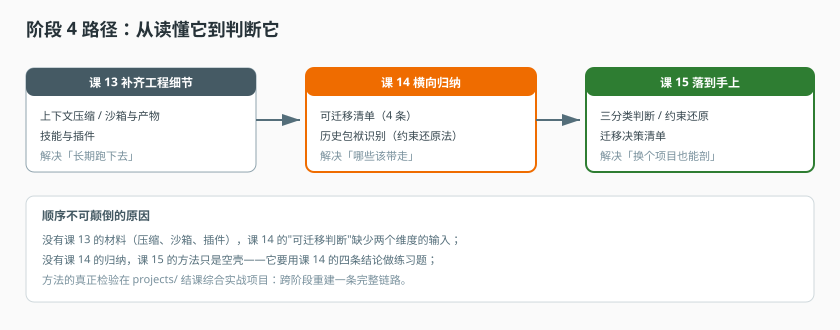

# 阶段 4：判断力

> 所属课程：Agent 工程解剖 ｜ 故事章节：回头看，哪些该带走 ｜ 上一阶段：[阶段 3](../3-执行与协作/overview.md) ｜ [返回总览](../../01-学习路径总览.md)

## 🎯 本阶段目标

- 从"读懂它"转为"判断它"：能对一份 Agent 系统设计给出可迁移 / 需改造 / 应放弃的三分类判断
- 掌握识别历史包袱的方法——不是嘲笑旧代码，而是还原它当时的约束
- 掌握一套可复用的解剖方法，换一个陌生项目也能照做

## 📍 学习重点

- 本阶段的价值不在"多学几个知识点"，而在**建立判断标准**。前三个阶段回答"它是什么"，这个阶段回答"我该怎么办"。
- 课 14 会看一段"看起来很奇怪"的代码：项目自己用已被移除的 API 实现了一份 ReAct 图。这段代码的正确读法不是"写得烂"，而是"2024 年它需要的能力，当时的框架给不了；今天框架给了，但存量系统迁移成本极高"。**能读出这层，才算具备工程判断力。**
- 课 15 不引入新机制，交付的是**方法**：三分类判断法 + 约束还原法 + 迁移决策清单。方法的检验在结课综合实战项目里。

## ✅ 必须掌握的知识点

| 知识点 | 所属课 | 学完应能 |
|--------|--------|----------|
| 上下文压缩 | 课 13 | 说出触发时机、策略选择与信息丢失风险 |
| 沙箱与产物 | 课 13 | 说清隔离边界与产物回收时机 |
| 技能与插件 | 课 13 | 说清"版本化资源"与"服务端代码"的边界 |
| 可迁移清单 | 课 14 | 列出四条可迁移设计并说出适用条件 |
| 历史包袱识别 | 课 14 | 用"约束还原法"解释一段旧代码为何长这样 |
| 可测试性 | 课 14 | 说清 988 个 spec 的组织方式，能用 spec 反推行为 |
| 三分类判断法 | 课 15 | 对任一设计点给出可迁移 / 需改造 / 应放弃的结论 |
| 约束还原法的操作步骤 | 课 15 | 独立走完四步还原，区分"没想到"与"做不到" |
| 迁移决策清单 | 课 15 | 为自己的项目产出带优先级的迁移结论 |

## 📖 本阶段在故事主线中的章节定位

主角的故事走到尾声，这一章的主语从"它"换成"你"。

前三个阶段都在回答"它是什么、它怎么被造、它怎么跑"。但读完这些，你可能仍然答不出一个更实际的问题：我要在自己项目里做 Agent，哪些该抄、哪些不该抄？

这个问题的难点在于：这套标本系统的很多设计看起来都对，但它们是特定约束下的产物。比如那一套自建 ReAct 图，今天的框架已经内置了，看起来像"历史包袱"，但还原到 2024 年——框架没有对应能力、业务又等不起——自建就是当时唯一正确的选择。判断"这段代码过时了"很容易，判断"它当时为什么只能这么写"才需要功力。

课 13 先补齐两块以前没细说的工程细节（上下文与沙箱、扩展方式），课 14 做横向归纳，课 15 把判断固化成方法。方法的真正检验不在课文里，在 `projects/` 的结课项目。

> 章节作用：**从"读懂"转向"判断"**。这是全课程唯一不引入新机制、只交付判断标准的阶段。学完这里的标志不是"记住了四条可迁移设计"，而是"换一个陌生项目，也知道从哪下手"。

## 🗺️ 本阶段路径图

> 看图：课 13 补齐两块工程细节（上下文与沙箱、扩展方式），课 14 做横向归纳（哪些可迁移、哪些是包袱），课 15 把这套判断固化成可复用方法。方法练手在结课综合实战项目。

## 本阶段产出

- [ ] [lessons/13-成本与上下文.md](lessons/13-成本与上下文.md)
- [ ] [lessons/14-设计判断力.md](lessons/14-设计判断力.md)
- [ ] [lessons/15-把判断变成可复现的方法.md](lessons/15-把判断变成可复现的方法.md)
- [ ] `projects/数据库变更审批助手/`（Phase 3 结课综合实战项目）
- [ ] `final-课程手册.md`（Phase 4）
- [ ] `实战经验/`、`排障速查手册/`、`场景解法库/`（Phase 5）
