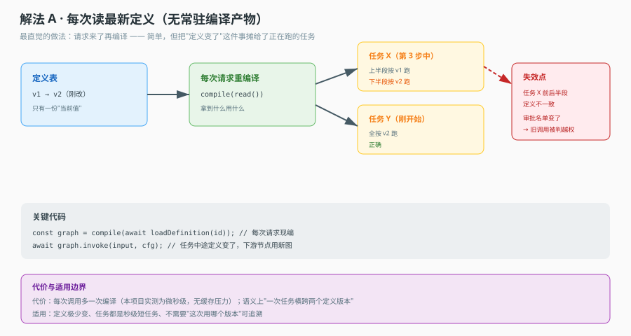
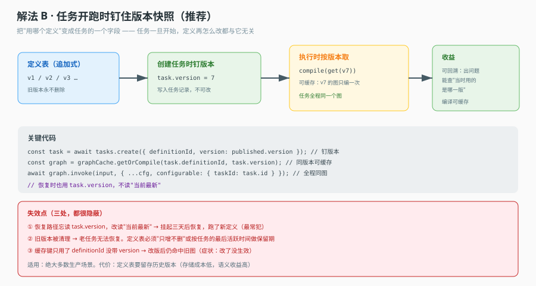
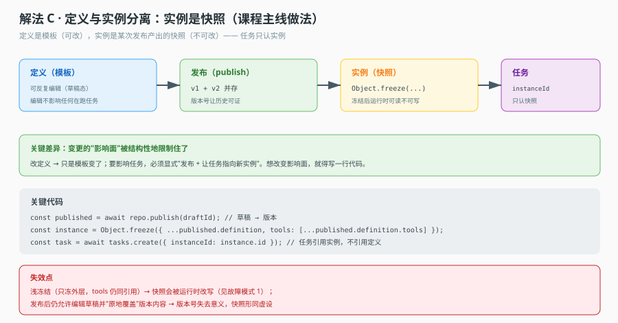

# 场景 01 · 定义热更新：改配置时在跑的任务怎么办

> 类型：经典设计题｜覆盖知识点：课 4 定义与实例分离、课 5 编译、课 11 幂等
> 一句话冲突：**定义是全局的，任务是已经开始的。**

## 场景

你的 Agent 平台上线三个月，跑得好好的。某天运营跑来提需求：某类工单的处理流程需要加一个"先查客户等级"的步骤。

流程定义存在数据库里，改一行 `graph_spec`，点保存。你按之前的理解，这就是一次普通的配置更新，改完立刻生效。

第二天出问题了。客服反馈：昨天下午提交的那批工单，有几张莫名报"无权执行"——它们明明在提交时是合法的。日志里能看到工具调用被拒，但调用参数看着没问题。

你去查原因：那张工单是昨天上午提交的，用的是旧定义；下午你改了定义，把某个工具从流程里去掉了；这张工单今天上午跑到那一步，读的是**当前**定义，于是被判越权。

更麻烦的是另一类：有张工单跑到一半，你改定义时把某一步的字段名从 `orderId` 改成了 `order_id`，它重跑那一步时读到了旧的中间结果，写出去一条字段缺失的记录，而且**没有任何报错**。

这就是本场景的核心矛盾：**流程定义是全局的一份，任务却是早就开始、正在跑的个体。** 你改的那一份，是所有在跑任务的下一次读。

## 🔒 先想

不看下面的解法，先回答四个问题（拿纸写，别只在脑子里过）：

**1.** 你会让"正在跑的任务"读哪一份定义？三选一：每次都读最新的、启动时钉住、启动时拷一份快照。选完写一句"为什么"。

**2.** 你选的那个方案，如果恰好在"任务跑到一半"的时刻改了定义，会发生什么？会不会报错？

**3.** 你的方案能不能回答这个问题：**这张工单到底是按哪一版定义跑的？** 如果运维问你"这张单为什么走了这一步"，你拿什么给他看？

**4.** 旧版本定义要不要留？留多久？谁来决定什么时候可以删？

想清楚这四题，后面三个解法你会有明确的偏好；想不清楚，三个解法看起来都"有道理"，这才是真正的坑。

<details>
<summary>💡 提示（卡住了再看，看一条就够）</summary>

- 先区分两件事：**"改定义"** 和 **"定义生效"** 不是同一个动作。前者是写数据库，后者是让某批任务开始用新的。中间可以隔着一个显式的动作。
- 再问一句：**任务的进度存在哪里？** 如果进度里只存"我跑到第几步了"，那定义一变，第几步的含义就变了；如果进度里也存"我当时用的是哪一版"，问题就变成了"能不能读到那一版"。
- 最后想一个反例：如果"每次都读最新"看起来很灵活、很省事，那它的代价是什么？**代价不会消失，只会从你这转移到某个凌晨三点的告警上。**

</details>

<details>
<summary>📖 展开解法（想完再看）</summary>

### 解法一览

| 解法 | 一句话机制 | 改动量 | 适用 | 主要风险 |
|---|---|---|---|---|
| A 每次读最新 | 任务每步都查库取当前定义 | 最小 | 定义很少变、任务很短 | 任务中途定义漂移，判越权或语义错位 |
| B 钉版本快照 | 任务启动时记下 `version`，之后只读这版 | 中 | 定义会变、任务有生命周期 | 旧版被清理、恢复路径忘了读 version |
| C 实例快照 | 定义 → 发布 → 实例 → 任务四级，任务挂实例 | 最大 | 多租户、需审计、需灰度 | 存储与生命周期管理复杂 |

---

### 解法 A · 每次读最新：最省事，也最容易静默错

**思路**：不存版本，任务每一步都去读"当前定义"。改完立刻对所有在跑任务生效。

**机制图**



看图重点：红色虚线标的是"任务 X 的前半段和后半段读到了两个不同的定义"。这不是"读到了旧数据"，而是**同一个任务内部前后不一致**——它前面按旧规则产出的中间结果，后面按新规则解读。

**关键代码**

```ts
// 反例：看起来很 DRY，实际上把"版本"这个维度丢掉了
async function runStep(taskId: string, step: string) {
  const def = await loadCurrentDefinition();   // 永远是最新的一份
  const node = def.nodes.find((n) => n.id === step);
  if (!node) throw new Error(`step ${step} not found`);  // 定义改了就找不到
  return executeNode(node, await loadState(taskId));
}
```

**为什么它会在真实系统里活下来**：因为开发和测试阶段定义基本不变，本地跑通毫无问题。它只在"有人在任务执行期间改定义"这个条件下暴露，而这个条件在灰度环境很难复现。

**这个解法特有的代价 / 坑**

- 失效是**静默的**：`node not found` 会抛错还算是好事，更糟的是字段改名但节点还在——`node` 找到了，读出来的配置语义已经变了，产出脏数据且不报错。
- 排查成本极高：日志里只看到"某任务失败"，而失败原因在几小时前的一次配置保存里，两者没有任何显式关联。
- 审计不可回答：你无法回答"这张单按哪一版跑的"，因为根本不存在这个信息。

**什么时候它其实是对的**：任务执行时间远短于"改定义的间隔"，且改定义时你愿意接受"在跑的任务全失败重来"。这时候简单是对的，但**你要显式写下这个前提**，而不是默认它成立。

---

### 解法 B · 钉版本快照：任务认版本，不认"最新"

**思路**：定义每次修改产生一个新版本号（不可变）。任务在**启动时**把 `version` 写进自己的状态，之后所有读取都按这个版本取。恢复时也一样：从任务状态里读 `version`，而不是读最新。

**机制图**



看图重点：三个红色标注都在**读取路径**上，而不是在写入路径上。这套方案的正确性不取决于"保存得多好"，取决于"每一个读定义的地方都带上了 version"。漏一处，就等于退回解法 A。

**关键代码**

```ts
type TaskState = {
  taskId: string;
  defVersion: number;      // 启动时写入，之后只读不改
  cursor: string;
  values: Record<string, unknown>;
};

async function startTask(taskId: string, defId: string) {
  const def = await loadDefinition(defId);
  const version = def.currentVersion;                 // 启动瞬间定版
  await saveState({ taskId, defVersion: version, cursor: def.entry, values: {} });
}

async function runStep(taskId: string, step: string) {
  const state = await loadState(taskId);
  const def = await loadDefinitionVersion(state.defVersion);  // 按版本取，不是取最新
  if (!def) throw new Error(`版本 ${state.defVersion} 已不可用`);   // 显式失败，别静默降级
  // 伪代码：按该版本的节点定义执行
  return executeNode(def.nodes[step], state.values);
}
```

**必须一起做的三件事**（少一件这个方案就是残缺的）

- 恢复路径也要走 `loadDefinitionVersion(state.defVersion)`。异步子任务、定时重试、人工审批后恢复，这三条路径最容易忘。
- 旧版本要保留到"所有引用它的任务都终态"。可以用"引用计数 + 宽限期"实现，别用"保留最近 10 版"这种拍脑袋规则。
- 缓存键要包含 version。`cache[defId]` 这种写法会把新版塞进旧键，前面钉版本的功夫全白费。

**这个解法特有的代价 / 坑**

- 前面图里的三个失效点：恢复路径忘读 version、旧版被清理、缓存键缺 version。这三个都属于"写对了 90% 等于没写"的类型。
- 版本会累积。如果一个定义一天改十次，一年就是三千多个版本，管理成本是真实的。
- 它只解决了"读哪一版"，没解决"怎么让新版本对**新**任务生效"——这个还是要靠"新任务启动时读 latest"。

---

### 解法 C · 实例快照：定义、发布、实例、任务四级

**思路**：把"定义"和"发布"拆开。定义是可编辑的草稿；发布产生一个不可变的实例（含完整快照，不是引用）；任务挂在实例上。改定义不影响任何已发布实例，只有**重新发布**才产生新实例，新任务才用新实例。

**机制图**



看图重点：四级各自的"不可变边界"不同。定义可变、实例不可变、任务绑定实例、任务内部状态可变。这套结构的价值在于**每一级都可以单独回答一个问题**：这版改了什么（定义 diff）、这次发布包含什么（实例快照）、这张单走的哪次发布（任务外键）。

**关键代码**

```ts
// 发布：把草稿固化成不可变快照（注意 tools 数组必须一起复制）
type Instance = { instanceId: string; defId: string; snapshot: Readonly<AgentDef> };

function publish(def: AgentDef): Instance {
  const snapshot = Object.freeze({ ...def, tools: [...def.tools] });  // 浅冻结的经典坑
  return { instanceId: ulid(), defId: def.id, snapshot };
}

// 任务：绑实例，不绑定义
async function startTask(defId: string) {
  const inst = await loadActiveInstance(defId);   // 当前生效的那次发布
  return createTask({ instanceId: inst.instanceId });
}
```

**这里必须点明的一个坑**：`Object.freeze({ ...def })` 只冻结外层对象，`def.tools` 还是同一个数组引用。外面 push 一个工具进去，所谓"不可变快照"就被改了，而且冻结不会报错。正确写法是连数组一起复制再冻结。这就是图里标出的"浅冻结失效"。

**这个解法特有的代价 / 坑**

- 存储成本：每个实例一份完整快照，定义大的时候（几十个节点 + 几十个工具）不便宜。实践上常用"快照 + 增量引用"折中，但那又引入"引用的东西会不会变"的问题。
- 生命周期管理是主要工作量，不是写代码：发布要能回滚、要能灰度、要能下线，每一条都是一套状态机。
- 对**小型**系统是过度设计。如果你的定义一年改两次、任务十分钟跑完，解法 B 就够了。

---

### 替代路线（不依赖本栈的做法）

**路线一：把定义当代码，走 CI/CD。** 定义存 Git，改定义走 PR + 发版，版本号就是 commit sha。好处是审计、回滚、review 全部复用现成工具；坏处是运营改不了，每次都要研发发版。适合"定义变更频率低、变更影响大"的场景（比如资金类流程）。

**路线二：事件溯源（Event Sourcing）。** 不存"当前定义"，只存"定义变更事件流"。要取某一时刻的定义，就重放事件到那个时间点。好处是天然可审计、可回到任意时点；坏处是读取成本随事件数增长，需要快照加速。适合"必须能回答任意历史时点状态"的合规场景。

### 推荐路径

- **先上 B**，成本最低、收益最大。落地时把"三件事"（恢复路径、旧版保留、缓存键）写进 code review checklist，这三处漏了就等于没做。
- **等到出现多租户、灰度发布、审计要求**，再演进到 C。别一上来就上 C，你会花两周搭一套只有两个客户用的发布系统。
- **A 不要用**，除非你能明确写下"任务执行期间定义保证不变"这个前提，并且有机制保证它（比如改定义时加全局锁，虽然那更糟）。

### 知识点挂钩

- 课 4「定义与实例分离」：本场景就是这一课的直接应用题。定义是模板，实例是固化的模板，任务是运行中的实例。
- 课 5「编译」：编译是纯函数，同样的输入必得同样的输出。这条性质正是"钉版本"能成立的基础——只要输入（定义版本）确定，编译产物就确定。
- 课 11「幂等」：解法 B 的恢复会重跑被中断的节点，如果那个节点有副作用，就必须幂等。版本问题解决了"读对的定义"，幂等问题解决了"重跑不重复"。

### 不适用边界

- 如果任务执行时间短于秒级、且定义几乎不变，三个解法都是过度设计，直接读最新即可。
- 如果定义变更需要"立即对所有在跑任务生效"（比如紧急下线一个有安全问题的工具），那么钉版本反而是错的——这时候需要的是"强制作废在跑任务"的能力，属于另一套机制。

</details>
