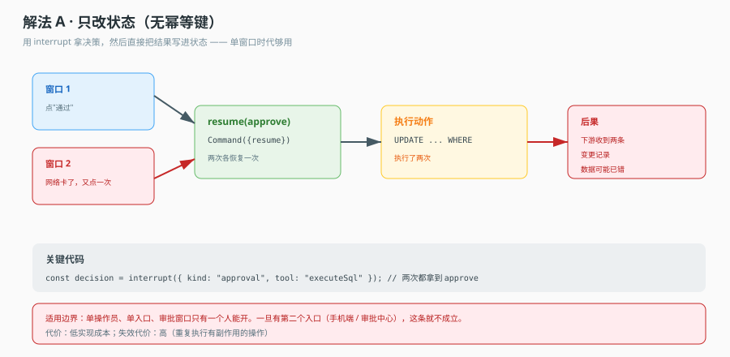
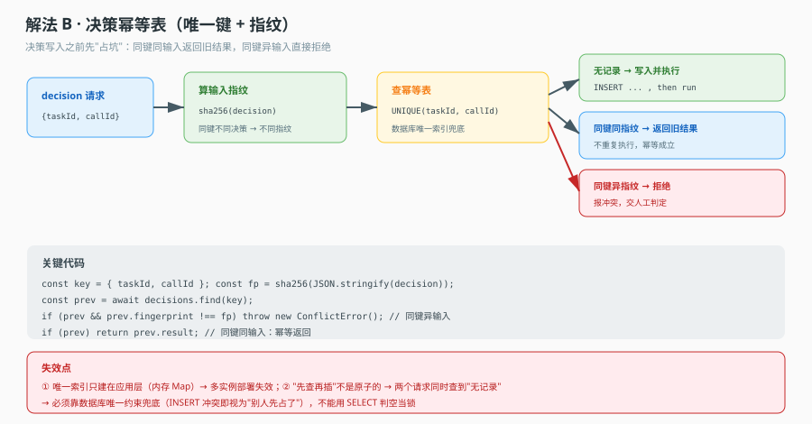
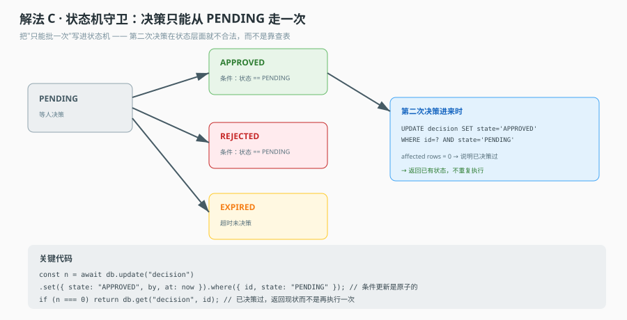

# 场景 02 · 审批不能批两次：决策写入的幂等

> 类型：经典设计题｜覆盖知识点：课 10 interrupt、课 11 授权与幂等
> 一句话冲突：**人在两个窗口点了两次"通过"。**

## 场景

审批系统接上了 Agent：变更单跑完校验和预检，停在 `interrupt` 等人。

审批人在手机上看了一眼，点了"通过"。网络不太好，按钮转圈没反应，他又点了一次。

服务端收到两个请求。第一个请求恢复图、执行变更、写回结果；第二个请求也恢复图、也执行变更、也写回结果。

变更被应用了两次。第一次把 `status` 从 `pending` 改成 `approved`，第二次把 `approved` 改成 `approved`——看着没坏。但变更内容是"余额加 100"，于是加了两次。

更隐蔽的情况：第二次恢复时，图已经跑完了（`next` 为空）。如果代码不检查这个，`invoke` 会**从头再跑一遍**，或者抛一个看不懂的错——两种都很糟。

这不是"用户手快"的问题。这是**同一个业务决策被投递了两次**，而你的系统没有能力识别"这是同一个"。

## 🔒 先想

**1.** 你能用什么来判定"这两个请求是同一件事"？列举你手上有的标识（提示：不止一个）。

**2.** 如果两个请求**同时**到达（不是先后），你的判定还成立吗？"先查有没有做过，没有再写"这个流程在并发下会发生什么？

**3.** 假设判定成功、第二个请求被识别为重复。它应该返回什么？报错？返回第一次的结果？返回"处理中"？三种选择对调用方意味着什么？

**4.** 如果第一次执行到一半崩了（变更已应用，账本没写），重试进来会怎样？你的方案能不能正确处理这个中间态？

第 4 题是本场景真正的难点。前 3 题是"重复请求"，第 4 题是"未完成的请求"——后者更常见，也更难。

<details>
<summary>💡 提示（卡住了再看）</summary>

- 幂等的本质不是"防止重复执行"，是"**重复执行的结果和执行一次相同**"。这两句话听起来一样，实现难度差很远：前者要拦，后者要能容忍。
- "先查再写"在并发下必有窗口。要么用数据库的唯一约束（让第二次写入直接失败），要么用状态机的条件更新（让第二次更新影响 0 行）。**纯应用层的检查挡不住并发。**
- 崩溃在中间态时，你需要知道"这次执行到底做到哪一步了"。如果账本只有 `RUNNING` 和 `FINISHED` 两态，你无法区分"还没开始"和"做了一半"。

</details>

<details>
<summary>📖 展开解法（想完再看）</summary>

### 解法一览

| 解法 | 一句话机制 | 能挡住 | 挡不住 | 主要风险 |
|---|---|---|---|---|
| A 只靠状态判断 | 恢复前查 `next` 是否为空 | 已完成的重复 | 并发双写 | 两个请求同时通过检查 |
| B 幂等表 + 指纹 | 决策落库，唯一键去重 | 并发、重试、跨进程 | 半成品状态判断 | 先查再插非原子 |
| C 状态机条件更新 | `UPDATE ... WHERE state='PENDING'` | 并发、乱序 | 恢复值错位 | 影响行数为 0 时的处理 |

---

### 解法 A · 只靠状态判断：能挡住"事后重复"，挡不住"同时"

**思路**：恢复前先查图状态，`next` 为空说明已经跑完，直接返回。

**机制图**



看图重点：两个窗口的检查都在**自己执行之前**，但都发生在**对方写入之前**。这就是检查-执行（check-then-act）的经典竞态：检查通过不代表执行时条件还成立。

**关键代码**

```ts
async function handleApprove(taskId: string, decision: Decision) {
  const snap = await graph.getState({ configurable: { thread_id: taskId } });
  if (snap.next.length === 0) {
    return { ok: true, note: 'already finished' };   // 事后重复：能挡住
  }
  // ⚠ 这里到下面 invoke 之间，另一个请求可能也通过了上面的检查
  return graph.invoke(new Command({ resume: decision }), { configurable: { thread_id: taskId } });
}
```

**为什么它仍然值得写**：它挡住了"用户刷新页面后重复提交"这类最常见的情况，成本几乎为零。但它不是幂等，只是**重复提交的最后一道兜底**。

**这个解法特有的代价 / 坑**

- 竞态窗口在"查状态"和"invoke"之间。这个窗口在正常情况下只有几毫秒，但在 GC、慢查询、容器调度时会拉长到秒级——偏偏这时候用户最容易重复点。
- `snap.next.length === 0` 只说明"当前不在挂起态"，不说明"这个决策曾被处理过"。如果任务从未启动，`next` 可能非空（指向入口），你会误以为可以 resume。
- 它无法回答"这个决策是谁批的、什么时候批的"，审计上是空的。

---

### 解法 B · 幂等表 + 指纹：把"同一件事"变成可判定的

**思路**：为每个业务决策生成一个幂等键（`taskId + stepId + decision`），落一张唯一索引的表。写入成功才执行；写入冲突说明是重复，直接返回第一次的结果。

**机制图**



看图重点：指纹（输入内容的哈希）是这套方案的第二个维度。光有键不够——**同键不同输入**必须拒绝，否则用户在两个窗口点了"通过"和"驳回"，你会按先到的那次执行，而另一次被静默丢弃，用户以为自己的"驳回"生效了。

**关键代码**

```ts
type DecisionRow = {
  idemKey: string;        // taskId:stepId  —— 唯一索引
  fingerprint: string;    // sha256(decision) —— 内容指纹
  state: 'RUNNING' | 'DONE' | 'FAILED';
  result?: unknown;
};

async function handleApprove(taskId: string, stepId: string, decision: Decision) {
  const idemKey = `${taskId}:${stepId}`;
  const fingerprint = sha256(canonicalJson(decision));

  // 插入即抢占：唯一索引保证只有一个请求能成功
  const inserted = await db.tryInsert({ idemKey, fingerprint, state: 'RUNNING' });
  if (!inserted) {
    const row = await db.get(idemKey);
    if (row.fingerprint !== fingerprint) {
      throw new ConflictError('同一决策位收到了不同内容');   // 必须拒绝，不能选一个执行
    }
    if (row.state === 'DONE') return row.result;             // 幂等返回
    if (row.state === 'RUNNING') return { status: 'in_progress' };
    // FAILED：允许重试，但要重置为 RUNNING（用条件更新）
  }

  try {
    const result = await runGraph(taskId, decision);
    await db.update({ idemKey, state: 'DONE', result });     // 成功才落定
    return result;
  } catch (e) {
    await db.update({ idemKey, state: 'FAILED' });           // 异常也要落定，否则永远 RUNNING
    throw e;
  }
}
```

**这段代码里三个容易漏的点**

- 插入成功才算抢到，不是"先查再插"。`tryInsert` 依赖唯一索引，这才是原子的。
- 指纹不一致必须抛错，不能"以先到的为准"。这是数据正确性问题，不是体验问题。
- `catch` 里也要写状态。漏掉这行，一次崩溃就留下永久 `RUNNING` 的僵尸行，之后所有重试都被判为"处理中"。

**这个解法特有的代价 / 坑**

- 多了一张表和一套状态机，运维面变大（要清理、要监控僵尸行）。
- 幂等键的粒度设计是关键：按"任务"去重会导致同一任务不能有两次不同的审批；按"任务+步骤"才对。多步骤流程里这一点很容易错。
- 它只保证"决策不重复应用"，不保证"应用本身可重入"。如果 `runGraph` 内部有非幂等副作用（发通知、扣款），仍然需要那些操作自己幂等。

---

### 解法 C · 状态机条件更新：让数据库来判重

**思路**：不建独立的幂等表，把幂等做进业务表的状态迁移里。`UPDATE ... WHERE state = 'PENDING'`，影响行数为 0 就说明别人已经改过了。

**机制图**



看图重点：判重的位置从"应用层的 if"移到了"数据库的 where"。这是本解法唯一但决定性的优势——数据库的行锁天然串行化了并发写入。

**关键代码**

```ts
async function handleApprove(taskId: string, decision: Decision) {
  const next = decision.ok ? 'APPROVED' : 'REJECTED';
  const affected = await db.execute(
    `UPDATE tasks SET state = ?, decided_at = ?, decided_by = ?
     WHERE id = ? AND state = 'PENDING'`,
    [next, now(), decision.by, taskId],
  );

  if (affected === 0) {
    // 两种可能：已决策 / 不存在。区分开才能给对的响应
    const row = await db.get(taskId);
    if (!row) throw new NotFoundError(taskId);
    return { ok: true, state: row.state, note: 'already decided' };  // 幂等返回
  }

  // 抢到了，继续执行（此时 state 已是 APPROVED）
  await runGraph(taskId, decision);
}
```

**这个解法特有的代价 / 坑**

- 状态机必须**只能前进**。如果允许 `APPROVED → PENDING` 回退（比如"撤销审批"），那"影响行数为 0 即已决策"这个判据就不成立了，因为合法的回退也会让第二次更新成功。
- 它把"决策"和"执行"绑在一次更新里，但如果 `runGraph` 失败，状态已经是 `APPROVED` 了——需要一个"已审批但未执行"的中间态，否则会丢执行。这是它最常见的实现缺陷。
- 相比 B，它没有内容指纹。同键不同内容的情况只能靠业务约束（比如"已决策的单据不允许再提交决策"）挡住，而这条约束在并发下依然要靠条件更新。

---

### 替代路线（不依赖本栈的做法）

**路线一：数据库唯一约束 + 冲突即幂等。** 建一张 `decisions(task_id, step_id)` 唯一索引表，插入冲突就当作"已处理"。这是最朴素也最可靠的实现，几乎所有关系库都支持。缺点是失败重试需要一个独立的 `state` 列，否则无法区分"处理中"和"已处理"。

**路线二：请求级幂等键（Idempotency-Key 头）。** 由客户端生成 UUID，随请求带上，服务端按这个键去重。这是 Stripe 等支付系统的标准做法。好处是"同一件事"的判定权在调用方，坏处是客户端可能每次都生成新键（那就失效了），所以要配合"同一个用户动作复用同一个键"。

### 推荐路径

- **首选 B**：幂等表 + 指纹，能同时解决重复、并发、内容冲突三个问题，且与业务状态解耦。
- **如果已有清晰的状态机**，用 C 更轻，但要补上"已审批未执行"的中间态和内容校验。
- **A 一定要有**，作为最外层兜底（挡住刷新重复提交），但绝不能当成幂等方案。

### 知识点挂钩

- 课 10「interrupt」：本场景的入口。要记住"恢复时被中断节点从头重跑"，所以 `interrupt` 之前的副作用必须幂等——这正是本场景要解决的问题。
- 课 11「授权与幂等」：幂等三件套（同键同输入返旧账本 / 同键异输入按指纹拒绝 / 进执行前判终态 + 异常也落定）就是本场景的答案骨架。
- 课 10 的另一个知识点：`graph.getState().next` 是判断挂起态的唯一可靠判据。解法 A 用的就是它，但要知道它只能判"当前状态"，不能判"是否处理过"。

### 不适用边界

- 如果审批动作本身是纯查询（无副作用），重复执行无害，这套机制是过度设计。
- 如果系统只允许单实例、单线程处理审批，那并发窗口不存在，解法 A 就够用——但"单实例"这个前提在容器化环境里通常不成立。

</details>
