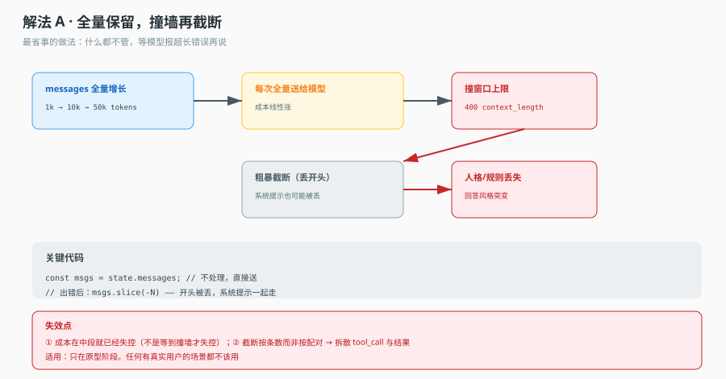
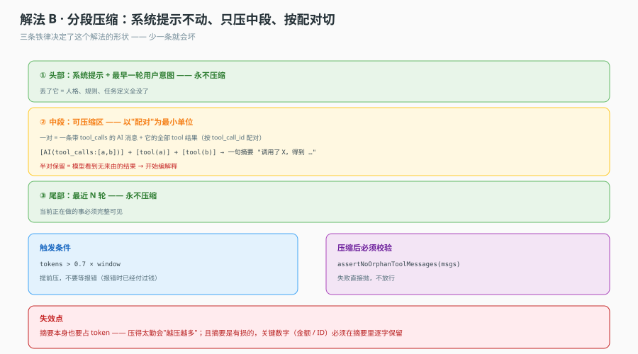
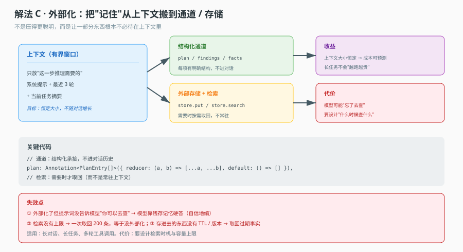

# 场景 03 · 对话量翻 10 倍：上下文与成本

> 类型：规模压力题｜覆盖知识点：课 6 通道、课 13 上下文压缩
> 一句话冲突：**记得越多越贵，忘得越多越蠢。**

## 场景

产品上线时，用户一周聊几次，每次十来轮。上下文从不清理，一切正常，账单每月几十块。

三个月后增长来了。DAU 翻十倍，重度用户单次会话能到 200 轮，还要挂三个工具。某天运营在群里发了一张截图：一个用户的会话在第 180 轮，模型开始胡编——用户问"我上周说的那个订单号是多少"，模型给了一个**看起来完全合理但根本不存在**的订单号。

同一时间，财务发来账单：上下文成本涨了 40 倍，不是 10 倍。

你去查日志：每轮请求带的 token 数随轮次线性增长，第 200 轮单次请求已经 12 万 token。而且因为超了模型窗口，有个中间层在悄悄截断——截断的逻辑是"保留最近 N 条消息"，于是系统提示被截掉了，`tool_call` 和对应的 `tool` 结果被拆散了。

模型收到一个"有工具结果但没有对应调用"的历史，开始自由发挥。

这个场景有两条独立的线：**成本**（越聊越贵，且贵得不成比例）和**正确性**（压缩方式错了，模型就废了）。两条线要用不同手段治。

## 🔒 先想

**1.** 成本为什么涨了 40 倍而不是 10 倍？（提示：算一下"每轮请求的 token 数"和"轮数"的关系）

**2.** 如果让你设计压缩策略，你会保留什么、丢什么？写出你的"保留清单"和"丢弃清单"。

**3.** 有一类消息**绝对不能拆散**。你能指出是哪一类吗？拆散之后会发生什么？

**4.** 压缩本身也有成本（要调用模型做摘要）。什么情况下"压缩"比"不压缩"更贵？

第 3 题是硬性约束，不是优化项。拆散了不是"效果差一点"，是**模型会开始编造**。

<details>
<summary>💡 提示（卡住了再看）</summary>

- 第 1 题：每轮请求带的是"到目前为止的全部历史"。第 n 轮的成本 ≈ n，总成本 ≈ 1+2+...+n = n²/2。轮数涨 10 倍，成本涨约 100 倍——实际 40 倍是因为有上限截断在起作用。
- 第 3 题：想一想工具调用的消息结构。模型发出 `tool_call`（带 id），工具返回 `tool` 消息（带同一个 id）。这两个 id 是一对。拆开后模型看到一个"孤立的工具结果"，它的训练数据里没有这种形状。
- 第 4 题：如果一段历史只被读一次、从此不再需要，那压缩它的成本永远收不回来。压缩只在"这段历史会被反复读"时才划算。

</details>

<details>
<summary>📖 展开解法（想完再看）</summary>

### 解法一览

| 解法 | 一句话机制 | 成本曲线 | 主要风险 |
|---|---|---|---|
| A 全量保留 | 什么都不做，撞到窗口再说 | n² | 撞墙截断 → 系统提示丢失、配对拆散 |
| B 分段压缩 | 保留头尾，中段摘要，配对整体搬 | 近似线性 | 摘要丢细节、配对切错 |
| C 外部化 | 结构化通道 + 外部存储，上下文恒定 | 恒定 | 模型忘了去查 |

---

### 解法 A · 全量保留：先看清它为什么会崩

**思路**：不做任何处理，把全部历史塞进每次请求。

**机制图**



看图重点：崩溃点不在"贵"，在"撞墙之后那个中间层怎么截"。绝大多数线上事故是这个截断逻辑造成的，而不是 token 太多本身——token 太多只是让截断发生。

**关键代码（反面）**

```ts
// 很多框架/网关的默认行为，等价于这样
function prepare(messages: Message[]) {
  const budget = 128_000;
  let total = countTokens(messages);
  while (total > budget) {
    messages.shift();        // 从最老的开始丢
    total = countTokens(messages);
  }
  return messages;          // 系统提示可能已经被 shift 掉了
}
```

**这段代码错在哪（三处，每一处都致命）**

- `shift()` 会把**系统提示**丢掉。系统提示在数组第 0 位，最老，第一个被丢。丢了系统提示，模型就失去了角色和约束。
- 它不知道 `tool_call` / `tool` 是配对的，可能只丢掉一半，留下孤立的工具结果。
- 它没有"压缩"，只有"删除"。删掉的信息永久丢失，用户下次问起就答不上——于是模型编。

**这个解法特有的代价 / 坑**

- 成本是 n² 量级，且**前期完全感知不到**。前 10 轮每轮几千 token，账单上看不出来；第 100 轮单次就 6 万 token，一切已经晚了。
- 它把"正确性"和"成本"两个问题混在一起：你为了省钱去截断，结果引入了编造。这两件事必须分开治。

---

### 解法 B · 分段压缩：保留头尾，中段摘要，配对整体搬

**思路**：三段式。头部（系统提示 + 最初几轮）永久保留；尾部（最近 K 轮）原样保留；中段压缩成摘要。压缩的最小单位不是"消息"，是"配对组"——一个 `tool_call` 加它所有的 `tool` 结果必须整体进或整体出。

**机制图**



看图重点：图里那个 `assertNoOrphanToolMessages` 不是可选的防御，是**必须有的断言**。压缩逻辑正确与否，不能靠"我觉得我写对了"，要靠运行时的结构性检查。

**关键代码**

```ts
type Block = { kind: 'pair'; call: Message; results: Message[] } | { kind: 'plain'; msg: Message };

function toBlocks(messages: Message[]): Block[] {
  const blocks: Block[] = [];
  const byId = new Map<string, Block>();
  for (const m of messages) {
    if (m.role === 'assistant' && m.tool_calls?.length) {
      const b: Block = { kind: 'pair', call: m, results: [] };
      blocks.push(b);
      for (const c of m.tool_calls) byId.set(c.id, b);
    } else if (m.role === 'tool') {
      const b = byId.get(m.tool_call_id);
      if (!b) throw new Error(`孤儿工具结果 ${m.tool_call_id}`);  // 输入就已经坏了，早报早好
      b.results.push(m);
    } else {
      blocks.push({ kind: 'plain', msg: m });
    }
  }
  return blocks;
}

async function compress(messages: Message[], keepTail = 6): Promise<Message[]> {
  const sys = messages.filter((m) => m.role === 'system');        // 1. 系统提示永不压
  const rest = messages.filter((m) => m.role !== 'system');
  if (rest.length <= keepTail + 4) return messages;

  const blocks = toBlocks(rest);
  const head = blocks.slice(0, 1);                                 // 2. 首轮保留（任务设定）
  const tail = blocks.slice(-keepTail);
  const middle = blocks.slice(1, -keepTail);

  const summary = await summarize(middle);                         // 3. 只压中段
  const merged: Message[] = [
    ...sys,
    ...head.flatMap(flatten),
    { role: 'system', content: `【早前对话摘要】\n${summary}` },
    ...tail.flatMap(flatten),
  ];
  assertNoOrphanToolMessages(merged);                              // 4. 出口断言
  return merged;
}
```

**三条铁律（对应代码里四个编号）**

- 系统提示保留——它定义角色和约束，丢了模型就不是你的 Agent 了。
- 只压中段——头部是任务设定，尾部是当前焦点，都有强语义。
- `tool_call` 与 `tool` 结果配对不可拆——这是结构性约束，不是效果优化。

**这个解法特有的代价 / 坑**

- 摘要本身要调模型，有延迟和成本。如果每轮都压，成本反而上升。实践上是"超过阈值才压"，阈值按窗口的 60-70% 设。
- 摘要会丢细节，且**丢得静默**。用户问"上周那个订单号"，摘要里可能只剩"用户咨询过订单问题"。要么接受这个损失，要么把关键事实写进结构化通道（见解法 C）。
- 压缩后的历史不再是原始历史，调试时对不上账。要保留原始消息（存库），只在请求时用压缩版。

---

### 解法 C · 外部化：把"记住"搬出上下文

**思路**：不是压得更聪明，而是让一部分东西**根本不必待在上下文里**。结构化的事实（订单号、金额、决策）进通道或外部存储，上下文里只放"这一步推理需要的"。

**机制图**



看图重点：左边那个框的目标是"恒定大小"。这不是压缩的极致，是另一个思路——压缩是"把 100 条变 20 条"，外部化是"永远只放 5 条，其余按需取"。

**关键代码**

```ts
const State = Annotation.Root({
  messages: Annotation<BaseMessage[]>({ reducer: messagesReducer, default: () => [] }),
  // 结构化通道：追加归约，不进对话历史
  facts: Annotation<Fact[]>({
    reducer: (a, b) => dedupeByKey([...a, ...b]),   // 同 key 覆盖，不同 key 追加
    default: () => [],
  }),
});

// 事实抽取：每轮结束后把关键事实抽出来落到通道 + 存储
async function afterTurn(state: typeof State.State) {
  const found = await extractFacts(state.messages.slice(-2));
  if (!found.length) return {};
  await store.put(['facts', state.threadId], found);   // 长期存储
  return { facts: found };
}

// 检索工具：模型需要时才去查（关键：要告诉它能查）
const lookupFacts = tool(
  async ({ query }) => search(await store.search(['facts', threadId], query), 5),  // 必须限条数
  { name: 'lookup_facts', description: '查本次会话早前确认过的事实（订单号、金额、决策）' },
);
```

**这里最容易被忽略的一句**：`description` 里必须明确告诉模型"什么时候该用这个工具"。外部化之后模型看不到那些事实了，如果它不知道该去查，就会**用残存的模糊印象硬答**——这比不外部化更危险，因为它答得更自信。

**这个解法特有的代价 / 坑**

- 图里的失效点：模型忘了去查。缓解手段是把"查事实"写进系统提示的固定动作（比如"回答涉及具体数字前必须先调 lookup_facts"），但这是软约束，模型仍可能跳过。
- 检索没有上限就等于没外部化。一次取回 200 条，token 立刻回到解放前。
- 存进去的东西需要 TTL 和版本。取回一条三个月前的"当前余额"，比不取回更糟。

---

### 替代路线（不依赖本栈的做法）

**路线一：滑动窗口 + 落库。** 只保留最近 N 轮在上下文里，更早的全部落库，提供一个"搜索历史"的工具。实现极简，是大多数聊天产品的实际做法。缺点是模型不会主动去搜，需要提示词强约束。

**路线二：分层记忆（短期 / 长期）。** 短期是当前会话窗口，长期是向量库。每轮把新信息写入长期库，检索时按语义召回。好处是跨会话也能记住；坏处是召回不准时会误导，且写入成本随会话增长。

### 推荐路径

- **第一步一定是 B**：先止血。三段式 + 配对切 + 出口断言，能同时解决成本和"编造"两个问题。
- **第二步按需上 C**：当用户开始问"我之前说的那个…"，说明摘要丢的信息已经影响体验了，这时把关键事实搬到结构化通道。
- **A 必须改掉**，尤其是默认的 `shift()` 截断——它是最常见的线上事故源。

### 知识点挂钩

- 课 6「通道」：通道的归约语义（追加 vs 取新）决定了压缩策略能不能落地。`messages` 是追加归约，所以能做"保留头尾"；如果是取新归约，历史根本留不住。
- 课 13「上下文压缩」：三条铁律（保留系统提示 / 只压中段 / 配对不拆）就是解法 B 的全部要点。
- 课 13 的另一个知识点：环境信息（密钥、租户）不能进持久化状态，要"读时投影"。这和外部化是同一类思路——不该进上下文的东西，一开始就别放进去。

### 不适用边界

- 短会话（< 10 轮）不需要任何压缩，加了反而增加复杂度和延迟。
- 如果任务本身要求"完整保留全部对话"（比如法律记录），压缩是不可接受的，这时应该改为"分片处理 + 引用"，而不是摘要。

</details>
