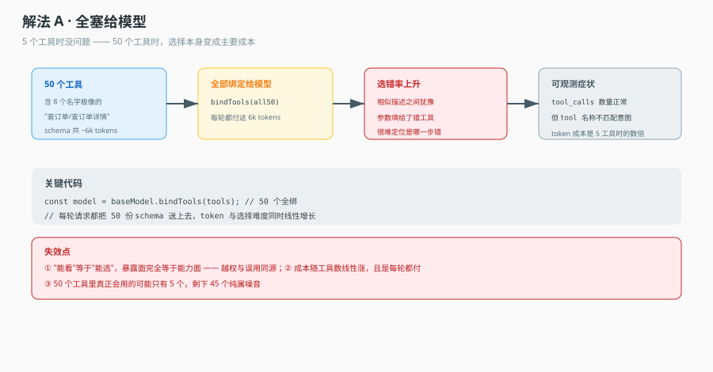
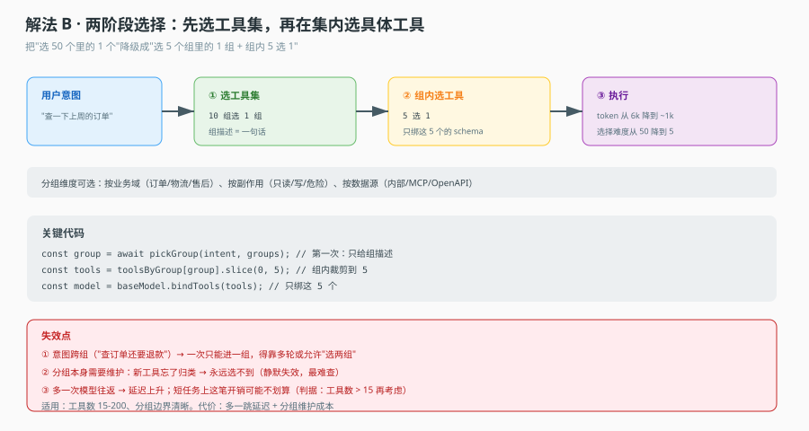
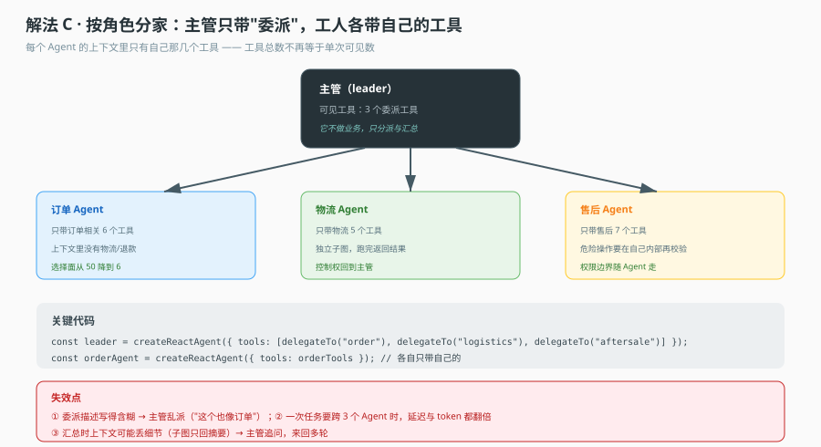

# 场景 04 · 工具从 5 个涨到 50 个

> 类型：规模压力题｜覆盖知识点：课 7 中间件、课 8 工具边界、课 9 多 Agent
> 一句话冲突：**选择本身是成本。**

## 场景

Agent 刚上线时只有 5 个工具：查订单、查物流、改地址、退款、转人工。效果很好，选得准。

半年后接了六个业务线，工具涨到 50 个。问题开始出现，而且是三种不同的问题：

第一种，**选错**。用户说"我那个快递怎么还没到"，模型调了 `query_order` 而不是 `query_logistics`。两个工具描述都是"查询订单相关信息"，模型在名字相似的工具之间犹豫，选错的概率随工具数上升。

第二种，**变贵**。每次请求都要把 50 个工具的描述发过去，光工具定义就 6000 token。用户问一句"你好"，也要付这 6000 token。

第三种，**变慢且更难排查**。50 个工具里有一个的描述写得含糊，模型偶尔会调它，参数还填错。你想定位是哪个工具的问题，得一个个看日志。

这三种问题看着都是"工具太多"，但根因不同：选错是**语义混淆**，变贵是**固定开销**，难排查是**边界不清**。所以没有一个方案能一次解决三个——这也正是这个场景 worth 想的地方。

## 🔒 先想

**1.** 50 个工具里，一次请求真正可能用到的有几个？这个数字决定了你的优化上限。

**2.** 如果你要做"先选工具组、再选具体工具"，那"选组"这一步靠什么？靠模型判断还是靠规则？两种各有什么风险？

**3.** 拆成多个 Agent 之后，谁能保证"该给用户的答案"不会在交接中丢掉？举一个会丢的具体例子。

**4.** 三个问题（选错 / 变贵 / 难排查）里，哪个最不能容忍？你的答案会改变方案优先级。

<details>
<summary>💡 提示（卡住了再看）</summary>

- 第 1 题：真实统计通常是个位数。90% 的请求只用到 3-8 个工具。这个数字就是"两阶段选择"能省下多少的直接依据。
- 第 2 题：靠模型判断会引入"归类错误"（用户意图跨组时，模型只能选一个组）；靠规则会引入"规则覆盖不到"（新意图没人写规则）。**两条路都会失效，区别是失效时你知不知道。**
- 第 3 题：想一想"工人 Agent 回答了，但主管只拿到一句话摘要"的情况。细节在哪一步丢失的？

</details>

<details>
<summary>📖 展开解法（想完再看）</summary>

### 解法一览

| 解法 | 一句话机制 | 解决 | 不解决 | 主要风险 |
|---|---|---|---|---|
| A 全绑 | 50 个工具全给模型 | 实现最简单 | 三个问题都是 | token 固定开销 6k |
| B 两阶段选择 | 先选组，再绑该组的工具 | 变贵、部分选错 | 跨组意图 | 归类错误静默失效 |
| C 按角色分家 | 主管只带委派工具，工人各带自己的 | 三个都缓解 | 汇总丢细节 | 编排延迟与 token 翻倍 |

---

### 解法 A · 全绑：先量化它到底贵在哪

**思路**：所有工具一次性绑定给模型，靠模型自己从 50 个里挑。

**机制图**



看图重点：6000 token 是**每轮固定开销**，与用户问什么无关。一轮对话如果有 5 次模型调用，就是 3 万 token 只花在"告诉模型有哪些工具"上。

**关键代码（量化，不是实现）**

```ts
// 先量，再决定要不要优化
function toolTokenCost(tools: Tool[]) {
  const schema = JSON.stringify(tools.map((t) => ({ name: t.name, description: t.description, parameters: t.schema })));
  return countTokens(schema);
}

console.log(toolTokenCost(allTools));   // 50 个工具 ≈ 6000 token
// 若单次会话平均 5 次模型调用：30k token / 会话，纯工具描述
```

**这个解法特有的代价 / 坑**

- 成本随工具数**线性**增长，但选错率增长得更快（模型要在更多相似项之间区分）。
- 它有一个隐藏的好处：**没有信息损失**。模型能看到全部能力，不会因为"选错了组"而彻底失败。这是 B 和 C 都要付出的代价。
- 50 个还不算多。有些平台有几百个工具，那时候全绑直接不可行（超窗口）。

---

### 解法 B · 两阶段选择：先选组，再绑定

**思路**：把工具按业务域分组。第一次模型调用只看到"组描述"（比如 6 个组，每个一句话），让它选组；第二次调用只绑该组的工具（每组 5-10 个）。

**机制图**



看图重点：三个失效点都在**第一阶段**。第二阶段是确定性的（绑哪组就是哪组），风险全在"选组选对了吗"。

**关键代码**

```ts
const GROUPS = {
  order:     { desc: '订单查询、修改、取消', tools: [queryOrder, updateOrder, cancelOrder] },
  logistics: { desc: '物流轨迹、配送异常、改地址', tools: [queryLogistics, reportException, changeAddress] },
  refund:    { desc: '退款申请、退款进度、争议处理', tools: [applyRefund, queryRefund, dispute] },
  // ...共 6 组
};

async function pickGroup(userText: string): Promise<keyof typeof GROUPS> {
  const reply = await llm.invoke([
    { role: 'system', content: '从下列组中选一个最相关的，只输出组名：\n' +
        Object.entries(GROUPS).map(([k, v]) => `- ${k}: ${v.desc}`).join('\n') },
    { role: 'user', content: userText },
  ]);
  const key = reply.content.trim();
  if (!(key in GROUPS)) return 'order';       // ⚠ 兜底必须有，但要记录这个事件
  return key as keyof typeof GROUPS;
}
```

**必须做的一件事：把"选组结果"记进日志。** 归类错误是静默失效——模型选了 `order` 组，用户问的是退款，然后模型用订单工具硬答，看起来像"模型不聪明"，实际是"选组错了"。不记录这个中间结果，你永远定位不到。

**这个解法特有的代价 / 坑**

- 跨组意图必失效。用户说"我的退款到哪了，顺便看下物流"，两件事分属两组，选任一组都会漏一半。
- 多了一跳延迟。第一阶段本身就是一次模型调用，简单问题（"你好"）也付这个成本。
- 组划分需要维护。新工具加进来要决定归哪组，归错了就是永久性的选错。

---

### 解法 C · 按角色分家：主管只带委派工具

**思路**：不按"工具分组"，按"角色分工"。主管 Agent 只带 3 个委派工具（`ask_order_agent` / `ask_logistics_agent` / `ask_refund_agent`），每个工人 Agent 只带自己那 5-7 个工具。

**机制图**



看图重点：主管的上下文里只有 3 个工具描述（约 300 token），工人的上下文里只有自己那组。**总 token 不一定省**（多个 Agent 要多次调用），但**每次调用的选择空间都小了**。

**关键代码**

```ts
function makeWorker(name: string, tools: Tool[], system: string) {
  return createReactAgent({ llm, tools, prompt: system });
}

const orderAgent = makeWorker('order', orderTools, '你只处理订单问题。信息不足时明确说缺什么。');
const logisticsAgent = makeWorker('logistics', logisticsTools, '你只处理物流问题。');

// 主管：只带委派工具，不带业务工具
const supervisor = createReactAgent({
  llm,
  tools: [
    tool(async ({ q }) => orderAgent.invoke({ messages: [{ role: 'user', content: q }] }), {
      name: 'ask_order_agent',
      description: '订单相关问题（查询/修改/取消）。传入完整的用户问题原文，不要改写。',
    }),
    // ...logistics / refund
  ],
  prompt: '你是调度员。判断问题属于哪个域，转给对应的 Agent，然后如实转述它的回答。',
});
```

**描述里的两个细节，决定了它能不能用**

- "传入完整的用户问题原文，不要改写"——主管改写问题时会丢上下文，工人拿到一个残缺的问题只能猜。
- "如实转述它的回答"——不写这句，主管会自己"总结"一遍，细节在总结时丢失。

**这个解法特有的代价 / 坑**

- 图里的三个失效点：委派描述含糊导致乱派、跨 3 个 Agent 时延迟与 token 翻倍、汇总丢细节。
- 排查变难：一次失败要跨多个 Agent 的日志。需要统一的 trace id 贯穿。
- 最隐蔽的问题：工人说"我需要订单号"，主管可能自己编一个订单号传给工人，而不是回头问用户。这是"转述"环节的典型失真。

---

### 替代路线（不依赖本栈的做法）

**路线一：工具检索（Tool RAG）。** 把工具描述向量化，按用户问题召回 top-k 个工具再绑定。好处是无需人工分组，新工具自动纳入；坏处是召回不准时会漏掉正确工具，且"工具描述写得好不好"直接决定召回质量。

**路线二：固定分组 + 前端路由。** 不问模型，按用户进入的入口（订单页 / 物流页）直接确定工具组。最简单、最可靠、零延迟，代价是用户必须先在对的入口，跨域问题处理不了。

### 推荐路径

- **先量再改**：把工具描述 token 打出来，把选错率统计出来。没有数据就开始重构，很可能优化错了对象。
- **10-20 个工具**：全绑（A）通常还可以，重点是**把描述写清楚**——把"查询订单相关信息"改成"按订单号查询订单状态、金额、商品"，选错率能降一半。
- **20-50 个工具**：上 B，同时必须记录选组结果。
- **超过 50 个或需要多轮协作**：上 C。但要先解决 trace 贯穿和"不许改写问题"这两条。

### 知识点挂钩

- 课 7「中间件策略层」：工具过滤应该放在中间件层，而不是在业务代码里 if-else。这样"这次请求能用哪些工具"是一个可配置、可测试的策略。
- 课 8「工具边界」：工具描述就是给模型的 API 文档。描述含糊等于文档含糊，模型选错是必然结果。
- 课 9「多 Agent 协作」：按控制流语义分家（谁能决定下一步），而不是按"业务名词"分家。这是 C 能不能成立的关键判据。

### 不适用边界

- 如果工具之间差异极大（名字、参数、用途都不同），50 个也不一定需要优化，先测选错率。
- 如果一次请求本来就需要跨多个域（比如"帮我退款并改地址"），B 的两阶段选择会天然失效，直接考虑 C 或 A。

</details>
