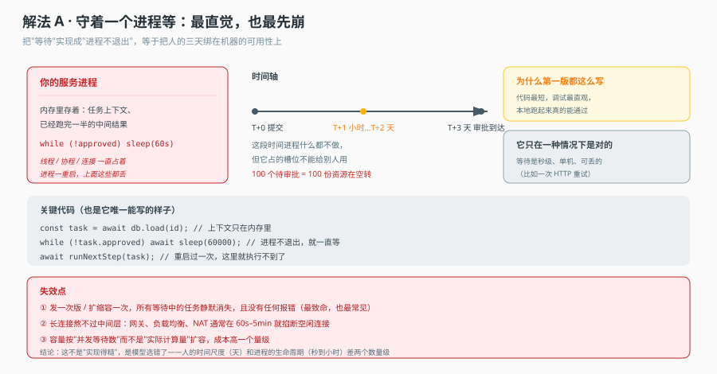
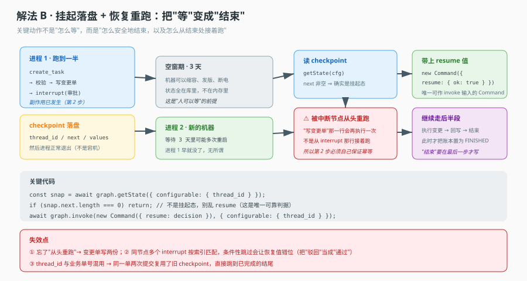
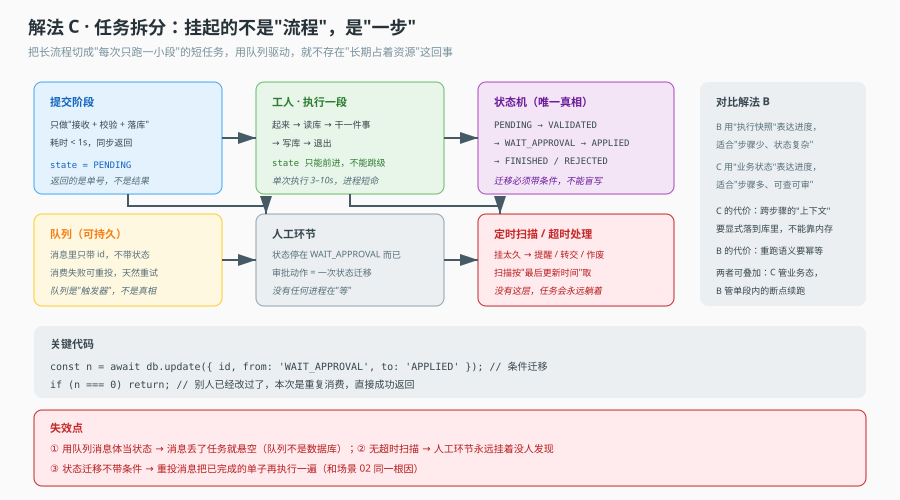

# 场景 05 · 一个请求要等人工 3 天

> 类型：经典设计题｜覆盖知识点：课 10 持久执行、课 11 账本
> 一句话冲突：**人可以等，进程不能等。**

## 场景

变更审批流程上线了。提交变更单 → 自动校验 → 预检 → **等人审批** → 执行变更 → 回写结果。

开发阶段一切顺利：本地跑，提交完在终端按一下回车就当审批通过，三秒跑完。

上线第一周就出问题。第一版实现是"提交后开一个后台任务，轮询数据库等审批状态"。周五下午发了一次版。

周一早上，运营反馈：**周末提交的 37 张变更单全部卡住了，既没执行也没报错。**

你去查：那 37 个后台任务所在的进程在周五发版时被替换了。任务对象在内存里，随进程一起消失。数据库里这 37 张单还停在"待执行"，没有任何东西会去推进它们。

更麻烦的是另一类。有 5 张单在发版前**已经审批通过并开始执行**，执行到一半进程被杀。重启后你无法判断：这 5 张单的变更到底应用了没有？日志里有"开始执行"但没有"执行完成"，而变更本身（改数据库表结构）如果已经做了，重做一次会报错。

这就是本场景的核心矛盾：**人的时间尺度是"天"，进程的生命周期是"秒到小时"，两者差两个数量级。** 你不能用一个生命周期只有几分钟的东西去承载一个需要等三天的状态。

## 🔒 先想

**1.** 那 37 张卡住的单，正确的恢复方式是什么？谁来触发恢复？（提示：不能靠"用户重新提交"）

**2.** 那 5 张"执行到一半"的单，你如何判断变更是否已应用？如果无法判断，你的系统设计缺了什么？

**3.** 挂起期间，任务状态存在哪里？如果存在数据库里，那"恢复"这个动作需要什么信息才能继续？

**4.** 如果审批要等 3 天，中间可能经历 10 次发版、2 次数据库迁移。你的方案能撑住吗？

第 2 题是本场景的真正难点，也是"持久执行"和"定时轮询"的分水岭：前者记录的是**执行进度**，后者记录的只是**一个待办标记**。

<details>
<summary>💡 提示（卡住了再看）</summary>

- 第 1 题：恢复不能依赖"有人记得"。需要一个主动扫描的机制——按"最后更新时间"找超期的、处于中间态的记录。
- 第 2 题：如果你只有"开始"和"完成"两个日志，中间态是不可判定的。你需要的是"每一步做完就落一次盘"，而不是"整个流程完成后落一次盘"。
- 第 3 题：恢复需要三样东西——**在哪**（thread/task id）、**到哪了**（进度）、**用什么定义**（版本）。缺一样都恢复不了。

</details>

<details>
<summary>📖 展开解法（想完再看）</summary>

### 解法一览

| 解法 | 一句话机制 | 抗发版 | 可审计 | 主要风险 |
|---|---|---|---|---|
| A 进程内等待 | 后台任务 sleep 轮询 | ❌ 完全不行 | ❌ | 发版即静默丢失 |
| B 挂起落盘 + 恢复 | checkpoint 存进度，进程退出 | ✅ | 部分 | 重跑语义、版本漂移 |
| C 任务拆分 + 状态机 | 每步一个短任务，队列驱动 | ✅ | ✅ 完整 | 上下文要显式落库 |

---

### 解法 A · 进程内等待：为什么它一定会崩

**思路**：提交后开一个后台任务，`while (!approved) sleep()` 轮询。

**机制图**



看图重点：图里时间轴中间那段"T+1 小时…T+2 天"，进程什么都不做，但它占的资源（线程/协程/连接/内存里的中间结果）不能给别人用。而这段时间里任何一次发版、扩缩容、OOM、节点回收，都会让它消失，且**不会报错**。

**关键代码（反面）**

```ts
async function submitChange(req: ChangeReq) {
  const task = await validateAndPrecheck(req);
  void (async () => {                        // 后台跑，不阻塞响应
    while (true) {
      const row = await db.get(req.id);
      if (row.state === 'APPROVED') break;
      if (row.state === 'REJECTED') return;
      await sleep(60_000);                   // 进程重启后，这个循环就不存在了
    }
    await applyChange(task);                 // 37 张单永远到不了这里
    await db.update(req.id, { state: 'DONE' });
  })();
  return { id: req.id, state: 'PENDING' };
}
```

**这个解法特有的代价 / 坑**

- 失效是**完全静默**的。没有异常、没有告警、没有日志。任务就是不推进了，而你的监控只看"接口是否 200"。
- 长连接撑不住：即便不做发版，网关/负载均衡/NAT 通常在 60s–5min 就掐断空闲连接。
- 容量按"并发等待数"扩容，成本高一个数量级。100 个待审批 = 100 份资源在空转。

**它唯一合理的地方**：等待是秒级、单机、可丢的（比如一次 HTTP 重试）。等待跨天时，这个模型从根上就不对。

---

### 解法 B · 挂起落盘 + 恢复重跑：把"等"变成"结束"

**思路**：不在进程里等。跑到需要审批的那一步就 `interrupt`，把完整状态写进 checkpoint，然后**进程正常退出**。审批来了，启一个新进程，读 checkpoint，带 `resume` 值继续。

**机制图**



看图重点：中间那个"空窗期 · 3 天"是本解法的全部价值——这三天里机器可以缩容、发版、断电，因为状态不在内存里。同时注意图里那个红色警告：**恢复时被中断的节点会从头重跑**，不是从 `interrupt` 那行接着跑。

**关键代码**

```ts
const checkpointer = new SqliteSaver(db);        // 生产换 PostgresSaver

// 跑到需要审批时：interrupt 抛出一个特殊的暂停信号，state 已落盘
async function approvalNode(state: State) {
  const decision = interrupt({ ask: '是否执行变更', changeId: state.changeId });
  return { approved: decision.ok as boolean };
}

// 恢复：新进程，只需要 thread_id
async function onApproval(threadId: string, decision: Decision) {
  const cfg = { configurable: { thread_id: threadId } };
  const snap = await graph.getState(cfg);
  if (snap.next.length === 0) return { ok: true, note: 'already done' };  // 唯一可靠判据

  // 注意：new Command({ resume }) 是唯一可作 invoke 输入的 Command 形式
  return graph.invoke(new Command({ resume: decision }), cfg);
}
```

**三个必须处理的语义（也是三条最容易踩的坑）**

- **被中断节点从头重跑**：`interrupt` 之前写的代码会再执行一遍。所以 `interrupt` 之前的副作用（写变更单、发通知）必须幂等。这是本解法唯一无法回避的代价。
- **同节点多个 `interrupt` 按索引匹配恢复值**：如果节点里有两个 `interrupt`，第二个在第一轮被条件性跳过，恢复时传入的两个值会错位——把"驳回"当成"通过"。要么保证每次都执行全部 `interrupt`，要么拆成多个节点。
- **`thread_id` 不能用业务单号**：同一张单如果被重新提交，复用 `thread_id` 会读到上一次的 checkpoint，直接跳到已完成的结尾。要用独立的执行 id。

**这个解法特有的代价 / 坑**

- checkpoint 表会膨胀（每次节点切换都写一份）。需要 TTL 清理，但**不能清理还在挂起的**——要按"是否终态"判断，不能按时间。
- 定义版本漂移：恢复时读的是最新定义，可能和启动时不同。这就是场景 01 的问题，两个场景要一起考虑。
- 它解决"进程不能等"，但不解决"审批要等 3 天没人管"。超时提醒、转交、作废是另一套机制。

---

### 解法 C · 任务拆分：挂起的不是"流程"，是"一步"

**思路**：不把整个流程当成一个长任务。提交时只做"接收 + 校验 + 落库"，返回单号；之后每一步由一个短任务执行，由队列或定时扫描驱动。人工环节就是"状态停在 `WAIT_APPROVAL`"，没有任何进程在等。

**机制图**



看图重点：右侧那个对比框。B 用"执行快照"表达进度，适合步骤少但状态复杂的流程；C 用"业务状态"表达进度，适合步骤多、需要人能查能审的流程。两者可以叠加：C 管跨步骤的业务态，B 管单步内的断点续跑。

**关键代码**

```ts
// 每一步：读状态 → 条件迁移 → 干活 → 写状态 → 退出
async function stepHandler(msg: { changeId: string }) {
  const task = await db.get(msg.changeId);
  if (task.state !== 'VALIDATED') return;      // 不是我的阶段，忽略（幂等兜底）

  const affected = await db.execute(
    `UPDATE changes SET state = 'WAIT_APPROVAL', updated_at = ?
     WHERE id = ? AND state = 'VALIDATED'`,     // 条件迁移，防重复消费
    [now(), msg.changeId],
  );
  if (affected === 0) return;                    // 别人已经推进过了

  await notifyApprover(task);                    // 通知也在这里发（已具备幂等前提）
}

// 超时扫描：这个必须有，否则任务会永远躺着
async function sweep() {
  const stale = await db.query(
    `SELECT id FROM changes
     WHERE state = 'WAIT_APPROVAL' AND updated_at < ?`, [now() - 3 * DAY],
  );
  for (const row of stale) await remindOrEscalate(row.id);   // 提醒 / 转交 / 作废
}
```

**这个解法特有的代价 / 坑**

- 跨步骤的"上下文"要显式落库。B 里那些"内存里顺手带着"的东西（中间计算结果、用户偏好），在 C 里必须成为数据库字段。这是它最大的改动成本。
- 状态机必须只能前进。一旦允许回退，所有"条件迁移"的判据都要重新设计。
- 队列是触发器不是真相。消息丢了任务会悬空，所以要么消息持久化 + 重投，要么（更稳）用定时扫描兜底——这也是为什么 `sweep()` 不是可选项。
- 它比 B 多一层"状态设计"的工作量，但换来的是：运维能直接查库看到每张单卡在哪一步，这是 B 做不到的。

---

### 替代路线（不依赖本栈的做法）

**路线一：工作流引擎（Temporal / Camunda / AWS Step Functions）。** 把"持久执行"交给专门的引擎，你只写业务步骤。好处是重试、超时、可视化、版本管理全部现成；坏处是引入一个重的基础设施，且 Agent 的"循环 + 模型决策"结构和工作流的"DAG"结构不完全贴合，需要在中间做适配。

**路线二：由外部系统驱动（webhook + 幂等接口）。** 不主动等，而是让审批系统在决策后回调你的接口。你的接口只做"接收决策 → 恢复执行"，天然无状态。好处是架构最简单、最符合事件驱动；坏处是依赖外部系统的可靠性，回调丢了需要补偿扫描。

### 推荐路径

- **首选 B**，如果流程步骤不多（< 10 步）、主要由模型决策驱动。改动集中在"用 checkpointer 替掉内存状态"，收益立刻显现。
- **选 C**，如果流程步骤多、需要人能查能审、需要跨系统协作。前期设计成本高，但运维体验完全不同。
- **A 必须改掉**。它不是"不够好"，是"发一次版就丢一批任务"。
- **无论选哪个，都要有超时扫描**。这是唯一能发现"任务躺在中间态没人管"的机制。

### 知识点挂钩

- 课 10「持久执行」：`interrupt` 的三条硬语义（从头重跑 / 按索引匹配 / `resume` 唯一形式）是本场景的技术底座。三条里错一条，恢复就会出错。
- 课 10 的判据：`graph.getState().next` 非空是判断挂起态的唯一可靠方式。`pendingWrites` 和 `tasks[].interrupts` 都不可靠（前者框架不写，后者跨进程读不到）。
- 课 11「账本」：账本要记录"每一步做到哪"，而不只是"整体完成没有"。这正是第 2 题（5 张执行到一半的单）的答案——只有分步落盘，中间态才可判定。

### 不适用边界

- 如果审批通常几秒内完成（比如自动审批规则），进程内等待是合理的，上持久执行是过度设计。
- 如果流程本身有外部系统保证幂等（比如变更通过一个幂等的 IaC 工具应用），那"执行到一半"的判定可以交给外部系统，不需要自己记分步状态。

</details>
