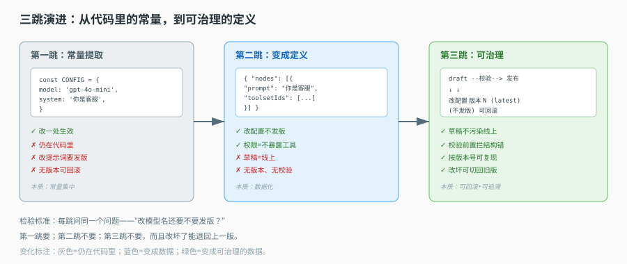

# 第 4 课实战 · 把硬编码 Agent 改成配置驱动

> 所属课程：[课 4：声明式定义](../stages/2-定义与编译/lessons/04-声明式定义.md) ｜ 索引：[应用实战 INDEX](./INDEX.md)
> 实战目标：把一份"模型名硬编码、权限散在 if 里"的 Agent 代码，改成一份定义 + 一段通用代码，并加上发布版本与前置校验。
> 覆盖知识点：一份定义包含什么 / 定义与实例分离 / 校验前置

## 🎯 你要解决什么

课 4 讲了"Agent 是数据不是代码"。但真到改造那天，你手上是一坨具体的代码：

```ts
// 改造前：客服 Agent（伪代码）
async function customerServiceAgent(messages) {
  const model = 'gpt-4o-mini'                    // ① 模型硬编码
  const system = '你是客服，只能查订单，不能改订单'  // ② 提示词硬编码
  const tools = [queryOrder, updateOrder]         // ③ 工具全给，权限靠提示词
  if (tenant === 'vip') { system += '，优先安抚' } // ④ 分支写在代码里
  return llm(model, system, tools, messages)
}
```

四个问题一眼可见：想换模型要改代码、想改提示词要发版、权限靠"提示词劝告"（模型不听就完了）、VIP 分支让代码随客户增长而膨胀。

这篇实战带你从这坨代码，演化成"一份定义 + 一段通用代码 + 一次发布 + 一组校验"。

## 📐 设计图

### 图 1：从硬编码到声明式的三跳



> **看图**：第一跳只是把常量提出来（还是代码）；第二跳把它们变成可存储的定义（数据）；第三跳加上版本与校验（可治理）。检验标准是"改模型名还要不要发版"。

## 🧱 第一跳：把常量提出来（先看它够不够用）

最朴素的重构——把散落的常量收进一个对象：

```ts
const CUSTOMER_SERVICE = {
  model: 'gpt-4o-mini',
  system: '你是客服，只能查订单，不能改订单',
  tools: ['queryOrder', 'updateOrder'],
  vipExtra: '，优先安抚'
}
```

**它解决了什么**：常量集中了，改模型名只改一处。

**它在真实使用中暴露的问题**：

| 问题 | 证据 | 后果 |
|---|---|---|
| 还是代码 | 常量写在 `.ts` 里 | 改提示词仍要发版、重启 |
| 无法按租户差异化 | 只有一份常量 | VIP 分支要么写死，要么再写 if |
| 无法回滚 | 没有版本概念 | 改坏了只能靠 git revert + 重新发版 |
| 权限仍是"提示词劝告" | `tools` 里给了 `updateOrder` | 模型可能真的调用它去改订单 |

> 结论：这只是"常量集中"，没解决本质——数据仍被代码包裹，无法独立演进。

## 🔀 第二跳：变成可存储的定义

把常量搬进一份可序列化的定义（一个"团队 + 节点 + 连线"的三段结构）：

```jsonc
{
  "team": { "name": "客服助手", "agent": { "key": "primary" } },
  "nodes": [{
    "key": "primary",
    "type": "agent",
    "entity": {
      "key": "primary",
      "prompt": "你是客服。只能查询订单，不允许修改订单。",
      "copilotModelId": "<model-id>",
      "toolsetIds": ["<order-query-toolset>"]     // 只给查询工具
    }
  }],
  "connections": []
}
```

三处关键变化：

- `prompt` 从代码常量变成字段——改提示词 = 改数据，不发版。
- `toolsetIds` 只放查询工具——**权限从"提示词劝告"变成"工具不暴露"**（这是课 7 权限拦截的基础）。
- VIP 差异不再写 if，而是**另一份定义**（或同一份定义的不同版本）。

**它解决了什么**：改配置不用发版；权限靠"给不给工具"而不是"劝模型别用"。

**它仍然有的问题**：

| 问题 | 后果 |
|---|---|
| 没有版本 | 改坏了无法回滚到"昨天那份" |
| 草稿等于线上 | 改一半保存，线上立刻受影响 |
| 没有校验 | 写了不存在的 toolsetId，要等运行才报错 |

## 🏗 第三跳：加上版本与校验（综合实现）

三件事一起补：

**① 草稿与发布分离**。定义有了两份数据：`draft`（可随便改）和 `graph`（线上读的），靠 `isDraft` 切换。草稿是**叠加层**——它叠在发布版之上，不是替代品。

**② 版本号 + latest 标记**。每次发布落一个 `version`，并把 `latest` 指向最新。这样：

- 线上默认读 `latest=true` 的那份。
- 排障时能按 `version` 精确调出"当时跑的那份"。
- 灰度时可以指定一部分请求走旧版本。

**③ 发布前跑校验**。两道：

- 节点级：检查**单个节点内的配置矛盾**，比如"开了结构化输出又开了文件理解"——两者都要抢着处理模型输出，同时开会互相踩。
- 图级：检查**节点之间的关系**，其中必查的是 Agent 构建环（A 委派给 B、B 又委派给 A），因为编译是递归展开的，成环会直接爆栈。

这两级校验的分工值得记住：节点级看"局部自洽"，图级看"全局可构建"。节点级能跑在配置界面上（用户边改边报错），图级只能在发布前跑（需要完整拓扑）。

最终形态：

```text
定义（draft） --校验--> 通过 --发布--> 版本 N（graph, latest）
   ↑                                        ↓
   └────────── 改配置（不发版） ←──── 线上读取
```

## ✅ 验收：改造后能回答的四个问题

| 问题 | 改造前 | 改造后 |
|---|---|---|
| 换模型要发版吗 | 要 | 不用，改 `copilotModelId` |
| 改提示词要发版吗 | 要 | 不用，改 `prompt` |
| 能禁止改订单吗 | 只能劝 | 不给 `updateOrder` 工具 |
| 改坏了能回滚吗 | git revert + 发版 | 切回上一版本号 |

## 🎯 练一练

1. 把你手头任意一个"配置写死在代码里"的函数，按上面三跳改一遍，重点体会第二跳到第三跳的差别（版本与校验）。
2. 找出你项目里一处"权限靠提示词劝告"的地方，判断能否改成"不暴露工具"。如果不能，想清楚为什么（是工具粒度太粗，还是需要执行时授权——这正是课 7 的伏笔）。

## 🧭 导航

⬅️ 回到课文：[课 4：声明式定义](../stages/2-定义与编译/lessons/04-声明式定义.md)
📚 索引：[应用实战 INDEX](./INDEX.md)
