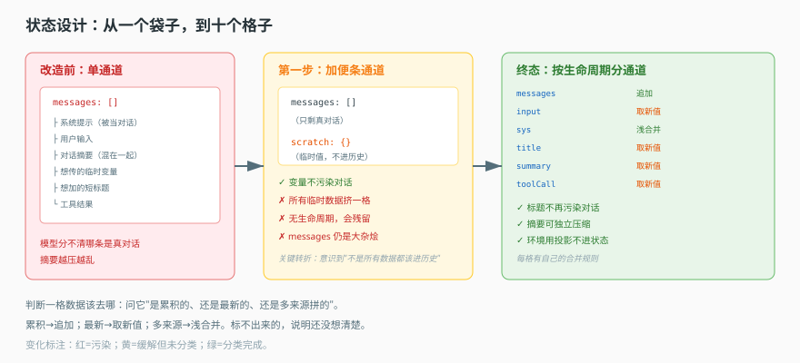

# 第 6 课实战 · 从单一 messages 到通道化状态

> 所属课程：[课 6：状态通道](../stages/2-定义与编译/lessons/06-状态通道.md) ｜ 索引：[应用实战 INDEX](./INDEX.md)
> 实战目标：把"所有东西塞进 messages"的状态设计，改造成分通道状态，并让摘要、标题、临时变量各归其位。
> 覆盖知识点：通道划分 / reducer 与并发

## 🎯 你要解决什么

课 6 讲了 10 个通道。但真到设计自己的 Agent 状态时，你的起点往往是这样：

```ts
// 改造前：一个袋子装一切
const State = Annotation.Root({
  messages: Annotation<BaseMessage[]>({ reducer: (a, b) => [...a, ...b], default: () => [] })
})

// 于是所有东西都往里塞
state.messages.push(new SystemMessage('当前租户：VIP'))
state.messages.push(new HumanMessage(state.messages[0].content))  // 想传个变量
```

跑起来你能看到三个症状：

- 模型开始"回答"你的系统提示，因为它在 messages 里就是一条消息。
- 想压缩历史时，摘要和原消息混在一起，压完更乱。
- 你想给对话起个短标题，塞进去之后它成了对话的一部分。

这篇实战带你从"一个袋子"，演化成"10 个各有归约规则的通道"。

## 📐 设计图

### 图 1：状态设计的两跳演进



> **看图**：左边是单通道（所有数据挤在 messages，互相污染）；右边是多通道（每条数据有自己的格子与合并规则）。中间那一步加了"临时变量通道"，是关键转折——它让你意识到"不是所有数据都该进历史"。

## 🧱 第一跳：先加一个"临时便条"通道（看它解决什么）

最痛的问题是"想传个变量给下个节点，但不想它进历史"。加一个通道：

```ts
const State = Annotation.Root({
  messages: Annotation<BaseMessage[]>({ reducer: messagesStateReducer, default: () => [] }),

  // 临时便条：只给节点间传值，不进对话历史
  scratch: Annotation<Record<string, unknown>>({
    reducer: (a, b) => ({ ...a, ...b }),   // 浅合并
    default: () => ({})
  })
})
```

**它解决了什么**：变量不再污染对话历史。模型看不到 `scratch`（除非你显式注入）。

**它在真实使用中暴露的问题**：

| 问题 | 证据 | 后果 |
|---|---|---|
| 所有临时数据混在一格 | 都写 `scratch.xxx` | 不同中间件互相覆盖同名键 |
| 没有生命周期 | `scratch` 从不清理 | 上一轮的值残留到下一轮 |
| messages 仍是大杂烩 | 系统提示、摘要都往里塞 | 模型分不清哪条是真对话 |

> 结论：加一个通道缓解了"污染历史"，但没解决"分类"——真正的问题是**不同生命周期的数据混在一起**。

## 🔀 第二跳：按生命周期拆通道

课 6 的 10 个通道，本质是按"合并语义"分类的。你可以用同一套判断方法拆自己的状态：

| 数据 | 生命周期 | 该用什么合并方式 | 对应通道类比 |
|---|---|---|---|
| 对话消息 | 永久累积 | 追加 | `messages` |
| 当前输入 | 每轮替换 | 取新值 | `input` |
| 环境配置 | 多来源叠加 | 浅合并 | `sys` |
| 本轮临时意图 | 单轮有效 | 取新值 | `toolCall` |
| 短标题 | 最新覆盖 | 取新值 | `title` |
| 长历史摘要 | 最新覆盖 | 取新值 | `summary` |

改造后：

```ts
const State = Annotation.Root({
  messages: Annotation<BaseMessage[]>({ reducer: messagesStateReducer, default: () => [] }),
  input: Annotation<string>({ reducer: (a, b) => b ?? a, default: () => '' }),
  scratch: Annotation<Record<string, unknown>>({ reducer: (a, b) => ({ ...a, ...b }), default: () => ({}) }),
  title: Annotation<string>({ reducer: (a, b) => b ?? a, default: () => null }),
  summary: Annotation<string>({ reducer: (a, b) => b ?? a, default: () => null })
})
```

**它解决了什么**：标题不会再被模型当对话回答（它在 `title` 里，不在 `messages` 里）；摘要可以独立压缩（它有自己的格）。

**它仍然有的问题**：

| 问题 | 后果 |
|---|---|
| `scratch` 里的键可能撞 | 两个中间件都写 `scratch.fileList`，后者覆盖前者 |
| 取新值通道并发写会丢 | 两个节点同超步写 `title`，只留一个 |
| 环境变量还在往里塞 | 密钥进了历史 |

## 🏗 第三跳：补上隔离与投影（综合实现）

三件事收尾：

**① 命名空间化临时数据**。不要都写 `scratch.xxx`，按来源分：`scratch.fileUnderstanding.xxx`、`scratch.skills.xxx`。这样两个中间件不会撞。

**② 接受"取新值会丢"，并为它负责**。`title` 只有一个值是对的；如果你需要"多个标题历史"，那说明它不该叫 title——另开一个追加型通道。

**③ 环境用投影，不进状态**。这是本实战最重要的一条：

```ts
// 错误：写进状态（会被持久化、会泄漏、会破坏回放）
state.env = { API_KEY: '...' }

// 正确：读时投影（纯函数，返回新对象）
function withEnvironment(state, environment) {
  return { ...state, env: toEnvObject(environment?.variables) }
}
```

为什么这条如此重要——三个理由：密钥不该被持久化到检查点；历史应记录"当时发生什么"而不是"现在环境是什么"；同一段历史在不同环境下回放应得到不同结果，而不是固化。

## ✅ 验收：改造后能回答的四个问题

| 问题 | 改造前 | 改造后 |
|---|---|---|
| 标题会被模型当对话回答吗 | 会 | 不会，它在 `title` |
| 摘要能和原消息分开压缩吗 | 不能 | 能，独立通道 |
| 临时变量会残留到下一轮吗 | 会 | 按通道语义，取新型自动替换 |
| 环境密钥会进历史吗 | 会 | 不会，读时投影 |

## 🎯 练一练

1. 数一数你现在的状态定义有几个通道，逐个标注它的"合并语义"（追加/取新/合并）。凡是标不出来的，说明它还没想清楚。
2. 找一个你曾经"塞进 messages 传值"的地方，判断它现在该去哪个通道。如果找不到合适的通道，考虑自建一个并明确写清 reducer。

## 🧭 导航

⬅️ 回到课文：[课 6：状态通道](../stages/2-定义与编译/lessons/06-状态通道.md)
📚 索引：[应用实战 INDEX](./INDEX.md)
