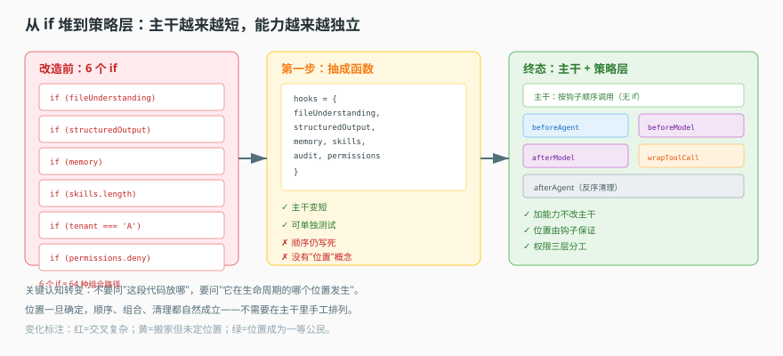

# 第 7 课实战 · 把 if 判断抽成中间件策略

> 所属课程：[课 7：中间件策略层](../stages/2-定义与编译/lessons/07-中间件策略层.md) ｜ 索引：[应用实战 INDEX](./INDEX.md)
> 实战目标：把主干上 6 个纠缠的 `if`，改造成 6 个独立策略，并为人人头疼的权限问题找到正确分层。
> 覆盖知识点：策略接口 / 六个钩子职责 / 中间件与工具

## 🎯 你要解决什么

课 7 讲的是"把每个能力做成一个策略"。但你的起点是一段越来越长的函数：

```ts
// 改造前：一个函数里 6 个 if（伪代码）
async function runAgent(state, config) {
  if (config.fileUnderstanding) {          // ① 文件理解
    tools.push(readFileTool)
    system += '你可以读文件'
  }
  if (config.structuredOutput) {           // ② 结构化输出
    tools = tools.filter(t => t.name !== 'read_file')  // 与①冲突，得手动排除
  }
  if (config.memory) {                     // ③ 记忆
    const memories = await searchMemory(state.messages)
    system += `相关记忆：${memories}`
  }
  if (config.skills.length) {              // ④ 技能
    for (const s of config.skills) tools.push(s.toTool())
  }
  if (config.tenant === 'A') {             // ⑤ 审计
    await auditLog('model_call', state)
  }
  if (config.permissions.deny.includes('write')) {  // ⑥ 权限
    tools = tools.filter(t => !t.name.startsWith('write'))
  }
  return llm(system, tools, state.messages)
}
```

六个问题：②要手动感知①的冲突；③④都在改 system 但互相不知道顺序；⑤审计只在"调用前"记了一次（模型返回后没记）；⑥权限靠过滤工具名，但工具名一改就失效。

这篇实战带你从这 6 个 if，演化成 6 个可独立测试、可自由组合的策略。

## 📐 设计图

### 图 1：从 if 堆到策略层的两跳



> **看图**：左边是主干上的 if 串（能力越多，交叉越复杂）；右边是主干 + 策略层（主干只负责按顺序调用，每个能力独立）。中间那一步是把每个 if "搬出去"变成函数——但还不够，因为它们仍在主干里按固定顺序硬调。

## 🧱 第一跳：把 if 抽成函数（看它够不够用）

先把每个 if 体提成独立函数：

```ts
const hooks = {
  fileUnderstanding: (ctx) => { /* 加工具、改 system */ },
  structuredOutput: (ctx) => { /* 过滤工具 */ },
  memory: async (ctx) => { /* 查记忆、改 system */ },
  skills: (ctx) => { /* 注册技能工具 */ },
  audit: (ctx) => { /* 记日志 */ },
  permissions: (ctx) => { /* 过滤工具 */ }
}

async function runAgent(state, config) {
  if (config.fileUnderstanding) hooks.fileUnderstanding(ctx)
  if (config.structuredOutput) hooks.structuredOutput(ctx)
  // ...
}
```

**它解决了什么**：主干变短了，每个能力可以单独测试。

**它暴露的问题**：

| 问题 | 证据 | 后果 |
|---|---|---|
| 顺序仍写死 | 主干里手工排列 | 想让审计跑在权限之后，得改主干 |
| 没有"位置"概念 | 全在"调用前"执行 | 想在模型返回后处理，无处可插 |
| 权限与工具耦合 | 靠工具名过滤 | 改名即失效 |
| 无法按租户差异化 | 分支判断留在主干 | 主干继续膨胀 |

> 结论：只是把代码搬了个家。真正的问题是"—**在哪个时机插入**"没有成为一等公民。

## 🔀 第二跳：给每个能力选一个"位置"（钩子）

课 7 的六个钩子，本质就是六个"位置"。把上面的函数按语义重新安放：

| 原 if | 该放哪个钩子 | 为什么 |
|---|---|---|
| ① 文件理解（加工具 + 改 system） | `beforeAgent`（加工具）+ `tools`（供给） | 整趟会话只需做一次 |
| ② 结构化输出（解析结果） | `afterModel` | 要在每轮模型返回后解析 |
| ③ 记忆（查 + 注入） | `beforeModel` | 每轮都要用最新记忆拼提示词 |
| ④ 技能（注册工具） | `tools` | 属于"能力供给"，不是"时机逻辑" |
| ⑤ 审计（记调用） | `wrapModelCall` | 包裹实际调用，前后都能记 |
| ⑥ 权限（拦工具） | `wrapToolCall` | 拦在工具真正执行前 |

关键的认知转变：**不要问"这段代码放哪"，要问"它在生命周期的哪个位置发生"**。位置一旦确定，顺序、组合、清理都自然成立。

**它仍然有的问题**：权限仍靠"过滤工具名"。这就是第三跳要解决的。

## 🏗 第三跳：权限分层（综合实现）

课 7 最重要的结论：**中间件层的权限只控制"看得见"，不控制"做得到"**。

三层分工：

| 层 | 做什么 | 拦得住 |
|---|---|---|
| `tools` 供给 | 不把危险工具给模型 | 模型的越权尝试 |
| `wrapToolCall` | 执行前再查一次参数 | 改参数绕过、动态路径 |
| 工具内部（执行边界） | 真正校验"这次操作允不允许" | 任何调用路径，含直调 |

为什么必须第三层——因为 `backend.write()` 这类底层 API 不经过 `wrapToolCall`。中间件拦的是"工具调用"这个动作，不是"文件系统"这个能力。

一个完整的策略实现骨架（`MiddlewareStrategy` 是本篇自定义的最小接口，只保留三个成员，含义与课 7 一致）：

```ts
// 策略只需要满足这个形状：自我介绍 + 静态清单 + 生产运行时实例
interface MiddlewareStrategy {
  meta: { name: string; label: Record<string, string> };
  getToolNames(): string[];
  createMiddleware(options: unknown): MiddlewareShape;
}

export class OrderPermissionStrategy implements MiddlewareStrategy {
  meta = { name: 'order_permission', label: { zh_Hans: '订单权限' } }

  getToolNames() {
    return ['query_order']       // 静态清单：告诉界面"我只提供查询"
  }

  createMiddleware() {
    return {
      tools: [createQueryOrderTool()],           // ① 不给 update_order
      wrapToolCall: async (request, handler) => {
        if (request.name === 'query_order'      // ② 执行前再查参数
            && request.args.scope === 'all_tenants') {
          return new ToolMessage({ content: '拒绝：越权查询', tool_call_id: request.toolCall.id })
        }
        return handler(request)                 // ③ 放行
      }
    }
  }
}
```

注意 `getToolNames()` 和 `createMiddleware().tools` 是两个不同的事实：前者是"能提供"（静态上限），后者是"这次真给了"（按配置过滤）。两者不相等是正常的，不要写成断言去要求它们相等。

## ✅ 验收：改造后能回答的五个问题

| 问题 | 改造前 | 改造后 |
|---|---|---|
| 新增第 7 个能力要改主干吗 | 要 | 不用，新增一个策略文件 |
| 每个能力能单独测试吗 | 难（纠缠） | 能（策略是独立类） |
| 能在模型返回后处理吗 | 不能 | 能，用 `afterModel` |
| 权限靠工具名吗 | 是（改名即失效） | 不是，靠"不暴露 + 执行前查参数" |
| 权限是绝对安全边界吗 | 误以为是 | 不是，需工具内部再校验 |

## 🎯 练一练

1. 数一数你项目里那段"能力装配"函数有几个 if。逐个判断它该挂哪个钩子（beforeAgent / beforeModel / wrapModelCall / afterModel / wrapToolCall / afterAgent）。判断不出来的，说明它的时机还不清楚。
2. 找一个你以为是"安全边界"的权限检查，验证它能不能被"绕过工具直调"绕过。这个实验可能会让你有点不安——但那正是课 7 想让你记住的。

## 🧭 导航

⬅️ 回到课文：[课 7：中间件策略层](../stages/2-定义与编译/lessons/07-中间件策略层.md)
📚 索引：[应用实战 INDEX](./INDEX.md)
