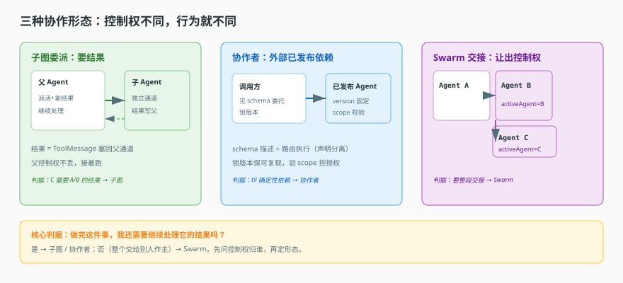

# 第 9 课实战 · 从单 Agent 到主管-工人

> 所属课程：[课 9：多 Agent 协作](../stages/3-执行与协作/lessons/09-多Agent协作.md) ｜ 索引：[应用实战 INDEX](./INDEX.md)
> 实战目标：把"一个塞满 47 个工具的 Agent"改造成"主管派活拿结果"的子图协作，并从选型上拒绝"无脑用 Swarm"。
> 覆盖知识点：子图委派 / 选型判据

## 🎯 你要解决什么

课 9 讲了三句话：子图要结果、协作者要依赖、Swarm 要交接。但你没练过，真到改造时容易犯一个普遍错误——不管什么场景，先摆一个 Swarm 再说。

这篇实战用一个具体改造，让你亲手走一遍选型：

> 场景：一个客服 Agent 有 47 个工具（查订单、查物流、算运费、退换货、查库存……），上下文越来越爆炸，模型开始答非所问。

需求拆开看：**需要的是"调研报告/订单结果"，然后主 Agent 要基于这些结果做汇总**。主 Agent（主管）永远要"接着处理"——这是典型的子图语义。

## 📐 设计图

### 图 1：三种形态该选哪个



> **看图**：从左到右是"控制权归谁"的递进。子图：父派活拿结果、父继续；协作者：调外部已发布依赖；Swarm：让出控制权、不再回头。先问"我还要不要这个结果"，再决定形态。

## 🧱 第一跳：先不分工，用"工具分组"止血（看它够不够用）

先别急着拆 Agent。第一步永远是**少给模型工具**——把 47 个工具按业务域分组，每组按需暴露：

```ts
// 止血：给"当前会话"一个更小的工具面
const workload = session.intent === 'order'
  ? ['query_order', 'query_logistics', 'calc_freight']   // 订单会话只见订单工具
  : ['query_stock', 'query_coupon', ...]
```

**它解决了什么**：模型每一轮的"可选工具"从 47 降到了 3 个左右，推理负担和 token 迅速下降。

**它暴露的问题**：

| 问题 | 证据 | 后果 |
|---|---|---|
| 意图判断脆弱 | `session.intent` 一个词 | 说"我想看下我上次买的东西"就分不清 |
| 跨域需求误伤 | 用户问题横跨订单+库存 | 工具没暴露，模型答"查不了" |
| 上下文还是单程 | 所有工具仍在一个会话里 | 语义塞得再多，主管没有子过程可管 |

> 结论：工具箱分组是治标。问题根源是**所有逻辑在一个进程、一个上下文里平铺**——需要"过程"来分层。

## 🔀 第二跳：主管 + 两个工人（子图）

把垂直域拆成独立子 Agent，主管只派活、拿结果：

```ts
// 主管 Agent：只负责理解意图 + 派活 + 汇总
const supervisor = createAgent({
  toolsetIds: ['order_worker', 'logistics_worker', 'stock_worker']  // 即"协作连接"
})

// 工人 1：订单（内部还是一个 Agent，但对主管表现为一个工具）
const orderWorker = createAgent({ /* 46 个订单相关工具 */ })
```

主管的"工具"其实是工人的入口——调用工人 = 起一个子图，给参数、拿 ToolMessage 回填。这正是课 9 的知识点 1（子图委派）的落地。

**它解决了什么**：

- 上下文案发爆炸：主管的上下文只装派活结果，不装工人的中间过程。
- 意图误伤：主管可以把"我想看上次买的"拆给订单工人，把"还剩多少"拆给库存工人。
- 失败隔离：某个工人挂了，主管能抓到它的失败，换一个工人或降级回答，不拖垮整个请求。

**它仍然有的问题**：

| 问题 | 后果 |
|---|---|
| "几个工人"拍脑袋 | 需要按业务域凝练，不是越多越好 |
| 结果如何结构化 | 每个工人返的 ToolMessage 内容格式要约定，主管才好汇总 |
| 该不该演进到 Swarm | 除非主管不想管后续（要整段交接），否则别升级成 Swarm |

## 🏗 第三跳：把"选型"写进设计（综合实现）

把课 9 的判据固化成一张表，作为设计评审的检查项：

| 检查项 | 自问 | 本例答案 |
|---|---|---|
| 控制权归谁 | 主管要不要在处理完结果后继续？ | 要 → **子图** |
| 依赖谁维护 | 工人的定义谁改？ | 自己改 → 子图；他人/已发布 → 协作者 |
| 是否整段交接 | 主 Agent 是否完全退场？ | 否 → 不要 Swarm |
| 是否跨系统 | 能力在不在本进程？ | 否 → runtime / MCP（课 12） |

一个反例供反思：如果产品说"让 A 全权接待这个客户，接下来都是 A 的事，主架不再参与"，那才该进化到 Swarm（或直接把 A 作为主 Agent）。**关键翻转点不是"工具多"，而是"主 Agent 要不要持续持柄"**。

## ✅ 验收：改造后能回答的五个问题

| 问题 | 改造前 | 改造后 |
|---|---|---|
| 可运行吗 | 是，但上下文爆炸 | 是，工人过程隔离 |
| 能跨域回答吗 | 难（意图脆弱） | 能（主管拆单给各工人） |
| 单个工人挂了会怎样 | 整个请求崩 | 主管抓到并降级 |
| 是 Swarm 吗 | （无脑填了） | 不是，是子图（按判据） |
| 可复现吗 | 依赖可变 | 工人若已发布可锁版本 |

## 🎯 练一练

1. 找一个你维护的多功能 Agent（或功能较大的会话工具列表），数出它的"工具"数量，画一张当前上下文图（哪些工具参与、每轮看多大面积）。
2. 用上面的检查表走一遍，判断它该拆成"子图"还是"Swarm"。如果拆不完，先想"哪几组工具高内聚"，再谈拆法。
3. 写一段伪代码：主管收到用户请求后，如何决定"派给订单工人 / 派给物流工人 / 直接回答"。观察这个决策点在 Swarm 里会怎么写——两种写法差别很大。

## 🧭 导航

⬅️ 回到课文：[课 9：多 Agent 协作](../stages/3-执行与协作/lessons/09-多Agent协作.md)
📚 索引：[应用实战 INDEX](./INDEX.md)
