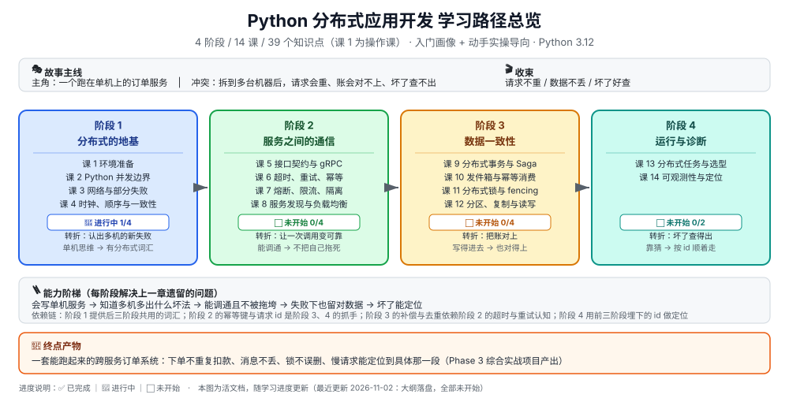

# Python 分布式应用开发 学习路径总览

> 本文件是活文档，随学习进度动态调整。阶段依赖图统一用 SVG。

## 🎯 学习目标

- **目标类型**：动手实操为主，兼顾概念理解
- **目标说明**：学完能用 Python 写出一套**不会把错误放大、不会把数据搞丢、出问题能查得出来**的跨机器服务；并且说得清每个设计背后的代价与适用边界。

> 学习目标是全局基准：每课必须包含可运行的 Python 代码或命令，不能只讲概念。

## 故事主线

- **主角**：一个起初跑在单机上的订单服务
- **冲突**：一台机器扛不住了，拆到多台机器之后，请求会重、数据会对不上、坏了一处却查不出原因——**多出来的机器没有变快，只是把失败的方式变多了**
- **收束**：在多机环境下做到「请求不重、数据不丢、坏了好查」

> 整个课程是这条故事线的展开，每个阶段是故事的一个"章节"。

## 学习路径图

> 看图：从左到右是四个阶段。阶段 1 建立地基（并发边界、失败形态、一致性词汇），阶段 2 处理服务之间的通信（契约、超时重试、熔断、发现），阶段 3 处理数据一致性（事务、发件箱、锁、分片），阶段 4 收口到运行与诊断。箭头表示前置依赖，不是时间顺序的强约束，但没有阶段 1 的词汇，阶段 3 会读不懂。

## 阶段总览

### 阶段 1：分布式的地基（故事章节："一台机器不够用了"）

- **目标**：说清"多一台机器到底多出了哪些新问题"，并建立后续三个阶段共用的词汇表。
- **学习重点**：
  - Python 并发模型的真实边界：GIL 管什么、不管什么，什么时候并行反而更慢
  - 部分失败：请求发出去了、结果未知，这是分布式与单机的根本区别
  - 超时不是"慢"，而是"未知"，以及重试为什么会放大故障
  - 时钟不可信、顺序与因果、CAP 的正确读法（不是"三选二"）
- **必须掌握**：能判断一段代码该用线程、进程还是 asyncio；能说清一次超时之后到底发生了什么；能解释为什么"加了机器吞吐没涨"。
- **对应课**：[课 1 环境准备](stages/1-分布式的地基/lessons/01-环境准备.md)、课 2 Python 并发的真实边界、课 3 网络与部分失败、课 4 时钟、顺序与一致性光谱

### 阶段 2：服务之间的通信（故事章节："让两台机器说上话"）

- **目标**：把单体拆成两个服务，并让这条调用链在对方出问题时**不把自己也拖死**。
- **学习重点**：
  - 接口契约：为什么值得一份 IDL，proto 的字段号与兼容规则
  - 超时预算与截止时间传播：上游的 3 秒如何变成下游的 500 毫秒
  - 重试的三个前提（幂等、有上限、有退避）与幂等键设计
  - 熔断器三态、限流算法、舱壁隔离
  - 服务发现、客户端负载均衡与服务端代理的取舍，健康检查与摘流
- **必须掌握**：能写出带 deadline 与重试策略的 gRPC 客户端；能设计一个真正幂等的下单接口；能说清雪崩的传导路径并给出阻断手段。
- **对应课**：课 5 接口契约与 gRPC、课 6 超时、重试、幂等、课 7 熔断、限流、隔离、课 8 服务发现与负载均衡

### 阶段 3：数据一致性（故事章节："到处对不上的账"）

- **目标**：让跨服务、跨库的操作在失败与并发下仍然留下**正确**的数据。
- **学习重点**：
  - 本地事务的边界，两阶段提交的真实代价，Saga 与补偿设计
  - 双写不一致的根源，事务性发件箱，幂等消费与去重表
  - 用 Redis 做锁的四个必答问题、锁续期与误删、fencing token
  - 分片键选择、复制滞后、读写分离陷阱、读己之写
- **必须掌握**：能为一个跨服务流程画出补偿路径；能写出不会误删他人锁的锁实现；能解释"用户改完资料刷新还是旧值"的三种成因。
- **对应课**：课 9 分布式事务与 Saga、课 10 事务性发件箱与幂等消费、课 11 分布式锁与 fencing token、课 12 分区、复制与读写一致性

### 阶段 4：运行与诊断（故事章节："上线之后才是开始"）

- **目标**：在多机环境里定位问题，并为一类计算任务选对工具。
- **学习重点**：
  - 任务队列、分布式计算、流处理的边界（什么时候不该用 Celery）
  - 选型的五个判断维度，至少一次与恰好一次的真实含义
  - 一次慢请求为什么在单服务日志里查不出来，traceId 与上下文传播
  - 指标、日志、链路三件套如何联动定位
- **必须掌握**：能为一类任务选对运行时并说清理由；能把一次跨服务慢请求拆到具体那一段。
- **对应课**：课 13 分布式任务与计算选型、课 14 跨服务可观测性与故障定位

## 当前进度

- [ ] 阶段 1：分布式的地基（未开始）
- [ ] 阶段 2：服务之间的通信（未开始）
- [ ] 阶段 3：数据一致性（未开始）
- [ ] 阶段 4：运行与诊断（未开始）

> 知识点级进度见 [00-学习档案.md](00-学习档案.md)。课程目录见 [02-课程目录.md](02-课程目录.md)。

## 与仓库其他课程的分工

本课程只讲**应用开发者视角**的分布式问题。以下内容不重复讲，只做提及级引用：

| 主题 | 已有课程 | 本课程怎么处理 |
|------|----------|---------------|
| 容器与编排 | Docker、Kubernetes | 只在环境准备里用 Docker 起 Redis；部署不展开 |
| 消息队列本体 | Kafka、RabbitMQ | 只讲"发件箱怎么把消息可靠发出去"，不重讲 broker 原理 |
| 缓存与集群 | Redis | 只用它做锁与去重表，不重讲持久化与集群 |
| 协调服务 | ZooKeeper、Consul | 只在服务发现一课提及，选型指向已有课程 |
| 异步任务框架 | Celery + Django | 课 13 讲"什么时候用、什么时候别用"，不重讲配置 |
| 监控与可观测 | Prometheus、Grafana、OpenTelemetry | 课 14 讲跨服务定位方法，工具用法指向已有课程 |

## 版本基线

> 本文涉及的版本结论核查于 **2026-11**。

| 组件 | 基线版本 | 说明 |
|------|----------|------|
| Python | 3.12（本机 3.12.3） | 代码只用 3.10+ 语法 |
| grpcio / grpcio-tools | 两者必须同版本 | 版本错配会生成不兼容 stub |
| redis-py | 最新稳定版 | 课 10、课 11 使用 |
| Redis Server | 7.x | 本机已装，用于锁实操 |
