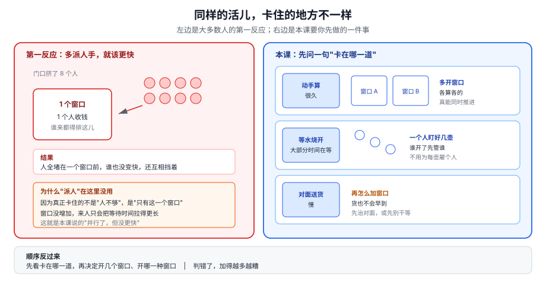
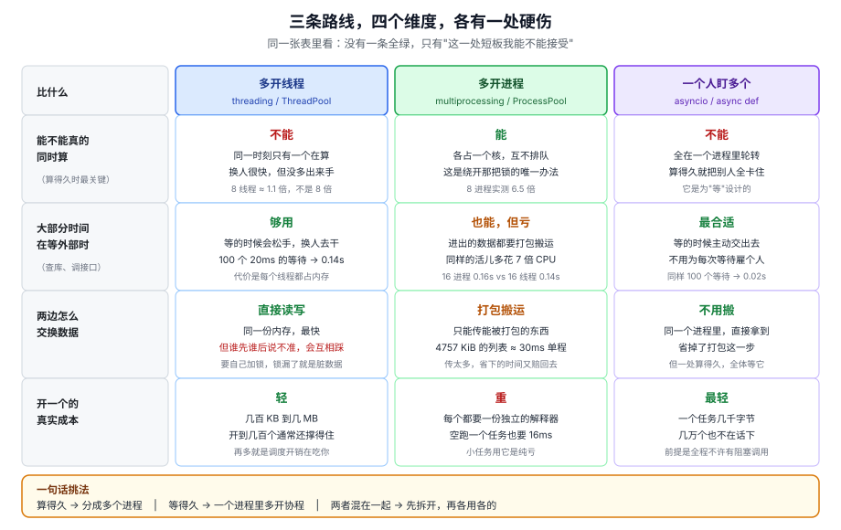
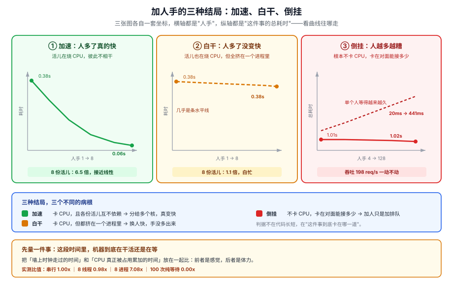
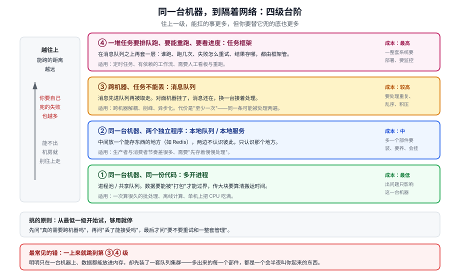
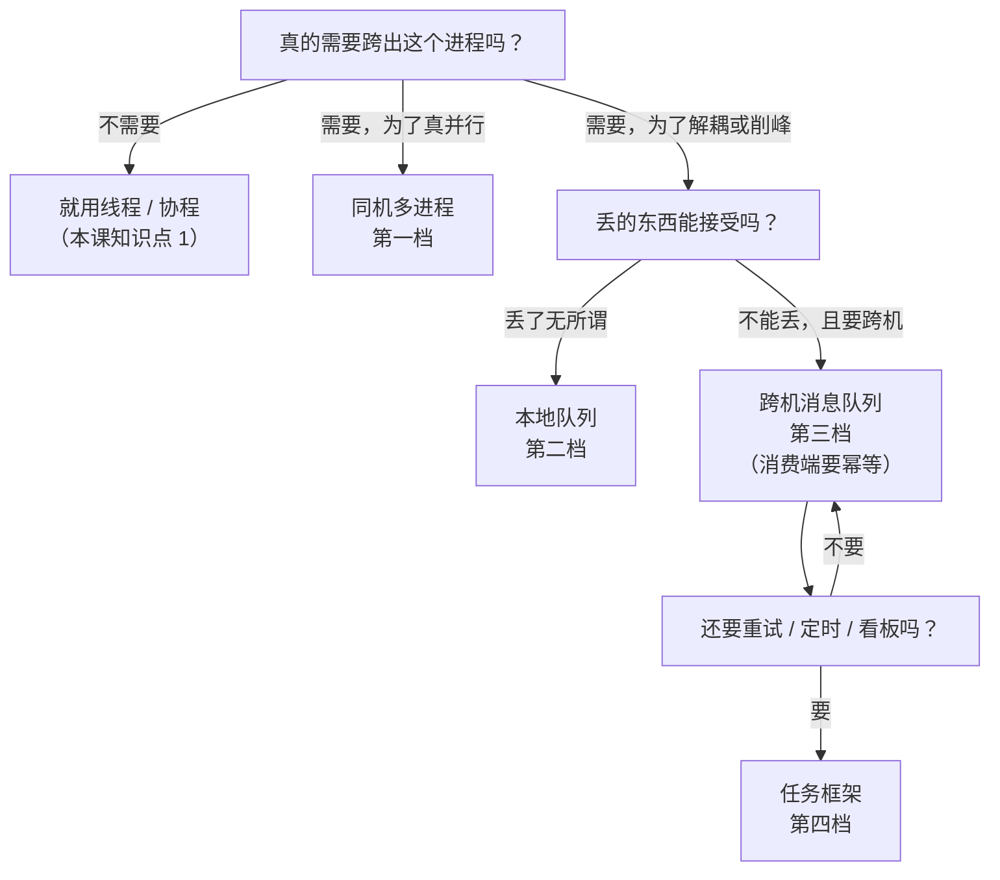
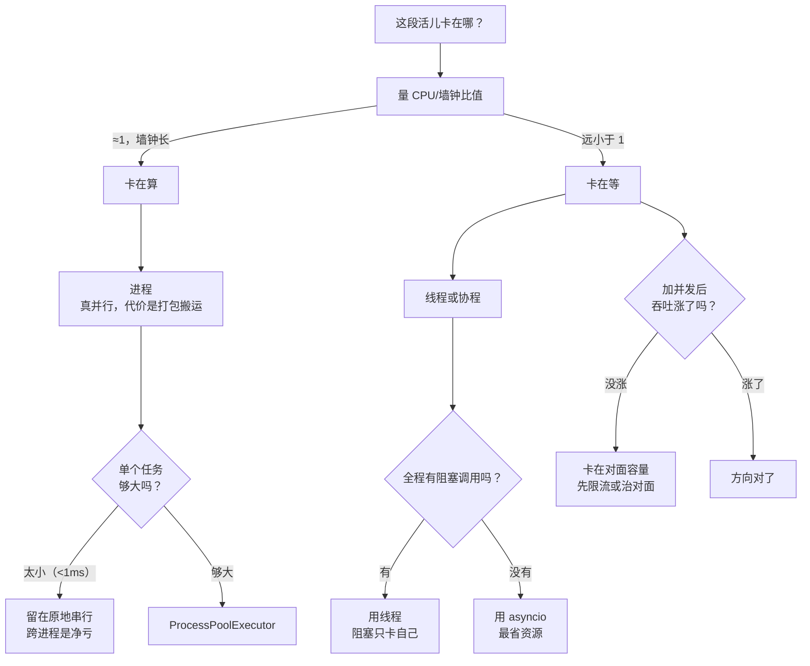

# 第 2 课：Python 并发的真实边界

> 所属阶段：阶段 1《分布式的地基》｜ 水平：入门 ｜ 本课知识点：并发模型的真实边界、什么时候并行反而更慢、跨进程协作的选型
> 故事情节：主角要给订单服务加一个"并发处理"的能力，第一反应是"多开几个线程"，结果压测下来吞吐一点没涨——他第一次意识到"并发"和"更快"不是同一件事。
> 📖 结论已按官方文档核对（核对于 2026-11 ｜ 来源：[Python 术语表 · GIL](https://docs.python.org/3/glossary.html#term-global-interpreter-lock)、[concurrent.futures](https://docs.python.org/3/library/concurrent.futures.html)、[asyncio](https://docs.python.org/3/library/asyncio.html)、[What's New In Python 3.14](https://docs.python.org/3/whatsnew/3.14.html)、[PEP 779](https://peps.python.org/pep-0779/)）
> ✅ 本课全部数字实测于 Linux / 20 核 / Python 3.12.3（`sys.getswitchinterval()` 默认 5ms），每项跑多轮取中位；脚本见 4.1，可原样复跑

## 🎯 本课目标

- 拿到一段代码，能判断它该用线程、进程还是 asyncio，并说清判断依据
- 遇到"加了机器/加了线程，吞吐却没涨"，能顺着 CPU 占用、下游容量两条线索定位到病根
- 在"同机多进程 / 本地队列 / 跨机消息队列 / 任务框架"四档之间，给出有理有据的初步选型

---

## 第一幕：起源与场景引入

> 🏛️ **起源**：CPython 从很早就用一把全局锁保护解释器内部状态，最直接的原因是引用计数——每个对象都靠一个计数器决定何时释放，多个线程同时改它就会算错，加锁是最省事的解法（核查于 2026-11）。多核普及后，"有线程却用不上多核"成了 Python 的长期标签。2023 年 10 月指导委员会接受 PEP 703（作者 Sam Gross，Meta）；2024 年 10 月发布的 3.13 先以**实验形态**提供无 GIL 构建；2025 年 10 月发布的 3.14 按 PEP 779 把它升为"官方支持但仍非默认"（核查于 2026-11）。

> 🎬 **场景**：你接手了一个订单服务。下单接口里有一段"校验库存 + 写订单 + 发通知"的逻辑，串行跑 100 次要 2 秒。同事说"这还不好办，开 16 个线程并发跑"。你照做了，压测结果贴在群里：**吞吐 198 req/s，和串行时一模一样；而平均延迟从 20ms 涨到了 78ms。**
>
> 于是你加了更多线程 —— 32、64、128。吞吐 198.1、197.6、197.0，纹丝不动；平均延迟 149.6ms、272.6ms、441.1ms，一路飙升。

> 📌 **一句话本质**：把"多派人手就会更快"的直觉，换成"先看这件事卡在哪一道，再决定派什么人、派几个"。
>
> ⚖️ **处境对照**：不这么做——8 份 CPU 活儿交给 8 个线程要 0.382 秒，跟串行 0.384 秒几乎没差别，白写一整套线程池；下游只能接 4 个时，把线程从 4 提到 128，吞吐始终约 198 req/s 不动，而平均等待从 20.1ms 涨到 441.1ms（22 倍）。这么做——同样 8 份活儿交给 8 个进程只要 0.059 秒（6.5 倍），同样 100 次 20ms 等待交给 asyncio 只要 0.022 秒（92.4 倍）。
>
> 位置说明：场景先把人带进去，再给一句"本课本质上在做什么"——既不违背"不以定义开场"，又让读者进第三幕前手里有锚点。

---

## 第二幕：认知冲突

上面的数字里藏着一个让人不舒服的事实：**你加的不是"并发度"，加的是"排队的人"。**

大多数教程讲到并发，给的是这样一条等式：`并发 = 快`。但真实世界里至少有三条不同的路会通向"并发"，它们各自能解决的和不能解决的完全不同：

- 多开线程：能解决"在等外部"的活儿，解决不了"在烧 CPU"的活儿
- 多开进程：能解决"在烧 CPU"的活儿，但要为数据搬运付钱
- 一个线程里多开协程：最省资源，但一处阻塞就全体停摆

> ❓ **问题**：如果"并发"有三种，那凭什么判断我这一段代码该用哪一种？更让人不安的是——为什么我明明加了 128 个线程，吞吐一个字节都没涨？

这个问题的答案不在"用哪个 API"，而在一个更前置的问题：**这段时间里，机器到底是在干活，还是在等？**

---

## 第三幕：层层揭示

### 一眼全局图（进入细节前先看一眼）



> 看图：左边是大多数人的第一反应——门口挤了 8 个人，但只有一个窗口，人再多也只是互相挡着；右边是本课要你先做的一件事——先看卡在哪一道，是"动手算"（要多开窗口）、"等水烧开"（一个人盯好几壶就够）、还是"对面送货慢"（加窗口没用，得先治对面或先别干等）。

**四条硬约束**已满足：这图只回答"本课解决什么问题、靠什么思路"；图上没有任何术语（"进程/线程/协程/GIL"一个都没出现）；下面有读图指引；图旁文字能独立说清同一件事。

### 本课地图（分几步走）

| 步 | 这一步要解决什么（人话） | 对应知识点 |
|:--:|------------------------|-----------|
| 1 | 先认识三条路线各自的天花板在哪，才不会拿错工具 | 知识点 1：并发模型的真实边界 |
| 2 | 再看"明明加了人却更慢"到底有几种病，怎么量出来 | 知识点 2：什么时候并行反而更慢 |
| 3 | 最后决定：要不要跨出这个进程，跨出去几步才够 | 知识点 3：跨进程协作的选型 |

> 只回答"分几步走、现在在哪"——不写机制、不写结论；表格式，不是图、不占 SVG 配额；不标学习状态（进度以 `00-学习档案.md` 为准）。

---

### 知识点 1：并发模型的真实边界

> 🧭 第 1/3 步｜承接：第二幕留下的问题是"凭什么判断该用哪一种" → 本步：把三条路线放到同一张表里，看清各自那条走不通的路在哪
> 本知识点关键点：同一时刻只有一个线程在跑 Python 字节码、I/O 时锁会松开、三条路线各有一处硬伤

#### 一句话定义

Python 里有三条并发路线（线程、进程、协程），它们的差别不是"快慢"，而是**各自被什么东西限制住**：线程被那把全局锁限制，进程被数据搬运限制，协程被"不许阻塞"限制。

#### 直觉建立（类比）

想象一个厨房。**线程**像同一个厨房里的几个厨师——灶台只有一口（那把锁），谁抢到谁炒，换人很快，但同时只能一个人动锅；有人在等水开的时候会把灶台让出来。**进程**像在隔壁又租了几间厨房——各有各的灶，真能同时开火，但食材要搬过去、菜要端回来，搬运本身要花时间，而且隔壁厨房看不到你这边的冰箱。**协程**像一个厨师同时盯几口锅——水没开就先去切菜，全靠他自己记得"哪口锅该看了"，一旦他犯傻站着盯一口锅不动（阻塞调用），所有锅都糊了。

> 💡 **类比的边界**：厨房类比抓的是"资源竞争"这一层，但它盖住了最关键的机制——那把锁不是"灶台数量"问题，而是**解释器自身的安全机制**：它保护的是引用计数等内部状态，不是你的业务资源。所以哪怕你有 20 个核、20 口灶，只要还在同一个解释器里跑字节码，同一时刻就只有一个线程在动。

#### 核心原理

先看官方对那把锁的定义（术语表原文）：

> "CPython 解释器所采用的一种机制，它确保同一时刻只有一个线程在执行 Python 字节码。……某些标准库或第三方库的扩展模块被设计为在执行计算密集型任务如压缩或哈希时释放 GIL。此外，在执行 I/O 操作时也总是会释放 GIL。"

这句话里有三个信息，每个都直接决定选型：

1. **"同一时刻只有一个线程执行 Python 字节码"**：纯 Python 的 CPU 活儿，线程拿不到并行。注意它说的是"执行字节码"——锁会在字节码之间切换（默认每 5ms 一次，可用 `sys.setswitchinterval()` 改），所以线程不是"卡死"，是"轮流"，轮流不产生加速。
2. **"I/O 操作时总是会释放"**：等网络、等磁盘、等数据库的时候，锁是松开的，别的线程可以进来干活。这是"线程能救 I/O 密集"的全部原因。
3. **"部分扩展模块在计算时释放"**：所以 NumPy 做矩阵运算时线程是能并行的——因为真正干活的是 C 代码，它主动把锁放了。这条是"例外"，不是"规律"，别拿它当通用结论。



> 看图：横着是三条路线，竖着是四个必答问题——能不能真同时算（看第一行，只有进程能）、等外部时划不划算（第二行）、两边怎么交换数据（第三行）、开一个要多少钱（第四行）。注意每一列都至少有一个红字：没有一条全绿，选型就是选"哪一处短板我受得了"。

三句话把这张图收掉：

- **算得久 → 进程**：只有它能真同时算（实测 6.5 倍），代价是数据要能被"打包"过界、每个进程都占一份独立内存。
- **等得久 → 线程或协程**：线程"等的时候会松手"（100 次 20ms 等待，2.009s → 0.141s）；协程更省（→ 0.022s），但要求全程不许有阻塞调用。
- **两者混在一起 → 先拆开**：把"算"的部分扔进进程池，把"等"的部分留在协程/线程里。硬用一条路线通吃，必然有一半在浪费。

#### 示例演示

三种路线跑同一批 I/O 活儿，看差距有多大：

```python
# io_compare.py
import asyncio, time
from concurrent.futures import ThreadPoolExecutor, ProcessPoolExecutor

DELAY, N = 0.02, 100

def io_task(_):
    time.sleep(DELAY)
    return "ok"

async def aio_task(_):
    await asyncio.sleep(DELAY)
    return "ok"

async def amain():
    return await asyncio.gather(*[aio_task(i) for i in range(N)])

def t(label, fn):
    global base
    t0 = time.perf_counter(); fn(); w = time.perf_counter() - t0
    if base == 0.0:
        base = w            # 第一条（串行）作为基准，避免硬编码分母
    print(f"{label:<18} {w:6.3f}s   加速 {base/w:5.1f}x")

base = 0.0
t("串行 100 次",      lambda: [io_task(i) for i in range(N)])
t("16 线程池",        lambda: list(ThreadPoolExecutor(16).map(io_task, range(N))))
t("16 进程池",        lambda: list(ProcessPoolExecutor(16).map(io_task, range(N))))
t("asyncio 单线程",   lambda: asyncio.run(amain()))
```

```
串行 100 次           2.010s   加速   1.0x
16 线程池             0.142s   加速  14.2x
16 进程池             0.155s   加速  13.0x
asyncio 单线程        0.022s   加速  92.4x
```

这里有两个值得停一下的地方。第一，**进程池在纯等待的活儿上比线程池还慢一点**（0.155 vs 0.142）——它为了"能真并行"付了额外的启动与调度成本，而这些成本在"只是等"的活儿上纯属浪费。第二，**asyncio 快出一个数量级**，因为它连"雇人"这一步都省了：一个线程，100 个任务各自挂起，谁到点谁接着跑。

再看一个反例——把阻塞调用混进协程，上面那个 92.4 倍会瞬间消失：

```python
# block_in_async.py
import asyncio, time

async def blocker(_):
    time.sleep(0.02)          # ❌ 阻塞调用：整个事件循环停在这儿
    return "ok"

async def sleeper(_):
    await asyncio.sleep(0.02) # ✅ 让出控制权：别的任务可以接着跑
    return "ok"

async def run(fn):
    t0 = time.perf_counter()
    await asyncio.gather(*[fn(i) for i in range(20)])
    return time.perf_counter() - t0

print(f"time.sleep    {asyncio.run(run(blocker)):.3f}s")
print(f"asyncio.sleep {asyncio.run(run(sleeper)):.3f}s")
```

```
time.sleep    0.401s
asyncio.sleep 0.021s
```

同样是 `async def`、同样用 `gather` 并发 20 个，一个 0.401 秒（和串行一样，20 × 20ms），一个 0.021 秒。**协程的并行不是"自动"的，是你每次 `await` 主动交出去的。**这就是知识点定义里说的"协程被'不许阻塞'限制"。

#### 常见误区

1. **"Python 有 GIL，所以多线程完全没用"**：错。GIL 只限制"执行 Python 字节码"，不限制"等待"。100 次 20ms 的等待，线程池拿到 14.2 倍加速——这是本课测出来的，不是理论值。
2. **"加了锁就安全了，所以我能放心共享状态"**：这是本课最值得记住的一条反例。请看下面。

> **🔬 反例对照：网上到处传的 GIL 竞态 demo，在你的机器上可能跑不出来**
>
> 教科书演示通常是这段：
>
> ```python
> # counter_race.py
> import threading
> counter = 0
> def add():
>     global counter
>     for _ in range(100_000):
>         counter += 1
> ts = [threading.Thread(target=add) for _ in range(8)]
> [t.start() for t in ts]; [t.join() for t in ts]
> print(counter, "期望", 800_000)
> ```
>
> 教学预期是"打印出一个小于 800000 的数，证明 `+=` 不是原子操作"。**我在本机跑了 5 轮，5 轮全部输出 `800000 期望 800000`，丢失 0**；把 `sys.setswitchinterval(1e-6)` 压到 1 微秒后重跑，**仍然是 0 丢失**。
>
> 原因是 CPython 3.12 实际执行时，`counter += 1` 的读-改-写往往在两次线程切换之间一次做完——**GIL 的切换粒度碰巧"保护"了它**。所以这条 demo 在教材里成立、在你的机器上不成立。
>
> 那"共享状态会出错"是假的吗？不是，是**换一个更能暴露问题的形状就能复现**——把"读-改-写"换成"检查-然后-动手"：
>
> ```python
> # check_then_act.py
> import threading, time
> cache, lock, calls = {}, threading.Lock(), []
> def compute(k):
>     time.sleep(0.01)          # 模拟一次耗时计算
>     calls.append(k); return "v"
> def get_bad(key):
>     if key not in cache:      # ← 检查
>         value = compute(key)  # ← 这中间别的线程也能通过上面的检查
>         cache[key] = value
>     return cache[key]
> ts = [threading.Thread(target=lambda: get_bad("k")) for _ in range(8)]
> [t.start() for t in ts]; [t.join() for t in ts]
> print("实际计算次数", len(calls), "期望 1 次")
> ```
>
> ```
> 实际计算次数 8 期望 1 次
> ```
>
> 8 个线程全都在"检查"时看到缓存是空的，于是**同一个 key 被算了 8 遍**。把计算挪进锁里能修好；只在"检查"和"写入"各加一把锁反而没用（实测仍 8 次，因为计算在锁外）。
>
> 这条给我们的不是"GIL 不可靠"，而是更实际的结论：**"靠 GIL 碰巧安全"是不成立的推理方式**。你要么让共享状态只被一个线程碰（用队列传），要么用锁把"检查 + 动手"整段圈起来，要么干脆别共享（走进程）。

#### 一句话记住

线程能救"等"，进程能救"算"，协程最省但要你每次主动让出；三者都不是"更快"，而是"各自解掉一种卡点"。

#### 🗣️ 行话对照

- **全局解释器锁：GIL（Global Interpreter Lock）**：就是本课说的"那把锁"；在哪遇到：`sys.getswitchinterval()`、官方术语表、几乎每篇讲 Python 多线程的文章第一段。
- **CPU 密集型 / I/O 密集型（CPU-bound / I/O-bound）**：本课说的"算得久"和"等得久"；在哪遇到：性能优化文章、`ThreadPoolExecutor` 的 max_workers 该怎么设的讨论。
- **协程（coroutine）/ 事件循环（event loop）**：本课说的"一个人盯好几口锅"；在哪遇到：`async def`、`asyncio.run()`、`RuntimeWarning: coroutine was never awaited`。

#### 官方文档

- [Python 术语表 · global interpreter lock](https://docs.python.org/3/glossary.html#term-global-interpreter-lock)
- [concurrent.futures · ThreadPoolExecutor / ProcessPoolExecutor](https://docs.python.org/3/library/concurrent.futures.html)
- [asyncio · Coroutines and Tasks](https://docs.python.org/3/library/asyncio-task.html)
- [threading · GIL 与线程切换](https://docs.python.org/3/library/threading.html)

---

### 知识点 2：什么时候并行反而更慢

> 🧭 第 2/3 步｜承接：第 1 步知道了"三条路线各有一处硬伤"，但还不知道"慢"是怎么发生的 → 本步：把"加了人却更慢"拆成三种可量化的病，并给出一条 30 秒就能量出来的判据
> 本知识点关键点：三种结局（加速/白干/倒挂）、真正的病根在下游容量、CPU 与墙钟的比值是分叉口

#### 一句话定义

"并行反而更慢"不是一个现象，是三个不同的病：活儿互不相干却挤在一个进程里（白干）、活儿太快而搬运太贵（倒挂）、下游只能接这么多（排队）。

#### 直觉建立（类比）

高速公路收费站。**白干**：你开了 8 条车道，但 8 条车道最后都汇进同一条单车道隧道——车再多也只能一辆一辆过。**倒挂**：每辆车过站只要 2 秒，但你把收费站设在离高速 50 公里外，每辆车光开过去就要 30 秒——加车道毫无意义。**排队**：收费站只有 4 个窗口，你放进来 128 辆车，总通过量还是那么多，但第 128 辆车要等前面 124 辆全部过完，它的"个人等待"被拉长了 22 倍。

> 💡 **类比的边界**：收费站类比容易让人以为"下游"一定是外部服务。实际上下游可能是你自己进程里的 CPU、是数据库连接池、是对方接口的并发上限，甚至是一把锁——**识别"窄口在哪"才是重点，"它是不是外部"不是重点**。

#### 核心原理

把三种结局画在一张图上看，它们长得很不一样：



> 看图：三张小图各自一套坐标，横轴都是"人手"，纵轴都是"总耗时"，但曲线走向完全不同——第一张陡降（真并行），第二张几乎是水平线（白干），第三张总耗时不动、同时另一条虚线（单个人等的时长）一路往上（排队）。第三张是唯一会让你"加了资源还挨骂"的那种。

**第一种：白干（线程跑 CPU 活儿）**

8 份各烧 200 万次乘法的活儿，串行 0.384 秒，8 线程 0.382 秒——1.01 倍。为什么只有 1.01 而不是 8？因为锁让它们轮流：8 份活儿按一份约 0.048 秒算，下限就是 0.38 秒左右。**换手本身还有点开销**，所以有时候甚至比串行还慢（早期几轮我测到过 0.98x）。

**第二种：倒挂（搬运比干活贵）**

进程池处理"几乎不干活"的任务，实测开销：

| 任务数 | 串行总耗时 | 8 进程池总耗时 | 倍数 |
|---:|---:|---:|---:|
| 100 | 0.01 ms | 18.43 ms | 1860x |
| 1,000 | 0.03 ms | 79.72 ms | 2574x |
| 10,000 | 0.22 ms | 734.18 ms | 3312x |

同样的道理在数据体积上也成立——跨进程传东西必须先"打包"：

| 传什么 | 打包后大小 | 打包+解包耗时 |
|---|---:|---:|
| 100 个整数 | 0.2 KiB | 0.00 ms |
| 10,000 个整数 | 29.1 KiB | 0.11 ms |
| 1,000,000 个整数 | 4757.2 KiB | 24.87 ms |

一个 4757 KiB 的列表单程就要约 25 毫秒。如果你的任务本身只要 5 毫秒，那就别跨进程——**你花 25 毫秒省 5 毫秒**。这也解释了官方文档为什么特意写明"只能执行和返回可被 pickle 的对象"：这条限制不是洁癖，是成本结构。

**第三种：排队（下游容量固定）**

这是最隐蔽也最常见的一种。用 `Semaphore(4)` 模拟"下游同时只接 4 个"，发 200 个各需 20ms 的请求，只改线程数：

| 线程数 | 总耗时(s) | 吞吐(req/s) | 平均(ms) | 中位(ms) | 最大(ms) |
|---:|---:|---:|---:|---:|---:|
| 4 | 1.01 | 198.5 | 20.1 | 20.1 | 20.4 |
| 8 | 1.01 | 198.4 | 39.9 | 20.1 | 1006.6 |
| 16 | 1.01 | 198.2 | 78.1 | 20.1 | 1007.3 |
| 32 | 1.01 | 198.1 | 149.6 | 20.1 | 1003.5 |
| 64 | 1.01 | 197.6 | 272.6 | 20.1 | 1007.1 |
| 128 | 1.02 | 197.0 | 441.1 | 503.2 | 1002.6 |

**吞吐从头到尾 198 req/s，一动不动；平均等待 20.1ms → 441.1ms，涨了 22 倍。** 而且注意"中位"那一列：8 到 64 线程时中位还是 20.1ms（多数请求其实很快），但"最大"那一列已经是 1007ms（每批里有几个倒了血霉，排了整整一秒）。**平均涨 22 倍而中位不动，就是排队型倒挂的指纹**。

#### 示例演示

怎么在 30 秒内判断自己属于哪一种？量两个时间：

- **墙钟时间**（`time.perf_counter()`）：你觉得过了多久
- **CPU 时间**（`time.process_time()` + `resource.getrusage(RUSAGE_CHILDREN)`）：机器真正干了多少活

两者的比值就是分叉口。实测（每组 3 轮取中位）：

| 场景 | 墙钟 | CPU | CPU/墙钟 | 说明 |
|---|---:|---:|---:|---|
| CPU 密集 · 串行 | 0.384s | 0.384s | **1.00x** | 干活，几乎不等待 |
| CPU 密集 · 8 线程 | 0.382s | 0.374s | **0.98x** | 还是 1 个核在干，白干 |
| CPU 密集 · 8 进程 | 0.059s | 0.420s | **7.08x** | 真的 7 个核在干 |
| I/O 密集 · 串行 | 2.009s | 0.003s | **0.00x** | 几乎全在等 |
| I/O 密集 · 16 线程 | 0.141s | 0.006s | **0.04x** | 等，但并发在等 |
| I/O 密集 · 16 进程 | 0.153s | 0.071s | **0.46x** | 能等，但搬运成本显形 |

读法只有两条：

- 比值 ≈ 1（或更低）且墙钟很长 → **卡在 CPU**，去要核（进程），别要线程
- 比值远小于 1 → **卡在等待**，去要并发（线程/协程）；如果此时吞吐还是上不去，那就是**第三种：卡在对面**，得先解决对面容量或先限流

#### 常见误区

1. **"线程数开到 CPU 核数的 2 倍最合适"**：这条经验只在"纯 I/O 且下游无限"时勉强成立。下游只能接 4 个时，开到 128 只会把平均延迟拉高 22 倍，吞吐一点不涨。**先看下游能吃多少，再定并发数。**
2. **"总耗时没变，说明并发没生效"**：不一定。上面那张表里总耗时一直 1.01 秒（因为活儿总量固定），真正恶化的是"每个人等多久"。**只看总耗时，会漏掉倒挂。**
3. **"进程一定比线程快"**：纯等待的活儿上，16 进程 0.153 秒反而慢于 16 线程 0.141 秒——它在为"能真并行"预付成本。工具没有绝对优劣，只有匹配与否。

#### 一句话记住

先量 CPU/墙钟比值分叉，再量吞吐与延迟：比值低而吞吐不涨 = 卡在对面，比值高而墙钟不降 = 卡在锁上，两者都不是"再加点人"能解决的。

#### 🗣️ 行话对照

**形态 A · 术语少量**

- **吞吐量 / 延迟（throughput / latency）**：本课说的"每秒处理多少个"和"单个等多久"；在哪遇到：压测报告、APM 面板、SLO 定义。
- **背压（backpressure）**：本课说的"下游只能接这么多"；在哪遇到：消息队列的消费限速、HTTP 429、连接池上限。
- **上下文切换开销（context switch overhead）**：本课说的"换手要钱"；在哪遇到：`vmstat` 的 `cs` 列、`pidstat -w`。

#### 官方文档

- [time · process_time / perf_counter](https://docs.python.org/3/library/time.html#time.process_time)
- [resource · getrusage](https://docs.python.org/3/library/resource.html)
- [concurrent.futures · ProcessPoolExecutor 的 pickle 约束](https://docs.python.org/3/library/concurrent.futures.html#processpoolexecutor)

---

### 知识点 3：跨进程协作的选型

> 🧭 第 3/3 步｜承接：第 2 步能定位病根了，但定位完常常发现"一台机器治不好" → 本步：给出四档台阶，以及"该不该往上跨、跨到第几档"的判据
> 本知识点关键点：四档台阶的成本与失败面单调递增、pickle 与 `__main__` 两道硬门、从最低一档开始试

#### 一句话定义

从"同一个进程"往外走，有四档台阶——同机多进程、本地队列、跨机消息队列、任务框架。每上一档能解决更多事，但你也要替它兜更多的底。

#### 直觉建立（类比）

从"一个人在自己工位上干活"，到"跟隔壁工位传纸条"，到"用公司快递系统寄件"，到"用一个带签收、能补发、能查物流的物流平台"。

- 传纸条（同机进程）：最快，但纸条只能写能写下的东西（能被打包），而且隔壁工位看不见你的抽屉（不共享内存）。
- 快递系统（消息队列）：隔壁楼也能寄到，东西丢了有记录，但同一件可能被送两次（"至少一次"语义）。
- 物流平台（任务框架）：能查每一单的状态、能要求补发、能定时发，但你要为此养一整套系统。

> 💡 **类比的边界**：类比容易让人觉得"越往后越好"。真实情况正相反——**每上一档，你都多引入一个会半夜挂掉的部件**。能停在低档就别往上走，是本知识点最反直觉也最实用的一条。

#### 核心原理



> 看图：从下往上四层，绿色（同机进程）成本最低、故障面只在这台机器；越往上颜色越"重"，到紫红色（任务框架）时你要为一整套系统的部署与监控负责。左侧箭头说明这条轴的两个方向是同时变的：能跨的距离变远，你要兜的失败也变多。

**第一档：同机多进程（`multiprocessing` / `ProcessPoolExecutor`）**

能力：真并行，绕开那把锁。代价：数据必须可 pickle，且 `__main__` 必须能被工作子进程导入——官方文档原话是"`__main__` 模块必须可以被工作子进程导入"，这句话翻译成操作就是：**你的启动代码必须放在 `if __name__ == "__main__":` 里面**，否则子进程一启动就把父进程的建池代码又跑一遍。

> ⚠️ **版本变更提醒**：Python 3.14 起，非 macOS 的 Unix 上 `multiprocessing` 的默认启动方式由 `fork` 改为 `forkserver`（gh-84559，核查于 2026-11）。`forkserver` 更安全（不会把父进程的锁状态带进子进程），但也意味着"靠 fork 继承父进程里的全局变量"这种老写法在 3.14 上会失效。写代码时显式传参，比依赖继承稳。

**第二档：本地队列（Redis / 本地文件队列）**

能力：生产者与消费者节奏解耦——生产者不用等消费者。代价：多一个部件要装、要养、会挂。这一档的关键收益不是"快"，是"能先存着"。

**第三档：跨机消息队列（Kafka / RabbitMQ / SQS 等）**

能力：跨机器、能扛单机挂掉、能削峰。代价：语义变成"至少一次"——同一条消息可能被处理两遍，你的消费端必须**幂等**（课 6、课 9 会展开）。

**第四档：任务框架（Celery 等）**

能力：在队列之上再加"谁跑、跑几次、失败重试、结果存哪、进度看板"。代价：整套系统要部署、要监控，配置复杂度陡增。

选型的顺序是**从下往上试，够用就停**，问三个问题：



> 看图：这张图只回答"往哪一档走"，不回答"怎么配"。注意唯一一条捷径——大多数"要不要上队列"的争论，在第一个方框就能结束。

#### 示例演示

同一件事（把 1000 个小任务算完），四档的最小形态对比。**注意第一档在"纯 CPU 小任务"上会输**，这正是知识点 2 讲的搬运成本：

```python
# ipc_ladder.py
import time
from concurrent.futures import ProcessPoolExecutor, ThreadPoolExecutor

def tiny(n):
    return n * n

N = 1000

def bench(label, fn):
    t0 = time.perf_counter(); out = fn(); w = time.perf_counter() - t0
    print(f"{label:<24} {w*1000:8.2f} ms   结果条数 {len(out)}")

bench("串行", lambda: [tiny(i) for i in range(N)])
bench("8 线程（同进程）", lambda: list(ThreadPoolExecutor(8).map(tiny, range(N))))
bench("8 进程（第一档）", lambda: list(ProcessPoolExecutor(8).map(tiny, range(N))))
```

```
串行                      0.03 ms   结果条数 1000
8 线程（同进程）           6.72 ms   结果条数 1000
8 进程（第一档）          82.07 ms   结果条数 1000
```

这个输出很值得看：任务小到 0.03 毫秒能干完时，**连开线程池都要付 200 倍代价，开进程池要付 2400 倍**。所以"要不要跨进程"的第一判据不是"CPU 密集不密集"，而是**单个任务够不够大**——大到能盖住每次搬运的固定成本（本机 8 进程空跑一次约 0.08 毫秒/任务量级，含 pickle 与调度）。

反过来，任务够大时结论就翻转（8 份各 200 万次乘法）：串行 0.384s → 8 进程 0.059s。**同一套 API，因为任务粒度不同，结论完全相反。**

#### 常见误区

1. **"上消息队列显得架构更专业"**：队列只解决"解耦 / 削峰 / 跨机"这三件事。你只是想让一段 CPU 活儿别卡住接口，用进程池就够了；上一套队列等于给一个 5 分钟的问题配了 3 天的运维。
2. **"用了队列就不会丢消息"**：默认语义是"至少一次"，不是"恰好一次"。丢不丢取决于你的确认时机与持久化配置；而同一条被处理两次，是默认行为，不是异常。消费端不做幂等，重复消息就会变成重复扣款。
3. **"进程池能替代所有线程池"**：进程池的每次调用都要 pickle 参数与返回值。传 4757 KiB 的列表单程要约 25 毫秒——如果你的任务本身只要 5 毫秒，跨进程是净亏。

#### 一句话记住

从最低一档开始试，够用就停；每往上一档，你换来的能力和你多背的故障面同时增加，而"任务够不够大"永远比"架构够不够新"更该先问。

#### 🗣️ 行话对照

**形态 B · 讲"多策略"**

| 本课说法（人话） | 行业标准叫法 | 典型配置 / 在哪遇到 | 代价 |
|---|---|---|---|
| 同机多进程 | 多进程 / multiprocessing | `ProcessPoolExecutor(max_workers=N)`、`if __name__ == "__main__"` | 数据须可 pickle；3.14 起默认 `forkserver`，不能靠继承传状态 |
| 本地队列 | 消息队列 / broker（本地形态） | Redis `LPUSH`/`BRPOP`、`redis` 客户端 | 多一个部件要养；消费者崩溃会丢在途消息 |
| 跨机消息队列 | 消息中间件 / MQ | Kafka topic、RabbitMQ queue、SQS | 语义是"至少一次"，消费端必须幂等 |
| 任务框架 | 分布式任务队列 | Celery 的 `@app.task`、`retry`、`beat` | 整套系统要部署监控；配置项多，排查链路长 |

#### 官方文档

- [multiprocessing · 启动方式（fork / spawn / forkserver）](https://docs.python.org/3/library/multiprocessing.html#contexts-and-start-methods)
- [What's New In Python 3.14 · gh-84559 默认启动方式变更](https://docs.python.org/3/whatsnew/3.14.html)
- [concurrent.futures · ProcessPoolExecutor](https://docs.python.org/3/library/concurrent.futures.html#processpoolexecutor)

---

## 第四幕：实操验证

### 4.1 机制验证

> ✅ 实测于 Linux / 20 核 / Python 3.12.3（`sys.getswitchinterval()` = 0.005）——下面每一段都可原样复跑。脚本内每项跑 3 轮取中位；数字会随机器浮动，但**方向和量级**稳定（同一脚本我先后跑了多轮，比值始终落在同一区间）。

一个脚本回答本课三个问题：三种路线各自多快、CPU/墙钟比值怎么分叉、下游固定时加线程会怎样。

```python
# boundary_check.py —— 三个探针，一次跑完
import os, resource, statistics, sys, threading, time
from concurrent.futures import ProcessPoolExecutor, ThreadPoolExecutor

REPEAT = 3          # 每项跑 3 轮取中位，抵消偶发抖动

def burn(_):
    s = 0
    for i in range(2_000_000):
        s += i * i
    return s

def io(_):
    time.sleep(0.02)
    return "ok"

def child_cpu():
    ch = resource.getrusage(resource.RUSAGE_CHILDREN)
    return ch.ru_utime + ch.ru_stime

def cpu_total():
    return time.process_time() + child_cpu()

def once(fn, wait_children=False):
    c0, w0 = cpu_total(), time.perf_counter()
    fn()
    w = time.perf_counter() - w0
    if wait_children:
        time.sleep(0.2)      # ⚠️ 关键：子进程退出后内核记账有延迟，不等会漏统计
    return w, cpu_total() - c0

def bench(label, fn, wait_children=False):
    ws, cs = [], []
    for _ in range(REPEAT):
        w, c = once(fn, wait_children)
        ws.append(w); cs.append(c)
    w, c = statistics.median(ws), statistics.median(cs)
    print(f"{label:<10} 墙钟 {w:6.3f}s  CPU {c:6.3f}s  CPU/墙钟 {c/w:5.2f}x")
    return w

print(f"cpu={os.cpu_count()}  switchinterval={sys.getswitchinterval()}  repeat={REPEAT}")

print("\n--- 8 份 CPU 活儿（每份 200 万次乘法）---")
s1 = bench("串行",   lambda: [burn(i) for i in range(8)])
s2 = bench("8 线程", lambda: list(ThreadPoolExecutor(8).map(burn, range(8))))
s3 = bench("8 进程", lambda: list(ProcessPoolExecutor(8).map(burn, range(8))), True)

print("\n--- 100 次 20ms 等待 ---")
i1 = bench("串行",   lambda: [io(i) for i in range(100)])
i2 = bench("16 线程", lambda: list(ThreadPoolExecutor(16).map(io, range(100))))
i3 = bench("16 进程", lambda: list(ProcessPoolExecutor(16).map(io, range(100))), True)

print(f"\nCPU 加速比：线程 {s1/s2:.2f}x   进程 {s1/s3:.2f}x")
print(f"I/O 加速比：线程 {i1/i2:.1f}x   进程 {i1/i3:.1f}x")

print("\n--- 下游容量固定为 4，200 个请求 ---")
downstream = threading.Semaphore(4)

def call_downstream(_):
    t0 = time.perf_counter()
    with downstream:
        time.sleep(0.02)
    return time.perf_counter() - t0

def run_pool(workers):
    t0 = time.perf_counter()
    with ThreadPoolExecutor(workers) as ex:
        lat = list(ex.map(call_downstream, range(200)))
    wall = time.perf_counter() - t0
    return wall, statistics.mean(lat) * 1000, statistics.median(lat) * 1000, max(lat) * 1000

print(f"{'线程数':>6} {'总耗时(s)':>10} {'吞吐(req/s)':>12} {'平均(ms)':>10} {'中位(ms)':>10} {'最大(ms)':>10}")
for w in (4, 8, 16, 32, 64, 128):
    wall, avg, med, mx = run_pool(w)
    print(f"{w:>6} {wall:>10.2f} {200/wall:>12.1f} {avg:>10.1f} {med:>10.1f} {mx:>10.1f}")
```

实测输出：

```
cpu=20  switchinterval=0.005  repeat=3

--- 8 份 CPU 活儿（每份 200 万次乘法）---
串行         墙钟  0.384s  CPU  0.384s  CPU/墙钟  1.00x
8 线程       墙钟  0.382s  CPU  0.374s  CPU/墙钟  0.98x
8 进程       墙钟  0.059s  CPU  0.420s  CPU/墙钟  7.08x

--- 100 次 20ms 等待 ---
串行         墙钟  2.009s  CPU  0.003s  CPU/墙钟  0.00x
16 线程      墙钟  0.141s  CPU  0.006s  CPU/墙钟  0.04x
16 进程      墙钟  0.153s  CPU  0.071s  CPU/墙钟  0.46x

CPU 加速比：线程 1.01x   进程 6.48x
I/O 加速比：线程 14.2x   进程 13.1x

--- 下游容量固定为 4，200 个请求 ---
   线程数     总耗时(s)    吞吐(req/s)     平均(ms)     中位(ms)     最大(ms)
     4       1.01        198.5       20.1       20.1       20.4
     8       1.01        198.4       39.9       20.1     1006.6
    16       1.01        198.2       78.1       20.1     1007.3
    32       1.01        198.1      149.6       20.1     1003.5
    64       1.01        197.6      272.6       20.1     1007.1
   128       1.02        197.0      441.1      503.2     1002.6
```

> ⚠️ **这个脚本本身踩过一个坑，值得记住**：最初我没写 `time.sleep(0.2)` 就直接读 `RUSAGE_CHILDREN`，结果 8 进程那一行报出 `CPU 0.011s / 比值 0.17x`，看起来像"进程根本没干活"。原因是子进程退出后，内核把 CPU 时间记到父进程的 `RUSAGE_CHILDREN` 上有延迟——**先回收、再记账、最后读**，否则你拿到的是残缺数据。这也顺带说明一件事：测量工具本身也会骗你，量出来的反常值要先怀疑测量方式。

三段各自对应本课一个知识点：

- 第一段：线程 0.98x、进程 7.08x——**同一个进程里的线程拿不到并行**，这是知识点 1 的直接证据
- 第二段：纯等待时 CPU/墙钟 0.00x——**比值就是分叉口**，这是知识点 2 的判据
- 第三段：吞吐恒定约 198 req/s、平均延迟一路涨——**加人只是加排队**，这是知识点 2 的"倒挂"

> ✅ **回扣场景**：第一幕里那个订单服务，压测结果正是第三段这张表——同事让"开 16 个线程"，其实下游只能接 4 个。正确的动作不是加线程，而是先去查下游是什么、能接多少；如果下游确实只能接 4 个，那 4 个线程配一个队列、把多余请求挡住，比 128 个线程一起冲上去要好得多（延迟 20ms vs 441ms）。

### 4.2 应用实战

> 本课不配应用实战。理由是：本课的实操重心就在 4.1 的压测对比本身，再加一篇"并发选型"的实战会与课 4《时钟、顺序与一致性光谱》以及阶段 3 的分布式锁主题重叠，反而分散主线。判定记录见 [00-学习档案.md](../../../00-学习档案.md)「应用实战逐课判定」。
>
> 如果你希望边学边练：把 4.1 的 `boundary_check.py` 改一改——把 200 个请求换成真实的 HTTP 调用（`httpx` 已在课 1 装好），对着一台你自己的服务跑一遍，看吞吐和延迟是不是同一个形状。

---

## 第五幕：体系收束

这一课看起来在讲 Python，其实在讲一件后面 12 课都会反复用到的事：**"加资源"之前先定位窄口**。

三个知识点串起来是一条完整的判断链：

- 知识点 1 给了你三个候选工具，以及它们各自撞墙的地方（锁 / 搬运 / 阻塞）
- 知识点 2 给了你一把尺子，能量出你撞的是哪面墙（CPU/墙钟比值 + 吞吐 vs 延迟）
- 知识点 3 给了你四条跨出去的台阶，以及"跨出去要付什么"

这条链在分布式场景里会被放大一整个数量级：本课里"跨进程"的搬运成本是 25 毫秒（4757 KiB 列表单程），到了课 3 你会看到"跨网络"的成本是几十毫秒到几十秒不等的**未知**——而且它不只是慢，它还会**部分失败**：请求发出去了，你不知道对面到底做没做。

> 📍 **全局定位**：本课是阶段 1 的第二块地基。第一块（课 1）解决了"工具装好"，这一块解决了"单机内的资源该怎么分配"。有了它，后面判断"这个瓶颈该在单机解决还是该拆服务"才有依据。
> 🔗 **下一步**：课 3 会把视角从"一个进程里的多个线程"推到"两台机器之间的一次调用"。你会发现一个让人不安的事实——**网络超时不是"慢"，是"未知"**：对面可能没收到，也可能收到了、做完了、只是回包丢了。所有重试、幂等、去重的设计，都是从这一个事实长出来的。

---

## 🐞 常见误区

1. **"并发就是同时做很多事，所以一定能变快"**：并发只是"让多个任务有重叠的机会"。重叠能不能变成更快，取决于它们是不是真的互不阻塞。8 个线程抢一把锁，重叠的是"排队"。
2. **"GIL 会在 Python 4 消失，所以现在不用管"**：GIL 是否默认移除是独立决策（PEP 779 明确把 phase III 留给未来），而默认构建至今仍带 GIL（核查于 2026-11）。更实际的是：即使无 GIL 构建普及，**共享可变状态仍然是 bug 之源**——你仍需要锁、队列或"不共享"。
3. **"压测只看 QPS 就够了"**：本课那张表里 QPS 从头到尾 198 不动，如果只看 QPS 你会得出"加线程无效果"的结论然后放弃；真相是延迟已经恶化 22 倍，用户早已在骂。**吞吐 + 延迟 + 分位数，三个一起看。**
4. **"线程池开得越大，能接的请求越多"**：线程池是"同时处理数"的上限，不是"能接多少"的上限。超过下游容量的部分只会变成排队，不会变成吞吐。

### ⏳ 与过时说法对照

| 旧说法（网上过时教程 / 训练知识里的说法） | 官方文档现状 | 来源 |
|---|---|---|
| "无 GIL 构建还是实验性的，别碰" | 3.14 起按 PEP 779 升为**官方支持但仍非默认**（3.13 时才是实验性） | [PEP 779](https://peps.python.org/pep-0779/)、[What's New 3.14](https://docs.python.org/3/whatsnew/3.14.html) |
| "`multiprocessing` 在 Linux 上默认用 `fork`" | 3.14 起非 macOS 的 Unix 默认改为 `forkserver`（gh-84559） | [What's New 3.14](https://docs.python.org/3/whatsnew/3.14.html) |
| "`counter += 1` 多线程一定会丢计数，可以拿它演示竞态" | 在本机 CPython 3.12 上 5 轮全对、丢失 0；应改用"检查-然后-动手"形状演示 | 本课 4.1 实测（见知识点 1 反例对照） |

## 一图总结



> **与课首入口的分工**：课首那张图给没学过的人建立直觉（"卡住的地方不一样"）；这张图给刚学完的人做决策——它多了每一步的判断条件与分支出口。

## 课后小测

**Q1**：你的服务里有一段"读 5 个文件然后合并"的逻辑，单次约 200ms，其中 195ms 在读文件。同事建议改成 `ProcessPoolExecutor`，你怎么判断？

- A. 应该改，进程能绕开 GIL，一定更快
- B. 不该改，应该用线程或 asyncio，因为瓶颈在等待而不是计算
- C. 应该改，因为文件数多于 1 个就可以并行
- D. 无法判断，必须看文件多大

<details><summary>答案与解析</summary>

**答案：B**。CPU/墙钟比值会远小于 1（195ms 在等待），说明卡在"等"。此时进程池带来的收益接近零，却要付 pickle 与启动成本，还得处理"`__main__` 可导入"约束。用线程或 `asyncio` 即可。

</details>

**Q2**：压测报告显示 QPS 从 500 提升到 500（没变），P50 从 20ms 变成 20ms（没变），P99 从 50ms 变成 3000ms。最可能发生了什么？

- A. CPU 打满了，需要加核
- B. 加了并发，但下游容量固定，请求在排队，少数倒霉请求排了很久
- C. 网络带宽不够
- D. 代码里出现了死锁

<details><summary>答案与解析</summary>

**答案：B**。这是"排队型倒挂"的典型指纹：吞吐与中位不动，长尾暴涨。本课实测的 8→64 线程区间就是这个形状（中位 20.1ms 不变，最大 1007ms）。A 的话吞吐通常会先降；D 的话 P50 会一起崩。

</details>

**Q3**：下面哪种情况最不该上消息队列？

- A. 下单后要发短信，短信服务偶尔超时，不能拖慢下单
- B. 有一批图片要缩略，单张要 300ms，任务量每天 10 万
- C. 订单状态变更要通知 3 个下游系统，其中一个可能长时间不可用
- D. 想把一台机器上的 1000 个纯计算小任务分给 8 个核

<details><summary>答案与解析</summary>

**答案：D**。同机纯计算，第一档（进程池）就够，不需要引入队列这个额外部件。A、C 需要解耦与削峰，B 需要跨机扩展与重跑能力，都属队列的正当用途。注意 D 还要额外满足"单个任务够大"（本例 300ms 级的任务换成 D 场景是够的，但 1000 个"小任务"若小到亚毫秒，连进程池都不划算）。

</details>

## 🚀 下一批接力提示词

> 学完本批后，**复制下面这段文字发给 AI**，即可无缝进入下一批（无需重新描述上下文）：

```
继续学 Python 分布式应用开发。我的学习档案在 distributed-python/00-学习档案.md，
刚学完阶段 1《分布式的地基》的课 2《Python 并发的真实边界》全部 3 个知识点，
请按大纲继续讲解课 3《网络与部分失败》的三个知识点。
```

## 🧭 课程导航

⬅️ **上一课**：[课 1：环境准备](01-环境准备.md)

➡️ **下一课**：课 3：网络与部分失败（下一批生成）

📚 **返回目录**：[课程目录](../../../02-课程目录.md)
