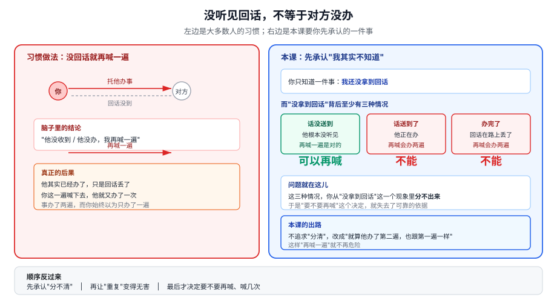
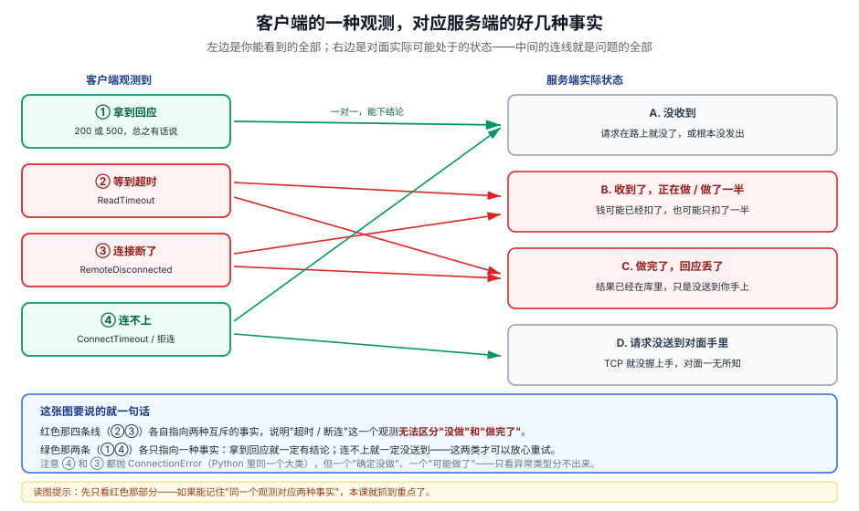
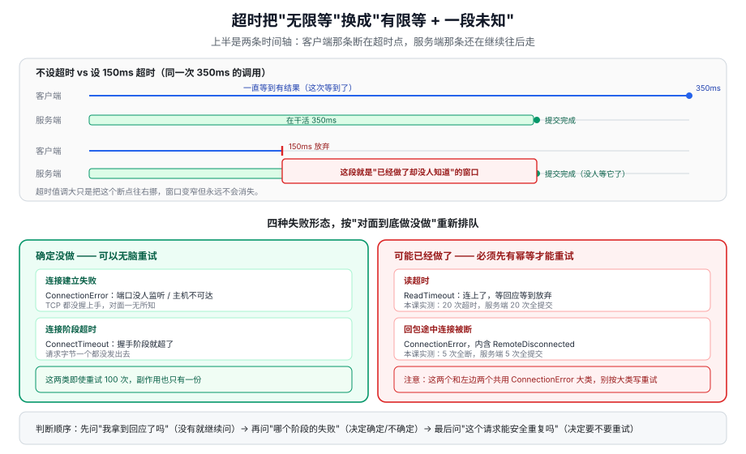
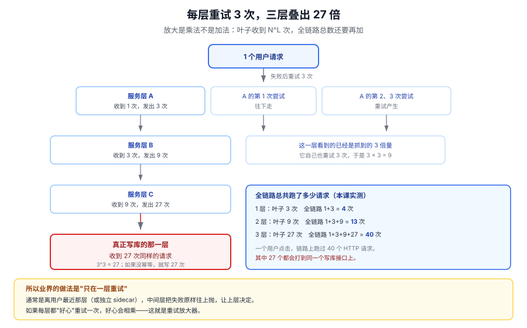
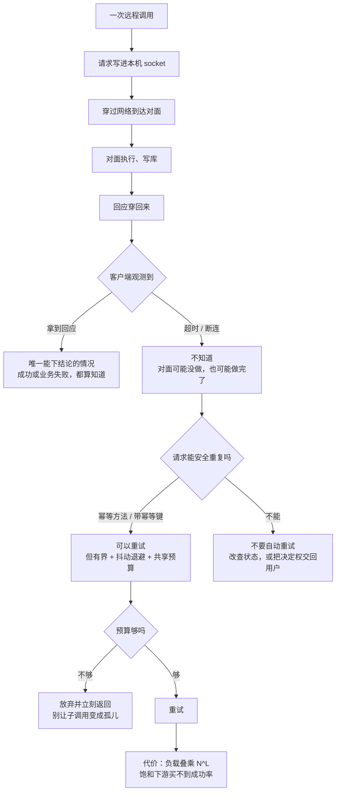

# 第 3 课：网络与部分失败

> 所属阶段：阶段 1《分布式的地基》｜ 水平：入门 ｜ 本课知识点：部分失败：请求发出去了，但不知道结果、网络超时不是"慢"，是"未知"、重试的代价与放大器效应
> 故事情节：主角把订单服务的支付调用接上真实支付网关，上线第二天账上少了一笔钱——用户付了两次。他加的"超时自动重试"本该让系统更可靠，结果变成了重复扣款机器。
> 📖 结论已按官方文档核对（核对于 2026-11 ｜ 来源：[RFC 9110 §9.2.2 Idempotent Methods](https://www.rfc-editor.org/rfc/rfc9110.html#section-9.2.2)、[requests · Timeouts](https://requests.readthedocs.io/en/latest/user/advanced/#timeouts)、[gRPC · Deadlines](https://grpc.io/docs/guides/deadlines/)、[AWS Architecture Blog · Exponential Backoff And Jitter](https://aws.amazon.com/blogs/architecture/exponential-backoff-and-jitter/)、Birrell & Nelson, *Implementing Remote Procedure Calls*, ACM TOCS 2(1), Feb 1984）
> ✅ 本课全部数字实测于 Linux / Python 3.12.3 / requests 2.31.0，服务端与客户端都在本机回环（127.0.0.1）上，不访问外网；脚本见 4.1，可原样复跑

## 🎯 本课目标

- 一次调用失败后，能说清"它到底做没做"这件事你知不知道，并把不知道的那部分单独识别出来
- 给一次远程调用加上超时后，能预判"超时了但对面可能已经做了"会带来什么后果，而不是把超时当成失败的同义词
- 加上重试之前，能算清这个重试会放大多少下游负载、会不会造出孤儿写，并说出三个前提缺了哪一个就不该重试

---

## 第一幕：起源与场景引入

> 🏛️ **起源**：把远程调用做得"像本地函数调用一样"这个想法，1984 年由 Andrew Birrell 和 Bruce Nelson 在 Xerox PARC 系统化提出（论文 *Implementing Remote Procedure Calls*，ACM TOCS 2(1)）。他们在那篇论文里写下一句至今没有失效的话：一次调用如果正常返回，服务端的过程恰好被调用一次；否则客户端会收到异常，而那个过程**要么被调用了一次，要么一次都没被调用，但客户端不会被告知是哪一种**。这句话就是"部分失败"这个概念的出生证明：网络让"调用"这个动作失去了原子性，你能看到的只有"没结果"，看不到"没发生"（核查于 2026-11）。

> 🎬 **场景**：你给订单服务接上了真实支付网关。上线第一周，你在监控里看到支付调用有 3% 的超时。你的第一反应很正常：**超时了就重试一次**。这个改动让"接口成功率"从 96.8% 涨到了 99.2%，你在周报里把它写成一项优化。
>
> 第二周财务找过来：对账单上有 47 笔重复扣款，用户投诉说"我只点了一次"。你翻日志，每笔重复扣款都长这样——第一次调用在 2.0 秒时超时，你重试了；重试成功了；而第一次那个请求在服务端 2.4 秒时才把扣款做完。

> 📌 **一句话本质**：把"没收到回应就等于没做成"这个单机时代的默认假设，换成"没收到回应只说明我不知道，接下来每一步都得为这个'不知道'设计"。
>
> ⚖️ **处境对照**：不这么做——客户端设 100 毫秒超时、服务端处理 50 到 150 毫秒，300 次支付里客户端只拿到 144 次成功，而服务端实际提交了 267 次；**123 次提交是客户端已经放弃的，占全部超时的 87%**（多次复跑落在 87%–92%）。这么做——同样 10 笔订单、每次超时后各重试一次：不加幂等键时实际写入 **20 次**（本该 10 次），加了幂等键后写入 **10 次**、重复请求被挡 10 次。
>
> 位置说明：场景先把人带进去，再给一句"本课本质上在做什么"——既不违背"不以定义开场"，又让读者进第三幕前手里有锚点。

---

## 第二幕：认知冲突

上面那两个数字放在一起看，会让人有点不舒服：**你以为的"失败"，有 87% 其实是"成功"。**

单机程序里，一次函数调用只有两种结局：返回了，或者抛异常了。异常意味着"没做成"，这个假设太自然了，自然到你从来没意识到它是一个假设。可一旦中间隔了一条网络，这个假设就塌了——网络不是一根管子，它是一段"你可以把话喊出去，但没法确认对方听没听见"的距离。

更麻烦的是，你手上有三样工具，看起来都能救场，实际各自只能救一部分：

- **超时**：能让你不再无限等，但它给你的答案是"我不等了"，不是"对面没做"
- **重试**：能救回真正没送到的请求，但它会把"已经做了"的那次再做一遍
- **幂等键**：能挡住重复执行，但它只有在对面愿意认这个键的时候才有效

> ❓ **问题**：如果"超时"不等于"失败"，那我在代码里到底该怎么判断一次调用有没有生效？更进一步——既然判断不出来，那"重试"这个动作凭什么还能是安全的？

---

## 第三幕：层层揭示

### 一眼全局图（进入细节前先看一眼）



> 看图：左边是大多数人的习惯——喊一声，没听见回话，就当对方没听见，于是再喊一遍；右边是本课要你先做的一件事——承认"没听见回话"有好几种可能，其中一种叫"对方听见了、也办了、只是回话丢了"，对这种情况，再喊一遍就是让他再办一遍。图里没有任何术语，谈的只是一件生活里的事：托人办事，没收到回执。

**四条硬约束**已满足：这图只回答"本课要解决什么问题、靠什么思路解决"；图上没有"超时/幂等/RPC"这类词；下面有读图指引；图旁文字能独立说清同一件事。

### 本课地图（分几步走）

| 步 | 这一步要解决什么（人话） | 对应知识点 |
|:--:|------------------------|-----------|
| 1 | 先承认一件事：发出去了没回音，我其实什么都不知道 | 知识点 1：部分失败：请求发出去了，但不知道结果 |
| 2 | 再看我平时最爱用的"超时"，它给我的到底是什么信息 | 知识点 2：网络超时不是"慢"，是"未知" |
| 3 | 最后算账：在这个"不知道"上面加重试，代价有多大、什么时候才能加 | 知识点 3：重试的代价与放大器效应 |

> 只回答"分几步走、现在在哪"——不写机制、不写结论；表格式，不是图、不占 SVG 配额；不标学习状态（进度以 `00-学习档案.md` 为准）。

---

### 知识点 1：部分失败：请求发出去了，但不知道结果

> 🧭 第 1/3 步｜承接：第二幕留下的问题是"超时不等于失败，那我到底知道什么" → 本步：把"一次调用"拆成四个环节，看清客户端能观测到的只有最末一环
> 本知识点关键点：调用不是原子的、客户端视角只有三种结局而服务端有四种状态、三种投递语义各自承诺了什么

#### 一句话定义

部分失败指的是：一次远程调用**已经发生了**，但它的一部分效果你看得见、另一部分看不见——请求发出去了，服务端可能做了、可能没做、可能做了一半，而客户端手上只有一个"没有正常回应"。

#### 直觉建立（类比）

寄一封挂号信。你把信投进邮筒，然后等回执。回执没来，你能确定什么？

你确定不了"对方没收到"。信可能在路上，可能已经躺在对方桌上，也可能对方签收了、回执在返程路上被弄丢了。你能确定的只有一件事：**你还没拿到回执**。挂号信比平信多的那一点保障，恰恰是"回执"这个额外动作，而不是"信本身更可靠"。

> 💡 **类比的边界**：挂号信类比抓的是"回执丢失"这一层，但它盖住了更关键的一点——本地函数调用出问题时，整个进程一起崩，你没有"半个结果"可担心；而远程调用出问题时，**两边的进程都好好活着**，一边做了、一边不知道，系统进入一个既不是成功也不是失败的状态。这才是"部分"两个字的真正含义：不是"做了一半"，是"我知道的那部分和不我知道的那部分不重合"。

#### 核心原理

先把一次调用拆开。它其实不是"一步"，而是四步：

1. 客户端把请求写进本机 socket（这一步失败 = 请求根本没出门）
2. 请求穿过网络到达服务端（这一步失败 = 请求在路上没了）
3. 服务端执行、写库（这一步可能执行到一半）
4. 回应穿回网络到达客户端（这一步失败 = 做了，但你不知道）

客户端能观测到的只有第 4 步的结果。第 1 到第 3 步发生了什么，全部要靠"第 4 步有没有成功"来反推——而这个反推在数学上就是不可靠的：**"没有回应"这一个观测，对应着第 1、2、3 步里任意一步出问题的全部可能**。



> 看图：左边一列是客户端**能看到的**全部三种结局（拿到回应、等到超时、连接断了），右边两列是服务端**实际可能处于**的四种状态。请注意那两条从"超时"和"连接断了"发出去的箭头——它们各自指向两个不同的服务端状态，这就是问题的全部：**同一个观测，对应两种事实，而你分不出来。**只有"拿到回应"那一行是一对一的，所以它才那么珍贵。

三种结局里，只有第一种能让你下结论。另外两种都落在"不知道"里，而"不知道"里的两种事实需要完全相反的处理：

- 如果服务端**没做**，你应该重试（这时候重试是纯收益）
- 如果服务端**做了**，你绝对不能重试（这时候重试是重复扣款）

分不出来，就只能靠"让重复执行变得无害"来解决。这就是为什么 1984 年那篇论文要在语义层面做选择，而不是在实现层面做优化。论文原文（核查于 2026-11）：

> "We guarantee that if the call returns to the user then the procedure in the server has been invoked precisely once. Otherwise, an exception is reported to the user and the procedure will have been invoked either once or not at all--the user is not told which."

翻译过来：正常返回 = 恰好一次；抛异常 = 一次或零次，**但不告诉你哪一种**。这句"不告诉你"不是实现偷懒，是物理限制——回应丢失和请求丢失在客户端看来完全一样。

于是业界退到三种"投递语义"，各自选一个方向认输：

| 语义 | 承诺 | 代价 | 典型实现 |
|---|---|---|---|
| at-most-once（至多一次） | 绝不重复，但可能一次都没执行 | 需要服务端记住"这个调用做过了"，且要扛住服务端重启 | Java RMI、Birrell-Nelson 的设计目标 |
| at-least-once（至少一次） | 一定执行，但可能重复执行 | 客户端必须重传直到收到确认 | Sun RPC、绝大多数消息队列的默认语义 |
| maybe（也许） | 什么都不承诺 | 实现最简单 | 早期 CORBA 的部分绑定 |

注意一个容易漏掉的细节：**at-most-once 也不是"恰好一次"**。服务端要做到"认得出这是同一个调用的重传"，就必须保存调用标识；这个记录一旦只存在内存里，服务端一重启就丢了，重传会被当成新调用再执行一遍。Birrell 和 Nelson 在论文里对此很坦白——他们靠 call identifier 加 server nonce（服务端每次启动换一个随机标识）来区分"这是重传"还是"这是新调用"，而跨崩溃的去重需要把回执持久化，代价很高。所以工程上的真相是：**"恰好一次"在跨进程、跨崩溃的世界里不是一个可以买到的语义，只能靠"至少一次 + 幂等"逼近。**

#### 示例演示

先看"客户端超时、服务端照做"这一幕有多容易复现（完整脚本见 4.1，这里只贴探针部分）：

```python
# 服务端：收到请求后先睡 350ms 再"提交"，然后才回包
if p == "/slow":
    time.sleep(int(q.get("ms", 350)) / 1000.0)
    with LOCK:
        ST["commits"][tag] += 1      # 这就是"钱已经扣了"
    return self._send(200, {"ok": True})

# 客户端：只等 150ms
for i in range(20):
    try:
        requests.get(U + "/slow?ms=350", timeout=0.15)
    except requests.RequestException as e:
        fails += 1                    # 客户端把它记成"失败"
```

实测输出：

```
客户端异常原文: ReadTimeout | HTTPConnectionPool(host='127.0.0.1', port=39501): Read timed out. (read timeout=0.15)
客户端看到失败 20/20 ｜ 客户端耗时 中位 0.151s / 最大 0.152s
服务端收到 20 次，实际提交 20 次
```

20 次调用，客户端 20 次全判失败，服务端 20 次全提交。**误差率 100%。**

再看更隐蔽的一种：服务端把活儿干完了，回包在返回路上丢了。

```
客户端异常原文: ConnectionError | ('Connection aborted.', RemoteDisconnected('Remote end closed connection without response'))
客户端判定：失败 ｜ 服务端提交成功 5/5
```

`RemoteDisconnected` 这个异常名值得记住，它是"对面把连接关了但没给回应"的专属名字。注意它抛出的是 `ConnectionError` 而不是超时——也就是说，**如果你只在代码里 `except Timeout` 做兜底，这一幕会直接穿透到上层**，连"我要不要重试"这个问题都不会被问到。

到底有多少"失败"是假的？把规模放大到 300 次请求：

```
客户端视角：拿到成功 144 ｜ 收到 500 14 ｜ 超时 142 ｜ 连不上 0
服务端视角：收到 298 ｜ 提交成功 267 ｜ 处理失败 31
客户端没拿到成功、服务端却已提交的 123 次 = 全部'超时'里的 87%
```

其余几轮落在 87%–92%。这个比例取决于"客户端超时"和"服务端处理耗时"两个分布的相对位置，不是常数——但它的量级说明一件事：**在有超时的系统里，"客户端认为的失败"里的大多数，可能根本不是失败。**

#### 常见误区

1. **"调用抛异常了，所以调用没成功"**：这是从单机函数调用带过来的直觉，在跨网络时不成立。异常只说明"我没拿到结果"。要判断"有没有生效"，只有三条路：查状态（问对面）、用幂等键（让重复无害）、或者接受不确定（业务上允许）。
2. **"部分失败是网络不好的时候才有的罕见情况"**：恰恰相反，它是**正常网络下的常态**。本课全部实验都在本机回环上跑，一个包都没丢，照样跑出 87% 的假失败——因为只要"客户端愿意等的时间"和"服务端干活的时间"有重叠区，就必然有一批请求落在"干了但没来得及说"的窗口里。
3. **"用了 gRPC / 某个现代框架就不会有这个问题"**：框架能帮你传播截止时间、能帮你自动重试，但它改不了物理事实。gRPC 官方文档明确写着超时后客户端收到 `DEADLINE_EXCEEDED`，而服务端是在客户端截止时间到达时才被 cancel 的——**从截止到 cancel 生效之间，服务端还在跑**（核查于 2026-11）。这个窗口就是部分失败的窗口。

#### 一句话记住

远程调用没有"失败"这个状态，只有"成功"和"不知道"；把"不知道"当失败处理，就是在赌对面没做。

#### 🗣️ 行话对照

**形态 A · 术语少量**

- **部分失败（Partial Failure）**：一次分布式操作中，部分参与者成功、部分失败、部分状态未知的情形——就是本课说的"发出去了但不知道结果"；在哪遇到：分布式系统教材第一章、SRE 复盘里的"部分成功"、消息队列的"部分确认"。
- **投递语义（Delivery Semantics）**：at-most-once / at-least-once / exactly-once 三档承诺——就是本课说的"三种认输方式"；在哪遇到：Kafka 的 `acks` 与 `enable.idempotence`、RabbitMQ 的 publisher confirm、SQS 的 standard vs FIFO。
- **恰好一次（Exactly-once）**：注意它是**效果**上的恰好一次，不是**投递**上的恰好一次；在哪遇到：Kafka 的 "exactly-once semantics"（实际是幂等生产者 + 事务）、Flink 的 checkpoint 机制。

#### 官方文档

- [RFC 9110 §9.2.2 Idempotent Methods](https://www.rfc-editor.org/rfc/rfc9110.html#section-9.2.2)：幂等的官方定义，下一课会用到
- [gRPC · Deadlines](https://grpc.io/docs/guides/deadlines/)：截止时间到了之后服务端会发生什么
- [Python `http.client.RemoteDisconnected`](https://docs.python.org/3/library/http.client.html#http.client.RemoteDisconnected)：上面那个异常名的出处

---

### 知识点 2：网络超时不是"慢"，是"未知"

> 🧭 第 2/3 步｜承接：既然"没回音"对应好几种事实，那我最常用的"超时"到底给了我什么 → 本步：把超时从"时间概念"重新理解成"信息概念"，并分清哪种超时能安全重试
> 本知识点关键点：超时表达的是"我不等了"、四种失败形态对应的确定性不同、超时值设多少都改变不了"未知"只改变"未知的比例"

#### 一句话定义

超时是客户端单方面宣布"我不再等了"的一个动作，它告诉你的是**你等了多久**，而不是**对面做了什么**；它把"无限等待"换成了"有限等待 + 一个未知"，但从来没有把未知变成已知。

#### 直觉建立（类比）

给朋友打电话，响了 30 秒没人接，你挂了。

"没人接"这三个字里其实混着好几种情况：他手机在包里没听见、他在电梯里没信号、他看见是你但正在开会、他接了但你自己这边听筒坏了。你挂断这个动作只证明了一件事——**你不想再等了**。它没有证明他没在。事实上，很多漏接电话的情况是：对方后来回你"我刚在洗澡，看见未接来电了"。

> 💡 **类比的边界**：电话类比抓的是"放弃等待 ≠ 事情没发生"，但它漏掉了超时最要命的一层——**超时是分段的**。TCP 连接有连接超时，读有读超时，整个请求还有总预算。你设的"3 秒"到底管的是哪一段，决定了你事后能不能说"这个请求肯定没送到"。这一层类比给不了，得看代码。

#### 核心原理

先把"超时"这个词拆成四件不同的事，它们在 Python 里连异常类型都不一样：

| 你设的超时管的是哪一段 | 抛出的异常 | 对面到底做没做 | 能不能安全重试 |
|---|---|---|---|
| 连接建立阶段超时 | `ConnectTimeout`（`ConnectionError` 的子类） | **肯定没做**，TCP 都没握上手 | 可以 |
| 连接建立失败（端口没人监听 / 主机不可达） | `ConnectionError` | **肯定没做** | 可以 |
| 连上了，但等回应超时 | `ReadTimeout`（`Timeout` 的子类） | **可能做了**，且很可能已经做了 | 不可以，除非幂等 |
| 连上了，回包途中连接被断 | `ConnectionError`（内含 `RemoteDisconnected`） | **可能做了**，更可能已经做完 | 不可以，除非幂等 |

这张表是本课最该背下来的一页。它的形状很反直觉：**同样是 `ConnectionError` 这个大类，第一种情况（连不上）是"确定没做"，第四种情况（连上了又断）是"可能做了"。** 如果你的重试逻辑写成 `except ConnectionError: retry()`，你就把"确定安全"和"绝对不能重试"这两种情况混成了一种。

requests 官方文档对超时的表述值得逐字读（核查于 2026-11）：

> "timeout is not a time limit on the entire response download; rather, an exception is raised if the server has not issued a response for timeout seconds (more precisely, if no bytes have been received on the underlying socket for timeout seconds)."

也就是说，`timeout=5` 不是"这个请求最多花 5 秒"，而是"**底层 socket 上连续 5 秒没收到任何字节就抛异常**"。这句话有两个直接推论：

第一，**超时是"空闲计时器"，不是"总时长计时器"**。服务端如果每 3 秒吐一个字节，`timeout=5` 的请求可以跑一小时不超时。要限制总时长，得自己在外面加 deadline。

第二，**超时值设多大都改变不了"未知"，只改变"未知的比例"**。设得短，假失败多；设得长，真失败等太久。这是个权衡，不是个可以调优到 0 的参数。文档里还有一句常被忽略的：

> "By default, requests do not time out unless a timeout value is set explicitly. Without a timeout, your code may hang for minutes or more."

**默认不超时。** 也就是说，如果你没写 `timeout=`，你的服务在对面卡住时会一直挂着——挂到你自己也被上游判超时。这是"部分失败"最容易漏的一环：你以为你在处理失败，其实你连失败都没等到。



> 看图：上半部分是同一个请求在"不设超时"和"设超时"两种情况下的时间轴——注意设了超时之后，客户端那条线在某个点就断了，而服务端那条线还在继续往后走，两条线的长度差就是"已经做了但没人知道"的窗口。下半部分是四种失败形态按"确定没做 / 可能做了"重新排队，颜色是判断依据：绿色可以无脑重试，红色必须先确保幂等。

再补一个工程细节，它会让你的超时"看起来没生效"：requests 传单个数值时，这个值**同时**作用于连接和读取两个阶段。所以 `timeout=3` 的实际含义是"连接最多 3 秒，连上之后读取最多 3 秒"，最坏情况总耗时接近 6 秒。要分开设，传元组：

```python
requests.get(url, timeout=(3.05, 27))   # (连接超时, 读取超时)
```

`3.05` 这个奇怪的小数不是玄学：TCP 的重传窗口是 3 秒的倍数，官方文档建议连接超时取略大于 3 的倍数，让客户端的超时落在服务端重传窗口之后，避免"自己先放弃"。还有一条更容易踩的：域名解析出多个 IP 时，底层会**顺序**尝试，所以实际的最坏连接耗时可能是你设的值的若干倍。

#### 示例演示

四种失败在 Python 里长得完全不一样，这段代码把四种都造出来：

```python
# 1) 端口没人监听
try:
    requests.get("http://127.0.0.1:1/", timeout=1.0)
except requests.RequestException as e:
    print(type(e).__name__, "|", str(e)[:70])

# 2) 连得上但一直不回
try:
    requests.get(U + "/slow?ms=2000", timeout=0.3)
except requests.RequestException as e:
    print(type(e).__name__, "|", str(e)[:70])

# 3) 连上了、写完了、回包前被掐断
try:
    requests.get(U + "/drop?ms=10", timeout=3.0)
except requests.RequestException as e:
    print(type(e).__name__, "|", str(e)[:70])

# 4) 服务端正常返回 500
r = requests.get(U + "/fail", timeout=3.0)
print("状态码", r.status_code)      # 不抛异常
```

实测输出：

```
端口没人监听  → ConnectionError | HTTPConnectionPool(host='127.0.0.1', port=1): Max retries exceeded wit
连得上但没回  → ReadTimeout | HTTPConnectionPool(host='127.0.0.1', port=39501): Read timed out. (rea
中途被掐断    → ConnectionError | ('Connection aborted.', RemoteDisconnected('Remote end closed connecti
服务端返回 500 → 不抛异常，状态码 500（要 raise_for_status 才抛）
```

第四行单独说一句：**HTTP 500 不会抛异常**。requests 认为"我拿到了回应"就算这次调用完成了，状态码是业务层面的事。所以一个 `try/except` 包住 `requests.get` 的写法，会漏掉全部 5xx——而这些恰恰是最该重试的一类（它们是"确定失败"，重试最安全）。

#### 常见误区

1. **"超时设长一点，就不会有假失败了"**：把超时从 100ms 调到 1000ms，假失败的比例确实会降，但降不到 0，只是把窗口挪到了 1 秒之后。而且你为此付出的代价是：真失败时你要多等 900ms 才知道。**超时是权衡，不是开关。**
2. **"`timeout=5` 表示这个请求最多 5 秒"**：不是。它是"底层 socket 连续 5 秒没数据"。慢速滴灌的响应可以让它跑很久；而连接 + 读取两段各 5 秒，最坏接近 10 秒。
3. **"没设超时就是等默认值，总有个默认吧"**：requests **没有默认超时**，不写就一直等。这一点和 `httpx` 正好相反——httpx 的默认是 5 秒（`DEFAULT_TIMEOUT_CONFIG = Timeout(timeout=5.0)`），所以从 httpx 换到 requests 的代码，最容易在这里出事。

#### 一句话记住

超时只回答"我等了多久"，永远不回答"对面做没做"；能安全重试的只有"确定没送到"的那两种，而它们和"绝对不能重试"的那两种，共用着同一个异常大类。

#### 🗣️ 行话对照

**形态 A · 术语少量**

- **连接超时 / 读超时（connect timeout / read timeout）**：分别管"握手等多久"和"握手之后等数据等多久"——就是本课说的"两段计时"；在哪遇到：`requests` 的 `timeout=(3.05, 27)`、`httpx.Timeout(connect=, read=)`、Nginx 的 `proxy_connect_timeout` 与 `proxy_read_timeout`。
- **截止时间（deadline）**：一个绝对时刻，不是一段时长——就是本课说的"总预算"；在哪遇到：gRPC 的 `withDeadlineAfter`、Go 的 `context.WithDeadline`、HTTP 的 `Grpc-Timeout` 头。
- **空闲超时（idle timeout）**：连接上多久没数据就断——就是本课说的"空闲计时器"；在哪遇到：负载均衡器的 `idle_timeout`、数据库连接池的 `max_idle`。

#### 官方文档

- [requests · Timeouts](https://requests.readthedocs.io/en/latest/user/advanced/#timeouts)：无默认超时、timeout 的精确语义、单值与元组
- [httpx · Timeouts](https://www.python-httpx.org/advanced/timeouts/)：默认 5 秒，connect / read / write / pool 四类分开设
- [gRPC · Deadlines](https://grpc.io/docs/guides/deadlines/)：超时后客户端 `DEADLINE_EXCEEDED`，服务端收到 `CANCELLED`，但清理工作要服务端自己做

---

### 知识点 3：重试的代价与放大器效应

> 🧭 第 3/3 步｜承接：既然"未知"消不掉、超时又只回答"我等了多久"，那唯一能做的动作就是重试——但重试在两种事实下后果完全相反 → 本步：算清重试放大了多少负载、什么时候它会造出孤儿写、以及加上重试必须同时满足哪三个前提
> 本知识点关键点：重试是指数而非线性放大、重试会造出父已退子仍写的孤儿、重试三前提（幂等 / 有界 / 同预算）缺一不可

#### 一句话定义

重试是"在不知道对面做没做的情况下再问一次"，它的收益是救回真正丢掉的请求，它的代价是**把一次用户请求放大成 N 次下游负载、把一次可能已完成的副作用变成 N 次副作用**，而这个放大会沿着调用链叠乘，不是相加。

#### 直觉建立（类比）

办公室里一件事要经过三层审批。每一层的人都有个习惯：上一层 3 分钟没回我，我就再问一次。

现在想象最底层那个审批人。他收到第一份申请，开始处理。3 分钟后，中间层没等到回音，又发一份；再过一会儿，又发一份。等这件事办完，他桌上堆了三份一模一样的申请。如果他每次都照办，这件事就被批了三遍。

而更糟的是：中间层的人也在被更上一层催。**每一层的"再问一次"都会让下一层把所有副本再展开一遍。** 三层各重试 3 次，最底层收到的不是 9 份，是 27 份。

> 💡 **类比的边界**：审批类比抓的是"放大"，但它把放大画成了线性累加。真实的放大是**乘法**：每层重试 N 次、链路 L 层，最底层收到 N^L 次。这个差别很要紧——L=3、N=3 时是 27 倍而不是 9 倍；L=5、N=3 时是 243 倍。而现实中一条链路 5 跳很常见。

#### 核心原理

重试的代价有三层，从浅到深：

**第一层：直接放大。** 一次用户请求，客户端重试 R 次，下游就看到最多 R+1 次。这一层容易算，也容易接受。

**第二层：叠乘放大。** 当链路上每一跳都在重试时，最底层看到的是各跳重试次数的乘积。这不是理论推演，是实测：每层失败各重试 3 次，一层的叶子被打 3 次，两层 9 次，三层 27 次。而全链路的总请求数分别是 4、13、40 次——**为了一个用户请求，链路上跑过 40 个 HTTP 请求，而每一次都可能触发一次副作用。**



> 看图：从上往下读。最上面是 1 个用户请求；每往下一层，一个请求裂成 3 个；到第三层的时候，最底下那个服务已经收到 27 个同样的请求了。右边那列数字是全链路累计请求数（4 / 13 / 40），它比叶子数更能说明"这一次用户点击让系统付出了多少"。注意颜色：只有最底层是红色，因为只有它真的在写库——上面的放大都还只是"问"，最底层的放大才是"做"。

**第三层：孤儿写。** 这一层最隐蔽。它发生在"父调用已经放弃，子调用还在跑"的时候。

父调用有个总预算（比如 1 秒），它调子调用时给子设了 0.8 秒超时，子实际要 0.9 秒。0.8 秒到，父认为子失败了，重试一次；重试又一次 0.8 秒超时；预算耗尽，父返回 504。但子调用那两次并没有停——它们还在跑。父返回 504 之后，它们各自跑完，各自写了一次库。

实测现场：

```
父返回 504 ｜ 父耗时 1.00s ｜ 父预算 1.0s
此刻子调用已到达 2 次，完成 1 次
父返回之后，又有 1 次子调用完成（这批是纯浪费）
子调用最终到达 2 次，完成 2 次
```

父已经给用户回了"失败"，用户可能已经重新下单了；而服务端还在把旧的那单慢慢做完。**2 次完成里，1 次是在父已经放弃之后完成的。** 这就是"孤儿写"：没有人再等它的结果，但它的副作用留下来了。

第三层的根因和第一、二层不同：它不是"重试次数太多"，而是**父子的超时预算没有共用一条时间线**。父给了子一个独立的 0.8 秒，而不是"我还剩 0.8 秒，你最多用这么多"。这个区别在单机上看不出来，在有一层超时包裹另一层超时的系统里就会稳定复现。

那么什么时候可以重试？RFC 9110 §9.2.2 对幂等的定义是判断的起点（核查于 2026-11）：

> "A request method is considered 'idempotent' if the intended effect on the server of multiple identical requests with that method is the same as the effect for a single such request."

注意 "intended effect" 这三个词——它约束的是"意图产生的效果"，不是"服务端一切可观测的痕迹"。删一条已经删掉的记录，第二次返回 404，效果仍然与第一次相同，所以 DELETE 是幂等的；但服务端照样会写两条访问日志。这个区别在排查时很有用：**幂等不等于"什么都没发生"，等于"该发生的只发生了一次"**。

同一节还有一句直接针对重试的（这是本课最重要的一句规范原文）：

> "Idempotent methods are distinguished because the request can be repeated automatically if a communication failure occurs before the client is able to read the server's response."

后半句是前提，也是常被漏掉的部分：**"在客户端还没读到响应之前"**。如果客户端已经读到响应了（哪怕是 500），它就不该自动重试——因为那时候它已经知道结果了，重试的正当性消失了。规范接着说：

> "A client SHOULD NOT automatically retry a request with a non-idempotent method unless it has some means to know that the request semantics are actually idempotent"

"除非它有办法知道这个请求的语义实际上是幂等的"——这个"办法"就是幂等键。GET / HEAD / OPTIONS / TRACE 是 safe 的，PUT / DELETE 是幂等的，而 **POST 默认两者都不是**。这就是为什么支付接口必须额外设计一个幂等键，而不能指望 HTTP 方法本身。

实测这条规则的威力（10 笔订单，每笔都在超时后重试一次）：

```
无幂等键：10 单实际写入 20 次（应当 10 次）
有幂等键：10 单实际写入 10 次，重复请求被挡 10 次（应当 10 次）
```

一次重试就让副作用翻倍。而幂等键的实现有一个非常容易写错的地方，我自己第一版就写错了——见下面的反例。

三个前提，缺一不可：

1. **幂等性**：要么方法本身幂等（PUT/DELETE/GET），要么带幂等键。没有这一条，重试就是在制造重复副作用。
2. **有界**：重试次数要有上限，且退避要有抖动。无上限的重试会在下游故障时变成永久放大器。
3. **同预算**：重试共享父级的总时间预算，且子的超时必须从剩余预算里扣。否则就是孤儿写。

#### 示例演示

先看重试风暴的实测。下游并发上限 4，64 个客户端同时打，客户端超时 0.1 秒，跑 5 轮取中位：

| 客户端重试上限 | 客户端发出 | 服务端收到 | 成功 | 墙钟 |
|---|---|---|---|---|
| 0（不重试） | 64 | 40 | 20/64 | 0.15s |
| 2 | 149 | 112 | 24/64 | 0.36s |
| 4 | 234 | 193 | 27/64 | 0.57s |

读这张表要横着读三遍：

- 客户端发出量：64 → 234，涨了 **3.7 倍**
- 成功率：20/64 → 27/64，只多了 **7 个**
- 墙钟：0.15s → 0.57s，也涨了 **3.8 倍**

也就是说，多出来的 170 次请求，买回来 7 次成功。**在下游已经饱和的情况下，重试几乎买不到成功率，只买到负载。** 更糟的是这些负载加在同一个已经饱和的下游上，会让它更慢——表里服务端"收到"从 40 涨到 193，而"完成"并没有等比例涨，多出来的全在排队。

第二个反例是我自己写错的幂等键。第一版长这样：

```python
if p == "/dedup":
    key = q["key"]
    with LOCK:
        if key in ST["dedup"]:        # ① 先检查
            ST["dedup_hit"] += 1
            return self._send(200, {"ok": True, "dup": True})
    time.sleep(int(q.get("ms", 300)) / 1000.0)   # ② 中间干了 300ms 的活
    with LOCK:
        ST["dedup"][key] = "done"     # ③ 最后才登记
```

跑出来是：`有幂等键：10 单实际写入 20 次，重复请求被挡 0 次`。**加了幂等键，一次都没挡住。**

原因是典型的 check-then-act 竞态：两个并发请求都在第 ① 步通过检查（那时表里还没有这个 key），然后都进了第 ② 步，都干了活。**幂等键必须在"开始干活之前"就占位，而不是"干完之后"才登记。** 修法是先写 `inflight` 再干活：

```python
with LOCK:
    state = ST["dedup"].get(key)
    if state is not None:
        ST["dedup_hit"] += 1
        return self._send(200, {"ok": True, "dup": True, "state": state})
    ST["dedup"][key] = "inflight"     # ✅ 先占位，再干活
time.sleep(int(q.get("ms", 300)) / 1000.0)
with LOCK:
    ST["dedup"][key] = "done"
```

修完才是 `10 单实际写入 10 次，重复请求被挡 10 次`。这个坑值得单独记一笔：**幂等键的正确性不在"键"上，在"占位的时机"上**。而且 `inflight` 状态还顺带解决了一个更麻烦的问题——如果第二个请求在第一个请求还在跑的时候就到了，它应该等结果（或返回"处理中"），而不是另起一份活儿。

#### 常见误区

1. **"重试是提高可用性的免费午餐"**：重试的收益只在"请求真的没送到"时存在。在"下游饱和"和"服务端已执行"这两种情况下，重试分别是纯负载和纯副作用。本课实测：下游饱和时把重试从 0 提到 4，负载涨 3.7 倍，成功率只多了 7 个（64 个客户端里）。
2. **"给每层都加重试，可靠性就能叠加"**：正好相反，可靠性不会叠加，负载会叠乘。三层各 3 次 = 27 倍。业界的做法是**只在一层重试**（通常是离用户最近的那层，或专门的 sidecar），中间层把失败原样往上抛。
3. **"指数退避就够了，不用加抖动"**：不加抖动的指数退避会让所有客户端在同一时刻醒来重试，形成周期性的尖峰。AWS 那篇被引用最多的退避文章结论很直接："The return on implementation complexity of using jittered backoff is huge, and it should be considered a standard approach for remote clients."（核查于 2026-11）。三种抖动的取舍：Full Jitter（`random(0, base*2^n)`）最简单、分散效果最好，但可能出现极短等待；Equal Jitter（`base*2^(n-1) + random(0, base*2^(n-1))`）保底一半等待；Decorrelated Jitter（`min(cap, random(base, prev*3))`）适合连续失败。

#### 一句话记住

重试的前提不是"失败了就重试"，而是"我能安全地重复执行"；在不确定对面做没做的时候加重试，等于把不确定性兑换成重复副作用。

#### 🗣️ 行话对照

**形态 B · 讲"多策略"**

| 本课说法（人话） | 行业标准叫法 | 典型配置 / 在哪遇到 | 代价 |
|---|---|---|---|
| 同一条请求再发一次 | 重试（retry） | `urllib3.util.Retry(total=3, backoff_factor=0.5)`、`tenacity.retry`、Nginx `proxy_next_upstream` | 放大下游负载；非幂等时有重复副作用 |
| 越等越久再试 | 指数退避（exponential backoff） | `Retry(backoff_factor=)`、gRPC 的 `retryPolicy.initialBackoff` | 长尾变长；无抖动时形成同步尖峰 |
| 等待时间加随机 | 抖动（jitter） | AWS SDK 默认 Full Jitter、`Retry(backoff_jitter=)` | 等待时间不可预测，压测时不好复现 |
| 用同一个号识别同一次操作 | 幂等键（idempotency key） | `Idempotency-Key` 请求头（IETF draft，非 RFC）、Stripe 的 API 实践 | 服务端要存键与结果，还要处理键的过期 |
| 所有重试共用一份时间 | 截止时间传播（deadline propagation） | gRPC 自动传播、`context.WithTimeout`、HTTP `Grpc-Timeout` | 需要全链路改造，跨语言要约定头名 |

> `Idempotency-Key` 目前是 IETF 的 draft（`draft-ietf-httpapi-idempotency-header`），**不是已发布的 RFC**，别提"RFC 规定"。

#### 官方文档

- [RFC 9110 §9.2.2 Idempotent Methods](https://www.rfc-editor.org/rfc/rfc9110.html#section-9.2.2)：幂等定义、自动重试的边界条件、代理不得自动重试非幂等请求
- [AWS · Exponential Backoff And Jitter](https://aws.amazon.com/blogs/architecture/exponential-backoff-and-jitter/)：三种抖动算法与实测对比（2015-03-04，Marc Brooker）
- [urllib3 · Retry](https://urllib3.readthedocs.io/en/stable/reference/urllib3.util.html#urllib3.util.Retry)：requests 生态里实际生效的重试实现
- [Stripe API · Idempotent requests](https://docs.stripe.com/api/idempotent_requests)：幂等键的工业级用法

---

## 第四幕：实操验证

### 4.1 机制验证

> ✅ 实测于 Linux / 20 核 / Python 3.12.3 / requests 2.31.0——下面这段脚本可原样复跑，全部请求打本机回环 `127.0.0.1`，服务端也在同一进程里起，不访问外网。M1–M5、M7 是确定性场景，同一脚本多次复跑输出完全一致；M6 每项跑 5 轮取中位、M8 用 16 线程并发跑 300 次，这两项会随机器浮动，但**方向和量级**稳定（同一脚本先后跑了三轮，M8 的假失败率落在 87%–92%，M6 的成功数落在 20–31 之间（满值 64））。

一个脚本回答本课全部问题：超时后服务端做没做、假失败有多少、重试放大多少倍、孤儿写怎么来的、重试能救回多少成功率、四种失败长什么样。

```python
# network_partial_failure.py —— 课 3 全部探针，一个脚本跑完
import http.server, json, random, statistics, sys, threading, time
from collections import defaultdict
from concurrent.futures import ThreadPoolExecutor
from urllib.parse import parse_qs, quote, urlparse
import requests

LOCK = threading.Lock()
ST = {"hits": defaultdict(int), "commits": defaultdict(int), "dedup": {},
      "dedup_hit": 0, "late": 0, "parent_done_at": None,
      "pay": {"hit": 0, "commit": 0, "fail": 0}}
T0 = time.perf_counter()
SEM = threading.Semaphore(4)          # 模拟下游并发上限 4


class H(http.server.BaseHTTPRequestHandler):
    protocol_version = "HTTP/1.1"

    def log_message(self, *a):
        pass

    def _send(self, code, obj):
        body = json.dumps(obj).encode()
        try:
            self.send_response(code)
            self.send_header("Content-Type", "application/json")
            self.send_header("Content-Length", str(len(body)))
            self.end_headers()
            self.wfile.write(body)
        except (BrokenPipeError, ConnectionResetError):
            self.close_connection = True

    def do_GET(self):
        u = urlparse(self.path)
        q = {k: v[0] for k, v in parse_qs(u.query).items()}
        p, tag = u.path, u.path.strip("/")

        if p == "/pay":                       # M8：真实分布的支付
            with LOCK:
                ST["pay"]["hit"] += 1
            time.sleep(random.uniform(0.050, 0.150))
            if random.random() < 0.10:
                with LOCK:
                    ST["pay"]["fail"] += 1
                return self._send(500, {"ok": False})
            with LOCK:
                ST["pay"]["commit"] += 1
            return self._send(200, {"ok": True})

        with LOCK:
            ST["hits"][tag] += 1

        if p == "/slow":                      # M1/M3：慢但会成功
            time.sleep(int(q.get("ms", 350)) / 1000.0)
            with LOCK:
                ST["commits"][tag] += 1
            return self._send(200, {"ok": True})

        if p == "/drop":                      # M2：写完就掐断，不回包
            time.sleep(int(q.get("ms", 50)) / 1000.0)
            with LOCK:
                ST["commits"][tag] += 1
            self.close_connection = True
            try:
                self.connection.close()
            except Exception:
                pass
            return

        if p == "/dedup":                     # M3：带幂等键
            key = q["key"]
            with LOCK:
                state = ST["dedup"].get(key)
                if state is not None:
                    ST["dedup_hit"] += 1
                    return self._send(200, {"ok": True, "dup": True, "state": state})
                ST["dedup"][key] = "inflight"   # 先占位，再干活
            time.sleep(int(q.get("ms", 300)) / 1000.0)
            with LOCK:
                ST["dedup"][key] = "done"
                ST["commits"][tag] += 1
            return self._send(200, {"ok": True, "dup": False})

        if p == "/fail":
            return self._send(500, {"ok": False})

        if p == "/chain":                     # M4：每层重试 3 次的中间节点
            nxt = q["next"]
            for i in range(3):
                try:
                    r = requests.get(nxt, timeout=5.0)
                except requests.RequestException:
                    continue
                if r.status_code == 200:
                    return self._send(200, {"ok": True, "attempts": i + 1})
            return self._send(503, {"ok": False})

        if p == "/limited":                   # M6：下游并发上限 4
            with SEM:
                time.sleep(0.02)
                with LOCK:
                    ST["commits"][tag] += 1
            return self._send(200, {"ok": True})

        if p == "/child":                     # M5：被父调用的子
            time.sleep(int(q.get("ms", 500)) / 1000.0)
            with LOCK:
                ST["commits"][tag] += 1
                if ST["parent_done_at"] is not None:
                    ST["late"] += 1           # 父已返回后才完成 = 孤儿
            return self._send(200, {"ok": True})

        if p == "/parent":                    # M5：有总预算的父
            budget, child_to, child = 1.0, 0.8, q["child"]
            deadline = time.perf_counter() + budget
            ok = False
            for _ in range(3):
                left = deadline - time.perf_counter()
                if left <= 0.02:
                    break
                try:
                    requests.get(child, timeout=min(child_to, left))
                    ok = True
                    break
                except requests.RequestException:
                    continue
            with LOCK:
                if not ok:
                    ST["parent_done_at"] = time.perf_counter() - T0
            return self._send(200 if ok else 504, {"ok": ok})

        return self._send(404, {"ok": False})


class Srv(http.server.ThreadingHTTPServer):
    daemon_threads = True
    allow_reuse_address = True


def start():
    s = Srv(("127.0.0.1", 0), H)
    threading.Thread(target=s.serve_forever, daemon=True).start()
    return "http://127.0.0.1:%d" % s.server_address[1]


def reset():
    with LOCK:
        ST["hits"] = defaultdict(int); ST["commits"] = defaultdict(int)
        ST["dedup"] = {}; ST["dedup_hit"] = 0
        ST["late"] = 0; ST["parent_done_at"] = None


def hdr(t):
    print("\n" + "=" * 66); print(t); print("=" * 66)


U = start()
print("server:", U, "| python", sys.version.split()[0], "| requests", requests.__version__)

# M1 客户端超时 ≠ 服务端没做
hdr("M1 客户端 0.15s 放弃，服务端 0.35s 才提交")
reset(); fails, el, first = 0, [], None
for _ in range(20):
    t0 = time.perf_counter()
    try:
        requests.get(U + "/slow?ms=350", timeout=0.15)
    except requests.RequestException as e:
        fails += 1
        if first is None: first = e
    el.append(time.perf_counter() - t0)
time.sleep(0.6)
print("  客户端异常原文:", type(first).__name__, "|", str(first)[:90])
print("  客户端看到失败 %d/20 ｜ 中位 %.3fs / 最大 %.3fs" % (fails, statistics.median(el), max(el)))
print("  服务端收到 %d 次，实际提交 %d 次" % (ST["hits"]["slow"], ST["commits"]["slow"]))

# M2 提交成功、回应丢失
hdr("M2 服务端写库完成后直接掐断连接")
reset(); err = None
for _ in range(5):
    try:
        requests.get(U + "/drop?ms=50", timeout=3.0)
    except requests.RequestException as e:
        err = e
time.sleep(0.3)
print("  客户端异常原文:", type(err).__name__, "|", str(err)[:110])
print("  客户端判定：失败 ｜ 服务端提交成功 %d/5" % ST["commits"]["drop"])

# M3 超时后重试一次：无幂等键 vs 有幂等键
hdr("M3 超时后重试一次（各 10 单）")
reset()
for i in range(10):
    for _ in range(2):
        try: requests.get(U + "/slow?ms=300", timeout=0.1)
        except requests.RequestException: pass
time.sleep(0.6); a = ST["commits"]["slow"]
reset()
for i in range(10):
    for _ in range(2):
        try: requests.get(U + "/dedup?key=order-%d&ms=300" % i, timeout=0.1)
        except requests.RequestException: pass
time.sleep(0.6); b, dup = ST["commits"]["dedup"], ST["dedup_hit"]
print("  无幂等键：10 单实际写入 %d 次" % a)
print("  有幂等键：10 单实际写入 %d 次，重复请求被挡 %d 次" % (b, dup))

# M4 重试放大器
hdr("M4 每层失败各重试 3 次")
for depth in (1, 2, 3):
    reset(); url = U + "/fail"
    for _ in range(depth):
        url = U + "/chain?next=" + quote(url, safe="")
    try: requests.get(url, timeout=10.0)
    except requests.RequestException: pass
    print("  层数 %d：叶子收到 %d 次（3^%d=%d）｜ 全链路总请求 %d 次"
          % (depth, ST["hits"]["fail"], depth, 3 ** depth, sum(ST["hits"].values())))

# M5 超时预算倒挂
hdr("M5 父预算 1.0s，子超时 0.8s，子实际 0.9s")
reset(); t0 = time.perf_counter()
r = requests.get(U + "/parent?child=" + quote(U + "/child?ms=900", safe=""), timeout=10.0)
print("  父返回 %d ｜ 父耗时 %.2fs" % (r.status_code, time.perf_counter() - t0))
print("  此刻子调用已到达 %d 次，完成 %d 次" % (ST["hits"]["child"], ST["commits"]["child"]))
time.sleep(1.6)
print("  父返回之后，又有 %d 次子调用完成" % ST["late"])
print("  子调用最终到达 %d 次，完成 %d 次" % (ST["hits"]["child"], ST["commits"]["child"]))

# M6 重试风暴
hdr("M6 下游并发上限 4，64 客户端，超时 0.1s，5 轮取中位")
def one_client(retry):
    attempts = 0
    for _ in range(retry + 1):
        attempts += 1
        try:
            if requests.get(U + "/limited", timeout=0.1).status_code == 200:
                return True, attempts
        except requests.RequestException:
            continue
    return False, attempts

rows = []
for _ in range(5):
    for retry in (0, 2, 4):
        reset(); t0 = time.perf_counter()
        with ThreadPoolExecutor(max_workers=64) as ex:
            res = list(ex.map(lambda _: one_client(retry), range(64)))
        wall = time.perf_counter() - t0
        ok = sum(1 for s, _ in res if s)
        sent = sum(a for _, a in res)
        time.sleep(1.0)
        rows.append((retry, sent, ST["hits"]["limited"], ok, wall))
for retry in (0, 2, 4):
    g = [r for r in rows if r[0] == retry]
    med = lambda i: sorted(x[i] for x in g)[len(g) // 2]
    print("  重试上限 %d：发出 %d ｜ 服务端收到 %d ｜ 成功 %d/64 ｜ 墙钟 %.2fs"
          % (retry, med(1), med(2), med(3), med(4)))

# M7 四种失败形态
hdr("M7 四种失败在 Python 里长得不一样")
try: requests.get("http://127.0.0.1:1/", timeout=1.0)
except requests.RequestException as e: print("  端口没人监听  →", type(e).__name__, "|", str(e)[:70])
try: requests.get(U + "/slow?ms=2000", timeout=0.3)
except requests.RequestException as e: print("  连得上但没回  →", type(e).__name__, "|", str(e)[:70])
try: requests.get(U + "/drop?ms=10", timeout=3.0)
except requests.RequestException as e: print("  中途被掐断    →", type(e).__name__, "|", str(e)[:70])
r = requests.get(U + "/fail", timeout=3.0)
print("  服务端返回 500 → 不抛异常，状态码 %d（要 raise_for_status 才抛）" % r.status_code)

# M8 未知态有多大
hdr("M8 300 次支付：客户端 100ms 超时，服务端 U(50,150)ms、10% 失败")
random.seed(7); cnt = {"ok200": 0, "srv500": 0, "timeout": 0, "conn": 0}
def pay(_):
    try:
        return "ok200" if requests.get(U + "/pay", timeout=0.100).status_code == 200 else "srv500"
    except requests.Timeout: return "timeout"
    except requests.RequestException: return "conn"
with ThreadPoolExecutor(max_workers=16) as ex:
    for o in ex.map(pay, range(300)):
        cnt[o] += 1
time.sleep(1.0)
print("  客户端视角：成功 %d ｜ 500 %d ｜ 超时 %d ｜ 连不上 %d"
      % (cnt["ok200"], cnt["srv500"], cnt["timeout"], cnt["conn"]))
print("  服务端视角：收到 %d ｜ 提交成功 %d ｜ 处理失败 %d"
      % (ST["pay"]["hit"], ST["pay"]["commit"], ST["pay"]["fail"]))
fake = ST["pay"]["commit"] - cnt["ok200"]
print("  客户端没拿到成功、服务端已提交的 %d 次 = 全部超时里的 %.0f%%"
      % (fake, 100.0 * fake / max(1, cnt["timeout"])))
```

实测输出（Linux / 20 核 / Python 3.12.3 / requests 2.31.0）：

```
server: http://127.0.0.1:39501 | python 3.12.3 | requests 2.31.0

==================================================================
M1 客户端 0.15s 放弃，服务端 0.35s 才提交
==================================================================
  客户端异常原文: ReadTimeout | HTTPConnectionPool(host='127.0.0.1', port=39501): Read timed out. (read timeout=0.15)
  客户端看到失败 20/20 ｜ 中位 0.151s / 最大 0.152s
  服务端收到 20 次，实际提交 20 次

==================================================================
M2 服务端写库完成后直接掐断连接
==================================================================
  客户端异常原文: ConnectionError | ('Connection aborted.', RemoteDisconnected('Remote end closed connection without response'))
  客户端判定：失败 ｜ 服务端提交成功 5/5

==================================================================
M3 超时后重试一次（各 10 单）
==================================================================
  无幂等键：10 单实际写入 20 次
  有幂等键：10 单实际写入 10 次，重复请求被挡 10 次

==================================================================
M4 每层失败各重试 3 次
==================================================================
  层数 1：叶子收到 3 次（3^1=3）｜ 全链路总请求 4 次
  层数 2：叶子收到 9 次（3^2=9）｜ 全链路总请求 13 次
  层数 3：叶子收到 27 次（3^3=27）｜ 全链路总请求 40 次

==================================================================
M5 父预算 1.0s，子超时 0.8s，子实际 0.9s
==================================================================
  父返回 504 ｜ 父耗时 1.00s
  此刻子调用已到达 2 次，完成 1 次
  父返回之后，又有 1 次子调用完成
  子调用最终到达 2 次，完成 2 次

==================================================================
M6 下游并发上限 4，64 客户端，超时 0.1s，5 轮取中位
==================================================================
  重试上限 0：发出 64 ｜ 服务端收到 40 ｜ 成功 20/64 ｜ 墙钟 0.15s
  重试上限 2：发出 149 ｜ 服务端收到 112 ｜ 成功 24/64 ｜ 墙钟 0.36s
  重试上限 4：发出 234 ｜ 服务端收到 193 ｜ 成功 27/64 ｜ 墙钟 0.57s

==================================================================
M7 四种失败在 Python 里长得不一样
==================================================================
  端口没人监听  → ConnectionError | HTTPConnectionPool(host='127.0.0.1', port=1): Max retries exceeded wit
  连得上但没回  → ReadTimeout | HTTPConnectionPool(host='127.0.0.1', port=39501): Read timed out. (rea
  中途被掐断    → ConnectionError | ('Connection aborted.', RemoteDisconnected('Remote end closed connecti
  服务端返回 500 → 不抛异常，状态码 500（要 raise_for_status 才抛）

==================================================================
M8 300 次支付：客户端 100ms 超时，服务端 U(50,150)ms、10% 失败
==================================================================
  客户端视角：成功 144 ｜ 500 14 ｜ 超时 142 ｜ 连不上 0
  服务端视角：收到 298 ｜ 提交成功 267 ｜ 处理失败 31
  客户端没拿到成功、服务端已提交的 123 次 = 全部超时里的 87%
```

八段各自对应本课三个知识点：

- M1、M2、M8：**"失败"里有一大半是假失败**——知识点 1 的核心证据，87% 这个数字比任何论述都直接
- M7：**同一个大类异常里混着两种确定性**——知识点 2 的判据表，`ReadTimeout` 才是"未知"
- M3、M4、M5、M6：**重试的四种代价**——知识点 3，分别对应"副作用翻倍""负载叠乘""孤儿写""买不到成功率"

> ⚠️ **这个脚本本身踩过三个坑，都值得记住**：
> ① 幂等键第一版写成"先检查、再干活、最后登记"，跑出 `重复请求被挡 0 次`——**check-then-act 竞态**，必须先占位再干活（知识点 3 给了对照代码）。
> ② 重试放大器最初把所有请求记进同一个全局计数，跑出"层数 1 时叶子收到 4 次（理论上限 3）"——把中间节点也算成了叶子。改成按 path 分标签后才对上 3/9/27。
> ③ 想用 `192.0.2.1`（文档保留地址）构造连接超时，结果网关让它 TCP 建连成功但无响应，抛的是 `ReadTimeout` 而不是 `ConnectionError`——**构造"连不上"要用一个本机没人监听的端口（`127.0.0.1:1`）**，别用保留地址。

> ✅ **回扣场景**：第一幕那个"3% 超时就重试"的改动，现在可以算清它的账了。它救回的是 M1 里那种"服务端真没做"的请求；它制造的是 M3 里的第 11 笔到第 20 笔写入。因为支付是 POST（非幂等），按 RFC 9110 那句 "A client SHOULD NOT automatically retry a request with a non-idempotent method"，这个重试从一开始就不该自动发生。正确的动作顺序是：先给支付接口加幂等键（让重复执行无害），再给重试设上限和抖动，最后把所有重试收进父级的总预算里。三件事做完，"提高成功率"那个改动才真的只是提高成功率。

### 4.2 应用实战：重试掩盖超时（入口）

> 🎯 **本课应用实战独立成篇**（配套实战册）：[第 3 课实战 · 重试掩盖超时](../../../应用实战/03-网络与部分失败.md)
> 含**分步设计图**（每步一张：这一版长什么样、比上一版改了什么）与"裸调 → 加超时 → 加幂等与重试"的完整演进与代码；通览全部：📚 [应用实战索引](../../../应用实战/INDEX.md)
> **课内不重复实战正文**：本课的知识点已在上面讲透，实战册负责把"一个真实的扣款接口"从裸调一路改到能上生产的最小形态，每一步都贴可运行代码与它的运行输出。

---

## 第五幕：体系收束

这一课表面上在讲网络，其实在讲一件后面 11 课都会反复用到的事：**在分布式系统里，"失败"不是一个状态，而是一个观测缺口。**

三个知识点串起来是一条完整的推理链：

- 知识点 1 建立了缺口的存在：一次调用拆成四段，客户端只看得到最后一段，所以"没有回应"对应着好几种互斥的事实
- 知识点 2 给了缺口一个精确的名字：超时只说明"我不等了"，它把"无限等待"换成了"有限等待 + 未知"，而未知的比例取决于超时值和处理耗时的相对位置
- 知识点 3 给了应对缺口的唯一出路：既然消不掉未知，就让"重复执行"变得无害（幂等），并给这个动作套上三重约束（有界、抖动的退避、共享预算）

这条链会一直在后面的课里出现。课 6《超时、重试、幂等》会把这里的三条前提做成工程规范；课 7《熔断、限流、隔离》处理的是"重试把下游压死"之后的事；课 10《事务性发件箱与幂等消费》会把这个思路从"同步调用"搬到"异步消息"——那时"部分失败"换了个名字叫"重复投递"，解法还是同一个：幂等。

> 📍 **全局定位**：本课是阶段 1 的第三块地基。第一块（课 1）装工具，第二块（课 2）解决单机内的资源分配，这一块解决"跨出进程之后，你能知道什么"。有了它，后面所有关于重试、幂等、事务、补偿的设计才有立足点——它们全部是在填这一个缺口。
> 🔗 **下一步**：课 4 会把视角再推一层——如果连"什么时候发生"都不能信任，那"先后顺序"这件事还剩多少意义？你会看到时钟漂移、单调时钟与墙钟的区别，以及 CAP 那句话被误读了多少年。

---

## 🐞 常见误区

1. **"加了重试，可用性就上去了"**：重试能改善的是"瞬时故障"这一类。对"下游持续饱和"和"请求已执行"这两类，它分别加剧问题和制造问题。本课实测：饱和下游上把重试从 0 提到 4，负载涨 3.7 倍，成功率只从 20/64 到 27/64。
2. **"超时时间调大一点，就能减少误判"**：能减少，但永远减不到 0，只是把窗口往后挪。而且你付出的是"真失败时要多等这么久"。真正的解法是让重复执行无害，而不是试图用更长的等待去覆盖不确定性。
3. **"POST 不幂等，那就别重试——问题解决了"**：不重试只是不制造重复，但用户点了一次、网络断了、他没看到结果，他会自己再点一次。**用户的手就是最强的重试器，而且没有退避。** 所以幂等键不是"为了支持自动重试"，是"为了防住所有来源的重复"。
4. **"我们用了消息队列，重复消息会被框架处理掉"**：绝大多数队列的默认语义是 at-least-once，框架保证的是"不丢"，不是"不重"。重复消息是默认行为，消费端不做幂等就会重复扣款。

### ⏳ 与过时说法对照

| 旧说法（网上过时教程 / 训练知识里的说法） | 官方文档现状 | 来源 |
|---|---|---|
| "`requests` 有默认超时，不写就等一会儿" | **没有默认超时**，不显式设置会一直等（核查于 2026-11） | [requests · Timeouts](https://requests.readthedocs.io/en/latest/user/advanced/#timeouts) |
| "`timeout=5` 表示请求最多 5 秒" | 是"底层 socket 连续 5 秒无数据"；连接与读取各算一次，最坏接近 10 秒 | 同上 |
| "幂等重试是 RFC 规定的，客户端可以随便重试幂等方法" | RFC 允许自动重试的前提是"**在读到响应之前**"；已读到 5xx 就不该自动重试；代理**不得**自动重试非幂等请求 | [RFC 9110 §9.2.2](https://www.rfc-editor.org/rfc/rfc9110.html#section-9.2.2) |
| "`Idempotency-Key` 是 RFC 标准头" | 目前是 IETF draft（`draft-ietf-httpapi-idempotency-header`），**未成为 RFC** | [IETF Datatracker](https://datatracker.ietf.org/doc/draft-ietf-httpapi-idempotency-header/) |

## 一图总结



> **与课首入口的分工**：课首那张图给没学过的人建立直觉（"没收到回执不等于没办"）；这张图给刚学完的人做决策——它多了每个分支的判断条件和三条重试约束。

## 课后小测

**Q1**：你的代码这么写：`try: requests.post(pay_url, json=body, timeout=3) except requests.ConnectionError: retry()`。下面哪个判断是对的？

- A. 安全，`ConnectionError` 说明连接没建起来，对面肯定没收到
- B. 危险，`ConnectionError` 既包含"连不上"，也包含"连上了但回包时被断"，后者对面可能已经扣款
- C. 安全，因为 `timeout=3` 限制了总时长，不会重复
- D. 危险，因为 POST 一定不幂等，任何重试都错

<details><summary>答案与解析</summary>

**答案：B**。本课 M7 实测：端口没人监听抛 `ConnectionError`（确定没做），而服务端写完库掐断连接也抛 `ConnectionError`、内含 `RemoteDisconnected`（可能已经做了）。两者共用同一个大类，只看异常类型分不出来。D 的说法过强：POST 加上幂等键之后是可以安全重试的。

</details>

**Q2**：链路上有 3 层服务，每层都在失败时重试 3 次。最底层服务（真正写库的那个）最多会收到多少次同样的请求？全链路总共跑过多少个请求？

- A. 9 次；13 个
- B. 27 次；40 个
- C. 9 次；40 个
- D. 27 次；81 个

<details><summary>答案与解析</summary>

**答案：B**。重试沿链路是**乘**不是加：3^3 = 27。全链路总数是 1 + 3 + 9 + 27 = 40（本课 M4 实测完全对上：层数 1/2/3 对应全链路 4/13/40）。选 A 的人是把放大当成了线性累加；选 D 的人重复计入了每层的重试。

</details>

**Q3**：下游已经饱和（并发上限 4、请求排队），你把客户端重试上限从 0 提到 4。最可能看到什么？

- A. 成功率显著上升，因为重试兜住了排队超时的请求
- B. 客户端发出量涨 3 倍多，成功率只小幅上升，下游更慢
- C. 成功率不变，但延迟下降
- D. 没有任何变化，因为下游是瓶颈

<details><summary>答案与解析</summary>

**答案：B**。本课 M6 实测（5 轮中位）：发出 64→234（3.7 倍），成功 20/64→27/64（+7），墙钟 0.15s→0.57s。下游饱和时，重试只是把同一批请求再排一次队，而且新增的负载让队列更长。D 错在"完全没变化"——变化很大，只是方向不对。

</details>

**Q4**：下面哪一句最准确地描述了"超时"？

- A. 超时说明对面处理太慢，需要优化对面性能
- B. 超时说明请求没有送达
- C. 超时说明客户端不再等待了，对面做没做仍然未知
- D. 超时说明网络有问题

<details><summary>答案与解析</summary>

**答案：C**。超时是一个客户端侧的动作，它只表达"我不等了"。A 只在部分情况下成立（也可能是客户端超时设得太短）；B 完全错误，本课 M1 实测 20 次超时、服务端 20 次全提交；D 也不对，本课全部实验都在无丢包的本机回环上跑出了大量超时。

</details>

## 🚀 下一批接力提示词

> 学完本批后，**复制下面这段文字发给 AI**，即可无缝进入下一批（无需重新描述上下文）：

```
继续学 Python 分布式应用开发。我的学习档案在 distributed-python/00-学习档案.md，
刚学完阶段 1《分布式的地基》的课 3《网络与部分失败》全部 3 个知识点，
请按大纲继续讲解课 4《时钟、顺序与一致性光谱》的三个知识点。
```

## 🧭 课程导航

🎯 **练一练（本课应用实战）**：[第 3 课实战 · 重试掩盖超时](../../../应用实战/03-网络与部分失败.md)

⬅️ **上一课**：[课 2：Python 并发的真实边界](02-Python并发的真实边界.md)

➡️ **下一课**：[课 4：时钟、顺序与一致性光谱](04-时钟顺序与一致性光谱.md)

📚 **返回目录**：[课程目录](../../../02-课程目录.md)
