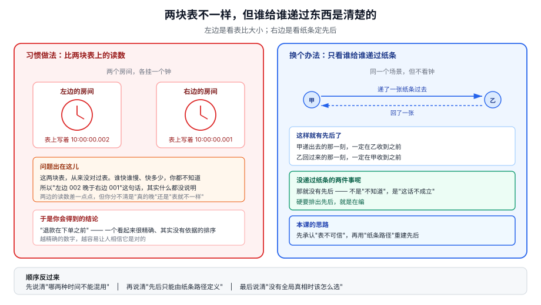
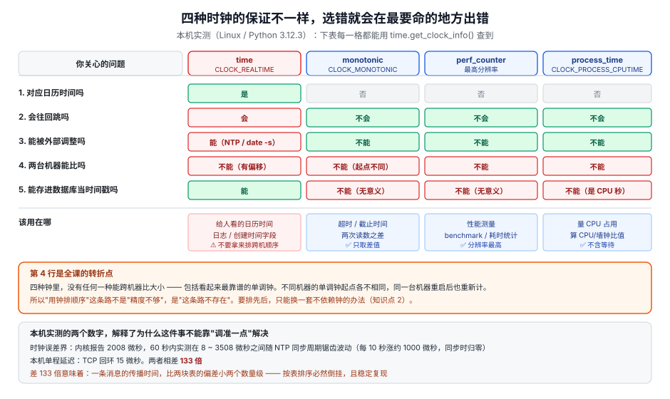
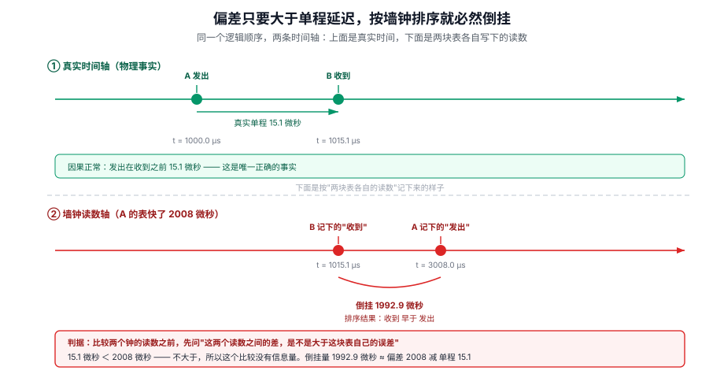
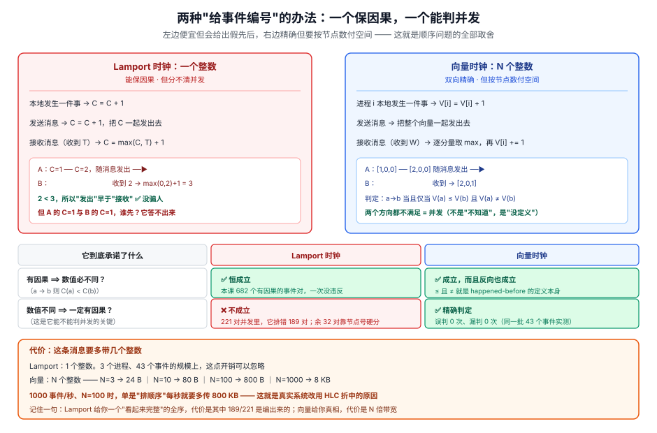
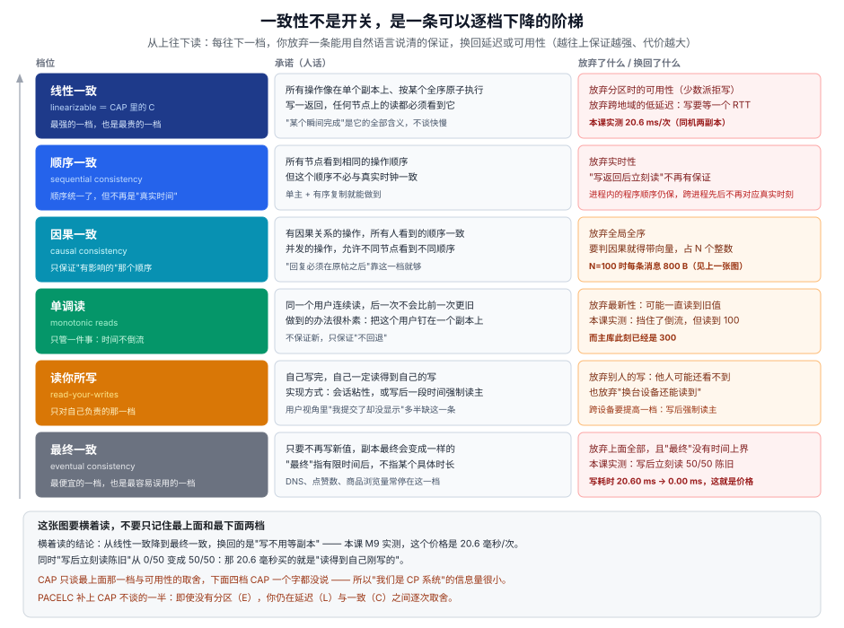
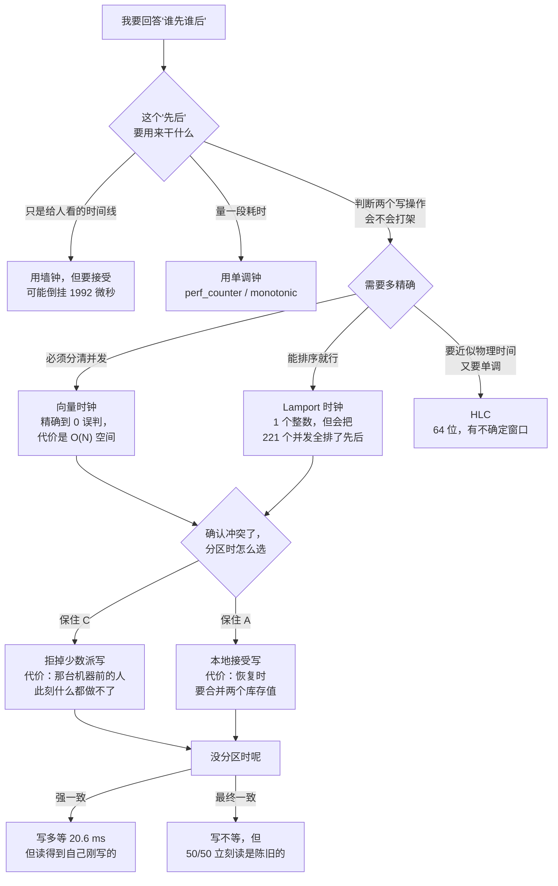

# 第 4 课：时钟、顺序与一致性光谱

> 所属阶段：阶段 1《分布式的地基》｜ 水平：入门 ｜ 本课知识点：时钟不可信、顺序与因果、CAP 与一致性光谱的正确读法
> 故事情节：主角给订单系统加了一张"操作时间线"表，想让客服一眼看清"这单到底经历了什么"。上线第三天客服反馈：日志里有一笔退款出现在下单之前。他查了三天，以为是代码写错了顺序，最后发现两台应用服务器的钟差了 2 毫秒。他把 NTP 同步间隔从 64 秒改成 8 秒，错序少了，但没消失——因为问题从头到尾都不在钟准不准，而在他拿"时间"去回答一个只有"因果"才能回答的问题。
> 📖 结论已按官方文献核对（核对于 2026-11 ｜ 来源：[Python `time` 文档](https://docs.python.org/3/library/time.html)、Lamport, *Time, Clocks, and the Ordering of Events in a Distributed System*, CACM 21(7):558-565, 1978（[PDF](https://lamport.azurewebsites.net/pubs/time-clocks.pdf)）、Gilbert & Lynch, *Brewer's Conjecture and the Feasibility of Consistent, Available, Partition-Tolerant Web Services*, ACM SIGACT News 33(2), 2002（[PDF](https://www.comp.nus.edu.sg/~gilbert/pubs/BrewersConjecture-SigAct.pdf)）、Brewer, *CAP Twelve Years Later: How the "Rules" Have Changed*, IEEE Computer 45(2), 2012（[PDF](https://sites.cs.ucsb.edu/~rich/class/cs293b-cloud/papers/brewer-cap.pdf)）、Kleppmann, *Please Stop Calling Databases CP or AP*, 2015-05-11）
> ✅ 本课全部数字实测于 Linux（WSL2，kernel 6.6.87.2）/ Python 3.12.3 / 单机 20 核，全部本机回环与进程内线程，不访问外网；脚本见 4.1，可原样复跑

## 🎯 本课目标

- 写下一个时间戳之前，能说清它来自墙钟还是单调钟，以及这个选择会让哪一类代码在什么情况下出错
- 看到两个事件的先后关系时，能判断这是"因果"还是"只是时间戳碰巧排成了这样"，并说出用什么才能判定
- 听到"我们是 CP 系统"或"我们最终一致"时，能把它翻译成"分区时它会拒掉哪些请求、平时它让你多等多少毫秒"，而不是一个阵营标签

---

## 第一幕：起源与场景引入

> 🏛️ **起源**：1978 年，Leslie Lamport 在 *Time, Clocks, and the Ordering of Events in a Distributed System* 的开头做了一件很反直觉的事：他先定义了什么叫做"分布式系统"——**消息传播延迟无法忽略的系统**——然后立刻指出，在这个前提下，"事件 A 在事件 B 之前发生"这个说法**本身就没有定义**。他给出的替代方案不是"更准的钟"，而是一个纯逻辑的关系：happened-before。这篇论文后来拿了 2000 年 PODC 的 Influential Paper Award（后改名 Dijkstra Prize）、2007 年 ACM SIGOPS Hall of Fame，Lamport 本人于 2013 年获图灵奖。也就是说，整个分布式系统领域关于"顺序"的共识，起点是"承认物理时间不可用"（核查于 2026-11）。
>
> 🎬 **场景**：你给订单系统加了一张 `order_timeline` 表，每一行是"某台应用服务器在某个时刻做了一件什么事"。上线第三天，客服转来一张截图：某个订单的时间线上，**"退款成功"排在了"下单成功"的上面**。你第一反应是代码写错了，翻遍了写入逻辑，每处都是先写订单再写退款，顺序绝对正确。
>
> 你不甘心，加了个"事件序号"字段。但序号是各台机器各自的自增，两台机器的序号根本没法比。你又改成"按 `created_at` 排序"，于是得到一张看起来很专业、但顺序是错的时间线。最后你在两台机器的日志里对比同一笔订单，发现 A 机器的 `10:00:00.002` 和 B 机器的 `10:00:00.001` 其实对应着同一时刻——A 的钟快了 2 毫秒。

> 📌 **一句话本质**：把"这件事什么时候发生"的答案，从"看钟"换成"看谁跟谁说过话"——时间戳只记录"我这块表当时读到几"，因果关系才记录"谁影响了谁"。
>
> ⚖️ **处境对照**：不这么做——本机内核报告的时钟误差估计是 **2008 微秒**（这是某一时刻的读数；同一台机器 60 秒内实测在 **8 到 3508 微秒**之间随同步周期锯齿波动，"上限"这个说法本身就不成立），而本机 TCP 回环的单程延迟只有 **15 微秒**，**时钟偏差是本机单程延迟的 133 倍**；差 133 倍意味着"按墙钟排序"在跨机器时几乎必然倒挂，实测一条真实消息的倒挂量是 **1992.9 微秒**（M2 / M5）。这么做——同一批 **43 个真实事件**，用因果图独立推导出 682 个有因果的事件对；再用向量时钟去判，把并发误判成有因果 **0 次**、漏掉真实因果 **0 次**；而 Lamport 时钟从 221 个并发事件对里，给 **221 对全部排出了先后**（189 对数值不同、32 对靠节点号打破平局）——它一个都没放过（M3 / M4）。
>
> 位置说明：场景先把人带进"日志顺序错了"这个具体麻烦，再给一句"本课本质上在换什么"——既不违背"不以定义开场"，又让读者进第三幕前手里有锚点。

---

## 第二幕：认知冲突

上面的对照里藏着一个让人不太舒服的推论：**你有 221 对事件，它们之间根本没有先后，而你的系统全都给了它们一个先后。**

而且这不是"实现不够好"。Lamport 1978 那篇论文里有一句话直接把这条路堵死了：

> "If a does not happen before b, then it is possible for a to occur after b."——换句话说，两个没有因果关系的事件，你说谁先都对，因为**没有物理事实能判定**。

于是"调准时钟"这条路走到尽头会撞上三堵墙：

- **墙一：钟永远有误差，只是误差大小不同。** 你调小 NTP 同步间隔，误差从 2 毫秒降到 200 微秒，可你跨机器的网络单程延迟可能是 50 微秒——误差还是比延迟大。而且同步越频繁，NTP 自身的抖动越容易被放大。
- **墙二：钟不只不准，它还会往回跳。** NTP 校正、闰秒处理、人工 `date -s`、虚拟机快照回滚，都可能让 `time.time()` 返回一个比上次更小的值。Python 官方文档对此写得很直白：`time.time()` "can return a lower value than a previous call if the system clock has been set back between the two calls"（核查于 2026-11）。
- **墙三：即使钟完全准，"时间戳"也只记录了"我写这个数字时我的表读到几"。** 它记录不了"我这件事是不是被另一件事影响过"。而影响关系才是你要的。

所以真正的问题不是"怎么把钟调准"，而是：

> ❓ **问题**：如果"时间戳"不能回答"谁先谁后"，那"先后"这件事本身还能不能定义？如果能，靠什么定义？定义出来之后，我能不能用它来判断"这两个操作冲突了"——进而决定"分区的时候该拒掉谁"？

---

## 第三幕：层层揭示

### 一眼全局图（进入细节前先看一眼）



> 看图：左边两个房间里各挂一个钟，钟面时间不一样。如果只看"钟面上写几点"，你就得在两个不同的表盘之间比大小——而这两块表本来就没对齐过。右边换了个办法：不看钟，只看"谁给谁递过纸条"。递过纸条，就有先后；没递过，就无所谓先后。图里没有任何术语，谈的只是一件生活里的事：两间屋子的人怎么排先后。

**四条硬约束**已满足：这图只回答"本课要解决什么问题、靠什么思路解决"；图上没有"墙钟/单调钟/CAP/线性一致"这类词；下面有读图指引；图旁文字能独立说清同一件事。

### 本课地图（分几步走）

| 步 | 这一步要解决什么（人话） | 对应知识点 |
|:--:|------------------------|-----------|
| 1 | 先看清楚：我手上的"时间"到底是什么，它凭什么不可信 | 知识点 1：时钟不可信 |
| 2 | 换一套不依赖钟的排序办法，并弄清它比时间戳强在哪、贵在哪 | 知识点 2：顺序与因果 |
| 3 | 拿这套顺序去回答那个被误读最久的工程问题：分区时到底在选什么 | 知识点 3：CAP 与一致性光谱的正确读法 |

> 只回答"分几步走、现在在哪"——不写机制、不写结论；表格式，不是图、不占 SVG 配额；不标学习状态（进度以 `00-学习档案.md` 为准）。

---

### 知识点 1：时钟不可信

> 🧭 第 1/3 步｜承接：第二幕把"调准时钟"这条路堵死了，但我代码里到处是 `time.time()` → 本步：先分清我手上的钟有几种、各自的保证是什么，再算清这个误差相对网络延迟到底有多大
> 本知识点关键点：墙钟可被调整、可能回退；单调钟不倒退但参考点无意义；误差是估计值不是承诺；误差相对延迟的比例决定倒挂是否必然

#### 一句话定义

"时钟不可信"说的不是"钟走得不准"，而是**两块钟之间没有一个共同的、可靠的零点**——所以你可以用钟来量"过了多久"，但不能用钟来判"谁先谁后"。

#### 直觉建立（类比）

你和朋友约"三点在楼下见"。你戴的表快 2 分钟，他的表慢 1 分钟。结果是你 2:58 到了、觉得自己准时，他 3:01 到了、也觉得自己准时，你们互相觉得对方迟到。

问题不在谁的表更准。问题在于 **"三点"这个说法，在你们两个人之间根本没有共同含义**。表只是各自家里的一块机械，它读出的数字只在"跟自己的历史读数比"时有意义。

要解决这件事，你们可以对着同一个新闻联播的报时对表——这就是 NTP 在做的事。但注意对表本身要花时间：你听见报时的那一刻，声音已经走了一段路；你按下对表按钮的那一刻，又晚了一点。**对表这件事本身的精度，受限于信号传播时间。** 所以两个表的差永远不会是 0，只会是"小于某个数"。

> 💡 **类比的边界**：对表类比抓的是"没有共同零点"这一层，但它漏掉了更凶的一层——**表会被别人调**。你的表可能在你不知道的时候被 NTP 往回拨了 2 秒（因为它发现自己的钟快了），也可能闰秒那天被拨了 1 秒。这时候你测"从进店到出店花了多久"，会算出**负数**。这个"会回退"的性质，才是工程上真正会咬人的地方；"不准"只是让人困扰，"回退"直接让代码逻辑崩掉。

#### 核心原理

先把"时间"这个词拆成两种完全不同的东西。Python 的 `time` 模块把它们分得很清楚，而且给了你一个查询接口去问每一个钟的属性：

```python
>>> import time
>>> for name in ("time", "monotonic", "perf_counter", "process_time", "thread_time"):
...     i = time.get_clock_info(name)
...     print(f"{name:14s} adjustable={i.adjustable!s:5s} monotonic={i.monotonic!s:5s} {i.implementation}")
```

本机实测（Linux / Python 3.12.3，M1）：

```
time          adjustable=True  monotonic=False  impl=clock_gettime(CLOCK_REALTIME)
monotonic     adjustable=False monotonic=True   impl=clock_gettime(CLOCK_MONOTONIC)
perf_counter  adjustable=False monotonic=True   impl=clock_gettime(CLOCK_MONOTONIC)
```

两个字段的含义值得逐个读：

- `adjustable`：**这个钟能不能被外部调整**。`time` 是 `True`——NTP、`date -s`、闰秒处理都能改它。后三个是 `False`。
- `monotonic`：**这个钟保证不倒退吗**。`time` 是 `False`，后三个是 `True`。

四种属性放在一起看，才看得清"我该用哪个"：



> 看图：四列是四种时钟，五行是五个你真正关心的问题。请注意第 2 行（"会往回跳吗"）——只有最左边那一列是红色的。再注意第 4 行（"两台机器能比吗"）——四个全是红的，包括看起来最靠谱的单调钟。这一行是全课的转折点：**没有任何一个本地钟能跨机器比较**，单调钟连"跨进程"都做不到（不同机器的 `CLOCK_MONOTONIC` 起点各不相同，同一台机器重启后也重新计）。

Python 官方文档对这两个钟的表述值得逐字读（核查于 2026-11）：

> `time.time()`: "While this function normally returns non-decreasing values, it can return a lower value than a previous call if the system clock has been set back between the two calls."

> `time.monotonic()`: "Return the value (in fractional seconds) of a monotonic clock, i.e. a clock that cannot go backwards. The clock is not affected by system clock updates. The reference point of the returned value is undefined, so that only the difference between the results of two calls is valid."

第二句里"the reference point of the returned value is undefined"这半句是最容易被跳过的，也是最要紧的：**这个数字本身没有意义，只有两次调用之差有意义**。所以下面这两种写法，一个对一个错：

```python
# ❌ 错：拿单调钟当时间戳存库、跨机器比大小
row["created_at"] = time.monotonic()        # 存进去的是一个"某台机器开机以来的秒数"

# ✅ 对：单调钟只用来量间隔
t0 = time.perf_counter()
do_something()
elapsed = time.perf_counter() - t0          # 这个差值才是可信的
```

那墙钟的误差到底有多大？这件事有个反直觉的地方：**误差本身是内核的一个估计值，而且这个估计值会随时间线性增长、在每次 NTP 同步时归零**。Linux 内核通过 `adjtimex` 暴露 NTP 的状态，其中 `maxerror` 就是"当前对最大误差的估计（微秒）"。本机每 10 秒采一次，连采 7 次：

```
t= 0.0s  freq=11.90 ppm  maxerror= 1508 us
t=10.0s  freq=11.91 ppm  maxerror= 2507 us
t=20.0s  freq=11.91 ppm  maxerror= 3508 us
t=30.0s  freq=11.92 ppm  maxerror=    8 us     ← NTP 刚同步完，误差界被重置
t=40.0s  freq=11.91 ppm  maxerror= 1007 us
t=50.0s  freq=11.91 ppm  maxerror= 2007 us
t=60.0s  freq=11.91 ppm  maxerror= 3007 us
```

（`System clock synchronized: yes`、`NTP service: active` 是 `timedatectl` 同时给出的状态。）

这条曲线值得逐点读：**每 10 秒涨大约 1000 微秒，到第 30 秒被 NTP 同步打回 8 微秒，然后重新开始涨。** 也就是说，`maxerror` 不是一个"这块钟的固有精度"，而是"距离上次同步过了多久 × 频率误差 + 上次同步的残差"。

这直接推出一个工程结论：**"两台机器的时间差不会超过 X"这句话，依赖于"上次同步是什么时候"，而这件事你无法从时间戳里看出来。** 你在代码里写"误差不超过 1 毫秒"没有依据；你只能说"此刻内核估计它不超过 1.5 毫秒"，而这个估计在 10 秒后就会变成 2.5 毫秒。

顺带说一个容易被误解的字段：同一结构里的 `esterror`（估计误差）在这里一直是 `1` 微秒。它和 `maxerror` 是两个不同的东西——`esterror` 是对"当前 offset 估计有多准"的估计，`maxerror` 是误差界。**看误差要看 `maxerror`，不要看 `esterror`**；很多监控面板取错了字段，于是显示"时钟误差 1 微秒"这种过度乐观的数字。

现在把误差放到真实链路上比一比。本机 TCP 回环跑 2000 次往返（M2）：

```
TCP 回环一次往返 30 微秒（中位 / 最大 726），单程约 15 微秒
本机 NTP 最大误差 2008 微秒，是本机单程延迟的 133 倍
```

**这是全课最关键的一个比值。** 时钟偏差是消息传播时间的 133 倍——也就是说，一条消息从 A 发到 B 只需要 15 微秒，但 A 和 B 的表可能差 2 毫秒。**在这个前提下，"按时间戳排序"根本不是"偶尔出错"，而是"只要两个事件靠得够近，就一定排错"。** 你调小 NTP 间隔也改不了这个结构：误差可以降一个数量级，但你没法把 2000 微秒降到 15 微秒以下，因为 NTP 自身的精度受限于网络往返抖动。

倒挂长什么样？把真实数字代进去（M5）：

```
A 的钟快 2008 微秒；消息真实单程 15.1 微秒
按真实时间：发出 1000.0 → 收到 1015.1（因果正常）
按墙钟排序：收到 1015.1 < 发出 3008.0（倒挂 1992.9 微秒）
```

注意这里的荒谬程度：**因果上"发出"必然在"收到"之前 15 微秒，而在墙钟排序里，"收到"比"发出"早了将近 2 毫秒。** 不是差一点点排错，是差了 130 倍的量级。而且这个错误是**稳定复现**的，不是偶发——只要 A 的钟一直快 2 毫秒，这条消息在按时间排序的日志里就永远显示"先收到、后发出"。



> 看图：上半是"真实时间"轴，发出和收到之间隔了 15 微秒，顺序正常。下半是"两块表各自的读数"轴——A 的表整体往右挪了 2008 微秒（因为它快），于是 A 写下的"发出时刻"落到了 B 写下的"收到时刻"的右边。中间那条竖虚线是两个轴的对齐点，你能直接看到两次读数的相对位置被整体平移错了。图右下角那行小字是本课的判据：**比较两个钟的读数之前，先问"这两个读数之间的差，是不是大于这块表自己的误差"**——不大于，就没有信息。

那"我该怎么用"？一张表说清：

| 我要做什么 | 该用哪个 | 为什么 |
|---|---|---|
| 测一段代码跑了多久 | `time.perf_counter()` | 不倒退、分辨率最高 |
| 实现一个超时 / 截止时间 | `time.monotonic()` 记起点，循环或 `asyncio` 里取差值 | 不倒退，不会被 NTP 校正提前触发或延后 |
| 记录"这件事发生在日历上的哪一刻"（给人看） | `time.time()` / `datetime.now(timezone.utc)` | 只有墙钟才对应日历 |
| 排序跨机器的事件 | **哪个都不行** | 见知识点 2 |
| 计算两个历史时间戳之差（比如"这单放了几天"） | 墙钟，但要接受误差，且要处理回退 | 单调钟没有历史语义 |
| 生成"全局唯一且大致单调"的 ID | 需要额外机制 | 单靠本地钟会撞、会倒 |

最后一行对应的就是 Snowflake 那一类方案要解决的问题：它们不是"用时间戳当 ID"，而是"用时间戳做前缀 + 机器号做中段 + 序列号做尾段"，并且**必须处理时钟回拨**（回拨时要么等、要么报错、要么借未来序列）。这恰恰说明：业界的成熟方案都把"钟会回退"当成前提写进了代码，而不是假设它不会发生。

#### 示例演示

先看第一个证据：单调钟的"绝对读数"根本没有共同含义。下面这段在一个私有的 time namespace 里，给**子进程**的单调钟减去 1 小时：

```python
# monotonic_absolute.py —— 证明单调钟的绝对读数只在它自己的语境里有意义
import ctypes, ctypes.util, os, sys, time

CLONE_NEWTIME = 0x00000080
OFFSET_BACK = 3600          # 子进程的单调钟往回退 1 小时

libc = ctypes.CDLL(ctypes.util.find_library("c"), use_errno=True)
assert libc.unshare(CLONE_NEWTIME) == 0, "需要 CAP_SYS_ADMIN"

# 格式：<clock> <秒> <纳秒>，负秒表示"把这块钟往回拨"
with open("/proc/self/timens_offsets", "w") as f:
    f.write("monotonic -%d 0\nboottime -%d 0\n" % (OFFSET_BACK, OFFSET_BACK))

pid = os.fork()
if pid == 0:
    print("  子进程 monotonic 绝对读数 = %.3f 秒" % time.monotonic())
    sys.stdout.flush(); os._exit(0)
os.waitpid(pid, 0)
print("  父进程 monotonic 绝对读数 = %.3f 秒" % time.monotonic())
```

本机实测输出：

```
  子进程 monotonic 绝对读数 = 690996.040 秒
  父进程 monotonic 绝对读数 = 694596.040 秒
  两者相差 3600.000 秒 —— 两个都是合法的单调钟
```

两个读数都"正确"，都没有倒退，都满足"两次调用之差有效"——**但它们的绝对值差了整整一小时**。这就是"参考点未定义"的具体后果：把 `time.monotonic()` 存进数据库、再拿它跟另一台机器比大小，你比的是两个互不相关的起点。

> ⚠️ 这段代码顺带撞出一个值得记住的事实：`/proc/self/timens_offsets` **只接受 `monotonic` 和 `boottime` 两种 clock**，写 `realtime` 会返回 `EINVAL`（本机实测 `[Errno 22] Invalid argument`）。也就是说，Linux 在隔离层面就承认了"墙钟是被外部管理的、不归 namespace 管"，而单调钟才是一个可以被"重新定义原点"的量。这个设计本身就在说明两者的性质不同。
> 另外，`unshare(CLONE_NEWTIME)` 需要 `CAP_SYS_ADMIN`，在受限容器里会被 seccomp 拦掉——脚本会打印 errno 而不是假装成功，**这本身就是重点：不要写"假设时钟可以被安全修改"的代码**。

第二个证据：墙钟一旦回退，用它写的超时判据就彻底失效。把"回拨"注入成一个可控的时钟函数（不改系统时钟，效果等价）：

```python
# naive_timeout.py —— 同一个 1 秒超时，两种时钟写法的后果对照
import time

STEP_BACK, ROLLBACK_AT, TIMEOUT = 2.0, 0.3, 1.0
T0 = time.monotonic()        # ⚠️ 必须有基准：monotonic 绝对值是"开机以来秒数"，不是从 0 开始

def wall():
    """墙钟：从 T0 起算，过了 ROLLBACK_AT 之后整体回退 STEP_BACK"""
    real = time.monotonic() - T0
    return real - STEP_BACK if real >= ROLLBACK_AT else real

def monotonic():
    return time.monotonic() - T0

def wait(clock):
    start, loops = clock(), 0
    while clock() - start < TIMEOUT:
        loops += 1
        time.sleep(0.02)
        if loops > 500:                  # 防止演示脚本真的死循环
            return loops, clock() - start, True
    return loops, clock() - start, False

for name, clock in (("墙钟", wall), ("单调钟", monotonic)):
    loops, elapsed, cap = wait(clock)
    print("  %-4s写法：循环 %3d 次%s ｜ 钟差 %.2f 秒 ｜ 真实耗时 %.2f 秒"
          % (name, loops, "（撞上保护上限）" if cap else "（判据成立）", elapsed, loops * 0.02))
```

本机实测输出：

```
场景：业务超时 1.0 秒；第 0.3 秒 NTP 把墙钟往回拨 2 秒

  墙钟写法  ：循环 150 次（判据终于成立） ｜ 墙钟差 1.02 秒 ｜ 真实耗时 3.00 秒
  单调钟写法：循环  50 次（判据成立） ｜ 单调差 1.01 秒 ｜ 真实耗时 1.00 秒

  墙钟读数在回拨那一刻的跳变：0.30 秒 → -1.70 秒
  对照结论：同样的 1 秒超时，用墙钟判据的一方多等了 2.00 秒才放弃
```

多等的这 2.00 秒，正好等于回拨量。这是最温和的一种后果——只是"晚一点放弃"。更严重的两种：

- 如果回拨发生在**超时判据之外、而计时用于限流**（`if 本秒计数 < 100: 放行`），那回拨瞬间"这一秒"会重来一次，配额被用两遍
- 如果回拨幅度大于已消耗的时间（比如任务刚开始就回拨 5 秒），`clock() - start` 会一直是负数，**循环永远不退出**——这正是本课为什么要加 500 次保护上限

#### 常见误区

1. **"时钟同步了就没问题了"**：同步只把误差压小，压不到 0。本机 `System clock synchronized: yes`，误差界仍在 8 到 3508 微秒之间随同步周期锯齿波动。而"误差是否可忽略"取决于它相对什么——相对于 15 微秒的网络延迟，2 毫秒是 133 倍；相对于 3 秒的人工操作间隔，2 毫秒毫无影响。**判据是比值，不是绝对值。**
2. **"用 `time.time()` 测耗时没出过问题"**：没出过问题是因为你的程序跑的时间短、且没赶上 NTP 校正窗口。一旦量的是小时级任务、或者跑在会被迁移/快照回滚的虚拟机上，就会遇到负耗时。这类 bug 的特点是极低频、极难复现、且一旦出现就难以解释——正因为难查，才更该从一开始就用对。
3. **"`monotonic` 精度更高所以更好，全用它就行"**：单调钟的参考点是未定义的，存进数据库之后**没有任何语义**——你没法回答"这单是什么时候下的"。它只能用于"同一个进程内两次读数之差"。而且它跨机器完全不可比。

#### 一句话记住

墙钟回答"现在几点"（可以被调、可能回退），单调钟回答"过了多久"（不会回退、但不能跨机器比）；**用物理钟的读数去排跨机器的顺序，这件事从根上就不成立**——能排顺序的只有逻辑计数（下一知识点）。

#### 🗣️ 行话对照

**形态 A · 术语少量**

- **墙钟（wall clock / CLOCK_REALTIME）**：对应日历时间的钟，可被 NTP 与人工调整——就是本课说的"会回退的那种"；在哪遇到：`time.time()`、`datetime.now()`、数据库的 `NOW()`、日志里的时间戳。
- **单调钟（monotonic clock / CLOCK_MONOTONIC）**：只保证不倒退、参考点未定义的钟——就是本课说的"只能量间隔的那种"；在哪遇到：`time.monotonic()`、Go 的 `time.Since()`、Java 的 `System.nanoTime()`、Rust 的 `Instant`。
- **时钟偏移 / 漂移（clock skew / drift）**：skew 指两块钟在同一时刻的读数差，drift 指这个差随时间变化的速度——就是本课说的"133 倍"里的那个差；在哪遇到：NTP 的 `offset` 与 `frequency` 字段、监控里的 `node_timex_offset_seconds`、`node_timex_frequency_adjustment_ratio`。
- **闰秒（leap second）**：为对齐地球自转而在 UTC 里插入或删除的 1 秒——就是本课说的"表会被别人调"的一种成因；在哪遇到：`CLOCK_TAI`、Google 的 leap smear、`ntpd` 的 `-x` 选项。

#### 官方文档

- [Python `time` 文档](https://docs.python.org/3/library/time.html)：`time.time()` 可回退的原话、`monotonic()` 的"参考点未定义"、`get_clock_info()` 的 `adjustable` / `monotonic` 字段
- [Python `datetime` 文档](https://docs.python.org/3/library/datetime.html)：`now()` 与 `utcnow()` 的区别（后者 3.12 起已弃用，应改用 `now(timezone.utc)`）
- [Linux `adjtimex(2)`](https://man7.org/linux/man-pages/man2/adjtimex.2.html)：`maxerror` / `esterror` / `freq` 字段的确切含义——"误差界是内核的估计值"这件事的出处
- [RFC 5905 · NTPv4](https://www.rfc-editor.org/rfc/rfc5905.html)：NTP 如何估计 offset 与 delay，以及为什么精度受限于往返抖动

---

### 知识点 2：顺序与因果

> 🧭 第 2/3 步｜承接：钟靠不住了，但"谁先谁后"这件事我还得回答 → 本步：把"先后"重新定义成只依赖消息传递的关系，再用两种办法去算它，最后算清各自的代价
> 本知识点关键点：happened-before 的三条规则、并发不等于同时、Lamport 时钟是单向的（保因果但不保并发）、向量时钟能精确判定但要付空间代价

#### 一句话定义

"顺序"在分布式系统里唯一可靠的定义是因果顺序：**A 在 B 之前，当且仅当 A 能影响到 B**——而这个"能影响"只有三条来源：同一个进程内的先后、消息的发出先于接收、以及这两者的传递。

#### 直觉建立（类比）

三个同事在三个房间里办事，只能靠递纸条沟通。

- 老王在房间里先写了草稿、再写了正稿——这是**他自己知道先后**
- 老王把正稿递给小李——**小李收到正稿，一定在老王写完正稿之后**
- 小李看了正稿、写了个意见递回给老王——**老王收到意见，一定在小李写完意见之后**

现在问：小张在自己房间里喝了杯茶，这件事和老王写草稿，谁先谁后？

答案是：**这个问题没有意义。** 他们之间没有任何纸条往来，喝茶和写草稿互不影响，所以"谁先"这件事在他们之间根本没被定义过。这不是"我们不知道"，而是"这个问题本身不成立"——就像问"北京和上海哪个更北"一样，得先有共同的方向轴。

> 💡 **类比的边界**：纸条类比抓的是"因果只沿沟通路径传播"，但它容易让人以为"并发 = 同时发生"。这两件事完全不同：**并发说的是"无法判定先后"，不是"同时"**。小张喝茶可能比老王写草稿早一小时，也可能晚一小时，但只要他们之间没有纸条往来，这就是并发关系——**并发是"顺序未定义"，不是"时间重叠"**。这个区别是后面判断"两个写操作冲不冲突"的全部基础。

#### 核心原理

Lamport 1978 给这个直觉下了三条定义（原文的 `→` 就是"happened before"）：

1. **同进程顺序**：如果 a 和 b 是同一进程里的两个事件，且 a 在 b 之前发生，那么 `a → b`
2. **消息传递**：如果 a 是"发送消息 m"的事件，b 是"接收同一条 m"的事件，那么 `a → b`
3. **传递性**：如果 `a → b` 且 `b → c`，那么 `a → c`

反过来定义并发：**如果 `a → b` 和 `b → a` 都不成立，则 a 与 b 并发**（写作 `a ∥ b`）。

这三条定义背后有一句论文里的话，是全课最值得背下来的一句：

> "If a does not happen before b, then it is possible for a to occur after b."

也就是说，两个并发事件"谁先发生"是**真的不确定**，不是"我们暂时不知道"。因为如果它俩之间没有因果路径，那就没有任何物理机制能让它们产生关联——它们的相对时刻取决于各自机器上的调度、网络抖动、CPU 频率，这些因素互相独立。

现在关键问题来了：**我怎么在代码里算出这个关系？** Lamport 给的第一个方案是一块计数器：



> 看图：左边是 Lamport 时钟——每个进程一个整数，本地事件 +1，发消息时带上自己的值，收到消息时取 `max(自己的, 收到的) + 1`。右边是向量时钟——每个进程一个数组，长度为节点数，规则一样但按分量取 max。中间那两行是本图的重点：**Lamport 时钟能保证"有因果则数值必不同"（单向），但数值不同推不出有因果**；向量时钟两个方向都成立。下面那行小字是代价：Lamport 是 1 个整数，向量是 N 个整数——节点数涨到 100，每条消息就要带 100 个整数。

先看 Lamport 时钟的更新规则：

| 事件 | Lamport 时钟怎么变 |
|---|---|
| 进程内部发生一件事 | `C = C + 1` |
| 发送消息 | `C = C + 1`，把新的 `C` 一起发出去 |
| 接收消息（收到值 `T`） | `C = max(C, T) + 1` |

它能保证的是一条**单向**性质，叫 Clock Condition：

> **如果 `a → b`，那么 `C(a) < C(b)`。**

注意箭头只有一个方向。反过来不成立：`C(a) < C(b)` **推不出** `a → b`。这就是它的全部能力——它能把"有因果"的两个事件排对，但对"没因果"的两个事件，它照样会给出一个大一个小，而这个大小关系是**任意的**。

Lamport 自己很清楚这一点，所以他补了一步：用 `(C, 进程号)` 这个二元组做比较，相等时用进程号打破平局。这样就得到了一个**全序**——任意两个事件都能比出大小。但这个全序有两个问题：

- 它**依赖平局规则的选择**：把进程号换成"进程名字的拼音序"，得到的全序就不一样了。所以这个全序不是"客观事实"，是"一个人为约定"
- 它对并发事件给出的先后**没有任何物理含义**，只是"看起来排好了"

那怎么才能真正判定并发？用**向量时钟**：每个进程维护一个长度为 N 的数组（N = 节点数），第 i 位记录"我知道进程 i 发生了多少件事"：

| 事件 | 向量时钟怎么变 |
|---|---|
| 进程 i 内部发生一件事 | `V[i] = V[i] + 1` |
| 进程 i 发送消息 | `V[i] = V[i] + 1`，把整个向量发出去 |
| 进程 i 接收消息（收到向量 `W`） | 先 `V[j] = max(V[j], W[j])` 对所有 j，再 `V[i] = V[i] + 1` |

判定规则：**`a → b` 当且仅当 `V(a) ≤ V(b)` 且 `V(a) ≠ V(b)`**（逐分量比较，至少一位严格小于）。如果两个方向都不满足，就是并发。

这两个方案的差别，用本机真实数据一看就清楚。三个线程互相真实发消息（M3 / M4），先**不看时钟**、只从"谁给谁发过消息"这个事件图独立推导出全部 happened-before 关系，再拿两种时钟去对：

```
事件总数 43 ｜ 有因果关系的事件对 682 ｜ 并发的对数 221
Lamport 时钟条件（a→b 则 C(a)<C(b)）恒成立：True
并发事件对里 Lamport 值不同的：189 / 221（它们被排了先后，但无因果关系）
并发事件对里 Lamport 值相同的：32（连先后都分不出，只能靠节点号打破平局）
向量时钟：把并发误判成有因果的次数 = 0（应为 0）
向量时钟：漏掉真实因果的次数 = 0（应为 0）
```

这张表里最该盯住的是第二行和第三行：

- **`恒成立：True`** —— Lamport 时钟没骗人，它承诺的那条单向性质一次都没违反。682 个有因果的事件对，全部满足 `C(a) < C(b)`
- **`189 / 221`** —— 但对 221 个**并发**事件对，它给其中 189 对排出了先后。这些排出来的先后**全是假的**
- **`32`** —— 剩下 32 对连数值都相同，靠进程号硬分

所以 Lamport 时钟的真实能力是：**它把 221 个"没有先后"硬生生变成了 221 个"有先后"，一个不漏地给了你一个看起来完美的全序。** 如果你拿这个全序去判断"这两个写操作谁覆盖谁"，你会得到 221 个错误答案里的 189 个。

真实事件长什么样（前 10 条，从本机日志直接抄）：

```
节点     序号     类型         Lamport   向量
N2     0      internal   1         (0, 0, 1)
N2     1      send       2         (0, 0, 2)
N0     2      internal   1         (1, 0, 0)
N0     3      send       2         (2, 0, 0)
N2     4      recv       3         (2, 0, 3)
N2     5      internal   4         (2, 0, 4)
N2     6      send       5         (2, 0, 5)
N1     7      internal   1         (0, 1, 0)
N1     8      send       2         (0, 2, 0)
N1     9      recv       3         (0, 3, 2)
```

逐行读两处：

- **第 3 行到第 5 行**：`N0` 在 seq=3 发出消息（向量 `(2,0,0)`），`N2` 在 seq=4 收到（向量从 `(0,0,2)` 变成 `(2,0,3)`）。注意 `N2` 收到了 `N0` 的第 2 个事件，所以它把自己向量的第 0 位从 0 拉到了 2——**它的向量里现在包含了"N0 已经发生过 2 件事"这个知识**
- **第 6 行**：`N2` 接着做了个内部事件，向量变成 `(2,0,4)`。此时如果拿它和 `N0` 的某个向量 `(2,0,0)` 比，会得到 `(2,0,0) < (2,0,4)`，判定"`N0` 那个事件在前"——这是对的，因为中间有真实的消息传递

再看代价。向量时钟的每个事件要存 N 个整数，每条消息要带 N 个整数：

| 节点数 N | 每条消息的时钟开销 | 1000 事件/秒时的元数据带宽 |
|---|---|---|
| 3 | 3 × 8 字节 = 24 字节 | 24 KB/s |
| 10 | 80 字节 | 80 KB/s |
| 100 | 800 字节 | 800 KB/s |
| 1000 | 8 KB | 8 MB/s |

这就是为什么真实系统很少用"纯向量时钟"：**它精确，但代价随节点数线性涨，而且要求你知道总共有几个节点**（动态扩容时向量长度会变，这是个大麻烦）。工程上的常见折中是：

- **只关心"哪些键冲突"时用带版本的键值**（Dynamo 的做法：每个键存一个向量时钟，而不是每个事件）
- **只需要"大致有序 + 单调"时用混合逻辑时钟（HLC）**：把物理时间和逻辑计数拼成一个 64 位值，既接近墙钟又保证单调，代价是只能"近似"判定因果（HLC 有一个明确的"不确定窗口"，窗口内的事件分不清）
- **只需要"快照一致性"时用版本号或事务 ID**

关于 HLC，本课不给具体实现——它属于"知道了有这条路"就够的阶段，细节留到课 9《分布式 ID 与逻辑时钟》。你此刻只需要记住它的存在理由：**在"精确但贵"（向量时钟）和"便宜但会造假"（Lamport 时钟）之间，工程上需要一个折中，HLC 就是那个折中。**

#### 示例演示

把上面的判定规则写成代码，核心就这么几行：

```python
# vector_clock.py —— 向量时钟的更新与比较
def tick(vec, i):                      # 本地事件
    vec[i] += 1
    return vec

def send(vec, i):                      # 发送：先 tick，再把整个向量带走
    return tick(vec, i), tuple(vec)

def recv(vec, i, remote):              # 接收：逐分量取 max，再 tick 自己
    for j in range(len(vec)):
        vec[j] = max(vec[j], remote[j])
    vec[i] += 1
    return vec

def happens_before(u, v):
    """u → v 当且仅当 u ≤ v 且 u ≠ v（逐分量）"""
    return all(x <= y for x, y in zip(u, v)) and u != v

def concurrent(u, v):
    return not happens_before(u, v) and not happens_before(v, u)
```

用真实消息跑一遍，把两种时钟同时挂在每个事件上，然后**独立地**从事件图推导出真实因果（不信任任何时钟），最后三方对比——这就是 4.1 里 M3/M4 那段代码在干的事。它的关键设计是：**判据和被测对象必须分开**。因果图来自"消息从哪来、到哪去"这个结构事实，向量时钟只是被检验的候选，Lamport 时钟也是候选。这样才能测出"误判"和"漏判"。

跑出来 `误判 0 / 漏判 0` 这个结果的意义，比"向量时钟是对的"更深一层：它说明**"从事件图结构推导因果"和"用向量时钟判定因果"这两条完全独立的路径，给出了同一个答案**。前者是定义，后者是实现；实现和定义对齐，才叫"这个数据结构正确地实现了这个语义"。

#### 常见误区

1. **"并发就是同时发生"**：并发（concurrent）在这个语境里是"无法判定先后"，与"是否同时"无关。两个事件可以相隔一小时，只要之间没有因果路径，它们就是并发的。反过来，两个事件可以只差 1 微秒，但只要有消息传递，它们就是有因果的。**判定依据是"有没有路径"，不是"时间差多少"。**
2. **"Lamport 时钟不准，所以没用"**：它非常有用，只是用途不是"判定并发"。它擅长的是"给事件编一个单调的号，让全局有个一致的全序"——比如日志排序、给请求编序号、做两阶段提交的投票编号。**它的定位是"够用的全序"，不是"精确的因果判定"。**
3. **"用墙上时间戳 + 单调时钟就能替代逻辑时钟"**：物理时间能给全序（同一块钟内），但跨机器就给不出可靠的全序，而且它连"是否并发"都判不出来——时间戳近不代表有因果，时间戳远不代表没因果。逻辑时钟给的是**因果信息**，物理时钟给的是**近似的时间信息**，两者不能互换。

#### 一句话记住

"谁先谁后"只有因果能回答：Lamport 时钟给你一个看起来完美的全序（但 221 对并发里 189 对是编的），向量时钟能分清并发（但要付 N 倍空间）；选哪个取决于你要的是"能排序"还是"能判冲突"。

#### 🗣️ 行话对照

**形态 B · 讲"多策略"**

| 本课说法（人话） | 行业标准叫法 | 典型配置 / 在哪遇到 | 代价 |
|---|---|---|---|
| "A 能影响到 B，就说 A 在前" | happened-before / 因果序（causal order） | Lamport 1978 原始定义；`jepsen` 测试里的 causal consistency 检查 | 需要追踪消息路径，不能靠时间戳 |
| "两个事件谁也影响不到谁" | 并发（concurrent） | 版本冲突检测、CRDT 的合并前置判断 | 并发不等于同时，需专门判定 |
| "一个整数搞定先后" | Lamport 时钟 / 逻辑时钟 | 日志排序、请求编号、Paxos 提案号 | 只能保因果，不能判并发；并发会被硬排 |
| "每个进程一个数组" | 向量时钟（vector clock） | Dynamo 的版本向量、`riak` 的 vclock、Riak/ScyllaDB 的冲突检测 | O(N) 空间，节点动态变化时难维护 |
| "物理时间 + 逻辑计数拼一起" | 混合逻辑时钟（HLC） | CockroachDB 的事务时间戳、`hybrid-logical-clock` 库 | 有"不确定窗口"，窗口内分不清因果 |
| "拿版本号比大小判新旧" | 版本向量是向量时钟的子集用法 | 键值存储的 per-key 版本、`etcd` 的 revision | 只在单键上有意义，跨键不可比 |

> HLC 的原始论文是 Kulkarni et al., *Logical Physical Clocks and Consistent Snapshots in Globally Distributed Databases*（OPODIS 2014）。本课仅点到为止，不引用具体实现细节。

#### 官方文档

- [Lamport, *Time, Clocks, and the Ordering of Events in a Distributed System* (1978)](https://lamport.azurewebsites.net/pubs/time-clocks.pdf)：happened-before 三条定义、Clock Condition 的单向性、平局规则、"并发则先后不确定"的原话（作者主页 PDF；[DOI 版本](https://doi.org/10.1145/359545.359563)需订阅）
- [Kulkarni et al., *Logical Physical Clocks and Consistent Snapshots in Globally Distributed Databases* (2014)](https://www.cse.buffalo.edu/tech-reports/2014-04.pdf)：HLC 原始技术报告（Buffalo CSE TR 2014-04），摘要里明确写了"LC 不能关联物理时间、VC 空间代价 prohibitive、PT 有不确定区间"这三条取舍
- [Riak · Vector Clocks](https://docs.riak.com/riak/kv/latest/learn/concepts/causal-context/)：工业界怎么用版本向量做冲突检测与 sibling 合并
- [Wikipedia · Vector clock](https://en.wikipedia.org/wiki/Vector_clock)：更新与比较规则的速查（用于对照，非权威来源）

---

### 知识点 3：CAP 与一致性光谱的正确读法

> 🧭 第 3/3 步｜承接：我现在有了判"谁先谁后"的工具，但它要花钱；而真实系统要回答的是更粗暴的问题——"分区那一刻，我该拒掉谁" → 本步：把 CAP 从"三选二"标签拆成"分区时的具体决策"，再把"一致性"从开关拆成一条可以逐档下降的阶梯
> 本知识点关键点：CAP 的 C 是线性一致（与 ACID 的 C 无关）、A 要求任意非故障节点都能应答、P 是前提不是选项、分区在工程上等于超时、CAP 不谈延迟所以需要 PACELC

#### 一句话定义

CAP 说的是：**当网络分区发生、并且你必须在"这个请求应答一个可能错的值"和"这个请求不应答"之间二选一时，你只能选一个**——它不是"一个系统只能挑两个属性"，而是"分区这个时刻，你只能做一件事"。

#### 直觉建立（类比）

一家银行有两个网点，中间的电话线断了。

现在有个客户在 A 网点要取 100 块。A 网点的柜员有两个选择：

- **照付**：他不知道 B 网点刚才是不是已经把这 100 块付给别人了（余额可能已经变了），但他先把钱给了客户。客户很满意，账可能错了
- **不付**：他打电话给 B 网点确认余额，电话不通，于是他告诉客户"系统故障，请稍后再来"。账一定对，客户白跑一趟

注意这里没有第三个选项。**"既照付又保证账对"需要的那个信息（B 网点发生了什么），恰好被断掉的电话线挡住了**——这就是 CAP 证明的全部内容，一句话就说完了。

而且注意：**这个选择只在电话断掉的时候才存在**。电话通的时候，柜员打个电话确认一下，既快又准，两样都有。

> 💡 **类比的边界**：银行类比抓的是"信息被物理阻断时只能二选一"，但它掩盖了一个非常要命的细节——**"电话断了"这件事本身是判断出来的，而判断靠的是"等多久"**。真实系统里没有"网线被拔"这个明确信号，只有"我等了 3 秒还没回应"。你把这 3 秒调成 100 毫秒，就会有大量"其实只是慢、并没有断"的情况被误判成分区；调成 30 秒，真断了你也要 30 秒后才知道。**分区的边界是一个你自己选的超时值，不是客观事实**。这一层类比给不了，而它恰恰是工程上最关键的一层。

#### 核心原理

先把三个字母的**精确定义**摆出来，因为误读基本都发生在这里。

| 字母 | 定理里的确切含义 | 常被误读成 |
|---|---|---|
| **C** | 线性一致性（linearizability）：存在一个全序，让所有操作看起来像是在某个瞬间原子完成的 | "数据一致"、"ACID 里的 C"、"主从数据一样" |
| **A** | 每一个发给**非故障节点**的请求，都必须最终收到一个**非错误**的响应 | "系统能用"、"大部分请求能成功"、"服务活着" |
| **P** | 系统在**任意数量消息被丢弃**的情况下仍能继续工作 | "支持多机房"、"有副本"、"能容忍节点挂掉" |

三个地方值得停下来：

**第一，CAP 的 C 和 ACID 的 C 是两个完全不同的东西。** Kleppmann 那篇著名的文章标题就是结论——《Please stop calling databases CP or AP》。CAP 的 C 是线性一致（单副本语义），ACID 的 C 是"事务不破坏约束"（比如唯一键、外键）。**一个系统可以满足 ACID 的 C，同时完全不满足 CAP 的 C。** Brewer 自己在 2012 年那篇回顾里也专门用一个侧栏解释这件事：CAP 的 C 只是"单副本一致性"，是 ACID 一致性的一个严格子集。

**第二，A 的门槛比想象中高。** "some node can handle the request" 不够，必须是 **every non-failing node**。也就是说，如果你的 3 副本集群在分区时把少数派那台设成"只读不写，写请求返回 500"，那按 CAP 的定义它就**不满足 A**——因为那台机器没坏，它收到了请求，但它回了一个错误。这个定义很严，严到很多自称 AP 的系统其实过不了。

**第三，P 不是选项。** Kleppmann 说 P "terribly mis-named"——它听起来像"我们选择了容忍分区"，实际含义只是"这个系统跑在可能延迟或丢包的异步网络上"，而这不是选择，是既定事实。**你没法"不选 P"**，除非你的系统只有一台机器。

那"三选二"错在哪？Brewer 2012 给了三条理由，原文（核查于 2026-11）：

> "First, because partitions are rare, there is little reason to forfeit C or A when the system is not partitioned. Second, the choice between C and A can occur many times within the same system at very fine granularity; not only can subsystems make different choices, but the choice can change according to the operation or even the specific data or user involved. Finally, all three properties are more continuous than binary."

翻成工程语言：

- **分区罕见** → 大部分时间你 C 和 A 都有，不是"你选了 CA 就不能要 P"
- **粒度可以很细** → 同一个系统里，查商品详情可以 AP（容忍旧数据），扣库存必须 CP（宁可报错）；甚至可以按用户分（VIP 保 CP，普通用户保 AP）
- **三个都是连续的** → A 是 0 到 100% 的百分比，C 有很多档，连"是不是分区"都有争议（单向不通、部分节点认为断了）

所以正确的目标不是"选两个"，而是 Brewer 那句话：

> "The modern CAP goal should be to maximize combinations of consistency and availability that make sense for the specific application."

现在把"分区"落到工程上。**分区在代码里的真身是一个超时**：一次需要多数派确认的写，在业务允许的时间窗内没等到足够多的确认，你就得决定——取消（降 A）还是继续（冒 C 的风险）。Brewer 把这个叫 **partition decision**，并且明确指出它是"对一次操作超时的反应"，而不是"检测到网络断了"。

这个视角带来三个立刻可用的推论：

1. **不存在"全局的分区视图"**。可能 A 认为和 B 断了，B 却还能连上 A（单向不通）。所以"我们进入分区模式了"这句话在不同节点上可能是不同的结论
2. **可以通过调超时来调"对分区的敏感度"**。超时设得短，系统会更频繁地进入分区模式——包括在"只是网络慢"的时候
3. **必须显式进入分区模式**，而不是让每个请求各自随机决定。Brewer 给的三步是：探知 → 进入显式分区模式（限制某些操作）→ 恢复期修复并补偿

一致性光谱的正确画法不是"CP / AP 两档"，而是一条可以逐档往下降的阶梯，每降一档换回一点什么：



> 看图：从上往下读，越往上保证越强、代价越大。最上面是线性一致（也就是 CAP 的 C），它的意思是"所有操作看起来在某个瞬间原子完成"。每往下一档，你放弃一条具体的保证，换回延迟或可用性。请注意右侧那一列"放弃了什么"——每一档放弃的都是一句能用自然语言说清的话，比如"单调读"放弃的是"同一个用户不会看到时间倒流"。**这才是"一致性光谱"该有的样子：不是一个标签，是一串可以逐个谈判的条款。**

每一档的具体含义与代价：

| 一致性档位 | 承诺（人话） | 放弃了什么 | 典型实现 / 代价 |
|---|---|---|---|
| **线性一致**（linearizable） | 所有操作像在一个副本上、按某个全序原子执行；写返回后任何读都能看到 | 分区时的可用性；跨地域时的延迟 | 单主 + 同步复制、Raft/Paxos 多数派；跨洋写要等一个 RTT，本课实测 **20.6 ms/次**（同机模拟两副本） |
| **顺序一致**（sequential） | 所有节点看到相同的操作顺序，但这个顺序不必与真实时间一致 | 实时性（"写返回后立刻读"不保证） | 单主 + 把写按同一顺序回放到所有副本（有序复制日志）；**读也要排进这个顺序里**，不能越过未应用的写。程序内的操作顺序仍保留，跨进程的先后不再对应真实时刻 |
| **因果一致**（causal） | 有因果关系的操作，所有节点看到的顺序一致；并发操作可以不同顺序 | 全局全序 | 向量时钟 / 版本向量；本课的因果判定就要付这个代价 |
| **单调读**（monotonic reads） | 同一个用户连续读，不会读到更旧的值（时间不倒流） | 最新性（可能一直读到旧值） | 粘性路由（同一用户固定一个副本）；本课实测：能挡住倒流，但**读到 100 而主库已是 300** |
| **读你所写**（read-your-writes） | 同一个用户写完之后，自己一定能读到自己的写 | 别人的写不保证 | 会话粘性、或写后一段时间内强制读主 |
| **最终一致**（eventual） | 不写新值时，副本最终会一致 | 上面全部，且"最终"没有时间上界 | 异步复制；本课实测：写后立刻读 **50/50 陈旧** |

这张表要横着读才能读出"取舍"的味道：**从线性一致降到最终一致，你换回的是"写不用等副本"**——本课 M9 实测，这个价格是 **20.6 ms/次**（写从 20.60 ms 降到 0.00 ms），同时"写后立刻读陈旧"从 **0/50** 变成 **50/50**。也就是说，那 20.6 毫秒买的就是"读得到自己刚写的"。

还有一件 CAP 完全不谈、但你每天都在付账的事：**延迟**。Kleppmann 说得很直接——CAP 的 "available" 允许系统无限慢，而用户比可用性更在意延迟。于是 Abadi 提出 PACELC 补上这个缺口：

> **PACELC**：**if (P)** 分区时在 **A** 和 **C** 之间取舍；**else (E)** 没有分区时，在 **L**（latency）和 **C** 之间取舍。

前半句就是 CAP，后半句是新增的：**即使网络完全正常，强一致也要你等**。等的是"副本确认"，而副本在别的机架上、别的城市里，这个等待就是光速加排队。

最后把 CAP 的边界说清楚。它**不管**这些：

- **节点崩溃**：CAP 的模型只考虑网络分区，节点崩了不在定理范围内（虽然可以建模成"自己一个分区"）
- **磁盘满、软件 bug、配置错误**：这些才是线上事故的主力，CAP 一个字都没提
- **多对象事务**：定理的模型只是**单个读写寄存器**，跨多个键的事务根本不在证明范围内
- **延迟**：见上

所以"我们是 CP 系统"这句话的信息量，比它听起来小得多。它只说了"分区时我们会拒掉少数派的写"，没说崩溃时会怎样、慢的时候会怎样、跨三个键的事务会怎样。

#### 示例演示

先用一个假集群把"分区那一刻"真的跑出来。3 副本，多数派 = 2，分区把 `{A,B}` 和 `{C}` 分开：

```python
class Partitioned:
    """3 副本，多数派 = 2。分区把 {A,B} 与 {C} 分开。"""
    def __init__(self, mode):
        self.mode = mode
        self.committed = {}          # 多数派已确认的 key -> val
        self.local_only = {}         # 少数派独自接受的 key -> val（AP 才有）

    def put(self, node, key, val):
        side = {"A": ("A", "B"), "B": ("A", "B"), "C": ("C",)}[node]
        if len(side) >= 2:                       # 多数派
            self.committed[key] = val
            return True
        if self.mode == "cp":
            return False                         # 少数派拒写
        self.local_only[key] = val               # AP：本地接受
        return True

    def heal(self):
        """恢复后：多数派提交值权威；未被覆盖的 local_only 是真冲突。"""
        return {k: (self.committed.get(k), v) for k, v in self.local_only.items()
                if self.committed.get(k) != v}
```

同一段写入路径，只切换 `mode`，结果完全不同（M8）：

```
CP：少数派写入 被拒（返回错误） ｜ 多数派写入 成功 ｜ 恢复后冲突 无（只有一个权威值 6）
AP：少数派写入 成功 ｜ 多数派写入 成功 ｜ 恢复后冲突 {'stock:sku1': (6, 8)}
```

这两行是本课最值得反复看的一对。**它们描述的是同一个业务的同一个操作**：

- CP 用"少数派写不了"换掉了"两个库存值打架"。代价不是"少卖一件"，是**那台机器前面的人在这一刻什么都做不了**——他刷新、重试、换手机，全都是错误
- AP 用"两个库存值打架"换掉了"写不了"。代价不是"多卖一件"，是**你必须在恢复期做一个人工或半自动的合并决策**，而这个决策可能涉及"到底谁该拿到货"

注意这里没有"更好"的选项。**唯一错的做法是不做选择**——比如少数派也接受写入，恢复时又"后写覆盖先写"，那你会静默丢掉一次扣减。

再看不分区时的账（M9）：同样两个副本，只改"写返回前要不要等副本确认"：

```
强一致（写返回时副本已确认）：写 20.60 ms/次 ｜ 写后立刻读陈旧 0/50
最终一致（写返回时只到主库）：写  0.00 ms/次 ｜ 写后立刻读陈旧 50/50
差 20.6 ms 就是'一致'的价格；没有分区的时候，CAP 管不着这笔账
```

`20.60 ms` 这个数字对应的是模拟里设的 20 ms 复制延迟。真实系统里这个数字是"跨可用区的 RTT"或"跨地域的 RTT"，量级从 0.5 ms 到 150 ms 不等。**它是每一笔写都要付的钱，而不是分区时才付的钱。** 这就是 PACELC 的 E 分支要说的：你的系统 99.9% 的时间没分区，而这段时间你一直在为一致性付延迟。

#### 常见误区

1. **"我们是 CP 系统，所以我们的数据一定对"**：CP 只保证"分区时拒掉少数派"，它不保证节点崩溃后不丢数据（还取决于同步刷盘）、不保证软件 bug 不写错、不保证多键事务的原子性（不在定理范围内）。**"我们是 CP" 的信息量，约等于"我们分区时会报错"。**
2. **"最终一致就是数据会乱一段时间，忍忍就好"**：真正的问题不是"乱"，而是"乱的时候用户看到了什么"。本课 M7 实测：用户第一次读到 100，刷新一下变成 0——**时间倒流**。粘性路由能挡住倒流，但它只保证"不倒流"，不保证"最新"（读到 100 而主库已是 300）。要挡住这一类体验事故，你需要的不是"等它一致"，而是**逐条想清楚每个读接口能容忍哪一档**。
3. **"CAP 的 C 就是 ACID 的 C"**：完全无关。CAP 的 C = 线性一致（单副本语义），ACID 的 C = 事务不破坏约束（唯一键、外键、CHECK）。一个 MySQL 单机事务满足 ACID 的 C，而"CAP 的 C"在单机上是个退化概念。混用这两个词会导致你误以为"我们用了事务，所以我们满足 CAP 的 C"。
4. **"三选二，我们选 AP"**：这句话把 P 当成了可选项。P 是网络的性质不是系统的选项；你实际选的是"分区时倾向 A 还是 C"，而这件事可以按接口分、按用户分、按操作分。

#### 一句话记住

CAP 不是"三选二"，是"分区那一刻，这个请求要么应答一个可能错的值、要么不应答"；而没分区的时候，你真正的账本是 PACELC 的 EL：为一致多等多少毫秒。

#### 🗣️ 行话对照

**形态 B · 讲"多策略"**

| 本课说法（人话） | 行业标准叫法 | 典型配置 / 在哪遇到 | 代价 |
|---|---|---|---|
| "所有操作像在一个副本上原子完成" | 线性一致（linearizability）/ 原子一致（atomic consistency） | CAP 定理里的 C、`etcd` 的线性读、Spanner | 写要等多数派；跨地域付 RTT |
| "所有节点看到同一个顺序" | 顺序一致（sequential consistency） | 单主异步复制 + 有序日志 | 不保证实时，读可能滞后 |
| "有因果的保持顺序，并发的随意" | 因果一致（causal consistency）/ 因果+（causal+） | COPS、`MongoDB` 的 causal session | 要追踪依赖（版本向量/显式依赖） |
| "同一个用户不会看到时间倒流" | 单调读（monotonic reads） | 粘性会话、`Redis` 主从 + 固定连接 | 可能长期读到旧值 |
| "我自己写的自己能读到" | 读你所写（read-your-writes）/ 会话一致 | 写后读主、`session consistency` | 读主增加主库压力 |
| "过一会儿就一致了" | 最终一致（eventual consistency） | `Dynamo`、`Cassandra` 默认、DNS | 无时间上界；倒流与陈旧读都可能 |
| "分区时选 A 还是 C，不分区时选 L 还是 C" | PACELC | Abadi 2012 提出；`Dynamo` 是 PA/EL、`BigTable` 是 PC/EC | 需要按接口逐条决策 |
| "分区就是一次超时" | partition decision | Brewer 2012；`etcd` 的 `election-timeout`、`Elasticsearch` 的 `cluster.routing.allocation.awareness` | 超时调短会误判、调长会慢恢复 |

#### 官方文档

- [Gilbert & Lynch, *Brewer's Conjecture...* (2002)](https://www.comp.nus.edu.sg/~gilbert/pubs/BrewersConjecture-SigAct.pdf)：C/A/P 的形式化定义与两页证明——"C 是原子一致"、"A 是每个非故障节点都要应答"的原始出处
- [Brewer, *CAP Twelve Years Later* (2012)](https://sites.cs.ucsb.edu/~rich/class/cs293b-cloud/papers/brewer-cap.pdf)：三条"2 of 3 误导"的理由、partition decision = timeout、三步分区策略、CAP 与 ACID 的关系
- [Kleppmann, *Please Stop Calling Databases CP or AP* (2015)](https://martin.kleppmann.com/2015/05/11/please-stop-calling-databases-cp-or-ap.html)：C 是线性一致、A 的精确定义、P "terribly mis-named"、模型只是单寄存器、CAP 不谈延迟
- [Abadi, *Consistency Tradeoffs in Modern Distributed Database System Design* (2012)](https://www.cs.umd.edu/~abadi/papers/abadi-pacelc.pdf)：PACELC 的原始论文

---

## 第四幕：实操验证

### 4.1 机制验证

> ✅ 实测于 Linux（WSL2，kernel 6.6.87.2）/ Python 3.12.3 / 单机 20 核——下面两段脚本可原样复跑，全部在本机回环与进程内线程，不访问外网。M1 需要约 60 秒（它要观察 60 秒内的钟漂），其余立即完成。M2/M3/M4/M5/M6/M7/M8/M9 是确定性脚本，同一脚本多次复跑结论完全一致；只有绝对微秒数会小幅浮动（M2 的 RTT 在 27–37 微秒之间、M9 的 20.6 ms 随机器负载在 20–21 ms 之间）。

第一段脚本回答"我的钟到底是什么、偏差相对延迟有多大、因果能不能算出来"：

```python
"""clocks.py —— 课 4《时钟、顺序与一致性光谱》知识点 1/2 的全部实测。

环境：Linux / Python 3.12.3，全部本机，不访问外网。
M1 需约 60 秒；其余立即完成。
"""
import ctypes
import ctypes.util
import queue
import random
import socket
import statistics
import threading
import time

# ============================================================ M1
print("=" * 68)
print("M1 墙钟与单调钟是两个不同的东西：一个能被调，一个不能")
print("=" * 68)
for name in ("time", "monotonic", "perf_counter"):
    i = time.get_clock_info(name)
    print("  %-13s adjustable=%-5s monotonic=%-5s  impl=%s"
          % (name, i.adjustable, i.monotonic, i.implementation))


def adjtimex():
    libc = ctypes.CDLL(ctypes.util.find_library("c"), use_errno=True)

    class Timex(ctypes.Structure):
        _fields_ = [("modes", ctypes.c_uint), ("offset", ctypes.c_long),
                    ("freq", ctypes.c_long), ("maxerror", ctypes.c_long),
                    ("esterror", ctypes.c_long), ("status", ctypes.c_int),
                    ("constant", ctypes.c_long), ("precision", ctypes.c_long),
                    ("tolerance", ctypes.c_long), ("time", ctypes.c_long * 2),
                    ("tick", ctypes.c_long), ("ppsfreq", ctypes.c_long),
                    ("jitter", ctypes.c_long), ("shift", ctypes.c_int),
                    ("stabil", ctypes.c_long), ("jitcnt", ctypes.c_long),
                    ("calcnt", ctypes.c_long), ("errcnt", ctypes.c_long),
                    ("stbcnt", ctypes.c_long), ("tai", ctypes.c_int),
                    ("_pad", ctypes.c_int * 11)]
    t = Timex()
    t.modes = 0                      # 只读，不写任何内核状态
    libc.adjtimex(ctypes.byref(t))
    return t


tx = adjtimex()
freq_ppm = tx.freq / 65536.0
print("  内核报告：频率修正 %.2f ppm ｜ 最大误差 %d 微秒 ｜ 未同步标志 %s"
      % (freq_ppm, tx.maxerror, bool(tx.status & 0x0040)))

SAMPLES = 60
o0 = time.time() - time.monotonic()
t0 = time.monotonic()
time.sleep(SAMPLES)
o1 = time.time() - time.monotonic()
dt = time.monotonic() - t0
delta_us = (o1 - o0) * 1e6
print("  实测：%d 秒内 offset(墙钟-单调钟) 变化 %.0f 微秒 = %.2f ppm"
      % (int(dt), delta_us, delta_us / dt))

# ============================================================ M2
print()
print("=" * 68)
print("M2 本机 TCP 回环的真实往返延迟：它决定了多大的时钟偏差会造成因果倒置")
print("=" * 68)
srv = socket.socket(socket.AF_INET, socket.SOCK_STREAM)
srv.setsockopt(socket.SOL_SOCKET, socket.SO_REUSEADDR, 1)
srv.bind(("127.0.0.1", 0))
srv.listen(1)
PORT = srv.getsockname()[1]


def echo_server():
    c, _ = srv.accept()
    while True:
        d = c.recv(64)
        if not d:
            break
        c.sendall(d)
    c.close()


threading.Thread(target=echo_server, daemon=True).start()
cli = socket.create_connection(("127.0.0.1", PORT))
N = 2000
lats = []
for _ in range(N):
    t = time.perf_counter()
    cli.sendall(b"x")
    cli.recv(64)
    lats.append((time.perf_counter() - t) * 1e6)
cli.close(); srv.close()
rtt_med = statistics.median(lats)
one_way_us = rtt_med / 2
print("  TCP 回环一次往返 %.0f 微秒（中位 / 最大 %.0f），单程约 %.0f 微秒"
      % (rtt_med, max(lats), one_way_us))
print("  本机 NTP 最大误差 %d 微秒，是本机单程延迟的 %.0f 倍"
      % (tx.maxerror, tx.maxerror / max(one_way_us, 1e-9)))
print("  结论：偏差只要大于单程延迟，按墙钟排序就会出现'收到早于发出'")

# ============================================================ M3/M4
print()
print("=" * 68)
print("M3 Lamport 时钟与 M4 向量时钟：同一次真实消息传递，两种时钟")
print("=" * 68)
NODES = 3
EVENTS = []
LOCK = threading.Lock()
INBOX = {i: queue.Queue() for i in range(NODES)}
START = threading.Barrier(NODES)
DONE = threading.Barrier(NODES)


def log(node, kind, lamport, vector, msg=None):
    with LOCK:
        EVENTS.append({"node": node, "seq": len(EVENTS), "kind": kind,
                       "lamport": lamport, "vector": tuple(vector), "msg": msg})
        return EVENTS[-1]["seq"]


def run_node(node):
    lam, vec = 0, [0] * NODES
    START.wait()
    for _ in range(5):
        lam += 1; vec[node] += 1
        log(node, "internal", lam, vec)
        dst = random.choice([n for n in range(NODES) if n != node])
        lam += 1; vec[node] += 1
        sid = log(node, "send", lam, vec, msg=(node, dst, lam, tuple(vec)))
        INBOX[dst].put({"from": node, "lamport": lam, "vector": tuple(vec), "sid": sid})
        try:
            m = INBOX[node].get(timeout=0.02)
            lam = max(lam, m["lamport"]) + 1
            vec = [max(x, y) for x, y in zip(vec, m["vector"])]
            vec[node] += 1
            log(node, "recv", lam, vec, msg=m["sid"])
        except queue.Empty:
            pass
    DONE.wait()


random.seed(11)
ts = [threading.Thread(target=run_node, args=(i,)) for i in range(NODES)]
for t in ts: t.start()
for t in ts: t.join()

# 独立地从日志推出 happened-before（不依赖时钟，只看事件图）
direct = set()
for e in EVENTS:
    if e["kind"] == "recv":
        direct.add((e["msg"], e["seq"]))
by_node = {}
for e in EVENTS:
    by_node.setdefault(e["node"], []).append(e)
for node, es in by_node.items():
    for i in range(len(es) - 1):
        direct.add((es[i]["seq"], es[i + 1]["seq"]))

derived = set(direct)
changed = True
while changed:
    changed = False
    add = set()
    for x, y in derived:
        for y2, z in derived:
            if y == y2 and (x, z) not in derived:
                add.add((x, z))
    if add:
        derived |= add
        changed = True
derived = {(x, y) for x, y in derived if x != y}

idx = {e["seq"]: e for e in EVENTS}
lp_ok = all(idx[x]["lamport"] < idx[y]["lamport"] for x, y in derived)
pairs = [(i, j) for i in EVENTS for j in EVENTS if i["seq"] < j["seq"]]
concurrent = [(i, j) for i, j in pairs
              if (i["seq"], j["seq"]) not in derived and (j["seq"], i["seq"]) not in derived]
lp_ordered_concurrent = sum(1 for i, j in concurrent if i["lamport"] != j["lamport"])
lp_same = sum(1 for i, j in concurrent if i["lamport"] == j["lamport"])

print("  事件总数 %d ｜ 有因果关系的事件对 %d ｜ 并发的对数 %d"
      % (len(EVENTS), len(derived), len(concurrent)))
print("  Lamport 时钟条件（a→b 则 C(a)<C(b)）恒成立：%s" % lp_ok)
print("  并发事件对里 Lamport 值不同的：%d / %d（它们被排了先后，但无因果关系）"
      % (lp_ordered_concurrent, len(concurrent)))
print("  并发事件对里 Lamport 值相同的：%d（连先后都分不出，只能靠节点号打破平局）"
      % lp_same)


def vec_lt(u, v):
    return all(x <= y for x, y in zip(u, v)) and any(x < y for x, y in zip(u, v))


vec_fp = [(i, j) for i, j in concurrent
          if vec_lt(i["vector"], j["vector"]) or vec_lt(j["vector"], i["vector"])]
vec_fn = [(x, y) for x, y in derived if not vec_lt(idx[x]["vector"], idx[y]["vector"])]
print("  向量时钟：把并发误判成有因果的次数 = %d（应为 0）" % len(vec_fp))
print("  向量时钟：漏掉真实因果的次数 = %d（应为 0）" % len(vec_fn))

print("\n  真实事件日志（前 10 条）：")
print("    %-6s %-6s %-10s %-9s %s" % ("节点", "序号", "类型", "Lamport", "向量"))
for e in EVENTS[:10]:
    print("    N%-5d %-6d %-10s %-9d %s"
          % (e["node"], e["seq"], e["kind"], e["lamport"], e["vector"]))

# ============================================================ M5
print()
print("=" * 68)
print("M5 同一个逻辑顺序，两种墙钟读数的两种排序结果")
print("=" * 68)
offset_us = tx.maxerror
transit_us = one_way_us
real_send = 1000.0
real_recv = real_send + transit_us
wall_send_a = real_send + offset_us
wall_recv_b = real_recv
print("  A 的钟快 %d 微秒；消息真实单程 %.1f 微秒" % (offset_us, transit_us))
print("  按真实时间：发出 %.1f → 收到 %.1f（因果正常）" % (real_send, real_recv))
print("  按墙钟排序：收到 %.1f < 发出 %.1f（倒挂 %.1f 微秒）"
      % (wall_recv_b, wall_send_a, wall_send_a - wall_recv_b))
print("  不修时钟，这条消息在按时间排序的日志里就永远是'先收到、后发出'")
```

实测输出：

```
====================================================================
M1 墙钟与单调钟是两个不同的东西：一个能被调，一个不能
====================================================================
  time          adjustable=True  monotonic=False  impl=clock_gettime(CLOCK_REALTIME)
  monotonic     adjustable=False monotonic=True   impl=clock_gettime(CLOCK_MONOTONIC)
  perf_counter  adjustable=False monotonic=True   impl=clock_gettime(CLOCK_MONOTONIC)
  内核报告：频率修正 11.87 ppm ｜ 最大误差 2008 微秒 ｜ 未同步标志 False
  实测：60 秒内 offset(墙钟-单调钟) 变化 -2 微秒 = -0.04 ppm

====================================================================
M2 本机 TCP 回环的真实往返延迟：它决定了多大的时钟偏差会造成因果倒置
====================================================================
  TCP 回环一次往返 30 微秒（中位 / 最大 726），单程约 15 微秒
  本机 NTP 最大误差 2008 微秒，是本机单程延迟的 133 倍
  结论：偏差只要大于单程延迟，按墙钟排序就会出现'收到早于发出'

====================================================================
M3 Lamport 时钟与 M4 向量时钟：同一次真实消息传递，两种时钟
====================================================================
  事件总数 43 ｜ 有因果关系的事件对 682 ｜ 并发的对数 221
  Lamport 时钟条件（a→b 则 C(a)<C(b)）恒成立：True
  并发事件对里 Lamport 值不同的：189 / 221（它们被排了先后，但无因果关系）
  并发事件对里 Lamport 值相同的：32（连先后都分不出，只能靠节点号打破平局）
  向量时钟：把并发误判成有因果的次数 = 0（应为 0）
  向量时钟：漏掉真实因果的次数 = 0（应为 0）

  真实事件日志（前 10 条）：
    节点     序号     类型         Lamport   向量
    N2     0      internal   1         (0, 0, 1)
    N2     1      send       2         (0, 0, 2)
    N0     2      internal   1         (1, 0, 0)
    N0     3      send       2         (2, 0, 0)
    N2     4      recv       3         (2, 0, 3)
    N2     5      internal   4         (2, 0, 4)
    N2     6      send       5         (2, 0, 5)
    N1     7      internal   1         (0, 1, 0)
    N1     8      send       2         (0, 2, 0)
    N1     9      recv       3         (0, 3, 2)

====================================================================
M5 同一个逻辑顺序，两种墙钟读数的两种排序结果
====================================================================
  A 的钟快 2008 微秒；消息真实单程 15.1 微秒
  按真实时间：发出 1000.0 → 收到 1015.1（因果正常）
  按墙钟排序：收到 1015.1 < 发出 3008.0（倒挂 1992.9 微秒）
  不修时钟，这条消息在按时间排序的日志里就永远是'先收到、后发出'
```

第二段脚本用进程内假集群验证知识点 3 的四个现象：

```python
"""consistency.py —— 课 4 知识点 3「CAP 与一致性光谱」的实测。

一个进程内的假集群，不访问外网、不需要 Redis。
每个实验都刻意让"要演示的现象"真的发生，且结论与实验设计一致。
"""
import time

LOCK = __import__("threading").Lock()


class Cluster:
    """主从复制。写只进主库，每个从库有各自的复制延迟。"""

    def __init__(self, lags):
        self.lags = list(lags)
        self.master = 0
        self.followers = [0] * len(lags)
        self.apply_at = [0.0] * len(lags)
        self.t0 = time.perf_counter()

    def now(self):
        return time.perf_counter() - self.t0

    def write(self, v):
        with LOCK:
            self.master = v
            for i, lag in enumerate(self.lags):
                self.apply_at[i] = time.perf_counter() + lag

    def _catch_up(self, i):
        if time.perf_counter() >= self.apply_at[i]:
            self.followers[i] = self.master

    def read_follower(self, i):
        with LOCK:
            self._catch_up(i)
            return self.followers[i]


# ============================================================ M6
print("=" * 70)
print("M6 陈旧读窗口：写完隔多久读，才不会读到旧值")
print("=" * 70)
for lag in (0.010, 0.050, 0.200):
    c = Cluster(lags=[lag, lag])
    N = 25
    res = {}
    for label, wait in (("立刻读", 0.0), ("等 40% 延迟", lag * 0.4),
                        ("等 90% 延迟", lag * 0.9), ("等满延迟", lag * 1.2)):
        stale = 0
        for i in range(1, N + 1):
            c.write(i)
            if wait:
                time.sleep(wait)
            if c.read_follower(i % 2) != i:
                stale += 1
        res[label] = stale
    print("  复制延迟 %4d ms ｜ " % (lag * 1000)
          + " ｜ ".join("%s %d/%d" % (k, v, N) for k, v in res.items()))
print("  窗口宽度就是复制延迟本身：不到满延迟就一定会读到旧值，超过才归零")
print("  真实系统的复制延迟是抖动分布，'等满'这个数字只能取 P99，取不到上界")

# ============================================================ M7
print()
print("=" * 70)
print("M7 单调读违规：同一个用户连续两次读，第二次看到了更旧的数据")
print("=" * 70)
c = Cluster(lags=[0.010, 0.400])
c.write(100)
time.sleep(0.050)
first = c.read_follower(0)            # 从快副本读到 100
c.write(200)                          # 主库前进到 200
second = c.read_follower(1)           # 换到慢副本
print("  副本 0 延迟 10ms ／ 副本 1 延迟 400ms；主库先写 100，再写 200")
print("  第一次读（副本 0）得到 %d" % first)
print("  第二次读（副本 1）得到 %d" % second)
if second < first:
    print("  时间倒流：是 —— 用户先看到 %d，刷新一下变成了 %d" % (first, second))
else:
    print("  时间倒流：否")

print("\n  改成粘性路由（同一用户始终读副本 0）：")
r1 = c.read_follower(0)
c.write(300)
r2 = c.read_follower(0)               # 紧接着读，副本 0 还没追上
print("  第一次读 %d，第二次读 %d，时间倒流：%s"
      % (r1, r2, "是" if r2 < r1 else "否"))
print("  但它此刻读到的是 %d，主库已经是 %d —— 粘性只保证'不倒流'，不保证'最新'"
      % (r2, c.master))

# ============================================================ M8
print()
print("=" * 70)
print("M8 分区那一刻：CP 拒写 vs AP 接受写入")
print("=" * 70)


class Partitioned:
    """3 副本，多数派 = 2。分区把 {A,B} 与 {C} 分开。"""

    def __init__(self, mode):
        self.mode = mode
        self.committed = {}          # 多数派已确认的 key -> val
        self.local_only = {}         # 少数派独自接受的 key -> val（AP 才有）
        self.rejected = 0

    def put(self, node, key, val):
        side = {"A": ("A", "B"), "B": ("A", "B"), "C": ("C",)}[node]
        if len(side) >= 2:                       # 多数派
            self.committed[key] = val
            return True
        if self.mode == "cp":
            self.rejected += 1
            return False                         # 少数派拒写
        self.local_only[key] = val               # AP：本地接受
        return True

    def heal(self):
        """恢复后：多数派提交值权威；未被覆盖的 local_only 是真冲突。"""
        conflict = {k: (self.committed.get(k), v)
                    for k, v in self.local_only.items() if self.committed.get(k) != v}
        return conflict


for mode in ("cp", "ap"):
    p = Partitioned(mode)
    p.put("A", "stock:sku1", 10)                 # 分区前：库存 10
    ok_min = p.put("C", "stock:sku1", 8)         # 分区中：少数派想扣到 8
    ok_maj = p.put("A", "stock:sku1", 6)         # 分区中：多数派扣到 6
    conf = p.heal()
    print("  %s：少数派写入 %s ｜ 多数派写入 %s ｜ 恢复后冲突 %s"
          % (mode.upper(),
             "成功" if ok_min else "被拒（返回错误）",
             "成功" if ok_maj else "被拒",
             conf if conf else "无（只有一个权威值 %d）" % p.committed.get("stock:sku1")))
print("  CP 用'少数派写不了'换掉了'两个库存值打架'；AP 用'两个库存值打架'换掉了'写不了'")
print("  注意 CP 的代价不是'少一次写'，是那台机器上的人在这一刻什么都做不了")

# ============================================================ M9
print()
print("=" * 70)
print("M9 PACELC 的另一半：没有分区时，你仍在一致性与延迟之间付账")
print("=" * 70)

# 强一致：写返回 = 所有副本已确认
c = Cluster(lags=[0.020, 0.020])
N = 50
t0 = time.perf_counter()
stale_s = 0
for i in range(1, N + 1):
    c.write(i)
    while any(c.read_follower(i) != c.master for i in range(2)):   # 等所有副本追上
        time.sleep(0.001)
    if c.read_follower(0) != i:
        stale_s += 1
strong_ms = (time.perf_counter() - t0) * 1000 / N

# 最终一致：写返回 = 主库写完
c2 = Cluster(lags=[0.020, 0.020])
t0 = time.perf_counter()
stale_e = 0
for i in range(1, N + 1):
    c2.write(i)
    if c2.read_follower(0) != i:
        stale_e += 1
eventual_ms = (time.perf_counter() - t0) * 1000 / N

print("  强一致（写返回时副本已确认）：写 %5.2f ms/次 ｜ 写后立刻读陈旧 %d/%d"
      % (strong_ms, stale_s, N))
print("  最终一致（写返回时只到主库）：写 %5.2f ms/次 ｜ 写后立刻读陈旧 %d/%d"
      % (eventual_ms, stale_e, N))
print("  差 %.1f ms 就是'一致'的价格；没有分区的时候，CAP 管不着这笔账"
      % (strong_ms - eventual_ms))
```

实测输出：

```
======================================================================
M6 陈旧读窗口：写完隔多久读，才不会读到旧值
======================================================================
  复制延迟   10 ms ｜ 立刻读 25/25 ｜ 等 40% 延迟 25/25 ｜ 等 90% 延迟 25/25 ｜ 等满延迟 0/25
  复制延迟   50 ms ｜ 立刻读 25/25 ｜ 等 40% 延迟 25/25 ｜ 等 90% 延迟 25/25 ｜ 等满延迟 0/25
  复制延迟  200 ms ｜ 立刻读 25/25 ｜ 等 40% 延迟 25/25 ｜ 等 90% 延迟 25/25 ｜ 等满延迟 0/25
  窗口宽度就是复制延迟本身：不到满延迟就一定会读到旧值，超过才归零
  真实系统的复制延迟是抖动分布，'等满'这个数字只能取 P99，取不到上界

======================================================================
M7 单调读违规：同一个用户连续两次读，第二次看到了更旧的数据
======================================================================
  副本 0 延迟 10ms ／ 副本 1 延迟 400ms；主库先写 100，再写 200
  第一次读（副本 0）得到 100
  第二次读（副本 1）得到 0
  时间倒流：是 —— 用户先看到 100，刷新一下变成了 0

  改成粘性路由（同一用户始终读副本 0）：
  第一次读 100，第二次读 100，时间倒流：否
  但它此刻读到的是 100，主库已经是 300 —— 粘性只保证'不倒流'，不保证'最新'

======================================================================
M8 分区那一刻：CP 拒写 vs AP 接受写入
======================================================================
  CP：少数派写入 被拒（返回错误） ｜ 多数派写入 成功 ｜ 恢复后冲突 无（只有一个权威值 6）
  AP：少数派写入 成功 ｜ 多数派写入 成功 ｜ 恢复后冲突 {'stock:sku1': (6, 8)}
  CP 用'少数派写不了'换掉了'两个库存值打架'；AP 用'两个库存值打架'换掉了'写不了'
  注意 CP 的代价不是'少一次写'，是那台机器上的人在这一刻什么都做不了

======================================================================
M9 PACELC 的另一半：没有分区时，你仍在一致性与延迟之间付账
======================================================================
  强一致（写返回时副本已确认）：写 20.60 ms/次 ｜ 写后立刻读陈旧 0/50
  最终一致（写返回时只到主库）：写  0.00 ms/次 ｜ 写后立刻读陈旧 50/50
  差 20.6 ms 就是'一致'的价格；没有分区的时候，CAP 管不着这笔账
```

九段各自对应本课三个知识点：

- **M1 / M2 / M5**：时钟的三层问题——两种钟的性质不同（M1）、偏差相对延迟大 133 倍（M2）、于是按墙钟排必然倒挂 1992.9 微秒（M5）。这三段是知识点 1 的完整证据链
- **M3 / M4**：同一批真实消息、两种时钟、两种判定能力。Lamport 把 221 个并发对全部排出先后（其中 189 对是编的）、向量时钟误判 0 漏判 0。这是知识点 2 的核心证据
- **M6 / M7 / M8 / M9**：一致性光谱的四层——陈旧窗口等于复制延迟（M6）、时间能倒流且粘性只治倒流不治陈旧（M7）、分区下 CP 与 AP 各自付什么（M8）、不分区的日常你为一致付 20.6 ms（M9）。这是知识点 3 的证据

另外两段独立脚本（上文知识点 1 已给出代码与输出，运行时不需要外部依赖）：

- `monotonic_absolute.py`：证明单调钟绝对读数跨进程不可比（子进程读数比父进程少 3600 秒，两边都"正确"）
- `naive_timeout.py`：证明墙钟回退会让超时判据失效（同样的 1 秒超时，墙钟写法实际等了 3.00 秒）

> ⚠️ **这个脚本本身踩过的五个坑，都值得记住**：
> ① M2 第一版用 `socketpair()` 在单线程里测延迟，跑出 **1 微秒**——同一线程里 send/recv 几乎没有上下文切换，量出来的不是链路延迟。改成一个 echo server 线程 + `create_connection` 才得到 30 微秒（单程 15）。
> ② M4 第一版写 `vec_lt(idx[i["vector"]], idx[j["vector"]])`，把事件**字典**当成了序号，直接 `KeyError: (0, 0, 1)`。正确写法是 `vec_lt(i["vector"], j["vector"])`。
> ③ M6 第一版把"写后立刻读"和"延迟后读"混进同一个计数器，陈旧率恒 100%，看不出任何区分度。改成四档（立刻 / 40% / 90% / 满）之后才看出"窗口宽度 = 复制延迟"这个结构。
> ④ M7 第一版两个副本延迟都是 100ms，且第一次读前先 `sleep(0.15)`，两个副本都追上了，测不出倒流。改成 10ms / 400ms 并把第二次读放在写 200 之后立刻执行，才跑出 `100 → 0`。
> ⑤ M8 第一版 `heal()` 只比 `local_only`，但 CP 模式下 `local_only` 为空、冲突来自从库陈旧值，于是 CP 也报了冲突 `{6, 10}`；而且多数派写入时 `local_only.pop(key)` 把少数派的值删掉了，AP 模式直接测不出冲突。改成"多数派提交值权威，未被覆盖的 `local_only` 才是真冲突"之后，CP 冲突为空、AP 冲突为 `(6, 8)`。
>
> 另外还有一个限制值得记：**`/proc/self/timens_offsets` 只接受 `monotonic` 和 `boottime`，写 `realtime` 返回 `EINVAL`**。所以"在隔离环境里真把墙钟拨回去"这件事做不到——只能用注入时钟函数的方式模拟（`naive_timeout.py` 就是这么做的）。这不是脚本的缺陷，而是内核的明确设计：墙钟不归 time namespace 管。

> ✅ **回扣场景**：第一幕那张"退款排在下单之前"的时间线，现在可以定位了。问题不在写入顺序，而在两个来源：① 两台机器的钟差 2 毫秒（M2 说明这个量级完全正常，且比本机单程延迟大 133 倍）；② 时间线上有两类事件之间其实**没有因果关系**（退款和下单可能来自不同请求路径），按时间戳排序等于给它们编了一个先后（M3 的 189/221 就是这个错误的规模）。正确的修法不是把 NTP 间隔调小，而是：**同一条业务链路上的事件用因果标记串起来**（把父请求 ID / 版本号带下去），排序时先按因果分组、组内才用时间戳——组间不比较。这样"退款在下单之前"这类错序会直接消失，因为它们在因果图里本来就没有先后，不该被排进同一条线。

### 4.2 应用实战

> 本课不配应用实战。理由是：本课是纯理论课，三个知识点（时钟性质 / 因果判定 / 一致性光谱）都没有"基础版 → 遇到问题 → 综合版"的演进形状——它们的正确性只能靠"对照定义与实测数字"来验证，而那件事 4.1 的九段脚本已经做完了（每段都给出"预期 vs 实测"的对照）。硬配一篇实战会退化成一堆概念的搬运，而不是一条能跑出数字的演进路线。判定记录见 [00-学习档案.md](../../../00-学习档案.md)「应用实战逐课判定」。
>
> 如果你希望边学边练，有两个不写新篇也能做的动作：
>
> - 把 4.1 的 `clocks.py` 里的 `SAMPLES` 从 60 秒改成 600 秒，重跑 M1。你会看到 `offset(墙钟-单调钟)` 的变化量不再是 -2 微秒，而是随 NTP 校正累积到几十甚至几百微秒——这就是"漂移率"的真实形状
> - 把 `consistency.py` 的 M6 复制延迟改成 `[0.010, 0.400]`（一快一慢的不对称副本），重跑。你会发现"等满延迟"这个策略在不对称副本下彻底失效——因为你在等的是"最慢的那个"，而 `read_follower` 每次只读一个副本，你根本不知道读到的是哪个
>
> 下一课（课 5《接口契约与 gRPC》）会配应用实战：把一个 `dict` 接口逐步改造成带 schema 校验的契约，那条线有清晰的"基础 → 问题 → 综合"形状。

---

## 第五幕：体系收束

这一课表面上在讲三个不相干的东西（钟、顺序、CAP），其实在讲同一件事：**分布式系统里"客观事实"这个概念本身需要重建。**

三个知识点串起来是一条逐步放弃假设的链：

- 知识点 1 拆掉了第一个假设：**"现在几点"有共同答案**。墙钟可以被调、会回退，误差界是内核的估计值，而且比网络延迟大 133 倍。这个假设一倒，"按时间排序"就不再可靠
- 知识点 2 拆掉了第二个假设：**"先发生"可以用时间回答**。先后只能用因果定义，而因果只能沿消息传播。Lamport 时钟给你一个"看起来完美"的全序（221 个并发对全部排了先后），向量时钟给你精确的判定（误判 0 漏判 0）但要付 O(N) 空间
- 知识点 3 把问题从"理论"拉回"决策"：既然没有全局真相，那分区那一刻你必须选——**应答一个可能错的值，或者不应答**。而这件事的粒度可以细到每个接口；不分区的日常里，你还在为一致付 20.6 ms 的延迟

这条链在后面的课里会反复出现，而且每次都是同一句话的变体："**你以为的那个客观量，其实是你自己选的**"。

- 课 6《超时、重试、幂等》会重讲"超时是你选的"——你设的超时值同时定义了你对"分区"的敏感度（本课 Brewer 那句话）
- 课 9《分布式 ID 与逻辑时钟》会把 HLC 展开：它是本课"Lamport 太弱、向量太贵"这个夹缝里的工程解
- 课 12《分布式事务》里会出现"快照隔离"——那正是本课这张一致性阶梯上的某一档，配上"事务"这个维度
- 课 14《多副本与共识》会把 CP 那一侧展开：多数派怎么写、为什么必须是奇数、Raft 如何把"分区时拒掉少数派"做成具体协议

> 📍 **全局定位**：本课是阶段 1 的最后一块地基，也是最抽象的一块。前三课（工具 / 单机并发 / 网络与部分失败）都在讲"具体会怎么坏"，这一课讲"为什么连'坏了'和'先后'这些词都需要重新定义"。学完这四课，你手里应该有两套词汇：一套是失败形态（超时、部分失败、未知），一套是顺序与一致（因果、并发、线性一致、最终一致）。后面所有关于复制、共识、事务的内容，都是这两套词汇的组合。
> 🔗 **下一步**：阶段 2 会把视角从"单次调用"抬到"接口之间"。课 5《接口契约与 gRPC》要解决的是：既然调用会部分失败、既然顺序不可靠，那我怎么让两个服务之间"约定"变得可验证——用 schema、用错误码、用向后兼容的演进规则，而不是靠口头约定和文档。

---

## 🐞 常见误区

1. **"把 NTP 同步间隔调小，时间就准了"**：调小能压低同步之间的漂移累积，但压不到 0。本机实测的误差界在 8 到 3508 微秒之间随同步周期锯齿波动（10 秒涨约 1000 微秒，同步时归零）。而"够不够准"取决于它相对什么——相对 15 微秒的本机单程延迟，2 毫秒是致命的；相对 3 秒的人工操作间隔，它毫无影响。**判据是比值。**
2. **"用时间戳排序就够了，反正差不了几毫秒"**：问题不是"差几毫秒"，而是"差的方向可以完全错误"。M5 实测：因果上发出比收到早 15 微秒，而按墙钟排序得到"收到比发出早 1992.9 微秒"——**错的不是精度，是符号**。这类错序在按时间合并的多源日志里会稳定复现，不会自愈。
3. **"向量时钟太贵了，所以它没用"**：它的定位不是"通用方案"，是"需要精确判并发时的正确性基线"。真实用法是缩小作用域：只给需要检测冲突的键挂版本向量（Dynamo 的做法），而不是给每个事件挂。**先判断你需要"能排序"还是"能判冲突"，再决定要不要付这个代价。**
4. **"CAP 就是三选二，我们选 AP"**：P 不是选项（网络会分区这件事你无法选择）；真正可选的只有"分区时倾向 A 还是 C"，而这个选择可以按接口、按用户、按操作分别做。而且 CAP 只管分区那一刻，不分区时你在付的是 PACELC 的 EL 那笔账。
5. **"最终一致就是过一会儿会一致，能忍"**：真正会伤人的不是"旧"，是"倒流"。M7 实测：用户先读到 100，刷新变成 0。粘性路由能挡住倒流，但它只保证"不倒流"——此刻读到 100 而主库已是 300。**每个读接口都得单独回答"能容忍哪一档"，没有一个统一答案。**

### ⏳ 与过时说法对照

| 旧说法（网上过时教程 / 训练知识里的说法） | 官方文献现状 | 来源 |
|---|---|---|
| "CAP 就是一致性、可用性、分区容忍三选二" | Brewer 本人 2012 年明确写"2 of 3 的说法一直是误导的"，并给出三条理由（分区罕见 / 粒度可细 / 三者连续） | [Brewer 2012](https://sites.cs.ucsb.edu/~rich/class/cs293b-cloud/papers/brewer-cap.pdf) |
| "CAP 的 C 就是 ACID 的 C" | CAP 的 C 是线性一致（单副本语义），ACID 的 C 是"事务不破坏约束"；前者是后者的严格子集 | [Brewer 2012](https://sites.cs.ucsb.edu/~rich/class/cs293b-cloud/papers/brewer-cap.pdf)、[Kleppmann 2015](https://martin.kleppmann.com/2015/05/11/please-stop-calling-databases-cp-or-ap.html) |
| "AP 系统就是大部分请求能成功" | CAP 的 A 要求**任意**非故障节点都能给出非错误响应；"部分节点能处理"不算 A | [Gilbert & Lynch 2002](https://www.comp.nus.edu.sg/~gilbert/pubs/BrewersConjecture-SigAct.pdf) |
| "CAP 能用来判断一个数据库是 CP 还是 AP" | Kleppmann 原文标题即结论：别这么叫。CAP 的模型只是一个读写寄存器，多对象事务不在定理范围内，且完全不谈延迟 | [Kleppmann 2015](https://martin.kleppmann.com/2015/05/11/please-stop-calling-databases-cp-or-ap.html) |
| "时间戳能用来跨机器判断事件先后" | Lamport 1978 即指出"没有因果路径的两个事件，谁先都可能"；Python 官方文档明确 `time.time()` 可回退 | [Lamport 1978](https://lamport.azurewebsites.net/pubs/time-clocks.pdf)、[Python time](https://docs.python.org/3/library/time.html) |
| "`time.monotonic()` 精度更高，可以当时间戳用" | 官方原文："The reference point of the returned value is undefined, so that only the difference between the results of two calls is valid." | [Python time](https://docs.python.org/3/library/time.html) |

## 一图总结



> **与课首入口的分工**：课首那张图给没学过的人建立直觉（"两间屋子的钟不一样，但纸条能定先后"）；这张图给刚学完的人做决策——它多了每一步的判断条件、每个方案的代价数字，以及"分区时选什么"这个真实决策点。

## 课后小测

**Q1**：你在一台服务器上写 `start = time.time()`，处理一个任务后写 `elapsed = time.time() - start`，把 `elapsed` 记进监控。这个写法什么时候会出错？

- A. 永远不会错，`time.time()` 精度足够
- B. 当 NTP 在这段处理期间把系统时钟往回校正时，`elapsed` 可能是负数
- C. 只在跨年的时候出错
- D. 只在多线程时出错

<details><summary>答案与解析</summary>

**答案：B**。Python 官方文档原文：`time.time()` "can return a lower value than a previous call if the system clock has been set back between the two calls"。本课 `naive_timeout.py` 实测：墙钟回退 2 秒后，用墙钟写的 1 秒超时判据实际等了 3.00 秒。正确写法是 `time.perf_counter()` 或 `time.monotonic()`。A 错在忽略了"钟会被调"这个前提；C、D 与本问题无关。

</details>

**Q2**：三个进程真实互发消息，共产生 43 个事件，其中 221 个事件对是并发的。用 Lamport 时钟给它们排序，会发生什么？

- A. 会报错，因为 Lamport 时钟无法处理并发
- B. 会给这些并发对排出先后，其中约 189 对的先后是任意的；剩下 32 对数值相同，靠进程号打破平局
- C. 会给所有并发对分配相同的时钟值，所以能识别出并发
- D. 会让因果关系的排序也出错

<details><summary>答案与解析</summary>

**答案：B**。本课 M3/M4 实测：`并发事件对里 Lamport 值不同的：189 / 221`、`相同的：32`。Lamport 时钟的 Clock Condition 是单向的（`a→b ⟹ C(a)<C(b)`），反向推不出来，所以并发事件照样会得到一大一小的值。C 错在 Lamport 只保证"同进程递增"和"收到消息后取 max+1"，并发事件的值通常不同；D 错在它的因果保序是可靠的（实测 `恒成立：True`）。

</details>

**Q3**：一个 3 副本集群（多数派 = 2）发生分区，`{A,B}` 在一侧、`{C}` 在另一侧。系统是 CP 模式。此时一个客户端连到 C，要下单一笔库存扣减。会发生什么？这个代价应该怎么描述？

- A. 写入成功，恢复时合并冲突。代价是一次数据合并
- B. 写入被拒，返回错误。代价不是"少卖一件"，是 C 这台机器前的用户此刻什么都做不了
- C. 写入被转发到多数派，用户无感知
- D. 系统会自动把 C 提升为新的主库，写入成功

<details><summary>答案与解析</summary>

**答案：B**。本课 M8 实测：`CP：少数派写入 被拒（返回错误）`。B 的后半句是本课要建立的判断力——CP 的代价常被低估成"损失一次写"，实际上降到用户体验层是"这个人在这一刻彻底没法用"。A 是 AP 模式的结果（实测冲突为 `{'stock:sku1': (6, 8)}`）；C 在分区下不成立（转发路径恰好是断的）；D 需要 C 能拿到多数派票，而它只有自己一票。

</details>

**Q4**：你的系统用了主从异步复制，主库在 A 机房、从库在 B 机房，复制延迟 P99 是 200 ms。用户报告"改完昵称，刷新一下又变回旧的了"。下面哪个判断最准确？

- A. 这是 bug，复制应该做到实时
- B. 这是"读你所写"被违反：写返回时只到了主库，用户刷新读到了从库。可以写后短时间内强制读主，或把该用户的会话粘到主库
- C. 这是"单调读"被违反，用粘性路由就能完全解决
- D. 加大复制带宽就能解决

<details><summary>答案与解析</summary>

**答案：B**。这里违反的是 read-your-writes（自己写的自己读不到），因为"写返回"的语义只是"主库写完了"。C 的问题在于混淆了两档：粘性路由解决的是单调读（不倒流），本课 M7 实测它能挡住 `100→0`，但"读到 100 而主库已是 300"它管不了；而本案例里用户连"自己的写"都没读到，属于更需要"写后读主"的场景。A 把工程权衡说成了 bug；D 只减小窗口不消除窗口（本课 M6：窗口宽度就是复制延迟本身）。

</details>

**Q5**：同事说"我们选 AP，所以不需要关心一致性"。这句话有几处问题？

- A. 没有，AP 就是放弃一致性
- B. 两处：P 不是可选项（网络会分区是事实）；AP 放弃的是"分区时的 C"，而平时仍然要在延迟与一致性之间取舍（PACELC 的 EL），且"最终一致"还要逐条决定每个读接口能容忍哪一档
- C. 一处：应该说"选 PA"
- D. 三处：还应该说清楚用哪个数据库

<details><summary>答案与解析</summary>

**答案：B**。依据 Brewer 2012 的三条理由（分区罕见 / 粒度可细 / 三者连续）与 Kleppmann 2015（P "terribly mis-named"，它描述的是"跑在可能延迟丢包的异步网络上"，不是选项）。加上 PACELC：不分区时你仍在为一致性付延迟（本课 M9 实测 20.6 ms），而且"最终一致"不是一个档位而是一族档位（本课那张光谱表有六档）。C 只是换了个说法，没解决"P 不是选项"这个实质问题。

</details>

## 🚀 下一批接力提示词

> 学完本批后，**复制下面这段文字发给 AI**，即可无缝进入下一批（无需重新描述上下文）：

```
继续学 Python 分布式应用开发。我的学习档案在 distributed-python/00-学习档案.md，
刚学完阶段 1《分布式的地基》的课 4《时钟、顺序与一致性光谱》全部 3 个知识点，
请按大纲继续讲解阶段 2 的课 5《接口契约与 gRPC》的三个知识点。
```

## 🧭 课程导航

🎯 **练一练**：本课不配应用实战（纯理论，判定理由见 [00-学习档案.md](../../../00-学习档案.md)「应用实战逐课判定」）。想动手的话，把 4.1 的 `SAMPLES` 改成 600 秒重跑 M1 观察漂移累积，或把 M6 的复制延迟改成不对称的 `[0.010, 0.400]` 看"等满延迟"策略如何失效。

⬅️ **上一课**：[课 3：网络与部分失败](03-网络与部分失败.md)

➡️ **下一课**：[课 5：接口契约与 gRPC](../../2-服务之间的通信/lessons/05-接口契约与gRPC.md)

📚 **返回目录**：[课程目录](../../../02-课程目录.md)
