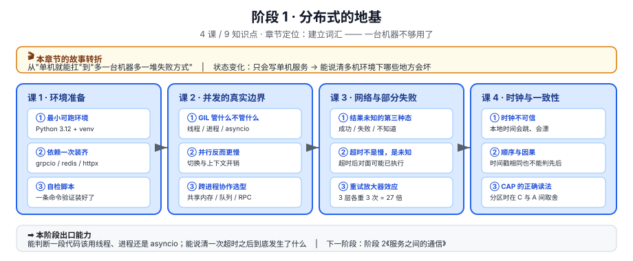

# 阶段 1：分布式的地基

> 所属课程：Python 分布式应用开发 ｜ 故事章节："一台机器不够用了" ｜ 上一阶段：无（本阶段为起点）

## 🎯 本阶段目标

- 说清"从一台机器变成多台机器，到底多出了哪些新问题"——不是性能问题，是失败形态变了
- 建立后续三个阶段共用的词汇表：部分失败、超时、幂等、一致性
- 能在 Python 的三条并发路线（线程 / 进程 / asyncio）之间做出有依据的选择

## 📍 学习重点

- **并发不等于更快**：CPU 密集时多线程被 GIL 挡住，I/O 密集时多进程反而浪费内存——这条边界决定了后面所有服务端代码的写法。
- **部分失败是分水岭**：单机上函数要么返回要么抛异常；跨机器还有第三种状态——**不知道**。后面所有重试、幂等、去重的设计都在处理这个"不知道"。
- **超时是未知，不是慢**：把超时当成"慢"会导致无脑重试，把"未知"当成"失败"会导致无脑放弃，两者都会出错。
- **一致性词汇要提前建**：CAP 常被读成"三选二"，实际讨论的是分区发生时在一致性与可用性之间的取舍；顺序问题往往不是时钟不准，而是因果无法从时间戳推出。

## ✅ 必须掌握的知识点

| 知识点 | 所属课 | 学完应能 |
|--------|--------|----------|
| 并发模型的真实边界 | 课 2 | 判断一段代码该用线程 / 进程 / asyncio，并说清理由 |
| 什么时候并行反而更慢 | 课 2 | 解释"加了机器吞吐没涨"，并定位是 CPU、GIL 还是下游被打爆 |
| 跨进程协作的选型 | 课 2 | 在 multiprocessing / 消息队列 / 分布式任务框架间给出初步判断 |
| 部分失败：请求发出去了，但不知道结果 | 课 3 | 画出"请求发出 → 超时 → 三种可能结果"的完整状态 |
| 网络超时不是"慢"，是"未知" | 课 3 | 说清超时后服务端可能已经执行成功 |
| 重试的代价与放大器效应 | 课 3 | 计算一次重试风暴对下游的请求放大倍数 |
| 时钟不可信 | 课 4 | 举出依赖本地时间做判断导致出错的真实场景 |
| 顺序与因果 | 课 4 | 解释为什么时间戳无法推出因果顺序 |
| CAP 与一致性光谱的正确读法 | 课 4 | 说清 CP 系统主库挂掉后为什么不能写 |

## 🗺️ 本阶段路径图

> 看图：课 1 先把环境跑起来（可以跳过），课 2 解决"我这台机器上怎么并发"，课 3 把视角推到机器之间（失败形态变了），课 4 抽象到多机协作的通用规律。三课的依赖是从具体到抽象，课 3 依赖课 2（要先知道并发在单机的边界），课 4 依赖课 3（要先见过部分失败，才理解为什么时钟和顺序会成为问题）。

## 本阶段产出

- [x] `lessons/01-环境准备.md`
- [x] `lessons/02-Python并发的真实边界.md`（含 4 张 SVG：入口直觉图 / 三路线矩阵 / 三种结局 / 四级协作台阶）
- [ ] `lessons/03-网络与部分失败.md`
- [ ] `lessons/04-时钟、顺序与一致性光谱.md`
- [ ] `../应用实战/03-网络与部分失败.md`（课 3 配应用实战；课 2、4 不配）
