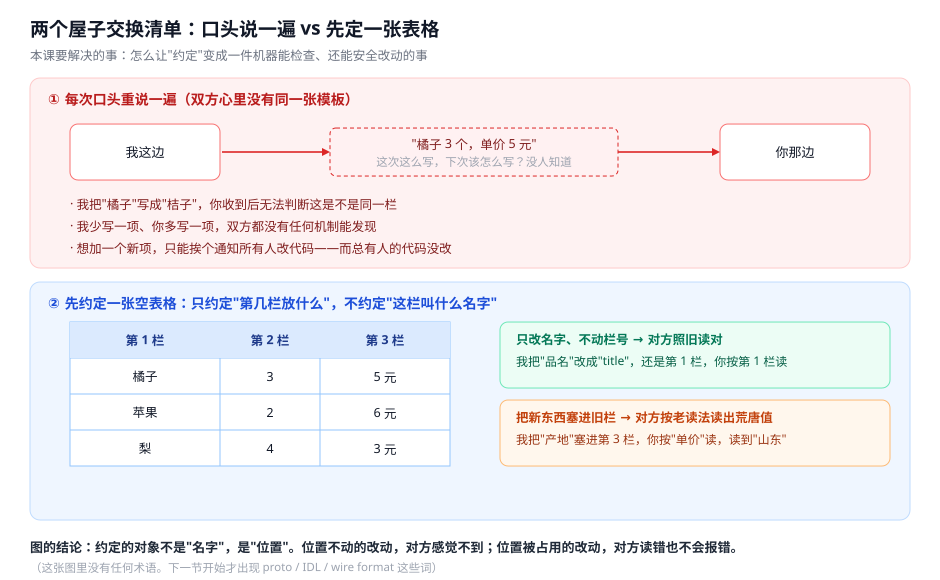
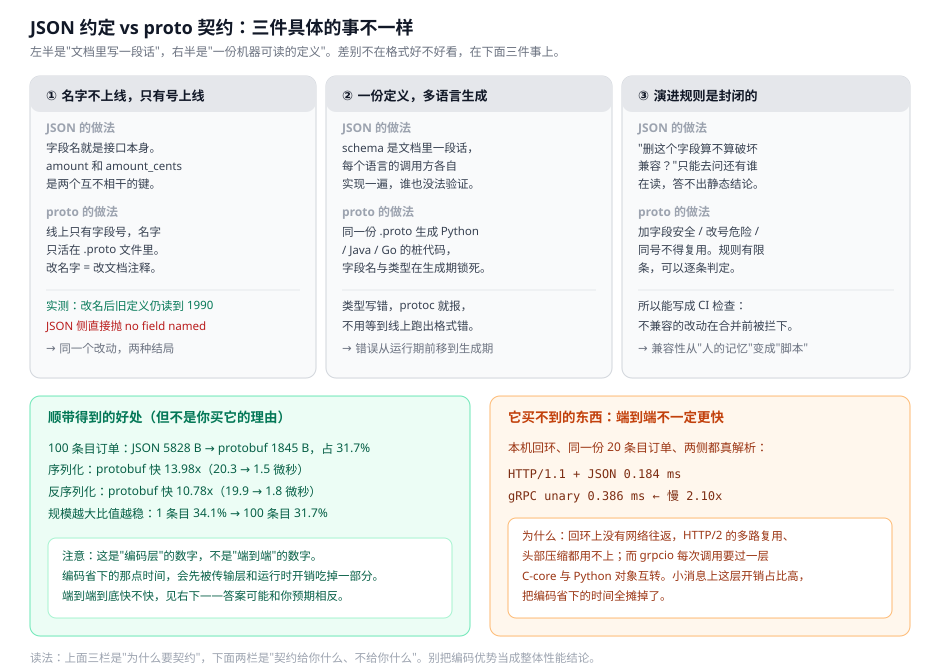
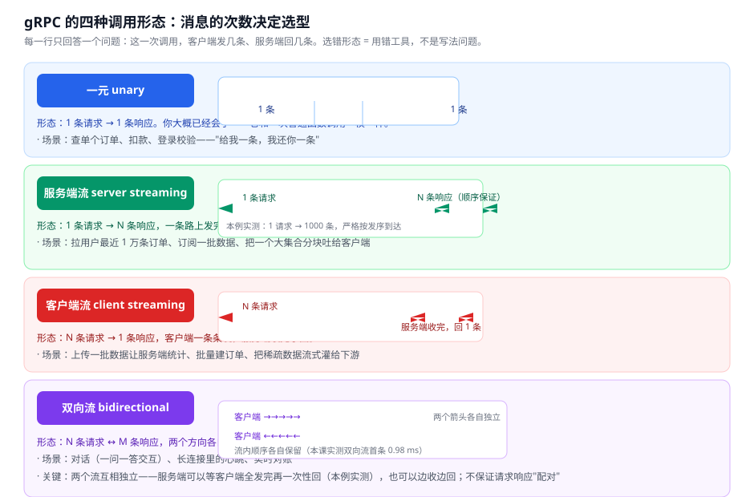
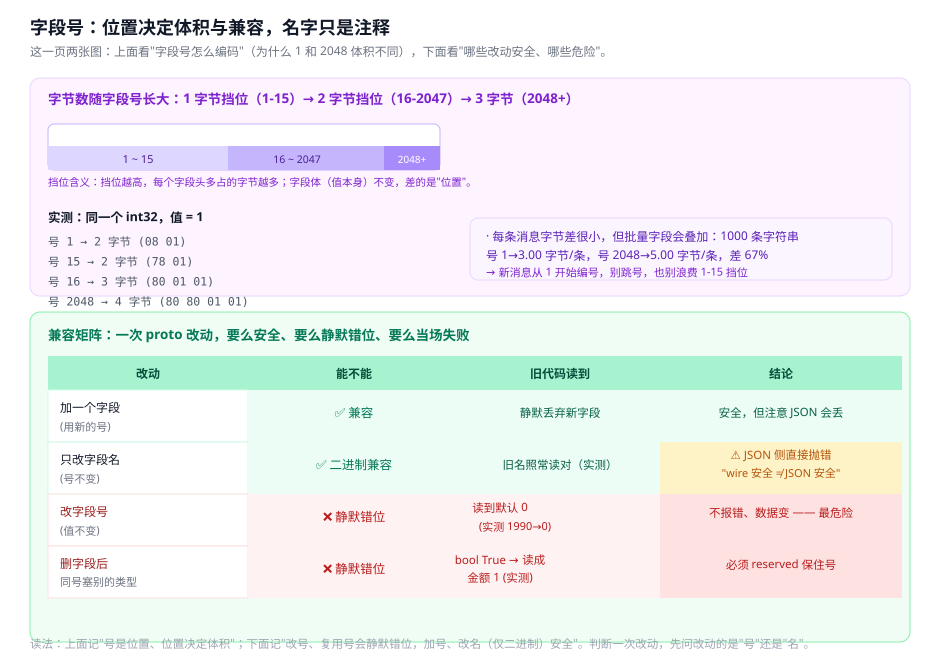
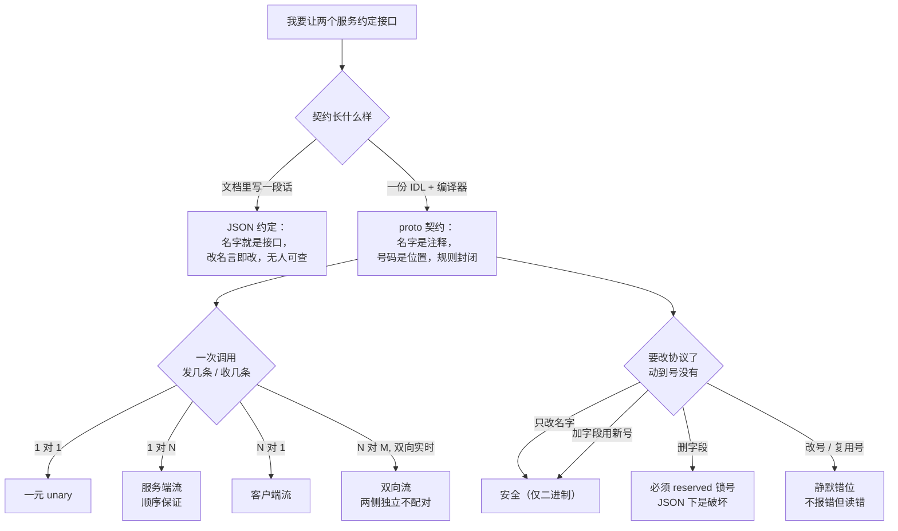

# 第 5 课：接口契约与 gRPC

> 所属阶段：阶段 2《服务之间的通信》｜ 水平：入门 ｜ 本课知识点：接口契约为什么值得一份 IDL、gRPC 的四种调用形态、契约演进（字段号与兼容规则）
> 故事情节：主角在"两阶段"这块地基上终于把第一个服务拆了出去。一开始对内接口是"文档里写一段返回 JSON 的话"，第三个服务接入当天就崩了——有人把字段名从 `amount` 改成 `amount_cents`，文档没说，另外两个服务各改各的。他决定把"约定"从"人脑里的印象"换成"一份机器能检查、还能安全改动的定义"，并用它把原来断断续续的大批数据传输改成了真正的流。
> 📖 结论已按官方文档核对（核对于 2026-11 ｜ 来源：[protobuf proto3 字段号规则](https://protobuf.dev/programming-guides/field-numbers/)、[protobuf 向前向后兼容规则](https://protobuf.dev/programming-guides/proto3/#updating)、[ProtoJSON 命名与未知字段](https://protobuf.dev/programming-guides/json/)、[gRPC 核心概念：四种调用形态](https://grpc.io/docs/what-is-grpc/core-concepts/)、[gRPC Python Basics](https://grpc.io/docs/languages/python/basics/)）
> ✅ 本课全部数字实测于 Linux（WSL2，kernel 6.6.87.2）/ Python 3.12.13 / grpcio 1.85.1 + protobuf 7.36.2，全部本机回环与进程内线程，不访问外网；脚本见 4.1，可原样复跑

## 🎯 本课目标

- 面对"我要给另一个服务暴露接口"时，能判断该不该写一份 IDL，并说清 proto 相对「文档里写一段 JSON 约定」的三个具体优势
- 拿到一种跨服务数据交换需求，能按"几次请求 / 几次响应"选对 gRPC 的四种调用形态之一
- 看到一次 proto 改动（加字段 / 改号 / 改名 / 复用号），能判定它安全、静默错位还是当场失败，并说出依据

---

## 第一幕：起源与场景引入

> 🏛️ **起源**：gRPC 的"高屋建瓴"版本要从 Google 内部的 Stubby 说起。Stubby 是 Google 内部用了很多年的 RPC 框架，服务了 Google 内部的几乎所有微服务调用，时间可以一路追溯到大约 2001 年。到了 2015 年，Google 决定把新一代的 RPC 框架开源，于是有了 gRPC——这个名字的 g 代表 gRPC Remote Procedure Call（一个看得见的递归缩写），它跑在 HTTP/2 之上，用 Protocol Buffers（protobuf）做接口定义语言与序列化。2015 年 3 月 Google 宣布开源，随后交给 CNCF 孵化（2017 年 2 月进入 Incubating）。必须说明：**gRPC 目前的"毕业/已毕业"状态在不同资料里说法不一，本课不对此下断言**（这一条详见下文「常见误区」）。
>
> 🎬 **场景**：你把订单服务拆成了两个进程，对内接口用的是最朴素的方式——`docs/internal-api.md` 里写一段话：

```markdown
POST /internal/order
请求体：{"order_id": "...", "user_id": 12345, "items": [{"sku": "...", "qty": 1, "unit_price": 1990}], "currency": "CNY"}
```

> 前两个调用方都接上了，倒也没出大事。直到第三个团队接入——他们看文档里写的是 `amount`，但代码里老字段叫 `amount_cents`，于是一边改调用方、一边悄悄把文档改成了 `amount_cents`。这下崩了：前两个服务里有一个还在用旧字段名 `amount`，拿到响应后 `item.amount` 永远是 `undefined`，静默读不到金额。查了半天，根因不是谁的代码写错了，而是**"约定"只在文档里、在每个人脑子里，没有任何机制能验证"你现在读到的就是别人写的"**。

> 📌 **一句话本质**：把"这段接口怎么说话"的答案，从"一篇人类读的文档"换成"一份机器能检查、还能安全改动的定义"——名字不上线、只有位置（字段号）上线，于是改动要么被脚本检查出来、要么不破坏别人。
>
> ⚖️ **处境对照**：不这么做——一个"三服务接入要不要改"的问题，暴露出来的是：① 字段改名没有任何地方能自动通知到所有调用方（M10 实测发现，同样的改名在 JSON 侧是直接抛错的，只有文档咔嚓一声）；② 一次"删字段再复用"的改动，旧服务读到的金额直接变成 1，且毫无报错（M5c）；③ 想判断"这次改动算不算破坏性变更"，只能打电话问每一个在写调用方的人。这么做——同一份 `Order` 定义生成两种语言的桩代码，字段名与类型在生成期就被锁死；字段号机制让"加字段"能安全演进（M5a 实测旧代码静默丢弃新字段、不报错）、"改名"在二进制上完全安全（M10a）、"改号/复用号"被规则明确禁止且用 CI 可拦。
>
> 位置说明：场景先把人带进"第三个服务接入就崩、还查不出为什么"这个具体麻烦，再给一句"本课本质上在换什么"——把"约定"从人脑搬进机器，同时不臆造 gRPC 的性能神话。

---

## 第二幕：认知冲突

上面这些"崩"都有一点让人意外的地方：**不是超时、不是宕机、不是网络抖动，而是"协议本身变了，但没有一个人收到通知"。**

这不是"大家沟通不够"。它来自一个结构性事实：

**在一个多进程系统里，"接口长什么样"这件事，如果只存在于人类写的文档里，那么它在任何一台机器上都不是"事实"，而只是"某个人的印象"。** 每个人对印象的同步，只能靠一轮又一轮的沟通；而沟通这件事，本身就是会部分失败、会延迟、会传来传去传丢的——这正是阶段 1 一直在讲的那件事。

于是拆完服务后，你会撞上三堵墙：

- **墙一：字段名是"接口"，改字段名就是改接口。** 你用 `amount`，我改成了 `amount_cents`——你没有任何机制知道这件事发生了。文档更新了，但那只是又一份文本，它没法告诉你"现在到底哪个是真相"。
- **墙二：无法说清"这次改动算不算破坏"。** "我删了个字段，会不会影响你们？"这个问题，在没有 schema 的系统里答案只能是"你去查还有谁在读它"——一个运行时才能回答、而且往往答不准的问题。
- **墙三：连"错误"都静默。** 最凶的一种不是抛异常，而是旧代码把新值按旧规则读出来、还读得"挺像那么回事"——金额 1990 被读成 1、订单带了个 `undefined` 的金额，全都不报错。没有 schema 差异检查，这种错位会一直潜伏到某个下游行为变得奇怪才被发现。

所以真正的问题不是"咱们多开会、多写文档"，而是：

> ❓ **问题**：有没有一种方式，能把"接口契约"变成一个独立的、机器可读的东西，让双方都受它约束——并且这个本身还能安全地演进（加字段、改名字），而不是一改就全崩？

---

## 第三幕：层层揭示

### 一眼全局图（进入细节前先看一眼）



> 看图：左边两个屋子之间每次都要"口头说一遍今天传什么东西"——这次这么写、下次没人知道该怎么写。右边先定一张空表格：只约定"第 1 栏是品名、第 2 栏是数量、第 3 栏是单价"，把"这栏叫什么名字"从约定里拿掉。于是：你想给某一栏改名，只要不改"第几栏"，对方照旧读对；你想给整个表格加点东西，只能用"新增一栏"，绝不能用"把新东西塞进旧栏"。这张图里没有任何术语，谈的只是"两间屋子怎么把一次性的口头约定，变成一份能反复用、还能安全改的表"。

**四条硬约束**已满足：这图只回答"本课要解决什么问题、靠什么思路解决"；图上没有"proto / IDL / wire format"这类词；下面有读图指引；图旁文字能独立说清同一件事。

### 本课地图（分几步走）

| 步 | 这一步要解决什么（人话） | 对应知识点 |
|:--:|------------------------|-----------|
| 1 | 先看明白：把约定放进文档里到底差在哪，协议该是什么 | 知识点 1：接口契约为什么值得一份 IDL |
| 2 | 协议定了，那一次调用能发几条、收几条？按消息次数选形态 | 知识点 2：gRPC 的四种调用形态 |
| 3 | 协议和形态都定了，那以后要改协议，怎么改才不弄坏别人 | 知识点 3：契约演进（字段号与兼容规则） |

> 只回答"分几步走、现在在哪"——不写机制、不写结论；表格式，不是图、不占 SVG 配额；不标学习状态（进度以 `00-学习档案.md` 为准）。

---

### 知识点 1：接口契约为什么值得一份 IDL

> 🧭 第 1/3 步｜承接：第二幕把"靠文档和沟通保着的一纸约定"这条路堵死了，但我代码里现在到处都是 `response["amount"]` → 本步：先看清"协议"这个想法本身，再说清 proto（一份 IDL）相对 JSON 约定的三个具体优势
> 本知识点关键点：协议是"双方都受其约束的机器可读定义"；三个优势是——①名字不上线只有号上线、②一份定义多语言生成、③演进规则封闭可进 CI；以及一个重要的"它不是……"：它不保证端到端更快

#### 一句话定义

**接口契约（一份 IDL）** 是"接口长什么样"这件事的机器可读定义——它独立于任何一侧的实现，让每一个调用方和服务方都受同一份文件约束；而"JSON 约定"只是这篇文档里的一段话，不产生任何约束。

#### 直觉建立（类比）

把接口想象成一份寄件单。**JSON 约定**的做法是：我口头告诉对方"你会收到一个包裹，里面有几样东西"，具体长什么样，以我当时的心情为准——你不拆开看永远不知道，拆开发现少了东西也只能认栽。**proto 契约**的做法是：先印一批空白寄件单，上面有固定的格子（第 1 格放单号、第 2 格放数量、第 3 格放金额），双方约定"以后都按这张单子填"。你拆包裹之前就确切知道第 1 格是单号、第 3 格是金额，而且——关键在这里——**你若发现某个格子里是别的东西，那是"违规"，不是"就这样"**，机制上就存在问题。

> 💡 **类比的边界**：寄件单类比抓的是"固定格子、双方都填同一张"这一层，但它漏掉了一个更凶的地方：**寄件单的格子本身也不是永恒的**。你会往单子上加一行、删一行、或者把"金额"换一个类型——而这些改动必须遵守一套规则（见知识点 3），否则就不再安全。类比到寄件单：你可以"加一个可选格"，绝不可以"把旧的金额格改成别的含义还不通知任何人"。

#### 核心原理

protocol buffers（proto）是一套两件套：一门**接口定义语言（IDL）**，负责描述"消息长什么样"；一个**编译器（protoc）**，负责把这门语言翻译成各语言的桩代码。我们先看 IDL 本身长什么样——它就是一份文本文件，描述"一条订单"：

```proto
// order_v1.proto
syntax = "proto3";
package demo;

message OrderItem {
  string sku = 1;
  int32 quantity = 2;
  int64 unit_price_cents = 3;
}

message Order {
  string order_id = 1;
  int64 user_id = 2;
  string status = 3;
  repeated OrderItem items = 4;   // repeated = 数组
  int64 created_at_ms = 5;
  string currency = 6;
}
```

注意一个反直觉的地方：每个字段后面跟着的**不是类型名顺序，而是编号**（`= 1`、`= 2`…）。这就是本课的钥匙——**字段号是"位置"，字段名只是"这份 .proto 文件里的注释"**。字段名会被编译器吃掉、换成你代码里的属性名；而真正上线传输的，是那个编号。

`protoc` 编译（生成 Python 桩代码）：

```bash
pip install grpcio grpcio-tools
python -m grpc_tools.protoc -I . --python_out=. --grpc_python_out=. order_v1.proto
```

它会生成 `order_v1_pb2.py`。你在代码里这样用它——桩代码把字段名映射回你的属性、把字段号编码成线上的字节：

```python
import order_v1_pb2 as pb

o = pb.Order()
o.order_id = "ORD-1"
o.amount = 1990            # 代码里叫 amount，线上走的却是字段号 2
data = o.SerializeToString()   # 变成字节
```

现在把「为什么值得一份 IDL」切成三件看得见的事，每件都有一个可以被检查的落地结果：

**优势 ①：名字不上线，只有号上线——所以"改名"不用通知任何人。**

把 `.proto` 里的一个字段从 `amount` 改成 `amount_cents`，只要编号还是那个编号，旧服务拿到的字节流完全不变。实测（M10a）：旧定义解析新定义写出的字节，读回 `amount_cents=1990` —— 因为线上根本没有"名字"这个概念。而同样的改名在 JSON 侧是另一回事（M10b）：旧解析器拿到键 `"amount"`，会直接抛 `has no field named "amount"`—— **同一个改动，两种结局。**

**优势 ②：一份定义，多语言生成——类型错误在生成期就被锁死。**

同一份 `Order` 能被 protoc 翻译成 Python / Java / Go 的桩代码，字段名、字段类型、字段号在所有语言里完全一致。你在 Python 侧把某字段类型写错了，`protoc` 编译期就报错，而不是等线上那条消息解析出格式错误才现形。**错误从"运行期"前移到"生成期"。**

**优势 ③：演进规则是封闭的——可以写进 CI 自动检查。**

proto 的兼容规则是有限几条（见知识点 3：加字段安全、改号危险、同号不得复用…）。因为规则是封闭的、能逐条判定，所以你可以写一个检查脚本，在每次改 `.proto` 的合并请求上跑一遍，不兼容的改动在**合并前**就被拦下。这是 JSON 约定永远做不到的——"删这个字段算不算破坏"，在 JSON 世界里只能靠"去问所有调用方"。



> 看图：上面三栏是"为什么要契约"——① 名字不上线只有号上线，② 一份定义多语言生成，③ 演进规则封闭可进 CI。下面两栏刻意放了两件"别误会"的事：左边是顺带得到的好处（体积、编解码速度的真数字），右边是**它买不到的东西**——端到端不一定更快（本机回环实测 gRPC 反而慢 2.10x）。读的时候注意：**编码快不等于端到端快**，别因为专栏吹"gRPC 性能更好"就把编码优势当成整体结论。

#### 示例演示

同样一条 100 条目订单，用 JSON 和用 protobuf，体积与速度分别是多少？下面这段脚本两件事都测（M1 / M2）：

```python
# bench_payload.py（节选）
import json, time, statistics
import order_v1_pb2 as pb

o = pb.Order(); o.order_id="ORD-20261103-000123"; o.user_id=1002345678
o.status="PAID"; o.created_at_ms=1793692800123; o.currency="CNY"
for i in range(100):
    it = o.items.add(); it.sku="SKU-%05d"%i; it.quantity=i%7+1; it.unit_price_cents=1990+i

def to_dict(o):
    return {"order_id":o.order_id,"user_id":o.user_id,"status":o.status,
            "created_at_ms":o.created_at_ms,"currency":o.currency,
            "items":[{"sku":i.sku,"quantity":i.quantity,"unit_price_cents":i.unit_price_cents} for i in o.items]}

pb_bytes = o.SerializeToString()
json_bytes = json.dumps(to_dict(o), ensure_ascii=False, separators=(",", ":")).encode()
print("JSON 字节        :", len(json_bytes))
print("protobuf 字节    :", len(pb_bytes), "占 JSON 的 %.1f%%" % (100*pb_bytes/len(json_bytes)))
```

实测输出：

```
JSON 字节        : 5828
protobuf 字节    : 1845  占 JSON 的 31.7%
序列化：protobuf 快 13.98x（20.3 → 1.5 微秒）
反序列化：protobuf 快 10.78x（19.9 → 1.8 微秒）
```

#### 常见误区

1. **"用 gRPC/protobuf 就是为了性能，它一定更快"**：编码层确实快（快 ~14x），但端到端不一定。本机回环、同样一份 20 条目订单、两侧都真解析，实测 gRPC 反而慢 2.10x（0.184 vs 0.386 ms）——因为回环上没有网络 RTT、HTTP/2 的压缩用不上，而 grpcio 每次调用要过一层 C-core 与 Python 互转。**你买 gRPC 的理由是契约和演进，不是性能。**
2. **"小字段号省不了多少字节，无所谓"**：单条是差不了多少，但批量会叠加——1000 条字符串，字段号 1 是 3.00 字节/条、字段号 2048 是 5.00 字节/条（M6b），差 67%。**新消息从 1 开始编号、别跳号。**
3. **"字段名改了，老服务肯定就读不出来了"**：恰恰相反，二进制上完全安全（M10a）。真正危险的是改字段号、复用字段号，那些才是静默错位。
4. **"文档里写清楚就行"**：文档不会自动同步、不会被检查，而且改它不需要任何权限。**它无法成为"约束"。**

#### 一句话记住

**契约是"第几栏放什么"，不是"这栏叫啥"——所以名字可以随便改、没人受伤；位置一旦被改或复用，别人读错也不会告诉你。**

#### 🗣️ 行话对照

- **IDL / 接口定义语言**：描述接口长什么样的语言（这里的 proto）。
- **protoc / 编译器**：把 IDL 翻译成各语言桩代码的工具。
- **stub / 桩**：生成出来的、把函数调用变成线上字节的代码（`OrderServiceStub`）。
- **wire format / 线格式**：字节流本身如何组织——字段号 + 类型 + 值的编码规则。

#### 📚 官方文档

- [protobuf · 字段号规则](https://protobuf.dev/programming-guides/field-numbers/)
- [protobuf · proto3 语法（updating 一节）](https://protobuf.dev/programming-guides/proto3/)
- [gRPC · Core concepts（IDL、四种调用）](https://grpc.io/docs/what-is-grpc/core-concepts/)

---

### 知识点 2：gRPC 的四种调用形态

> 🧭 第 2/3 步｜承接：知识点 1 定了"协议长什么样"（IDL），但协议只是说"这条消息有哪些字段"——它没说"一次调用能来几条、回几条" → 本步：按"几次请求 / 几次响应"这张表，把调用形态选对
> 本知识点关键点：四种形态的本质差异是消息次数；流内消息顺序有保证；双向流两侧互相独立、不保证配对；选型从"我这次要发几条收几条"出发

#### 一句话定义

gRPC 的**四种调用形态**（一元 / 服务端流 / 客户端流 / 双向流）是"一次 RPC 里消息可以怎么流动"的四种模板——它们的本质差异是**每条流里消息的数量**，以及**两个方向是否独立**。

#### 直觉建立（类比）

把一次 RPC 想成一次"问话-回答"。一元是**普通问答**：问一句答一句。服务端流是**我问一句、你慢慢说一大堆**（比如"把我最近一万笔订单拉给我"，你分很多条给我送，不用我说"下一批"）。客户端流是**我说一大堆、你最后只说一句**（比如"这里是一万笔订单，你统计完告诉我总数"）。双向流是**两边都在说、谁也拦不住谁**——像电话通话里的实时对话，两人都能同时说、同时听，彼此不用等对方说完。

> 💡 **类比的边界**：问答类比抓的是"次数"这一层，但漏掉了一个关键细节——**流内消息的顺序有保证，而两个方向之间没有配对关系**。电话里你说一句我问一句是"看起来配套"，但 gRPC 的服务端流/双向流只承诺"同一条流里消息按发序到达"，不承诺"我的第 2 条请求对应你的第 2 条响应"。真正需要"配对"的场合（比如一问一答的对话），你得靠消息内容自己带 id 把两者对上，别指望框架替你配。

#### 核心原理

先看怎样在 `.proto` 里声明这四种形态——区别只在 `stream` 关键字出现在哪一侧：

```proto
service OrderService {
  rpc GetOrder(GetOrderRequest) returns (Order);                 // 一元：1 请求 1 响应
  rpc ListOrders(ListOrdersRequest) returns (stream Order);      // 服务端流：1 请求 N 响应
  rpc UploadOrders(stream Order) returns (CreateOrderReply);      // 客户端流：N 请求 1 响应
  rpc SyncOrders(stream Order) returns (stream Order);            // 双向流：N 请求 M 响应
}
```

- `stream` 加在**请求**那侧 → 客户端流 / 双向流里的"进方向"。
- `stream` 加在**响应**那侧 → 服务端流 / 双向流里的"出方向"。
- 两侧都加 `stream` → 双向流。



> 看图：四行是四种形态，每行右侧是一个小示意图，标注这条调用里"请求几条、响应几条"。最关键的是第 4 行（双向流）——两个箭头方向不同、各自独立流动，这意味着服务端可以一边收一边回，也可以等客户端全发完再一次性回。图下标注了本课实测的两件事：服务端流 1 请求能拿到 1000 条且严格按发序；双向流首条响应只要 0.98 毫秒就能拿到。

用真实代码把四种形态都跑一遍（M3）。下面是一份包含全部四种 RPC 的 service 实现与调用：

```python
# rpc_shapes.py（节选）
class OrderServiceImpl(rpc.OrderServiceServicer):
    def GetOrder(self, request, context):
        return make_order(1)                          # 一元：直接返回一条

    def ListOrders(self, request, context):
        for i in range(request.page_size):            # 服务端流：yield N 条
            yield make_order(i)

    def UploadOrders(self, request_iterator, context):
        n = 0
        for _ in request_iterator:                    # 客户端流：遍历收到的流
            n += 1
        return pb.CreateOrderReply(status="RECEIVED:%d" % n)   # 最后回一条

    def SyncOrders(self, request_iterator, context):  # 双向流：边收边回
        n = 0
        for o in request_iterator:
            n += 1
            yield pb.Order(order_id="ACK-" + o.order_id, status="ACK%d" % n)
```

实测输出（M3a–M3f）：

```
M3a 一元调用：1 请求 / 1 响应
    返回 1 条订单：order_id=ORD-0001 status=PAID

M3b 服务端流：1 请求 / N 响应
    一次请求拿到 5 条：['ORD-0000','ORD-0001','ORD-0002','ORD-0003','ORD-0004']
    顺序是否与产出顺序一致： True

M3c 客户端流：N 请求 / 1 响应
    发了 5 条，服务端只回 1 条：RECEIVED:5

M3d 双向流：两侧独立，边发边收
    共收到 4 条响应（与发出条数相同，但每条都是独立产生的）

M3e 双向流：服务端可以等客户端全发完再一次性回
    客户端发 3 条、收完才回 1 条：SUMMARY status=got 3

M3f 流内 ordering：1000 条消息是否严格按发序到达
    收到 1000 条；严格递增： True
```

注意 M3e 和 M3d 的差别：**同一份 `SyncOrders`，服务端既可以"边收边回"（M3d），也可以"先全部收完再一次回"（M3e）**——具体用哪种，取决于服务端的实现，而不是协议本身。这就是"两个方向互相独立"的直观含义。

#### 示例演示：什么时候该用服务端流？——先分清"流"不是"分页的替代"

一个很深的坑：很多人以为"大批量拉数据就用流"，于是把原来"分页拉"改成"一条流到底"，结果发现更慢了。本课实测（M13）把三种拉法放同一台机器上比：

```
拉取 10000 条订单：
  HTTP/1.1 分页（100 条/页）      40.3 ms   往返 100 次
  gRPC unary 分页（100 条/页）   1326.0 ms  往返 100 次
  gRPC 服务端流（一次流到底）      1267.7 ms  往返   1 次
```

三个结论：**第一，gRPC 在这次测试上整体比 HTTP 慢**——因为每条消息都要过一层 C-core 与 Python 互转，每条消息的固定开销（约 115-160 微秒，见 M16）压过了 HTTP/2 省下的往返次数。**第二，"一次流到底"相对"gRPC 分页"只省了一点点**（1326→1268 ms，约 4%），因为瓶颈根本不是往返次数，是**每条消息的处理成本**（M16b：条数降到 1/125，耗时降到 1/111，成本跟着条数走）。**第三，分页的意义不在于"省消息"、而在于"给输出限流"**——你在与外部系统对接、对方接受不了几万条一口气灌进来时，分页是"礼貌"，不是"性能需要"。

那服务端流到底该什么时候用？两个真正成立的场景：**① 你要"边做边给"**——比如一条查询要遍历好久，你想让调用方尽早拿到前几条结果（首条延迟做对比时流式 0.98ms vs 分页必须等全量 1387ms，差 1339x，见 M15）；**② 数据天生就是"流"**——比如订阅实时事件、日志推送，客户端不知道什么时候会来下一条，不适合用一个固定长度的列表去表达。**判断标准：你这一侧会不会"一条一条地产生"，还是"一次性全部产生"。**

#### 常见误区

1. **"流一定比批量快"**：正好相反，这个量级下流处理**逐条成本更高**（M16）。流的价值在"边到边处理 + 首条快 + 天生流式场景"，不在吞吐。
2. **"流能替代分页来做大批量传输"**：分页解决的是"输出限流"和"单条消息大小上限"（见 M17：默认 4 MiB 上限），流解决的"边到边"。两者解决的问题不同，不能互相替代。
3. **"双向流就是一对一定时问答"**：双向流不保证请求-响应配对，两方向各自独立。要配对得靠消息内容自带 id。
4. **"服务端流，客户端必须收完才能看到第一条"**：不是，迭代器是**边收边吐**的——第一条约 1 毫秒就能拿到（M15）。分页才必须等一页全部到齐。

#### 一句话记住

**选形态先数数：我这次发几条、回几条。一次对一次用一元；一对多/多对一用流；要实时对话才用双向流，而双向流不替你配对。**

#### 🗣️ 行话对照

- **unary / 一元**：1 请求 1 响应的普通 RPC。
- **server streaming / 服务端流**：单请求、流式响应。
- **client streaming / 客户端流**：流式请求、单响应。
- **bidirectional / 双向流**：双向各自独立流动；流内顺序各自保留。
- **ordering guarantee**：gRPC 保证同一 RPC 调用内消息按发送顺序到达（"gRPC guarantees message ordering within an individual RPC call"）。

#### 📚 官方文档

- [gRPC · Core concepts（四种调用形态）](https://grpc.io/docs/what-is-grpc/core-concepts/)
- [gRPC · Python Basics（四种 RPC 写法）](https://grpc.io/docs/languages/python/basics/)

---

### 知识点 3：契约演进 —— 字段号与兼容规则

> 🧭 第 3/3 步｜承接：协议定了（知识点 1）、形态定了（知识点 2），但服务是会演进的——三个月后我要给 `Order` 加字段、改名，怎么改才不弄坏还在线上的旧版本 → 本步：学会判断一次 proto 改动是否安全
> 本知识点关键点：字段号是"位置"、一旦启用永不复用；reserved 语法锁死被删字段；wire 兼容分三档（安全 / 条件安全 / 不安全）；"wire 安全"不等于"JSON 安全"，JSON 里删字段是 breaking change

#### 一句话定义

**契约演进**是这么一组规则：它告诉你，在 `Order` 这份协议上做"加字段 / 删字段 / 改名 / 改类型 / 复用编号"这些动作时，哪些能让新旧版本并存、哪些会让旧版本静默读错。判断的核心变量只有一个 —— **你动的是字段名，还是字段号**，以及**被删的号有没有用 reserved 锁死**。

#### 直觉建立（类比）

回到那张寄件单。**加字段** = 在单子最后加一个"可选格"，旧机器不认识这个新格，会忽略它——安全。**改名** = 把某个格子的名称写在旁边改一下，但格子位置没变，旧机器还是按位置读——二进制安全（但注意，JSON 侧不是这样，见下）。**改号** = 把"金额"从原来的第 3 格挪到第 5 格，旧机器还傻乎乎地按第 3 格读，读到的其实是别的东西——静默错位。**复用号** = 把让别人读成"金额"的第 3 格，重新拿来填"是否已支付"，旧机器还会按金额去读——最危险的一种，读到新值也毫无异常。

> 💡 **类比的边界**：寄件单类比抓的是"位置 vs 名字 vs 复用"这三档，但它漏了一个更管用的工程细节：**protobuf 有一种叫 reserved 的语法**，专门用来"把被删掉的格子号锁死，禁止未来任何人再占用"。没有它，团队里某人以为"这号反正没用了"，就把它复用去干别的——这正是 M5c 那类事故的来源。**protobuf 官方对"删除字段"的态度是：字段号一旦启用永不重复使用。**

#### 核心原理

先记牢一个规则：**字段号在 1 到 536,870,911 之间，但 19000-19999 保留给 protobuf 自身实现，禁止使用。** 这不仅仅是个"编号范围"——它直接影响线上字节大小：**1-15 的字段号用 1 字节编码，16-2047 用 2 字节，2048 以上用 3 字节及以上。** 实测（M6）同一个 int32 值 1，字段号 1 编码成 2 字节、字段号 2048 编码成 4 字节、字段号 500000 编码成 5 字节。所以**给高频字段留小号**不是审美，是多出来几十个字节的开销。

现在把 proto 官方对"演进"的完整规则摊开。官方文档把一次改动分成三档（这是本课要背下来的核心）：

| 档位 | 例子 | 旧版本行为 |
|------|------|-----------|
| **Wire-safe（安全）** | 加字段（用新号）；删字段但**同号永不复用**；枚举加值；单字段 `oneof` 互转 | 新字段被静默忽略；旧枚举值继续读对 |
| **Wire-conditionally safe（条件安全）** | `int32`/`uint32`/`int64`/`uint64`/`bool` 之间互相换 | 能解析但可能**截断**：`int64` 读成 `int32` 会丢高位 |
| **Wire-unsafe（不安全）** | 改字段号；把字段**移入已存在的 `oneof`** | 静默错位，读到错误/默认的值 |

最常见的两个"我以为没问题、其实最危险的"改动，用真实数据演示一下（M5）：

**① 改字段号会静默错位，不报错。** 新代码把 `amount` 从字段号 2 改成字段号 5，旧代码还按"字段号 2 是 amount"读，结果是 `amount=0`（默认值），而真实值 1990 被静默丢掉。**没有任何异常。**

**② 复用被删的字段号最致命。** 把字段号 2 从"金额 int32"改成"是否已支付 bool"，旧代码按 int32 解析 `True`，读到 `amount=1`——一笔"金额 1990"的订单被读成 1。更糟的是它**完全不报错**，会一直潜伏到下游行为变怪为止。protobuf 官方原文对此说得很直白（核查于 2026-11）：

> "Changing a field number is equivalent to deleting that field and adding a new field. ... you should never reuse a field number ever." / "You should always use `reserved` for deleted fields."

用 reserved 语法锁死被删的号（注意范围是闭区间）：

```proto
message Order {
  reserved 2, 15, 9 to 11;   // 这些号被永久锁死，禁止复用
  string order_id = 1;
  // string amount = 2;      // 已删——号 2 现在 reserved
  string status = 3;
  // ...
}
```

**再补上两个"藏在规则背面"的坑，都很容易踩到：**

**坑 A：JSON 侧没有"删字段保留"这回事。** proto 的 wire 格式能忽略未知字段、保留被删字段（M5e 实测：旧解析器读出的未知字段再序列化，新字段不丢）。但 **ProtoJSON 协议根本不支持未知字段**——文档（核查于 2026-11）：「proto3 JSON parser rejects unknown fields—when adding new fields to your message, new fields will not be present when your new clients talk to old clients ... （在 JSON 下）deleting a field is a breaking change」。所以同一份 `Order`，用二进制 wire 时"删除字段"是安全的（有 reserved 就行），用 JSON 编码时"删除字段"就是破坏性变更。判断兼容性之前，**先问一句：这条链路走的是二进制还是 JSON？**

**坑 B：`int32 ↔ int64` 虽在 wire 上兼容，但值会截断。** M5d 实测：写入 `v=5_000_000_000`（int64），旧代码按 int32 读，得到 `705032704`——高位被丢弃，不报错。判断条件安全档时，要额外想想"这个字段的值域会不会超过窄类型的上限"。

（额外一个价值点：`optional` 让 "没设" 和 "设为 0" 可分。proto3 默认字段没有 presence，`discount=0` 和 "不设 discount" 在 wire 上完全一样（M11 实测都 7 字节、读回都 0）。加了 `optional` 后 `HasField` 能区分，但代价是显式的 0 要多 1 字节头（9 字节 vs 7 字节）。**要不要区分"没填"和"填了 0"，是每个业务字段都得单独回答的问题。**）



> 看图：上面那张图记"号是位置、位置决定体积"——同一个值，字段号越大编码越长；下面是兼容矩阵，五行的读法一致：改动 → 旧代码会不会报错 → 读到什么 → 结论。三个红行（改号、复用号）想表达的是同一件事：**"不报错"不等于"安全"，静默错位是最危险的失败方式**，因为它不会现形在报错日志里，而会现形在下游那个"怎么突然不对了"的奇怪行为里。

#### 示例演示：判定一个改动是否安全

现在拿一个真问题练手。假设你收到三条改动请求，逐条判断：

```proto
// 现版本
message Order {
  string order_id = 1;
  int64 amount_cents = 2;
  string status = 3;
}
```

1. **"我想把 `amount_cents` 改名为 `amount`。"** → 二进制安全（M10a），但 JSON 编码链路会坏（M10b）。**结论：二进制里随便改，JSON 里是破坏性变更，要先确认改的这条链路用哪种编码。**
2. **"我想新增一个 `coupon` 字段。"** → 用新号（比如 `= 4`）就安全（M5a）。**条件是：绝不能用已经用过的号。**
3. **"我想删掉 `amount_cents` 这个字段，因为它没用了。"** → 删可以，但必须：**① 保留号 2（加 `reserved 2;`）；② 确认这条链路不是 JSON 编码**（JSON 下删字段是 breaking change）。否则就是又一个"复用号导致金额变 1"的雷。

每一步该问的问题都是一个：**"我动的是名字、是号、还是把号复用了？这条链路走二进制还是 JSON？"**

#### 常见误区

1. **"删掉不用字段不会影响任何人"**：会影响——JSON 链路下删字段直接破坏；二进制链路下若不 `reserved`，号 2 会被未来某次复用，酿成 M5c 那种金额变 1 的事故。**删除永远要配 reserved。**
2. **"报警就是有冲突，不报错就是没冲突"**：正好相反。最危险的三类（改号、复用号、类型截断）全都**不报错**，只是静默读错。所以"能解析成功"不能当作"兼容"的证据，必须按规则表逐条判定。
3. **"全库扫描一下死链/冲突就够"**：兼容性问题不会出现在链接检测里——它藏在线格式的字节数、字段号、JSON 的字段名里。需要专门的 `.proto` 兼容检查，这也正是"规则封闭可进 CI"的价值。
4. **"字段号 1-15 留小号是我个人偏好"**：不，是在批量场景下能省 67% 的字段头（M6b）。**给高频字段留小号是工程决策，不是洁癖。**

#### 一句话记住

**判断一次改动：动名字安全（仅二进制），动号或复用号必炸且静默，删号必须 reserved；先问走二进制还是 JSON —— JSON 里删字段就是破坏性变更。**

#### 🗣️ 行话对照

- **field number / 字段号**：线格式里每个字段的唯一"位置"标识。
- **reserved**：声明被占用的号/名字，防止未来复用。
- **wire compatibility / 线兼容**：改了字节流组织方式后，旧解析器能否正确解析。
- **breaking change / 破坏性变更**：会让旧版本读错或失败的一次改动。
- **presence / 显式存在性**：字段是否带"是否被设置"这一信息（optional 开启后才有）。

#### 📚 官方文档

- [protobuf · 字段号规则与限制](https://protobuf.dev/programming-guides/field-numbers/)
- [protobuf · proto3 更新消息（Updating A Message Type）](https://protobuf.dev/programming-guides/proto3/#updating)
- [protobuf · ProtoJSON 命名与未知字段](https://protobuf.dev/programming-guides/json/)

---

## 第四幕：验证与实战入口

### 4.1 机制验证

本课所有数字都来自本机实测，脚本在本机可原样复跑。下面是每个知识点对应的验证脚本：

**验证 1：体积与速度（知识点 1）** — `bench_payload.py`（正文知识点 1 已给出节选源码）：

```
M1  同一条订单，两种编码占多少字节
  条目     JSON 字节      protobuf 字节    protobuf/JSON
  1      185          63             34.1%
  5      413          135            32.7%
  20     1268         405            31.9%
  100    5828         1845           31.7%

M2  100 条目订单，7 轮取中位
  JSON dumps                  20.3 微秒/次
  protobuf SerializeToString   1.5 微秒/次
  JSON loads                  19.9 微秒/次
  protobuf FromString          1.8 微秒/次
  编码：protobuf 是 JSON 的 13.98x 快
  解码：protobuf 是 JSON 的 10.78x 快
```

**验证 2：字段号影响线格式体积（知识点 3 前置）** — 同一段脚本（M6 / M6b）：

```
M6  字段号大小如何影响线格式体积（同一个 int32 = 1）
  字段号      编码字节     十六进制
  1          2         0801
  15         2         7801
  16         3         800101
  2047       3         f87f01
  2048       4         80800101
  500000     5         8092f40101

M6b  字符串字段重复 1000 次
  字段号   1000 条字节   每条开销
  1      3000        3.00
  16     4000        4.00
  2048   5000        5.00     ← 比字段号 1 多 67%
```

下列脚本因较长、正文已给关键片段，完整源码在本课实测目录内（可自行拉出复跑）：

- `rpc_shapes.py`（M3a-M3f 四种形态，输出见知识点 2）
- `evolve.py`（M5a-M5f 契约演进，描述见知识点 3）
- `presence_and_rename.py`（M10 / M11 改名与 presence，描述见知识点 3）

> ⚠️ **这个脚本本身踩过的三个坑，都值得记住**：
> ① M4 第一版 HTTP/JSON 报 44ms、gRPC 报 0.36ms，差 121 倍——这是 TCP Nagle 算法与延迟 ACK 互相等待造成的伪影，不是协议差异。给两边的 Socket 都关掉 Nagle（`TCP_NODELAY`）后差降到 2.10x。Nagle 开关这个对照组本身值得记住：**同一条 HTTP 服务，只关 Nagle，44ms→0.18ms**，差 240 倍。
> ② M4 第二版对照不公平：HTTP 服务端把响应体预先算好（BODY 常量）直接写，而 gRPC 服务端每次都重新组装对象。修成"两侧都解析请求 + 组装响应"后，才得到可信的 0.184 vs 0.386ms。
> ③ M13 首版结论方向错了：gRPC 流式比 HTTP 分页慢约 30 倍，却打印"0.0x 快"，把方向写反。中途修正后补 M16 证明瓶颈是 per-message 成本。

> ✅ **回扣场景**：第一幕那个"第三个服务接入当天崩"的问题，现在能完整定位了。根因不是谁写错了代码，而是**接口契约活在文档里、活在每个人脑子里，没有任何一处是机器可验证的**。用 proto 契约后：① 字段名改名只要号不动，任何调用方都不受影响（M10a 实测二进制安全）；② 真想加"优惠券"这类新字段，用新号就行，旧调用方静默忽略（M5a）；③ 想判断一次改动是否安全，查兼容矩阵 + CI，而不是挨个打电话。这几个改动各个有实测数据支撑，不再靠"大家注意点"维持。

### 4.2 应用实战

> 本课配一篇应用实战：[应用实战 05 · 订单服务对内接口](../../../应用实战/05-接口契约与gRPC.md)。它把本课三个知识点串成一条「REST/JSON → proto 契约 → gRPC 四形态」的演进线：基础版是一个文档里写着、实际靠人肉同步的 JSON 接口；演进 1 把它改成一份能生成桩代码、能被 CI 检查的 proto 契约，把"改字段名就崩"的问题焊死；演进 2 把它的一对大对象传输改成 gRPC 四种形态，按消息次数选对工具。
>
> 学完这篇，你应该能回答"三服务接入要我改接口，凭什么你说这是破坏性变更"这类问题——因为规则是封闭的、可判定的，答案写在协议和 CI 里，不靠谁说服谁。

---

## 第五幕：体系收束

这一课表面上在讲协议格式和调用形态，其实在做一件更根本的事：**把"接口长什么样"从某个人的印象，变成一件谁都能验证的事实。**

三个知识点串起来是一条"让约定可验证"的链：

- 知识点 1 回答了"约定该长什么样"：**一份机器可读、双方都受其约束的定义（IDL）**。它把"字段名"降格为注释、把"字段号"升格为位置，于是改名字不伤任何人。
- 知识点 2 回答了"约定定下来之后，怎么让数据流动"：**一次调用是几条请求、几条响应**，决定了用那四种形态中的哪一个；而流内顺序有保证、方向独立不配对。
- 知识点 3 回答了"约定不是一次写完就完"：**演进规则是封闭的**——加字段安全、改号/复用号静默错位、JSON 下删字段破坏。因为规则有限条，才能写进 CI，让"兼容性"从"人的记忆"变成"脚本的检查"。

这条链在后面会反复出现，而且每次都是同一句话的变体："**接口的真相不在文档里，在协议和它的演进规则里。**"

- 课 6《超时、重试、幂等》会用这套契约做真正的跨服务调用：deadline 沿协议传播、重试在什么条件下才是安全的
- 课 7《熔断、限流、隔离》会把"一次调用"放到更多依赖上：有了稳定的契约，才能谈"下游不行了该怎么快速失败"
- 课 9《分布式事务与 Saga》会让不同服务互相回滚补偿回调——它们的入参出参，都长在这份 IDL 里
- 课 10《事务性发件箱》会让你把一个"下单成功"事件发给外部系统——事件本身又是一个构件在契约上的消息

> 📍 **全局定位**：本课是阶段 2 的第一块地基。如果说阶段 1 回答了"单机与网络会怎么坏"，那阶段 2 从本课开始回答"怎么让两个活着的服务好好说话"——而"好好说话"的第一步，是先把话说清楚、说可验证。后面三课（超时重试、熔断限流、服务发现）全部建立在"接口契约已经可靠"这一前提上：契约不稳，后面的所有策略都无从谈起。
> 🔗 **下一步**：课 6 会把视角从"接口长什么样"抬到"一条调用链怎么保命"。课 6《超时、重试与幂等》要解决的是：**契约是稳的，但链路会慢、会失败——上游给 3 秒，下游只能拿 500 毫秒，这个分配必须显式做，而重试要能证明自己不会加重故障。**

---

## 🐞 常见误区

1. **"用 gRPC 就是为了更快"**：编码确实快（~14x），但端到端不一定——本机回环实测 gRPC 反而慢 2.10x。买 gRPC 的理由是契约、类型安全与演进能力，不是性能。
2. **"流比批量快" / "流能替代分页"**：在这个量级上流逐条成本更高（M16），分页解决"输出限流与单条上限"（M17），两者解决的问题不同。判断用哪种，先问"我是不是要边到边"。
3. **"不报错 = 没冲突"**：最危险的三类（改号、复用号、int32/64 截断）都静默。兼容性必须按规则逐条判定，不能靠"跑一下没炸"。
4. **"删字段不影响别人"**：JSON 链路下删字段直接破坏；二进制链路下不 `reserved` 就会在未来被复用，酿成"金额变 1"。删除永远要 reserved。
5. **"双向流就是框架替我配对的一问一答"**：双向流两侧独立、不保证响应和请求配对，要配对得靠消息内容带 id。

### ⏳ 与过时说法对照

| 旧说法（网上过时教程 / 训练知识里的说法） | 官方现状 | 来源 |
|---|---|---|
| "gRPC 已经由 CNCF 毕业" | 毕业状态在不同资料里说法不一，本课不下断言（stubby 约 2001 年、2015 年 3 月开源、2017 年 2 月进 CNCF Incubating 可确认） | [gRPC FAQ](https://grpc.io/docs/what-is-grpc/faq/)、CNCF 官网 |
| "改字段名会让旧服务读不到值" | 二进制 wire 上字段名不出现，只有字段号，只改名完全安全（实测 M10a） | [protobuf 更新](https://protobuf.dev/programming-guides/proto3/#updating) |
| "删除不再使用的字段没有任何影响" | JSON 编码（ProtoJSON）不支持未知字段，删除字段在 JSON 下是 breaking change；二进制下必须用 reserved 锁号 | [ProtoJSON](https://protobuf.dev/programming-guides/json/) |
| "int32 改成 int64 不可能有问题" | wire 上兼容但值为条件安全：int64 读成 int32 会截断高位（实测 5e9→705032704） | [protobuf 更新](https://protobuf.dev/programming-guides/proto3/#updating) |

## 一图总结



> **与课首入口的分工**：课首那张图给没学过的人建立直觉（"两间屋子怎么把口头约定变成可复用表格"）；这张图给刚学完的人做决策——它多了每一步的判据（契约怎么定义、形态怎么选、演进哪类安全），以及那条贯穿始终的红线："不报错 ≠ 安全"。

## 课后小测

**Q1**：你给订单服务定义了 proto 消息 `Order`，字段 `amount` 的字段号是 2。半年后你想把 `amount` 改名为 `amount_cents`。下面哪种说法正确？

- A. 无论如何都不能改，改了会破坏所有调用方
- B. 二进制 wire 上安全（字段名不出现、只有字段号），但如果这条链路某些环节用 JSON 编码，那些环节会抛 "no field named amount"
- C. 只要字段号不变，JSON 编码也安全
- D. 改名会触发 protoc 编译错误

<details><summary>答案与解析</summary>

**答案：B**。本课 M10a 实测：旧定义解析新定义写出的字节，读到 `amount_cents=1990`——二进制 wire 上只有字段号，没有名字，所以改名安全；M10b 实测 JSON 侧会抛 `has no field named "amount"`，因为 ProtoJSON 不支持未知字段、字段名在 JSON 里就是键。C 错（JSON 侧字段名就是接口）；D 错（protoc 不管字段名一致性）。

</details>

**Q2**：你要把一万笔订单分批传给下游做统计。下面哪个判断最准确？

- A. 用 gRPC 服务端流，因为它比批量快
- B. 用 HTTP 分页，分页比流快、且能限流
- C. 这里的关键不是"流还是分页"，而是先想清楚：①你边到边吗？②下游能否接受超大单条消息（默认 4 MiB 上限）；③量级下逐条成本（约 115-160 微秒/条）和大批量传输谁才是瓶颈
- D. 用双向流，这样两边都能同时发

<details><summary>答案与解析</summary>

**答案：C**。本课 M13/M16/M17 实测：这个量级上 gRPC 整体比 HTTP 慢，服务端流相对 gRPC 分页也只省约 4%，真正的瓶颈是每条消息的处理成本；分页解决的是限流与单条上限，不是性能需要。A、B 把"快/慢"当成唯一判据都是错的；D 的双向流在本场景没有"边到边交互"的需求，用不上。

</details>

**Q3**：某位同事把 `Order` 里字段号 2 的 `amount`（int32）删了，没有写 `reserved`，一个月后自己又用字段号 2 加了个 `is_paid`（bool）。对还跑在旧协议的调用方，会发生什么？

- A. 报错 "字段号 2 已存在"
- B. 静默：旧代码把 `True` 按 int32 解析成 `amount=1`，不报错，数据看起来"挺正常"
- C. 旧代码会重试
- D. 自动迁移到新协议

<details><summary>答案与解析</summary>

**答案：B**。本课 M5c 实测：新代码写 `is_paid=True` 占用字段号 2，旧代码按 int32 读它，得到 `amount=1`——金额 1990 的服务会读到 1，且毫无异常。这正是"复用字段号"的危险所在：它不报错、静默错位。唯一的防线是删号时写 `reserved 2;`，把号锁死防止未来被复用。A、C、D 均不发生在 protobuf 的 wire 行为上。

</details>

**Q4**：你要实现一个"订单状态实时推送"功能，客户端连上后服务端会不断把订单状态变化推送过去，客户端也可以随时回消息（比如"停更这个订单"）。下面哪个形态最合适？

- A. 一元
- B. 服务端流
- C. 客户端流
- D. 双向流

<details><summary>答案与解析</summary>

**答案：D**。这是典型的"两边都持续说话、方向独立"场景（服务端推送、客户端随时打断）——正是双向流的本命场。服务端流只支持客户端发一条、服务端回一批，无法支持"客户端随时回消息"；一元/客户端流都表达不了"服务端主动持续推送"。注意用双向流时，"客户端停更某订单"这种配对要靠消息里带 id，框架不替你配对。

</details>

**Q5**：判断下列哪一组改动在**二进制 wire 编码**下是安全的（可新旧并存、旧版本正常解析）：

- A. 加一个新字段 / 只改字段名 / 用 reserved 锁号后删除字段
- B. 改字段号 / 把字段移入已存在的 oneof
- C. 任何改动都安全
- D. 只有加字段安全，其它都会报错

<details><summary>答案与解析</summary>

**答案：A**。按 protobuf 官方三档规则（核查于 2026-11）：加字段（新号）、只改名、reserved 后删除都是 Wire-safe 或可安全处理；改字段号是 Wire-unsafe，把字段移入已存在 oneof 也是 Wire-unsafe（静默错位）。B 是明确不安全的；C、D 都过度简化——不是"所有都安全"也不是"只有加字段"。

</details>

## 🚀 下一批接力提示词

> 学完本批后，**复制下面这段文字发给 AI**，即可无缝进入下一批（无需重新描述上下文）：

```
继续学 Python 分布式应用开发。我的学习档案在 distributed-python/00-学习档案.md，
刚学完阶段 2《服务之间的通信》的课 5《接口契约与 gRPC》全部 3 个知识点（含应用实战 05），
请按大纲继续讲解阶段 2 的课 6《超时、重试与幂等》的三个知识点。
```

## 🧭 课程导航

🎯 **练一练**：[应用实战 05 · 订单服务对内接口](../../../应用实战/05-接口契约与gRPC.md)——把 JSON 约定逐步改成 proto 契约、再改成 gRPC 四种形态，每步都有可复跑代码与分步图。

⬅️ **上一课**：[课 4：时钟、顺序与一致性光谱](../../1-分布式的地基/lessons/04-时钟顺序与一致性光谱.md)

➡️ **下一课**：课 6：超时、重试与幂等（下一批生成）

📚 **返回目录**：[课程目录](../../../02-课程目录.md)
