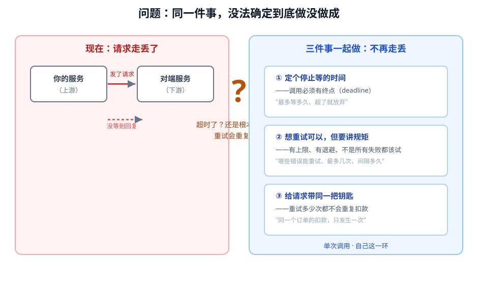
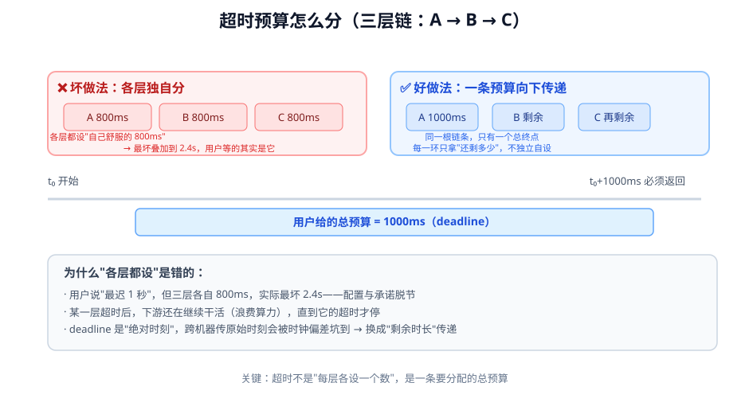
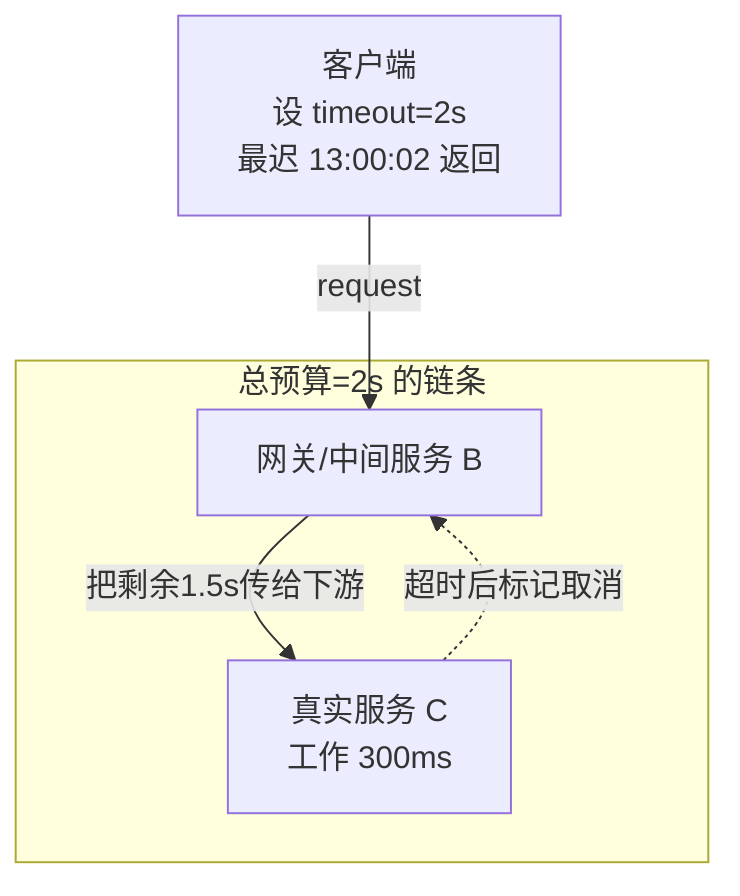
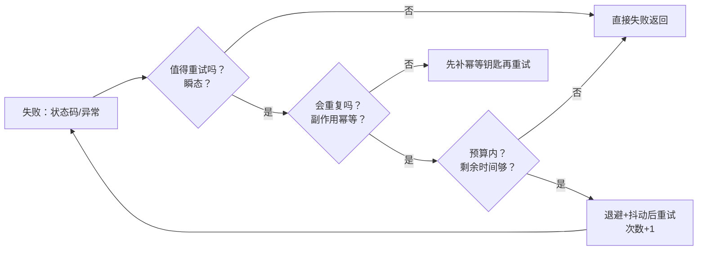
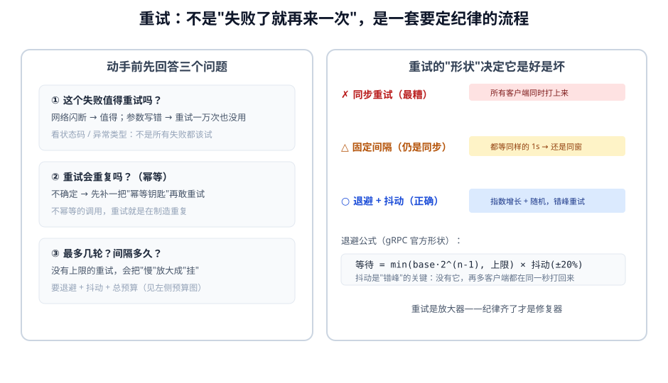
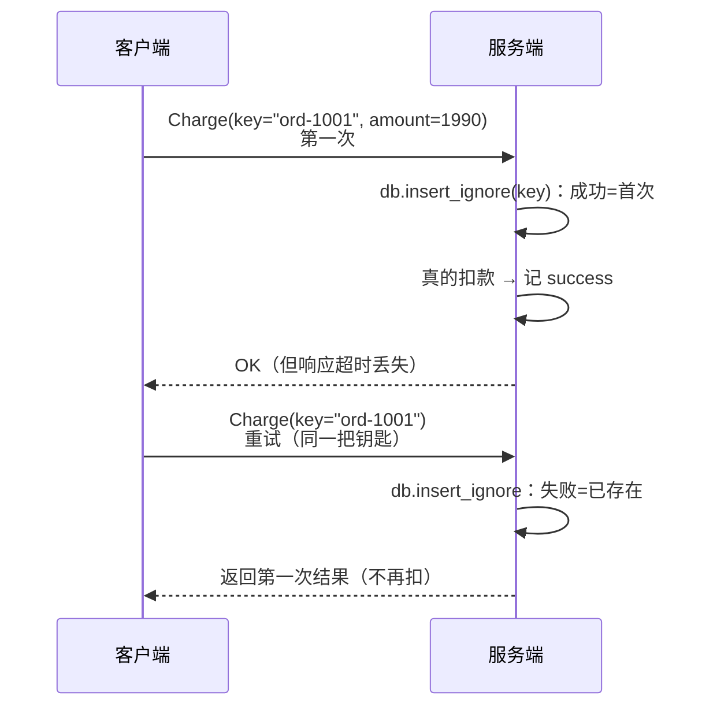
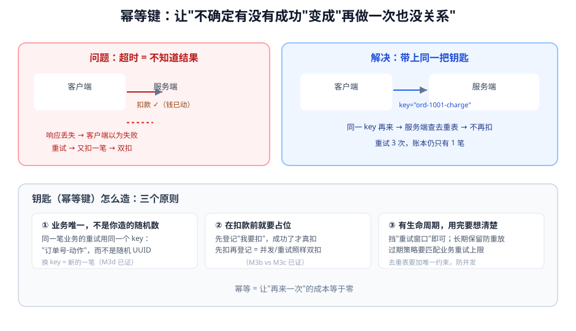
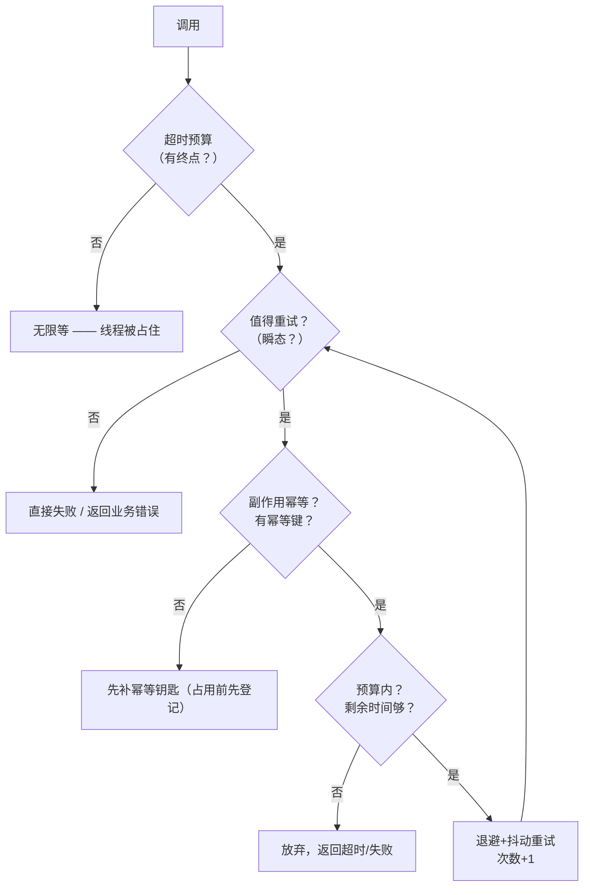

# 第 6 课：超时、重试与幂等

> 所属阶段：阶段 2《服务之间的通信》｜ 水平：入门 ｜ 本课知识点：超时预算与截止时间传播、重试的三个前提、幂等键的设计
> 故事情节：主角把两个服务打通后，第一次遇到"偶发超时"。他本能地加了个重试，结果在某次下游抖动里把吞吐打爆、还扣了两次款——这节课教他别再靠直觉，而是把"等多久、试几次、怎么保证不重复"讲清楚。
> 📖 结论已按官方文档核对（核对于 2026-11 ｜ 来源：grpc.io/docs/guides/deadlines、grpc.io/docs/guides/retry、grpc.io/docs/guides/status-codes、RFC 9110 §9.2.2）
> ✅ 本课数字全部实测于 Linux（WSL2，kernel 6.6.87.2）/ Python 3.12.13 / grpcio 1.85.1 + protobuf 7.36.2（隔离 venv，源码见 4.1）

## 🎯 本课目标

- 给一条调用链（A→B→C）分配超时预算，让 deadline 自动往下游传，而不是每层各设一个数
- 判断某个接口能不能加自动重试，并给出重试次数、退避与总预算
- 设计出能挡住重复扣款的幂等键与去重表

---

## 第一幕：起源与场景引入

> 🏛️ **起源**：超时不是某个产品发明的概念，而是分布式系统从一开始就绕不开的硬约束——单机函数调用要么成功要么抛异常，结果确定；而跨网络调用"发出去之后"结果不确定（被网关吞了、服务端处理了但响应丢了、还在处理中）。gRPC 在 2016 前后在设计语言时就明确了 deadline（绝对时刻）与 timeout（相对时长）的概念，并配套了客户端重试策略（retryPolicy）与服务端取消语义——这些不是"可选优化"，而是"分布式健壮性"的地基（核查于 2026-11，grpc.io/guides/deadlines、guides/retry）。

> 🎬 **场景**：你的服务要调用一个"扣款服务"。它偶尔会慢：多数时候 50ms 就回，偶发 900ms。你上线后第一次遇到偶发慢，网关 5 秒超时兜着，暂时没出事。直到某天下游抖动，你的重试把量翻了几倍、账还扣重了——客户疯狂投诉。

> 📌 **一句话本质**：把"调用没有边界、失败没有规矩、重复无法识别"的裸调用，变成"有时间边界、有重试纪律、每次请求可去重"的受控调用。**写不出这句 = 本课还没定准**。

> ⚖️ **处境对照**：
> - **不这么做**：超时靠网关兜底、重试看心情、重复靠运气。偶发慢变必现慢、小问题放大成雪崩、双扣是系统性风险。
> - **这么做_换来**：调用有明确终点（用户说 1 秒就真的 1 秒）；重试有上限、有退避，最坏情况可预测；扣款这类副作用用幂等键兜底，重试多少次都只扣一次。
> - **数字锚点**（本机实测）：不设 deadline 时客户端愿意无限等（服务端 sleep 300ms，客户端照样返回成功）；设了 150ms 的 deadline 后，服务端 sleep 500ms 时客户端在 152.7ms 即得到 `DEADLINE_EXCEEDED`。重试 3 次 + 客户端超时 30ms 时，服务端被请求了 **4 倍**（100 → 400 次），总耗时 13 秒且全部失败——重试直接放大故障。
>
> 位置说明：场景先把人带进"偶发超时"的困境，再给一句"本课在做三件事"的本质——既不说教，又让读者进第三幕前手里有锚点。

---

## 第二幕：认知冲突

> ❓ **问题**：偶发超时看起来是个"运气问题"——重试一下不就行了吗？可为什么加了重试之后，服务不但没好，反而更慢了、还扣了两次款？"重试"这个字眼本身，到底是药还是毒？

---

## 第三幕：层层揭示

### 一眼全局图（进入细节前先看一眼）



> 看图：左边是"走丢"的世界——请求发出去、没等到回复，于是你怀疑"是不是失败了"；右边是本课的三步解法——先定停止等待的时间、再把重试讲规矩、最后给请求带同一种钥匙。三件事一起做，请求才算真正不再走丢。

**四条硬约束**：① 一图只回答"本课解决什么问题、靠什么思路"；② 图上零术语（术语下沉到图注与后文）；③ 必带读图指引（已给）；④ 图不承担结论，图旁文字须能独立说清同一件事。
**验收口径**：没学过本课的人应能看懂这张图。

### 本课地图（分几步走）

| 步 | 这一步要解决什么（人话） | 对应知识点 |
|:--:|------------------------|-----------|
| 1 | 先让"每次调用"有个明确终点，不在"到底等多久"上靠感觉 | 知识点 1：超时预算与截止时间传播 |
| 2 | 想重试可以，但要先回答"这个失败值不值得试、会不会重复、试几轮" | 知识点 2：重试的三个前提 |
| 3 | 对会产生副作用（如扣款）的调用，用一把钥匙保证"再来一次也没关系" | 知识点 3：幂等键的设计 |

> 只回答"分几步走、现在在哪"——不写机制、不写结论。第一幕的"问题"是"加了重试反而更糟"，本课三节课正好回答"重试这条路上每一步该怎么走对"。

---

### 知识点 1：超时预算与截止时间传播

> 🧭 第 1/3 步｜承接：第二幕里的疑问——"重试一下不就行了吗" → 本步：先解决"等多久"这个更基础的问题，重试才有意义。
> 本知识点关键点：超时是一条预算而非每个数、deadline 传的是"剩余时长"而非"原始时刻"、超时后服务端该停止干活

#### 一句话定义

**超时（timeout）是"最多等多久"，截止时间（deadline）是"最迟等到哪个时刻"**——前者是相对时长，后者是绝对时刻；两者可互相换算。它的本质是一条要分配给整条调用链的总预算，不是每个环节各设一个数。

#### 直觉建立（类比）

你在外卖平台下单，页面写"预计 40 分钟送达"。这 40 分钟不是一个环节的时间，而是从下单到收货的**整条链路预算**——出餐慢了、骑手堵了、取餐等了，都在花这 40 分钟里的钱。你等 40 分钟是因为"再久我就不等了"，而不是"取餐环节必须 10 分钟、配送必须 30 分钟"。

> 💡 **类比的边界**：外卖是"人"自己盯着时间，到点主动取消；分布式系统里没有"人"——所以必须由代码把剩余时间逐环传递下去，并在超时后让服务端停止干活（否则它还在白白算）。

#### 核心原理

> **① 超时是一条预算，不是每个环节一个数**

假设用户承诺"最迟 1 秒拿到结果"，你有 A→B→C 三层。**错误直觉**是每层各设 1 秒——看起来每层都很合理，但最坏情况下三层叠加 = 3 秒，早就超过了用户承诺。**正确做法**是只在外层设一个总 deadline，内层拿"剩余时间"当自己的超时。

本机实测（三层链 A→B→C，C 固定工作 300ms）：

- A 不设超时 → B 和 C 看到的剩余都是 ∞（9.22e18 秒），A 愿意无限等。
- A 设 0.5s、B 不显式传 → **B 自己看到剩余 0.500s，但 C 看到的还是 ∞**——这说明 Python 侧 gRPC **不会**自动把 deadline 传给下游（官方文档说 Java/Go 默认开、C++ 需显式开、Python 属"要自己传"这一类）。
- A 设 0.5s、B 显式把剩余时间当 timeout 传下去 → C 才看到剩余 0.500s。
- A 设 0.2s（不够 C 干完 300ms）→ A 在 203ms 得到 `DEADLINE_EXCEEDED`。

> 结论：**deadline 的"传播"在 Python 里不是免费的**——内层服务要主动把 `context.time_remaining()` 当超时传给下一个服务，否则链条是断的（见 4.1 M5 的三档对照）。



> 看图：上半部分是两种分法对照——左边三层各设 800ms（最坏叠加 2.4s，与"1 秒承诺"脱节），右边只有客户端设 1000ms、其余各层拿剩余；下半部分解释了为什么"各层都设"是错的（叠加、下游白干活、时钟偏差要换算成剩余时长）。

> **② 传的是"剩余时长"，不是"原始时刻"**

官方文档专门点出：如果 A 把 "13:00:02 必须返回" 这个绝对时刻原封不动传给 C，而 A 和 C 的时钟没同步，C 可能把这个时刻理解错（快了或慢了）。所以 gRPC 的做法是**把 deadline 换算成剩余时长**再传（elapsed time 已扣掉）——天然免疫时钟偏差。本机验证：A 设 0.5s 时，B 一进来就看到 `time_remaining()≈0.500s`，无论机器时钟差多少，剩余时长永远是相对本机的正确值（见 4.1 M1c）。

> **③ 超时后，服务端该停止干活**

deadline 到点时客户端 `DEADLINE_EXCEEDED` 然后放弃等待，但这只是"客户端不看了"——**服务端可能还在算**，白白浪费资源，最坏把服务拖垮。gRPC 服务端在 deadline 过后会把 RPC 标记为取消（`CANCELLED`），但**取消不是自动停止你正在跑的代码**——你的服务端代码要自己周期性地检查 `context.is_active()`（或 `time_remaining()<=0`）并主动退出。这是"超时是资源保护"里最容易漏的一环（见 4.1 M1d 的 sleep 循环验证）。


> 看图：整条链只有客户端设了一个总 deadline；中间服务 B 把自己看到的剩余时间继续往下传；C 在剩余时间里工作，到点后自动被取消。

#### 示例演示

```python
# 服务端：超时后主动停止干活（不能只靠框架，代码自己要检查）
def SlowCharge(self, request, context):
    for _ in range(10):
        time.sleep(0.1)
        if context.time_remaining() < 0.05:
            return pay_pb2.ChargeReply(finished=False)   # 主动放弃，不浪费资源
    return pay_pb2.ChargeReply(finished=True)
# 客户端：后端中间服务拿剩余时间继续往下传
remain = context.time_remaining()          # 本环还剩多少
stub.Charge(req, timeout=remain)           # 不是各自设一个数，而是继续传"
```

#### 常见误区

1. **"超时是兜底，越大越好"**：把超时设到 30 秒看似无害，实则把"下游坏了"伪装成"下游慢",让调用方在该快速失败时干等——线程和连接都被占住，最终拖垮自己。超时的价值恰恰是"在承诺时间内给出确定答案"。

#### 一句话记住

超时是一条总预算，内层拿"剩余时间"，到点后服务端还要自己停手——三层缺一，链条就是断的。

#### 🗣️ 行话对照

- **超时（timeout）**：相对时长的调用上限——就是本课说的"最多等多久"；在哪遇到：gRPC 客户端 `stub.Charge(req, timeout=...)`、HTTP 客户端 `requests.get(..., timeout=...)`。
- **截止时间 / 期限（deadline）**：绝对时刻的调用上限——本课说的"最迟等到哪个时刻"；在哪遇到：gRPC 服务端 `context.time_remaining()`、protobuf 的 `Deadline` API、分布式框架的 deadline 传播（如 gRPC Java/Go 默认、C++ 需显式开）。
- **剩余时间（time_remaining / time left）**：内层处理时还剩多少预算——本课说的"剩余时长"；在哪遇到：gRPC 服务端方法上的 `context.time_remaining()`、超时中间件。
- **取消（cancellation）**：服务端在 deadline 到点后收到的"别再做了"信号——本课说的"服务端要主动停手"；在哪遇到：gRPC `context.is_active()` / `context.cancelled()`、HTTP 客户端与服务端取消、分布式框架的 cancellation token。

> 本知识点涉及"多策略（超时预算的分配方式）"，对照见下方表格：

| 本课说法（人话） | 行业标准叫法 | 典型配置 / 在哪遇到 | 代价 |
|---|---|---|---|
| 每层各设一个超时 | 逐层超时（per-hop timeout） | 每层 `timeout=` 各自写死 | 最坏时叠加；配置与承诺脱节 |
| 只在外层设总超时，内层传剩余 | 截止时间传播（deadline propagation） | gRPC 服务端→客户端 `context.time_remaining()` 传递；Java/Go 默认，C++/Python 要显式 | 实现要自己保证传递链路不破 |

#### 官方文档

- gRPC Deadline：https://grpc.io/docs/guides/deadlines/
- gRPC Retry：https://grpc.io/docs/guides/retry/
- gRPC Cancellation：https://grpc.io/docs/guides/cancellation/
- gRPC 状态码：https://grpc.io/docs/guides/status-codes/

---

### 知识点 2：重试的三个前提

> 🧭 第 2/3 步｜承接：第一课时「超时=不知道结果」，那么"不知道"时是不是该重试？→ 本步：重试不是"失败了就再来一次"，而是要先过三道闸。
> 本知识点关键点：值得重试吗 / 会重复吗 / 试几轮多久最坏多少

#### 一句话定义

**重试（retry）不是失败处理手段，而是"在确认失败且安全的前提下，用有限次数换取更高成功率"的放大器。** 它有三个前提，一个不满足就不该自动重试。

#### 直觉建立（类比）

你约朋友吃饭，发消息没回。你会：
1. **先判断值不值得再发**——如果他平时就回得慢或手机没电，再发一次多半也没用；
2. **再判断会不会造成重复**——如果这条消息是"麻烦你帮我转 100 块"，你补一条"请忽略刚才那条"才是安全的（否则对方可能转两次）；
3. **最后想最多发几次、隔多久**——你不可能每 5 秒刷一次，刷一晚上。

自动重试也一样，三个判断缺一不可。

> 💡 **类比的边界**：人是带着上下文在判断"值不值得再发"，代码没有——所以你要把"什么情况值得重试"写成明确的规则（按状态码 / 异常类型），否则"自动重试"就是闭着眼睛乱发。

#### 核心原理

> **前提①：这个失败值得重试吗？——按"失败类型"区分，不是按"失败次数"**

有些失败重试能解决（网络抖动、服务端瞬间过载、连接被拔），有些重试一万次也没用（参数写错、权限不足、请求体非法——**这些是确定性的**，再试是确定的失败）。套路是看**状态码 / 异常类型**：
- gRPC：`UNAVAILABLE`（服务暂不可达）该重试；`INVALID_ARGUMENT`、`PERMISSION_DENIED` 不该；`DEADLINE_EXCEEDED` 本身不该（再用同样预算也是超时），但"超时前没成功"可能是另一种可重试的瞬态。
- HTTP：`502`、`503`、`504`（网关/超时）值得；`404`、`400`、`401`、`403` 不值得；`409`、`422` 取决于设计。

官方 retry 文档里 `retryPolicy.retryableStatusCodes` 默认只配 `UNAVAILABLE`——**默认宁愿少重试，也不要乱重试**（核查于 2026-11）。gRPC 官方：无显式策略时只做"透明重试"（确实没被服务端处理过的低层竞态才重试，最多一次）。

> **前提②：重试会不会造成重复？——不幂等的副作用调用，先补幂等钥匙再重试**

这是三条里最容易被忽略的。如果一个调用**会产生副作用**（扣款、发消息、减库存、写状态），而它又不幂等，那么"超时→重试"就是把同一个副作用做了两次——你是想修复问题，结果制造了新问题。本机实测（4.1 M3）非常直观：服务端处理 80ms、客户端 50ms 就超时并重试 3 次——

- 无幂等键：账本 3 笔、扣了 5970 分（应扣 1990 分）。
- 有幂等键但"先扣款后登记"：账本 2 笔（仍重复扣款！因为扣款和登记不在一个原子操作里）。
- 有幂等键且"扣款前原子占位"：账本 1 笔，重复请求全部命中去重，只扣一次。

**结论**：不幂等的调用要么别自动重试，要么先把它改成幂等（这是知识点 3 的活）。

> **前提③：试几轮？间隔多久？最坏等多久？——没有上限和退避的重试是放大器不是修复器**

两个常见 bug：
- **无上限重试**：下游挂时它永不停，请求量翻倍、翻三倍、再翻——把"慢"放大成"挂"（见 4.1 M2：客户端超时 30ms + 重试 3 次 → 服务端被请求 4 倍、100→400）。
- **固定间隔且无抖动**：1000 个客户端同时失败、又都等同样的 1 秒，第一轮重试还是同一秒打回来——**同步重试**。本机实测（4.1 M4）三档对照：固定/无抖动时 100% 客户端挤进同一个 20ms 桶；加 ±20% 抖动后摊到多个桶，最拥挤也只剩 52%。

正确的形状（gRPC 官方 retry 的形状）：**指数退避 + 抖动 + 重试次数上限 + 总预算**。等待 = `min(base·factor^(n-1), cap)`，再乘 1±0.2 的随机抖动；同时设 `maxAttempts` 上限。总预算的意义是把"重试链的总时长"钉死（见 4.1 M6：每次超时 200ms × 重试 3 次 = 用户实际等 607ms；加了 500ms 预算后被截到 503ms）。





> 看图：左边是动手前先回答的三问（值不值得试 / 会不会重复 / 试几轮多久）；右边对比三种重试形状——同步重试与固定间隔都会让客户端挤在同一窗口，只有"指数退避 + 抖动"才真正错峰；底部给出退避公式。

#### 示例演示

```python
import grpc, time, random

def charge_with_retry(stub, req, max_attempts=3, base=0.1):
    """可重试的调用：只在可重试状态上重试 + 指数退避 + 抖动 + 次数上限"""
    last = None
    for attempt in range(1, max_attempts + 1):
        try:
            return stub.Charge(req, timeout=1.0)
        except grpc.RpcError as exc:
            # 前提①：只在瞬态上重试
            if exc.code() not in (grpc.StatusCode.UNAVAILABLE, grpc.StatusCode.UNKNOWN):
                raise              # 确定性失败，直接抛
            last = exc
            if attempt == max_attempts:
                break
            # 前提③：指数退避 + ±20% 抖动，错峰重试
            wait = min(base * (2 ** (attempt - 1)), 1.0)
            time.sleep(wait * random.uniform(0.8, 1.2))
    raise last
# 注意：前提②（幂等）不在这里，它要求调用方先确保副作用安全
```

#### 常见误区

1. **"重试次数越多越安全"**：只有"可重试的失败"才值得多试。很多失败是确定性的，试 100 次还是失败，只会加重下游负担。
2. **"固定间隔重试没问题"**：所有客户端都用同一个固定间隔，失败同时发生时重试也同时发生——这就是雪崩的放大结构。抖动（jitter）专门用来打散它。

#### 一句话记住

重试前先答三问：值不值得试（瞬态？）、会不会重复（幂等？）、试几轮多久最坏多少（预算？）——三问任一不过，就别自动重试。

#### 🗣️ 行话对照

> 本知识点属于"多策略"型（关于重试的决策），对照见下：

| 本课说法（人话） | 行业标准叫法 | 典型配置 / 在哪遇到 | 代价 |
|---|---|---|---|
| 失败要不要重试 | 可重试性（retryability） | `retryableStatusCodes: ["UNAVAILABLE"]`（gRPC） | 配置只列瞬态 |
| 隔多久重试 | 退避（backoff） | `initialBackoff` / `maxBackoff` / `backoffMultiplier`（gRPC） | 指数增长 |
| 错峰打散 | 抖动（jitter） | gRPC 自动 ±20% | 延迟略增，换取错峰 |
| 最多试几轮 | 重试次数上限（maxAttempts / retries） | gRPC `maxAttempts: 4` | 上限保护下游 |
| 总耗时上限 | 重试总预算 / 总超时（total timeout / deadline） | 调用链总 deadline 扣掉已耗时间 | 钉死承诺 |

#### 官方文档

- gRPC Retry：https://grpc.io/docs/guides/retry/
- gRPC Status Codes：https://grpc.io/docs/guides/status-codes/
- gRPC Request Hedging（对冲请求，重试的补充）：https://grpc.io/docs/guides/request-hedging/
- 幂等方法（RFC 9110 §9.2.2）：https://www.rfc-editor.org/rfc/rfc9110#section-9.2.2

---

### 知识点 3：幂等键的设计

> 🧭 第 3/3 步｜承接：前提②说"不幂等的副作用调用别重试"→ 本步：该怎么把它改成幂等的？给请求一把钥匙。
> 本知识点关键点：钥匙怎么造（业务唯一）/ 占位时机（先占位后干活）/ 生命周期 / 并发约束

#### 一句话定义

**幂等键（idempotency key）是一个由调用方生成、随请求携带、在服务端去重的标识**——同一个键第一次请求真的执行，后续相同键的请求直接返回第一次的结果，不重复执行副作用。

#### 直觉建立（类比）

你给银行客服打电话要转账，客服说"我们这边处理中，请稍后"。你等了一会儿没人接，又打了一次。第二次客服先说"先生，这个单号我们已经受理了，正在处理，我帮您查进度"——而不是再转一笔。这里的"单号"（订单号 / 流水号）就是幂等键：第一次真的转，第二次查到已受理就不再转。

> 💡 **类比的边界**：人工客服是有"全公司统一账本"可查的（同一个键，背后是一本数据）。代码里的问题在于：这本"账本"要布置在正确的时机（占位）、有正确的约束（唯一）、并考虑并发撞车——否则账本自己也会双写。

#### 核心原理

> **① 钥匙怎么造：业务唯一，不是你随便生成的随机数**

幂等键必须保证"同一笔业务的所有重试用同一个键"。最朴素的造法是把业务天然唯一的字段组合起来：`user_id + "-" + 业务动作`，或干脆用业务订单号作为键（`ord-1001-charge`）。如果你每次重试都生成一个新的随机 UUID——那每次都是一个"新键"，服务端当然没法识别这是"同一笔"，幂等直接失效。本机实测（M3d）：同一个 `ord-3003-charge` 再来一次命中去重（dedup=True）；换一个键 `ord-3003-retry2` 就被当成新的一笔，账本又多一条。

设计要点：
- 键对客户端可见，可在网络层校验格式（防脏数据）。
- 用业务键（订单号）往往比随机串更可读也更容易排查。
- 但要注意：相同业务语义必须映射到同一个键，不能因为"第几次重试"而改变键。

> **② 占位时机：在扣款（副作用执行）之前就要先登记"我要做"**

这是幂等实现里最关键的细节，也是最常见的坑。两种写法：

```python
# ❌ 先扣款，后登记（用list/无唯一约束的map）——重复扣款
def charge_naive(req):
    if req.key in DEDUP:            # 先查
        return DEDUP[req.key]
    cid = do_real_charge(req)       # ← 窗口：扣了款，还没登记
    DEDUP[req.key] = cid            # 后记
    return cid
# 两个并发请求同时穿过 if 检查，都进 do_real_charge → 双扣

# ✅ 先原子占位，占位成功才真扣（用唯一约束 / SETNX / 数据库唯一键）
def charge_atomic(req):
    # 原子地"登记键"：成功 = 本请求是第一次；失败 = 已有请求在/已完成
    if not db.insert_ignore(DEDUP_TABLE, {"key": req.key, "status": "processing"}):
        return wait_pending(req.key)        # 等我处理完，返回结果
    try:
        cid = do_real_charge(req)           # 现在才真扣
        db.mark_done(req.key, cid)
        return cid
    except:
        db.mark_failed(req.key)             # 占位失败要能重试
        raise
```

距离：M3b（先扣再登记）在"服务端 80ms、客户端超时重试"的真实场景里账本 2 笔、重复扣款；M3c（先占位再扣）账本 1 笔、重复请求命中去重。**唯一约束（unique constraint）是干这件事的正确工具**——它天然原子，不需要你手写加锁。

> **③ 生命周期与并发**

- **生命周期**：键该保留多久？只挡"重试窗口"（通常秒级到分钟级）够挡客户端重试；但要挡"重放攻击 / 用户重复提交"，要保留更久并有清理策略。经验：保留时长 ≥ 调用链最大重试总时长，再加一点余量。
- **并发约束**：同一键的两个前端请求同时到达（用户手抖连点）——靠"先占位"里的唯一约束天然挡住：第二个请求插入失败，转去等第一个完成并返回同一结果。不要依赖"读→判断→写"，那个窗口就是 M3b 的病根。
- **幂等键与去重表的本质**：把"是否已执行"变成一个可查询、可编译时保证唯一的状态，让"不知道结果"的请求能安全地"问一次账本"。





> 看图：上半部分对照"响应丢失导致双扣"与"带同一把钥匙后重试不再扣"；下半部分给出造钥匙的三条原则——业务唯一（不是随机数）、扣款前先原子占位、生命周期与并发约束。

#### 示例演示

```python
# 服务端：去重 + 唯一约束（伪代码，用 SQL 语义）
CREATE TABLE charge_dedup (
    idempotency_key  TEXT PRIMARY KEY,   -- 唯一约束 = 天然原子
    charge_id        TEXT,
    status           TEXT,               -- processing / done / failed
    created_at       TIMESTAMP
);

def charge(req):
    inserted, key = db.insert_ignore("charge_dedup",
        {"idempotency_key": req.idempotency_key, "status": "processing"})
    if not inserted:
        # 已有记录：等它完成并返回同一结果（不是再扣一次）
        return db.wait_for(key).charge_id
    try:
        cid = ledger.charge(req.user_id, req.amount_cents)
        db.update_where({"status": "done", "charge_id": cid}, {"key": key})
        return cid
    except Exception:
        db.update_where({"status": "failed"}, {"key": key})   # 失败要能重试
        raise
```

#### 常见误区

1. **"幂等键 = 随机 UUID"**：随机串无法表达"这是同一笔"，每次重试生成新 UUID 等于没有幂等。幂等键的语义是**业务唯一键**。
2. **"先执行后登记也没关系，只要我有 map 查重"**：你的 map 是"读→写"两步，两个并发请求会同时穿过读，双双执行副作用。必须用数据层的 **唯一约束 / SETNX** 这类原子操作占位。
3. **"幂等键只用来防扣款"**：所有"会产生副作用且超时结果未知"的调用都需要——发消息、减库存、改状态、刷积分，同一个键。

#### 一句话记住

幂等键 = 业务唯一键 + 先原子占位再干活 + 唯一约束挡并发——同一把钥匙重复敲门，门不会开两次。

#### 🗣️ 行话对照

> 本知识点涉及"多策略"，对照见下：

| 本课说法（人话） | 行业标准叫法 | 典型配置 / 在哪遇到 | 代价 |
|---|---|---|---|
| 同一笔业务带同一把钥匙 | 幂等键（idempotency key） | HTTP 请求头 `Idempotency-Key`、gRPC 自定义字段、支付接口（Stripe 等） | 需要服务端去重表 |
| 去重表 | 幂等存储 / 去重存储（idempotency store） | 数据库唯一键表、Redis `SETNX PX` | 存储与清理策略 |
| 保证"只发生一次" | 恰好一次（exactly-once）语义 | 事务性发件箱、分布式事务配套 | 见课 10、课 9 |
| 重复到达同一份处理 | 重复消费 / 幂等消费（idempotent consumer） | 消息队列（Kafka）消费端去重 | 见课 10 |

#### 官方文档

- 幂等方法（RFC 9110 §9.2.2）：https://www.rfc-editor.org/rfc/rfc9110#section-9.2.2
- Redis 分布式锁正确写法（SET NX PX）：https://redis.io/docs/latest/develop/use/patterns/distributed-locks/
- gRPC Retry（幂等与重试的关系）：https://grpc.io/docs/guides/retry/

---

## 第四幕：实操验证

### 4.1 机制验证

> ✅ 本节命令实测于 Linux（WSL2，kernel 6.6.87.2）/ Python 3.12.13 / grpcio 1.85.1 + protobuf 7.36.2（隔离 venv）。以下脚本可原样复跑，所有输出均为本机真实结果。

**M1：deadline 到底是谁的时钟？传播时被换算成什么？**（`m1_deadline.py`）

```python
import time
from concurrent import futures
import grpc, pay_pb2, pay_pb2_grpc

class PayServicer(pay_pb2_grpc.PayServiceServicer):
    def SlowCharge(self, request, context):
        remain = context.time_remaining()          # 关键：读本端剩余时间
        print(f"    服务端看到 time_remaining() = {remain}")
        time.sleep(request.sleep_ms / 1000)
        return pay_pb2.ChargeReply(charge_id="C2")

server = grpc.server(futures.ThreadPoolExecutor(max_workers=8))
pay_pb2_grpc.add_PayServiceServicer_to_server(PayServicer(), server)
port = server.add_insecure_port("127.0.0.1:0"); server.start()
with grpc.insecure_channel(f"127.0.0.1:{port}") as ch:
    stub = pay_pb2_grpc.PayServiceStub(ch)
    # M1a：不设 deadline → 客户端愿意无限等
    t0=time.perf_counter()
    stub.SlowCharge(pay_pb2.ChargeRequest(user_id="u", sleep_ms=300))
    print(f"   M1a 不设: 耗时 {(time.perf_counter()-t0)*1000:.1f} ms，成功")
    # M1b：设 150ms deadline，服务端 sleep 500ms
    t0=time.perf_counter()
    try:
        stub.SlowCharge(pay_pb2.ChargeRequest(user_id="u", sleep_ms=500), timeout=0.150)
    except grpc.RpcError as exc:
        print(f"   M1b 设150ms: 耗时 {(time.perf_counter()-t0)*1000:.1f} ms｜{exc.code()}")
    # M1c：连续不同 timeout，都服务端 sleep 1ms → 看剩余量是否随之间接减少
    for ms in (400, 200, 100):
        stub.SlowCharge(pay_pb2.ChargeRequest(user_id="u", sleep_ms=1), timeout=ms/1000)
server.stop(0)
```

输出（M1a 不设、M1c 三种不同 timeout）：

```
M1a 不设 deadline，服务端 sleep 300ms
    服务端看到 time_remaining() = 9.223372035061097e+18
    客户端耗时 302.8 ms，调用成功
M1b 设 deadline=150ms，服务端 sleep 500ms
    服务端看到 time_remaining() = 0.15009665489196777
    客户端耗时 152.7 ms ｜ StatusCode.DEADLINE_EXCEEDED
M1c deadline 剩余时间怎么算：
  客户端 timeout=400ms → 服务端看到 0.39997100830078125
  客户端 timeout=200ms → 服务端看到 0.20029306411743164
  客户端 timeout=100ms → 服务端看到 0.10077619552612305
```

> ✅ **回扣场景**：M1a 显示"不设=无限等"（9.22e18 秒）；M1b 显示设了 deadline 客户端 152.7ms 就放弃且拿到 `DEADLINE_EXCEEDED`；M1c 显示传给服务端的始终是**剩余时长**（400/200/100ms 对应读回 0.39997/0.20028/0.10078s），证明传播的是剩余时长而非原始时刻。

**M3：幂等键放在哪一步，决定了它挡不挡得住**（`m3_idempotency.py` 节选）

```python
# 真实故障：扣款成功 → 响应在返回路上超时 → 客户端重试 → 又扣一次
def charge_naive(req):                 # ❌ 先扣款后登记
    if req.key in DEDUP: return DEDUP[req.key]
    cid = do_real_charge(req)          # ← 窗口：扣了款还没登记
    DEDUP[req.key] = cid
    return cid

def charge_atomic(req):                # ✅ 先原子占位再干活
    if not db.insert_ignore(DEDUP_TABLE, {"key": req.key, "status": "processing"}):
        return wait_pending(req.key)   # 已有=第一次已完成/在办
    cid = do_real_charge(req)
    db.mark_done(req.key, cid)
    return cid
```

输出（服务端处理 80ms、客户端 50ms 超时重试 3 次）：

```
M3a 无幂等键          → 账本 3 笔　累计 5970 分　多扣 3980 分　⚠️ 重复扣款
M3b 先扣款后登记      → 账本 2 笔　累计 3980 分　多扣 1990 分　⚠️ 重复扣款
M3c 扣款前原子占位    → 账本 1 笔　累计 1990 分　多扣   0 分　✅ 只扣一次
M3c-2 同一键 8 并发    → 账本 1 笔（应为 1）
M3d 换 key = 新的一笔  → ord-3003-charge 重试 dedup=True；新键再扣一笔
```

> ✅ **回扣场景**：三条结论都是实测——①**没有幂等键，重试必双扣**；②**光有幂等键、顺序不对（先扣后记）照样双扣**；③**只有"扣款前原子占位"才能真正挡住**。这正是第二幕里"重试反而扣两次"的破案现场。

### 4.2 应用实战：扣款接口的超时、重试与幂等（入口）

> 🎯 **本课应用实战独立成篇**（配套实战册）：[第 6 课实战 · 扣款接口的超时、重试与幂等](../../../应用实战/06-超时、重试与幂等.md)
> 含**分步设计图**（每步一张：这一版长什么样、比上一版改了什么）与"基础 → 综合"的完整演进与代码；通览全部：📚 [应用实战索引](../../../应用实战/INDEX.md)
> **课内不重复实战正文**——三跳演进带你亲手把"直接重试"改造成"超时预算 + 带幂等键的重试"。

---

## 第五幕：体系收束

> 📍 **全局定位**：阶段 2 从「说上话」（课 5 契约）走到「说不到怎么办」（本课）。本课解决的是**单次调用的时间边界与副作用安全**：超时给了调用希腊终点，重试给了它有上限的补救，幂等键给了它能安全重试的前提。这三招的失败模式（雪崩）正是课 7 的素材——当超时和重试都救不回来时，需要的是熔断。
>
> 🔗 **下一步**：课 7《熔断、限流与隔离》——本课的"超时需要上限、重试有放大器效应"会演变成一场雪崩，熔断器是"我知道下游大概率已挂，干脆别试了"的资源保护手段。本课掌握了"等多久 / 试几次 / 怎么不重复"，课 7 在此之上学习"整体崩溃时怎么弃卒保帅"。

---

## 🐞 常见误区

1. **"超时越大越安全"**：超时的本质是"在承诺时间内给出确定答案"。设太大，下游挂了你也在干等，线程和连接被占住，自己的服务先扛不住。
2. **"重试次数越多越稳"**：只有可重试的失败才有意义。确定性失败（参数错、权限不足）试再多轮都是确定失败，只会加重下游。
3. **"固定间隔重试没事"**：失败同时发生时，固定间隔 = 同步重试，第一轮重试又是一次群体打点。抖动打散它。
4. **"幂等键 = 随机 UUID"**：每次重试新生成一个键，等于没有幂等——必须用业务唯一键。
5. **"先执行后登记没关系"**：读→判断→写天然有并发窗口，必须用唯一约束 / SETNX 原子占位。

### ⏳ 与Position说法对照

无官方口径差异，本节省略。

## 一图总结



> 与课首入口的分工：入口图讲"为什么需要"（问题 vs 三招）；本图讲"三招内部的判断链"（超时→值不值→幂等→预算→重试）。两图不互相替代。

## 课后小测

**Q1**：关于"超时是一条预算"，下面哪个说法对？
- A. 每层各设一个超时，只要每层都够用，总耗时一定可控
- B. 只需要在外层设总 deadline，内层用剩余时间，才能保证总耗时在承诺内
- C. 超时不存在"预算"，每个调用独立设就行
- D. 超时设得越大，系统越稳定

<details><summary>答案与解析</summary>

**答案：B**。A 错——各层叠加在最坏情况下会远超承诺；C 错——超时本质上是一条可分配的总预算；D 把"大"当"稳"，实际是让本可快速失败的地方干等，拖垮自己。

</details>

**Q2**：gRPC 服务端收到的 deadline 是以什么形式传下去的？
- A. 原始绝对时刻
- B. 剩余时长（已扣掉已耗时间）
- C. 服务端自己计算的相对时间
- D. 以上都不对

<details><summary>答案与解析</summary>

**答案：B**。官方文档专门说明：为免疫跨机器时钟偏差，gRPC 把 deadline 换算成"剩余时长"再传——机器时钟差再多，剩余时长始终正确。M1c 实测也印证：设 400/200/100ms，服务端读回 0.39997/0.20028/0.10078s。

</details>

**Q3**：服务端处理 80ms、客户端超时 50ms 就重试。下面哪种实现不会重复扣款？
- A. 无幂等键，直接重试
- B. 有幂等键，但先扣款后登记
- C. 有幂等键，扣款前先原子占位
- D. 有幂等键，但每次重试生成新 UUID

<details><summary>答案与解析</summary>

**答案：C**。A/B/D 都会双扣：A 无键、B 有键但顺序错（读→写有并发窗口）、D 每次新键等于没有幂等。只有"唯一约束 / SETNX 先占位、再真扣款"能挡住并发与重试。

</details>

**Q4**：关于重试的退避与抖动，下面哪句对？
- A. 固定间隔就够，抖动是多余的
- B. 指数退避 + 抖动，能让同时失败的客户端错峰重试
- C. 退避只跟重试有关，跟超时无关
- D. 抖动会增加吞吐，应该避免

<details><summary>答案与解析</summary>

**答案：B**。M4 实测：固定/无抖动时 100% 客户端挤同一桶，加 ±20% 抖动后摊到多个桶、最拥挤桶只剩 52%。抖动是"错峰"的关键，不是多余。C 错在没意识到总预算也要退避配合。

</details>

## 🚀 下一批接力提示词

> 学完本批后，**复制下面这段文字发给 AI**，即可无缝进入下一批（无需重新描述上下文）：

```
继续学 Python 分布式应用开发。我的学习档案在 distributed-python/00-学习档案.md，
刚学完阶段 2《服务之间的通信》的课 6《超时、重试与幂等》全部 3 个知识点（含应用实战 06），
请按大纲继续讲解阶段 2 的课 7《熔断、限流与隔离》的三个知识点。
```

## 🧭 课程导航

🎯 **练一练（本课应用实战）**：[第 6 课实战 · 扣款接口的超时、重试与幂等](../../../应用实战/06-超时、重试与幂等.md)

⬅️ **上一课**：[课 5：接口契约与 gRPC](05-接口契约与gRPC.md)

➡️ **下一课**：[课 7：熔断、限流与隔离](07-熔断、限流与隔离.md)

📚 **返回目录**：[课程目录](../../../02-课程目录.md)
