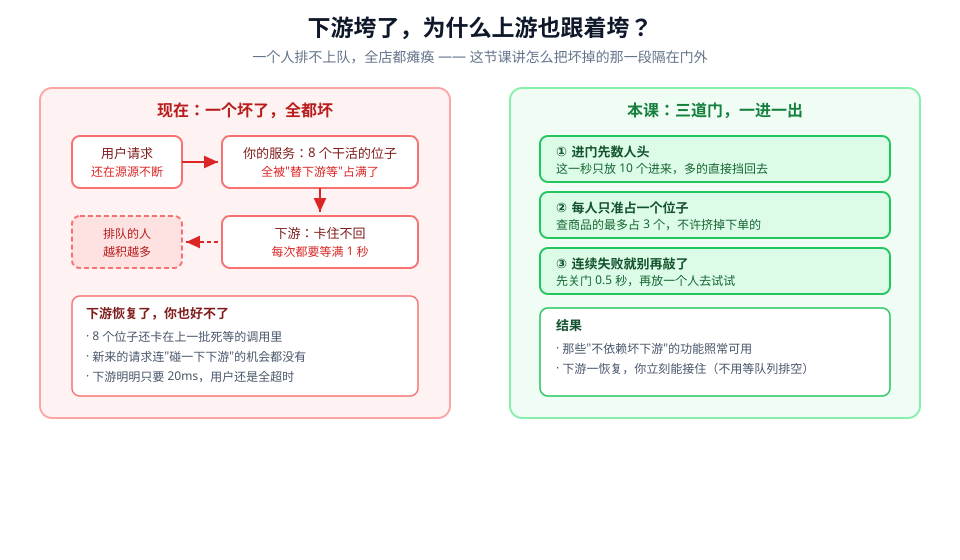
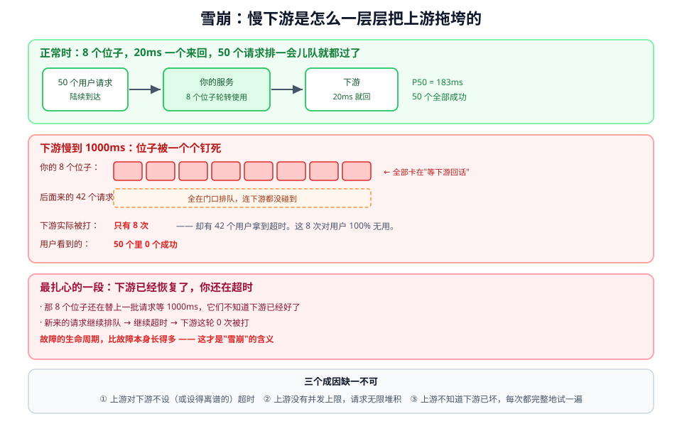
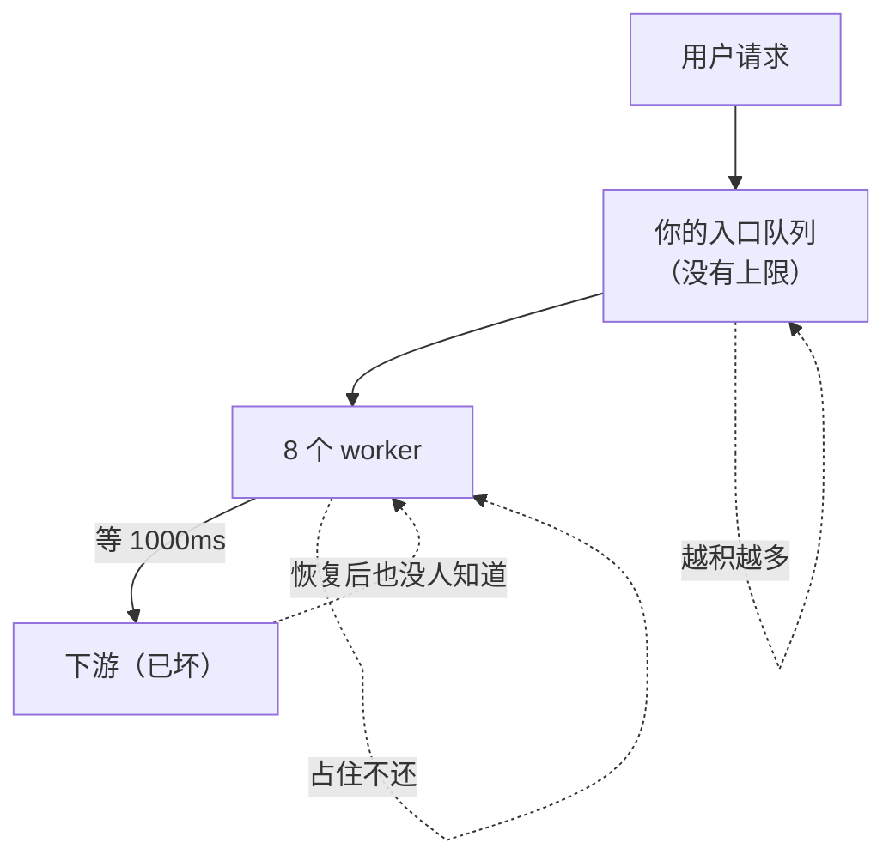
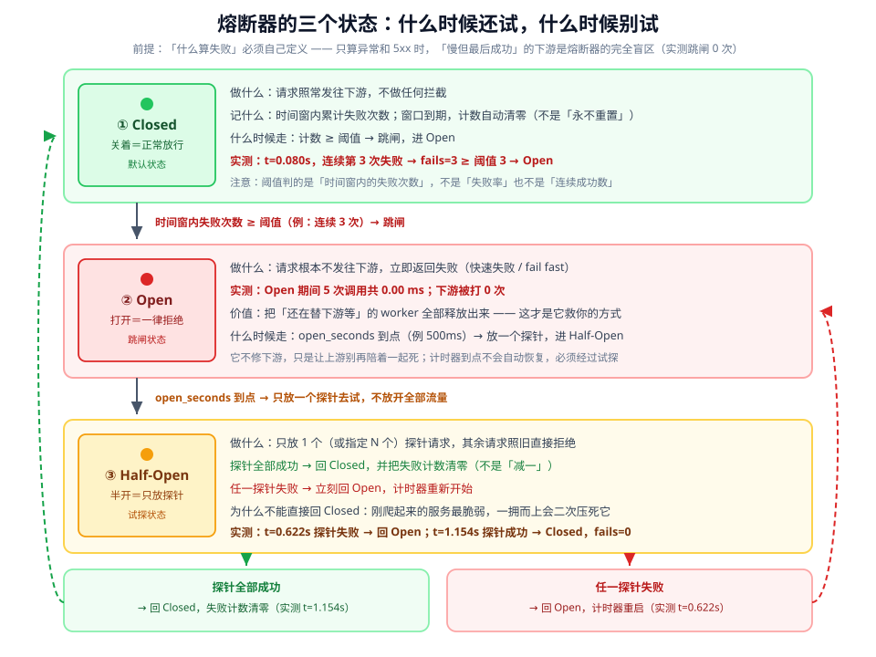
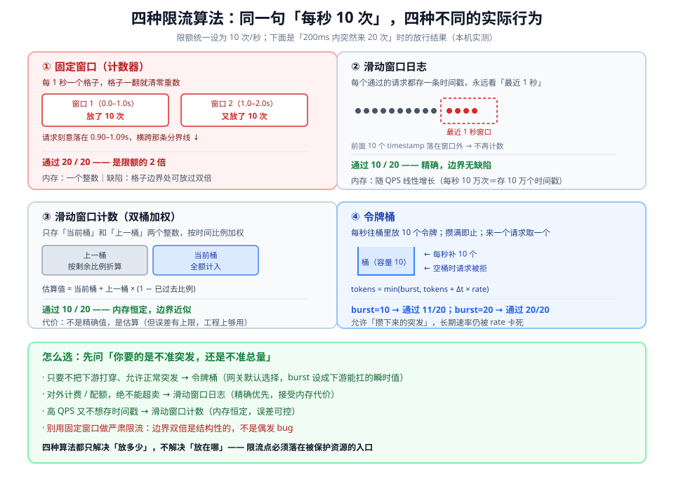
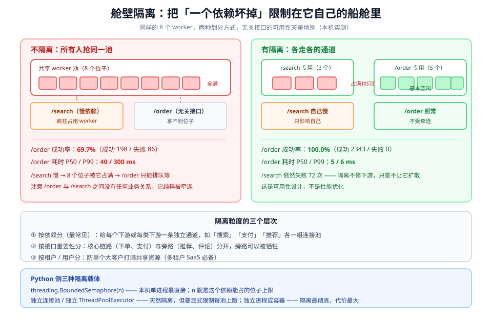
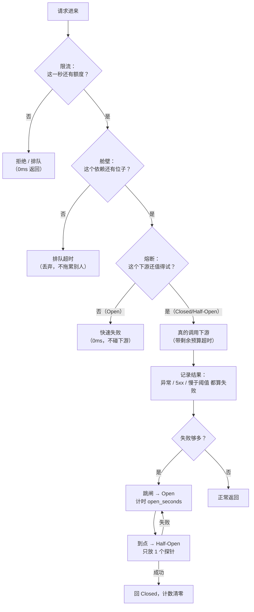

# 第 7 课：熔断、限流与隔离

> 所属阶段：阶段 2《服务之间的通信》｜ 水平：入门 ｜ 本课知识点：雪崩是怎么发生的、熔断器的三个状态、限流算法与舱壁隔离
> 故事情节：主角刚把超时和重试理顺，以为"每次调用都有边界"就安全了。结果某个下午，一个只负责"猜你喜欢"的推荐服务变慢，把整个下单链路一起拖死——监控上你的服务 CPU 是空的，线程全在等；用户看到的不是"推荐慢了"，而是"网站打不开"。这节课他学的是：当下游已经坏了、且短时间内好不了的时候，怎么让损失停在它自己那一格里。
> 📖 结论已按官方文档核对（核对于 2026-11 ｜ 来源：Azure Architecture Center《Circuit Breaker Pattern》、Azure《Retry Pattern》、RFC 2697 / RFC 2698 / RFC 4115、Michael Nygard《Release It!》第 5 章 Stability Patterns、Martin Fowler bliki《CircuitBreaker》、Resilience4j 官方文档）
> ✅ 本课数字全部实测于 Linux（WSL2，kernel 6.6.87.2）/ Python 3.12.13 标准库（`http.server` + `threading` + `urllib`，无需第三方依赖）。可复跑脚本在 `playground/lesson07/`（含 `_downstream.py` 与 M1–M7、M5b 对照），下文 4.1 逐段给出关键片段与真实输出。

## 🎯 本课目标

- 画出"下游变慢 → 你的 worker 被钉死 → 排队积压 → 你自己也变慢 → 上游也崩"的完整链路，并指出三个可下手的位置
- 说清熔断器 Closed / Open / Half-Open 的进入与退出条件，以及"什么算失败"为什么决定它有没有用
- 按场景在固定窗口、滑动窗口日志、滑动窗口计数、令牌桶之间选型，并给出限流位置与隔离粒度

---

## 第一幕：起源与场景引入

> 🏛️ **起源**：熔断器、舱壁、超时这三个词不是互联网公司发明的，它们来自造船和电气工程。Michael Nygard 在 2007 年的《Release It!》第 5 章"Stability Patterns"里，第一次把它们系统地带进软件架构：船的舱壁把船体分成若干密封隔间，一个舱进水不会让整条船沉掉；电路里的保险丝在过载时熔断，牺牲一小段线路保住整张电网。他把这套思路落成三个模式——超时（Timeout）、熔断器（Circuit Breaker）、舱壁（Bulkhead）。
>
> Martin Fowler 在 2014 年的 bliki 里专门写了一篇《CircuitBreaker》把这套模式讲给更广的读者，并明确注明"这个模式出自 Nygard 的书"。Netflix 2012 年开源的 Hystrix 让它变成一代 Java 服务的标配；Hystrix 已于 2018 年进入维护模式（最后一个版本 1.5.18），官方推荐的后继是 Resilience4j——它把"慢调用率"（slowCallRate）做成了熔断的一等判定条件，本课知识点 2 的核心结论正是从这里来的（核查于 2026-11）。
>
> 限流那边则是通信标准的故事：RFC 2697（1999）定义了单速率三色标记器 srTCM（承诺速率 CIR + 承诺突发 CBS + 超额突发 EBS，两个桶共享一个速率，C 桶溢出流进 E 桶，结果分红/黄/绿三色）；RFC 2698（1999）定义了双速率 trTCM（承诺速率 CIR + 峰值速率 PIR，PIR ≥ CIR）；RFC 4115（2005）又补了一个 EIR 桶，修正 trTCM 的黄包会把峰值桶吃空的问题。今天你在网关配置里看到的"每秒 N 次 + 突发 M 次"，就是这套三色标记的现代简化版。

> 🎬 **场景**：周一早上十点，推荐服务（一个不影响下单的旁路功能）响应时间从 20ms 涨到 1000ms。你的下单服务有 8 个工作线程，它们全都调用了推荐。十点零三分，你开始收到"下单接口超时"的告警——但下单逻辑本身一行没改，数据库也很闲。十点零八分，推荐服务恢复了；十点十五分，下单接口还在超时。你重启了服务，一切正常。第二天，同样的时间，同样的事。

> 📌 **一句话本质**：当"一个依赖坏了"必然发生时，把它的伤害限制在它自己那一格里——用熔断停止徒劳的尝试，用限流挡住超出容量的请求，用舱壁防止资源被一个依赖吃光。**写不出这句 = 本课还没定准**。

> ⚖️ **处境对照**：
> - **不这么做**：下游一慢，你的线程全在"替它等"，排队越积越多，你自己也变成慢服务，把上游一起拖下水。故障的生命周期远长于故障本身——实测里下游恢复后，你的服务仍然 50 个请求全灭、下游 0 次被打。
> - **这么做_换来**：下游坏掉时你快速失败（Open 期间 5 次调用共 0.00ms、下游 0 次被打），把线程腾出来服务还有救的请求；无关接口的可用性从 69.7% 抬到 100.0%；下游真实收到的流量被锁在配额内（实测 9.5 QPS / 配额 10 QPS）。
> - **数字锚点**（本机实测）：50 并发打一个 8 worker 的服务，下游从 20ms 慢到 1000ms 后，50 个请求里 0 个成功，下游只被打 8 次；下游恢复后的一轮里，50 个请求仍然 0 个成功，下游被打 0 次。熔断器 Open 期间，5 次调用总耗时 0.00ms。舱壁隔离让无关接口成功率 69.7% → 100.0%、P99 从 300ms 降到 6ms。
>
> 位置说明：场景刻意选"推荐服务"这种"看起来不重要"的旁路依赖——因为大多数人以为雪崩是核心链路的问题，实际上旁路依赖拖垮主链路才是最常见的形态。

---

## 第二幕：认知冲突

> ❓ **问题**：你不是已经设了超时吗？超时不就是用来防止"无限等"的吗？为什么超时没救你——甚至下游都恢复了，你还在超时？"加个超时"和"加个熔断"到底差在哪一步？

---

## 第三幕：层层揭示

### 一眼全局图（进入细节前先看一眼）



> 看图：左边画的是现在的处境——一个下游卡住，你那几个"位子"就全被钉在那里，后面的人只能排队；排队的人越多，你的服务越像坏掉了，而且下游好了你也好不了。右边是本课的三道门：进门先数人头（限流，决定这一秒放多少进来）、每人只准占一个位子（隔离，决定一个依赖最多能占用你多少资源）、连续失败就别再敲了（熔断，决定还要不要再去试）。
>
> 三道门管的是不同的事，缺一道都还会漏：只有隔离没有熔断，位子会被"注定失败的调用"反复占满；只有熔断没有限流，洪峰来的时候所有请求都会实打实打到下游一次，才轮到熔断跳闸。

**四条硬约束**：① 一图只回答"本课解决什么问题、靠什么思路"；② 图上零术语（术语下沉到图注与后文）；③ 必带读图指引（已给）；④ 图不承担结论，图旁文字须能独立说清同一件事。
**验收口径**：没学过本课的人应能看懂这张图。

### 本课地图（分几步走）

| 步 | 这一步要解决什么（人话） | 对应知识点 |
|:--:|------------------------|-----------|
| 1 | 先看清"一个坏了为什么全都坏"——到底哪一环在放大伤害 | 知识点 1：雪崩是怎么发生的 |
| 2 | 对"已经坏了、短期好不了"的下游，别再白试了，但要能自动恢复 | 知识点 2：熔断器的三个状态 |
| 3 | 对"还没坏但会被打坏"的下游，控制进去的量，并把资源按依赖切开 | 知识点 3：限流算法与舱壁隔离 |

> 只回答"分几步走、现在在哪"——不写机制、不写结论。第二幕的"问题"是"超时为什么没救你"，本课三步正好按"看清放大器 → 掐掉徒劳尝试 → 掐掉过量请求"的顺序回答。

---

### 知识点 1：雪崩是怎么发生的

> 🧭 第 1/3 步｜承接：第二幕的疑问——"我不是设了超时吗" → 本步：先看清超时为什么不够，伤害到底在哪一环被放大。
> 本知识点关键点：致命的是"替下游等"的 worker 而非下游本身、故障生命周期比故障本身长、三个成因缺一不可

#### 一句话定义

**雪崩（cascading failure）是一个依赖的延迟或故障，通过"共享的有限资源"传染给调用方，再通过调用方传染给它自己的调用方，逐层放大直到整条链路不可用。** 注意这句话里的关键词是"共享的有限资源"——不是"下游坏了"这件事本身。

#### 直觉建立（类比）

早高峰的高速公路，前方一条车道出了事故。事故本身只堵了一条车道（下游只慢了一点），但后面的车为了避让开始变道、减速、排队——**堵车长度远远超过事故本身的影响范围**。更扎心的是：拖车 10 分钟就把事故车拉走了，但队伍要再过 40 分钟才能散开，因为每辆车都在等前一辆车动。

> 💡 **类比的边界**：高速公路上的司机能看见前方、能自主决定绕路；你的服务里没有"司机"——worker 只会傻傻地等一个 TCP 响应，它不知道下游已经好了，也不会自己放弃。所以软件里的"堵车"必须靠代码主动打断（超时、熔断），不能指望它自愈。

#### 核心原理

> **① 致命的是"替下游等"的 worker，不是下游本身**

这是本课最重要的一句认知转换。下游变慢 50 倍，如果它对你是"零成本"的，你根本不会有事。真正杀死你的是：你为了等它，把有限的 worker 钉在了那里。

本机实测（M1：A 客户端 50 并发 → B 你的服务 8 个 worker → C 真实 HTTP 下游，A 侧总预算 300ms）：

| 轮次 | 下游状态 | A 的结果 | A 的 P50 / P99 | 下游实际被打 | B 峰值排队 |
|---|---|---|---|---|---|
| R1 | 健康 20ms | 50 个全部成功 | 195 / 255 ms | 50 次 | 42 |
| R2 | 卡住 1000ms | 42 个 `QUEUE_TIMEOUT`，0 个成功 | 293 / 296 ms | **8 次** | 42 |
| R3 | 已恢复 20ms | 50 个全 `QUEUE_TIMEOUT`，0 个成功 | 297 / 301 ms | **0 次** | 50 |

R2 那一行值得盯三秒：**下游只被打了 8 次**（8 个 worker 各一次），却有 42 个请求拿到了超时。那 8 次调用对用户的价值是零——它们全都超时了，但它们占住了全部 8 个位子整整 300ms。剩下的 42 个请求连"碰一下下游"的机会都没有，就在自己家门口的队列里死掉了。

> **② 故障的生命周期，比故障本身长得多**

R3 是本课最扎心的数字。这一轮里下游已经完全恢复（20ms 就回），但 A 依然 50 个全灭，而下游这一轮**被打了 0 次**。

原因很朴素：R2 里那 8 个 worker 还在替上一批请求等 1000ms，它们不知道下游已经好了；新来的 50 个请求继续在队列里排队，继续超时。**你的服务进入了一种自持的坏状态——它在用"上一次故障的后果"制造"这一次故障"。**

这就是为什么重启服务能"治好"它，也是为什么"下游恢复了"这条信息对系统毫无帮助：没有任何机制去告诉那 8 个 worker"别等了"。



> 看图：从上到下三段推进。第一段是健康时——8 个位子轮转，50 个请求排队但都能过。第二段是下游慢到 1000ms——8 个位子全卡在"等下游回话"，后面 42 个请求连下游都没碰到就超时了，而下游总共只被打 8 次。第三段最反直觉——下游已经恢复到 20ms，但那 8 个位子还在替上一批请求等，新一轮 50 个请求依然全灭，下游这一轮被打 0 次。最后一行是三个成因。

> **③ 三个成因缺一不可**

| 成因 | 缺了它会怎样 | 对应解法 |
|---|---|---|
| 对下游不设超时（或设得离谱） | worker 被永久钉死，永远不会归还 | 课 6 的超时预算 |
| 没有并发上限，请求无限堆积 | 队列无限长，内存与延迟一起爆，先到先得变成先到先死 | 本课知识点 3 的舱壁 / 排队上限 |
| 不知道下游已坏，每次都完整地试一遍 | 即使下游 100% 失败，你还在拿宝贵的 worker 去陪跑 | 本课知识点 2 的熔断 |

R2 里三个成因全中：300ms 预算对着 1000ms 的下游必然超时（第一个成因）、8 个 worker 对 50 并发差得太远（第二个成因）、每个请求还是老老实实去试一遍（第三个成因）。三层伤害叠在一起，就是 0 成功。

> **④ 幽灵请求：你以为放弃了，其实它还活着**

超时只是"你不看了"，被放弃的那次调用在服务端可能还在跑（课 6 已经讲过服务端要自己停手）。在雪崩场景里这一点被放大：你超时重试了 3 次，服务端就有 4 个请求在跑，其中 3 个的结果 100% 会被丢弃，但它们照样占着下游的连接和 CPU。**你越"努力"，下游越难恢复**——这是"重试放大故障"在系统层面的版本。


> 看图：真正形成环的是 worker 与队列之间那一圈——worker 被钉住 → 队列变长 → 等待变长 → 更多请求在队列里超时。下游那条虚线只是触发器，恢复之后环还在自己转。

#### 示例演示

```python
# 这就是 M1 里 B 的骨架：8 个 worker + 共享 deadline + 排队上限
import threading, time

class YourService:
    def __init__(self, workers=8):
        self.sem = threading.BoundedSemaphore(workers)   # 位子上限

    def handle(self, deadline):
        remain = deadline - time.perf_counter()
        # 关键一：拿 worker 也要受预算约束，不能无限排队
        if remain <= 0 or not self.sem.acquire(timeout=remain):
            return "QUEUE_TIMEOUT"      # ← 连 worker 都没拿到，下游一次没被打
        try:
            remain = deadline - time.perf_counter()
            if remain <= 0:
                return "QUEUE_TIMEOUT"
            return call_downstream(timeout=remain)   # 关键二：用剩余预算，不是新设一个数
        finally:
            self.sem.release()          # 关键三：无论如何都要还位子
```

把这段和"M1 第一版"对比一下就明白为什么值得单独写：第一版我用 `Future.result(timeout=0.3)` 去截断，结果统计出来的数字自相矛盾（P50 207ms 却"50 个全成功"）——因为 socket 超时只是"我不等了"，耗时被记成了实际未截断的值。**"放弃等待"和"停止工作"是两件事**，代码里必须分开处理。

#### 常见误区

1. **"雪崩是因为下游挂了"**：不是。下游"挂了"（快速失败）反而好办——你立刻知道。雪崩的燃料是"慢"：慢让你既不能成功、又不能立刻失败，只能白白占着资源。
2. **"我有超时，所以不会雪崩"**：超时只保证"你会放手"，不保证"你放得及时"。只要 `超时 × 并发` 超过你的 worker 数，队列就会积压，积压就会雪崩。M1 的 300ms 预算相对 8 个 worker 就是不够。
3. **"下游恢复了系统就恢复了"**：R3 实测反驳了这一点——下游 20ms 就回，你依然全灭。恢复需要有人主动"停止等待"（熔断的 Open 状态就是在做这件事）。
4. **"多加点 worker 就好了"**：加 worker 只是把雪崩的临界点往后推，同时把下游压得更狠。它不改变"你在替下游等"这个结构。

#### 一句话记住

雪崩不是"下游坏了"，而是"你拿有限的 worker 去替坏掉的下游等"——所以解法不是修下游，而是别等。

#### 🗣️ 行话对照

- **雪崩（cascading failure / cascade failure）**：一个依赖的故障通过共享资源逐层放大——本课说的"一个坏了全都坏"；在哪遇到：任何"调用方池化资源 + 被调方无上限延迟"的结构。
- **级联失效 / 连锁故障**：同义词，多见于电力与网络领域文献——本课按"雪崩"讲。
- **惊群 / 排队积压（queue buildup）**：请求在入口排队，等待时间超过预算——本课说的"后面 42 个连下游都没碰到"；在哪遇到：线程池队列、连接池等待队列、网关 backlog。
- **幽灵请求（zombie / orphaned request）**：调用方已放弃、服务端仍在处理——本课说的"你不看了它还在跑"；在哪遇到：所有"超时不取消"的客户端。
- **舱壁（bulkhead）**：把资源按依赖切成互不侵占的隔间——本课知识点 3；词源是船体分舱。
- **背压（backpressure）**：下游用信号告诉上游"我扛不住了，慢点"——本课未展开，但它与限流是同一件事的两种方向（限流是上游主动，背压是下游反馈）。

#### 官方文档

- Azure Architecture Center · Circuit Breaker Pattern：https://learn.microsoft.com/en-us/azure/architecture/patterns/circuit-breaker
- Azure Architecture Center · Retry Pattern：https://learn.microsoft.com/en-us/azure/architecture/patterns/retry
- Michael Nygard《Release It!》第 5 章 Stability Patterns（Timeout / Circuit Breaker / Bulkhead 的原始出处）
- Martin Fowler · CircuitBreaker（bliki，2014）：https://martinfowler.com/bliki/CircuitBreaker.html

---

### 知识点 2：熔断器的三个状态

> 🧭 第 2/3 步｜承接：已经看清"替下游等"是病根 → 本步：让代码自己判断"这个下游还值不值得试"，并能在它好转时自动恢复。
> 本知识点关键点：三态转换的条件、"什么算失败"决定熔断有没有用、熔断与重试是两件事

#### 一句话定义

**熔断器（circuit breaker）是一个记录"最近失败了多少次"的开关：失败够多就跳到"一律拒绝"（Open），过一段时间放一个探针试水（Half-Open），探针成功就恢复放行（Closed），失败就继续拒绝。** 它的产出不是"成功"，而是"快速失败"——把等待时间从 1000ms 压到 0ms。

#### 直觉建立（类比）

家里的空气开关。电器短路（下游持续失败）时它"啪"一下跳闸，此后这个回路上的所有插座都没电——不是因为插座坏了，而是因为**再通电只会更危险**。你要去把闸推回去（Half-Open 的探针），推得回去就恢复正常（Closed），一推又跳（探针失败）就说明故障还在，继续断电等。

> 💡 **类比的边界**：空气开关要人手动推。软件里的熔断器必须自己推——否则下游恢复了你的服务还在拒绝，那就成了"自己制造的故障"。Half-Open 就是那个"自动推闸"的动作。

#### 核心原理

> **① 三个状态与四个转换条件**

| 状态 | 行为 | 离开条件 |
|---|---|---|
| **Closed**（关） | 请求照常发往下游；统计**时间窗内**的失败次数 | 失败计数 ≥ 阈值 → **Open** |
| **Open**（开） | 请求**不发**往下游，立即返回失败 | `open_seconds` 到点 → **Half-Open** |
| **Half-Open**（半开） | 只放 1 个（或 N 个）探针，其余请求仍直接拒绝 | 探针**全部成功** → **Closed**（计数清零）<br>任一探针失败 → **Open**（计时器重启） |

有两个细节官方文档专门强调，也很容易被实现错：

- **Closed 的失败计数器是"基于时间、定期自动重置"的**，不是"永久累加"。否则一个跑了一年的服务，失败计数早晚会撞到阈值，明明没故障也会跳闸。Azure 文档的原话是计数器"is reset periodically"。
- **Half-Open 判定的是"指定数量的连续成功"**，不是"连续失败"。也就是说探针必须**全部**成功才回 Closed；只要有一个失败，立刻回 Open 并重新计时。

本机实测（M2：`fail_threshold=3`、`open_seconds=0.5`、`half_open_probes=1`）：

```
状态流转日志（相对启动时刻）:
  t= 0.080s  Closed → Open        连续失败 3 次 ≥ 阈值 3
  t= 0.622s  Open → Half-Open     计时 0.5s 到，放探针
  t= 0.622s  Half-Open → Open     探针失败，重启计时
  t= 1.154s  Open → Half-Open     计时 0.5s 到，放探针
  t= 1.154s  Half-Open → Closed   探针成功，故障已恢复
```

以及 Open 期间最关键的一条：

```
【3】Open 期间 —— 快速失败，且一次都不碰下游
  5 次调用结果: ['REJECTED', 'REJECTED', 'REJECTED', 'REJECTED', 'REJECTED']
  总耗时 0.00 ms（平均 0.001 ms/次）
  下游被打次数: 0 ← 0 说明真的没去敲下游
```

**这 0.00ms 就是熔断器的全部价值**。它没有让任何请求成功，它做的是：把 5 个请求从"各等 1000ms、共 5000ms 的 worker 占用"变成"共 0.001ms"。省下的 worker 可以去服务别的请求——这就是知识点 1 里那 8 个被钉死的位子的解药。



> 看图：三个状态纵向排开，每个状态都标了"做什么 / 记什么 / 什么时候走"。从 Closed 往下是"时间窗内失败次数 ≥ 阈值"；从 Open 往下是"open_seconds 到点，只放一个探针"；Half-Open 分两条路——探针全部成功回 Closed 并把计数清零（左侧虚线绕回顶部），任一探针失败回 Open 并重启计时（右侧虚线）。每张卡片里都带着本机实测的时间点。最上面那行小字是本知识点的前提：**不定义"什么算失败"，下面三个状态全是空的**。

> **② "什么算失败"决定熔断器有没有用**

这是本课最容易被跳过、也最致命的一环。绝大多数熔断器默认只把"抛异常、5xx"算失败。那么一个"慢但最后成功"的下游会怎样？

M3 实测（20 并发持续打，0–0.6s 健康 / 0.6–2.0s 坏 / 2.0s 起恢复；熔断参数：连续失败 5 次跳闸、Open 0.4s）：

**组 A：下游快速失败（503，约 10ms）**

| 配置 | 成功 | 短路 | 跳闸次数 | 恢复后首次成功 | 下游被打 | worker 占用 |
|---|---|---|---|---|---|---|
| 无熔断 | 795 | 0 | 0 | +7 ms | 1317 | 28810 ms·次 |
| 有熔断（只算硬失败） | 697 | 1700 | **17** | +336 ms | 718 | 15307 ms·次 |

**组 B：下游慢但最终成功（1000ms 后返回 200）**

| 配置 | 成功 | 短路 | 跳闸次数 | 恢复后首次成功 | 下游被打 | worker 占用 |
|---|---|---|---|---|---|---|
| 无熔断 | 620 | 0 | 0 | +562 ms | 620 | 28872 ms·次 |
| 有熔断（只算硬失败） | 625 | 0 | **0** | +562 ms | 625 | 28939 ms·次 |
| 有熔断（慢 > 300ms 也算失败） | 461 | 939 | **12** | +1025 ms | 461 | 25479 ms·次 |

组 B 的第二行是全课最该记住的一行：**熔断器一次都没跳**（跳闸 0 次），下游被打 625 次，跟"完全没装熔断器"几乎一模一样（620 次、28872 vs 28939 ms·次）。它装了、它在线、它就是不动——因为在这个配置里，"慢 1000ms 后返回 200"是一次**成功**。

也就是说：**雪崩最常见的燃料（慢下游）恰好是默认熔断器的完全盲区。** 你不能只装一个熔断器就以为万事大吉，必须显式定义失败：

```python
def is_failure(result, elapsed_ms, slow_ms=300):
    """熔断器的"失败"必须自己定义，三档都要算。"""
    if result is None or result.status >= 500:      # ① 硬失败：异常 / 5xx
        return True
    if elapsed_ms > slow_ms:                        # ② 慢调用：这才是雪崩的主要燃料
        return True
    return False
```

行业标准里这个叫**慢调用率**（Slow Call Rate）。Resilience4j 把它做成了一等配置：`slowCallDurationThreshold`（超过多久算慢）+ `slowCallRateThreshold`（慢调用占比超过多少就跳闸），和失败率并列。组 B 的第三行就是加上这一档之后的效果：跳闸 12 次、短路 939 次、下游被打从 625 降到 461、worker 占用从 28872 降到 25479 ms·次。

代价也要看清楚：第三行的成功数从 620 降到 461，恢复后首次成功从 +562ms 变成 +1025ms。**熔断是用"一部分本可以成功的慢请求"换"整体不被拖死"**——这不是免费的，但对雪崩场景是划算的。

> 额外提醒一个反直觉的数字：组 A 里"有熔断"的成功数（697）比"无熔断"（795）**低**。这不是 bug——短路掉的 1700 次请求里，有一部分本来在下游恢复后是能成功的。熔断的收益不在"成功数"，在"worker 占用从 28810 降到 15307 ms·次"（省掉 47%）。**用成功数评价熔断器是选错了指标。**

> **③ 熔断 ≠ 重试，两者必须分工**

这两件事经常被混在一起，但它们的方向完全相反：

- **重试**假设"这次失败是偶然，再试一次可能成功"——它**增加**对下游的请求；
- **熔断**假设"下游已经坏了，再试也是白试"——它**减少**对下游的请求。

Azure 文档在 Retry Pattern 里专门写了一句话，大意是：重试逻辑必须对熔断器返回的异常敏感，一旦熔断器表示"这不是瞬态故障"，就应停止重试。翻译成代码就是——**熔断判定必须发生在"拿 worker 之前"**，也就是在重试循环的最外层，而不是在每次尝试的里面。

```python
# ❌ 错：熔断在重试里面 → 一次业务请求会连续敲 3 次下游，才轮到熔断器说话
for attempt in range(3):
    if breaker.allow():
        call_downstream()

# ✅ 对：熔断在重试外面 → 熔断器说"别试"，一次都不打
if not breaker.allow():
    return fast_fail()          # 0ms 返回
for attempt in range(3):
    ...
```

M7 的组 A 实测印证了这一点：只装熔断、熔断在正确位置时，"下游被打 270 次、平均 122.7 QPS"——它挡住的是"还要不要再试"，但挡不住"洪峰本身"（这点在知识点 3 会展开）。

> **④ 为什么必须有 Half-Open（而不是"到点自动恢复"）**

一个自然的想法是：Open 计时到了就直接回 Closed。这样做的后果，M2 的日志已经演示了——t=0.622s 探针失败、t=0.622s 立刻回 Open。如果那时放开全部流量，会发生什么？下游刚被打了一下就证明它还没好，你把全部并发一起放过去，等于给它补上最后一刀，然后它被打得更惨、恢复得更慢、你的 Open 时间被拉得更长。

**Half-Open 的本质是"限量的、可回退的试探"**：只放 1 个请求，成功就承认它好了，失败就退回去，代价最大是"浪费一个请求"。这个设计在任何"状态不确定"的场景都成立（连接池探活、DNS 重解析、主备切换），值得记成通用手法。

#### 示例演示

```python
import time, threading

class CircuitBreaker:
    """最小可用熔断器：三态 + 时间窗计数 + 慢调用判定。"""
    def __init__(self, threshold=5, open_seconds=0.4,
                 window=10.0, slow_ms=300, probes=1):
        self.threshold, self.open_seconds = threshold, open_seconds
        self.window, self.slow_ms, self.probes = window, slow_ms, probes
        self.state, self.fails, self.opened_at = "Closed", 0, 0.0
        self.window_start = time.perf_counter()
        self.lock = threading.Lock()

    def allow(self) -> bool:
        with self.lock:
            now = time.perf_counter()
            if self.state == "Open":
                if now - self.opened_at >= self.open_seconds:
                    self.state = "Half-Open"     # 只放探针，不放开全部
                    return True
                return False                     # ← 0ms 快速失败，不碰下游
            return True                          # Closed / Half-Open 放行

    def record(self, ok: bool, elapsed_ms: float):
        with self.lock:
            now = time.perf_counter()
            if now - self.window_start > self.window:   # 窗口到期，计数自动清零
                self.fails, self.window_start = 0, now
            slow = elapsed_ms > self.slow_ms
            if ok and not slow:
                if self.state == "Half-Open":
                    self.state, self.fails = "Closed", 0     # 探针全部成功 → 清零
                return
            self.fails += 1
            if self.state == "Half-Open":
                self.state, self.opened_at = "Open", now      # 探针失败 → 重启计时
            elif self.fails >= self.threshold:
                self.state, self.opened_at = "Open", now
```

两个易错点在这段代码里都标出来了：`window_start` 的重置（否则计数永不清零）和 `record` 里对 `elapsed_ms` 的判定（否则慢下游是盲区）。生产里用 Resilience4j / Polly / `pybreaker` 这类库当然更省事，但**你必须知道它们在拿什么当"失败"**，否则前面组 B 第二行的现象会原样发生在你身上。

#### 常见误区

1. **"装了熔断器就不会雪崩"**：组 B 第二行实测——只算硬失败的熔断器面对"慢但成功"的下游，跳闸 0 次，跟没装一样。熔断的上限由"失败的定义"决定。
2. **"熔断器跳闸越早越好"**：阈值太低会被正常抖动误触发，把健康下游关在门外；组 B 第三行的代价（成功数 620→461）就是提醒你，熔断是拿成功率换存活率。
3. **"Open 到点就自动恢复"**：必须经过 Half-Open 的探针。直接放开会让刚爬起来的服务被二次压死，然后 Open 更久。
4. **"用成功数评价熔断器"**：组 A 里"有熔断"的成功数反而更低（697 vs 795）。要看的是 worker 占用、下游被打次数、恢复时间。
5. **"熔断和重试是一回事"**：方向相反。而且位置错了会互相抵消——熔断在重试里层，一次业务请求照样敲 3 次下游。
6. **"只有一个熔断器就够了"**：熔断器要按"下游 + 关键参数"分。按接口分还是按实例分，取决于你想保护的是"某个功能"还是"某个依赖"。

#### 一句话记住

熔断器不是让请求成功，是让失败变快——而且它只对"你定义过的失败"有反应，所以"什么算失败"必须先写清楚。

#### 🗣️ 行话对照

- **熔断器 / 断路器（circuit breaker）**：本课说的"连续失败就别再敲了"的开关；在哪遇到：Resilience4j `CircuitBreaker`、Polly、Hystrix（维护模式）、`pybreaker`、Envoy / Istio 的 `outlierDetection`。
- **跳闸 / 断开（trip / open）**：从 Closed 进到 Open 的那一刻——本课说的"跳闸"；在哪遇到：熔断器状态指标 `state{="open"}`。
- **快速失败（fail fast）**：不碰下游、立即返回失败——本课说的"0.00ms 返回"；在哪遇到：熔断 Open 态、连接池耗尽、限流拒绝。
- **慢调用（slow call）**：超过阈值的调用，即使成功也算"坏"——本课说的"慢 >300ms 也算失败"；在哪遇到：Resilience4j `slowCallDurationThreshold` / `slowCallRateThreshold`。
- **半开（half-open）**：限量探针状态——本课说的"只放一个探针"；在哪遇到：所有标准熔断器实现。
- **强制打开 / 只监控（forced open / metrics only / disabled）**：运维用的手动档位——在哪遇到：Resilience4j 的 `FORCED_OPEN` / `METRICS_ONLY` / `DISABLED`，用于演练与灰度。
- **隔离舱（bulkhead）**：与熔断并列的稳定性模式，见知识点 3。

#### 官方文档

- Azure · Circuit Breaker Pattern（三态与计数器行为）：https://learn.microsoft.com/en-us/azure/architecture/patterns/circuit-breaker
- Azure · Retry Pattern（与熔断的分工）：https://learn.microsoft.com/en-us/azure/architecture/patterns/retry
- Resilience4j · CircuitBreaker（slowCallRate 等配置项）：https://resilience4j.readme.io/docs/circuitbreaker
- Martin Fowler · CircuitBreaker：https://martinfowler.com/bliki/CircuitBreaker.html

---

### 知识点 3：限流算法与舱壁隔离

> 🧭 第 3/3 步｜承接：熔断只管"还要不要再试"，管不住"洪峰本身"（M7 组 A 下游照样被打 122.7 QPS） → 本步：在请求进门前就控制量，并把资源按依赖切开。
> 本知识点关键点：四种限流算法的真实行为差异、限流必须放在被保护资源的入口、舱壁保护的是自己而不是下游

#### 一句话定义

**限流（rate limiting）是主动丢弃超出容量的请求，舱壁隔离（bulkhead）是把有限资源按依赖切成互不侵占的隔间。** 前者管"进来多少"，后者管"谁能占多少"——两者都不提升单次调用的性能，它们保证的是"过载时系统还在"。

#### 直觉建立（类比）

限流像商场限流：门口保安数人头，场内满 500 人就不让进了。你在门口被拦下会不爽，但如果不拦，场内踩踏，所有人都出不去。

舱壁像医院分科：急诊、门诊、体检各有一套医生和设备。流感爆发时急诊挤爆，体检照样能做——因为体检没有和急诊共用同一批人。如果全院只有一个医生池，急诊一挤，体检就全部停摆（这就是 M5 里 69.7% 的来历）。

> 💡 **类比的边界**：商场保安可以"看一眼场内人数"再决定放不放（全局视角）；而你的服务如果是 6 个实例部署，每个实例只知道自己门口有多少人——**默认情况下没人知道全局总数**。这是知识点 3 最容易出事的地方（见下方"限流位置"）。

#### 核心原理

> **① 四种算法：同一句"每秒 10 次"，四种不同的实际行为**

先记住一个前提：所谓"每秒 10 次"是个含糊的说法，它没说"这 10 次能不能集中在 20ms 内用完"。四种算法的差别，几乎全在这个问题上。

| 算法 | 怎么数 | 内存 | 边界突发 | 典型场景 |
|---|---|---|---|---|
| 固定窗口（fixed window） | 每 1 秒一个格子，格子翻篇就清零 | 一个整数 | **可放过 2 倍限额** | 简单场景、日志采样；不适合严肃限流 |
| 滑动窗口日志（sliding window log） | 存每个通过请求的时间戳，只数"最近 1 秒" | 随 QPS 线性增长 | 无 | 计费 / 配额，精确优先 |
| 滑动窗口计数（sliding window counter） | 只存当前桶 + 上一桶两个整数，按时间比例加权 | 恒定 | 极小（估算误差） | 高 QPS 的通用限流 |
| 令牌桶（token bucket） | 每秒补 rate 个令牌，攒满 burst 即止，来一个取一个 | 两个数 | **允许攒额度的突发** | API 网关默认选择 |

本机实测（M4，限额统一 10 次/秒）：

**陷阱一：请求跨越窗口边界**（0.90–0.99s 来 10 次，1.00–1.09s 又来 10 次，200ms 内共 20 次）

| 算法 | 通过 | 说明 |
|---|---|---|
| 固定窗口（绝对对齐） | **20 / 20** | 每个格子都没超 10，合计放过 2 倍限额 |
| 固定窗口（从本窗口第一个请求起算） | 10 / 20 | 非对齐实现反而挡住了——但这是运气，不是设计 |
| 滑动窗口日志 | 10 / 20 | 精确，边界无缺陷 |
| 滑动窗口计数 | 10 / 20 | 双桶加权，边界近似但够用 |
| 令牌桶 rate=10/s burst=10 | 11 / 20 | 桶里有 10 个存量 + 补 1 个 |

第一行就是固定窗口那个"著名缺陷"的现场：**它不是偶发 bug，是结构性缺陷**。只要你的限额按"整秒/整分钟"重置，攻击者（或一个恰好踩点的客户端）就能在边界两侧各打满一次，实际速率翻倍。

顺带一个实现细节：我第一版写固定窗口时"从本窗口第一个请求起算"，结果通过 10/20，看起来"固定窗口也没问题"。加上 `aligned=True` 用 `int(now // window)` 按绝对时间对齐（这才是生产中"整秒重置"的真实实现）才复现出 20/20。**同一个名字的算法，两种实现，行为差一倍**——选型时要说清是对齐还是不对齐。

**陷阱二：先静默 2 秒再突发 20 次**（攒下来的额度怎么处理）

| 算法 | 通过 |
|---|---|
| 固定窗口 / 滑动窗口日志 / 滑动窗口计数 | 10 / 20 |
| 令牌桶 rate=10/s **burst=10** | 10 / 20 |
| 令牌桶 rate=10/s **burst=20** | **20 / 20** |

只有令牌桶的 `burst` 能控制"允许多大的瞬时突发"。同样是"每秒 10 次"，`burst=10` 和 `burst=20` 面对突发流量是完全不同的两个系统——**配置里只写 rate 不写 burst，等于把这个开关交给了库的默认值**。

**陷阱三：稳定超额流量（每秒 20 次，持续 3 秒，共 60 次）**

| 算法 | 通过 | 观察 |
|---|---|---|
| 固定窗口（绝对对齐） | 30 / 60 | 每秒严格 10 个 |
| 滑动窗口日志 | 30 / 60 | 每秒严格 10 个 |
| 滑动窗口计数 | 30 / 60 | 每秒严格 10 个 |
| 令牌桶 rate=10/s burst=10 | **39 / 60** | 前 0.9 秒按 20/s 放，之后降到 10/s |

令牌桶这一行是它最容易被误读的地方：**长期速率确实被 rate 卡住了（后 2 秒稳定在 10/s），但前 0.9 秒它按 20/s 在放**。因为它开局有满桶 10 个令牌，加上持续补充。所以令牌桶的正确理解是"**允许你把未来的额度提前花掉一小部分**"，而不是"每秒严格 10 个"。如果你的下游连 20/s 的瞬时都扛不住，就得把 burst 调小（M6 的组 ② 就是用 `burst=1` 把实测压到 0.87×）。



> 看图：四个象限，每种算法都配了"200ms 内来 20 次时的放行结果"。左上固定窗口画了两个格子、各放 10 次——边界处合计 2 倍限额；右上滑动窗口日志画了一排时间戳，只有落在"最近 1 秒"框里的才计数；左下双桶加权只存两个整数；右下令牌桶画出桶和补充速率。最下面一行是选型口诀：要允许突发用令牌桶、要精确用滑动日志、要高 QPS 低内存用滑动计数、别用固定窗口做严肃限流。

> **② 限流必须放在被保护资源的入口（这条比选算法重要 10 倍）**

M6 实测：上游 6 个实例，每个 5 QPS，合计意愿 30 QPS；下游对外承诺容量 10 QPS；时间轴 3 秒（理论上下游最多该被打 30 次）。

| 方案 | 说明 | 上游发起 | 下游实收 | 实收 QPS | 超容量 |
|---|---|---|---|---|---|
| ① 只在调用方限流 | 每实例 5 QPS，各自都合规 | 90 | 90 | **30.0** | **3.00×** |
| ② 只在被调方限流 | 入口统一 10 QPS（burst=1） | 91 | 26 | 8.7 | 0.87× |
| ③ 都不限，只超时 | 没人为总量负责 | 301 | 301 | **100.3** | **10.03×** |

方案 ① 是分布式限流最常见的误配：**6 个实例每一个都严格守住了自己的 5 QPS，全局却超了 3 倍**。这不是谁配错了，是"局部合规"和"全局合规"在数学上根本不是一回事。只要限流器是"每实例一个计数器"，实例数一扩，总限额就跟着翻倍——扩容本来是好事，结果把下游打死了。我第一版做这个实验时还真起线程跑，结果 ① 和 ③ 数字一模一样，因为并发时序互相干扰；改成确定性时间轴后（这里要回答的是算术问题，网络抖动只让数字更难读）才看清 3.00× 与 10.03× 的差别。

方案 ② 才是对的：**计数器必须由被保护的那一侧持有**。落地形态有三种——服务端自己限流（最可靠）、集中式限流器（Redis + Lua 脚本做原子计数）、网关层限流（把入口收敛成一个）。

方案 ③ 顺带说明了一件事：**超时和重试都不是限流**。超时只是让你早点放弃，请求照样发出去；重试还会让下游更忙。只有限流能主动减少发出去的请求数——这是它在稳定性工具箱里不可替代的原因。

> **③ 舱壁隔离：保护的是自己，不是下游**

M5 实测：两个接口 `/search`（慢依赖，下游 1000ms）和 `/order`（快接口，本机 5ms），共 8 个 worker，20 并发持续打。

| 配置 | `/search` 成功/失败 | `/order` 成功/失败 | `/order` 成功率 | `/order` P50 / P99 |
|---|---|---|---|---|
| 无舱壁（共用 8） | 163 / 42 | 198 / 86 | **69.7%** | 40 / 300 ms |
| 有舱壁（`/search` 独占 3） | 93 / 72 | 2343 / 0 | **100.0%** | 5 / 6 ms |

这组数字里有两个必须分开看的地方：

- `/order` 从 69.7% 到 100.0%、P99 从 300ms 到 6ms——**隔离救的是"无关接口"**。`/order` 和 `/search` 之间没有任何业务关系，它纯粹被"共用资源池"牵连。
- `/search` 自己从 163 成功降到 93 成功、失败从 42 涨到 72——**隔离没有修好慢依赖，反而让它更差**（能用的 worker 从 8 个变成 3 个）。这是设计意图，不是副作用：`/search` 本来就病了，让它病得更彻底、但别传染，是正确的取舍。

所以那句定义要念准：**舱壁是可用性设计，不是性能优化**。它不提升任何一次调用的速度，它保证"一个依赖坏掉时，不依赖它的功能仍然可用"。



> 看图：左边是"所有人抢同一池"——8 个格子全被 `/search` 占满（红色），`/order` 只能排队，成功率 69.7%、P99 300ms。右边是"各走各的通道"——`/search` 只有 3 个格子（占满也只到这），`/order` 有 5 个格子且基本空闲，成功率 100.0%、P99 6ms。底部分三行给出隔离粒度的三个层次（按依赖 / 按接口重要性 / 按租户）和 Python 侧的三种载体（信号量 / 独立连接池 / 独立进程）。

隔离粒度怎么定？三个层次，从最常见到最细：

- **按依赖分**（最常见）：每个下游或每类下游一条独立通道。"搜索"、"支付"、"推荐"各一组连接池。
- **按接口重要性分**：核心链路（下单、支付）与旁路（推荐、评论）分开，旁路可以被牺牲。
- **按租户 / 用户分**：防单个大客户打满共享资源，多租户 SaaS 必备。

粒度越细，隔离越彻底，但资源利用率越低（每个池子都要留余量，且不能互相借）。**这是"爆炸半径"和"资源效率"之间的一条曲线，没有标准答案**——判据是：这个依赖坏掉时，你愿意让哪些功能跟着一起坏？

> **一个必须补上的坑：舱壁只限"位子"，不限"时间"**

我在验证应用实战 07 的第一版时踩了这个坑：三个依赖各一个舱壁、共用 300ms 总预算，代码看着完全合理，跑出来却是**核心链路 0/50 成功**。原因很简单——推荐排在最前面，它一个人把 300ms 吃光了，支付和库存拿到的是一个已经归零的 deadline，连试的机会都没有。

给旁路依赖配一份独立子预算（`rec_deadline = min(deadline, now + 0.100)`）之后才变成 45/50。所以完整的隔离是两件事：**分位子（舱壁）+ 分时间（子预算）**。只做前者，一个慢依赖会把你的总预算全部预支掉——位子还在，钱已经花完了。

> **④ 三者的装配顺序：限流 → 舱壁 → 熔断**

这不是风格问题，是逻辑顺序。M7 实测（同一个下游，配额 10 QPS，三个版本）：

| 装配 | 下游被打 | 平均 QPS | 成功 | 限流拒绝 | 熔断短路 | 排队超时 |
|---|---|---|---|---|---|---|
| A 只有熔断 | 270 | **122.7** | 270 | 0 | 507 | 0 |
| B 熔断 + 舱壁（无限流） | 198 | **90.0** | 198 | 0 | 0 | 140 |
| C 限流 → 舱壁 → 熔断 | 21 | **9.5** | 21 | 9761 | 0 | 0 |

三行读完，各自的职责就清楚了：

- **A：熔断管"还要不要试"，它不削峰。** 122.7 QPS 照样打下游——洪峰里的每一个"第一次尝试"都会实打实发出去一次，才轮到熔断器跳闸。所以熔断再灵敏，也救不了被自己流量打死的下游。
- **B：舱壁管"最多占多少资源"，它保护的是自己。** 加了舱壁后熔断完全没跳（短路 0 次），因为排队超时 140 次先发生了——请求连 worker 都没拿到，根本没机会去试探下游。这说明**舱壁会"抢在熔断前面"生效**，两层不是冗余，是不同深度的防线。
- **C：限流管"这一秒放多少进来"，只有它在入口就把量削掉。** 下游被打 21 次、9.5 QPS，正好落在配额 10 以内。

顺序的道理：**先削峰（限流），再限制占用（舱壁），最后才停止徒劳尝试（熔断）**。反过来的话，熔断会被洪峰反复触发（每次跳闸前都要先失败几次），舱壁会在洪峰里把 worker 全排满队列。

#### 示例演示

```python
import threading, time

class TokenBucket:
    """令牌桶：允许攒额度的突发，长期速率被 rate 卡住。"""
    def __init__(self, rate: float, burst: int):
        self.rate, self.burst = rate, burst
        self.tokens, self.last = float(burst), time.perf_counter()
        self.lock = threading.Lock()

    def try_acquire(self, n=1) -> bool:
        with self.lock:
            now = time.perf_counter()
            # 关键：补令牌要有上限，否则静默一整天回来就有 86400 个令牌
            self.tokens = min(self.burst, self.tokens + (now - self.last) * self.rate)
            self.last = now
            if self.tokens >= n:
                self.tokens -= n
                return True
            return False        # 拒绝要快，不要在这里 sleep 等令牌


class Bulkhead:
    """舱壁：一个依赖最多占 n 个位子，排队也要受预算约束。"""
    def __init__(self, n: int):
        self.sem = threading.BoundedSemaphore(n)

    def run(self, fn, deadline: float):
        remain = deadline - time.perf_counter()
        if remain <= 0 or not self.sem.acquire(timeout=remain):
            raise TimeoutError("bulkhead full")   # 连位子都没拿到
        try:
            return fn()
        finally:
            self.sem.release()
```

`min(self.burst, ...)` 这一行是令牌桶最容易被写漏的地方——不加上限，一个空闲了 3 小时的服务在流量回涌时会瞬间放出 10 万个令牌，限流形同虚设。而 `try_acquire` 里不能 `sleep` 等令牌：等待要交给调用方的 deadline 管，限流器自己睡会让线程白白占着（这就是知识点 1 的雪崩）。

#### 常见误区

1. **"每秒 N 次就是每秒最多 N 次"**：只有滑动窗口日志/计数能做到严格。令牌桶允许把未来额度提前花（实测 39/60）；固定窗口在边界能放过 2 倍（实测 20/20）。**配置里必须同时给出 rate 和 burst**。
2. **"每个实例都限流了，总量就安全了"**：M6 实测 3.00× 超标。计数器必须由被保护资源那一侧持有（服务端 / 集中式 / 网关），不能靠"大家都守规矩"。
3. **"限流会降低成功率，所以能不限就不限"**：不限流的方案 ③ 是 10.03× 超容量、下游被打死。限流是"主动丢一小部分"换"不丢全部"，它不是可选项。
4. **"舱壁能提升性能"**：`/search` 自己从 163 成功降到 93 成功。舱壁不优化任何单次调用，它是拿资源效率换爆炸半径。
5. **"熔断和限流装一个就行"**：M7 三行对照——只有熔断时下游被打 122.7 QPS，只有舱壁时 90.0 QPS，三个都装才降到 9.5 QPS。
6. **"限流阈值拍脑袋定一个 QPS 就行"**：阈值要来自下游的实测容量（压测出的拐点），并且要留出突发余量。定高了没保护，定低了把正常用户挡在门外。

#### 一句话记住

限流决定"放多少进来"、舱壁决定"谁能占多少"、熔断决定"还要不要再试"——三道门按这个顺序装，缺一道都会漏。

#### 🗣️ 行话对照

- **限流 / 速率限制（rate limiting / throttling）**：本课说的"进门先数人头"；在哪遇到：网关 `rate_limit`、Nginx `limit_req`、Redis + Lua 计数器、`slowapi`（FastAPI）。
- **固定窗口 / 滑动窗口（fixed / sliding window）**：本课说的"整秒格子"与"最近 1 秒"；在哪遇到：`limit_req_zone`、各类限流库的 `window` 参数。
- **令牌桶 / 漏桶（token bucket / leaky bucket）**：本课说的"攒额度"；漏桶是令牌桶的对偶——它以恒定速率流出、桶满即弃，**不允许突发**。在哪遇到：`burst` 参数、Linux `tc`、云网关的 token bucket 配置。
- **三色标记（srTCM / trTCM，RFC 2697 / 2698 / 4115）**：令牌桶的标准血统——绿/黄/红三档；在哪遇到：运营商与 QoS 设备、部分网关的 committed/burst/excess 三参数。
- **舱壁 / 隔离舱（bulkhead / bulkhead isolation）**：本课说的"每人只准占一个位子"；在哪遇到：Resilience4j `Bulkhead`、独立连接池、独立线程池、Kubernetes 的 resource limit 也是同一思路。
- **信号量隔离 / 线程池隔离（semaphore / threadpool isolation）**：舱壁的两种实现——信号量不换线程、开销小；线程池可超时中断、开销大。在哪遇到：Hystrix 的 `SEMAPHORE` / `THREAD` 策略。
- **背压（backpressure）**：下游反向告知上游降速——与限流方向相反；在哪遇到：Reactive Streams、gRPC 流控、TCP 窗口。

#### 官方文档

- RFC 2697 · A Single Rate Three Color Marker（srTCM）：https://www.rfc-editor.org/rfc/rfc2697
- RFC 2698 · A Two Rate Three Color Marker（trTCM）：https://www.rfc-editor.org/rfc/rfc2698
- RFC 4115 · A Differentiated Service Two-Rate, Three-Color Marker with Efficient Handling of in-Profile Traffic：https://www.rfc-editor.org/rfc/rfc4115
- Azure Architecture Center · Throttling Pattern：https://learn.microsoft.com/en-us/azure/architecture/patterns/throttling
- Resilience4j · Bulkhead：https://resilience4j.readme.io/docs/bulkhead

---

## 第四幕：实操验证

### 4.1 机制验证

> ✅ 本节脚本实测于 Linux（WSL2，kernel 6.6.87.2）/ Python 3.12.13 标准库（`http.server` + `threading` + `urllib`），零第三方依赖，可原样复跑。所有输出均为本机真实结果，两次复跑量级一致。脚本在 [`playground/lesson07/`](../../../playground/lesson07/)（共用 `_downstream.py` 造真实 HTTP 下游），本节抄录关键片段与完整输出。

**M1：下游变慢，到底是谁被打死了？**（`m1_avalanche.py`）

```python
# B 的核心：8 个 worker + 共享 deadline + 排队受预算约束
def handle(self, deadline):
    remain = deadline - time.perf_counter()
    if remain <= 0 or not self.sem.acquire(timeout=remain):
        return "QUEUE_TIMEOUT"          # 连 worker 都没拿到，下游一次没被打
    try:
        remain = deadline - time.perf_counter()
        if remain <= 0:
            return "QUEUE_TIMEOUT"
        return self.call_downstream(timeout=remain)   # 用剩余预算，不新设数字
    finally:
        self.sem.release()
```

输出（A 侧 50 并发、总预算 300ms、B 是 8 worker 的 `ThreadingHTTPServer`、C 是真实 HTTP 下游）：

```
R1 下游健康（20ms）
  A 结果      : {'ok': 50}
  A P50/P99   : 195 ms / 255 ms
  C 被打      : 50 次
  B 峰值排队  : 42 个（worker 数 = 8）
  → 8 个 worker 应付 50 并发：靠排队，A 在预算内都等到了

R2 下游卡住（1000ms）
  A 结果      : {'QUEUE_TIMEOUT': 42}
  A P50/P99   : 293 ms / 296 ms
  C 被打      : 8 次
  B 峰值排队  : 42 个（worker 数 = 8）
  → 打下游 8 次，A 拿到有用结果 0 次；其余 42 个请求连下游都没碰到就死了

R3 下游已恢复（20ms）—— 但 B 的 8 个 worker 还卡在 R2 的下游调用上
  A 结果      : {'QUEUE_TIMEOUT': 50}
  A P50/P99   : 297 ms / 301 ms
  C 被打      : 0 次
  B 峰值排队  : 50 个（worker 数 = 8）
  → C 这次只被打 0 次，A 依然全灭：雪崩的余波在 B 自己身上
```

> ✅ **回扣场景**：R2 显示"下游只被打 8 次、42 个请求拿到超时"——那 8 次调用对用户毫无价值，却占满了全部位子。R3 显示下游已恢复（20ms）、自己被 0 次打到，50 个请求依然全灭——**故障的生命周期比故障本身长**。这就是第一幕"推荐服务十点零八分恢复、下单接口十点十五分还在超时"的完整解释。

**M2：三个状态真的会按条件转换吗？**（`m2_breaker_states.py`，`fail_threshold=3`、`open_seconds=0.5`）

```
【3】Open 期间 —— 快速失败，且一次都不碰下游
  5 次调用结果: ['REJECTED', 'REJECTED', 'REJECTED', 'REJECTED', 'REJECTED']
  总耗时 0.00 ms（平均 0.001 ms/次）
  下游被打次数: 0

状态流转日志（相对启动时刻）:
  t= 0.080s  Closed → Open        连续失败 3 次 ≥ 阈值 3
  t= 0.622s  Open → Half-Open     计时 0.5s 到，放探针
  t= 0.622s  Half-Open → Open     探针失败，重启计时
  t= 1.154s  Open → Half-Open     计时 0.5s 到，放探针
  t= 1.154s  Half-Open → Closed   探针成功，故障已恢复
```

> ✅ **回扣场景**：t=0.622s 那一对日志（Open→Half-Open→Open）证明了"探针失败必须回 Open 并重启计时"——如果实现成"到点自动回 Closed"，这里就会把全部流量放开，刚爬起来的服务被二次压死。t=1.154s 那一对证明了"探针成功才回 Closed 并清零计数"。

**M3：熔断器对"慢但成功"到底管不管？**（`m3_breaker_blocks_avalanche.py`）

```python
class Breaker:
    def __init__(self, threshold, open_seconds, count_slow=False, slow_ms=300):
        self.count_slow, self.slow_ms = count_slow, slow_ms   # ← 这一行决定它有没有用

    def record(self, ok, elapsed_ms):
        fail = (not ok) or (self.count_slow and elapsed_ms > self.slow_ms)
        ...
```

```
# 组 A：下游「快速失败」（返回 503，约 10ms）
  无熔断                    成功  795 ｜ 短路    0 ｜ 跳闸  0 次 ｜ 恢复后首次成功    +7 ms ｜ 下游被打 1317 ｜ worker 28810 ms·次
  有熔断（只算硬失败）          成功  697 ｜ 短路 1700 ｜ 跳闸 17 次 ｜ 恢复后首次成功  +336 ms ｜ 下游被打  718 ｜ worker 15307 ms·次

# 组 B：下游「慢但最终成功」（1000ms 后返回 200）
  无熔断                    成功  620 ｜ 短路    0 ｜ 跳闸  0 次 ｜ 恢复后首次成功  +562 ms ｜ 下游被打  620 ｜ worker 28872 ms·次
  有熔断（只算硬失败）          成功  625 ｜ 短路    0 ｜ 跳闸  0 次 ｜ 恢复后首次成功  +562 ms ｜ 下游被打  625 ｜ worker 28939 ms·次
  有熔断（慢 >300ms 也算失败）  成功  461 ｜ 短路  939 ｜ 跳闸 12 次 ｜ 恢复后首次成功 +1025 ms ｜ 下游被打  461 ｜ worker 25479 ms·次
```

> ✅ **回扣场景**：组 B 第 2 行是本课最该记住的一行——**跳闸 0 次**，下游被打 625 次，和"完全没装熔断"（620 次 / 28872 vs 28939 ms·次）几乎无差。它装了、它在线、它就是不动。加上慢调用判定（第 3 行）才跳闸 12 次、下游被打降到 461。这就是知识点 2 那句"什么算失败决定熔断有没有用"的实测出处。

**M4：四种限流算法在同一批请求上的差别**（`m4_rate_limiters.py`，限额统一 10 次/秒）

```
陷阱一：请求跨越窗口边界 —— 每 1.0s 窗口限 10 次，但流量在边界两侧各来 10 次
  到达：0.90-0.99s 十次，1.00-1.09s 十次（200ms 内共 20 次）

  固定窗口(绝对对齐)        通过  20 / 20 ｜0.9s:10  1.0s:10
  固定窗口(首请求起算)      通过  10 / 20 ｜0.9s:10
  滑动窗口日志             通过  10 / 20 ｜0.9s:10
  滑动窗口计数             通过  10 / 20 ｜0.9s:10
  令牌桶 rate=10/s burst=10 通过  11 / 20 ｜0.9s:10  1.0s:1

陷阱二：先静默 2 秒再突发 20 次
  固定窗口(绝对对齐)        通过  10 / 20
  滑动窗口日志             通过  10 / 20
  滑动窗口计数             通过  10 / 20
  令牌桶 rate=10/s burst=10 通过  10 / 20
  令牌桶 rate=10/s burst=20 通过  20 / 20   ← 大桶允许攒额度

陷阱三：稳定超额流量（每秒 20 次，持续 3 秒）
  固定窗口(绝对对齐)        通过  30 / 60
  滑动窗口日志             通过  30 / 60
  滑动窗口计数             通过  30 / 60
  令牌桶 rate=10/s burst=10 通过  39 / 60   ← 前 0.9s 按 20/s 放，之后降到 10/s
```

> ✅ **回扣场景**：陷阱一第 1 行 20/20 是"固定窗口边界放过 2 倍限额"的现场证据；陷阱二第 5 行 20/20 是"令牌桶允许攒额度"的证据；陷阱三第 4 行 39/60 说明令牌桶的长期速率仍被 rate 卡住，只是开头把存量花掉了。

**M5：舱壁隔离救的是谁？**（`m5_bulkhead.py`，`/search` 慢依赖 vs `/order` 快接口，共 8 worker）

```
# 对照一：无舱壁（共用 8）
  /search  : 成功 163 ｜ 失败  42
  /order   : 成功 198 ｜ 失败  86  ｜ 成功率  69.7%
  /order 耗时 P50/P99 : 40 / 300 ms

# 对照二：有舱壁（/search 独占 3）
  /search  : 成功  93 ｜ 失败  72
  /order   : 成功 2343 ｜ 失败   0  ｜ 成功率 100.0%
  /order 耗时 P50/P99 : 5 / 6 ms
```

> ✅ **回扣场景**：`/order` 与 `/search` 之间没有业务关系，它纯被共享资源池牵连。隔离后 `/order` 100.0% / P99 6ms，但 `/search` 自己从 163 成功降到 93——**舱壁不修下游，只是不让它扩散**。这是"可用性设计而非性能优化"的实测依据。

**M5b：舱壁只限位子、不限时间——子预算是缺一不可的另一半**（`verify_app07_compare.py`）

为了验证应用实战 07 的最终代码，我用真实 HTTP 下游重跑了一遍。第一版"三个依赖各一个舱壁、共用 300ms 总预算"跑出来是**核心链路 0/50 成功**——推荐排在最前面，一个人吃光了整条预算，支付和库存拿到已归零的 deadline。加上旁路独立子预算（`min(deadline, now + 100ms)`）后才正常：

```
推荐服务慢到 1000ms，50 个请求、并发度 20、总预算 300ms

装配                                核心链路成功    推荐被打    熔断跳闸
① 只有超时（共享 8 位子）                 0/50        25 次        0 次
② + 独立舱壁 + 旁路独立子预算             45/50        35 次        0 次
③ + 熔断（含慢调用）+ 限流               42/50         7 次       11 次

再压一轮（推荐仍未恢复）
② 独立舱壁 + 子预算（无熔断）              46/50        33 次
③ 全套三道门                        41/50         5 次
```

> ✅ **回扣场景**：第 2 行是这一步最重要的发现——**救活核心链路的是"独立舱壁 + 独立子预算"（0/50 → 45/50），不是熔断**。熔断真正的贡献在"推荐被打"那一列：35 次 → 7 次。而 ② 比 ③ 成功率还略高（45 vs 42），因为熔断跳闸时推荐直接降级了，有些请求本来能在 100ms 子预算内拿到结果。这说明三道门不是"越多越好"，各有各的收益口径——舱壁和子预算买"活下来"，熔断买"少打下游"。

**M6：限流器装在哪，决定了它有没有用**（`m6_ratelimit_placement.py`，6 实例 × 5 QPS、下游容量 10 QPS、3 秒）

```
方案                说明                    上游发起   下游实收   实收 QPS   超容量
① 只在调用方限流      每实例 5 QPS，各自都合规      90.0      90      30.0    3.00×
② 只在被调方限流      入口统一 10 QPS（burst=1）   91        26       8.7    0.87×
③ 都不限，只超时      没人为总量负责              301       301     100.3   10.03×
```

> ✅ **回扣场景**：方案 ① 是"每个都合规 ≠ 整体合规"的算术证明——6 × 5 = 30 QPS，正好超容量 3 倍。方案 ② 把计数器搬到被保护资源入口（并用 `burst=1` 严格配额）才降到 0.87×。方案 ③ 说明超时不是限流：301 个请求照样全打到下游。

**M7：三道门的装配顺序**（`m7_assembly_order.py`，下游配额 10 QPS）

```
A 只有熔断            成功 270 ｜ 熔断短路 507 ｜ 下游被打 270 次 ｜ 平均 122.7 QPS
B 熔断 + 舱壁（无限流） 成功 198 ｜ 排队超时 140 ｜ 下游被打 198 次 ｜ 平均  90.0 QPS
C 限流 → 舱壁 → 熔断   成功  21 ｜ 被限流 9761 ｜ 下游被打  21 次 ｜ 平均   9.5 QPS
```

> ✅ **回扣场景**：A 证明"熔断不削峰"（122.7 QPS 照样打）；B 证明"舱壁保护自己、且会抢在熔断前面生效"（短路 0 次，因为排队超时先发生）；C 证明只有限流能在入口把量削到配额内（9.5 / 10）。三行连起来就是装配顺序的证据。

### 4.2 应用实战：下游挂了拖垮自己（入口）

> 🎯 **本课应用实战独立成篇**（配套实战册）：[第 7 课实战 · 下游挂了拖垮自己](../../../应用实战/07-熔断、限流与隔离.md)
> 含**分步设计图**（每步一张：这一版长什么样、比上一版改了什么）与"无保护 → 超时 → 熔断 + 舱壁"的三跳演进与完整代码；通览全部：📚 [应用实战索引](../../../应用实战/INDEX.md)
> **课内不重复实战正文**——三跳演进带你亲手把一个"裸调下游"的服务，改造成"限流 + 舱壁 + 熔断"都到位、并且能拿数字证明有效的版本。

---

## 第五幕：体系收束

> 📍 **全局定位**：阶段 2《服务之间的通信》从"能不能说上话"（课 5 契约）走到"说不到怎么办"（课 6 时间边界），到本课收口——"说不通的时候，怎么不被拖死"。三课连起来是一条完整的调用弹性链：**契约定义"说什么"、超时定义"等多久"、熔断限流舱壁定义"什么时候干脆不说"**。本课是阶段 2 的最后一课，它把"单次调用的正确性"提升到"系统的存活能力"。
>
> 🔗 **下一步**：课 8《服务发现与负载均衡》。本课的所有手段都建立在"我知道下游的地址"这个前提上——而实例会扩缩容、会重启、IP 会变。课 8 解决"我怎么知道现在有哪几个实例可调、该调哪一个"，它和本课直接咬合：**负载均衡决定请求发给谁，熔断限流决定还发不发、发多少**。阶段 3《数据一致性》再往下一层——课 7 保的是"请求还能被处理"，课 9 起要解决"跨服务的数据怎么才能不错"。
>
> 🧩 **本课三招的退化关系**（记住这条比记参数有用）：只有超时 → 你会放手但可能放得太晚；加熔断 → 你会早点放手，但洪峰照样打到下游；加限流 → 洪峰在门口就被削掉；加舱壁 → 即使漏进来的量也占不满全部资源。**每加一层，伤害的传播半径就小一圈。**

---

## 🐞 常见误区

1. **"雪崩是下游挂了导致的"**：不是。快速失败的下游反而好处理——你立刻知道。雪崩的燃料是"慢"：慢让你既不能成功、又不能立刻失败，只能白白占着 worker。
2. **"我有超时所以不会雪崩"**：超时只保证你会放手，不保证放得及时。只要 `超时 × 并发 > worker 数`，队列就会积压。M1 实测：300ms 预算配 8 个 worker、50 并发，照样 0 成功。
3. **"下游恢复了系统就自动恢复"**：M1 的 R3 直接反驳——下游 20ms 就回、这一轮被打 0 次，你依然 50 个全灭。恢复需要有人主动停止等待。
4. **"装个熔断器就安全了"**：M3 组 B 第 2 行——只算硬失败的熔断器面对"慢但成功"的下游，跳闸 0 次，跟没装一样。**熔断的上限由"失败的定义"决定**。
5. **"熔断 = 重试的加强版"**：方向相反。重试增加下游请求，熔断减少。而且位置错了会互相抵消：熔断放在重试内层，一次业务请求照样敲 3 次下游。
6. **"Open 到时间自动恢复"**：必须经过 Half-Open 的限量探针。直接放开会让刚爬起来的服务被二次压死。
7. **"用成功率评价熔断器"**：M3 组 A 里"有熔断"的成功数反而更低（697 vs 795）。要看 worker 占用（28810 → 15307 ms·次）、下游被打次数、恢复时长。
8. **"每秒 N 次就是严格每秒 N 次"**：令牌桶会允许把未来额度提前花（实测 39/60，前 0.9 秒按 20/s 放），固定窗口在边界能放过 2 倍（20/20）。**config 里只写 rate 不写 burst 等于没配**。
9. **"每个实例都限流，总量就安全"**：M6 实测 3.00× 超标。计数器必须由被保护资源那一侧持有。
10. **"舱壁能提升性能"**：`/search` 自己从 163 成功降到 93。舱壁是拿资源效率换爆炸半径，是可用性设计不是性能优化。
11. **"限流、舱壁、熔断装一个就够"**：M7 三行——只有熔断 122.7 QPS、只有舱壁 90.0 QPS、三个都装 9.5 QPS。它们不是替代关系，是三道不同深度的门。

### ⏳ 与Position说法对照

无官方口径差异，本节省略。

## 一图总结



> 与课首入口图的分工：入口图讲"为什么需要"（一个坏了全都坏 vs 三道门）；本图讲"三道门的装配顺序与内部判断链"（限流 → 舱壁 → 熔断 → 调用 → 记录 → 跳闸 → 探针）。两图不互相替代。

## 课后小测

**Q1**：50 并发打一个 8 worker 的服务，下游从 20ms 慢到 1000ms，客户端预算 300ms。下面哪个描述最准确？
- A. 下游被打 50 次，全部超时
- B. 下游只被打 8 次，0 个用户成功，其余 42 个请求连下游都没碰到
- C. 下游被打 50 次，其中 42 次成功
- D. 只要设了超时，用户至少能拿到 8 个成功结果

<details><summary>答案与解析</summary>

**答案：B**。M1 的 R2 实测：8 个 worker 各打一次下游（共 8 次），这 8 次全部超时、对用户价值为零；其余 42 个请求在队列里就 `QUEUE_TIMEOUT` 了，一次都没碰到下游。D 错在"超时就能成功"——超时只保证放弃，不保证结果。

</details>

**Q2**：M3 组 B 里，"有熔断（只算硬失败）"面对"慢 1000ms 但返回 200"的下游，跳闸次数是多少？为什么？
- A. 17 次，因为慢调用也算失败
- B. 12 次，因为达到了阈值
- C. 0 次，因为在默认定义里"慢但成功"是一次成功
- D. 5 次，等于阈值

<details><summary>答案与解析</summary>

**答案：C**。组 B 第 2 行实测跳闸 0 次、下游被打 625 次，与"完全没装熔断"（620 次）几乎无差。这就是本课最重要的一环：**熔断器只对"它认得的失败"有反应**。要覆盖慢下游，必须显式加慢调用判定（第 3 行才跳闸 12 次）。

</details>

**Q3**：6 个实例，每个实例配了 5 QPS 的限流，下游容量 10 QPS。会发生什么？
- A. 下游实际收到 10 QPS，限流生效
- B. 下游实际收到 30 QPS，超容量 3 倍
- C. 下游实际收到 5 QPS，因为取最小值
- D. 取决于用的哪种限流算法

<details><summary>答案与解析</summary>

**答案：B**。M6 方案 ① 实测 30.0 QPS / 3.00×。每个实例都严格守住了自己的 5 QPS，但"局部合规"不等于"全局合规"。解法是把计数器搬到被保护资源入口（服务端 / 集中式 / 网关），M6 方案 ② 实测 8.7 QPS / 0.87×。

</details>

**Q4**：为什么装配顺序必须是"限流 → 舱壁 → 熔断"？
- A. 只是代码组织的习惯，顺序无所谓
- B. 因为限流削峰、舱壁限制占用、熔断停止徒劳尝试——顺序反了会让熔断被洪峰反复触发、舱壁被洪峰排满
- C. 因为熔断必须最先执行才能保护下游
- D. 因为舱壁依赖限流器提供的计数

<details><summary>答案与解析</summary>

**答案：B**。M7 实测：只有熔断时下游被打 122.7 QPS（熔断不削峰，洪峰里每个"第一次尝试"都会实打实发出去）；加舱壁后熔断短路 0 次（排队超时 140 次先发生，说明舱壁抢在熔断前面生效）；三者齐全才降到 9.5 QPS。

</details>

## 🚀 下一批接力提示词

> 学完本批后，**复制下面这段文字发给 AI**，即可无缝进入下一批（无需重新描述上下文）：

```
继续学 Python 分布式应用开发。我的学习档案在 distributed-python/00-学习档案.md，
刚学完阶段 2《服务之间的通信》的课 7《熔断、限流与隔离》全部 3 个知识点（含应用实战 07），
请按大纲继续讲解阶段 2 的课 8《服务发现与负载均衡》的三个知识点。
```

## 🧭 课程导航

🎯 **练一练（本课应用实战）**：[第 7 课实战 · 下游挂了拖垮自己](../../../应用实战/07-熔断、限流与隔离.md)

⬅️ **上一课**：[课 6：超时、重试与幂等](06-超时、重试与幂等.md)

➡️ **下一课**：[课 8：服务发现与负载均衡](08-服务发现与负载均衡.md)

📚 **返回目录**：[课程目录](../../../02-课程目录.md)
