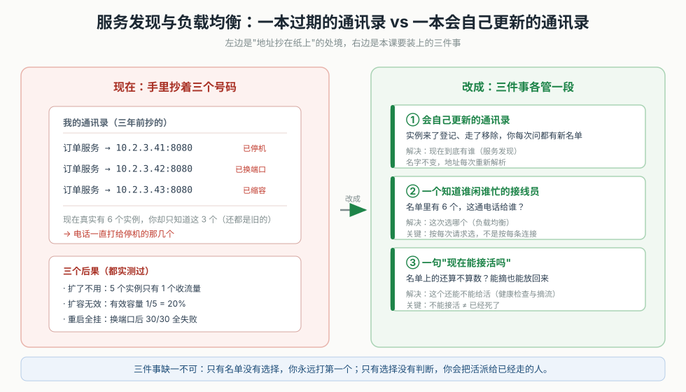
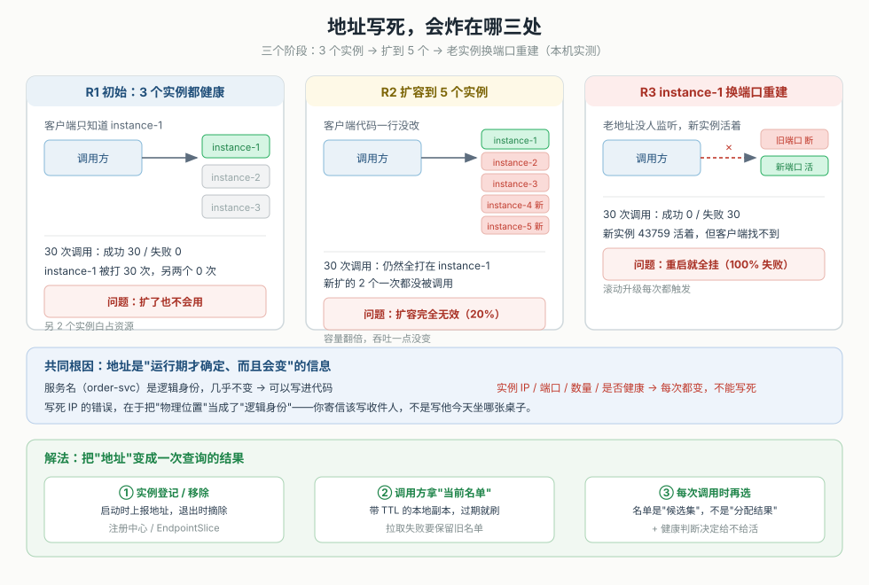
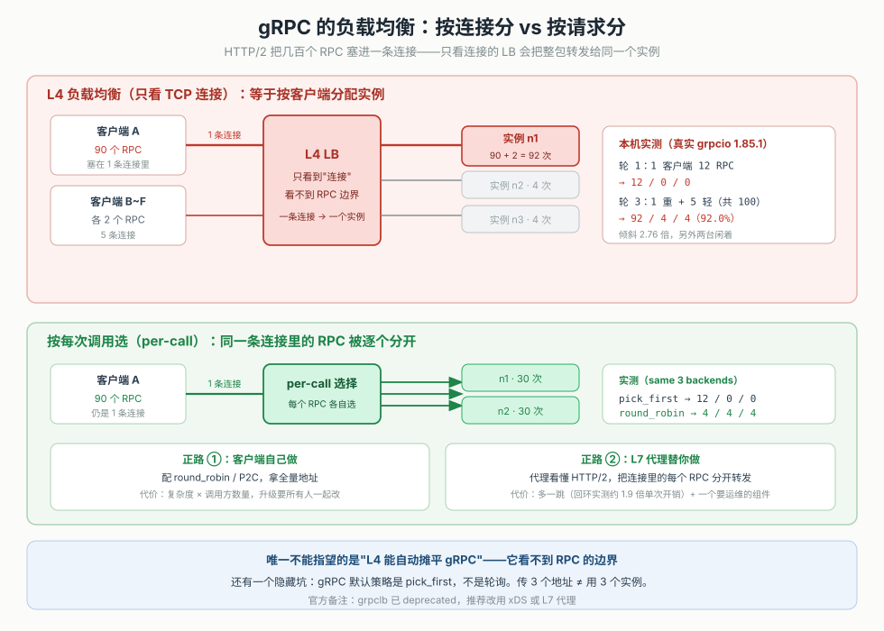
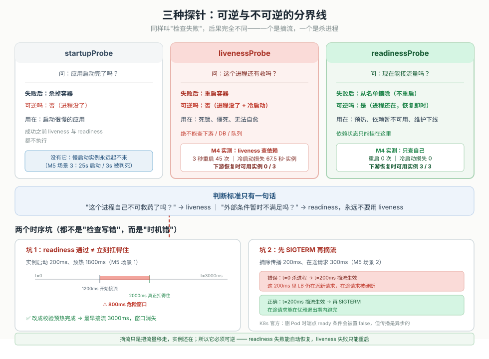
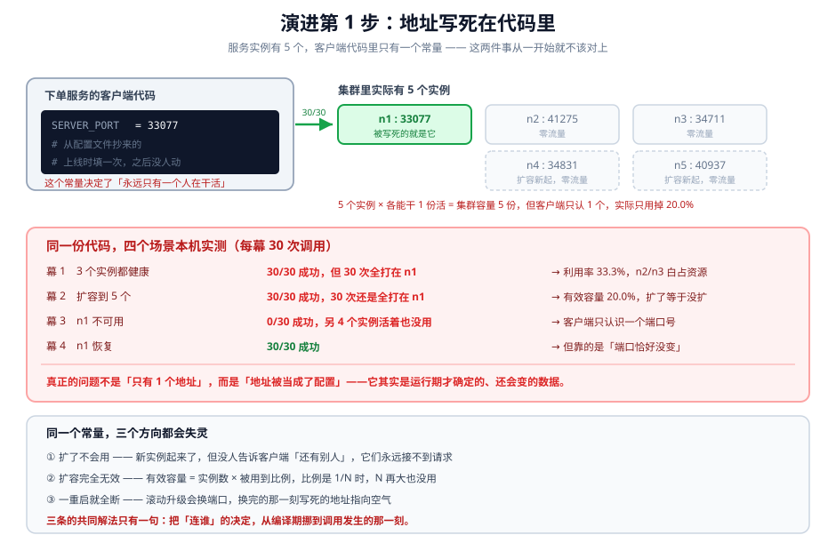
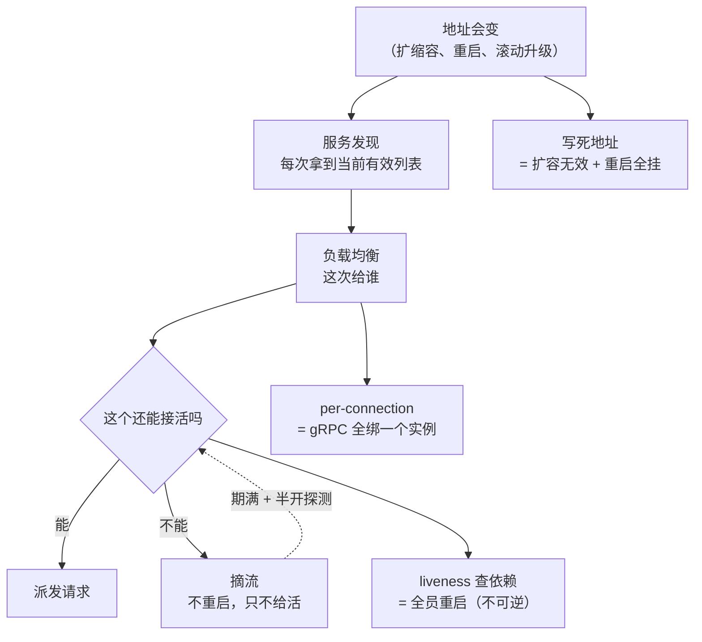

# 第 8 课：服务发现与负载均衡

> 所属阶段：阶段 2《服务之间的通信》｜ 水平：入门 ｜ 本课知识点：服务发现要解决什么、客户端负载均衡与服务端代理、健康检查与摘流
> 故事情节：主角刚把超时、重试、熔断、限流这套"坏天气装备"配齐，觉得调用链终于稳了。结果运维在周五下午做了一次常规扩容——把订单服务从 3 个实例扩到 6 个。周一早上流量高峰，监控显示"扩容后吞吐一点没涨"，而原来那 3 个实例的 CPU 全在 90%。更糟的是周三凌晨一次滚动升级，订单服务重启后接口错误率瞬间冲到 100%，因为调用方代码里写着一个早就换掉的 IP。这节课他学的是：**地址是会变的，所以"找谁"这件事不能写死在代码里，也不能交给"连上哪个算哪个"**。
> 📖 结论已按官方文档核对（核对于 2026-11 ｜ 来源：gRPC 官方《Load Balancing in gRPC》与《gRPC Load Balancing》博客、Kubernetes 官方《Liveness, Readiness and Startup Probes》、Kubernetes 官方《Pod Lifecycle / Pod termination》、RFC 2782 DNS SRV、Azure Architecture Center《Health Endpoint Monitoring Pattern》）
> ✅ 本课数字全部实测于 Linux（WSL2，kernel 6.6.87.2）/ Python 3.12.3 标准库（`http.server` + `threading` + `urllib` + `socket`）+ grpcio 1.85.1（仅 M3/M3b 两段用真实 gRPC）。可复跑脚本在 `playground/lesson08/`，下文 4.1 逐段给出关键片段与真实输出。

## 🎯 本课目标

- 说清"把地址写死在代码里"在扩缩容下会炸出的三个具体问题，并给出各自的量化代价
- 说清 gRPC 为什么不能用普通的 L4 负载均衡，以及客户端 LB 与 L7 代理各自的取舍
- 区分 liveness / readiness / startup 三种探针的语义与后果，说清用错会怎样

---

## 第一幕：起源与场景引入

> 🏛️ **起源**：服务发现不是微服务时代才有的东西。DNS 从 1983 年就在做同一件事——把"名字"翻译成"地址"，让你不用记住 IP。1996 年的 RFC 2059（后来的 RFC 2782）给 DNS 加了一种叫 SRV 的记录：它不只返回地址，还返回**端口和优先级/权重**，也就是"这个服务有哪几个实例、各自多重"。这就是服务发现的原型。
>
> 真正把它变成基础设施的是 2010 年代的两条路。一条是**中心化注册中心**：Consul（2014）、etcd（2013）、Eureka（2012，Netflix）、ZooKeeper（2008，Apache 项目）——实例启动时来登记，客户端来查询。另一条是**平台托管**：Kubernetes 用 Service + EndpointSlice 把"哪些 Pod 现在能接流量"做成了集群内的一等公民，CoreDNS 再把它变成一个可解析的名字。今天你在 K8s 里写 `http://order-svc:8080`，背后就是这条链。
>
> 负载均衡那边则有一个专门为 gRPC 而生的转折。gRPC 官方文档明确写着一句话：**负载均衡在 gRPC 里是按每次调用（per-call）发生的，而不是按每条连接（per-connection）**。这句话看着平淡，但它直接判定了"普通 L4 负载均衡器对 gRPC 基本无效"——因为 L4 只能看到 TCP 连接，而 gRPC 会把成百上千个调用塞进同一条连接里。官方给出的两条正路是：客户端负载均衡、L7（应用层）代理负载均衡（核查于 2026-11）。

> 🎬 **场景**：周五下午，运维把订单服务从 3 个实例扩到 6 个，一切正常。周一早高峰，下单接口的 P99 从 180ms 涨到 2.1s，但订单服务 6 个实例里，只有原来那 3 个的 CPU 到了 90%，新扩的 3 个几乎是 0%。你想"扩容应该有用啊"，于是又扩到 9 个——新实例依然是 0%。同时网关的日志里，请求全部指向那 3 个老 IP。
>
> 周三凌晨，一次滚动升级把订单服务的实例重建了一遍，IP 和端口都变了。早上八点，调用方开始 100% 失败，报 `Connection refused`。你去看调用方代码：

```python
ORDER_SERVICE = "http://10.2.3.41:8080"   # ← 三年前写的常量
```

> 一行常量，把"地址"这个**运行期才确定、而且会变**的信息，固化成了编译期的事实。

> 📌 **一句话本质**：服务发现解决的是"**地址是运行期的、会变的**"这件事——让调用方每次都能拿到"现在谁还活着"，而不是记住"曾经谁在哪里"。负载均衡解决的是"**拿到多个之后选哪个**"，而选法取决于实例能力是否相同。**写不出这句 = 本课还没定准**。

> ⚖️ **处境对照**：
> - **不这么做**：地址写死，扩容等于没扩（实测 5 个实例只有 1 个收流量，有效容量 20%）；实例换端口等于全站不可用（实测 30 次调用 0 成功）；gRPC 用 L4 负载均衡，一个客户端就把 12 个 RPC 全压在一个实例上（实测 12/0/0）。
> - **这么做_换来**：客户端拿到全量地址并按 P2C 选择，快实例自然多干（实测 78.1% : 16.2% : 5.7%，总墙钟从 509ms 降到 135ms）；gRPC 用 round_robin 三次调用均分到三个实例（4/4/4）；实例挂掉后连续失败 2 次即摘除，失败率从 33.3% 降到 1.7%。
> - **数字锚点**（本机实测）：硬编码地址在 5 实例集群下只用到 1 个（20% 有效容量），实例换端口后 30/30 全失败；L4 转发下 1 个 gRPC 客户端 12 次 RPC 全部落到同一实例（12/0/0）；L4 遇上"一个重客户端 + 五个轻客户端"时最忙实例拿到 92.0%，倾斜 2.76 倍；代理只是纯转发时，后端挂一个的失败率与直连完全一样（33.3% vs 33.3%）。
>
> 位置说明：场景刻意选"扩容无效"而不是"服务挂了"——因为"挂了"至少会报警，而"扩容无效"会安静地把你拖进一个越来越贵的坑：你不断加机器，账单涨了三倍，吞吐一点没动。

---

## 第二幕：认知冲突

> ❓ **问题**：你已经在用 Kubernetes 了，`order-svc` 这个 Service 名字是自动解析的，为什么还会踩"地址写死"的坑？"用 K8s 就自带服务发现和负载均衡"这句话，到底哪里不成立？

---

## 第三幕：层层揭示

### 一眼全局图（进入细节前先看一眼）



> 看图：左边是现在的处境——你手里抄着 3 个号码（地址），其中一个早停机了、两个新增的你不知道，于是电话一直打给那 3 个旧号。右边是本课的三件事：**一本会自己更新的通讯录**（服务发现，解决"现在有谁"）、**一个知道谁闲谁忙的接线员**（负载均衡，解决"这通电话给谁"）、**一条"这个人现在能接电话吗"的判断规则**（健康检查与摘流，解决"名单上的还算不算数"）。
>
> 三件事必须一起做：只有通讯录没有接线员，你就永远打给第一个；只有接线员没有健康判断，接线员会把电话转给一个已经离职的人；只有健康判断没有通讯录，你连该判断谁都不知道。

**四条硬约束**：① 一图只回答"本课解决什么问题、靠什么思路"；② 图上零术语（术语下沉到图注与后文）；③ 必带读图指引（已给）；④ 图不承担结论，图旁文字须能独立说清同一件事。
**验收口径**：没学过本课的人应能看懂这张图。

### 本课地图（分几步走）

| 步 | 这一步要解决什么（人话） | 对应知识点 |
|:--:|------------------------|-----------|
| 1 | 先看清"把地址抄在纸上"到底错在哪三个地方 | 知识点 1：服务发现要解决什么 |
| 2 | 拿到一串地址之后，这通电话该给谁——两种架构怎么选 | 知识点 2：客户端负载均衡与服务端代理 |
| 3 | 名单上的那个到底还能不能接活，以及"摘下来"和"放回去"的时机 | 知识点 3：健康检查与摘流 |

> 只回答"分几步走、现在在哪"——不写机制、不写结论。第二幕的"问题"是"用了 K8s 为什么还踩坑"，本课三步正好按"地址从哪来 → 选哪个 → 还算不算数"的顺序回答。

---

### 知识点 1：服务发现要解决什么

> 🧭 第 1/3 步｜承接：第二幕的疑问——"我不是有 K8s Service 吗" → 本步：先看清"地址"这个信息的性质，以及写死它必然炸在哪三处。
> 本知识点关键点：地址是运行期数据不是配置、三个问题各有独立成因、有效容量 ≠ 实例数量

#### 一句话定义

**服务发现（service discovery）是一套让调用方在"调用发生的那一刻"才知道该连谁的机制**：实例启动时把自己的地址登记进去，实例消失时地址被移除，调用方每次要连之前去问一次（或从一份会定期刷新的本地副本里拿）。它的产出不是"一个地址"，而是"**一份当前有效地址的列表**"。

#### 直觉建立（类比）

你搬家之后，会做两件事：把新地址告诉快递公司，以及**不再指望朋友按三年前名片上的地址给你寄东西**。如果你只做了第一件，第二件没做，那些还拿着旧名片的人依然会把包裹寄到别人家去。

更贴切的是公司前台那块"今日在岗"的牌子：谁来了挂上去，谁走了摘下来。你要找人，先看牌子，而不是记住"小王以前坐 3 楼"。

> 💡 **类比的边界**：前台那块牌子是**实时的**，你看的时候它一定是准确的。服务发现的名单永远是"**上一次刷新时的**"——从实例挂掉到名单更新，中间一定有一个窗口（本课 M6 实测：列表 TTL 800ms 时，窗口内打到已摘流实例的比例约 13%）。所以服务发现永远需要"名单过期了怎么办"的兜底，这是本课知识点 3 的入口。

#### 核心原理

> **① 地址是运行期数据，不是配置**

判断一个东西该不该写进代码，有个简单的标准：**它会不会在"代码不改"的情况下发生变化？**

| 信息 | 会变吗 | 该写死吗 | 为什么 |
|---|---|---|---|
| 服务名（`order-svc`） | 几乎不变 | 可以 | 它是逻辑身份，是你要找的"那个人" |
| 实例 IP / 端口 | **每次重启都可能变** | 不行 | 它是物理位置，是"那个人今天坐哪" |
| 实例数量 | **随时变（扩缩容）** | 不行 | 它是运行状态 |
| 是否健康 | **随时变** | 不行 | 它是实时状态 |

前两行是"逻辑 vs 物理"的分界：**调用方应该依赖逻辑身份，让中间一层去解析物理位置**。写死 IP 的错误在于把物理位置当成了逻辑身份。

> **② 三个问题，各自独立，各自都会要命**

本机实测（M1：3 个实例，客户端代码里只有 `instance-1` 的地址；然后扩容到 5 个，再让 instance-1 换端口重建）：

| 阶段 | 运维动作 | 客户端结果 | 问题 |
|---|---|---|---|
| R1 | 3 个实例都健康 | 30/30 成功，但**全部 30 次都打在 instance-1** | 扩了也不会用：另 2 个实例白占资源 |
| R2 | 扩容到 5 个 | 30/30 成功，**仍然全部打在 instance-1** | 扩容完全无效：有效容量还是 1/5 = 20% |
| R3 | instance-1 换端口重建 | **30/30 全部失败** | 重启就全挂：老地址没人监听，新实例永远找不到 |

R2 那一行值得盯三秒：**容量翻倍了，吞吐一点没变**。而且这种故障不会报警——没有错误、没有超时，只有"加了三台机器却没效果"和一张越来越贵的账单。

R3 更直接：**滚动升级是常态**，每次升级实例都会重建、IP 或端口都会变。写死的地址不是"偶尔会坏"，是"每次发布都会坏一次"。



> 看图：左边是"客户端只认识一个地址"的三种处境——3 个实例只用了 1 个、扩到 5 个还是只用 1 个、那个唯一的地址一换就全断。右边是"客户端拿一份会刷新的列表"之后的对应结果。最下面一行点出共同点：地址是运行期数据，写死它等于把"今天谁在"冻成了"三年前谁在"。

> **③ "有效容量"不等于"实例数量"**

R2 揭示了一个容易被忽略的指标：**有效容量 = 实例数 × 被真正用到的比例**。

```
5 个实例 × 20%（只有 1 个在用）= 1 个实例的有效容量
```

这也是为什么"扩容无效"格外贵：你付了 5 台的账单，只买到 1 台的吞吐。而且它有一个恶性循环——因为吞吐不涨，你会继续加机器，账单继续涨，问题继续在。**没有任何监控会告诉你这件事，因为系统"看起来正常"**。

> **④ 注册中心的名单，天生是"过期的"**

即使上了注册中心，也不是"实时"。链路上至少有三段延迟：


> 看图：三段延迟任意一段不为零，"用旧名单打已下线实例"就会发生。第 ③ 段还会额外撞上连接已建立、但实例正准备退出的窗口。

这三段决定了本课一个核心结论：**服务发现不是"消灭失败"，而是"让失败可控"**。真正把失败率压下来的，是名单 + 健康判断 + 客户端容忍的组合（M6 实测 33.3% → 1.7%）。

#### 示例演示

```python
# 一个最小可用的"服务发现客户端"骨架：三件事一个都不能少
import time, threading

class Discovery:
    def __init__(self, fetch_list, ttl=1.0):
        self._fetch = fetch_list          # 从注册中心拉列表（函数，可以是 HTTP 调用）
        self._ttl = ttl
        self._list = []
        self._at = -1e9
        self._lock = threading.Lock()

    def endpoints(self):
        """关键一：永远返回"当前这一份"，并且过期就刷新。"""
        now = time.monotonic()
        with self._lock:
            if now - self._at < self._ttl:
                return list(self._list)   # 关键二：返回副本，别把内部列表暴露出去
            self._list = self._fetch()    # 关键三：拉取失败要保留旧列表
            self._at = now
            return list(self._list)
```

三个"关键"对应三种最常见的写错方式：不设 TTL（永远用启动时那份）、返回内部引用（调用方一改本地列表就污染缓存）、拉取失败就清空（注册中心抖一下，你就把全量实例都丢了）。

#### 常见误区

1. **"我们上了 K8s，服务发现是自带的，不用管"**：K8s 确实提供了 Service 的集群内 DNS，但**它解决的是"名字解析成一组 IP"，不解决"这组里选哪个"**。默认 Service 是 L4（ClusterIP + kube-proxy），对普通 HTTP 请求是按连接分配——这在短连接场景够用，对 gRPC 就等于把整个客户端绑死在一个 Pod 上（M3b 实测 12/0/0）。
2. **"地址配在配置文件里就不是写死了"**：配置文件和代码的区别只是"改的时候要不要重新编译"。如果配置里的地址是**手工维护的一组固定 IP**，那它和常量是同一个东西——扩缩容时没人会记得去改它。真正的区别是"谁在维护这份列表"：人，还是系统。
3. **"服务发现就是注册中心，装一个 Consul 就完事"**：注册中心只解决"名单从哪来"。本课 M7 实测：代理只是纯转发时，后端挂一个的失败率和直连完全一样（33.3% vs 33.3%）——**有了名单不等于会用名单**。
4. **"DNS 也算服务发现，所以不用额外组件"**：DNS 是最早的服务发现，但它有两个已知短板：TTL 受客户端/中间解析器缓存影响（Java 的 JVM 默认会缓存 DNS 结果，历史上要设 `networkaddress.cache.ttl`），且 SRV 记录虽然能表达端口与权重，实际客户端支持度参差。它能用，但"能用"和"能快速感知实例变化"是两件事。
5. **"实例越多可用性越高"**：只有"被真正用到的实例"才贡献容量（R2 实测：5 个实例、20% 有效容量）。名单不更新，加机器只是加账单。

#### 一句话记住

地址是运行期的数据，不是配置——服务发现让调用方每次都知道"现在谁在"，而不是记住"曾经谁在哪里"。

#### 🗣️ 行话对照

- **服务发现（service discovery）**：本课说的"会自己更新的通讯录"；在哪遇到：Consul / etcd / Nacos / Eureka / K8s Service + CoreDNS。
- **注册中心（registry / service registry）**：保存"现在有哪些实例"的地方；在哪遇到：`consul agent`、K8s 的 EndpointSlice、Nacos 控制台。
- **服务注册 / 心跳（registration / heartbeat）**：实例定期说"我还活着"；在哪遇到：`ttl` 参数、lease、`keepalive`。
- **端点 / Endpoint**：一个具体的"IP:端口"；在哪遇到：K8s `EndpointSlice`、Consul 的 `ServiceAddress`。
- **DNS SRV 记录**：能在 DNS 里表达端口与权重的记录类型（RFC 2782）；在哪遇到：`_http._tcp.example.com SRV`。
- **服务网格（service mesh）**：把服务发现、负载均衡、熔断这些能力从应用里挪到边车代理；在哪遇到：Istio、Linkerd、Envoy sidecar。

#### 官方文档

- gRPC · Load Balancing in gRPC（per-call、pick_first / round_robin / grpclb）：https://www.grpc.io/grpc/core/md_doc_load-balancing.html
- gRPC Blog · gRPC Load Balancing（客户端 LB / 代理 LB / lookaside 的选型建议）：https://grpc.io/blog/grpc-load-balancing/
- Kubernetes · Liveness, Readiness and Startup Probes：https://kubernetes.io/docs/concepts/configuration/liveness-readiness-startup-probes/
- RFC 2782 · A DNS RR for specifying the location of services（SRV）：https://www.rfc-editor.org/rfc/rfc2782
- Azure Architecture Center · Health Endpoint Monitoring Pattern：https://learn.microsoft.com/en-us/azure/architecture/patterns/health-endpoint-monitoring

---

### 知识点 2：客户端负载均衡与服务端代理

> 🧭 第 2/3 步｜承接：已经拿到一份会刷新的地址列表 → 本步：列表里有 3 个，这一通电话给谁？以及这个"选"的动作放在哪一侧。
> 本知识点关键点：per-call 而不是 per-connection、L4 对 gRPC 无效、两种拓扑差的是"复杂度复制几份"而不是"能不能做"

#### 一句话定义

**负载均衡（load balancing）是在多个可用实例之间选一个来处理当前请求**。放在客户端做叫**客户端负载均衡**（调用方自己拿列表、自己选），放在中间一层做叫**代理负载均衡**（调用方只认识代理，代理转发）。两者的区别不在"算法"，而在"**选择的决定权、以及列表与健康状态这份信息放在哪**"。

#### 直觉建立（类比）

打车去机场。**客户端负载均衡**是你自己打开地图，看着实时路况选一条路线——你比任何调度中心都清楚自己这单要去哪，选得最准；但每个乘客都得自己会看地图，而且地图 App 要在每个人的手机上各装一份、各升级一次。

**代理负载均衡**是你在酒店门口上一辆"机场大巴"，司机负责路线。你什么都不用管，但大巴永远绕一站，而且司机要是罢工了，你连门都出不去。

> 💡 **类比的边界**：大巴司机必须知道所有乘客的目的地才能拼车，而代理必须能**看懂每个请求**才能做 L7 分流。如果代理只能看到"有一辆车开出去了"（L4，只看连接），它就没法把同一条连接里的不同乘客分开——这正是 gRPC 踩坑的根源。

#### 核心原理

> **① gRPC 的负载均衡是 per-call，不是 per-connection**

这是本知识点、也是整节课最重要的一句。gRPC 官方文档写得非常直接：*"Load-balancing within gRPC happens on a per-call basis, not a per-connection basis."*

它为什么重要？因为 HTTP/2 的多路复用让**一条 TCP 连接里可以同时跑几百个 RPC**。所以：

- **per-connection 的负载均衡**（典型 L4：NLB、K8s 默认 Service、HAProxy 的 `mode tcp`）只能按"连接"分配 → 一个客户端的所有 RPC 都跟着那一条连接走 → **等于按客户端分配实例**。
- **per-call 的负载均衡**才能把同一个客户端的 100 个 RPC 摊到 3 个实例上。

本机实测（M3b，真实 grpcio 1.85.1 + 手写 TCP 转发器模拟 L4）：

| 轮次 | 场景 | 代理建立的连接数 | n1 / n2 / n3 | 最忙占比 |
|---|---|---|---|---|
| 轮 1 | 1 个客户端 × 12 次 RPC，经 L4 | 1 | **12 / 0 / 0** | 100% |
| 轮 2 | 6 个客户端 × 12 次 RPC，经 L4 | 6 | 24 / 24 / 24 | 33.3% |
| 轮 3 | 1 个重客户端（90 次）+ 5 个轻客户端（各 2 次） | 6 | **92 / 4 / 4** | **92.0%** |

轮 2 看着很完美，但那只是"客户端数量刚好是 3 的整数倍"的巧合。轮 3 才是真实形态：**流量从来不是均匀分布在客户端之间的**。一个重客户端就能把它那一个实例压到 92%，另外两个闲着。

对照：同一批后端，客户端自己用 `round_robin` 直连三个地址（M3，真实 gRPC）：

```
【默认策略（pick_first）】12 次调用
  n1: 12  ############
  n2:  0
  n3:  0
  → 实际用到的后端数：1 / 3

【round_robin】12 次调用
  n1:  4  ####
  n2:  4  ####
  n3:  4  ####
  → 实际用到的后端数：3 / 3
```

> 注意这里还有一个隐藏的坑：**gRPC 的默认策略是 `pick_first`，不是轮询**。也就是说，即使你传了 3 个地址进去，客户端默认也只连第一个能连上的，然后一直用它。你必须显式在 service config 里配 `round_robin`（或用支持 xDS 的代理下发策略）。这是"我明明配了三个地址，为什么还是一个实例在扛"的最常见原因。



> 看图：上半部分画的是 L4 的视角——它只看到 6 条 TCP 连接，每条连接背后是一整包 RPC，于是把"整包"转发给同一个实例。中间那行是关键：客户端 A 的 90 个调用全在一条连接里，一起被送到 n1。下半部分是 per-call 的视角——同一条连接里的 RPC 被逐个挑出来分给不同实例。右侧标出两条正路：客户端自己选（round_robin / P2C）、或让理解 HTTP/2 的 L7 代理替你选。

> **② 即使不是 gRPC，"分得均匀"也未必是对的**

如果三个实例的能力不一样（一台新机器、一台在跑批、一台有缓存），轮询会把三分之一的活压给最慢的那台。本机实测（M2，n1 工作 0ms / n2 10ms / n3 40ms，容量比约 4:2:1，210 个请求、12 并发，三次复跑量级一致）：

| 算法 | n1（快） | n2（中） | n3（慢） | 总墙钟 | P95 |
|---|---|---|---|---|---|
| 轮询 round_robin | 33.3% | 33.3% | 33.3% | 509~530 ms | 177~201 ms |
| 随机 random | 31~40% | 32~36% | 28~35% | 306~347 ms | 41~42 ms |
| 最少连接 least_conn | **76~78%** | 16~18% | **5.7%** | **136~144 ms** | 41~43 ms |
| 二选一 P2C | 57~65% | 26~32% | 8.6~11% | 145~182 ms | 42~43 ms |

判读要小心，这里有一个反直觉的地方：

- **轮询是硬均分 33.3%**，完全不看快慢。慢实例只干得动 1/7 的量，却被分到 1/3，于是它那一路堵起来 → 总墙钟最长（约 510ms，是最少连接的 3.8 倍）、P95 明显变差。
- **随机的"次数"也是均分，但它不排队对齐**：12 个并发 worker 里总有人抽到快实例先返回，慢实例的排队被摊薄，所以 P95 只有 40ms 量级。但**总墙钟仍是最少连接的两倍多**（306~347ms vs 136~144ms）——它在吞吐上依然吃亏，只是尾延迟没那么难看。
- **最少连接 / P2C 看"在途数"**：谁先空出来谁再接，快实例自然多干（76~78%），慢实例只剩 5.7%，总墙钟降到 136ms。

所以真正的结论不是"谁能分得更均匀"，而是：**能力不等时，均分本身就是错的**。轮询把 1/3 的活压给只能干 1/7 的实例，这不叫公平，叫排队。

> **③ 两种拓扑差的是"复杂度复制几份"，不是"能不能做"**

这是很多人想错的地方。本机实测（M7，3 个实例、坏掉 1 个、各方案 120 次调用）：

| 方案 | 成功 | 失败 | 失败率 |
|---|---|---|---|
| A 客户端直连，不剔除失败实例 | 80 | 40 | **33.3%** |
| B 客户端直连，连续失败就剔除 | 118 | 2 | **1.7%** |
| C 经代理，代理只做转发 | 80 | 40 | **33.3%** |
| D 经代理，代理主动探测并剔除 | 118 | 2 | **1.7%** |

看清两件事：

- **A 和 C 一模一样（都 33.3%）**。加了代理，但代理只是纯转发，那它和你自己直连没有任何区别——**"上了个代理"本身不解决故障感知**。
- **B 和 D 一模一样（都 1.7%）**。真正起作用的是"**探测并剔除**"这个动作，放在客户端还是放在代理，效果等价。

所以选择的真正依据是：**这份"健康判断 + 选择算法"要被复制多少份、谁来升级它**。

| | 客户端负载均衡 | 代理 / 服务端负载均衡 |
|---|---|---|
| 谁保存列表与健康状态 | 每个调用方各存一份 | 代理存一份，所有调用方共享 |
| 复杂度 | **× 调用方数量**（N 个客户端要各实现一遍） | 常数（一处实现） |
| 升级成本 | 要所有调用方一起改、一起发 | 改代理一处 |
| 额外网络跳 | 无（直连后端） | **有**（M7 实测回环地址上约 1.91~1.94 倍单次成本） |
| 调用方能感知后端细节 | 能（可以做 P2C、按延迟加权） | 不能（只看到代理） |
| 故障域 | 无单点（每个客户端自己判断） | 代理本身是要运维的组件 |
| 适合 | 东西向流量、客户端可信、延迟敏感、语言栈统一 | 南北向流量、客户端不可信/不可控、多语言混杂 |

> 一个具体数字：M7 测出代理多一跳在回环地址上约 **1.91~1.94 倍**单次开销。这个倍数是"跳数"的代价，不是绝对值——同机 sidecar 几乎无感，跨机房代理就很明显。**别把回环上的倍数直接套到生产延迟上**，它只说明"多一跳确实有成本"。

> **④ gRPC 官方的选型建议，比"二选一"更细**

gRPC 官方博客给的建议表（核查于 2026-11）：

| 你的处境 | 官方建议 |
|---|---|
| 客户端与服务端之间流量非常大、客户端可信 | 厚客户端负载均衡（客户端 LB + etcd/ZooKeeper/Consul） |
| 传统部署，大量客户端连代理后面的服务，需要信任边界 | 代理负载均衡（L3/L4 LB 或 L7 LB） |
| 微服务、N 客户端 M 服务端、性能要求极高、客户端不可信 | lookaside 负载均衡（gRPC-LB 协议）或服务网格（Istio/Envoy） |
| 需要会话粘性 | L7 LB（Envoy） |

注意 `pick_first` 和 `round_robin` 都在客户端侧，而 `grpclb`（lookaside 协议的实现）已被官方标记为 **deprecated**，推荐改用 xDS。这条信息很实用：如果你在找"gRPC 官方推荐的负载均衡方案"，答案不是 grpclb，而是 xDS 或 L7 代理。

#### 示例演示

```python
import grpc, json

# 关键一：必须显式配 round_robin —— gRPC 默认是 pick_first，只连第一个
opts = [(
    "grpc.service_config",
    json.dumps({"loadBalancingConfig": [{"round_robin": {}}]}),
)]

# 关键二：target 用多地址语法，让 resolver 一次性拿到全部实例
target = "ipv4:127.0.0.1:50051,127.0.0.1:50052,127.0.0.1:50053"
channel = grpc.insecure_channel(target, options=opts)

# 关键三：等 READY 再发请求，否则首批 RPC 会在"还没连上"时失败
grpc.channel_ready_future(channel).result(timeout=5)
```

三行各有出处：不配 `round_robin` → 退化成 pick_first（M3 实测 12/0/0）；不给多地址 → resolver 只有一个候选，配什么策略都没用；不等 READY → 冷启动瞬间一片 `UNAVAILABLE`。

#### 常见误区

1. **"配了多个地址就是负载均衡了"**：gRPC 默认 `pick_first`，多地址只是"备胎列表"，不是"分流列表"。M3 实测 12/0/0。
2. **"K8s Service 会自动把 gRPC 请求摊平"**：默认 Service 是 L4（kube-proxy 按连接转发）。M3b 轮 1 实测 12/0/0，轮 3 实测 92/4/4。要用 headless Service + 客户端 LB，或上 L7 代理 / 服务网格。
3. **"轮询是最公平的"**：只有实例能力相同时才公平。能力比 4:2:1 时，轮询把 33.3% 压给只能干 1/7 的实例，总墙钟是从最少连接的 3.8 倍（M2）。
4. **"加个代理就自动有了健康检查和负载均衡"**：代理如果只做纯转发，失败率和直连完全一样（M7 的 A 与 C 都是 33.3%）。起作用的是"探测 + 剔除"这个动作。
5. **"客户端 LB 更先进，代理 LB 是老方案"**：两者解决的是不同约束。客户端 LB 的复杂度是"× 调用方数量"，代理 LB 是多一跳但集中运维。多语言、多团队、客户端不可控的环境，代理往往才是对的。
6. **"最少连接一定比轮询好"**：它需要准确的"在途数"。如果统计口径不对（比如只统计到"发出请求"而没统计到"收到响应"），它会误判。而且它假设"每个请求代价相近"——一个 10ms 的查询和一个 3s 的报表混在一起，最少连接也会偏。

#### 一句话记住

负载均衡的关键不是"算法选哪个"，而是"这个选择发生在每次调用还是每条连接"——gRPC 必须 per-call；而选择放在客户端还是代理，取决于你愿意把复杂度复制几份。

#### 🗣️ 行话对照

- **客户端负载均衡（client-side LB）**：本课说的"自己看地图选路线"；在哪遇到：gRPC `round_robin` / `pick_first`、Ribbon（Java）、`grpc-lb`。
- **代理负载均衡（proxy / server-side LB）**：本课说的"上大巴让司机决定"；在哪遇到：Nginx `upstream`、HAProxy、Envoy、AWS ALB/NLB、GCP CLB。
- **L4 / L7 负载均衡**：L4 只看 TCP/UDP（看不到请求内容），L7 能看懂 HTTP/2 并把请求分开转发；在哪遇到：NLB/CLB 是 L4，ALB/Envoy 是 L7。
- **lookaside 负载均衡**：客户端向一个"旁路"LB 问"我该用谁"，然后直连；也叫外部 LB / 单臂 LB。在哪遇到：gRPC-LB 协议、`grpclb`（已 deprecated）。
- **per-call / per-connection**：按每次调用分 / 按每条连接分；这是 gRPC 负载均衡的核心区分。
- **pick_first / round_robin / P2C**：三种选择策略——连第一个能连的 / 轮流 / 随机两个选闲的；在哪遇到：gRPC service config、Envoy `least_request`、Finagle。
- **会话粘性 / sticky session**：同一个用户的请求固定去同一实例；在哪遇到：ALB 的 sticky session、Envoy 的 ring hash。

#### 官方文档

- gRPC · Load Balancing in gRPC（per-call 定义、pick_first / round_robin / grpclb 的行为与 deprecated 标注）：https://www.grpc.io/grpc/core/md_doc_load-balancing.html
- gRPC Blog · gRPC Load Balancing（四种部署形态的建议表）：https://grpc.io/blog/grpc-load-balancing/
- Microsoft Learn · gRPC 性能最佳做法（L4 为何不适合 gRPC、流式调用一旦建立就绑定端点）：https://learn.microsoft.com/zh-cn/aspnet/core/grpc/performance
- Microsoft Learn · gRPC client-side load balancing（代理 vs 客户端 LB 的取舍）：https://learn.microsoft.com/en-us/aspnet/core/grpc/loadbalancing
---

### 知识点 3：健康检查与摘流

> 🧭 第 3/3 步｜承接：已经能选一个实例了 → 本步：名单上那个实例，现在到底还能不能接活？谁来判断、判断错了会怎样。
> 本知识点关键点：三种探针的语义与不可逆后果、liveness 绝不能查依赖、摘流必须早于退出

#### 一句话定义

**健康检查（health check）是一个周期性执行的诊断，用来回答"这个实例现在处于什么状态"**；**摘流（drain / de-registration）是根据这个诊断，把它从"接流量的名单"里拿掉（或在恢复后放回去）**。关键在于：检查本身不改变任何东西，**真正改变系统的是"诊断结果被用来做什么"**。

#### 直觉建立（类比）

一家餐厅有两个完全不同的判断：

- **"这家店还开着吗？"**（liveness）——如果答案是否，那就是**关门歇业**，员工全部回家。你明天再来，它可能重新开张，但今天的客人全走了。
- **"现在能接客吗？"**（readiness）——如果答案是否，那就是**门口挂个"客满，请稍候"**。店还在营业、员工还在、后厨还在准备，只是暂时不让人进来。

这两个判断如果搞混，就会出荒唐事：**因为"今天食材没送到"而宣布"本店倒闭、全员解散"**——这就是 liveness 检查依赖的后果。

> 💡 **类比的边界**：餐厅关了门，老板知道明天还能再开；容器被 liveness 杀掉重启，**中间那段冷启动是真金白银的服务真空**（本课 M4 把冷启动设成 1.5s/实例，组 A 3 秒内累计损失 67.5 秒·实例）。而且如果启动本身就依赖那个还没好的下游，重启会变成死循环（M5 场景 3）。

#### 核心原理

> **① 三种探针，三种不可互换的后果**

Kubernetes 官方文档定义了三种探针（核查于 2026-11）：

| 探针 | 回答的问题 | 失败后的动作 | **可逆吗** | 什么时候用 |
|---|---|---|---|---|
| **startupProbe** | 应用启动完了吗？ | 超过 `failureThreshold` 就杀掉容器 | 否（杀进程） | 启动很慢的应用；成功前 liveness/readiness 都不执行 |
| **livenessProbe** | 这个进程还有救吗？（死锁、僵死） | 重启容器 | **否（杀进程）** | 只在"进程自己无法恢复"时才用 |
| **readinessProbe** | 现在能接流量吗？ | 从 EndpointSlice 摘除（不重启） | **是（可恢复）** | 预热、依赖暂不可用、主动下线维护 |

官方文档对这个区别说得很重，甚至专门加了一段 Caution：*"Incorrect implementation of liveness probes can lead to cascading failures."*（错误实现 liveness 会导致级联故障）——后果包括：高负载下容器被反复重启、客户端请求失败、以及**剩下的 Pod 因为少了一批同伴而负载更重**。

> 这句话正好接上课 7 的雪崩：**liveness 写错，就是自己给自己制造一次雪崩**。

> **② liveness 检查依赖 = 把"依赖故障"升级成"全员重启"**

这是本节最重要的一条。本机实测（M4：3 个实例共享 1 个下游，下游故障持续 3 秒，探针周期 200ms，冷启动 1.5s）：

| 组 | liveness 是否检查下游 | 重启次数 | 冷启动损失 | 下游恢复时可用实例 |
|---|---|---|---|---|
| A（常见错法） | 是 | **45 次** | **67.5 秒·实例** | **0 / 3** |
| B（正确） | 否，只查自己 | **0 次** | 0 | **3 / 3** |

组 A 的机理是个死循环：下游一直坏 → liveness 一直失败 → 容器被反复拉起 → 冷启动期间还是过不了 liveness → 再被杀。3 秒内重启 45 次，每个实例都在"正在启动"和"正在被杀"之间循环。**最讽刺的是下游恢复那一刻：0 个实例可用**——它们全在冷启动里。

组 B 一次重启都没有：readiness 失败只是把实例从名单里摘掉，进程安安静静等着，下游一恢复立刻能接流量。

核心区别不是"哪个探针更严格"，而是**后果不同**：

```
liveness 失败 = 杀掉进程 → 不可逆，且要付冷启动成本
readiness 失败 = 暂时不派活 → 可逆，进程还在，恢复即时
```

所以判断标准只有一句话：**"这个进程自己不可救药了吗？"** 死锁、goroutine 泄漏、无法响应的僵死 → liveness。**"外部条件暂时不满足"**（下游挂了、缓存没热、正在迁移数据）→ readiness，永远不要用 liveness。



> 看图：左边三列分别是 startup / liveness / readiness，每列标出"回答什么问题""失败后做什么""可逆吗"。中间那条红色分界线是本节的核心——线左边的动作是杀进程（不可逆），线右边的动作是摘流（可逆）。右侧是 M4 的实测对照：liveness 查依赖那组 3 秒重启 45 次、下游恢复时 0 个可用；只查自己那组 0 次重启、3 个全可用。

> **③ "健康"的三个层次，别混着查**

| 层次 | 检查什么 | 该挂到哪个探针 | 典型实现 |
|---|---|---|---|
| 进程存活 | HTTP 端口能连、事件循环还在转 | liveness | `GET /healthz` 返回 200 |
| 能否服务 | 依赖可用、缓存热了、连接池建好了 | **readiness** | `GET /readyz` 检查 DB/队列连通性 |
| 启动完成 | 初始化流程走完了 | startup | 与 liveness 同端点，但 `failureThreshold` 放大 |

最常见的两个错法：

1. **一个 `/health` 端点同时挂给 liveness 和 readiness**。这在"只是活着"的服务里没问题（官方也说这是 common pattern，只是 liveness 用更高的 `failureThreshold`）。但只要这个端点里加了依赖检查，它就立刻变成组 A 的那种写法。
2. **readiness 只 ping 端口，不检查预热**。本机时序推演（M5 场景 1）：启动 200ms + 预热 1800ms 的实例，如果 readiness 只 ping 端口，它在 **t=1200ms 就开始接流量**，而它真正扛得住要到 **t=2000ms**——中间有 **800ms 的危险窗口**，流量已经来了，实例还没热。改成校验预热完成，最早接流量时间推到 t=3000ms，危险窗口消失。

> **④ 摘流必须早于退出，而且要留够时间**

这条在滚动升级时最要命。本机时序推演（M5 场景 2，在途请求最长 300ms，endpoint 摘除传播 200ms）：

```
错法：先 SIGTERM，再摘 endpoint
  t=  0ms  收到 SIGTERM，进程开始退出
  t=200ms  endpoint 摘除传播完成
  t=300ms  在途请求最长耗时
  → 200ms 的窗口里，LB 还在把新请求发给一个正在死的实例

正确：先摘 endpoint，等传播完成再 SIGTERM
  t=200ms  endpoint 摘除传播完成
  t=200ms  收到 SIGTERM，进程开始退出
  t=300ms  在途请求最长耗时
  → 摘流生效后才退出，在途请求能在优雅退出期内跑完
```

Kubernetes 官方对此有一个容易忽略的说明：**删除 Pod 时不需要你额外做 readiness 摘流**——Pod 被删除时，EndpointSlice 里该端点的 `ready` 条件会被置为 false，负载均衡器就不再给它常规流量。但**这仍然是异步的**，所以 `preStop` hook 里加一个短暂的 sleep（或直接 sleep 在进程的 SIGTERM 处理里）依然是常见做法，目的是等那段传播完成。

> **⑤ 摘流之后还要能放回去（半开探测）**

只摘不放是另一个经典事故：实例修好了，但因为"被标记为坏"而永远收不到流量。

本机实测（M8，客户端负载均衡器，`strike_limit=2`、`eject_seconds=0.5`）：

```
③ n1 被打挂后，60 次调用：成功 60 ｜ 失败 0
   被摘掉的端点: ['46023']
   当前健康数: 2 / 3

④ n1 恢复，等摘除期过 + 半开探测，40 次调用：成功 40 ｜ 失败 0
   当前健康数: 3 / 3  ← 探针成功后自动回归
```

注意 ③ 里"失败 0"是怎么做到的：**连续 2 次失败才摘除**，摘除后剩下的两次调用就全打到健康实例了。如果实现成"一次失败就永久拉黑"，那么运维的一次网络抖动就能把健康实例踢出集群——**你为了防故障，自己制造了故障**。

这和课 7 熔断器的 Half-Open 是同一个道理的两种应用：**熔断器管"还要不要再试这个下游"，摘流管"还要不要给这个实例派活"**，两者的恢复机制都是"到期限后放一个探针试试"。

> **⑥ 名单的延迟有多大，失败率就有多高**

回到知识点 1 提到的三段延迟。本机实测（M6：3 个实例，t=0 时 n3 摘流并开始返回 503，列表 TTL 800ms，200 个请求 @10ms）：

| 客户端策略 | 成功率 | 打到已摘流实例的次数 | 过期窗口内失败 |
|---|---|---|---|
| ① 只信列表 | **174/200 = 87.0%** | 26 | 26 |
| ② 失败重试到别的实例 | **200/200 = 100%** | 29 | 0 |
| ③ 列表 + 客户端连续失败剔除 | **200/200 = 100%** | **2** | 0 |

三个数字读法不同：

- **① 87.0%**：窗口内打到 n3 的 26 个请求全失败。这个 13% 的失败率**完全由"摘流频率 × 列表 TTL"决定**，跟你的代码质量无关。
- **② 100%**：重试把单次失败掩盖了，但**打到 n3 的次数反而更多（29 次）**——因为它先打一次失败、再重试一次。用户无感，下游多挨了一刀。
- **③ 100% 且只打 2 次**：客户端自己记住"这个不行"，不再打第二次。

所以生产上通常两个都做：**重试保证单次请求成功（仅限幂等接口，见课 6），剔除保证之后不再浪费**。只做重试，失败的下游会被反复敲；只做剔除，第一个撞上的用户就得吃一次 503。

#### 示例演示

```python
# 三个端点，三种职责 —— 不要用同一个 handler 全包
from http.server import BaseHTTPRequestHandler

class Handler(BaseHTTPRequestHandler):
    ready_at = 0.0        # 启动时刻 + 预热耗时

    def do_GET(self):
        import time
        now = time.monotonic()

        if self.path == "/healthz":          # liveness：只回答"进程还活着吗"
            # 绝不查 DB / 下游 —— 它们挂了不是我的错，重启我也修不好
            return self._ok()

        if self.path == "/readyz":           # readiness：回答"现在能接流量吗"
            if now < self.ready_at:          # 关键：预热没完就是"没准备好"
                return self._status(503, "warming up")
            if not self._deps_ok():          # 依赖不可用 → 摘流，不重启
                return self._status(503, "dependency down")
            return self._ok()

        if self.path == "/startupz":         # startup：只关心启动完成
            return self._ok() if now >= self.ready_at else self._status(503, "starting")

    def _ok(self):
        self._send(200, b"ok")

    def _status(self, code, msg):
        self._send(code, msg.encode())

    def _send(self, code, body):
        self.send_response(code)
        self.send_header("Content-Length", str(len(body)))
        self.end_headers()
        self.wfile.write(body)

    def _deps_ok(self):
        return True   # 真实实现：检查连接池 / 队列 / 必要下游
```

配套的探针配置要点（K8s）：

```yaml
startupProbe:            # 慢启动专用：成功前 liveness/readiness 都不执行
  httpGet: { path: /startupz, port: 8080 }
  failureThreshold: 30   # 30 × 2s = 60s 的启动预算
  periodSeconds: 2
livenessProbe:           # 只查自己，failureThreshold 放大，给 readiness 先摘流的机会
  httpGet: { path: /healthz, port: 8080 }
  failureThreshold: 6
  periodSeconds: 5
readinessProbe:          # 查依赖与预热，失败只摘流
  httpGet: { path: /readyz, port: 8080 }
  failureThreshold: 2
  periodSeconds: 3
lifecycle:
  preStop: { exec: { command: ["sleep", "5"] } }   # 等 endpoint 摘除传播完成
```

`livenessProbe` 的 `failureThreshold: 6`（30 秒）比 `readinessProbe` 的 `failureThreshold: 2`（6 秒）宽得多，这是官方推荐的 common pattern：**先让 readiness 把流量摘走，观察一段时间，实在不行才杀**。

#### 常见误区

1. **"一个 /health 端点挂给所有探针就行"**：只要这个端点里出现了依赖检查，liveness 就会开始杀健康进程。M4 实测：45 次重启、67.5 秒·实例冷启动损失、下游恢复时 0 个可用。
2. **"liveness 检查得越多越安全"**：恰恰相反。官方明确警告错误实现 liveness 会导致级联故障。它只该回答一个问题："这个进程还有救吗？"
3. **"readiness 失败说明实例坏了"**：不是。readiness 失败只说明"现在别给它派活"，它可能 100ms 后就恢复了。把它当成"坏了"去重启，就把可逆问题做成了不可逆操作。
4. **"删 Pod 时 K8s 会自动处理摘流，不用管"**：官方确实说不需要额外 readiness 摘流（端点 `ready` 条件会被置 false），但**传播是异步的**。滚动升级快、实例又多时，仍会撞上"请求发到正在退出的实例"。`preStop` 里 sleep 几秒是常见且必要的做法。
5. **"摘流就该永久拉黑"**：M8 实测，摘除必须有期限 + 半开探测，否则修好的实例永远回不来。这和课 7 熔断器的 Half-Open 是同一件事。
6. **"探针间隔越短，故障发现越快越好"**：间隔短意味着探针本身成为负载（尤其 `exec` 型探针，官方专门提示每次执行都会 fork 进程，在 Pod 密度高的节点上有 CPU 开销）。而且过短的间隔 + 低 `failureThreshold` 会让一次 GC 停顿就把健康实例摘掉。
7. **"实例越多越安全"**：如果用的是 liveness 查依赖那种错法，实例越多，一起重启的越多，对剩下的实例冲击越大——这正是官方说的"remaining pods 负载更重"。

#### 一句话记住

liveness 回答"这个进程还有救吗"（答否就杀，不可逆），readiness 回答"现在能接活吗"（答否就摘，可逆）——**依赖挂了只能动 readiness，永远不要用 liveness**。

#### 🗣️ 行话对照

- **存活探针 / liveness probe**：本课说的"这家店还开着吗"；在哪遇到：K8s `livenessProbe`、`/healthz`。
- **就绪探针 / readiness probe**：本课说的"现在能接客吗"；在哪遇到：K8s `readinessProbe`、`/readyz`、Spring Boot Actuator 的 `/health/readiness`。
- **启动探针 / startup probe**：慢启动专用，成功前不跑别的探针；在哪遇到：K8s `startupProbe`、`initialDelaySeconds` 的替代品。
- **摘流 / 下线（drain / de-registration）**：把实例从接流量的名单里拿掉；在哪遇到：K8s EndpointSlice 的 `ready` 条件、Nginx `down` 标记、Consul `deregister`。
- **优雅退出（graceful shutdown）**：收到 SIGTERM 后不立刻死，先把在途请求做完；在哪遇到：`terminationGracePeriodSeconds`、`preStop`、gunicorn `--graceful-timeout`。
- **半开探测（half-open probe）**：摘除期满后放一个探针试水，成功就恢复；在哪遇到：课 7 熔断器 Half-Open、Envoy `outlier_detection`、gRPC health checking。
- **gRPC 健康检查协议（grpc.health.v1）**：gRPC 标准的健康检查服务，K8s 也支持 `grpc` 型探针；在哪遇到：`grpc_health_probe`、K8s `grpc:` 探针（status 为 `SERVING` 视为成功）。

#### 官方文档

- Kubernetes · Liveness, Readiness and Startup Probes（三种探针定义与级联故障警告）：https://kubernetes.io/docs/concepts/configuration/liveness-readiness-startup-probes/
- Kubernetes · Pod Lifecycle / Pod termination（删除 Pod 时端点如何变化、优雅退出）：https://kubernetes.io/docs/concepts/workloads/pods/pod-lifecycle/
- gRPC · Health Checking Protocol（`grpc.health.v1`，与 K8s `grpc` 探针配合）：https://github.com/grpc/grpc/blob/master/doc/health-checking.md
- Azure Architecture Center · Health Endpoint Monitoring Pattern：https://learn.microsoft.com/en-us/azure/architecture/patterns/health-endpoint-monitoring

---

## 第四幕：实操验证

### 4.1 机制验证

> ✅ 本节脚本实测于 Linux（WSL2，kernel 6.6.87.2）/ Python 3.12.3 标准库 + grpcio 1.85.1（仅 M3/M3b 用真实 gRPC）。零外部服务依赖，可原样复跑。所有输出均为本机真实结果。脚本在 [`playground/lesson08/`](../../../playground/lesson08/)（M3/M3b 需 `.venv`，其余纯标准库）。

**M1：地址写死，扩缩容时会怎样？**（`m1_hardcoded_address.py`）

```
集群：instance-1:37593  instance-2:37797  instance-3:44849
客户端代码：SERVER = "127.0.0.1:37593"   ← 常量，写死

【R1 初始：3 个实例都健康】30 次调用
  成功 30 / 失败 0
    instance-1     被打  30 次
  → 3 个实例里只有 1 个收到流量；另外 2 个白占资源

【R2 扩容后（客户端代码一行没改）】30 次调用
  成功 30 / 失败 0
    instance-1     被打  30 次
  → 5 个实例里只有 1 个收到流量；新扩的 2 个一次都没被调用
  → 有效容量仍是 1/5 = 20%，扩了等于没扩

【R3 老地址失效后】30 次调用
  成功 0 / 失败 30
  → 写死的 37593 已经没人监听，客户端 100% 失败
  → 新实例 43759 活着，但客户端永远找不到它
```

> ✅ **回扣场景**：R2 就是"扩到 6 个实例、吞吐一点没涨、账单涨了"的机制解释。R3 是"周三凌晨滚动升级后 100% 失败"的机制解释。注意 R3 里客户端不是"变慢了"，是**彻底找不到服务**——因为地址这个信息从来就没更新过。

**M2：四种负载均衡算法的分布**（`m2_lb_algorithms.py`，n1 0ms / n2 10ms / n3 40ms，210 请求、12 并发）

```
算法                         n1(快)     n2(中)     n3(慢)       P95
轮询 round_robin             33.3%     33.3%     33.3%    176.5ms
随机 random                  33.8%     31.4%     34.8%     41.2ms
最少连接 least_conn            78.1%     16.2%      5.7%     42.8ms
二选一 P2C                    65.2%     26.2%      8.6%     41.8ms

【轮询 round_robin】总墙钟  508.9 ms
【随机 random】总墙钟  338.5 ms
【最少连接 least_conn】总墙钟  135.0 ms
【二选一 P2C】总墙钟  145.8 ms
```

三次复跑量级一致（轮询 509/527/530ms、随机 306~347ms、最少连接 135~144ms、P2C 146~182ms；分布列最稳，最少连接始终 76~78% / 16~18% / 5.7%）。

> ✅ **回扣场景**：轮询的 33.3% 是"绝对公平"，也是"绝对不合理"——慢实例只干得动 1/7 的量却分到 1/3，于是它堵了，整条链路跟着慢（总墙钟 509ms）。最少连接把 78% 给快实例，总墙钟降到 135ms。这就是"能力不等时，均分就是错"的实测出处。

**M3：gRPC 到底是按连接分还是按请求分？**（`m3_grpc_percall.py`，真实 grpcio）

```
【默认策略（pick_first）】12 次调用，3 个后端
  n1: 12  ############
  n2:  0
  n3:  0
  → 实际用到的后端数：1 / 3

【round_robin】12 次调用，3 个后端
  n1:  4  ####
  n2:  4  ####
  n3:  4  ####
  → 实际用到的后端数：3 / 3
```

> ✅ **回扣场景**：`pick_first` 是 gRPC 的**默认**策略。这意味着"我传了三个地址"和"我在用三个实例"完全是两件事。不显式配 `round_robin`，第三个地址一辈子不会收到请求。

**M3b：gRPC + L4 负载均衡（按连接转发）**（`m3b_grpc_l4.py`，真实 gRPC + 手写 TCP 转发器）

```
轮 1：1 个客户端 × 12 次 RPC，经 L4 代理（3 个后端）
  代理建立的连接数: 1
  n1: 12 次
  n2:  0 次
  n3:  0 次
  → 实际用到的后端: 1 / 3

轮 2：6 个客户端 × 12 次 RPC，经同一个 L4 代理
  代理建立的连接数: 6
  n1: 24 / n2: 24 / n3: 24
  分布: n1 33.3% ｜ n2 33.3% ｜ n3 33.3%

轮 3：1 个重客户端（90 次）+ 5 个轻客户端（各 2 次），共 100 次
  代理建立的连接数: 6
  n1:  92 次 ( 92.0%)
  n2:   4 次 (  4.0%)
  n3:   4 次 (  4.0%)
  → 最忙实例 92.0%（理想 33.3%），倾斜 2.76 倍

对照：客户端 round_robin 直连多地址
  n1: 4 / n2: 4 / n3: 4
```

> ✅ **回扣场景**：轮 2 的 24/24/24 是个陷阱——它只是"6 个客户端刚好被 3 整除"的巧合。轮 3 换成"一重五轻"就暴露真相：92/4/4，最忙实例扛了 92%。真实流量从来不均匀分布在客户端之间，所以"L4 能自动摊平 gRPC"是个错觉。

**M4：存活探针检查依赖 = 全员重启**（`m4_probe_confusion.py`，故障持续 3s、探针周期 200ms、冷启动 1.5s）

```
【组 A：liveness 也检查下游（常见错法）】
  重启次数合计      : 45
  冷启动损失        : 67.5 秒·实例
  下游恢复时刻可用实例: 0 / 3
  重启事件（前 6 条）:
    t=0.20s  pod-1  被重启
    t=0.20s  pod-2  被重启
    t=0.20s  pod-3  被重启
    t=0.40s  pod-1  被重启
    ...

【组 B：liveness 只看自己，readiness 才看下游（正确）】
  重启次数合计      : 0
  冷启动损失        : 0.0 秒·实例
  下游恢复时刻可用实例: 3 / 3
```

> ✅ **回扣场景**：组 A 最讽刺的一点是"下游恢复那一刻 0 个实例可用"——它们全在冷启动里。这正是官方文档说的"cascading failures"：你以为在提高可用性，实际在制造可用性空洞。

**M5：摘流与回流的时序**（`m5_drain_timing.py`）

```
场景 1：readiness 通过 ≠ 立刻能扛满流量
  readiness 只 ping 端口（不看预热）
    最早开始接流量: t = 1200 ms ｜ 真正扛得住: t = 2000 ms
    ⚠️ 危险窗口 800 ms
  readiness 校验预热完成
    最早开始接流量: t = 3000 ms ｜ 真正扛得住: t = 2000 ms
    ✅ 无危险窗口

场景 2：先 SIGTERM 再摘 endpoint → 200ms 窗口内 LB 仍在派新请求
        先摘 endpoint 再 SIGTERM → 在途请求能在优雅退出期内跑完

场景 3：慢启动 25000ms 没配 startupProbe
    → 第 3000 ms 就被判死重启（此时才初始化到 12%），永远启动不完
```

> ✅ **回扣场景**：场景 1 的 800ms 是"实例看起来健康但实际扛不住"的量化形态——这类故障最容易被误判成"下游慢"，因为报错都发生在实例内部。场景 3 解释了为什么"给慢启动服务调大 liveness 的 initialDelaySeconds"是不好的做法：它把启动预算和故障判定绑在了一起，而 `startupProbe` 就是为了把它们分开才存在的。

**M6：注册中心列表过期会带走多少请求？**（`m6_stale_registry.py`，TTL 800ms、200 请求 @10ms）

```
【① 只信列表】        成功率 174/200 =  87.0% ｜ 打到 n3: 26 ｜ 窗口内失败 26
【② 失败重试到别的实例】成功率 200/200 = 100.0% ｜ 打到 n3: 29 ｜ 窗口内失败  0
【③ 列表 + 客户端剔除】 成功率 200/200 = 100.0% ｜ 打到 n3:  2 ｜ 窗口内失败  0
```

> ✅ **回扣场景**：① 的 13% 失败率不来自代码 bug，只来自"摘流频率 × 列表 TTL"。② 把成功率做到 100%，但打到坏实例的次数反而更多（29 次）——重试是"多打一次换成功"，不是"少打"。③ 才真正把无效调用压到 2 次。

**M7：客户端 LB vs 代理 LB**（`m7_client_vs_proxy.py`）

```
① 单次调用净开销（回环地址，400 次）
  直连后端            : 0.461 ms/次
  经代理（不探测）    : 0.892 ms/次  → 1.94 倍
  经代理（主动探测）  : 0.881 ms/次  → 1.91 倍

② 后端 n1 挂掉后（理论失败率 33%）
  方案                            成功    失败       失败率
  A 客户端直连，不剔除                   80    40     33.3%
  B 客户端直连，连续失败剔除               118     2      1.7%
  C 经代理，代理不探测                   80    40     33.3%
  D 经代理，代理主动探测                 118     2      1.7%
```

> ✅ **回扣场景**：A 与 C 完全相同（33.3%）、B 与 D 完全相同（1.7%），这是本节最有用的一组数字——它证明"代理"本身不带来任何健康感知，起作用的是"探测并剔除"这个动作。所以选型的真正问题是"这份判断要复制几份"，不是"哪个方案更先进"。

**M8：客户端负载均衡器的四个必答问题**（`m8_client_lb_full.py`）

```
① 已知端点: ['46023', '36173', '38635']
② P2C 命中分布: {'n3': 8, 'n1': 2, 'n2': 2}
③ n1 打挂后 60 次调用：成功 60 ｜ 失败 0
   被摘掉的端点: ['46023'] ｜ 当前健康数: 2 / 3
④ n1 恢复后 40 次调用：成功 40 ｜ 失败 0
   当前健康数: 3 / 3  ← 探针成功后自动回归
   最终命中分布: {'n2': 50, 'n1': 13, 'n3': 39}
```

> ✅ **回扣场景**：③ 的"失败 0"来自 `strike_limit=2`——第一次失败还留着它（可能就是抖动），连续两次才摘。④ 的"3/3"来自 `eject_seconds` + 半开探测——摘除不是永久的。这两条合起来说明：**健康的摘流必须既能摘、也能放**。

### 4.2 应用实战入口

> 🎯 **本课应用实战独立成篇**（配套实战册）：[第 8 课实战 · 实例扩缩容](../../../应用实战/08-服务发现与负载均衡.md)
> 含**分步设计图**（每步一张：这一版长什么样、比上一版改了什么）与"硬编码地址 → 注册中心 → 客户端 LB + 健康检查"的三跳演进与完整代码；通览全部：📚 [应用实战索引](../../../应用实战/INDEX.md)



> 上面的分步图是应用实战 08 的第 1 步。完整的三跳演进、四幕同口径的真实对照数字（同一份后端只换客户端）与"什么时候可以退回简单版"，见 [应用实战 08 · 实例扩缩容](../../../应用实战/08-服务发现与负载均衡.md)。

> ✅ **会用标志**：你能否说清"我们用了 K8s 的 Service，为什么 gRPC 还是被绑在一个 Pod 上"？以及"liveness 和 readiness 都失败了，为什么只有后者该恢复、前者必然重启"？能说清，就说明你真正会用服务发现与负载均衡。

---

## 第五幕：体系收束

> 🧩 **回到那个问题**：你已经在用 Kubernetes 了，`order-svc` 这个名字是自动解析的，为什么还会踩"地址写死"的坑？

因为 `order-svc` 只解决了"**名字 → 一组 IP**"这一段。它没有解决两件事：

1. **这组 IP 里选哪个**（如果是 gRPC，默认 Service 是 L4，等于按客户端分配 Pod —— M3b 轮 3 实测 92/4/4）。
2. **这组 IP 里哪些现在真的能接活**（如果 readiness 没配、或配成了只 ping 端口，名单里就混着还没预热完的实例）。

所以"用 K8s 就自带服务发现和负载均衡"这句话，准确的说法是：**K8s 给了你一个正确的名字，和一份大致正确的名单；但从"名字"到"这通请求落到哪个实例、要不要落到它身上"，仍然需要你自己决定。**

> 🔗 **与前面几课的关系**：

| 课 | 管的是 | 和本课的接口 |
|---|---|---|
| 课 5 契约 | 怎么说话（格式与兼容） | 地址变了，契约不能变——这是为什么逻辑身份（服务名）比物理位置（IP）更适合写进代码 |
| 课 6 超时重试 | 说不到怎么办 | 换实例重试**只对幂等接口安全**（M6 的 ②就建立在这个前提上） |
| 课 7 熔断限流 | 对方不行了怎么办 | 摘流的"半开探测"与熔断器的 Half-Open 是同一机制；liveness 查依赖就是自造雪崩 |
| **课 8 本课** | **怎么找到对方** | 前四课都假设"我知道该连谁"，本课把这个假设拆掉了 |

> 📈 **往下走**：到这里，"两台机器怎么可靠地说话"这一整条线已经闭环了——契约（说什么）、超时重试幂等（说不到怎么办）、熔断限流隔离（对方坏了怎么办）、服务发现与负载均衡（怎么找到对方）。下一阶段进入**数据一致性**：当一次业务操作要跨两个服务改两份数据时，"要么都成功要么都失败"这件事在分布式环境下怎么做到。

### 一图总结


> 看图：上半部分是正确链路——发现给名单、负载均衡选一个、健康判断决定给不给。虚线的回流是关键：摘流之后必须能放回去。下半部分三个红框是本课的三个坑，各自对应一个知识点的反例。

### 常见误区速查（11 条）

1. 用了 K8s 就以为服务发现和负载均衡都有了 —— 它给的是"名字 + 大致正确的名单"，不是"per-call 分流 + 实时健康"。
2. 把地址放进配置文件就以为不是写死 —— 如果那份列表靠人维护，它和常量一样会过期。
3. 配了多个地址就以为在负载均衡 —— gRPC 默认 `pick_first`，M3 实测 12/0/0。
4. 以为轮询最公平 —— 能力比 4:2:1 时它把 33.3% 压给只能干 1/7 的实例，总墙钟是最少连接的 3.8 倍。
5. 以为加个代理就有了健康检查 —— 纯转发的代理失败率与直连完全一样（都是 33.3%）。
6. 以为 gRPC 用 L4 负载均衡也能摊平 —— 一个客户端一条连接，M3b 轮 3 实测 92/4/4。
7. 一个 `/health` 挂给所有探针 —— 里面一旦查依赖，liveness 就开始杀健康进程。
8. liveness 检查下游 —— 官方明说会导致级联故障；M4 实测 45 次重启、恢复时 0 个可用。
9. readiness 只 ping 端口 —— 漏掉预热判断，M5 实测 800ms 危险窗口。
10. 摘流永久拉黑 —— 修好的实例永远回不来；必须有期限 + 半开探测（M8）。
11. 先 SIGTERM 再摘流 —— 留下一个还在收流量的死实例窗口（M5 场景 2）。

### 小测（4 题，答案折叠）

**Q1**：你的 gRPC 客户端配了 3 个后端地址，但监控显示只有一个实例在扛流量。最可能的原因是什么？
- A. 网络问题导致另外两个连不上
- B. gRPC 默认负载均衡策略是 `pick_first`，只连第一个能连上的地址，之后所有 RPC 都发到那里
- C. gRPC 不支持多地址
- D. 需要给每个地址单独建 channel

<details><summary>答案与解析</summary>

**答案：B**。M3 实测：默认策略下 12 次调用全部落在 n1（12/0/0）。必须显式在 service config 里配 `{"loadBalancingConfig": [{"round_robin": {}}]}`，才会变成 4/4/4。顺带一提，D 也是常见误解——一个 channel 配多地址是正确做法，多建 channel 反而增加连接数。

</details>

**Q2**：你把 gRPC 服务放在 K8s 后面，用默认的 ClusterIP Service。为什么流量会严重倾斜？
- A. K8s 的负载均衡算法有 bug
- B. 默认 Service 是 L4，按 TCP 连接转发；gRPC 一条连接里跑几百个 RPC，于是一个客户端的所有调用被整体绑定到一个 Pod
- C. gRPC 不支持 K8s
- D. 需要把副本数设成一的倍数

<details><summary>答案与解析</summary>

**答案：B**。M3b 轮 1 实测：1 个客户端 12 个 RPC 全落在 n1（12/0/0）；轮 3 换成"一重五轻"客户端，最忙实例 92.0%、倾斜 2.76 倍。解法是 headless Service + 客户端 LB（`round_robin`），或上 L7 代理 / 服务网格。

</details>

**Q3**：为什么 liveness 探针绝对不能检查数据库或下游服务？
- A. 会让探针变慢
- B. 因为 liveness 失败会杀掉进程且不可逆；依赖挂了重启也修不好，还会因为冷启动让集群在故障恢复时反而没有可用实例
- C. 数据库不允许被探针访问
- D. 会和 readiness 冲突

<details><summary>答案与解析</summary>

**答案：B**。M4 实测：liveness 查依赖那组 3 秒内重启 45 次、累计冷启动损失 67.5 秒·实例，最讽刺的是**下游恢复那一刻可用实例是 0/3**——全在冷启动里。K8s 官方文档专门警告错误实现 liveness 会导致级联故障。依赖状态只能影响 readiness。

</details>

**Q4**：滚动升级时，为什么要在 `preStop` 里加一个 sleep（或先摘 endpoint 再 SIGTERM）？
- A. 让日志有时间刷盘
- B. 因为 endpoint 摘除是异步传播的；先杀进程会留下一个"还在收流量但已经在退出"的窗口，在途请求被硬断
- C. 为了让 K8s 有时间调度新 Pod
- D. 为了等健康检查通过

<details><summary>答案与解析</summary>

**答案：B**。M5 场景 2 时序：先 SIGTERM 再摘 endpoint，有 200ms 窗口 LB 仍在派新请求，在途 300ms 的请求会被硬断。正确顺序是先摘 endpoint、等传播完成再发 SIGTERM。

</details>

## 🚀 下一批接力提示词

> 学完本批后，**复制下面这段文字发给 AI**，即可无缝进入下一批（无需重新描述上下文）：

```
继续学 Python 分布式应用开发。我的学习档案在 distributed-python/00-学习档案.md，
刚学完阶段 2《服务之间的通信》的课 8《服务发现与负载均衡》全部 3 个知识点（含应用实战 08），
请按大纲继续讲解阶段 3《数据一致性》的课 9《分布式事务与 Saga》的三个知识点。
```

## 🧭 课程导航

🎯 **练一练（本课应用实战）**：[第 8 课实战 · 实例扩缩容](../../../应用实战/08-服务发现与负载均衡.md)

⬅️ **上一课**：[课 7：熔断、限流与隔离](07-熔断、限流与隔离.md)

➡️ **下一课**：[课 9：分布式事务与 Saga](../../3-数据一致性/lessons/09-分布式事务与Saga.md)

📚 **返回目录**：[课程目录](../../../02-课程目录.md)
