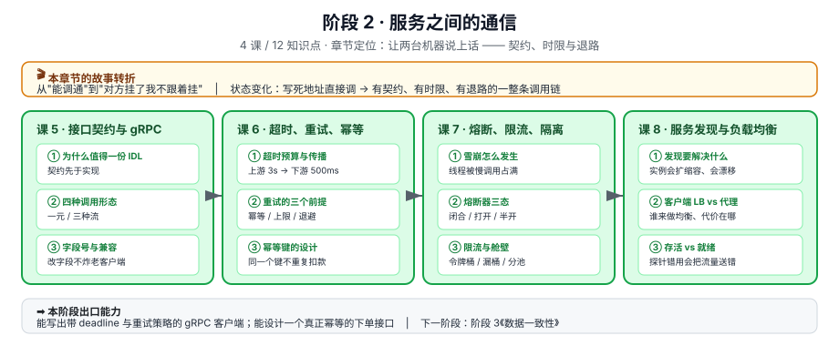

# 阶段 2：服务之间的通信

> 所属课程：Python 分布式应用开发 ｜ 故事章节："让两台机器说上话" ｜ 上一阶段：[阶段 1 分布式的地基](../1-分布式的地基/overview.md)

## 🎯 本阶段目标

- 把单体拆成两个服务，接口约定写在一处、双方都受约束
- 让这条调用链在对方变慢或挂掉时，**不把自己也拖死**
- 说清"重试"在什么条件下才是安全的

## 📍 学习重点

- **契约优于约定**：口头约定"返回 JSON 带 code 字段"在第三个服务接入时必然崩。proto 的字段号机制让接口能演进而不破。
- **超时是一条预算**：上游给 3 秒，下游最多只能拿 500 毫秒——这个分配必须显式做，否则下游的默认超时会吃掉整条链路。
- **重试是放大器**：没有上限和退避的重试，在下游已经过载时会让请求量翻三倍，把"慢"变成"挂"。
- **熔断不是失败处理，是资源保护**：它的目的是快速失败、把线程和连接留给还有希望的请求。

## ✅ 必须掌握的知识点

| 知识点 | 所属课 | 学完应能 |
|--------|--------|----------|
| 接口契约为什么值得一份 IDL | 课 5 | 说清 proto 相对 JSON 约定的三个具体优势 |
| gRPC 的四种调用形态 | 课 5 | 按场景选对形态（一元 / 服务端流 / 客户端流 / 双向流） |
| 契约演进：字段号与兼容规则 | 课 5 | 判断一次 proto 改动是兼容还是不兼容 |
| 超时预算与截止时间传播 | 课 6 | 给一条三层调用链分配超时，并让 deadline 自动传下去 |
| 重试的三个前提 | 课 6 | 判断某个接口能不能加自动重试 |
| 幂等键的设计 | 课 6 | 设计出能挡住重复扣款的幂等键与去重表 |
| 雪崩是怎么发生的 | 课 7 | 画出从下游变慢到上游线程池耗尽的完整链路 |
| 熔断器的三个状态 | 课 7 | 说清 Closed / Open / Half-Open 的转换条件与参数含义 |
| 限流算法与舱壁隔离 | 课 7 | 按场景选令牌桶或漏桶，并给出隔离粒度 |
| 服务发现要解决什么 | 课 8 | 说清硬编码地址在扩缩容下的三个具体问题 |
| 客户端负载均衡与服务端代理 | 课 8 | 给出两种方案的取舍结论 |
| 健康检查与摘流 | 课 8 | 区分存活探针与就绪探针，说清用错会怎样 |

## 🗺️ 本阶段路径图

> 看图：课 5 先定"怎么说话"（契约），课 6 定"说不到怎么办"（超时与重试），课 7 定"对方已经不行了怎么办"（熔断限流），课 8 定"怎么找到对方"（发现与负载均衡）。顺序是从单次调用到整条链路，课 7 依赖课 6（不知道超时与重试的代价，就理解不了为什么要熔断）。

## 本阶段产出

- [x] `lessons/05-接口契约与gRPC.md`
- [x] `lessons/06-超时、重试与幂等.md`
- [x] `lessons/07-熔断、限流与隔离.md`
- [x] `lessons/08-服务发现与负载均衡.md`
- [x] `../应用实战/05-接口契约与gRPC.md`
- [x] `../应用实战/06-超时、重试与幂等.md`
- [x] `../应用实战/07-熔断、限流与隔离.md`
- [x] `../应用实战/08-服务发现与负载均衡.md`
