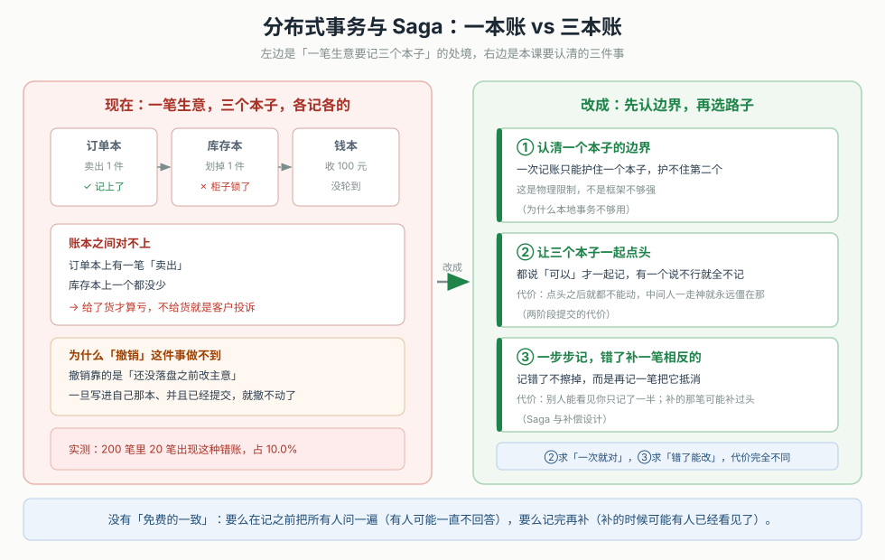
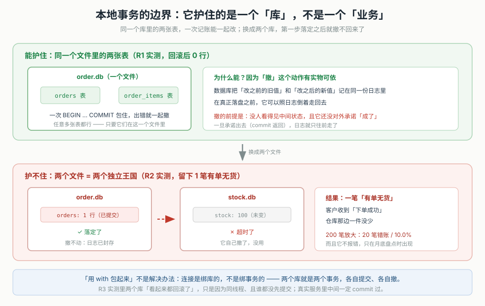
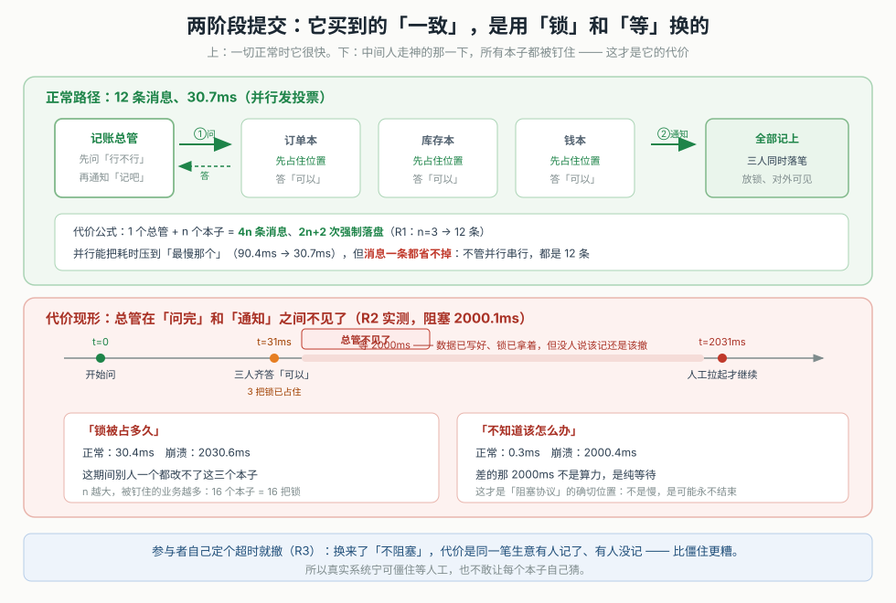
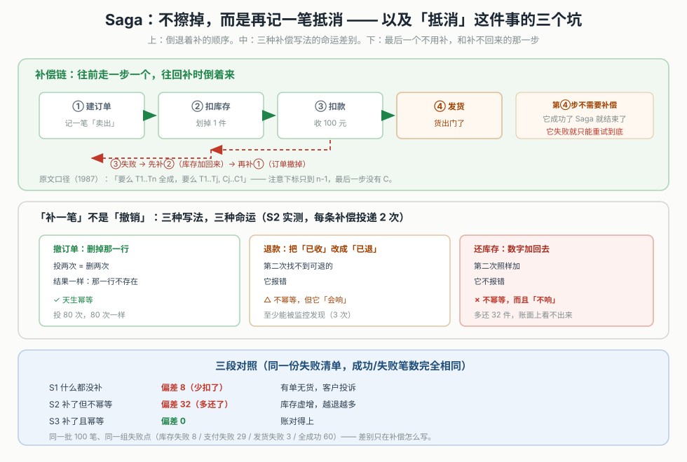
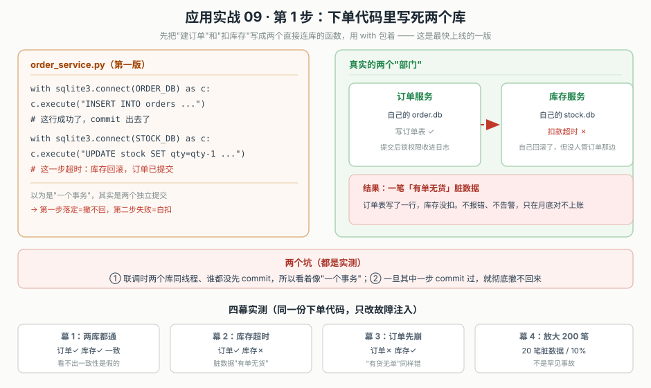
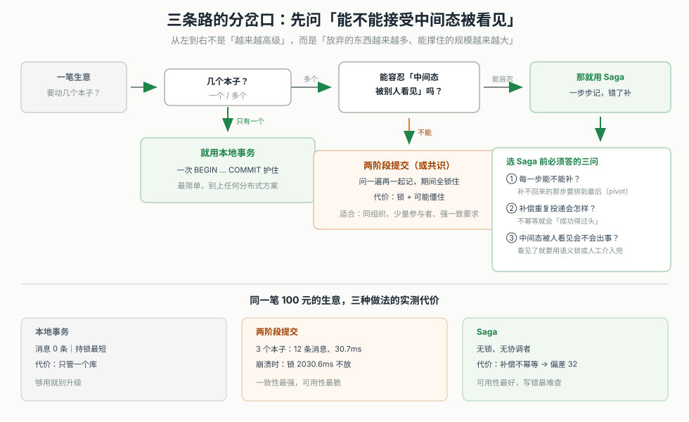

# 第 9 课：分布式事务与 Saga

> 所属阶段：阶段 3《数据一致性》｜ 水平：入门 ｜ 本课知识点：为什么本地事务不够用、两阶段提交的代价、Saga 与补偿设计
> 故事情节：主角上节课终于把"两台机器怎么可靠说话"这条线走完了——契约、超时重试、熔断限流、服务发现，他都装完了。这天他接了个新活儿：给下单接口加"库存检查"。下单逻辑要在一笔请求里同时改三个服务的数据：订单服务记一笔、库存服务扣一件、支付服务收一笔款。他想当然地在一个 `with transaction.atomic()` 里包了三行调用。联调没问题，可上线一周之后，运营拿着报表找上门："库存对不上，而且不少客户收到了'下单成功'却没收到货。"这节课他学的是：**本地事务的"要么全成要么全败"只护得住一个库；一次业务操作要跨服务改多份数据时，"一致"从哪来、要付出什么，以及怎么选**。
> 📖 结论已按官方文档核对（核对于 2026-11 ｜ 来源：Garcia-Molina & Salem《Sagas》SIGMOD 1987 pp.249-259、microservices.io《Saga pattern》、Gray《Notes on Data Base Operating Systems》1978、Skeen《NonBlocking Commit Protocols》1981、PostgreSQL 官方《PREPARE TRANSACTION》文档）
> ✅ 本课数字全部实测于 Linux / Python 3.12.3 标准库（`sqlite3` + `threading` + `socket`）。零第三方依赖。可复跑脚本在 `playground/lesson09/`，下文 4.1 逐段给出关键片段与真实输出。

## 🎯 本课目标

- 说清"本地事务不够用"到底是哪一件事做不到，并指出它失效的具体位置（跨服务、跨库的第二步）
- 说清两阶段提交用锁和协调者换来的一致，代价是什么（阻塞、协调者单点、超时兜底反而更乱）
- 为一个跨服务流程设计补偿链，并说清补偿不总是可行的场合、以及"不幂等的补偿会成功得过头"这一最难查的坑

---

## 第一幕：起源与场景引入

> 🏛️ **起源**：往事务里塞东西，越塞越堵，这件事 1970 年代就有定论了。Jim Gray 在《Notes on Data Base Operating Systems》（1978）里就分析过长活事务（LLT）：它持有的锁越久、碰的对象越多，卡在它后面的短事务就越多，死锁率随事务"尺寸"的四次方增长。所谓"长"，不是指花了多少 CPU，而是指"它把一堆看不见的资源一直攥在手里不撒手"。
>
> 1987 年，Hector Garcia-Molina 和 Kenneth Salem 在 SIGMOD 发了一篇论文《Sagas》（pp.249-259），提出了拆碎长事务的想法。原话说得很清楚：一个 LLT 可以改写成一组能和其他事务穿插的小事务（sub-transaction），系统保证「要么这组小事务全成，要么前面成功的几个用反向补偿事务（compensating transaction）补回来」。这篇论文的"补偿"概念，三十多年后成了今天所有微服务 Saga 框架的祖师爷。
>
> 两年后，1989 年有个叫 Skeen 的协议给"分布式事务"加了最后一块拼图的理解——两阶段提交到底哪里会卡死。他证明了两阶段提交在"无分区假设"下可以通过加一个阶段变成非阻塞（也就是后来的 3PC），但一旦有分区还是不安全。今日的主流共识是：**协调整个分布式事务本身要放进一个共识算法里（Spanner 的 Paxos 组、Paxos Commit），而不是让一个单点去拍板**。这些话留着第三幕展开，你先记住：分布式事务不是没人生研究过，结论是"没有免费的午餐"——要么锁、要么补、要么冒着不一致。

> 🎬 **场景**：你在给下单接口加库存检查。业务流程四步：
>
> ```text
> ① 订单服务：记一笔"卖出 A-1 × 1"，order_id = 1001
> ② 库存服务：扣掉 1 件 A-1
> ③ 支付服务：向客户收 100 元
> ④ 发货服务：把货发出
> ```
>
> 步骤 ①②③ 都要写各自的数据库，④ 是外部动作（调第三方物流、发出物流单）。你第一版是这么写的：

```python
# 你以为是这么回事：一包到底
with transaction.atomic():          # 想当然：一次事务包住整个业务
    orders.create(1001, "A-1", 1)   # ①②③ 分别是三个服务的函数
    stock.deduct("A-1", 1)
    pay.charge(1001, 100)
```

> 联调确实通过——因为联调时三个调用都在内存里、同一个事务上下文里，不会真的各自提交。但你忘了一件事：**`transaction.atomic()` 只能管住它连接的那个数据库**。真实环境里这三个函数各自连接各自的库，第二步一超时，第一步已经提交、撤不回来了。于是线上出现了"有单无货"：
>
> ```text
> 订单表：order_id=1001 已写入 ✓（提交了，撤不动）
> 库存表：A-1 没扣 ✗（第二步超时，它自己回滚了）
> ```

> 📌 **一句话本质**：跨服务改多份数据的时候，**没有"一次撤销"这种动作，只有"回头再补一笔"**。差异就在：你是选择在写之前把所有参与者问一遍（两阶段提交，代价是锁和等待），还是写完之后靠反向操作纠正（Saga，代价是中间态可见、补偿可能出错）。**写不出这句 = 本课还没定准**。

> ⚖️ **处境对照**：
> - **不这么做**：跨库两步，第一步已提交、第二步失败，留下一笔"有单无货"的脏数据（实测 200 笔里 20 笔占比 10%）；下单流程越拉越长，每多加一个参与者，总要一致性就越没着落。
> - **这么做_换来**：两阶段提交下，一旦协调者在"问完、准备通知"之间崩溃，参与者全部僵住、锁全被钉住（实测持锁 2030ms、其中纯等待 2000ms）；超时兜底换来不阻塞、却可能"有人记了有人没记"（实测 rm1 提交、rm2/rm3 回滚）。Saga 把锁和协调者全去掉，但代价是中途的中间态别人看得见、且补偿不幂等会"成功得过头"（实测库存偏差 32）。
> - **数字锚点**（本机实测）：单库事务回滚后 0 行、跨库失败留下 1 行（20/200 = 10%）；2PC 正常 30.7ms/12 条消息、崩溃 2030.6ms；Saga 三段对照 S1 差 8 / S2 差 32 / S3 差 0。
>
> 位置说明：本课刻意让"库存不够扣"这类失败发生，因为只有在失败发生时，你才看得见"一致"到底靠什么撑着——顺利路径下三条路长得一模一样，谁也看不出区别。

---

## 第二幕：认知冲突

> ❓ **问题**：你已经在用数据库事务了，`transaction.atomic()` 一直都没出过岔子。为什么放到跨服务场景，它就不灵了？难道不是"把代码往事务里一包"就完事？你甚至可以在下单接口外面再套一层"大事务"，把所有子调用都包进去——为什么我在正文第一幕已经说了"这没用"？

---

## 第三幕：层层揭示

### 一眼全局图（进入细节前先看一眼）



> 看图：左边是现在的处境——一笔生意要记三个本子（订单、库存、钱），各记各的，账本之间对不上。右边是本课的三件事：**先认清一个本子护不住别的本子**（为什么本地事务不够用）、**要么在记之前把三个本子一起问一遍**（两阶段提交，代价是锁和等）、**要么一步步记、错了再补一笔相反的**（Saga，代价是中间态可见、补可能补过头）。最下面一句话是本质：没有免费的一致。

**四条硬约束**：① 一图只回答"本课解决什么问题、靠什么思路"；② 图上零术语（术语下沉到图注与后文）；③ 必带读图指引（已给）；④ 图不承担结论，图旁文字须能独立说清同一件事。
**验收口径**：没学过本课的人应能看懂这张图。

### 本课地图（分几步走）

| 步 | 这一步要解决什么（人话） | 对应知识点 |
|:--:|------------------------|-----------|
| 1 | 先认清"一次记账到底护住什么"——它护住的是库，不是业务 | 知识点 1：为什么本地事务不够用 |
| 2 | 想"要么全成要么全败"？看两阶段提交把这个承诺换成了什么 | 知识点 2：两阶段提交的代价 |
| 3 | 不想锁，那就错了再补——这条路的三个坑 | 知识点 3：Saga 与补偿设计 |

> 只回答"分几步走、现在在哪"——不写机制、不写结论。第二幕的"问题"是"transaction.atomic 为什么跨服务不灵"，本课三步正好按"边界 → 全一致方案的代价 → 最终一致方案怎么做"的顺序回答。

---

### 知识点 1：为什么本地事务不够用

> 🧭 第 1/3 步｜承接：第二幕的疑问——"我不是有事务吗"。本步：先看清事务到底护住的是什么边界。
> 本知识点关键点：事务是"绑库"的、撤销是物理动作、跨库的第二步是它失效的确切位置

#### 一句话定义

**本地事务（local transaction）是"同一个数据库连接"上的原子操作**：它要么全成、要么全败，但"全败"只对这一个库成立。一旦一个业务动作要跨两个库、写两份数据，第一步提交之后、第二步失败，第一步就撤不回来了——**本地事务的边界是"一个库"，不是"一个业务"**。

#### 直觉建立（类比）

收银台记账。你把"卖出 1 件"和"划掉库存 1 件"写在**同一本账**里，写错了可以一整页撕掉重来——这是数据库事务：撤的姿势是"撕掉这一页"（物理回滚）。

但真实的下单不是一本账：订单写订单本、库存写库存本、付款写钱本，三个本子归三个部门管。你在订单本上写完了，去库存本那边发现笔不好用（服务超时）。你想"那我把订单本上那笔也涂了吧"——**办不到**：订单本已经锁进保险柜（已提交），没有哪支笔能再替你"撤"它。你能做的只有：另起一行，再记一笔"订单撤销"把它冲掉。

> 💡 **类比的边界**：柜台记账是"改同一个本子"，所以能物理撤销；数据库事务撤的也就是"同一个数据库文件里的改动"。跨库时"撤销"没有物理可实现性，只能靠"语义冲销"（补一笔相反的）。这正是知识点 3 的入口——它把"撤"换成了"补"。

#### 核心原理

> **① 事务是绑库的，不是绑业务的**

一个 `transaction.atomic()` 保护的数据，只能是它连接的那个数据库里的事务日志能覆盖到的数据。三个服务各连各的库，就有三份互不相干的事务日志。你用 `with` 包住三行调用，以为那是"一个事务"——实际上第一行提交归订单库的日志管、第二行归库存库的日志管，**中间没有任何机制强制它们一起提交或一起撤销**。

> **② "撤销"是个物理动作，需要"还没对外承诺"这个前提**

数据库能回滚，靠的是把"改之前的旧值"写进日志，在真正提交前随时可以照着日志倒着走。它成立有一个前提：**这段数据还没有对任何事务承诺"成功了"**（还没有 commit、还没被别人看到）。跨库场景里，第一步的提交往往早就返回了（真实服务不会等你把第二步也调完才提交），所以从第一步的角度看，"撤销"的机会已经过去了。

> **③ 失效的确切位置：两步之间那一次提交**

本地事务不是"不够强"，是它**根本没覆盖到第二个库**。R2 放大到 200 笔，第 2 步失败 20 笔，订单表里留下 20 笔"有单无货"，占 10%。它不是报错、不是变慢，是**账面上看不出来的脏数据**——这类问题只在月底盘点或客户投诉时才浮出水面。



> 看图：上半部分是"同一个文件里的两张表"——BEGIN/COMMIT 一包，出错一起撤，任意多张表都行，只要在一个文件里。下半部分是"两个文件"——各自是独立王国，第一步提交后日志封存，第二步超时撤不动。底部一句话讲清了 `with` 的欺骗性。

#### 示例演示

```python
# 场景：下单时"建订单"和"扣库存"要同时成功，否则都别成功
ORDER_DB = "/tmp/order.db"
STOCK_DB = "/tmp/stock.db"

# R1：同一个库里的两张表 —— 一个事务能护住（这是边界内）
with sqlite3.connect(ORDER_DB) as c:      # 同一个连接、同一个库
    c.execute("BEGIN")
    c.execute("INSERT INTO orders ...")
    c.execute("INSERT INTO order_items ...")
    c.execute("ROLLBACK")                 # 出错：两张表一起没了
# 实测：回滚后 orders 行数 = 0，两条插入都消失

# R2：跨两个库 —— 第一步已提交，第二步失败回不来
c1 = sqlite3.connect(ORDER_DB)            # 服务 A 的连接
c1.execute("BEGIN"); c1.execute("INSERT INTO orders ..."); c1.execute("COMMIT")
# 第二步：库存服务超时，它自己 rollback 了（用它的连接、它的库）
# 实测：orders = 1 行（应为 0）｜ stock = 100（应为 100）
# → 一笔「有单无货」的脏数据

# R3：把两步包进同一个 with —— 也没用！
with sqlite3.connect(ORDER_DB) as c1, sqlite3.connect(STOCK_DB) as c2:
    # 两个连接、两个库 —— 这不是一个事务，是两个
    c1.execute("...")   # 各自的 BEGIN/COMMIT
    c2.execute("...")
# 实测看起来"都回滚"，只是因为同线程、且谁都没先 commit；真实服务必然中间提交过
```

> 注意 R3 的欺骗性：它"看起来对"，是因为两个写都在同一线程、且没有任何一个先提交。只要中间任何一步 `commit()` 过（真实服务必然如此），第一步就再也撤不回来了。**"用 with 包"不是解决办法，它只是暂时没暴露问题**。

#### 常见误区

1. **"transaction.atomic() 能包住整个业务"**：它只能管住它连接的那个库。跨库调用里，`with` 块里的代码各连各的库，实际上是多段独立提交，只是"看起来包在一起"。
2. **"两个库我可以用分布式事务 / XA"**：那正是知识点 2 讲的两阶段提交——它能做到"全成或全败"，但不是免费的，它用锁和协调者换。
3. **"只要我不在中间 commit，就不会半途而废"**：联调可能通过，但真实服务里每个库的写入通常是独立的短事务、各自尽快提交（为了并发吞吐）。你不显式 commit，框架和后端也会替你在函数返回时提交。
4. **"跨库失败是一定会报错的"**：第二步超时可能把整个调用打飞（那至少会报警）；但更常见的是第二步"静默失败"或"被重试掩盖"，留下的是账面上对不上的数据，不报错、不告警。

#### 一句话记住

本地事务护住的是**一个库**，不是**一个业务**——跨库写多份数据时，第一步提交之后就撤不回来了。

#### 🗣️ 行话对照

- **本地事务（local transaction）**：单个数据库连接上的原子操作；在哪遇到：`transaction.atomic()`、`BEGIN ... COMMIT`。
- **分布式事务（distributed transaction）**：跨多个数据库/服务的原子性承诺；在哪遇到：XA、两阶段提交。
- **ACID**：原子性 A、一致性 C、隔离性 I、持久性 D。本地事务四者都保；Saga 会丢掉 I（隔离性）。
- **XA**：一个定义了 2PC 接口的分布式事务标准（`xa_start` / `xa_end` / `xa_prepare`），在很多数据库和消息中间件里支持。
- **长活事务（LLT）**：长时间攥着锁的事务；Saga 论文的起点概念。

#### 官方文档

- Garcia-Molina, Henry; Salem, Kenneth. _Sagas_. ACM SIGMOD Record, 1987, pp.249-259（"A LLT is a saga if it can be written as a sequence of transactions that can be interleaved with other transactions"）：https://www.cs.princeton.edu/techreports/1987/070.pdf
- PostgreSQL · Concurrency Control（本地事务如何做到原子与隔离）：https://www.postgresql.org/docs/current/mvcc.html

---

### 知识点 2：两阶段提交的代价

> 🧭 第 2/3 步｜承接：已经认清"本地事务护不住多库" → 本步：看看"问完再一起记"这条路（两阶段提交）到底要付出什么。
> 本知识点关键点：prepare 后参与者既不能提交也不能撤销、协调者单点是脆弱的、超时兜底可能比僵住更糟

#### 一句话定义

**两阶段提交（two-phase commit，2PC）是一个协调者（coordinator）+ 若干参与者（participant）的协议，分两阶段**：第一阶段（prepare）协调者问每个参与者"能不能提交"，每个参与者如果愿意就投 VOTE-COMMIT 并**锁住自己的资源**、把决定写进日志；第二阶段（commit）协调者若收齐全部 VOTE-COMMIT 就广播"都提交吧"。它买来的是「要么全成、要么全败」的强一致，代价是**在 prepare 之后、决定广播之前，投了 VOTE-COMMIT 的参与者既不能提交也不能撤销——只能等**。

#### 直觉建立（类比）

三间店的老板（协调者）要办一场跨店活动，问三家店（参与者）："周末都开吗？"三家都回"开"（prepare + VOTE-COMMIT），同时各自把自己的营业时间**占住**（锁资源、等最终决定）。就在这时老板电话突然断线了（协调者崩溃）。

此时三家店的处境是：**都说好了"开"，但没人通知到底开不开**。自己贸然开，万一老板本来要说"不开了"呢？自己贸然不开，万一别人开了活动、货单对不上呢？于是三家店只能干等老板回来。这中间，三家店的门都被"占住"了——别的活动没法用这几家店的档期（锁被持有）。

> 💡 **类比的边界**：现实中老板回来说一句就能解开；2PC 里协调者崩溃后，决定本身需要有人工介入或走共识算法才能恢复。而且 2PC 的"占住"是物理锁，持续多久取决于协调者多久回来——它不是"等几秒就有结果"，是"可能永远不结束"。

#### 核心原理

> **① 阻塞的确切位置**

在 prepare 阶段投出 VOTE-COMMIT 之后、收到协调者广播之前，参与者的状态是"无法决定"。它已经写了"我投了赞成票"的日志、已经拿到了锁，但**既不能提交（万一协调者说撤销）、也不能撤销（万一协调者说提交）**。卡住它的是"不知道决定"，不是慢。

> **② 成本公式**

一个协调者 + n 个参与者，两阶段各发一轮消息：总消息数 2 × 2n = 4n（n=3 时 12 条），强制日志写 2n+2 次。消息数不因并行而减少——并行省的是"排队等最慢那个"的时间，省不掉每条消息的量。

> **③ 协调者单点 + 崩溃窗口**

协调者是唯一掌握"是整个事务要提交还是撤销"的实体，它本身就是单点。最危险的是它在 prepare 之后、broadcast 之前崩溃——这时所有投了 VOTE-COMMIT 的参与者的锁全部被钉住，没人能告诉它们该提交还是撤销。参与者数越多，被牵连的资源越多（n=16 时 16 把锁全卡住）。

> **④ 超时兜底的危险**

参与者被卡住时，自己定一个超时、时间到了就撤销（R3）。这换来了"不阻塞"，但它把一个全局强一致事务变成了"**每份数据各自决定**"：同一笔事务，rm1 收到 COMMIT 提交了，rm2/rm3 超时撤销了，最终状态是 ['committed', 'aborted-by-timeout', 'aborted-by-timeout']——**有人记了、有人没记**。这正是 2PC 要避免的局面，所以真实系统宁可僵住、人工介入，也不敢让参与者自己猜。



> 看图：上半部分是正常路径——协调者问、三家齐答、广播、一起落笔。代价公式写在最下面：4n 条消息、2n+2 次落盘。下半部分是崩溃——协调者在问完和通知之间不见了，数据已写好、锁已拿着，三家只能干等。两条指标：锁被占多久（30.4→2030.6ms）、不知道该怎么办多久（0.3→2000.4ms）。

> **⑤ 现代解法：把"决定"放进共识**

传统 2PC 的脆弱来自"协调者一个人拍板"。所以真正要做强一致的系统，把决定本身放进共识算法（Paxos / Raft），例如 Spanner 用 Paxos 组做协调者、Paxos Commit 协议；业界一般不在微服务层面对每个请求做 2PC，因为代价太高。这些概念你只要知道"有这条路"即可，不必现在深挖。

#### 示例演示

```python
# 一个真实加锁的 2PC 模拟：三个"资源管理器"各持一把锁
# 串行 vs 并行发 PREPARE；崩溃 vs 不崩溃；超时兜底

# R1 正常路径（并行发 PREPARE，3 个参与者各 prepare 30ms）
#   总耗时 30.7ms｜消息数 12
#   总持锁 [30.5, 30.3, 30.2] ms｜不确定窗口 [0.4, 0.2, 0.1] ms
#   ⚠️ 串行发 PREPARE 时 rm1 总持锁 90.4ms —— 它 prepare 完就一直等着别人排队

# R2 协调者 prepare 后崩溃
#   基线（不崩溃）：总持锁 30.4ms、不确定窗口 0.3ms
#   崩溃：阻塞 2000.1ms｜总持锁 2030.6ms｜不确定窗口 2000.4ms
#   → 差的 2000ms 完全白等：数据已写好、锁已拿着，只是没人说该提交还是撤销

# R3 超时兜底
#   最终状态：['committed', 'aborted-by-timeout', 'aborted-by-timeout']
#   → 同一个全局事务，rm1 提交了、rm2/rm3 回滚了 —— 可能不一致

# R4 参与者扩展
#   参与者数  串行总耗时  并行总耗时  消息数  被卡的锁
#   2        10.2       5.5        8      2
#   4        20.4       5.6        16     4
#   8        40.9       5.9        32     8
#   16       81.9       7.3       64      16
```

> 看 R4 那一列"被卡的锁"：一旦协调者崩在 prepare 之后，**全部 n 把锁**都被卡住。并行能把耗时压到"最慢那个"，但压不掉锁数量——这是质的差别：规模一上去，一个协调者崩溃牵连的是整批业务。

#### 常见误区

1. **"2PC 慢是因为实现不好"**：它天生就是 4n 条消息 + 需要落在 prepare 之后等决定。慢的不是实现，是协议结构。
2. **"给参与者加超时就能解决问题"**：超时兜底换来了"不阻塞"，却把全局强一致变成"每份数据各自撤"——rm1 已提交、rm2/rm3 已回滚。它把一个清晰的失败，变成更糟糕的"不确定是否一致"。
3. **"协调者崩了，重启就好"**：重启后它还得知道"自己当时准备提交还是撤销"，这本身要日志+共识支持，不是重启就能续上。
4. **"3PC 完全解决了 2PC 的问题"**：3PC（加 pre-commit 阶段）在无分区假设下是非阻塞的，但一旦网络分区就变得不安全，所以极少在生产上用。主流是把协调者的决定放进展览（共识），而不是多一个阶段。
5. **"PostgreSQL 配了 2PC 就随便用"**：官方文档警告，长时间停留在 prepared 状态会干扰 VACUUM 回收、极端情况因 XID 回绕导致彻底关机，而且 **prepared 事务继续持有它持有的所有锁**。没有外部事务管理器配合，没必要开 `max_prepared_transactions`。

#### 一句话记住

两阶段提交买来「要么全成要么全败」，代价是**投了赞成票之后就只能等决定**——协调者一崩、锁全被钉住，超时兜底又只会把一致变成"不确定"。

#### 🗣️ 行话对照

- **协调者（coordinator）**：2PC 里决定"提交还是撤销"的角色；在哪遇到：`XA transaction manager`.
- **参与者（participant / cohort）**：持有实际资源的角色。
- **prepare（准备阶段）**：参与者把资源锁住并投出 VOTE-COMMIT / VOTE-ABORT。
- **VOTE-COMMIT / VOTE-ABORT**：参与者对"我这边能不能提交"的表态。
- **阻塞协议（blocking protocol）**：参与者可能在 prepare 后无限期等待的协议；2PC 是这类。
- **prepared 事务**：PostgreSQL 里已 prepare 但未 commit/abort 的事务。

#### 官方文档

- Skeen, Dale. _NonBlocking Commit Protocols_. 1981（2PC 阻塞性的证明与 3PC 的提出）
- PostgreSQL · PREPARE TRANSACTION / COMMIT PREPARED / ROLLBACK PREPARED：https://www.postgresql.org/docs/current/sql-prepare-transaction.html
- microservices.io · Saga pattern（"2PC is not an option" 的相关讨论）：https://microservices.io/patterns/data/saga.html

---

### 知识点 3：Saga 与补偿设计

> 🧭 第 3/3 步｜承接：两阶段提交为了强一致锁到崩溃 → 本步：不要锁、不要协调者，那就"逐步记、错了补"——以及补这条路本身的三个坑。
> 本知识点关键点：补偿是语义冲销不是物理回滚、最后一步不需要补偿、补偿不幂等会"成功得过头"

#### 一句话定义

**Saga（龙，1987 论文即用此名）是把一个跨服务的长流程拆成一串本地事务（T1..Tn），每个 Ti 配一个补偿事务 Ci**。系统保证的只有两种结局：要么 T1..Tn 全成功，要么先成功到某个 Tj、再倒着跑 Cj..C2,C1 把前面的补回来。它放弃了两阶段提交的"随时全撤"，换来的是**无锁、无协调者**；代价是中途的中间态对外可见、且补偿本身可能出错或补过头。

#### 直觉建立（类比）

还是三本账。两阶段提交是"先把三个部门都叫住，问一遍，都同意才动笔"——期间三个部门都被占着。Saga 是"不用叫住任何人，一个部门一个部门地办：订单本写好、库存本扣好、钱本收好；如果后面哪一步办砸了，就倒着给前面已经办好的每一步各补一笔相反的"。

补订单：订单本删掉那一行（delete 天然幂等 —— 删两次还是那一行不存在）。
补库存：库存本把扣的加回去。
补付款：钱本把"已收"改成"已退"。

这里就是本课最要紧的分叉：**三种补偿，三种命运**。删订单那笔怎么补都对；退款那笔第二次会"找不到可退的"而报错（它会响，能被监控发现）；还库存那笔第二次照样把数字加回去（它静默成功，账上多出一截库存却谁也不知道）——这正是本课 M3 实测要让你亲眼看见的。

> 💡 **类比的边界**：柜台改本子可以"擦掉重写"，Saga 补的是"另起一行冲销"，不是擦掉。所以它不能简单地让数据回到"没发生这单"时的样子，只能是"语义上这件事仿佛没发生过"——而且从别的事务的角度看，中间态是短暂可见的（见下方核心原理 ③）。

#### 核心原理

> **① 补偿是语义冲销，不是物理回滚**

论文原话（1987, §1）：补偿事务"从语义上撤销 Ti 做过的动作，但不一定把数据库恢复到 Ti 开始时的样子"。因为在 Ti 成功之后、Ci 执行之前，可能已经有别的业务读了 Ti 的结果并做了别的动作——你不可能把整个世界倒回去，只能"把这一步造成的影响设法抵消"。

> **② 最后一个子事务不需要补偿**

论文保证形式写的是 `T1..Tn（优先）` 或 `T1..Tj, Cj..C2, C1`（j < n）——下标只到 n-1。原因很简单：一旦 Tn（最后一步）成功，整个 Saga 就成功收尾，没有"后面失败回头补"这回事了。对应到下单流程：发货（④）就是那个 Tn，它成功后账就"平"了，不需要补它。但反过来，**如果发货本身也可能失败且没有补法，那它就是 pivot（分水岭）**——它之前所有步都要能补，它之后就只剩"重试到底"。

> **③ 隔离性（I）的丧失是设计代价，不是一个 bug**

你没法既"别人看不见中间态"又"不锁住任何人"——这是同一件事的两面。Saga 把锁都放了，代价就是：**其他事务可能看到"只执行到一半"的结果**。论文明确说：当 Ci 执行时，不会去通知或中断那些看过 Tj 结果的事务。所以如果"顾客看到下单成功但其实发货失败"会造成真问题，你得在业务侧用"语义锁"（比如下单状态先标 PENDING，发货成功才改成 CONFIRMED）或人工介入来兜住它。

> **④ 补偿不幂等的后果：不是失败，是"成功得过头"**

最要命的一条。你以为重复投递一条补偿，最多"再做一遍白做"。实际是：**不幂等的补偿不会报错，它会老老实实再做一遍，并且这个多余的动作永远赖在账上**。还库存补两次 = 库存虚增，补十次 = 库存虚增十次，而且它既不报错、也不告警。M3 里 S2 的库存偏差就从 8（少扣）翻到 32（多还）——方向相反、量级更大，却丝毫引不起注意。



> 看图：上半部分是补偿链的顺序——四个步骤往前走一格是横的，失败后往回补是竖的、倒着走的（退款 → 加库存 → 撤订单），并且第④步不需要补偿。中间三块是本课最要紧的对照：撤订单（delete）天生幂等怎么补都对、退款（update）第二次找不到会"响"、还库存（add）第二次照样加还"不响"——只有第三种会静默地补过头。下半部分是三段对照的量化结果，三行成功/失败笔数相同，差别只在终态偏差。

#### 示例演示

```python
# 三段对照（M3）：同一份失败清单，三种策略。三条路成功/失败笔数完全相同，
# 差别只在"失败了之后怎么办"。

# S1 无 Saga：任何一步失败直接返回，前面已提交的不管
#   → 订单 100、库存扣 92、支付 63。偏差 8。—— 有单无货

# S2 Saga，补偿不幂等：失败后倒着补已成功的步，但每条补偿投递 2 次
#   → 订单 100、库存扣 28、支付 63。偏差 32。
#     库存被重复加回去了：少扣 8 变成多还 32

#   → 关键是"不报错"：S2 里订单补偿投 80 次全成功（DELETE 天然幂等）
#     退款补偿第 2 次报错 3 次（它"会响"）
#     库存补偿第 2 次静默成功（它"不响"）——最难查的就是最后这种

# S3 Saga，补偿幂等：补偿去重表，同一业务键只补一次
#   → 订单 100、库存扣 100、支付 63。偏差 0。

# 幂等补偿的关键：去重键用"业务键"（订单号），不是"第几次投递"
# 重试带的是同一个业务键，所以第二次进来查去重表，直接判"补过了，跳过"。
```

> 看 S2 的数字：1 条静默重复的补偿，把偏差从 8 推到 32——如果你只把"补一律做两遍"当成一种无害的重复，这 24 件"凭空多出来的库存"就是你为它付的学费。

#### 常见误区

1. **"补偿就是再调一次原操作"**：那可不一定。原操作是"扣库存"，补偿得是"还库存"——是相反的业务动作，不是同一个函数。
2. **"最后一步也配个补偿"**：不需要，也往往配不出。最后一步成功整个 Saga 就完了；它失败也只能重试到底。
3. **"重复投递补偿顶多多做一遍，无伤大雅"**：不是"无伤大雅"，是"成功得过头"且不告警——M3 里一条重复的还库存补偿直接把偏差从 8 推到 32。
4. **"Saga 会自动回滚，像事务一样"**：它不提供自动回滚（microservices.io 第一个 drawback），回滚是你要手动补出来的；而且隔离性也丢了（第二个 drawback）。
5. **"补的时候别人看不到中间态"**：看得到。Saga 不锁，中间态短暂可见，所以需要语义锁或人工介入兜住业务风险。
6. **"用了 Saga 就不用写幂等"**：恰恰相反——补偿链越长，越依赖补偿本身的幂等性，否则一条 ack 丢失、叠加一次重试，就能把账冲乱。

#### 一句话记住

Saga 是"逐步记、错了再补一笔相反的"：无锁、无协调者，但中间态可见、且补偿不幂等会"成功得过头"——这是它最阴险的一个坑。

#### 🗣️ 行话对照

- **Saga / 补偿链（compensation chain）**：跨服务流程 + 反向补偿序列；在哪遇到：`saga`、`compensation`。
- **pivot / 分水岭**：一个一旦成功就无法补回的动作，它之前所有步都必须可补偿，它之后就只会重试到底；在哪遇到：发货、提现到外部账户这类动作。
- **语义锁（semantic lock）**：用业务状态（如 PENDING）代替物理锁，让中间态可被识别、可被人工处理；在哪遇到：订单状态机。
- **至少一次（at-least-once）投递**：补偿消息可能重复投递，消费方必须幂等。
- **幂等（idempotent）**：同一个操作重复执行任意多次，效果与执行一次相同。
- **compensating transaction**：论文中的术语，对应于这里的"补偿"。

#### 官方文档

- Garcia-Molina, Henry; Salem, Kenneth. _Sagas_. ACM SIGMOD, 1987, pp.249-259（补偿定义、最后一步豁免、隔离性丧失原句）
- microservices.io · Saga pattern（两个 drawback：no automatic rollback、no isolation + countermeasures）：https://microservices.io/patterns/data/saga.html
- microservices.io · Countermeasures（补回隔离性的常用手法，如 saga 锁 / 语义锁）：https://microservices.io/patterns/data/saga.html#countermeasures

---

## 第四幕：实操验证

### 4.1 机制验证

> ✅ 本节脚本实测于本机 / Python 3.12.3 标准库（`sqlite3` + `threading` + `socket`）。零第三方依赖，可原样复跑。所有输出均为本机真实结果。脚本在 [`playground/lesson09/`](../../../playground/lesson09/)（含 m1/m2/m3，纯标准库，无需安装）。

**M1：本地事务的边界**（`m1_local_tx_boundary.py`，真实两个 sqlite 库文件）

```
R1 单库两表：一次事务能护住，回滚后 orders 行数 = 0
R2 跨库两步：第一步已 commit，第二步失败回不来
   结果：orders = 1 行（应为 0）｜ stock = 100（应为 100）
   → 一笔「有单无货」的脏数据
R3 把两步包进同一个 with：看起来都回滚（同线程、谁都没先 commit），
   但只要中间任何一步 commit 过（真实服务必然如此），就回不去了
R2b 放大到 200 笔：20 笔在第 2 步失败 → 脏数据 20 笔，占比 10.0%
```

> ✅ **回扣场景**：R2 就是"有单无货"的机制解释；R2b 说明它有多普遍（10% 不是罕见事故）。R3 解释为什么"联调能过、上线就错"。

**M2：两阶段提交的代价**（`m2_2pc_cost.py`，真实加锁 + 协调者崩溃模拟）

```
R1 正常路径（并行发 PREPARE）：总耗时 30.7ms｜消息数 12
   串行发 PREPARE：总耗时 90.4ms（rm1 总持锁 90.4 ≈ 3×30ms，它在等别人）
   → 并行能压掉"排队等别人"，压不掉"prepare 完等决定"
R2 协调者 prepare 后崩溃：
   不崩溃基线：总持锁 30.4ms、不确定窗口 0.3ms
   崩溃：阻塞 2000.1ms｜总持锁 2030.6ms｜不确定窗口 2000.4ms
   → 差的 2000ms 是纯等待
R3 超时兜底：rm1 提交、rm2/rm3 超时撤销
   最终状态：['committed', 'aborted-by-timeout', 'aborted-by-timeout']
R4 参与者数   串行总耗时   并行总耗时   消息数   被卡的锁
   2        10.2        5.5        8       2
   4        20.4        5.6        16      4
   8        40.9        5.9        32      8
   16       81.9        7.3       64       16
```

> ✅ **回扣场景**：R2 就是"协调者单点崩溃锁全钉住"的量化出处。R3 说明"给参与者加超时"不是解药。

**M3：Saga 三段对照**（`m3_saga_three_way.py`，真实三库 + 去重表 + PENDING 语义锁；同一份预生成失败清单）

```
失败清单：库存失败 8｜支付失败 29｜发货失败 3｜全成功 60（共 100 笔）

【S1 无 Saga】任一步失败直接返回        成功 60 / 失败 40
  订单 100｜库存扣 92｜偏差 8 → 不一致（有单无货；8 笔失败订单留着）

【S2 Saga，补偿不幂等】倒着补，但每条投 2 次   成功 60 / 失败 40
  补偿：cancelled 80 全成功 / refunded 3 / release 重复加 32
  订单 60｜库存扣 28｜偏差 32 → 不一致（库存被重复加回去）

【S3 Saga，补偿幂等】去重表标同一业务键  成功 60 / 失败 40
  补偿：released 32 / duplicate-skipped 35 / cancelled 80 / refunded 3
  订单 60｜库存扣 60｜偏差 0 → 一致

对照表：
方案          成功   失败   补偿错误   库存偏差   终态一致
S1 无 Saga    60   40    0       8        否
S2 补偿不幂等   60   40    3       32       否
S3 补偿幂等    60   40    0       0        是
```

> ✅ **回扣场景**：三条路成功/失败笔数完全相同（60/40），差别只在补偿行为——这直接证明了本课"一致靠什么撑"：S1 靠"不管"、S2 靠"补但可能补过头"、S3 靠"补对 + 补不重"。S2 的偏差 32 就是"成功得过头"的实证。

### 4.2 应用实战入口

> 🎯 **本课应用实战独立成篇**（配套实战册）：[第 9 课实战 · 跨服务下单](../../../应用实战/09-分布式事务与Saga.md)
> 含**分步设计图**（每步一张：这一版长什么样、比上一版改了什么）与"先写死两个库 → 2PC 强一致 → Saga 最终一致"的三跳演进与完整代码；通览全部：📚 [应用实战索引](../../../应用实战/INDEX.md)



> 上面的分步图是应用实战 09 的第 1 步。完整的三跳演进、四幕同口径的真实对照数字与"什么时候可以退回简单版"，见 [应用实战 09 · 跨服务下单](../../../应用实战/09-分布式事务与Saga.md)。

> ✅ **会用标志**：你能否说清"上线前联调全过、上线后库存对不上"这件事，到底是哪一步没做对？以及"还库存补两次会怎样"——补两次会怎样？能答出来，就说明你真的会设计 Saga 补偿了。

---

## 第五幕：体系收束

> 🧩 **回到那个问题**：你已经在用数据库事务了，`transaction.atomic()` 一直没问题，为什么跨服务就不灵了？

因为它护住的从来只是"一个库"。跨服务/跨库的第一步一旦提交、第二步失败，第一步就撤不回来了——不是你不小心，是"物理撤销"这东西在跨库场景根本不存在。你只剩下两条路：

1. **写之前把所有人问一遍**（两阶段提交）：都同意才一起记。换来强一致，代价是投了票就只能等、协调者一崩锁全被钉住。
2. **写完之后错了再补**（Saga）：一笔一笔记，错了倒着补。换来无锁、无协调者、可用性好，代价是中间态可见、补可能补过头。

没有第三条路。剩下的只是，在哪个场景选哪条、以及你愿不愿意为补的那一步写幂等。

> 🔗 **与前面几课的关系**：

| 课 | 管的是 | 和本课的接口 |
|---|---|---|
| 课 3 网络问题 | 两台机器之间会发生什么坏事 | 本课所有"失败"都来自这里的网络/进程问题，它决定了每步都可能需要补 |
| 课 6 超时重试幂等 | 说不到怎么办 | 重试会带来**重复投递**，正是本课补偿必须幂等的原因 |
| 课 7 熔断限流隔离 | 对方不行了怎么办 | 隔离（舱壁）和本课的"pivot 步设最后"是同一思路：把不可控的放最后 |
| 课 8 服务发现与负载均衡 | 怎么找到对方 | 本课的每个子服务调用都建立在这条可靠传输线上 |
| **课 9 本课** | **跨服务改多份数据时一致从哪来** | 前八课假设"调用成功/失败"有清晰判定，本课处理"成功了一部分、要怎么收场" |

> 📈 **往下走**：到这里，你知道了"跨服务改多份数据"只有两阶段提交和 Saga 两条路线。但还有一类非常常见的跨服务写不是"改多份业务数据"，而是"写业务 + 发消息"——写库成功、发消息失败（或反过来），这才是双写不一致的根源。下一课讲事务性发件箱与幂等消费：怎么把"写业务"和"记待发"放进同一个本地事务，从而让"最终一致"真的落在账上。

### 一图总结



> 看图（三条路的判断）：左边先问"这笔生意要动几个本子"——一个，就直接用本地事务，别上任何分布式方案。多个，再问"能容忍中间态被别人看见吗"——不能，走两阶段提交（或共识），代价是锁 + 可能僵住；能容忍，走 Saga（但必须先答三问：每步能不能补、补的幂等性、中间态被看见会不会出事）。下方三行是同一笔生意三种做法的实测代价，结束时对照数据支撑"没有免费一致"。

### 常见误区速查（8 条）

1. 以为 `transaction.atomic()` 包住整个业务就是分布式事务 —— 它只护得住它连的那个库。
2. 以为只要不在中间显式 commit 就不会半途而废 —— 真实服务每个库都会尽快独立提交。
3. 以为跨库失败一定会报错 —— 更常见的是静默失败，留下账面脏数据。
4. 以为 2PC 慢是实现不好 —— 它天生 4n 条消息 + prepare 后只能等。
5. 以为给参与者加超时能解 2PC 的阻塞 —— 换来的是"有人记有人没记"，更糟。
6. 以为最后一步也要配个补偿 —— 不需要；它成功整个 Saga 就完了，失败只能重试到底。
7. 以为补偿等于把原操作再做一遍 —— 是相反的"冲销"动作，不是同一个函数。
8. 以为补偿重复投递顶多多做一遍、无伤大雅 —— 不幂等的补会"成功得过头"且不告警。

### 小测（4 题，答案折叠）

**Q1**：你在一个事务里调了订单服务和库存服务，上线后库存总是对不上。最直接的原因是？
- A. 事务没隔离好导致库存并发读错
- B. 一个事务只能管它连接的那个库，订单服务和库存服务各自独立提交，第一步成功第二步失败时撤不回第一步
- C. 需要给库存服务加索引
- D. 事务超时时间设得太短

<details><summary>答案与解析</summary>

**答案：B**。本地事务绑库不绑业务。R2 实测：第一步已提交、第二步失败，留下"有单无货"。它与事务隔离级别、索引、超时都无关。

</details>

**Q2**：两阶段提交在什么情况下会"僵住"（参与者既不能提交也不能撤销）？
- A. 任何一个参与者很慢
- B. 协调者在 prepare 之后、广播决定之前崩溃，投了 VOTE-COMMIT 的参与者只能等
- C. 消息数量太多
- D. 数据库不支持 XA

<details><summary>答案与解析</summary>

**答案：B**。prepare 之后、决定之前，参与者已投赞成票、已持有锁，但不知道最终决定，只能等。R2 实测：阻塞 2000ms、锁被占 2030ms。A 只是变慢，不是僵住。

</details>

**Q3**：为什么 Saga 里"最后一步"不需要补偿？
- A. 因为最后一步内存小、不可能失败
- B. 因为最后一步成功后整个 Saga 就结束了，没有"后面失败回头补"这回事（论文保证形式下标只到 n-1）
- C. 因为最后一步是只读的
- D. 因为补偿成本太高

<details><summary>答案与解析</summary>

**答案：B**。只要 Tn 成功，Saga 就成功收尾；它失败则整个流程已被处理为前面步 + 它们的补偿，不需要补 Tn 本身。

</details>

**Q4**：你的还库存补偿不幂等，且被重复投递了两次。最可能发生什么？
- A. 第二次报错，监控能发现
- B. 第二次静默地把库存又加一遍，账上多出一截库存，且没有告警（"成功得过头"）
- C. 事务自动回滚
- D. 产生死锁

<details><summary>答案与解析</summary>

**答案：B**。不幂等的补偿第二次照样执行，且不报错。M3 S2 实测一补两遍后库存偏差从 8 变 32，静默无告警——这正是它最难发现的原因。

</details>

## 🚀 下一批接力提示词

> 学完本批后，**复制下面这段文字发给 AI**，即可无缝进入下一批（无需重新描述上下文）：

```
继续学 Python 分布式应用开发。我的学习档案在 distributed-python/00-学习档案.md，
刚学完阶段 3《数据一致性》的课 9《分布式事务与 Saga》全部 3 个知识点（含应用实战 09），
请按大纲继续讲解阶段 3 的课 10《事务性发件箱与幂等消费》的三个知识点。
```

## 🧭 课程导航

🎯 **练一练（本课应用实战）**：[第 9 课实战 · 跨服务下单](../../../应用实战/09-分布式事务与Saga.md)

⬅️ **上一课**：[课 8：服务发现与负载均衡](../../2-服务之间的通信/lessons/08-服务发现与负载均衡.md)

➡️ **下一课**：课 10：事务性发件箱与幂等消费（尚未生成）

📚 **返回目录**：[课程目录](../../../02-课程目录.md)
