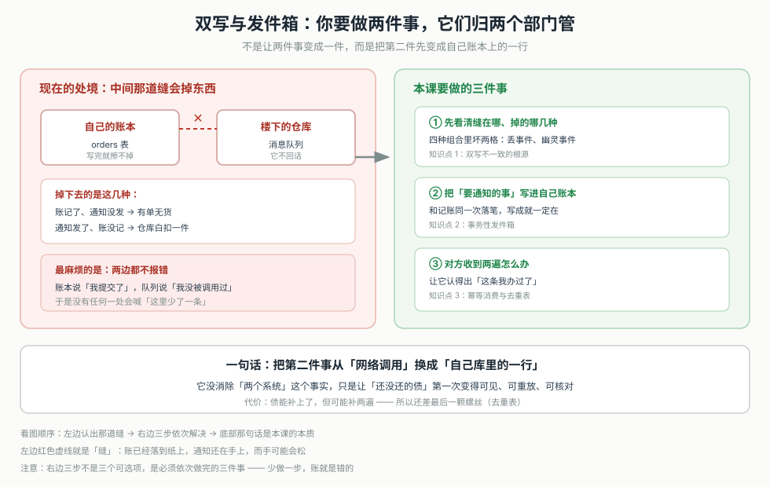
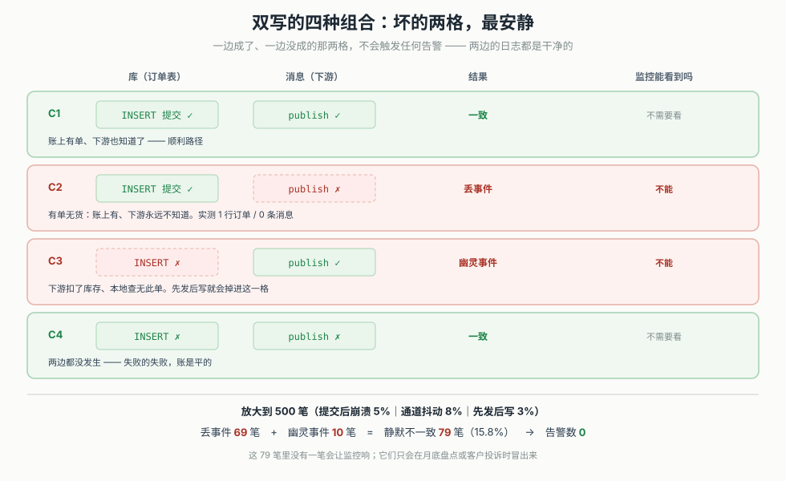
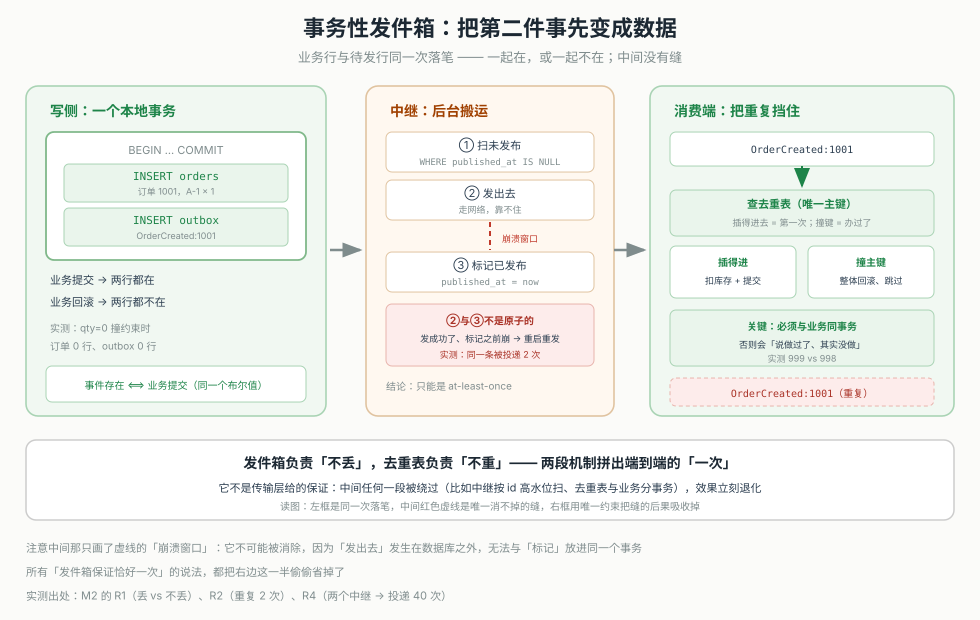
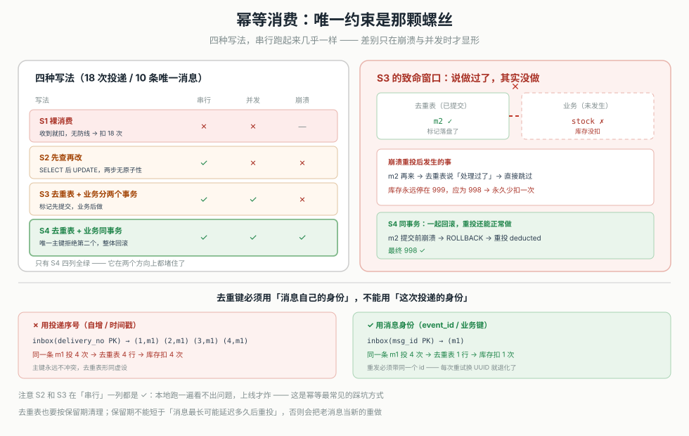
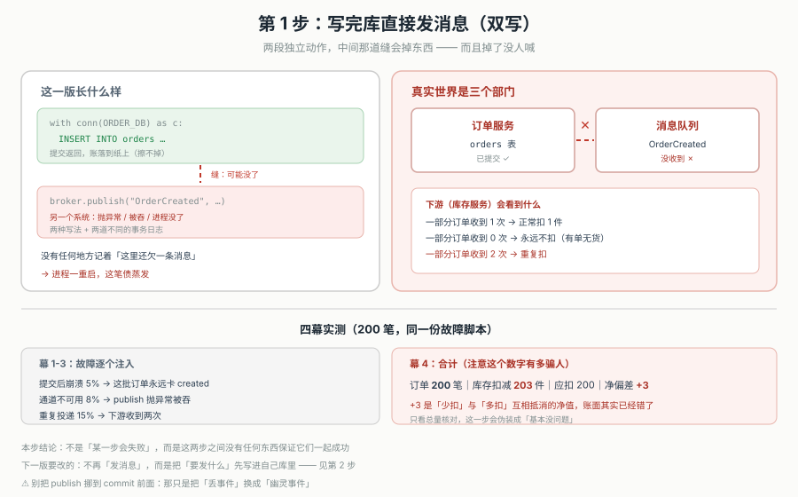
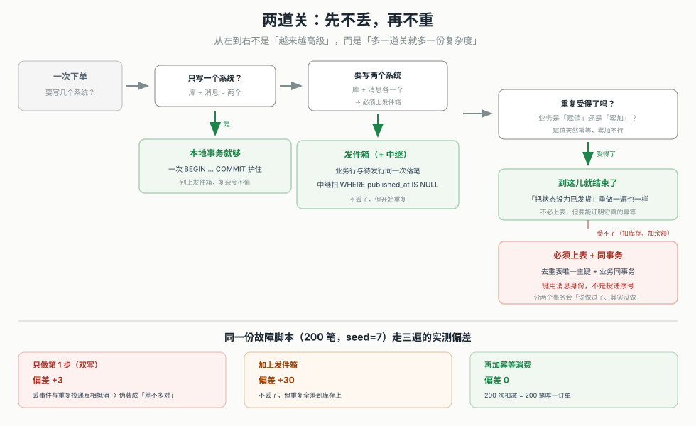

# 第 10 课：事务性发件箱与幂等消费

> 所属阶段：阶段 3《数据一致性》｜ 水平：入门 ｜ 本课知识点：双写不一致的根源、事务性发件箱、幂等消费与去重表
> 故事情节：上节课他用 Saga 把"跨三个服务改数据"收拾得能见人了——每一步都能补，补得也幂等。他以为这块总算翻篇了。可这次捅的窟窿不一样：没有任何一步失败，没有任何服务报错，监控一片绿。运营说的是另一句话："有 300 多个客户下单成功了，仓库一件都没发。"他去查，订单表里 300 多行躺得好好的，状态全是 `created`；库存服务那边，压根没收到过这 300 多条通知。中间那一步"发消息"，失败了，没报错，也没人知道。这节课他学的是：**"写库"和"发消息"是两件无论如何都拼不成一件的事——拼不成的时候，怎么让"一件都没漏"变成可验证的事实，而不是祈祷**。
> 📖 结论已按官方文档核对（核对于 2026-11 ｜ 来源：Chris Richardson《Microservices Patterns》与 microservices.io《Pattern: Transactional outbox》《Pattern: Transaction log tailing》、Debezium 官方文档《Outbox Event Router》、Gregor Hohpe & Bobby Woolf《Enterprise Integration Patterns》Idempotent Receiver（2003））
> ✅ 本课数字全部实测于 Linux / Python 3.12.3 标准库（`sqlite3` + `threading`）。零第三方依赖。可复跑脚本在 `playground/lesson10/`，下文 4.1 逐段给出关键片段与真实输出。

## 🎯 本课目标

- 列出双写的四种失败组合，并说清哪两格是坏的、坏在哪、为什么它不报警
- 写出与业务写在同一个事务里的发件箱表结构 + 中继逻辑，并说清中继为什么做不到"只发一次"
- 为消费端设计去重，处理"至少一次"投递，并说清去重键选错、去重表与业务分事务各会出什么问题

---

## 第一幕：起源与场景引入

> 🏛️ **起源**：这件事的根子在"两个系统没法一起成功"，而它第一次被系统性地写进工程手册，是在企业集成（EIP）那一脉。Gregor Hohpe 和 Bobby Woolf 在《Enterprise Integration Patterns》（2003）里专门写了一节 Idempotent Receiver（幂等接收者）：**消息系统给的投递保证是"至少一次"，不是"恰好一次"；想做到效果上恰好一次，靠的不是传输层，而是接收方自己认得出"这条我处理过"**。这句话是今天所有去重表、所有 `dedupe_key` 的祖宗。
>
> 而"事务性发件箱"这个名字被固定下来，是 Chris Richardson 在 microservices.io 和《Microservices Patterns》里做的事。他把问题拆成两个模式：**Transactional outbox**（把待发消息和业务数据写进同一个本地事务）与 **Transactional log tailing / Polling publisher**（中继怎么把发件箱里的行搬出去）。他的原话说得很直接：数据库更新和消息发送是两个不同的事务，"没有分布式事务就无法原子地完成两件事"。这不是"实现得不够好"，是这个组合本身不存在。
>
> 工业界最有说服力的实现是 Debezium 的 Outbox Event Router：它不写轮询中继，而是直接读数据库的变更日志（WAL / binlog），把发件箱表里新增的行当作事件流出去。这条路绕开了"轮询延迟"，也绕开了"中继重复标记"——但它**没有绕开重复投递**，因为读日志重放本身也可能重发。这一点留着第三幕讲。

> 🎬 **场景**：承课 9，下单流程已经稳了。现在要做的是"订单创建之后通知下游"：
>
> ```text
> ① 订单服务：往自己库里插一行 order（状态 created）
> ② 订单服务：发一条「OrderCreated」消息给消息队列
> ③ 库存服务：从队列收到消息，扣 1 件 A-1
> ```
>
> 你第一版是这么写的：

```python
# 你以为是这么回事：写完库顺手发一条
def create_order(order_id):
    db.execute("INSERT INTO orders(id, sku, qty) VALUES(?,?,?)",
               (order_id, "A-1", 1))
    db.commit()                                        # ① 本地事务，稳了

    broker.publish("OrderCreated", {"orderId": order_id})   # ② 另一个系统
    return {"ok": True}
```

> 这两行代码"看起来"是一个动作：先记一笔，再告诉别人。但它们分别属于两个系统——数据库和消息队列，各自有各自的事务、各自的失败模式。联调时两者都在本机、都很快，你不会看到中间那一段；上线后，每天几十万笔里总有几百笔会正好落在那一段里：
>
> ```text
> 订单表：order_id=1001 status=created  ✓（已提交，撤不动）
> 消息队列：OrderCreated:1001           ✗（publish 抛了异常 / 进程被 kill / 网络断了）
> ```
>
> 最要命的不是它失败，是它**失败得没有声音**：`db.commit()` 已经返回成功，接口也返回了 `{"ok": True}`，客户看到"下单成功"；而 `publish` 那一步如果被重试框架吞掉、或者进程在两次调用之间被重启，就没有任何一处会记录"这条消息本该发出去但没发"。

> 📌 **一句话本质**：**"写库"和"发消息"永远不可能被一个本地事务同时罩住，因为它们不归同一个系统管**。所以工程上不去追求"让它们一起成功"，而是掉过头来：**把"要发什么"先当成数据写进库里，让"消息还没发"这件事本身成为一条可查询、可重放、可核对的记录**。**写不出这句 = 本课还没定准**。

> ⚖️ **处境对照**：
> - **不这么做**：双写的四种组合里，两格是坏的（库成消息未成、库败消息成），而且都不报警。实测 500 笔、注入 5% 崩溃 + 8% 通道抖动 + 3% 先发后写，静默不一致 79 笔（15.8%）。这 79 笔在监控上一条告警都不会触发，只会在月底盘点时出现。
> - **这么做_换来**：崩溃窗口从"丢事件"变成"待发"——发件箱里那行还在，中继重启就能补上（实测崩溃后待发 1 条、重启补发成功）。业务写失败时两行一起回滚（实测订单 0 行、outbox 0 行）。代价是投递语义从"可能丢"变成"必然可能重"：中继在发完未标记时崩溃，同一条会被发两次（实测重复 1 次）。
> - **数字锚点**（本机实测）：双写四格中 C2 丢事件、C3 幽灵事件；500 笔放大后丢 69 笔 / 幽灵 10 笔 / 合计 15.8%；发件箱崩溃后待发 1 条；中继重发导致重复 1 次；两个中继并发扫 20 条 → 实际投递 40 次；去重表同事务后偏差归 0（S3 停 999 vs S4 得 998）。
>
> 位置说明：本课刻意让"消息没发出去"这类失败发生，因为只有在失败发生时，你才看得见"至少一次"到底靠什么兑现——顺利路径下双写和发件箱长得一模一样，谁也看不出区别。

---

## 第二幕：认知冲突

> ❓ **问题**：你的 `create_order` 里明明写了两行代码：先 `commit`，再 `publish`。第一行成功了，第二行失败了——那就"重试第二行"不就行了？或者更省事：**把 `publish` 挪到 `commit` 前面**，先发消息再写库，这样"至少消息发出去了"。这两种做法都看起来很合理，为什么正文说它们都不行？更奇怪的是：发件箱明明只是多插了一张表，凭什么它就能保证"一件都不漏"？

---

## 第三幕：层层揭示

### 一眼全局图（进入细节前先看一眼）



> 看图：左边是现在的处境——你要做两件事（记账、通知），它们归两个部门管，中间那道缝里会掉东西，而且掉了没人喊。右边是本课的三件事：**先认清那道缝到底在哪、掉下去的是哪几种**（双写的四种组合）、**把"要通知的事"先写进自己的账本，变成一张待办单**（发件箱，让它和记账同生共死）、**对方收到两遍怎么办**（幂等消费，用去重表把"至少一次"收成"实际一次"）。最下面一句话是本质：不是让两件事变成一件，是把第二件先变成数据。

**四条硬约束**：① 一图只回答"本课解决什么问题、靠什么思路"；② 图上零术语（术语下沉到图注与后文）；③ 必带读图指引（已给）；④ 图不承担结论，图旁文字须能独立说清同一件事。
**验收口径**：没学过本课的人应能看懂这张图。

### 本课地图（分几步走）

| 步 | 这一步要解决什么（人话） | 对应知识点 |
|:--:|------------------------|-----------|
| 1 | 先看清那道缝有多宽、掉下去的是哪几种东西 | 知识点 1：双写不一致的根源 |
| 2 | 把"要通知的事"先写进自己的账本，跟记账同生共死 | 知识点 2：事务性发件箱 |
| 3 | 账本保证了不漏，但会重；让对方认得出"这条我处理过" | 知识点 3：幂等消费与去重表 |

> 只回答"分几步走、现在在哪"——不写机制、不写结论。第二幕的"问题"是"重试第二行 / 先发后写为什么不行"，本课三步正好按"缝在哪 → 怎么把缝填掉 → 填掉之后冒出来的新问题"的顺序回答。

---

### 知识点 1：双写不一致的根源

> 🧭 第 1/3 步｜承接：第二幕的疑问——"重试一下不就行了"。本步：先看清那道缝到底在哪、掉下去的是哪几种、以及它为什么不报警。
> 本知识点关键点：四种组合里坏的是哪两格、写库与发消息没有共同事务、失败是静默的

#### 一句话定义

**双写（dual write）指的是在同一个业务动作里，向两个不同的系统各写一次**：这里是"订单库写一行"+"消息队列发一条"。它的问题不在"会不会失败"，而在**这两次写没有任何机制保证一起成功或一起失败**——所以四种组合里必然有两格是坏的，而且坏掉的那两格不会有任何一方报错。

#### 直觉建立（类比）

把一件事记在两个本子上：一个是你自己的账本，一个是给楼下仓库的送货单。你写完账本、把送货单塞进仓库的信箱——这两件事之间有一个瞬间：账本已经落到纸上（擦不掉了），送货单还在你手上（可能是风把它吹了、可能是信箱满了塞不进去）。

这时候你回头看一眼账本：写得清清楚楚。再看一眼信箱：空空如也。你不知道那张单子到底进去了没有，因为**信箱不会回话**。更麻烦的是，你打烊了、回家了——这张没塞进去的单子，明天也不会自己冒出来。

> 💡 **类比的边界**：现实里你至少"记得自己还有张单子没塞"。双写里连这个记忆都没有——`publish` 抛异常被重试框架吞掉，或者进程在 `commit` 与 `publish` 之间被 kill，代码里没有任何地方留下"这里欠一条消息"的痕迹。**这就是为什么它静默：不是没人管，是没人知道该管**。

#### 核心原理

> **① 四种组合，坏的只有两格，但这两格最安静**

| 组合 | 库 | 消息 | 结果 | 监控能看到吗 |
|---|---|---|---|---|
| C1 | 成 | 成 | 一致 | 不需要看 |
| C2 | 成 | 未成 | **丢事件**（有单无货） | 不能 |
| C3 | 败 | 成 | **幽灵事件**（下游扣了库存、这边没单） | 不能 |
| C4 | 败 | 未成 | 一致（都失败） | 不需要看 |

C1 和 C4 是"两边对齐"的两格——要么都成、要么都没成，账是对的。真正的问题全在 C2 和 C3：**一边成了、另一边没成**。

> **② 为什么 C2 和 C3 都不报警**

因为从每个系统的局部视角看，它自己都成功了。
C2 里，数据库看到了一次正常提交（`INSERT` 成功、约束通过、事务落盘），它没有任何理由报错；消息队列那边压根没被调用过，自然也不报错。C3 里反过来：消息发出去了、队列返回了 ack，队列认为一切正常；写库那边撞了约束，但那是个"业务失败"，通常只记一条 warning 日志，接口可能还返回了"下单失败，请重试"——而客户重试时，库存已经被扣过了。

**两边的日志都是干净的。**这就是双写最阴的地方：它不是"某处爆炸"，是"某处悄悄少了一行"。

> **③ 把发送塞进事务块，也不能跟着回滚**

这是最常见的错觉，值得单独验一次。你以为这样写就能一起回滚：

```python
with db.transaction():
    db.execute("INSERT INTO orders ...")
    broker.publish("OrderCreated", ...)     # 以为它在这个事务里
    raise RuntimeError("后面的步骤失败了")
```

但 `db.transaction()` 管辖的只是它自己那条连接。`broker.publish` 走的是网络、是另一个进程，**它不在这条连接的日志里**，回滚指令到不了它。实测结果：订单 0 行（库确实回滚了），但下游收到了 1 条消息（它回不来）。

> **④ 静默的规模：15.8%**

单次看是"偶发"，放大看是"必然"。500 笔里注入 5% 提交后崩溃、8% 通道抖动、3% 先发后写：丢事件 69 笔、幽灵事件 10 笔，合计 79 笔 = 15.8%。**这 79 笔里，没有一笔会触发告警。**



> 看图：上面一排是四个格子，C1/C4 绿色对齐、C2/C3 红色错位。C2 是"库里有单、下游不知道"，C3 是"下游扣了、库里没单"——箭头都只画了半边，因为另一边的动作根本没发生。下面一行是放大后的数字：79/500 静默不一致，而监控告警数是 0。

#### 示例演示

```python
# M1：把四种组合一格一格摆出来
# C1 库成 + 消息成     订单 1｜下游 1｜一致
# C2 库成 + 消息未成   订单 1｜下游 0｜✗ 丢事件（commit 后进程崩，这行根本没机会执行）
# C3 库败 + 消息成     订单 0｜下游 1｜✗ 幽灵事件（先发消息，再写库，写库撞约束）
# C4 库败 + 消息未成   订单 0｜下游 0｜一致

# 错觉验证：把 publish 塞进事务块
#   订单行 = 0（回滚了）
#   下游收到 = 1（消息已经出去了）
#   → 包在事务里也没用：sqlite 的事务只管自己的连接，publish 走的是网络

# 放大到 500 笔（提交后崩溃 5%、通道抖动 8%、先发后写 3%）
#   丢事件 69 笔｜幽灵事件 10 笔｜合计 79 笔 = 15.8%
#   → 这几百笔里，有几笔会在监控上报警？零。
```

> 看 C2 和 C3 的计数：它们不是"报错"，是"数不对"。C2 少一条、C3 多一条，而两边的系统都认为自己一切正常。

#### 常见误区

1. **"`publish` 失败了我重试一下不就行了"**：重试只能救"抛了异常并且你还活着"的情况。进程被 kill、机器掉电、`publish` 被重试框架吞掉——这些情况里没有任何代码会走到重试那一行。而且重试本身会引入重复（知识点 3 要处理的就是它）。
2. **"把 `publish` 挪到 `commit` 前面就安全了"**：那你就把 C2 换成了 C3。先发消息再写库，写库失败时下游已经扣了库存——变成"幽灵事件"，而且客户重试时会被再扣一次。
3. **"包进 `with transaction()` 就能一起回滚"**：事务只管它连接的库。`publish` 走网络，不在它的日志里。实测订单 0 行、下游仍收到 1 条。
4. **"两边都加事务、都加重试就可靠了"**：各自可靠 ≠ 一起可靠。两边都成功重试、都正确提交，中间那一次"跨系统的先后顺序"照样会错位。
5. **"这种失败很少见，不必专门处理"**：单次概率低，乘以请求量就是每天几百笔。实测 500 笔注入常见抖动就有 79 笔不一致（15.8%），且零告警。

#### 一句话记住

双写坏的不是"某一步会失败"，是**这两步之间没有任何东西保证它们一起成功**——所以它丢事件、造幽灵事件，而且两边都不报警。

#### 🗣️ 行话对照

- **双写（dual write）**：一个业务动作里向两个系统各写一次；在哪遇到：写库 + 发 MQ、写库 + 调下游接口。
- **丢事件（lost event）**：库写了、消息没发出去；下游永远不知道这件事发生过。
- **幽灵事件（phantom event）**：消息发出去了、库没写成；下游做了一个本地查不到依据的动作。
- **至少一次（at-least-once）**：消息系统的常见投递保证，允许重复、不允许丢。
- **恰好一次（exactly-once）**：理想语义。端到端做到它需要收发两端配合，单靠传输层给不了。

#### 官方文档

- microservices.io · Pattern: Transactional outbox（"database update and message send are two different transactions... cannot atomically do both"）：https://microservices.io/patterns/data/transactional-outbox.html
- Chris Richardson. _Microservices Patterns_. Manning, 2018（第 3 章 reliable messaging）
- Gregor Hohpe, Bobby Woolf. _Enterprise Integration Patterns_. Addison-Wesley, 2003（Idempotent Receiver）

---

### 知识点 2：事务性发件箱

> 🧭 第 2/3 步｜承接：已经看清那道缝（跨系统的两次写没有任何共同保证）→ 本步：不去填缝，而是把"要发的东西"先搬到自己这一侧，让它和业务数据同生共死。
> 本知识点关键点：outbox 行与业务行同一个本地事务、中继的四个必须做对的地方、投递语义必然是 at-least-once

#### 一句话定义

**事务性发件箱（transactional outbox）是在业务库里加一张 outbox 表，把"待发的消息"当普通数据行插进去，并且这次插入与业务写共享同一个本地事务**。业务提交则 outbox 行一定在、业务回滚则 outbox 行一定不在——"消息该不该发"于是变成一个可以用 SQL 查出来的事实。真正把它送出去的，是一个独立的中继（relay）：轮询 outbox 表，或读数据库变更日志。

#### 直觉建立（类比）

还是那两个本子。这次你换了做法：**不再去塞那张送货单，而是先在自己账本的最后加一页"待办"**——"第 1001 单，要通知仓库减 1 件"。这一页和前面那笔账写在同一张纸上、同一个装订线里，撕不掉一半。

写完之后你去忙别的。另有一个跑腿的（中继），每隔一会儿翻一遍账本的待办页：看到没打勾的，就跑到仓库去说一声，回来说完打个勾。

这样"漏"就没有了：只要账本上记了账，待办就必然也在；只要待办在，跑腿的总有一天会看到。代价是：**跑腿的可能说完话、还没回来打勾就被车撞了——他爬起来会再说一遍**。

> 💡 **类比的边界**：现实里"说一遍"和"打个勾"也是两个动作，无法合成一个原子动作。发件箱没有消除这个窗口，它只是把这个窗口的后果从"丢一条"改成了"多一条"——而多一条是可以被对方挡住的（知识点 3），丢一条不能。

#### 核心原理

> **① 表结构：让"未发布"变成一个可索引的谓词**

```sql
CREATE TABLE outbox (
    id             INTEGER PRIMARY KEY AUTOINCREMENT,
    aggregatetype  TEXT NOT NULL,          -- 聚合类型，如 order
    aggregateid    TEXT NOT NULL,          -- 聚合 id，消费端据此定位业务对象
    type           TEXT NOT NULL,          -- 事件类型，如 OrderCreated
    payload        TEXT NOT NULL,           -- 事件体（JSON）
    created_at     REAL NOT NULL,
    published_at   REAL                    -- NULL = 还没发出去
);
CREATE INDEX outbox_unpublished ON outbox(id) WHERE published_at IS NULL;
```

列名刻意对齐 Debezium Outbox Event Router 的默认约定（`aggregatetype` / `aggregateid` / `type` / `payload`），这样将来从"轮询中继"换成"读 CDC 日志"，表结构不用动。

那个**局部索引**是关键：它只索引"还没发布的行"，所以表里有几千万条历史记录也不影响中继扫描的速度。

> **② 写侧：两行同一个事务，没有中间态**

```python
def create_order(order_id):
    with db.transaction():                       # 一个本地事务
        db.execute("INSERT INTO orders(id, sku, qty) VALUES(?,?,?)",
                   (order_id, "A-1", 1))
        db.execute(
            "INSERT INTO outbox(aggregatetype, aggregateid, type, payload, created_at)"
            " VALUES('order', ?, 'OrderCreated', ?, ?)",
            (str(order_id), json.dumps({"orderId": order_id}), time.time()))
    # 提交返回 = 两行一起在；抛异常回滚 = 两行一起不在
```

这就把"业务是否发生"和"事件是否存在"合并成了同一个布尔值。实测：业务写失败（qty=0 撞 CHECK）时，订单 0 行、outbox 0 行，一起回滚。

> **③ 中继：四个必须做对的地方**

中继看起来只是"读出来、发出去、标记"，但有四处能出错：

第一，**扫描条件必须按"是否已发布"，不能按 id 高水位**。id 是在插入时分配的，不是提交时分配的。一个慢事务拿到 id=5 却晚提交，等它落库时高水位可能已经到 8 了——按 `id > 高水位` 扫，这一行会被永久跳过。实测：连跑 3 轮，那一行始终没被发出去。正确写法是 `WHERE published_at IS NULL`，配上那个局部索引。

第二，**"发送"和"标记"不是原子的**。发成功了、标记之前崩溃，重启后同一条会再发一次。实测：崩溃后重扫，同一条消息被投递 2 次。这个窗口**无法消除**——把发送和标记放进一个数据库事务是做不到的，因为发送发生在数据库之外。

第三，**多个中继实例会成倍放大重复**。两个中继同时扫到同一批 20 条，各自发一遍 = 实际投递 40 次。真实系统用 `SELECT ... FOR UPDATE SKIP LOCKED`（PostgreSQL 9.5+ / MySQL 8.0+）或"先领取再发"的租约来互斥。

第四，**表只涨不消**。已发布的行如果从不清理，表体积和 VACUUM 压力会一直涨。实测 5 批共 500 行，全部留着。真实做法是按保留期删除或归档已发布行。

> **④ 投递语义：只能是 at-least-once**

上面第二、三点决定了：**发件箱给的是"至少一次"，不是"恰好一次"**。这不是实现没做好，是结构性的——"把消息送出去"和"把这件事记成已送"发生在两个不同的系统里，中间必然有一个窗口。任何声称"发件箱保证 exactly-once"的说法，都把消费端的那一半偷偷省掉了。

> **⑤ 两种中继，一个取舍**

| | 轮询中继（polling publisher） | 日志中继（log tailing / CDC） |
|---|---|---|
| 怎么拿数据 | 定时 `SELECT ... WHERE published_at IS NULL` | 读数据库变更日志（WAL / binlog） |
| 延迟 | 取决于轮询间隔（秒级） | 近实时（毫秒级） |
| 对库的压力 | 每次查询（有局部索引，代价小） | 读日志，几乎不碰业务表 |
| 标记问题 | 需要 `published_at` 列 | 不需要标记，靠日志位点 |
| 典型实现 | 自己写 / Debezium polling | Debezium Outbox Event Router |

日志中继取消了"标记"这一步，所以它没有"发完未标记"的窗口——但它仍然可能重发（日志位点回退、消费者重启），所以**重复这件事依然要在消费端解决**。



> 看图：左边是写侧——订单行和 outbox 行在同一个事务框里，一起提交或一起回滚，中间没有缝。中间是中继，做了三件事（扫未发布、发出去、标记），而"发出去"和"标记"之间画了一道虚线缺口，缺口上标着"崩溃 → 重发"。右边是消费端，两条一模一样的消息进来，被去重表挡住一条。底部一句话：发件箱保证不丢，重复交给消费端。

#### 示例演示

```python
# M2：发件箱的五个回合

# R1 崩溃窗口对比
#   双写 + 发送前崩溃：订单 1 行｜下游 0 条｜✗ 丢事件
#   发件箱 + 发送前崩溃：订单 1 行｜待发 1 条｜重启后下游 1 条｜✓
#   R1b 业务写失败（qty=0）：订单 0 行、outbox 0 行 → 一起回滚

# R2 中继在「发完、还没标记」时崩溃
#   崩溃前已发出 1 条；重启后累计 2 条；重复投递 1 次
#   → 投递语义 = at-least-once，这个重复是设计内的

# R3 高水位中继漏行
#   id=1（晚提交）、id=2（先提交并被处理），hw=2
#   之后连跑 3 轮，每轮发出 0 条；id=1 永久卡住
#   → 正解：WHERE published_at IS NULL

# R4 两个中继并发扫 20 条
#   实际投递 40 次，重复 20 次 → n 个中继 = n 倍重复

# R5 不清理
#   第1批 100 行｜第2批 200 行｜…｜第5批 500 行（全部留着）
```

> 看 R1 与 R2 的对照：R1 是发件箱要解决的问题（丢），R2 是它引入的新问题（重）。这两个回合合起来才是完整的发件箱——只讲 R1 会让人以为它"解决了所有问题"。

#### 常见误区

1. **"发件箱保证了恰好一次"**：只保证不丢。重复来自"发送与标记不是原子的"和"多实例并发扫描"，必须由消费端处理。
2. **"中继用 id 高水位扫描更高效"**：会永久漏行。id 在插入时分配、提交顺序不定，晚提交的小 id 会被跳过。
3. **"中继只有一个实例，不用担心并发"**：单实例也有"崩溃重启"这个并发（旧进程的可能还没死透）。而生产上为了可用性通常至少两个实例。
4. **"发件箱表不用清理，反正有索引"**：局部索引让查询快，但表体积、备份时间、VACUUM 成本照样涨。已发布行要按保留期清理或归档。
5. **"用了 CDC 就绕开了重复"**：CDC 取消了标记，但日志位点回退、消费者重启仍会导致重发。重复最终仍要在消费端解决。
6. **"发件箱里应该存完整的业务对象"**：存"发生了什么"（事件），不存"当前是什么"（状态快照）。存快照会让晚到的消费者读到已被后续事件覆盖的状态，顺序问题变成正确性问题。

#### 一句话记住

发件箱没有让"两件事"变成"一件事"，它只是**把第二件事从"网络调用"换成了"自己库里的一行"**——于是它和业务同生共死，而"发出去"变成一个可以被重试、被核对、被补做的后台动作。

#### 🗣️ 行话对照

- **发件箱（outbox）**：装待发消息的表；在哪遇到：`outbox` 表、`outbox_event`。
- **中继（relay / message relay）**：把 outbox 行搬出去的后台进程；在哪遇到：polling publisher、Debezium。
- **轮询发布者（polling publisher）**：定时查表的中继。
- **事务日志拖尾（transaction log tailing）**：读 WAL/binlog 的中继，Debezium 是典型实现。
- **CDC（change data capture）**：捕获数据库变更并转成事件流。
- **SKIP LOCKED**：跳过已被别人锁住的行，让多个中继不抢同一批；PostgreSQL 9.5+ / MySQL 8.0+ 支持。

#### 官方文档

- microservices.io · Pattern: Transactional outbox：https://microservices.io/patterns/data/transactional-outbox.html
- microservices.io · Pattern: Transaction log tailing：https://microservices.io/patterns/data/transaction-log-tailing.html
- Debezium · Outbox Event Router（列名约定、`aggregatetype`/`aggregateid`/`type`/`payload`）：https://debezium.io/documentation/reference/stable/transformations/outbox-event-router.html
- PostgreSQL · SELECT（`FOR UPDATE SKIP LOCKED` 语义）：https://www.postgresql.org/docs/current/sql-select.html#SQL-FOR-UPDATE-SHARE

---

### 知识点 3：幂等消费与去重表

> 🧭 第 3/3 步｜承接：发件箱把"不丢"做到了，代价是把"可能重"推给了下游 → 本步：让消费端认得出"这条我处理过"，把至少一次收成实际一次。
> 本知识点关键点：去重必须与业务同事务、去重键必须是消息的身份、去重表与 outbox 一样要清理

#### 一句话定义

**幂等消费（idempotent consumption）指同一条消息被处理一次和处理多次，对业务数据的影响相同**。最常见的实现是**去重表（inbox / dedupe table）**：以消息自己的身份做唯一主键，消费时先插这一行——插入成功才执行业务，插入撞主键就说明处理过了、直接跳过。关键在于**插去重表与改业务必须在同一个本地事务里**，否则会留下"标记了但没做"的洞。

#### 直觉建立（类比）

仓库那边现在会收到重复的送货单了（因为跑腿的可能说两遍）。仓库管理员的做法是：门口挂一本签收簿，每张单子上有一个单号。收到单子先翻签收簿——这个单号在不在？

- 不在：签个名，然后去货架上减 1 件。
- 在：这张单子已经办过了，撕掉。

问题在于"签名"和"减货"是两个动作。如果管理员签完名就跑去厕所、回来忘了减货——签收簿上却已经有这个单号了，这张单子永远不会再被办。所以规矩必须是：**签名和减货要么一起完成，要么一起不算**（在实际操作里就是"减完货才签名"，而这两步的原子性由数据库事务提供）。

> 💡 **类比的边界**：人可以在脑子里记住"我签名了但还没减货"，数据库事务能把这个中间态彻底藏起来——要么两件事都发生，要么都不发生，不存在"记了一半"。

#### 核心原理

> **① 三种写法，只有一种能挡住崩溃**

| 写法 | 重复投递（串行） | 重复投递（并发） | 中途崩溃 |
|---|---|---|---|
| S1 裸消费（收到就扣） | ✗ 多扣 | ✗ 多扣 | 无所谓，本来就错 |
| S2 先查再改（日志无唯一约束） | ✓ | ✗ 两个都查到"没做过" | ✗ 业务已提交、日志没写 → 重投再扣一次 |
| S3 去重表 + 业务分两个事务 | ✓ | ✓ | ✗ 标记已提交、业务没做 → 永久丢 |
| S4 去重表 + 业务同事务 | ✓ | ✓ | ✓ 一起回滚，重投可正常做 |

实测（18 次投递、10 条唯一消息）：S1 扣 18 次、其余三种扣 10 次。串行跑看不出 S2/S3 的问题——它们的洞都要靠"并发"或"崩溃"才暴露出来。

S2 与 S4 的差别只有一处，但在生产上是致命的：**S2 的处理日志没有唯一约束，那次 `SELECT` 也挡不住任何人**。两个消费者可以同时查到"没处理过"，然后各自扣一次。实测（R2b）：A、B 同时查到 `None`，各自扣减成功 → 库存扣减量 2（应为 1），处理日志里留下 2 行 `m1`。

注意 S2 在 R1 的串行测试里是 ✓（扣 10 次，正确）——**这正是"本地跑没问题、上线就重复扣"的典型成因**。正解不是给它加锁，而是把 `INSERT` 放进同一个事务、并给 `msg_id` 加唯一约束（即 S4）。

S3 的洞在崩溃，单独验一次：m1 正常处理完（库存 999），处理 m2 时在"标记完、改业务前"崩溃，m2 重投 → 去重表说处理过了、直接跳过 → 最终库存停 999，应为 998。**永久少扣一次，而且再也不会重做**。

换成 S4：同样的崩溃点，`ROLLBACK` 让两件事一起回滚；m2 重投时正常扣减，最终 998，正确。

> **② 去重键必须是"消息自己的身份"**

这是最容易写错的一处，因为它错得很安静。对比两种键：

```python
# 错：用投递序号当键（自增、时间戳、消费者侧计数）
inbox(delivery_no INTEGER PRIMARY KEY, msg_id TEXT)   # 每次投递都是新行

# 对：用发送方生成的消息身份当键
inbox(msg_id TEXT PRIMARY KEY)                        # 重发时是同一条
```

实测：同一条消息 m1 投递 4 次，用投递序号做键，去重表记了 4 行 `[(1,'m1'),(2,'m1'),(3,'m1'),(4,'m1')]`，库存扣了 4 次。**去重表一行没少，等于没去重**。

正确的键可以是发送方生成的 `event_id`（UUID），也可以是业务键（`order_id` + 事件类型）。两者取舍：业务键天然幂等、不用额外字段，但一个业务对象产生多种事件时要组合；UUID 通用，但要保证"同一条事件重发时 UUID 不变"——如果每次重试都重新生成 UUID，那就退化成投递序号了。

> **③ 为什么必须同事务：一句话版本**

去重表的语义是"这件事我做过了"。如果它和业务不在同一个事务里，那就可能出现"我说我做过了，其实我没做"，而且这个谎永远无法纠正（下次再来会被自己的谎挡住）。同事务保证了这个语义不会撒谎。

> **④ 去重表也会涨，保留期有下限**

和 outbox 一样，inbox 也要按保留期清理。实测 5 批共 500 行全部留着。保留期有一条硬下限：**不能短于"消息最长可能延迟多久后重投"**。如果一条消息因为队列积压延迟了 3 天，而你去重记录只留 2 天，那它第 3 天到达时会被当成新消息再处理一遍——去重表反而成了制造重复的帮凶。

> **⑤ 顺序问题：去重不解决乱序**

去重只回答"处理过没有"，不回答"该不该按这个顺序处理"。`OrderCreated` 和 `OrderCancelled` 如果反序到达，即使两条都只处理一次，终态也是错的。这类问题要靠**版本号/序列号 + 状态机**（拒绝旧版本覆盖新版本），而不是去重表。本课不展开，但要知道去重表不背这个锅。



> 看图：左边是四种写法的对照，S1 到 S4 依次加防线，只有 S4 四列全绿。中间画的是 S3 的崩溃窗口——去重表已打勾、业务栏还空着，这一格会永久留空。右边是去重键的对照：用投递序号时 4 次投递留下 4 行、扣 4 次；用消息身份时只留 1 行、扣 1 次。

#### 示例演示

```python
# M3：四个回合

# R1 18 次投递 / 10 条唯一消息
#   S1 裸消费            扣 18｜✗ 多扣 8
#   S2 先查再改           扣 10｜串行看起来对
#   S3 去重表与业务分两事务    扣 10｜串行看起来对
#   S4 去重表与业务同事务     扣 10｜✓
#   → 串行跑只能分出 S1，另外三个的差别要靠崩溃/并发才看得见

# R2 S3 的崩溃窗口
#   m1 处理完 → 库存 999
#   m2 标记后崩溃 → 重投时 duplicate-skipped
#   最终 999，应为 998 → ✗ 永久少扣一次
#   S4 同样场景：重投正常扣减 → 998 ✓

# R2b 先查再改遇到并发
#   A、B 同时查到「没处理过」→ 各自扣减 → 扣减量 2（应为 1）
#   处理日志里留下 2 行 m1
#   → 没有唯一约束兜底，「先查再改」挡不住并发

# R3 去重键选错（用投递序号）
#   同一条 m1 投递 4 次 → 去重表 4 行 [(1,'m1'),(2,'m1'),(3,'m1'),(4,'m1')]
#   库存扣 4 次（应为 1）

# R4 去重表只涨不消
#   第1批 100｜第2批 200｜第3批 300｜第4批 400｜第5批 500
```

> 看 R2 和 R2b 的分工：R2 证明"分两个事务"会丢，R2b 证明"只查不约束"挡不住并发。两个回合合起来才说清"为什么必须是同事务里的唯一约束"——缺一个都会让人以为"查一下就够了"。

#### 常见误区

1. **"消费端加个 if 判断就够了"**：`SELECT` 完再 `UPDATE` 之间没有原子性，并发下两个消费者都会看到"没处理过"。必须有唯一约束兜底。
2. **"去重表和业务分两个事务也没关系，反正都会执行"**：中间崩溃就会留下"标记了但没做"的永久空洞。实测最终库存 999、应为 998。
3. **"用自增序号/时间戳做去重键"**：每次投递都是新键，去重表形同虚设。实测同一条消息投递 4 次、扣了 4 次。
4. **"去重表不用清理"**：会无限增长。要按保留期清理，且保留期不能短于消息最大延迟时间。
5. **"有了去重就不会出错了"**：去重只管重复，不管顺序。乱序要靠版本号 + 状态机。
6. **"发件箱 + 去重表 = 恰好一次"**：端到端效果上是"恰好一次"，但这是两段机制拼出来的（不丢 + 不重），不是传输层给的保证。中间任何一段被绕过，效果就退化了。

#### 一句话记住

发件箱把"不丢"做到了，代价是把"可能重"推给了下游；**去重表的唯一约束与业务同事务**，才是把"至少一次"收成"实际一次"的那颗螺丝。

#### 🗣️ 行话对照

- **幂等（idempotent）**：同一操作执行任意多次，效果与执行一次相同。
- **去重表 / 收件箱（inbox / dedupe table）**：记录"哪些消息处理过"的表；在哪遇到：`inbox`、`processed_message`、`dedupe`。
- **幂等接收者（idempotent receiver）**：EIP 里的模式名，指接收方自己负责识别重复。
- **去重键（dedupe key）**：判定"是不是同一条消息"的依据，必须是消息自身的身份。
- **至少一次 / 恰好一次**：见知识点 1 的行话对照。

#### 官方文档

- Gregor Hohpe, Bobby Woolf. _Enterprise Integration Patterns_. Addison-Wesley, 2003（Idempotent Receiver：消息系统只保证 at-least-once，效果上的 exactly-once 由接收方负责）
- microservices.io · Pattern: Transactional outbox（"at-least-once ... consumers must be idempotent"）：https://microservices.io/patterns/data/transactional-outbox.html
- PostgreSQL · Constraints（唯一约束与 `ON CONFLICT` 语义）：https://www.postgresql.org/docs/current/ddl-constraints.html#DDL-CONSTRAINTS-UNIQUE-CONSTRAINTS

---

## 第四幕：实操验证

### 4.1 机制验证

> ✅ 本节脚本实测于本机 / Python 3.12.3 标准库（`sqlite3` + `threading`）。零第三方依赖，可原样复跑。所有输出均为本机真实结果。脚本在 [`playground/lesson10/`](../../../playground/lesson10/)（含 m1/m2/m3，纯标准库，无需安装）。

**M1：双写的四种组合**（`m1_dual_write_matrix.py`，真实 sqlite 库 + 假消息通道）

```
R1 四种组合
   组合                        订单行   下游收到   一致?
   C1 库成 + 消息成                1        1      ✓
   C2 库成 + 消息未成               1        0      ✗ 丢事件
   C3 库败 + 消息成                0        1      ✗ 幽灵事件
   C4 库败 + 消息未成               0        0      ✓

R2 错觉验证：把 publish 塞进 with 事务块
   订单行 = 0（事务回滚了，库很干净）
   下游收到 = 1（消息已经出去了，回不来了）
   → 包在事务里也没用

R3 放大：500 笔，提交后崩溃 5%、通道抖动 8%、先发后写 3%
   丢事件 = 69 笔｜幽灵事件 = 10 笔｜静默不一致 79 笔 = 15.8%
   → 这几百笔里，有几笔会在监控上报警？零
```

> ✅ **回扣场景**：R1 就是"有 300 多单没发货"的机制解释——C2 那一格。R2 解释了为什么"我把发送包进事务了"这种防御是无效的。R3 说明它不是罕见事故，而是稳定发生率。

**M2：事务性发件箱与中继**（`m2_outbox_relay.py`，真实 outbox 表 + 局部索引 + 假中继）

```
R1 崩溃窗口对比
   双写 + 发送前崩溃：订单 1 行｜下游 0 条｜✗ 丢事件
   发件箱 + 发送前崩溃：订单 1 行｜待发 1 条｜重启补发 → 下游 1 条｜✓
   R1b 业务写失败（qty=0）：订单 0 行、outbox 0 行 → 一起回滚

R2 中继在「发完、还没标记」时崩溃
   崩溃前已发出 1 条；重启后累计 2 条
   重复投递：{'ordercreated:10': 2}
   → 投递语义 = at-least-once

R3 高水位中继漏行
   id=1（aggregateid=100，晚提交）、id=2（aggregateid=101，先处理），hw=2
   之后连跑 3 轮，每轮发出 0 条
   仍未发布：[(1, '100')] → 永久卡住
   → 正解：WHERE published_at IS NULL

R4 两个中继并发扫 20 条
   实际投递 40 次，重复投递 20 次
   → n 个中继 = n 倍重复

R5 不清理
   第1批 100｜第2批 200｜第3批 300｜第4批 400｜第5批 500
```

> ✅ **回扣场景**：R1 是发件箱的正向证明（同样是崩溃注入，一个丢、一个不丢）。R2 是它引入的新问题，也是知识点 3 的前提。R3 解释为什么"按 id 扫描"这个看起来很自然的优化会静默丢消息。

**M3：幂等消费与去重表**（`m3_idempotent_consumer.py`，真实去重表 + 唯一主键 + 崩溃注入）

```
R1 同一串消息（18 次投递 / 10 条唯一）喂给四种写法
   写法                        扣减量   应为   结果
   S1 裸消费                     18    10   ✗ 多扣 8
   S2 先查再改                    10    10   ✓（串行）
   S3 去重表与业务分两个事务             10    10   ✓（串行）
   S4 去重表与业务同事务              10    10   ✓

R2 S3 的崩溃窗口
   m1 处理完 → 库存 999
   m2 标记后崩溃 → 重投 duplicate-skipped
   最终库存 999，应为 998 → ✗ 永久少扣一次
   S4 同样场景：m2 提交前崩溃 → 重投 deducted → 998 ✓

R2b 先查再改遇并发（处理日志无唯一约束）
   A、B 同时查到 None（都没处理过）
   A 扣减成功、B 扣减也成功（没有约束能拦住它）
   处理日志里 m1 的行数 = 2（应为 1）
   最终库存扣减量 = 2（应为 1）

R3 去重键选错（用投递序号）
   同一条 m1 投递 4 次 → 去重表 4 行
   库存扣 4 次（应为 1）

R4 去重表只涨不消
   第1批 100｜第2批 200｜第3批 300｜第4批 400｜第5批 500
```

> ✅ **回扣场景**：R1 的四种写法串行结果几乎一样，这本身就是个教训——"本地跑起来没问题"不能证明幂等做对了。真正的分水岭在 R2（崩溃）和 R2b（并发）：S3 停在 999、S2 在并发下多扣一次。R3 是最容易犯且最难发现的错：写在代码里看着完全合理。

### 4.2 应用实战入口

> 🎯 **本课应用实战独立成篇**（配套实战册）：[第 10 课实战 · 跨服务下单的发件箱改造](../../../应用实战/10-事务性发件箱与幂等消费.md)
> 含**分步设计图**（每步一张：这一版长什么样、比上一版改了什么）与"双写 → 发件箱 → 发件箱 + 幂等消费"的三跳演进与完整代码；通览全部：📚 [应用实战索引](../../../应用实战/INDEX.md)



> 上面的分步图是应用实战 10 的第 1 步。完整的三跳演进、四幕同口径的真实对照数字与"什么时候可以退回简单版"，见 [应用实战 10 · 跨服务下单的发件箱改造](../../../应用实战/10-事务性发件箱与幂等消费.md)。

> ✅ **会用标志**：你能否说清"监控全绿、订单 300 单、仓库一件没发"这件事到底是哪一格？以及"发件箱上线后库存反而扣多了"——多出来的那些是从哪来的？能答出来，就说明你真的会做可靠消息了。

---

## 第五幕：体系收束

> 🧩 **回到那个问题**：`commit` 成功了、`publish` 失败了，重试第二行不就行了？

不行，因为**你根本不知道要重试**。重试的前提是"有个地方记着这笔债没还"——而双写恰恰没有这个地方：`commit` 返回之后，代码里没有任何变量、任何表、任何日志记着"这里还欠一条消息"。进程一重启，这笔债就蒸发了。

把 `publish` 挪到 `commit` 前面也不行：那只是把"库有消息无"换成了"消息有库无"，而且下游已经动了手（扣了库存），客户重试时会被再扣一次。

所以真正的解法是掉头：**先把"要发什么"写进自己库里**，让这笔债成为一条能被 `SELECT` 出来的记录。这就是发件箱——它没有消除"两个系统"这个事实，只是把第二件事从"网络调用"降级成"自己库里的一行"，从而让"还没还的债"第一次变得可见、可重放、可核对。

而一旦你这么做，账就必然是"至少一次"：中继发完还没标记时崩溃、多个中继抢同一批——都会让同一条消息发两遍。这个重复无法在发送端消除，只能在接收端吸收。这就是去重表的位置：**它的唯一约束，是把"至少一次"收成"实际一次"的最后那颗螺丝**。

> 🔗 **与前面几课的关系**：

| 课 | 管的是 | 和本课的接口 |
|---|---|---|
| 课 3 网络问题 | 两台机器之间会发生什么坏事 | `publish` 超时、消息丢失都来自这里；本课的缝就是它撑开的 |
| 课 6 超时重试幂等 | 说不到怎么办 | 本课消费端的幂等，是课 6"幂等"概念在消息链路上的落地 |
| 课 8 服务发现与负载均衡 | 怎么找到对方 | 中继投递、消费端拉取都建立在这条链路上 |
| 课 9 分布式事务与 Saga | 跨服务改多份数据，一致从哪来 | 课 9 说"要么锁要么补"；本课是第三条更窄的路：只处理"业务写 + 发消息"这一种组合 |
| **课 10 本课** | **写库和发消息拼不成一件，怎么办** | 前九课假设"要么成功要么失败"，本课处理"成功了一半、而另一半压根没开始" |

> 📈 **往下走**：到这里，"跨服务改数据"和"业务写 + 发消息"两条线都收口了。但还有一类完全不同的错：不是"两边没对齐"，而是**多个执行者同时想改同一份数据**。两个实例同时扣库存，各自读到 100、各自减 1、各自写回 99——最后少了 1 件，而每一方的日志都完美无缺。下一课讲分布式锁与 fencing token：为什么 `SETNX` + `EXPIRE` 是错的、锁续期与误删怎么处理，以及为什么"锁"本身不足以保证正确性。

### 一图总结



> 看图（两道关的判断）：左边第一关问"这次写会不会丢"——只写一个系统，本地事务就够，别上发件箱。要跨系统写，就必须让"要发的东西"和"业务数据"进同一个事务（发件箱）。右边第二关问"重复受不受得了"——业务天然幂等（比如"把状态设为已发货"），到这儿就结束了；业务是累加型（扣库存、加余额），就必须上去重表，且去重表要与业务同事务。底部三行是同一笔生意的实测代价：+3（两错相抵）、+30（只堵了丢）、0（两道关都过）。

### 常见误区速查（8 条）

1. 以为 `commit` 后 `publish` 失败"重试一下就好" —— 没人记着这笔债，进程一重启就蒸发。
2. 以为把 `publish` 挪到 `commit` 前更安全 —— 只是把丢事件换成了幽灵事件。
3. 以为 `with transaction()` 包住发送就能一起回滚 —— 事务管不到网络调用，实测订单 0 行、下游仍收到 1 条。
4. 以为发件箱保证了恰好一次 —— 它只保证不丢，重复必然会来。
5. 以为中继按 id 高水位扫描更高效 —— 晚提交的小 id 会被永久跳过。
6. 以为去重表与业务可以分两个事务 —— 中间崩溃会留下"标记了但没做"的永久空洞。
7. 以为去重键可以用自增序号/时间戳 —— 每次投递都是新键，去重表形同虚设。
8. 以为有了去重就不怕乱序 —— 去重只管重复，顺序要靠版本号 + 状态机。

### 小测（4 题，答案折叠）

**Q1**：`db.commit()` 之后 `broker.publish()` 抛异常，你加了重试仍然有几百单没发货。最可能的原因是？
- A. 重试次数不够
- B. 有些失败根本没走到重试那行（进程被 kill、异常被框架吞掉），而且没有任何地方记着"这里欠一条消息"
- C. 消息队列配置错了
- D. 数据库事务隔离级别太低

<details><summary>答案与解析</summary>

**答案：B**。重试只能救"抛了异常且进程还活着"的情况。双写的根本问题是"欠债没有记录"，所以 M1 的 C2 会静默丢事件。这与重试次数、队列配置、隔离级别都无关。

</details>

**Q2**：发件箱上线后，中继在"发完、还没标记"时崩溃了。会发生什么？
- A. 那条消息永久丢失
- B. 那条消息会被再发一次（at-least-once），需要消费端幂等
- C. 整个 outbox 表被回滚
- D. 中继会跳过这条继续发下一条，这条永远不发

<details><summary>答案与解析</summary>

**答案：B**。"发送"和"标记"发生在两个系统，无法原子完成。实测崩溃后重扫，同一条被投递 2 次。这正是发件箱只保证不丢、不保证不重的原因。

</details>

**Q3**：消费端"先查去重表、再改业务"，串行测试全部通过。上线后仍然出现重复扣减。为什么？
- A. 去重表索引建错了
- B. 两个消费者可能同时查到"没处理过"，各自扣一次；必须有唯一约束在同一事务里兜底
- C. 消息队列不支持事务
- D. 需要给去重表加锁

<details><summary>答案与解析</summary>

**答案：B**。`SELECT` 与 `UPDATE` 之间没有原子性。M3 的 R2b 实测：A、B 同时查到 None，各自去扣。只有当 INSERT 与业务在同一事务、由唯一主键拒绝第二个时，才真正挡住。

</details>

**Q4**：你的去重表用"投递序号"（自增）做主键，同一条消息重投 4 次。结果是？
- A. 只有第 1 次被处理
- B. 4 次都被处理，去重表留下 4 行
- C. 第 2 次报错，后面都被跳过
- D. 去重表只留 1 行，但业务被执行 4 次

<details><summary>答案与解析</summary>

**答案：B**。自增序号每次投递都不同，主键永不冲突。M3 的 R3 实测：去重表 4 行 `[(1,'m1'),...,(4,'m1')]`，库存扣 4 次。去重键必须是消息自身的身份。

</details>

## 🚀 下一批接力提示词

> 学完本批后，**复制下面这段文字发给 AI**，即可无缝进入下一批（无需重新描述上下文）：

```
继续学 Python 分布式应用开发。我的学习档案在 distributed-python/00-学习档案.md，
刚学完阶段 3《数据一致性》的课 10《事务性发件箱与幂等消费》全部 3 个知识点（含应用实战 10），
请按大纲继续讲解阶段 3 的课 11《分布式锁与 fencing token》的三个知识点。
```

## 🧭 课程导航

🎯 **练一练（本课应用实战）**：[第 10 课实战 · 跨服务下单的发件箱改造](../../../应用实战/10-事务性发件箱与幂等消费.md)

⬅️ **上一课**：[课 9：分布式事务与 Saga](09-分布式事务与Saga.md)

➡️ **下一课**：课 11：分布式锁与 fencing token（尚未生成）

📚 **返回目录**：[课程目录](../../../02-课程目录.md)
