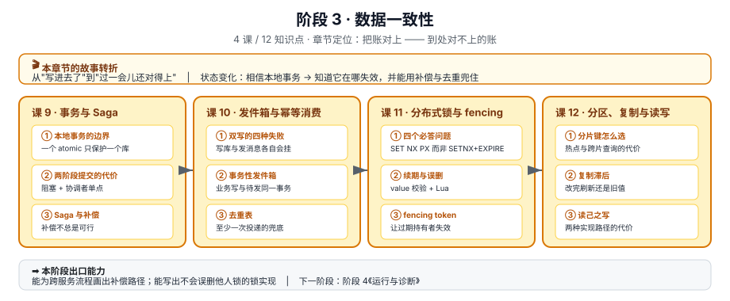

# 阶段 3：数据一致性

> 所属课程：Python 分布式应用开发 ｜ 故事章节："到处对不上的账" ｜ 上一阶段：[阶段 2 服务之间的通信](../2-服务之间的通信/overview.md)

## 🎯 本阶段目标

- 让跨服务、跨库的操作在失败与并发下仍然留下**正确**的数据
- 能识别并修复三类最常见的数据不一致：跨服务事务、双写、并发写
- 说清"数据按什么维度拆"和"拆完之后读到的还是不是最新的"

## 📍 学习重点

- **本地事务到此为止**：一个 `with transaction.atomic()` 只能保护一个数据库。跨服务要么补偿，要么用消息达成最终一致。
- **双写必然不一致**：写库成功、发消息失败（或反过来）在生产上不是小概率事件。发件箱把"写业务"和"记待发"放进同一个事务，问题才消失。
- **锁解决的是互斥，不是正确性**：持锁进程在 GC 或网络抖动时"假死"，锁过期后旧持有者仍可能写数据——fencing token 才能让过期持有者失效。
- **复制是异步的，读是可能落后的**：这不是 bug，是设计取舍；要解决只能在读路径上做补偿。

## ✅ 必须掌握的知识点

| 知识点 | 所属课 | 学完应能 |
|--------|--------|----------|
| 为什么本地事务不够用 | 课 9 | 举出跨服务操作中本地事务失效的具体位置 |
| 两阶段提交的代价 | 课 9 | 说清 2PC 的阻塞点与协调者单点问题 |
| Saga 与补偿设计 | 课 9 | 为一个跨服务流程设计补偿链，并说清补偿不总是可行的场合 |
| 双写不一致的根源 | 课 10 | 列出双写的四种失败组合 |
| 事务性发件箱 | 课 10 | 写出与业务写在同一个事务里的发件箱表结构 + 中继逻辑 |
| 幂等消费与去重表 | 课 10 | 设计消费端去重，处理"至少一次"投递 |
| 用 Redis 做锁的四个必答问题 | 课 11 | 说清为什么必须是 `SET NX PX` 而非 `SETNX`+`EXPIRE` |
| 锁续期与误删 | 课 11 | 用 value 校验 + Lua 避免删掉别人的锁 |
| fencing token：让过期持有者失效 | 课 11 | 说清 fencing 如何在下游生效，以及它要求下游做什么 |
| 分片键怎么选 | 课 12 | 按访问模式选分片键，并指出热点与跨片查询的代价 |
| 复制的滞后与读写分离陷阱 | 课 12 | 解释"改完资料刷新还是旧值"的三种成因 |
| 读己之写与会话一致性 | 课 12 | 给出读己之写的两种实现路径与代价 |

## 🗺️ 本阶段路径图

> 看图：课 9 处理"一个业务动作跨多个服务"（事务），课 10 处理"业务写和消息发"（双写），课 11 处理"多个执行者同时想改同一份数据"（并发互斥），课 12 处理"数据分散在多台机器上"（分片与复制）。四条线互相独立但常同时出现，课 10 用到课 9 的最终一致思路，课 11 的 fencing 常与课 12 的主从切换一起出现。

## 本阶段产出

- [x] `lessons/09-分布式事务与Saga.md`
- [x] `lessons/10-事务性发件箱与幂等消费.md`
- [ ] `lessons/11-分布式锁与fencing-token.md`
- [ ] `lessons/12-分区、复制与读写一致性.md`
- [x] `../应用实战/09-分布式事务与Saga.md`
- [x] `../应用实战/10-事务性发件箱与幂等消费.md`
- [ ] `../应用实战/11-分布式锁与fencing-token.md`
- [ ] `../应用实战/12-分区、复制与读写一致性.md`
