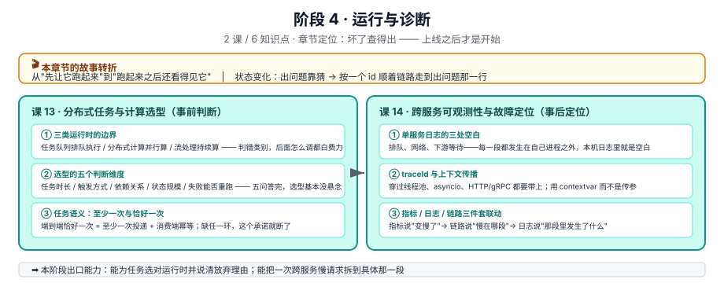

# 阶段 4：运行与诊断

> 所属课程：Python 分布式应用开发 ｜ 故事章节："上线之后才是开始" ｜ 上一阶段：[阶段 3 数据一致性](../3-数据一致性/overview.md)

## 🎯 本阶段目标

- 为一类计算任务选对运行时，并说清"为什么不用另一种"
- 把一次跨服务的慢请求拆到具体那一段，而不是在一堆日志里靠猜
- 让排查从"翻日志找线索"变成"按 id 顺着链路走"
## 📍 学习重点

- **任务语义先于框架**：先确定这件事能接受"至少一次"还是必须"恰好一次"，再谈用 Celery、Kafka 还是自己写循环。框架不解决语义，只是把语义实现得更省力。
- **选型的五个判断维度**：任务时长、触发方式、依赖关系、状态规模、失败后能否重跑。五个维度答完，选型基本没有悬念。
- **"恰好一次"是效果，不是协议**：端到端恰好一次通常由"至少一次投递 + 消费端幂等"合成，链路里任何一环没有幂等，这个承诺就断了。
- **单服务日志注定查不出跨服务慢**：每个服务只看见自己那一段，中间的空档（排队、网络、下游等待）在自己日志里是空白。必须有一个能跨服务对齐的关联 id。
- **三件套各有盲区**：指标告诉你"变慢了"，链路告诉你"慢在哪一段"，日志告诉你"那一段里发生了什么"。只用一个，就会在另外两个的盲区里打转。

## ✅ 必须掌握的知识点

| 知识点 | 所属课 | 学完应能 |
|--------|--------|----------|
| 任务队列、分布式计算与流处理的边界 | 课 13 | 面对一个需求，判断它属于"排队执行""并行计算"还是"持续流处理" |
| 选型的五个判断维度 | 课 13 | 用五个维度做一张对照表，给出选型结论与放弃理由 |
| 任务语义：至少一次与恰好一次 | 课 13 | 说清"恰好一次"为什么必须靠消费端幂等兜底 |
| 一次慢请求为什么查不出来 | 课 14 | 指出单服务日志在跨服务调用中的三处空白 |
| traceId 与上下文传播 | 课 14 | 在 Python 里把 traceId 穿过线程池、asyncio 与 HTTP/gRPC 调用 |
| 三件套联动定位 | 课 14 | 从一条告警指标出发，用链路定位到段，用日志定位到行 |

## 🗺️ 本阶段路径图

> 看图：课 13 在"事前"做判断——这个任务该交给哪类运行时，以及它的失败重跑语义是什么；课 14 在"事后"做定位——已经慢了、已经错了，怎么在两三个服务的日志里拼出完整因果。两者共用同一个前提：你在阶段 2、3 里写下的那些 id（请求 id、幂等键、消息 id）就是本阶段的抓手，没有它们，课 14 只能靠时间戳猜。

## 本阶段产出

- [ ] `lessons/13-分布式任务与计算选型.md`
- [ ] `lessons/14-跨服务可观测性与故障定位.md`
- [ ] `../应用实战/14-跨服务可观测性与故障定位.md`（课 13 为选型类，不配应用实战）
