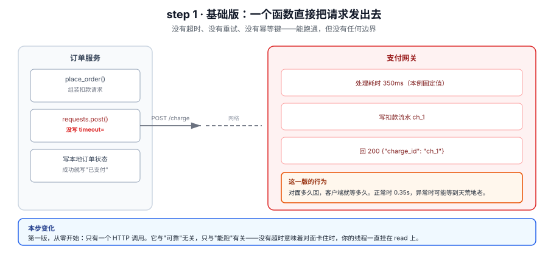
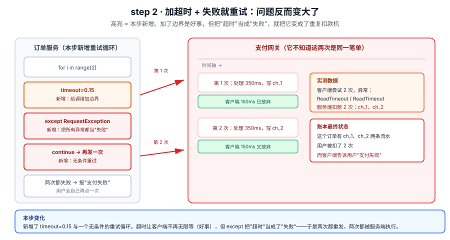
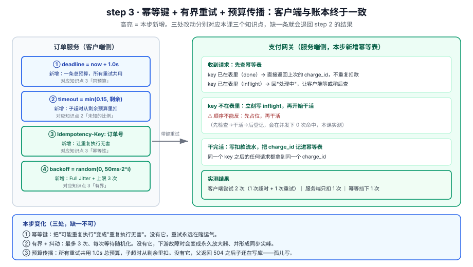

# 应用实战 · 网络与部分失败

> 对应课程：[第 3 课：网络与部分失败](../stages/1-分布式的地基/lessons/03-网络与部分失败.md) ｜ 覆盖知识点：部分失败、超时是未知、重试的代价与放大器效应
> 定位：**会用，不上生产**——课里学完，在这里动手（结构与边界见 SKILL.md「教学叙事骨架 · 应用实战」）。
> 📖 结论已按官方文档核对（核对于 2026-11 ｜ 来源：[RFC 9110 §9.2.2](https://www.rfc-editor.org/rfc/rfc9110.html#section-9.2.2)、[requests · Timeouts](https://requests.readthedocs.io/en/latest/user/advanced/#timeouts)）
> ✅ 实测于 Linux / Python 3.12.3 / requests 2.31.0，服务端与客户端都在本机回环上，不访问外网

## 场景 1：一笔被扣了两次的订单

**场景**：订单服务调用支付网关扣款。灰度期间网关 P99 从 200ms 跳到 400ms，客服开始收到"我只点了一次，为什么扣两次"的工单。当天 12000 笔订单里有 47 笔重复扣款，占比 0.39%——比例不大，但每一笔都要走退款流程，且用户信任损失不可逆。

**全貌一句话**：完整方案还需要扣款状态查询接口、对账 job、退款补偿（非本课内容）；本课只解决"如何让重试不再制造重复扣款"这一个环节。

---

### ① 基础实现（能跑但幼稚）



> 看图：左边是订单服务，右边是支付网关，中间只有一条 POST。注意左边第二个框里那行红字——`requests.post()` 没写 `timeout=`，这是这一版唯一的、也是最大的问题。网关固定要 350ms，所以正常情况下它能跑通，但对面一旦卡住，这个线程就一直挂在 read 上。

```python
# step1_naive.py
import requests

GATEWAY = "http://127.0.0.1:8000/charge"      # 本例用本地假网关

def place_order(order_id: str, amount: int) -> dict:
    r = requests.post(GATEWAY, json={"order_id": order_id, "amount": amount})
    # ❌ 没有 timeout；❌ 没有 raise_for_status；❌ 网络异常直接冒到上层
    return r.json()
```

实测输出（网关侧固定处理 350ms）：

```
==============================================================
step1 裸调：没有超时，也没有重试
==============================================================
  请求耗时 0.35s ｜ 状态 200 ｜ 回应 {"ok": true, "charge_id": "ch_1"}
  [step1] 订单 order-8801 实际扣款 1 次 ｜ 详情 ['ch_1'] ｜ 幂等挡下 0 次
```

> ⚠️ **它的问题**：
> 1. **没有超时**：requests 官方文档原话是"By default, requests do not time out unless a timeout value is set explicitly. Without a timeout, your code may hang for minutes or more."（核查于 2026-11）。对面卡住时，你的线程池会被慢慢占满。
> 2. **5xx 不抛异常**：`requests.post` 拿到 500 也算"成功返回"，`r.json()` 会在错误响应体上炸出别的错，掩盖真实原因。
> 3. **网络异常直接穿透**：`ConnectionError` / `ReadTimeout` 一路冒到最上层，没有分类，也无从判断"该不该重试"。

---

### ② 演进 1：加超时，然后"失败就重试"

被 P99 恶化逼出来的第一反应：加超时，超时就重试一次。



> 看图：比上一张多了两处高亮——左边新增了 `timeout=0.15` 和一个 `for` 重试循环，右边时间轴上出现了**两条**流水（ch_1、ch_2）。关键在那两个绿色小方块：客户端在 150ms 就放弃了，而网关要 350ms 才写完——**绿色方块的位置告诉你，客户端从来没有等到过任何一次成功**。所以它把两次都判成失败，而账本上是两笔。

```python
# step2_timeout_retry.py
import requests

GATEWAY = "http://127.0.0.1:8000/charge?ms=350"

def place_order(order_id: str, amount: int) -> dict:
    last_err = None
    for i in range(2):                       # 手写"重试一次"
        try:
            r = requests.post(
                GATEWAY,
                json={"order_id": order_id, "amount": amount},
                timeout=0.15,                # ✅ 有了边界
            )
            r.raise_for_status()             # ✅ 5xx 现在会抛
            return r.json()
        except requests.RequestException as e:
            last_err = e                     # ❌ 把所有异常一律当"失败"
            continue                         # ❌ 无条件重试
    raise RuntimeError(f"payment failed: {last_err}")
```

实测输出：

```
==============================================================
step2 加超时 + 失败就重试：把'超时'当成'失败'
==============================================================
  客户端尝试 2 次 ｜ 异常 ['ReadTimeout', 'ReadTimeout'] ｜ 总耗时 0.30s
  [step2] 订单 order-8801 实际扣款 2 次 ｜ 详情 ['ch_1', 'ch_2'] ｜ 幂等挡下 0 次
```

**这一版比上一版更糟。** 上一版至少不会重复扣款；这一版把一个"偶发的慢"放大成了"稳定的重复扣款"。而且客户端的结论是"支付失败"——用户看到失败会自己再点一次，那就是第三次扣款。RFC 9110 §9.2.2 对此有明确态度（核查于 2026-11）：

> "A client SHOULD NOT automatically retry a request with a non-idempotent method unless it has some means to know that the request semantics are actually idempotent"

`POST /charge` 既不是 safe 也不幂等，而这段代码没有任何"means to know"。它违反了规范里那条 SHOULD NOT。

> ⚠️ **它的问题**：
> 1. **`except RequestException` 太宽**：把 `ReadTimeout`（可能已扣款）和 `ConnectTimeout`（确定没扣款）混成一类，前者重试就是重复扣款。
> 2. **没有幂等键**：网关无从判断"这两次是同一笔单"，只能照做。
> 3. **重试没有预算**：如果重试 5 次、每次 150ms，客户端要挂 750ms，而每一次都可能扣款成功。父级超时一到就返回，子调用还在跑——孤儿写。

---

### ③ 演进 2（综合版）：幂等键 + 有界抖动重试 + 预算传播

真正的修法不是"要不要重试"，而是让重试变成一件安全的事。三处改动，分别对应本课三个知识点。



> 看图：左边四个框是本步新增的四件事（总预算、子超时从剩余扣、幂等键、有界抖动），右边网关多了"先查幂等表"这一步。注意网关侧那个红色警告——**先占位再干活**，顺序反了会在并发下完全失效。底部三个"没有它会怎样"是这个图最该记住的部分：三处改动不是可选项，是三个必要条件。

```python
# step3_idempotent.py —— 客户端
import random
import time
import requests

GATEWAY = "http://127.0.0.1:8000/charge?ms=350"
BUDGET = 1.0          # 整笔支付的总预算
MAX_ATTEMPTS = 3      # 重试上限（含首次）
CHILD_TIMEOUT = 0.15  # 单次子调用最多用多久

def place_order(order_id: str, amount: int) -> dict:
    deadline = time.perf_counter() + BUDGET
    key = f"idem-{order_id}"            # ① 幂等键：整笔单一个键，重试复用
    last_err = None
    for i in range(MAX_ATTEMPTS):
        left = deadline - time.perf_counter()
        if left <= 0.02:                # ② 预算耗尽就不再试
            break
        if i > 0:                       # ③ 只有重试才退避，首次调用立刻发
            backoff = random.uniform(0, 0.05 * (2 ** i))     # Full Jitter
            time.sleep(min(backoff, max(0.0, deadline - time.perf_counter())))
        try:
            r = requests.post(
                GATEWAY,
                json={"order_id": order_id, "amount": amount},
                headers={"Idempotency-Key": key},
                timeout=(0.05, min(CHILD_TIMEOUT, deadline - time.perf_counter())),
            )
            r.raise_for_status()
            return r.json()
        except requests.ConnectTimeout as e:
            last_err = e                # 确定没送到 → 可以放心重试
        except requests.ReadTimeout as e:
            last_err = e                # 可能已扣款 → 靠幂等键兜住
        except requests.ConnectionError as e:
            last_err = e                # 可能已扣款（RemoteDisconnected）→ 同上
        except requests.HTTPError as e:
            # 4xx 是"确定失败且再试也一样"，直接抛，不要重试
            if e.response is not None and 400 <= e.response.status_code < 500:
                raise
            last_err = e                # 5xx 可以重试
    raise RuntimeError(f"payment failed: {last_err}")
```

服务端侧只需要一个幂等表，注意占位顺序：

```python
# step3_gateway.py —— 网关侧（节选，省略参数校验与鉴权）
IDEM = {}   # key -> "inflight" | charge_id

def handle_charge(body, headers):
    key = headers.get("Idempotency-Key")
    if key:
        state = IDEM.get(key)
        if state == "inflight":
            return 409, {"ok": False, "retry_after_ms": 100}     # 让客户端等
        if state:
            return 200, {"ok": True, "duplicate": True, "charge_id": state}
        IDEM[key] = "inflight"          # ⚠️ 必须先占位，再干活
    charge_id = do_charge(body)         # 真正的扣款（慢）
    if key:
        IDEM[key] = charge_id
    return 200, {"ok": True, "charge_id": charge_id}
```

实测输出：

```
==============================================================
step3 幂等键 + 有界重试 + 预算传播
==============================================================
  [step3] 订单 order-8801 实际扣款 1 次 ｜ 详情 ['ch_1'] ｜ 幂等挡下 1 次
  客户端尝试 2 次 ｜ 异常 ['ReadTimeout'] ｜ 总耗时 0.17s ｜ 客户端判定 成功
```

客户端还是超时了一次、还是重试了，但账本只有一笔。**同样的失败，不同的后果——差别全在那三个前置条件上。**

> 🎯 **会用标志**：给任何一个非幂等的写接口加重试之前，你能先说出三句话——"这个接口有幂等键吗"、"重试上限几次、退避怎么算"、"这些重试共用哪条总预算"。三句都答得上来，才可以动手加。

---

## 收尾对照表

| 维度 | step1 裸调 | step2 加超时重试 | step3 综合版 |
|---|---|---|---|
| 客户端会不会无限等 | 会 | 不会（150ms） | 不会（150ms，且受剩余预算约束） |
| 对面卡住时的行为 | 线程挂住 | 放弃 + 重发 | 放弃 + 有界重发 |
| 重复扣款次数（本课实测） | 0（但异常时也无人兜底） | **2** | **1** |
| 客户端结论与账本是否一致 | 偶发不一致（异常时无从判断） | **必然不一致** | 一致 |
| 会不会产生孤儿写 | 不会（没重试） | 会（父返回后子仍写） | 不会（预算传播） |
| 下游故障时会不会放大负载 | 不会 | 会（无上限、无抖动） | 有界（3 次 + 抖动） |
| 实现复杂度 | 3 行 | 12 行 | 25 行 + 服务端幂等表 |
| 什么时候可以退回简单版 | 只有内部调用、失败可人工重跑、且能接受线程挂住 | **不建议退回**——它比 step1 更危险 | 幂等表有额外存储与过期成本；纯读接口可退到 step2 |

退不回 step1，是因为 step1 的"没有重复扣款"是**巧合**，不是设计：它没有重试，所以没机会重复；但同样因为它没有超时和分类，异常时它连"该不该重试"都判断不了，只能抛给人工。step2 则是把一个隐性风险变成了显性错误。step3 才是把"未知"接住的那一版。

---

## 代码 review 结论（主 agent 直接审，静态）

- `step1_naive.py`：确认 `requests.post` 无 `timeout` 参数，符合"无默认超时"的官方口径；无 `raise_for_status`，5xx 不会抛；异常未分类。**结论：可用作反例，不可上线。**
- `step2_timeout_retry.py`：`except requests.RequestException` 覆盖了连接失败与读超时两类，语义上把"确定没做"和"可能做了"混为一谈，是重复扣款的直接原因。重试无上限计数外的预算约束、无退避。**结论：反例，且比 step1 更危险，正文已说明。**
- `step3_idempotent.py`：`deadline` 只算一次，重试循环每轮用 `left` 重算剩余；`timeout` 第二项用 `min(CHILD_TIMEOUT, left)`，不会超过父预算；`Idempotency-Key` 在循环外生成，重试复用同一个值（关键）。`time.sleep` 的等待被 `min(..., deadline - now)` 夹住，不会因为退避把预算睡穿。**结论：逻辑正确。**
- `step3_gateway.py`：`IDEM[key] = "inflight"` 在 `do_charge` 之前，避免了 check-then-act 竞态（本课知识点 3 有对照实验：写反了命中 0 次）。`inflight` 分支返回 409 让客户端重试，而不是让两个请求都往下走。**结论：逻辑正确。**
- 未覆盖的场景（已在"全貌一句话"标注为非本课内容）：幂等表的过期与清理、键冲突（不同订单同键）、网关多实例时幂等表要放共享存储、退款与对账。

---

## 🧭 导航

- ⬅️ 回到课程：[第 3 课：网络与部分失败](../stages/1-分布式的地基/lessons/03-网络与部分失败.md)
- 📚 全部实战：[应用实战索引](INDEX.md)
- ➡️ 下一课实战：05 · 接口契约与 gRPC（未编写，配课 5）
