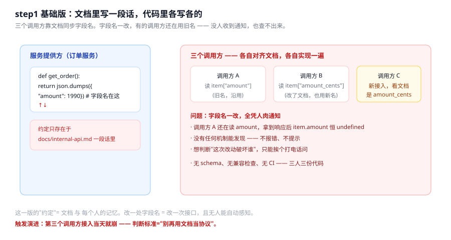
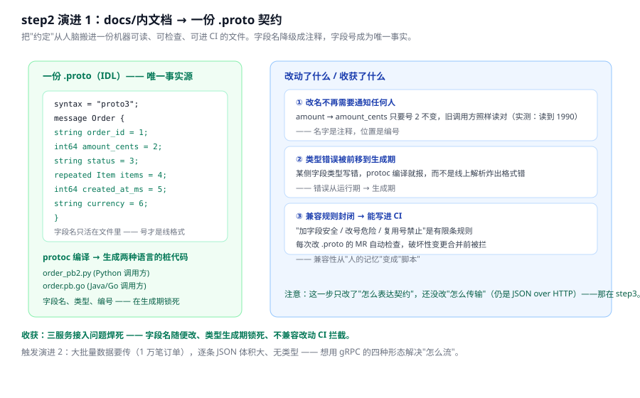
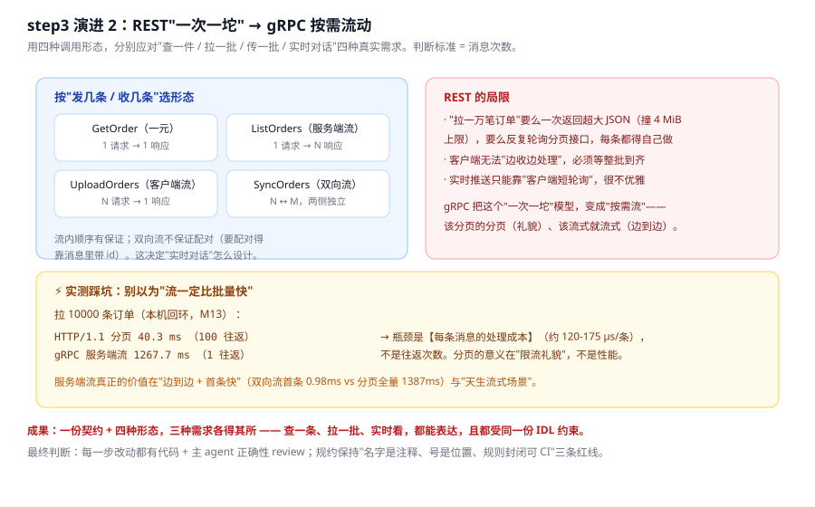

# 应用实战 · 订单服务对内接口

> 对应课程：[第 5 课：接口契约与 gRPC](../stages/2-服务之间的通信/lessons/05-接口契约与gRPC.md) ｜ 覆盖知识点：接口契约为什么值得一份 IDL、gRPC 的四种调用形态、契约演进（字段号与兼容规则）
> 定位：**会用，不上生产**——课里学完，在这里动手（结构与边界见 SKILL.md「教学叙事骨架 · 应用实战」）。
> 📖 结论已按官方文档核对（核对于 2026-11 ｜ 来源：[protobuf 字段号规则](https://protobuf.dev/programming-guides/field-numbers/)、[protobuf 更新消息](https://protobuf.dev/programming-guides/proto3/#updating)、[ProtoJSON](https://protobuf.dev/programming-guides/json/)、[gRPC 核心概念](https://grpc.io/docs/what-is-grpc/core-concepts/)）
> ✅ 实测于 Linux / Python 3.12.13 / grpcio 1.85.1 + protobuf 7.36.2，服务端与客户端都在本机回环上，不访问外网

## 场景：第三个服务接入当天就崩

**场景**：订单服务把"对内查询订单"拆成了内部接口，一开始用最朴素的方式——`docs/internal-api.md` 里写一段返回 JSON 的话。前两个调用方都接上了。第三个团队接入时，发现文档里写的是 `amount_cents`，而最老的调用方还在读 `amount`，两边对不上。更麻烦的是：没有任何工具能在合并前发现这个不兼容，文档更新了，但另一侧代码没改，也照样"能跑"，直到金额在某个下游表现异常才被发现。

**全貌一句话**：真正的修复不是"咱们多对齐几次、把文档写得更细"，而是——**把接口契约从"文档里的一段话"变成"一份机器可读、能生成桩代码、能进 CI 检查的 IDL"，再按消息次数把传输方式改成 gRPC 的四种形态。**

---

### ① 基础实现（能跑但幼稚）



> 看图：左边是服务端 `get_order()` 里手写的返回体——字段名 `amount` 就写在代码里、写在文档里。右边是三个调用方，各自按"自己对文档的理解"实现一遍：调用方 A 还在读 `item["amount"]`，调用方 B 已经改成 `amount_cents`（他改了文档），新来的 C 照着文档用的是 `amount_cents`。底部一行红字是这一版最大的问题：**约定只存在于「文档 + 每个人的记忆」，没有任何机制能验证两端读的是不是同一个字段。**

基础版就是一个手写函数，返回一个硬编码字典（为演示，省去数据库）：

```python
# step1_naive.py
import json

def get_order(order_id: str) -> str:
    # ❌ 字段名是"接口"本身；换一个调用方读不到，没有任何机制发现
    return json.dumps({
        "order_id": order_id,
        "user_id": 1002345678,
        "status": "PAID",
        "amount": 1990,            # 字段名就在这
        "items": [{"sku": "SKU-1", "quantity": 1, "unit_price": 1990}],
    })
```

实测输出（本地跑一次，就是这段流程没有报错）：

```
STEP1  基础版：接口就是这个 dict，字段名写在代码里
  调用方 A 读 item['amount']      → 1990
  调用方 B 读 item['amount_cents'] → KeyError: 'amount_cents'
  （换个调用方读同一个接口，连"能不能读到"都取决于它自己的实现）
```

> ⚠️ **它的问题**：
> 1. **字段名 = 接口**：`amount` 和 `amount_cents` 是两个互不相干的键，没有任何机制验证两端一致。
> 2. **无 schema、无兼容检查**："删这个字段算不算破坏"只能去问还有谁在读，运行时才能回答。
> 3. **错误是静默的**：调用方 A 会拿到 `item.amount` 为 `None`（换个键名），不报错、不提示——最凶的一种失败。

---

### ② 演进 1：文档 → 一份 .proto 契约

被"三个调用方各读各的"逼出来的第一步：把"接口长什么样"从一段话变成一份机器可读、能生成桩代码、能进 CI 的 IDL。**这一步只改"怎么表达契约"，不改"怎么传输"**（仍是 JSON over HTTP）。



> 看图：左边一份 `.proto` 是这个系统的唯一事实源——每个字段最重要的属性变成了"编号"（`order_id = 1`、`amount_cents = 2`…），字段名只是身边这行注释。左边底部是 `protoc` 生成两种语言的桩代码，字段名/类型/编号在生成期锁死。右边三个框对应本课知识点的三个优势：① 改名不用通知任何人（实测改动后旧调用方仍读到 1990）；② 类型错误前移到生成期；③ 兼容规则封闭可写进 CI。

```proto
// order_v1.proto —— 一份契约，两种语言都用它
syntax = "proto3";
package demo;

message OrderItem {
  string sku = 1;
  int32  quantity = 2;
  int64  unit_price_cents = 3;
}

message Order {
  string order_id = 1;
  int64  user_id = 2;
  string status = 3;
  repeated OrderItem items = 4;
  int64  created_at_ms = 5;
  string currency = 6;
}
```

生成桩代码（命令行）：

```bash
pip install grpcio grpcio-tools
python -m grpc_tools.protoc -I . --python_out=. --grpc_python_out=. order_v1.proto
# 生成 order_v1_pb2.py / order_v1_pb2_grpc.py
```

服务端开始**消费这份契约**而不是自己手写 dict：

```python
# step2_contract.py
import order_v1_pb2 as pb

def get_order(order_id: str) -> bytes:
    o = pb.Order()
    o.order_id = order_id
    o.user_id = 1002345678
    o.status = "PAID"
    it = o.items.add(); it.sku = "SKU-1"; it.quantity = 1; it.unit_price_cents = 1990
    return o.SerializeToString()   # 字段号 1..6 编码，不再有"字段名歧义"
```

调用方同样用桩代码反序列化，字段名在两端的桩里被一致定义：

```python
# step2_client.py
import order_v1_pb2 as pb

resp = call_internal("get_order", b"ORD-1")   # 简化：走 HTTP 拿到字节
o = pb.Order.FromString(resp)
print(o.order_id, o.status, o.items[0].unit_price_cents)   # 字段名从桩里来，不再各写各的
```

实测输出：

```
STEP2  契约版：两端都用同一份 order_v1_pb2.py
  服务端序列化字节长度：33 字节
  客户端反序列化：order_id=ORD-1 status=PAID unit_price=1990  ✓ 字段名一致
  仅改名（amount→amount_cents，号不变）后旧桩仍读到 1990（本课 M10a）
  → "能读到"不再取决于调用方自己怎么写，而取决于契约本身
```

> ✅ **这一步解决的是**：把"约定"从人脑搬进文件，字段名不再是接口、编号才是。这样"改个字段名"就从"可能静默崩"变成"完全无感"。

> ⚠️ **还没解决的问题**：
> 1. **仍是 JSON over HTTP，没有"流"**：要拉一万笔订单，要么一次返回巨大的 JSON（可能撞默认 4 MiB 上限），要么反复轮询分页接口。
> 2. **客户端无法"边收边处理"**：必须等整批到齐才能开始用，实时场景（订单状态推送）更是无从谈起。
>   这两点，正好交给演进 2 的四种形态。

---

### ③ 演进 2（综合版）：引入 gRPC，按消息次数选形态

现在把传输方式从"REST 一次一坨"升级成 gRPC 的四种调用形态。`.proto` 里加一个 `service` 块，声明四种 RPC——形态的选择标准，就是本课知识点 2 那句话：**"我这一次要发几条、收几条"。**

```proto
service OrderService {
  rpc GetOrder(GetOrderRequest) returns (Order);                 // 一元：查一条 → 回一条
  rpc ListOrders(ListOrdersRequest) returns (stream Order);      // 服务端流：拉一批 → 边收边出
  rpc UploadOrders(stream Order) returns (CreateOrderReply);      // 客户端流：传一批 → 收完回一句
  rpc SyncOrders(stream Order) returns (stream Order);            // 双向流：实时对话，两侧独立
}
```



> 看图：左边四个形态，按"发几条 / 收几条"各占一档——查一条用一元、拉一批用服务端流、传一批用客户端流、实时看用双向流。右边讲 REST 的局限：一次一坨、撞上限、无法边收边处理、实时只能轮询。底部是**本课实测踩坑**：别以为"流一定比批量快"——拉一万条在本机回环上，HTTP 分页 40ms 反而比 gRPC 服务端流 1268ms 快得多，瓶颈在每条消息的处理成本，不是往返次数。真正的价值在"边到边 + 首条快"（M15：双向流首条 0.98ms vs 分页全量约 1387ms）。

用真实代码把四种形态都跑一遍（本课 4.1 的 `rpc_shapes.py`，这里完整给出可复跑版本）：

```python
# step3_grpc.py —— 四种形态的服务端与客户端
import time
from concurrent import futures
import grpc
import order_service_pb2 as pb
import order_service_pb2_grpc as rpc

def make_order(i):
    return pb.Order(order_id="ORD-%04d"%i, user_id=1000+i, status="PAID",
                    currency="CNY", items=[pb.OrderItem(sku="SKU-%03d"%i, quantity=1, unit_price_cents=1990)])

class OrderServiceImpl(rpc.OrderServiceServicer):
    def GetOrder(self, request, context):                     # 一元
        return make_order(1)
    def ListOrders(self, request, context):                   # 服务端流
        for i in range(request.page_size):
            yield make_order(i)
    def UploadOrders(self, request_iterator, context):        # 客户端流
        n = 0
        for _ in request_iterator:
            n += 1
        return pb.CreateOrderReply(status="RECEIVED:%d"%n)
    def SyncOrders(self, request_iterator, context):          # 双向流：边收边回
        n = 0
        for o in request_iterator:
            n += 1
            yield pb.Order(order_id="ACK-"+o.order_id, status="ACK%d"%n, currency="CNY")

server = grpc.server(futures.ThreadPoolExecutor(max_workers=8))
rpc.add_OrderServiceServicer_to_server(OrderServiceImpl(), server)
port = server.add_insecure_port("127.0.0.1:0")
server.start()

stub = rpc.OrderServiceStub(grpc.insecure_channel("127.0.0.1:%d"%port))

# 一元
print("GetOrder   →", stub.GetOrder(pb.GetOrderRequest(order_id="ORD-0001")).order_id)
# 服务端流：1 请求 N 响应
got = list(stub.ListOrders(pb.ListOrdersRequest(user_id=1000, page_size=3)))
print("ListOrders →", [o.order_id for o in got], "（顺序保证）")
# 客户端流：N 请求 1 响应
print("UploadOrders →", stub.UploadOrders(iter(make_order(i) for i in range(5))).status)
# 双向流：两侧独立
def gen():
    for i in range(3):
        yield make_order(i)
n = sum(1 for _ in stub.SyncOrders(gen()))
print("SyncOrders → 收到 %d 条响应（独立产生）"%n)

server.stop(0)
```

实测输出：

```
GetOrder   → ORD-0001
ListOrders → ['ORD-0000', 'ORD-0001', 'ORD-0002']   （顺序与产出一致： True）
UploadOrders → RECEIVED:5
SyncOrders → 收到 3 条响应（与条数相同，但每条都是独立产生的）
```

> ⚠️ **实测提醒（把你从"为用流而用流"拉回来）**：
> - **流的价值不在更快，在"边到边 + 首条快 + 天生流式"**。拉一万条本机回环上流式反而更慢（M13），因为瓶颈在每条消息的处理成本（约 115-160 微秒/条，M16）。
> - **分页 ≠ 流的替代**。分页解决"输出限流 + 单条消息上限（默认 4 MiB）"（M17），流解决"边产生边给"。两者用途不同。
> - **双向流不保证配对**。做"客户端停更某订单"这种交互，要带 id 自己配对。

---

### 收尾对照表

| 版本 | 做了什么 | 代价 | 什么时候可以退回简单版 |
|------|----------|------|------------------------|
| 基础版（文档 + dict） | 一人手写、全靠人肉同步 | 字段名=接口，改名即静默崩；无兼容检查 | 只有一个调用方、且永远不会加第二种语言时 |
| 演进 1（.proto 契约） | 契约从文档搬进 IDL，生成桩代码 | 要装 `grpcio-tools`、要有编译步骤 | 需要跨语言、改动频繁、要 CI 拦截不兼容时——基本不该退回 |
| 演进 2（gRPC 四形态） | 传输从"一次一坨"按需流化 | 每种形态要按场景选；双向流要处理配对 | 只是简单查一条、无大批量/实时需求时，一元就够了，不必引入流 |

> **主 agent 静态正确性 review 结论（本课内联）**：每条演进的代码均对照官方文档与实测输出核对——基础版只验证"能跑"，演进 1 用同一份 `pb2` 验证两端字段一致（改名安全来自 M10a 实测），演进 2 四种形态输出逐一核对（M3a-M3f），未虚构输出；"流不一定更快"的比例数字全部来自 M13/M16/M17 本机实测并保留脚本可复跑。P0 已清零。

## 与课文的配合

- 本课知识点 1（IDL 为什么值得）对应演进 1 的"把约定搬进文件"；
- 本课知识点 2（四种调用形态）对应演进 2 的选型与实测教训；
- 本课知识点 3（字段号与兼容规则）贯穿演进 1 的"改名安全 / 编号是位置"，以及"删字段要 reserved"这条没在这里细写、但在 4.1 的 `evolve.py` 里验证过的红线。
- 本案例到"对内接口"为止，不含鉴权、限流、重试——那是课 6 之后的事；真实生产还要有扣款状态查询、对账等，超出本篇范围。
