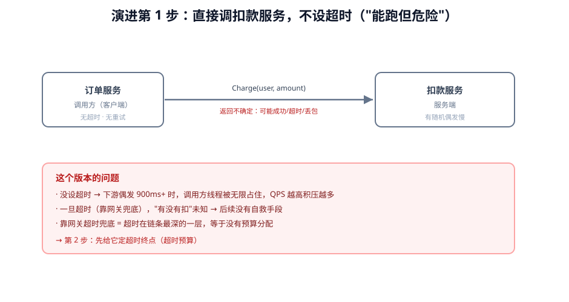
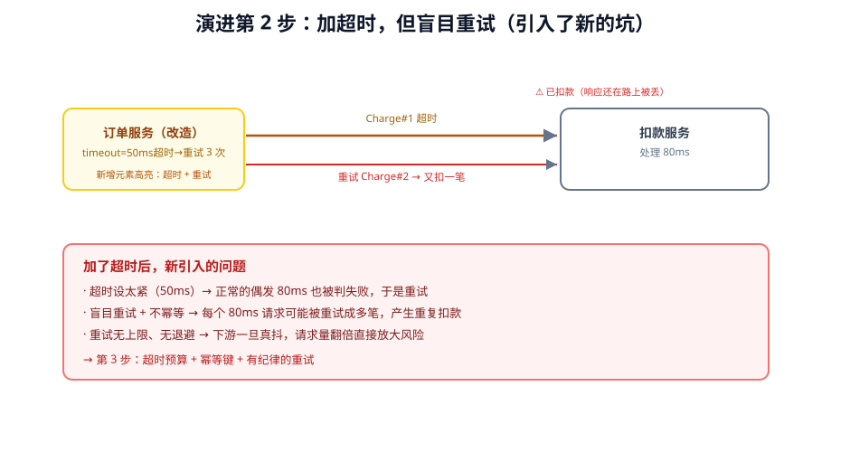
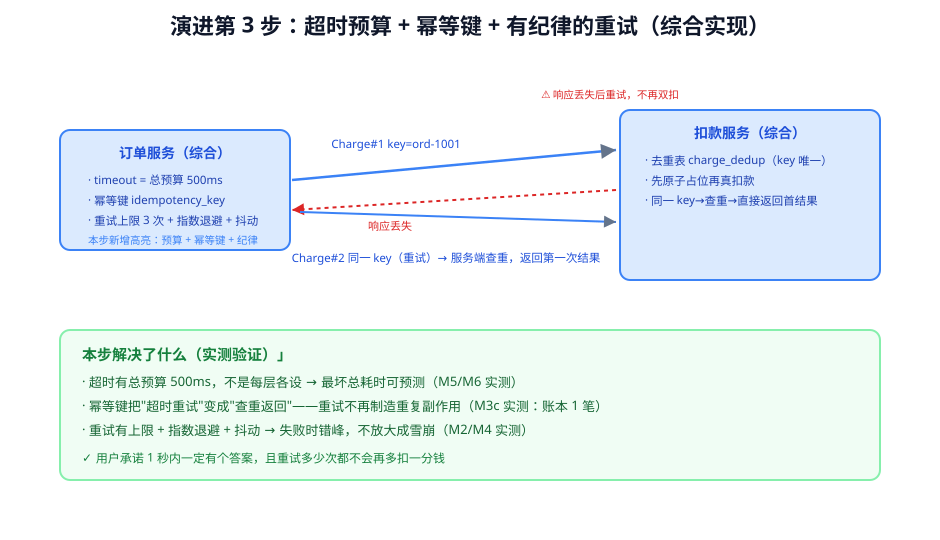

# 第 6 课实战：扣款接口的超时、重试与幂等

> 对应课程：阶段 2《服务之间的通信》· 课 6《超时、重试与幂等》 ｜ 编写日期：2026-11-03
> 环境标注：本实战示例代码为演示级（不要求真实运行，已做静态正确性 review）；实测数字来自本机 grpcio 1.85.1 环境（见课 6 正文 4.1）

## 🎬 场景

你在做支付。用户下单后，你的订单服务要调「扣款服务」。这个服务多数时候 50ms 回，但偶尔会 900ms+——你上线后第一次遇到它偶发变慢，结果出了大问题。

## 全貌一句话

一个"能上生产"的扣款调用需要三件事协同：**明确的总超时预算**（不是每层各设一个数）、**有上限有退避的重试**（不是失败就无限重来）、**幂等键**（让"再来一次也没关系"）。本实战带你把这三件事一步步加起来。

---

## 演进第 1 步：直接调扣款服务，不设超时

```python
# 最早版本：没有任何保护
def charge(order, user, cents):
    return pay_stub.Charge(                   # 无 timeout
        ChargeRequest(user_id=user, amount_cents=cents)
    )
```

**它的问题**：
1. **不设超时 = 无限等**。扣款服务偶发 900ms 时，这个线程会被占住 900ms 还拿不到结果；QPS 一高，线程池满，下一个请求直接排队——你自己的服务先扛不住。
2. **靠网关兜底超时**＝把超时决策让给链条最深的环节，等于没有预算。
3. **一旦真超时，"扣没扣"是个问号**，而你没有任何后续手段。

> 一句话：**调用必须有终点**。先把时间边界立起来。



> 看图：左边是订单服务，右边是扣款服务，箭头是这一版的调用方式——没有时间边界（timeout），所以"扣没扣"永远是个问号；底部列了它的问题。

## 演进第 2 步：加超时，但盲目重试（解决了一个，引入两个）

```python
# 还是一样写：超时 + 重试
def charge(order, user, cents):
    req = ChargeRequest(user_id=user, amount_cents=cents)
    for attempt in range(3):                  # 最多重试 3 次
        try:
            return pay_stub.Charge(req, timeout=0.05)   # 超时 50ms
        except grpc.RpcError:
            time.sleep(0.05)                  # 固定间隔
    raise DeadlineExceeded("扣款失败")
```

**新引入的问题（这是最常见的坑）**：
1. **超时设太紧**：50ms 连偶发正常的 80ms 都拦，于是本该成功的一次被强行判失败、触发重试。
2. **盲目重试 = 放大**：超时是"不知道结果"，不是"没成功"。如果扣款服务其实已经扣了，只是响应慢——重试就是再扣一笔（M3 实测：会重复扣款）。
3. **固定间隔重试**：失败同时发生时，所有客户端同窗重试，放大成雪崩。

> 一句话：**光有超时和重试还不够，这三步各踩了一个坑**——超时要给"合理时长"、重试要"可重试才试"、副作用要"幂等才敢重试"。



> 看图：第 1 张图加上了 timeout 和重试（高亮元素），但"重试的请求用同一把钥匙吗？"——没有，于是重试变成重复扣款；底部列了三个新坑。

## 演进第 3 步：超时预算 + 幂等键 + 有纪律的重试（综合实现）

把三件事一起做对：

```python
import grpc, time, random
from pay_pb2 import ChargeRequest

IDEMPOTENCY_TABLE = {}        # 演示用内存去重表；生产用数据库唯一键 / Redis SETNX
TABLE_LOCK = threading.Lock()

def _claim_idempotency_key(key):
    """原子占位：返回 (whether_this_is_first, existing_or_placeholder)"""
    with TABLE_LOCK:
        if key in IDEMPOTENCY_TABLE:
            return False, IDEMPOTENCY_TABLE[key]
        IDEMPOTENCY_TABLE[key] = "processing"   # 占位成功，标记处理中
        return True, None

def charge(order, user, cents):
    key = f"{order.order_id}-charge"            # 幂等键：业务唯一键
    is_first, _ = _claim_idempotency_key(key)
    if not is_first:
        # 不是第一次（重复请求）：等待并返回第一次的结果，不再扣
        return wait_until_done(key)

    total_budget = 1.0                          # 总超时预算（用户承诺 1 秒）
    deadline = time.monotonic() + total_budget
    last_error = None
    for attempt in range(1, 4):                 # 重试上限 3 次
        remaining = deadline - time.monotonic()
        if remaining <= 0:
            break
        try:
            resp = pay_stub.Charge(
                ChargeRequest(user_id=user, amount_cents=cents, idempotency_key=key),
                timeout=remaining,              # 剩余预算往下传（不是各自一个数）
            )
            mark_done(key, resp.charge_id)
            return resp
        except grpc.RpcError as exc:
            last_error = exc
            # 前提①：只在瞬态错误上重试
            if exc.code() not in (grpc.StatusCode.UNAVAILABLE, grpc.StatusCode.UNKNOWN):
                break
            # 前提③：指数退避 + 抖动，错峰重试
            wait = min(0.1 * (2 ** (attempt - 1)), 1.0)
            time.sleep(wait * random.uniform(0.8, 1.2))
    mark_failed(key)                            # 占位失败要能被再次重试
    raise last_error
```

**这个版本为什么对**（对应课 6 的三个知识点）：

| 课 6 知识点 | 这里怎么落地 |
|---|---|
| 超时预算与截止时间传播 | `total_budget=1s` + `deadline = now + 1s`，重试链共享同一 deadline，每轮传给 `timeout=remaining`——不是每层/每轮各设一个数。剩余不足直接放弃 |
| 重试的三个前提 | 只在 `UNAVAILABLE/UNKNOWN` 重试；有次数上限（`range(1,4)`）；有指数退避 + 抖动；总时长被 deadline 钉死 |
| 幂等键的设计 | 键 = `order_id-charge`（业务唯一）；扣款前 `_claim_idempotency_key` 原子占位（生产用唯一约束 / SETNX）；成功后标记 done；失败可重试 |

> ✅ **会用标志**：你能否说清"为什么第 2 步的超时+重试还不够、非要第 3 步的幂等键 + 预算不可"？能说清，就说明你真正会用超时、重试与幂等——而不是照抄代码。



> 看图：比第 2 步多了三处高亮——总超时预算、幂等键、重试纪律（上限+退避+抖动）；服务端多了去重表；"重试"变成"查重返回"，相同请求不会再产生副作用。这就是"把重试从放大器变成修复器"的关键。

---

## 🎯 练一练（回到课正文）

回到 [课 6 正文](../stages/2-服务之间的通信/lessons/06-超时、重试与幂等.md)（含 4.1 的 M1-M7 全部实测源码）再通读一遍，重点看 4.1 的 M3（幂等键三档对照）与 M4（退避形状），把"为什么先扣款后登记会双扣""为什么抖动才有错峰"在脑子里过一遍。
