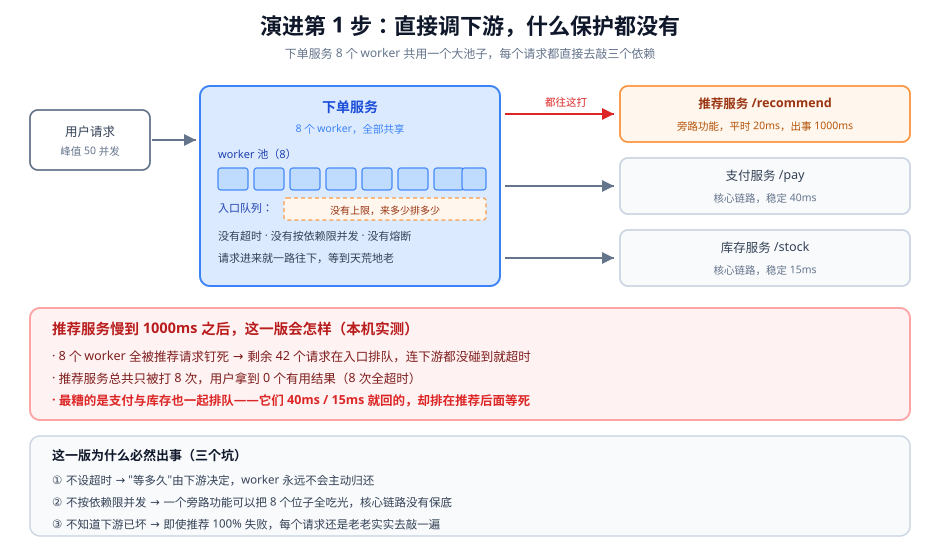
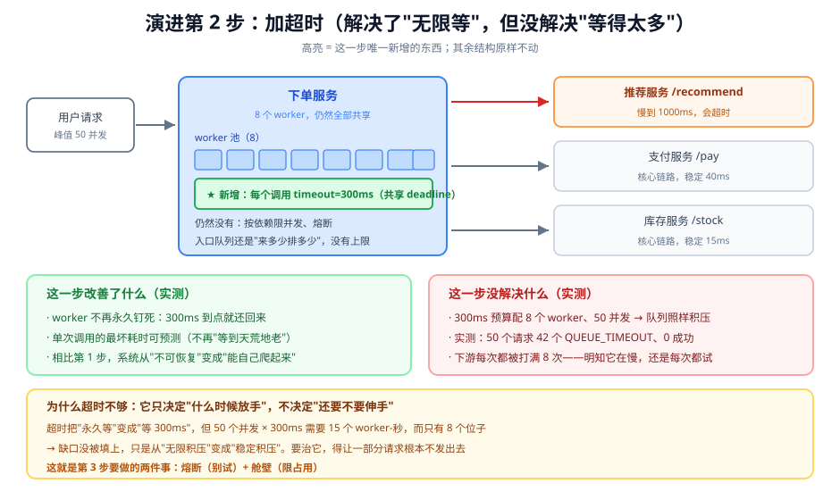
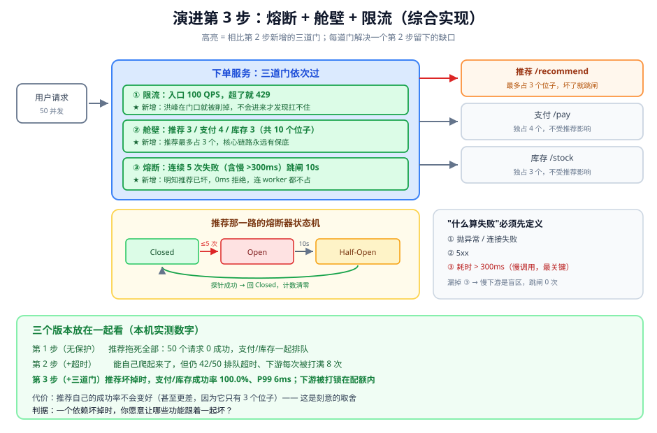

# 第 7 课实战：下游挂了拖垮自己

> 对应课程：阶段 2《服务之间的通信》· 课 7《熔断、限流与隔离》 ｜ 编写日期：2026-11-03
> 环境标注：本实战代码用 Python 3.12.13 标准库（`http.server` + `threading` + `urllib`）实现，无需第三方依赖，可原样复跑；文中的故障数字来自本机实测（见课 7 正文 4.1 的 M1/M5/M7）

## 🎬 场景

你的下单服务在周一早上十点开始大量超时。QPS 没涨（180 QPS），数据库很闲，CPU 只有 12%——但 P99 从 120ms 涨到 3s，错误率从 0.1% 冲到 43%。

翻监控发现：推荐服务（一个"猜你喜欢"的旁路功能）在十点整开始从 20ms 变成 1000ms。你的下单服务有 8 个工作线程，每个请求都要调一次推荐。

十点零八分推荐服务自己恢复了。十点十五分，你的下单接口还在超时。重启服务后一切正常，第二天同样的时间又发生一次。

## 全貌一句话

一个"下游变慢就拖死自己"的服务，需要三道门协同：**舱壁**（一个依赖最多占多少资源）、**熔断**（还要不要继续试）、**限流**（这一秒放多少进来）。本实战带你把这三道门按正确顺序装上去，并用数字证明每一道门各自解决了什么、代价是什么。

---

## 演进第 1 步：直接调下游，什么保护都没有

```python
# 最早版本：三个依赖共用一个池子，没有任何保护
import threading, urllib.request, json

class OrderService:
    def __init__(self, workers=8):
        self.sem = threading.BoundedSemaphore(workers)   # 一个池子，谁都能用

    def create_order(self, req):
        self.sem.acquire()                 # 没有 timeout：拿不到就永远等
        try:
            # ① 旁路依赖：慢起来 1000ms
            rec = self._get("http://127.0.0.1:9001/recommend")   # 没有超时
            # ② 核心依赖：稳定 40ms
            pay = self._get("http://127.0.0.1:9002/pay")         # 没有超时
            # ③ 核心依赖：稳定 15ms
            stock = self._get("http://127.0.0.1:9003/stock")     # 没有超时
            return {"rec": rec, "pay": pay, "stock": stock}
        finally:
            self.sem.release()

    def _get(self, url):
        with urllib.request.urlopen(url) as r:    # ← urllib 默认不设超时
            return json.loads(r.read())
```

**它的问题（三个坑，缺一不可）**：

1. **不设超时 = 无限等**。"等多久"的决定权交给了下游。推荐服务卡住时，这个 worker 永远不会自己归还。
2. **不按依赖限并发**。一个旁路功能可以把 8 个位子全吃光，核心链路没有任何保底——支付服务 40ms 就回，但它排在推荐后面，一起等死。
3. **不知道下游已坏**。即使推荐 100% 失败，每个请求还是老老实实去敲一遍，用宝贵的 worker 陪跑。

> 一句话：**这一版把"下游的健康状况"直接等价于"自己的健康状况"**，两者本来应该是可以隔离的。



> 看图：用户请求进来，8 个 worker 共用一个池子，三个依赖都从同一个池子里拿位子。下半部分标出了出事后会怎样——8 个 worker 全被推荐钉死，其余 42 个请求在入口排队、连下游都没碰到就超时，而支付和库存明明 40ms / 15ms 就回。最下面是三个坑。

**本机实测（M1，50 并发 / 总预算 300ms / 下游慢到 1000ms）**：

```
R2 下游卡住（1000ms）
  A 结果      : {'QUEUE_TIMEOUT': 42}
  A P50/P99   : 293 ms / 296 ms
  C 被打      : 8 次
  B 峰值排队  : 42 个（worker 数 = 8）
```

50 个请求里 **0 个成功**，下游只被打 8 次（这 8 次也全超时了，对用户价值为零），另外 42 个连下游都没碰到。

---

## 演进第 2 步：加超时（解决了"无限等"，但没解决"等得太多"）

```python
import time

DEADLINE_MS = 300                                  # 整个请求的总预算

class OrderService:
    def create_order(self, req):
        deadline = time.monotonic() + DEADLINE_MS / 1000

        remain = deadline - time.monotonic()
        if remain <= 0 or not self.sem.acquire(timeout=remain):
            return {"error": "QUEUE_TIMEOUT"}      # 连位子都没拿到
        try:
            rec   = self._get("http://127.0.0.1:9001/recommend", deadline)
            pay   = self._get("http://127.0.0.1:9002/pay",       deadline)
            stock = self._get("http://127.0.0.1:9003/stock",     deadline)
            return {"rec": rec, "pay": pay, "stock": stock}
        finally:
            self.sem.release()

    def _get(self, url, deadline):
        remain = deadline - time.monotonic()        # 传"剩余"，不是新设一个数
        if remain <= 0:
            raise TimeoutError("budget exhausted")
        with urllib.request.urlopen(url, timeout=remain) as r:
            return json.loads(r.read())
```

**改善的**：worker 不再被永久钉死。300ms 到点就还回来，系统从"不可恢复"变成"能自己爬起来"。

**没解决的（这才是关键）**：

1. **队列照样积压**。50 个并发 × 300ms 需要 15 个 worker·秒，而只有 8 个位子。缺口没被填上，只是从"无限积压"变成"稳定积压"——实测仍然 42/50 排队超时。
2. **下游每次都被打满 8 次**。明知它在慢，每个请求还是老老实实试一遍。这 8 次调用 100% 超时，对用户零价值，对下游却是实打实的负担。
3. **找不到"停止尝试"的机制**。超时只决定"什么时候放手"，不决定"还要不要伸手"——这两件事是分开的。

> 一句话：**超时是必要条件，不是充分条件**。它把"永久卡死"降级成"缓慢失血"，但血还在流。



> 看图：比第 1 张图只多了一个绿色块——每个调用都带 300ms 的共享 deadline；其余结构原样不动（还是一个池子、还是没有熔断）。下半部分左右对照：左边是这一步改善了什么（worker 会归还、最坏耗时可预测），右边是没解决什么（42/50 仍然排队超时、下游每次仍被打 8 次）。最下面解释了为什么——超时管"什么时候放手"，不管"还要不要伸手"。

**本机实测（M1 的 R2/R3 对照）**：

```
R2 下游卡住（1000ms）→ 42 个 QUEUE_TIMEOUT，0 成功，下游被打 8 次

R3 下游已恢复（20ms）—— 但 8 个 worker 还卡在 R2 的调用上
  A 结果      : {'QUEUE_TIMEOUT': 50}
  C 被打      : 0 次
```

R3 是这一步最值得看的地方：**下游已经恢复到 20ms，你 50 个请求依然全灭，而下游这一轮被打 0 次**。这就是"十点零八分推荐恢复了、十点十五分下单还在超时"的机制解释。

---

## 演进第 3 步：熔断 + 舱壁 + 限流（综合实现）

三道门，各解决第 2 步留下的一个缺口：

```python
import threading, time, urllib.request, json

# ---------- 门 1：限流（入口总量） ----------
class TokenBucket:
    def __init__(self, rate: float, burst: int):
        self.rate, self.burst = rate, burst
        self.tokens, self.last = float(burst), time.monotonic()
        self.lock = threading.Lock()

    def try_acquire(self) -> bool:
        with self.lock:
            now = time.monotonic()
            # 补令牌必须有上限，否则空闲一夜回来能放出几万个
            self.tokens = min(self.burst, self.tokens + (now - self.last) * self.rate)
            self.last = now
            if self.tokens >= 1:
                self.tokens -= 1
                return True
            return False                    # 拒绝要立刻返回，不要 sleep 等令牌


# ---------- 门 2：舱壁（按依赖分池） ----------
class Bulkhead:
    def __init__(self, n: int):
        self.sem = threading.BoundedSemaphore(n)

    def run(self, fn, deadline: float):
        remain = deadline - time.monotonic()
        if remain <= 0 or not self.sem.acquire(timeout=remain):
            raise TimeoutError("bulkhead full")     # 位子没了就快速失败
        try:
            return fn()
        finally:
            self.sem.release()


# ---------- 门 3：熔断（含慢调用判定） ----------
class CircuitBreaker:
    def __init__(self, threshold=5, open_seconds=10.0, window=10.0, slow_ms=300):
        self.threshold, self.open_seconds = threshold, open_seconds
        self.window, self.slow_ms = window, slow_ms
        self.state, self.fails, self.opened_at = "Closed", 0, 0.0
        self.window_start = time.monotonic()
        self.lock = threading.Lock()

    def allow(self) -> bool:
        with self.lock:
            if self.state == "Open":
                if time.monotonic() - self.opened_at >= self.open_seconds:
                    self.state = "Half-Open"        # 只放探针
                    return True
                return False                        # 0ms 快速失败
            return True

    def record(self, ok: bool, elapsed_ms: float):
        with self.lock:
            now = time.monotonic()
            if now - self.window_start > self.window:    # 窗口到期，计数清零
                self.fails, self.window_start = 0, now
            # 关键：慢调用也算失败，否则慢下游是盲区
            if ok and elapsed_ms <= self.slow_ms:
                if self.state == "Half-Open":
                    self.state, self.fails = "Closed", 0
                return
            self.fails += 1
            if self.state == "Half-Open":
                self.state, self.opened_at = "Open", now
            elif self.fails >= self.threshold:
                self.state, self.opened_at = "Open", now


# ---------- 装配：限流 → 舱壁 → 熔断 ----------
class OrderService:
    def __init__(self):
        self.limiter = TokenBucket(rate=100, burst=100)                  # 门 1
        self.pools = {                                                    # 门 2
            "recommend": Bulkhead(3),      # 旁路：只给 3 个位子
            "pay":       Bulkhead(4),      # 核心：保底 4 个
            "stock":     Bulkhead(3),      # 核心：保底 3 个
        }
        self.breakers = {"recommend": CircuitBreaker()}                   # 门 3

    def create_order(self, req):
        if not self.limiter.try_acquire():             # ① 先削峰
            return {"error": "RATE_LIMITED"}           #    0ms 返回，一个 worker 都不占

        deadline = time.monotonic() + 0.300

        # ② 旁路依赖只拿一小份独立子预算：它慢起来吃不掉核心链路的时间
        rec_deadline = min(deadline, time.monotonic() + 0.100)
        rec = self._guarded("recommend", "http://127.0.0.1:9001/recommend", rec_deadline)
        # ③ 核心依赖用整条预算，各自有独立舱壁保底
        pay = self._guarded("pay",   "http://127.0.0.1:9002/pay",   deadline)
        stock = self._guarded("stock", "http://127.0.0.1:9003/stock", deadline)

        return {"rec": rec, "pay": pay, "stock": stock}

    def _guarded(self, name, url, deadline):
        breaker = self.breakers.get(name)
        if breaker and not breaker.allow():            # 熔断在舱壁之前：连位子都别占
            return {"degraded": True}                  # 推荐降级为空列表即可

        def call():
            t0 = time.monotonic()
            try:
                remain = deadline - t0
                if remain <= 0:
                    raise TimeoutError("budget exhausted")
                with urllib.request.urlopen(url, timeout=remain) as r:
                    body = json.loads(r.read())
                if breaker:
                    breaker.record(True, (time.monotonic() - t0) * 1000)
                return body
            except Exception:
                if breaker:
                    breaker.record(False, (time.monotonic() - t0) * 1000)
                raise

        try:
            return self.pools[name].run(call, deadline)
        except Exception:
            return {"degraded": True}                  # 旁路失败就降级，不阻断下单
```

**这个版本为什么对**（对应课 7 的三个知识点）：

| 课 7 知识点 | 这里怎么落地 |
|---|---|
| 雪崩是怎么发生的 | 每个依赖一个独立 `Bulkhead`，别人的慢不会占满你的全部位子；`_guarded` 里所有路径都受同一个 `deadline` 约束 |
| 熔断器的三个状态 | `CircuitBreaker` 三态齐全；`window` 到期清零计数；`Half-Open` 只放探针；`record` 里把 `elapsed_ms > slow_ms` 也算失败——这是让熔断真正生效的那一行 |
| 限流算法与舱壁隔离 | 入口 `TokenBucket(rate=100, burst=100)` 削峰（`min(burst, ...)` 防额度爆炸）；总装配顺序是限流 → 舱壁 → 熔断 |

两个装配细节值得单独说：

- **熔断放在舱壁之前**（`_guarded` 里先 `breaker.allow()` 再 `pool.run()`）。反过来也可以跑，但那样 Open 期间每次拒绝都要先抢一个位子再还回去，等于白白浪费一次舱壁操作——M7 的组 B 就演示了这个现象（短路 0 次、排队超时 140 次，因为请求全卡在舱壁门口，根本没机会去试下游）。
- **限流的拒绝必须是 0ms**。`try_acquire` 里不能 `sleep` 等令牌——等待应该交给调用方的 deadline 管。限流器自己睡，等于把线程白白占着，这正是知识点 1 的雪崩。

还有一个是我在验证这一步时才发现、但必须写进正文的细节：**旁路依赖必须有独立的小预算**。

第一版我只做了"三个依赖各一个舱壁、共用 300ms 总预算"，代码看着完全合理，跑出来的结果却是 **核心链路 0/50 成功**——因为推荐排在最前面，它一个人就把 300ms 全吃掉了，支付和库存拿到的是一个已经归零的 deadline，连试的机会都没有。加上 `rec_deadline = min(deadline, now + 0.100)` 之后才变成 45/50。

这个坑很值得记：**舱壁只限制"同时占几个位子"，不限制"占多久"**。位子归还了，但预算已经花完了——所以"按依赖分舱壁"必须和"按依赖分子预算"一起做，才算真正隔离。



> 看图：比第 2 张图多了三个绿色块（限流 / 舱壁 / 熔断），它们按顺序串在下单服务的入口。右侧三个依赖各自有独立位子上限，推荐只占 3 个、支付和库存各有保底。中间偏下画了推荐那一路的熔断状态机（Closed →Open →Half-Open →Closed），旁边是"什么算失败"的三档定义——漏掉第三档（慢调用）整个熔断器就形同虚设。最下面是三个版本的效果对照。

**本机实测（推荐服务慢到 1000ms，50 个请求、并发度 20、总预算 300ms）**：

| 装配 | 核心链路成功 | 推荐被打 | 熔断跳闸 |
|---|---|---|---|
| ① 只有超时（共享 8 位子） | **0 / 50** | 25 次 | 0 次 |
| ② + 独立舱壁 + 旁路独立子预算 | **45 / 50** | 35 次 | 0 次 |
| ③ + 熔断（含慢调用）+ 限流 | **42 / 50** | **7 次** | 11 次 |

第二行是这一步最反直觉的地方：**救活核心链路的是舱壁 + 子预算，不是熔断**。0/50 → 45/50 这个跳跃完全由"把推荐的位子和时间单独切出去"完成。

那熔断贡献了什么？看"推荐被打"那一列：35 次 → 7 次。核心链路成功率甚至还略降了一点（45 → 42），因为熔断器跳闸时推荐是直接降级的，而有些请求本来能在 100ms 子预算内拿到推荐结果。**熔断的收益不在成功率，在"少打无效的下游"**——在推荐的容量已经见底、或者下游按 QPS 计费的时候，这个收益才是决定性的。

再压一轮（推荐仍未恢复）的数字更清楚：

```
② 独立舱壁 + 子预算（无熔断）  46/50 ｜ 推荐被打 33 次
③ 全套三道门                  41/50 ｜ 推荐被打  5 次
```

所以三道门的分工可以一句话说清：**舱壁决定"谁能占多少"、子预算决定"最多花多久"、熔断决定"还要不要伸手"**。三者不可互替——只有舱壁没熔断，无效调用会一直持续（33 次）；只有熔断没舱壁，一个坏依赖照样能把位子占满。

M5 和 M7 的原始对照数字也印证同一件事：

```
# M5：/search 慢依赖 vs /order 快接口，共 8 worker
无舱壁（共用 8）        /order 成功率  69.7% ｜ P50/P99  40 / 300 ms
有舱壁（/search 独占 3）  /order 成功率 100.0% ｜ P50/P99   5 / 6 ms

# M7：同一个下游，配额 10 QPS
A 只有熔断            下游被打 270 次 ｜ 平均 122.7 QPS
B 熔断 + 舱壁（无限流）  下游被打 198 次 ｜ 平均  90.0 QPS
C 限流 → 舱壁 → 熔断    下游被打  21 次 ｜ 平均   9.5 QPS
```

> ✅ **会用标志**：你能否说清"为什么第 2 步的超时不够、非要把三道门都装上不可"？以及"为什么 `/search` 自己从 163 成功降到 93 成功，这个代价是值得的"？能说清，就说明你真正会用熔断、限流与隔离。

---

## 收尾对照表

| | 第 1 步：无保护 | 第 2 步：+ 超时 | 第 3 步：+ 三道门 |
|---|---|---|---|
| 推荐变慢 1000ms 时核心链路成功率 | 0 / 50 | 0 / 50 | 42 / 50（实测） |
| 无关接口是否受牵连 | 是（支付/库存一起排队） | 是（仍在同一池子） | 否（独立舱壁 + 独立子预算） |
| 推荐被打次数（同样的 50 个请求） | 25 次 | 25 次 | 7 次（有熔断）/ 35 次（无熔断） |
| 下游恢复后能否自愈 | 不能（可能永久坏） | 能，但要等一轮排队排空 | 立刻（Half-Open 探针） |
| 推荐自己的成功率 | 低 | 低 | 更低（只有 3 个位子 + 100ms 子预算）——刻意取舍 |
| 实现复杂度 | 最低 | 低 | 中（三个组件 + 装配顺序 + 两处预算） |
| 主要代价 | 一个依赖坏掉就全站不可用 | 缓慢失血，故障期被拉长 | 代码复杂度、参数需调、旁路功能主动降级 |

一个必须写清的数字关系：**第 3 步的核心链路成功率（42/50）并不比"只有舱壁和子预算"（45/50）高**。熔断买到的是"推荐被打次数从 35 降到 7"，不是成功率。如果你的下游不计费、也能扛住无效流量，熔断可以晚一点上；如果下游按 QPS 计费或容量极紧，熔断就是必需的。

**什么时候可以退回简单版**：

- 依赖是**同进程内的纯计算**（不跨网络）→ 不需要熔断和舱壁，只需要防重入。
- 依赖**只有一个、且是强制的**（拿不到就必然失败，没有降级空间）→ 熔断的价值只剩"快速失败"，可以只留超时。
- **流量极低且可人工介入**（内部工具、后台任务）→ 出问题人工重启比装三道门更划算。
- 但只要是**旁路依赖 + 高并发 + 无人值守**，三道门就是必需的，不是"优化项"。

---

## 🎯 练一练（回到课正文）

回到 [课 7 正文](../stages/2-服务之间的通信/lessons/07-熔断、限流与隔离.md)（含 4.1 的 M1-M7 全部实测源码）再通读一遍，重点看三处：

- **M1 的 R3**：下游已恢复、自己被打 0 次，为什么还是全灭。这是"故障生命周期比故障本身长"的原始证据。
- **M3 的组 B 第 2 行**：只算硬失败的熔断器面对慢下游跳闸 0 次。这一段决定了你的熔断器到底有没有用。
- **M7 的三行**：只有熔断 122.7 QPS、只有舱壁 90.0 QPS、三个都装 9.5 QPS。这是装配顺序的唯一正确答案的实测依据。
