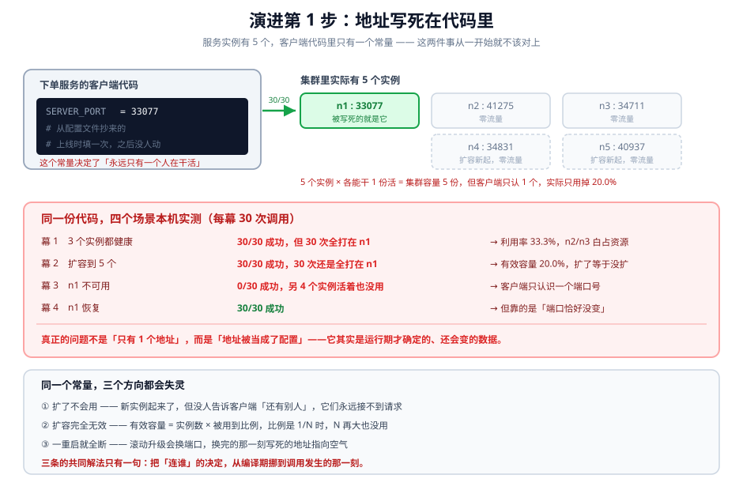
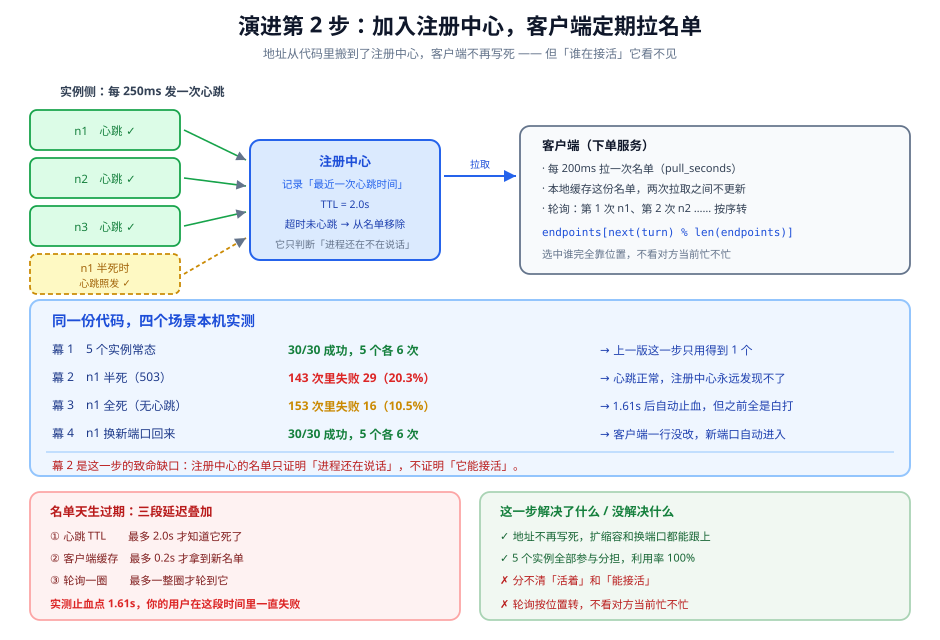
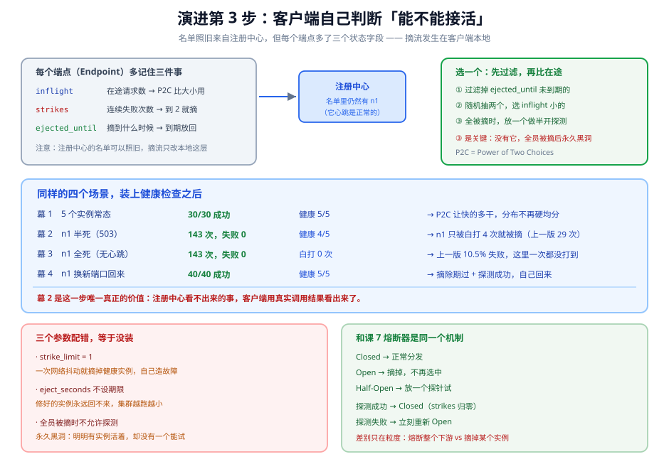

# 第 8 课实战：实例扩缩容

> 对应课程：阶段 2《服务之间的通信》· 课 8《服务发现与负载均衡》 ｜ 编写日期：2026-11-04
> 环境标注：本实战代码用 Python 3.12.3 标准库（`http.server` + `threading` + `urllib`）实现，无需第三方依赖，可原样复跑；文中的全部数字来自本机实测（完整脚本见 `playground/lesson08/app08_discovery_journey.py`）

## 🎬 场景

你的订单服务在双十一前压测，运维按计划把 `order-svc` 从 3 个实例扩到 5 个，扩容很顺利，Pod 全部 Running。

压测结果出来，QPS 和扩容前一模一样。你去看监控：n1 的 CPU 打满到 92%，n2 到 n5 的 CPU 全是 3%。五个实例里四个在摸鱼。

你以为是 Service 配置问题，改了 `sessionAffinity`、又换了 NodePort，还是没用。后来一位同事提了一句："你们调用方是不是把地址写死在 `config.py` 里了？"

打开一看：

```python
SERVER_PORT = 33077      # 上线时 n1 的端口，之后再没改过
```

周一凌晨滚动升级，n1 换了端口。早上九点，订单服务 100% 失败。值班同学手动把新端口填进 `config.py`，重新发布，恢复。

三个月后同样的事又发生了一次，还是同一个人值班。

## 全貌一句话

「连谁」这个决定，现在被放在了一个错的地方。它不是配置，是运行期的数据：**实例有 5 个、哪个能接活、端口是多少，这三件事在你写下代码的那一刻都不存在。** 本实战带你把这三件事从编译期搬到调用发生的那一刻，分两步：先让地址能变（注册中心），再让客户端能判断谁在接活（健康检查 + 客户端负载均衡）。

---

## 演进第 1 步：地址写死在代码里

```python
# 最早版本：地址是常量，客户端只知道一个人在干活
import http.client

SERVER_PORT = 33077          # ← 上线时从 n1 的端口抄过来的

def call(timeout=0.5):
    c = http.client.HTTPConnection("127.0.0.1", SERVER_PORT, timeout=timeout)
    try:
        c.request("GET", "/")
        return c.getresponse().read().decode()
    finally:
        c.close()
```

这段代码本身没有任何毛病——单实例部署时它 100% 正确。问题出在它假设了一件不成立的事：**这个世界上只有一个地方能接活，而且它的门牌号不会变。**

**本机实测（5 个真实实例，每个场景 30 次调用）**：

```
幕 1 初始 3 个实例：成功 30/30  被打分布 {'n1': 30}
       → 3 个实例只用到 1 个，利用率 33.3%
幕 2 扩容到 5 个：成功 30/30  被打分布 {'n1': 30}
       → 有效容量仍是 1/5 = 20.0%，扩了等于没扩
幕 3 n1 不可用：成功 0/30  被打分布 {'n1': 30}
       → 0% 成功。另 4 个实例活着，客户端只认识端口 33077
幕 4 n1 恢复：成功 30/30  被打分布 {'n1': 30}
       → 恢复靠的是「还是原来那个端口」；换了端口就永远回不来
```



> 看图：左边是那三行代码，`SERVER_PORT = 33077` 这个常量就是全部的「服务发现逻辑」。右边是集群里实际存在的 5 个实例，绿色那个是被写死的，灰色四个零流量。下半部分是四个场景的实测，最后一行是三个根因——它们其实都是同一件事的三个方向。

**三个坑，看起来是三件事，其实是一件事**：

1. **扩了不会用**。新实例起来了，但没有任何机制告诉客户端「还有别人」，它们永远接不到请求。利用率不是「低」，是「恒等于 1/N」。
2. **扩容完全无效**。有效容量 = 实例数 × 被用到比例。5 × 20% 还是等于 1。这不是扩容没生效，是扩容生效了但没人用。
3. **一重启就全断**。滚动升级换端口是常态，不是异常。写死的地址在那一刻指向空气。

> 一句话：**地址不是配置，是运行期数据**。配置的特征是「上线前就能确定、之后基本不变」；而实例有几个、在哪、端口多少，这三件事恰好全都不满足。

---

## 演进第 2 步：注册中心 + 客户端轮询

最小改动是：把地址从代码里搬出去，搬到一个大家都知道的地方，客户端定期去问。

```python
import itertools, threading, time, urllib.request

HOST = "127.0.0.1"

def fetch(port, timeout=0.4):
    """三版共用：真正发请求的那一步，端口是参数。"""
    url = f"http://{HOST}:{port}/"
    with urllib.request.urlopen(url, timeout=timeout) as r:
        return r.read().decode()


class Registry:
    """注册中心：心跳 + TTL。超过 hb_ttl 没心跳的实例从名单里消失。"""

    def __init__(self, hb_ttl=2.0):
        self.hb_ttl = hb_ttl
        self.ports = {}          # name -> port
        self.last_seen = {}      # name -> monotonic
        self.lock = threading.Lock()

    def register(self, name, port):
        with self.lock:
            self.ports[name] = port
            self.last_seen[name] = time.monotonic()

    def heartbeat(self, name):
        with self.lock:
            if name in self.ports:
                self.last_seen[name] = time.monotonic()

    def snapshot(self):
        now = time.monotonic()
        with self.lock:
            return [(n, p) for n, p in sorted(self.ports.items())
                    if now - self.last_seen[n] <= self.hb_ttl]


class PollingClient:
    """客户端：定期拉名单，本地缓存 pull_seconds，轮询选择。"""

    def __init__(self, registry, pull_seconds=0.2):
        self.reg = registry
        self.pull = pull_seconds
        self.cache = []
        self.fetched_at = -1e9
        self.turn = itertools.count()

    def refresh(self, force=False):
        now = time.monotonic()
        if force or now - self.fetched_at >= self.pull:
            self.cache = self.reg.snapshot()
            self.fetched_at = now
        return self.cache

    def call(self):
        eps = self.refresh()
        if not eps:
            raise RuntimeError("registry returned no endpoints")
        name, port = eps[next(self.turn) % len(eps)]
        return fetch(port), name
```

**改善的**：地址不再写死。扩容、缩容、换端口，客户端只要等到下一次拉取就能跟上，代码一行不用改。

**本机实测（同一份后端，只换客户端，四个场景保持同口径）**：

```
幕 1 常态 5 个实例：成功 30/30  被打分布 {'n1': 6, 'n2': 6, 'n3': 6, 'n4': 6, 'n5': 6}
       → 5 个全用上，每个 6 次（上一版只会用 1 个）

幕 2 n1 半死：能连上、返回 503，进程还在、心跳照发
       3 秒内：共 143 次｜失败 29（20.3%）｜最后一次失败在 2.95s
       n1 被白打 29 次
       → 注册中心只看心跳，永远发现不了「活着但接不了活」

幕 3 n1 全死：连不上、也不再发心跳
       3.2 秒内：共 153 次｜失败 16（10.5%）｜最后一次失败在 1.61s
       → 自动止血，止血点在 1.61s（= 心跳 TTL 2.0s + 客户端缓存 0.2s + 轮询一圈）

幕 4 n1 重新拉起，端口变了：新端口 40565（原来不是这个）
       30 次调用：成功 30/30  被打分布 {'n1': 6, 'n2': 6, 'n3': 6, 'n4': 6, 'n5': 6}
       → 客户端一行没改，新端口自动进入轮询
```



> 看图：左边实例往右发心跳，中间注册中心只记「最近一次心跳时间」，右边客户端定期拉一份名单缓存在本地。下半部分是四幕实测，其中幕 2 的红字是整个这一步的致命缺口——**n1 已经 100% 返回 503 了，注册中心依然认为它健康**，因为它的进程还在正常发心跳。最下面两块分别是延迟账和这一步的得失。

**幕 2 是这一步真正的分界线**。先看清它是什么：n1 的进程活着、端口能连、心跳正常，但每个请求都返回 503（预热没完成、依赖挂了、正在摘流，都会长这样）。注册中心的判据是「它还在说话吗」，答案是「在」，所以名单里一直有它。客户端于是每隔一圈就白打一次，全程 29 次。

**幕 3 看起来"自动好了"，实际是运气**。n1 进程真死了、心跳停了，2 秒后 TTL 到期，注册中心把它摘掉。但注意止血点 1.61s：这 1.61 秒里所有落到 n1 的请求都失败（153 次里 16 次，10.5%）。**注册中心能自动止血，但止血之前的那一段时间是纯亏损**，而且这段时间的长度由三个参数决定：

```
① 心跳 TTL　　　最多 2.0s 才知道它死了
② 客户端缓存　　最多 0.2s 才拿到新名单
③ 轮询一圈　　　最多一整圈才轮到它
```

三个延迟串起来，就是「用户实际承受的失败窗口」。想缩短只有两条路：把参数调小（代价是心跳流量和拉取压力上升），或者**不要等名单更新，让客户端自己看见失败就摘**。

> 一句话：**注册中心解决"地址从哪来"，不解决"这个地址现在能不能用"**。这两件事的判据完全不同——前者看进程是否在说话，后者看请求是否成功。

---

## 演进第 3 步：客户端负载均衡 + 健康检查

这一步的核心不是"再加一个组件"，而是**把判断权从注册中心挪到客户端**：既然我每次调用都会拿到真实结果（成功/失败），我为什么还要等别人告诉我它坏了？

```python
import random, threading, time


class Endpoint:
    __slots__ = ("name", "port", "inflight", "strikes", "ejected_until", "probing")

    def __init__(self, name, port):
        self.name = name
        self.port = port
        self.inflight = 0
        self.strikes = 0
        self.ejected_until = 0.0     # 0 表示健康
        self.probing = False         # 是否正在半开探测


class ClientLB:
    def __init__(self, registry, pull_seconds=0.2, eject_seconds=1.0, strike_limit=2):
        self.reg = registry
        self.pull = pull_seconds
        self.eject_seconds = eject_seconds   # 摘多久
        self.strike_limit = strike_limit     # 连续失败几次才摘
        self.eps = []
        self.fetched_at = -1e9
        self.lock = threading.Lock()

    def sync(self, force=False):
        """① 名单照旧来自注册中心，只是同步时保留已有端点的状态。"""
        now = time.monotonic()
        if not force and now - self.fetched_at < self.pull:
            return
        roster = dict(self.reg.snapshot())
        with self.lock:
            known = {e.name: e for e in self.eps}
            eps = []
            for name, port in roster.items():
                if name in known:
                    known[name].port = port      # 端口可能变
                    eps.append(known[name])      # 状态（strikes 等）不能丢
                else:
                    eps.append(Endpoint(name, port))
            self.eps = eps
            self.fetched_at = now

    def pick(self):
        """② 先过滤被摘的，再随机两个选在途少的（P2C）。"""
        now = time.monotonic()
        with self.lock:
            if not self.eps:
                raise RuntimeError("no endpoints")
            alive = [e for e in self.eps if e.ejected_until <= now]
            if not alive:
                # 全被摘了：放一个进去做半开探测，否则永远无法恢复
                probe = min(self.eps, key=lambda e: e.ejected_until)
                probe.probing = True
                alive = [probe]
            if len(alive) == 1:
                e = alive[0]
            else:
                a, b = random.sample(alive, 2)
                e = a if a.inflight <= b.inflight else b
            e.inflight += 1
            return e

    def report(self, ep, ok):
        """③④ 记录结果：成功清零，失败累计，到阈值就摘；探测失败立刻重摘。"""
        now = time.monotonic()
        with self.lock:
            ep.inflight -= 1
            if ok:
                ep.strikes = 0
                ep.ejected_until = 0.0
                ep.probing = False
            else:
                ep.strikes += 1
                if ep.probing or ep.strikes >= self.strike_limit:
                    ep.ejected_until = now + self.eject_seconds
                    ep.probing = False
```

**本机实测（同样的四个场景，这次客户端自己能看见失败）**：

```
幕 1 常态 5 个实例：成功 30/30  健康 5/5
幕 2 n1 半死（503）：3 秒内共 143 次｜失败 0｜全程无失败
       健康端点 4/5｜被摘 ['n1']
       n1 被白打 4 次 ← 对比上一版的 29 次
幕 3 n1 全死：3 秒内共 143 次｜失败 0｜全程无失败
       n1 被白打 0 次
幕 4 n1 以新端口回来：40 次调用成功 40/40  健康 5/5
       → 没重启客户端、没改配置，它自己回来了
```



> 看图：左上角是每个端点新记住的三个字段——`inflight` 用来比忙闲、`strikes` 用来累计失败、`ejected_until` 用来决定什么时候放回。中间那张卡说明**注册中心的名单可以照旧，摘流只发生在客户端本地这一层**，这是理解整个设计的关键。下半部是四幕对照，右侧注释标出了和上一版同一场景的差距；最下面两块是参数陷阱和它与课 7 熔断器的同构关系。

三个必须对齐的细节：

| 细节 | 为什么非这样不可 |
|---|---|
| `strike_limit = 2` 而不是 1 | 一次网络抖动不该摘掉健康实例。摘错了比不摘更糟——你少了一个能干活的，故障反而被你制造出来 |
| `ejected_until` 必须有值 | 摘除不是判决。没有期限的摘流会让集群越跑越小，最后无实例可用 |
| 全员被摘时必须允许探测 | 如果所有端点都被摘了，`alive` 是空列表。这时若直接报错，就变成永久黑洞——明明有实例活着，却没有一次机会去试它 |

还有一处容易被忽略、但决定了实现是否正确的细节：`sync()` 里更新名单时**不能重建端点对象**。第一版我直接 `self.eps = [Endpoint(n, p) for ...]`，跑出来的结果是摘流完全不生效——因为每次拉取（200ms 一次）都会把 `strikes` 和 `ejected_until` 全部清零，刚摘掉的实例下一轮又满血复活。改成保留已有端点、只更新 `port` 之后才对。

这和课 7 里那个坑是同一类错误：**状态被放在了会被重建的地方**。

**这一步和课 7 的熔断器是同一个机制，只是粒度不同**：

| | 课 7 熔断器 | 本课的端点摘流 |
|---|---|---|
| 对象 | 整个下游服务 | 某一个实例 |
| 判据 | 失败率 / 慢调用率到阈值 | 连续失败次数到阈值 |
| 打开后 | 请求直接降级，不打下游 | 该实例不被选中，请求落到别人身上 |
| 恢复 | Half-Open 放一个探针 | `ejected_until` 到期 + 半开探测 |
| 状态存哪 | 断路器对象（跨请求存活） | `Endpoint.strikes`（跨请求存活） |

> 一句话：**注册中心告诉你"有谁"，客户端负载均衡告诉你"这次选谁、下次还选不选它"**。后半句才是负载均衡真正的职责，轮询只是它最不重要的一部分。

---

## 收尾对照表

| | 第 1 步：硬编码 | 第 2 步：+ 注册中心 | 第 3 步：+ 客户端 LB |
|---|---|---|---|
| 5 个实例的利用率 | 20.0%（只用 1 个） | 100%（各 6 次 / 30 次） | 100%，且按在途数倾斜 |
| n1 半死（503）时失败率 | 100%（全部落到它） | 20.3%（143 次里 29 次） | 0%（143 次里 0 次） |
| n1 全死时的失败率 | 100%（未单独测，硬编码下与半死必然同结果） | 10.5%（等 TTL 到期） | 0%（本地立刻摘） |
| n1 半死时被白打次数 | 30 次（30 次全打它） | 29 次（每圈轮一次） | 4 次（2 次探测 + 余量） |
| 换端口后能否自愈 | 不能，必须改代码重发 | 能，等一次拉取 | 能，等一次拉取 + 摘除期 |
| 摘掉的实例能否自动回来 | 不适用 | 能（名单一更新就回来） | 能（到期 + 半开探测） |
| 实现复杂度 | 1 个常量 | 注册中心 + 心跳 + 本地缓存 | 再加端点状态机 + 选择算法 |
| 主要代价 | 扩缩容全废、重启即全断 | 多一个必须高可用的组件；名单天生过期 | 客户端复杂度上升；参数需调；每个语言各实现一遍 |

一个必须写清的数字关系：**第 3 步在幕 2/幕 3 都是 0 失败，但它并没有让 n1 变好**。n1 全程都在返回 503，只是没人再打它了。所以健康检查买到的是「把失败转移走」，不是「修复故障」。真正要修 n1，还得靠第 3 个知识点里的 readiness 探针 + 摘流时机。

**什么时候可以退回简单版**：

- **单实例部署**（开发环境、内部工具、定时任务）→ 硬编码地址完全可以，别为了对称上注册中心。
- **实例数固定且端口固定**（物理机、长期不动的中间件）→ 用 DNS 或配置文件里的地址列表就够了，注册中心是多余的一层。
- **只有一个客户端、且能人工介入**（后台批处理、月度对账）→ 出问题人工改配置重跑，比养一个注册中心便宜。
- **HTTP/1.1 + 短连接 + 无状态** → 如果前面已经有 L7 负载均衡（Nginx / ALB），客户端直连代理即可，客户端 LB 是重复投资。
- 但只要是**多实例 + 频繁扩缩容 + 长连接协议（gRPC/HTTP2）+ 无人值守**，这三步就都得走。少任何一步，都会在某个时间点以「扩容无效」或「重启全断」的形式还回来。

---

## 🎯 练一练（回到课正文）

回到 [课 8 正文](../stages/2-服务之间的通信/lessons/08-服务发现与负载均衡.md)（含 4.1 的 M1-M8 全部实测源码）再通读一遍，重点看三处：

- **M1 的 R2**：扩容后写死地址的客户端 30 次调用全部落在 n1。这一段的输出是「扩了等于没扩」这句话唯一的证据。
- **M3b 的轮 3**：1 个重客户端 + 5 个轻客户端经 L4 代理，命中分布 92/4/4（92.0%）。这是「L4 对 gRPC 无效」最反直觉的一段——轮 2 的 24/24/24 只是客户端数恰好是 3 的整数倍的假象。
- **M4 的组 A 与组 B**：liveness 查依赖的那一组，45 次重启、67.5 秒·实例、恢复时 0 个可用；只查自己进程的那一组，0 次重启、0 秒损失、恢复时 3 个可用。这是「liveness 绝不能查依赖」的量化依据。
