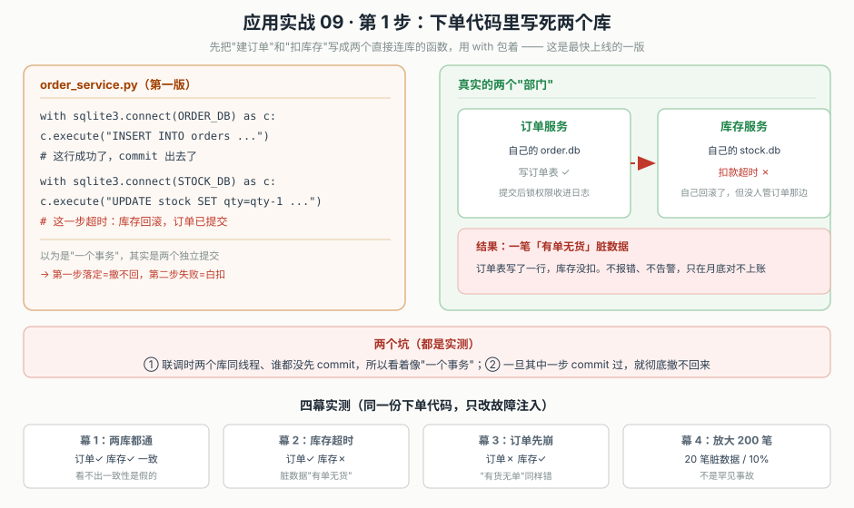
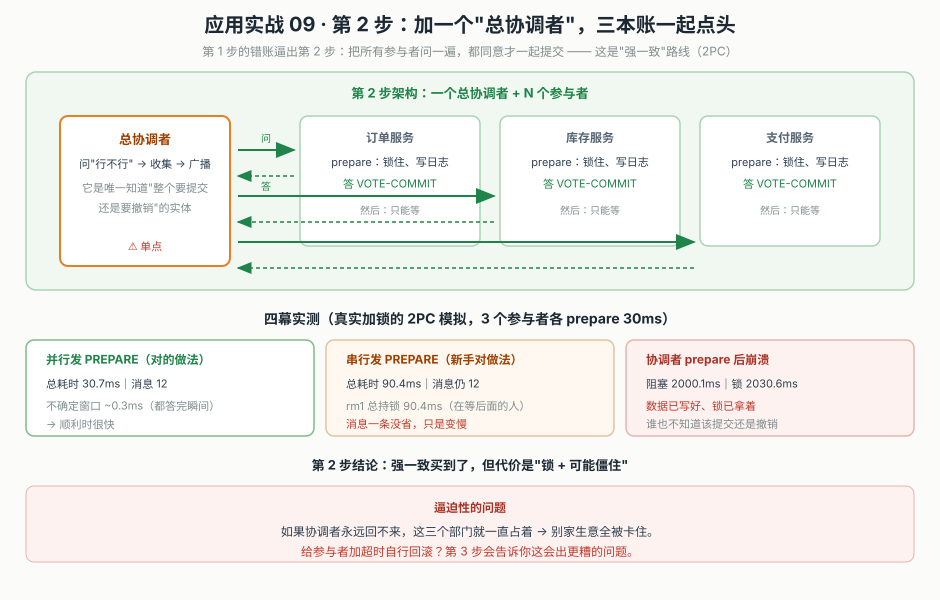
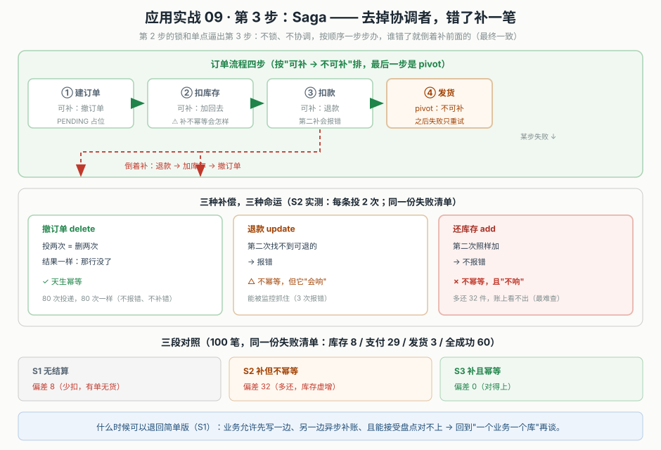

# 应用实战 09：分布式事务与 Saga（主线：跨服务下单）

> 配套理论：课 9《分布式事务与 Saga》。体例：三跳演进 + 每步一张设计图 + 同口径真实对照数字。

## 🎬 场景

> 你在给下单接口加"库存检查"。老的伪代码是这样：三个服务，三次调用，`with` 一包。你一度以为它是"一个事务"。
>
> ```python
> ORDER_DB = "…"
> STOCK_DB = "…"
> PAY_DB = "…"
> ```
>
> 全貌一句话：**跨服务改多份数据时，"一致"只能靠两阶段提交（锁+协调者）或 Saga（补），没有免费的第三方方案**。本实战把这三条路各跑一遍，用同一份失败清单横向对比，让你亲手看见"本地事务为什么护不住、2PC 代价在哪、Saga 的补偿坑在哪"。

---

## 演进第 1 步：写死两个库（本地事务假装能护住全部）

```python
# order_service.py —— 第 1 版
with sqlite3.connect(ORDER_DB) as c:
    c.execute("INSERT INTO orders(id, sku, qty) VALUES(?,?,?)", (oid, "A-1", 1))
    # 这一行 commit 出去了

with sqlite3.connect(STOCK_DB) as c:
    c.execute("UPDATE stock SET qty=qty-1 WHERE sku='A-1'")
    # 这一步超时：库存回滚，订单已提交
```



> 看图：左边是两段独立 `with`，右边是三个真实部门各自一个库。中间那句"以为是两个…其实两个独立提交"就是本步的结论。

### 四幕实测（m1_local_tx_boundary.py，真实两个 sqlite 库文件）

```
幕 1：两个库都通 → 订单✓ 库存✓，一切正常，看不出"一致性是假的"
幕 2：库存超时 → 订单已提交✓、库存回滚✗ → 一笔「有单无货」脏数据
幕 3：订单先崩 → 订单✗、库存✓ → 一笔「有货无单」，同样错
幕 4：放大 200 笔 → 20 笔第 2 步失败 → 脏数据 20 笔 / 10.0%
```

### 三个必须记住的坑

1. 联调时两个库同线程、谁都没先 commit，所以看着像"一个事务"——**只是没暴露**。
2. 只要中间任何一步 commit 过（真实服务必然如此），第一步就撤不回来。
3. 脏数据不报错、不告警，只在月底盘点浮出来。

---

## 演进第 2 步：加"总协调者"，三本账一起点头（2PC 强一致）

```python
# 两个资源管理器：prepare 时锁住、投 VOTE-COMMIT；收到决定才落地
class ResourceManager:
    def prepare(self):            # 问"能不能提交" → 锁 + 写日志
        self.mutex.acquire(timeout=2.0)
        return "VOTE-COMMIT"
    def commit(self): ...
    def abort(self): ...

# 协调者：问 → 收齐 → 广播
if all(r.prepare() == "VOTE-COMMIT" for r in rms):
    for r in rms: r.commit()
```



> 看图：总协调者（单点，⚠️）问三个服务，三个都答"可以"后广播一起记。图中下半部分是四幕实测——顺利时 30.7ms/12 条消息，但协调者崩溃时锁被钉住 2030ms。

### 四幕实测（m2_2pc_cost.py，真实加锁 + 协调者崩溃模拟）

```
幕 1：并行发 PREPARE → 总耗时 30.7ms（串行发则 90.4ms：rm1 在等别人）
幕 2：协调者在 prepare 后崩溃 → 阻塞 2000.1ms、锁 2030.6ms、不确定窗口 2000.4ms
幕 3：给参与者加超时自行回滚 → rm1 提交、rm2/rm3 回滚 → 不确定是否一致
幕 4：参与者越多，被卡的锁越多（2→2、4→4、8→8、16→16）
```

### 得失

- 买到：强一致（要么全成要么全败）。
- 代价：锁 + 协调者单点 + 崩溃时"可能永远不结束"。
- 超时兜底不是解药——它把一致的失败变成"不确定是否一致"。

---

## 演进第 3 步：Saga —— 去掉协调者，错了补一笔（最终一致）

```python
# 订单流程四步（按"可补 → 不可补"排，最后一步是 pivot）
done = []
try:
    create_order(oid, "PENDING")            # ① 可补：撤订单（先占位）
    done.append(("order", oid))
    reserve_stock()                          # ② 可补：还库存
    done.append(("stock", 1))
    charge(oid)                              # ③ 可补：退款
    done.append(("pay", oid))
    ship(oid)                                # ④ pivot：不可补
except RuntimeError:
    for kind, arg in reversed(done):         # 倒着补已成功的步
        if kind == "pay":   refund(arg)
        elif kind == "stock": release_stock(arg)
        else:               cancel_order(arg)
```



> 看图：上半部分是四步流程——①②③可补、④发不了就只重试（pivot）。中三块是三种补偿的命运差异；最要紧是"还库存 add"那块：第二次照样加、不报错（不响），这是最难查的。

### 三种补偿，三种命运（m3_saga_three_way.py，真实三库 + 去重表 + PENDING 语义锁）

```
撤订单 delete  ：投两次=删两次，结果一样          ✓ 天生幂等（80 次都安全）
退款   update  ：第二次找不到可退的 → 报错        △ 不幂等，但它"会响"（3 次）
还库存 add     ：第二次照样加 → 不报错            ✗ 不幂等，且"不响"（最阴险）
```

### 三段对照（100 笔，同一份失败清单：库存 8 / 支付 29 / 发货 3 / 全成功 60）

```
方案             成功  失败  补偿错误  库存偏差  终态一致
S1 无 Saga       60   40    0        8       否（有单无货）
S2 补但不幂等     60   40    3        32      否（库存虚增）
S3 补且幂等      60   40    0        0       是
```

> 三条路成功/失败笔数完全相同（60/40），差别只在"失败后怎么办"——这直接证明：**一致不来自"能不能做对"，而来自"做错了会不会被发现、会不会被纠正"**。S2 的偏差 32 就是"成功得过头"的实证：一条静默的重复补偿，把偏差从 8 推到 32。

### 幂等补偿的关键

去重键用**业务键**（订单号），不是"第几次投递"。重试带的是同一个业务键，第二次进来查去重表，直接判"补过了，跳过"：

```python
def release_stock_idem(key, qty=1, sku="A-1"):
    with tx("stock") as c:
        c.execute("INSERT INTO comp_log VALUES(?)", (key,))   # 占去重键
        c.execute("UPDATE stock SET qty=qty+? WHERE sku=?", (qty, sku))
    # 若 key 已存在（IntegrityError）→ 判 duplicate-skipped，不执行 UPDATE
```

---

## 收尾对照表

| 维度 | 第 1 步：写死两库 | 第 2 步：+ 总协调者(2PC) | 第 3 步：Saga |
|---|---|---|---|
| 一致性保证 | 无（各自提交） | 强一致（全成或全败） | 最终一致（补） |
| 协调者 | 无 | 有（单点 ⚠️） | 无 |
| 锁 | 无 | 有（崩溃时全钉住） | 无 |
| 中间态 | — | 不可见 | 可见（需语义锁兜） |
| 失败处理 | 不管 | 参与者只能等 / 超时兜底 | 倒着补，但补可能补过头 |
| 库存偏差（100 笔） | 8 | — | 不幂等 32 / 幂等 0 |
| 运维心智 | 最轻 | 中（协调者要高可用） | 中高（要写对补偿 + 去重） |

### 什么时候可以退回简单版（第 1 步）

- 业务允许先写一边、另一边异步补账，且能接受盘点对不上；
- 流程是"一路向下"，失败只需要提示、不需要把前面全部撤回；
- 只有一个库真正会被"一致"约束，其余是只读或可补偿的。

**规则**：先问"这笔生意要动几个本子"。一个 → 就用本地事务（第 1 步就是完整答案，别上任何分布式方案）。多个 → 能容忍中间态被看见用 Saga（第 3 步），不能容忍且参与者少用 2PC（第 2 步）。多数互联网业务的下单场景，最终答案是 Saga + 语义锁 + 幂等补偿，而不是 2PC。

> 🎯 **练一练**：把第 3 步流程里"发货"这一步从"必失败"改成"成功后补发"（补不回来），观察它如何变成 pivot；再对比"撤订单直接用 DELETE"和"用 UPDATE 标状态"两种写法的幂等差异。答案与完整代码见课 9 正文 [`09-分布式事务与Saga.md`](../stages/3-数据一致性/lessons/09-分布式事务与Saga.md)。
