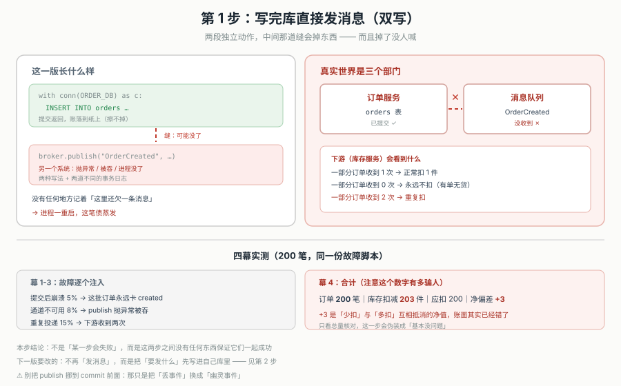
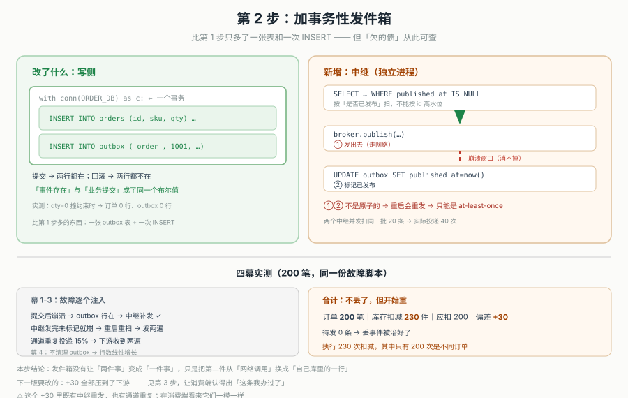
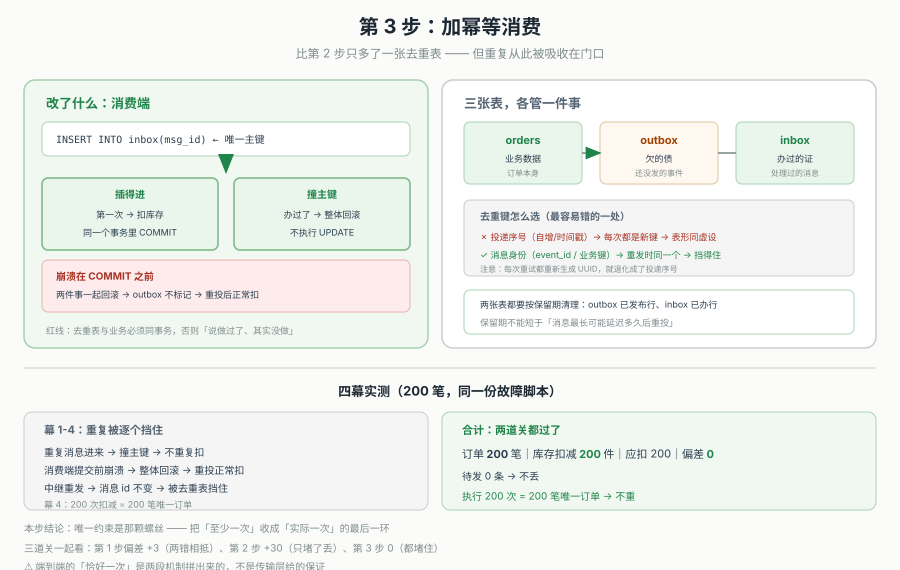

# 应用实战 10：事务性发件箱与幂等消费（主线：跨服务下单的发件箱改造）

> 配套理论：课 10《事务性发件箱与幂等消费》。体例：三跳演进 + 每步一张设计图 + 同口径真实对照数字。

## 🎬 场景

> 承课 9。下单流程本身已经稳了，现在的活儿是"订单创建之后通知库存服务减 1 件"。老代码是这样：写完库顺手发一条。
>
> ```python
> ORDER_DB = "…"
> STOCK_DB = "…"
> # 订单库：orders / outbox
> # 库存库：stock / inbox
> ```
>
> 全貌一句话：**"写库"和"发消息"永远拼不成一件事，因为它们不归同一个系统管**。本实战用同一份故障脚本（同 seed、同故障点）跑三遍，只有实现方式在变——这样每一步的差值就只来自"这一跳加了什么"，你能亲手看见"丢"是怎么变成"重"、"重"又是怎么被收成"一次"的。

---

## 演进第 1 步：写完库直接发消息（双写）

```python
# order_service.py —— 第 1 版
def create_order(order_id):
    with conn(ORDER_DB) as c:
        c.execute("INSERT INTO orders(id, sku, qty) VALUES(?,?,?)",
                  (order_id, "A-1", 1))
    # ↑ 提交返回，账已经落到纸上

    if crash_after_commit:
        return                      # 进程在这儿没了：消息永远不发

    broker.publish("OrderCreated", {"orderId": order_id})
    # ↑ 另一个系统：可能抛异常、可能被重试框架吞掉
```



> 看图：左边是两段独立动作，中间那道缝就是本步的结论——订单表已经提交、消息还在路上。图下方是实测：200 笔里净偏差 +3，但这个数字是"丢事件"和"重复投递"互相抵消出来的假象。

### 四幕实测（`app10_outbox_journey.py` 第 1 步）

```
幕 1：全部顺利 → 订单 200、库存扣 200、偏差 0（看不出问题）
幕 2：提交后崩溃 5% → 这批订单永远卡在 created，下游不知道
幕 3：通道不可用 8% → publish 抛异常，被外层的 pass 吞掉
幕 4：重复投递 15% → 下游收到两次，扣两次
```

合计结果：

```
订单 200 笔｜库存扣减 203 件｜应扣 200｜净偏差 +3
```

### 三个必须记住的坑

1. **+3 是净值，不是"基本对了"**。它是两股相反的错互相抵消：一批订单丢了事件（少扣），另一批被重复投递（多扣）。只看总量核对，这一步会伪装成"没问题"。
2. `commit` 返回之后，代码里没有任何变量、任何表、任何日志记着"这里还欠一条消息"。进程一重启，这笔债蒸发。
3. 把 `publish` 挪到 `commit` 前面只是把"丢事件"换成"幽灵事件"——下游扣了库存、本地查无此单。

---

## 演进第 2 步：加事务性发件箱 —— 把"要发什么"先写进自己库里

```python
# order_service.py —— 第 2 版
def create_order(order_id):
    with conn(ORDER_DB) as c:
        c.execute("INSERT INTO orders(id, sku, qty) VALUES(?,?,?)",
                  (order_id, "A-1", 1))
        c.execute("""INSERT INTO outbox(aggregatetype, aggregateid, type,
                                        payload, created_at)
                     VALUES('order', ?, 'OrderCreated', ?, ?)""",
                  (str(order_id), json.dumps({"orderId": order_id}), time.time()))
    # 两行同一个本地事务：业务提交 → 待发一定在；业务回滚 → 待发一定不在

# relay.py —— 独立进程
def relay():
    rows = db.query("""SELECT id, aggregateid FROM outbox
                       WHERE published_at IS NULL ORDER BY id LIMIT ?""", (100,))
    for rid, aid in rows:
        broker.publish("OrderCreated", {"orderId": aid})   # ① 发
        db.execute("UPDATE outbox SET published_at=? WHERE id=?", (now(), rid))  # ② 标记
    # ① 和 ② 之间不是原子的 —— 崩溃了就会重发
```



> 看图：上半部分是写侧——订单行与 outbox 行在同一个事务框里，一起提交或一起回滚。下半部分是中继，①②之间画了红色虚线缺口。图右下是实测：不丢了（待发 0 条），但扣多了 30 件。

### 四幕实测（`app10_outbox_journey.py` 第 2 步）

```
幕 1：崩溃注入 → 订单照样提交、outbox 行也在 → 中继补发成功（不再是丢事件）
幕 2：中继发完未标记就崩 → 重启重扫 → 同一条发两遍
幕 3：通道重复投递 15% → 下游收到两遍
幕 4：不清理 outbox → 表行数线性增长
```

合计结果：

```
订单 200 笔｜库存扣减 230 件｜应扣 200｜净偏差 +30｜待发 0 条
库存服务执行了 230 次扣减，其中只有 200 次是不同订单
```

### 得失

- 买到：不丢了。崩溃不再让事件消失，只是让它晚一点到。
- 代价：投递语义变成 at-least-once。重复从"偶发"变成"必然"，全部压到下游。
- 注意：这个 +30 里，既有中继重发（幕 2），也有通道自身重复（幕 3）。两者在消费端看起来一模一样。

---

## 演进第 3 步：加幂等消费 —— 让下游认得出"这条我办过了"

```python
# stock_service.py —— 第 3 版
def on_order_created(msg):
    msg_id = msg.event_id            # 消息自己的身份，重发时不变
    with conn(STOCK_DB) as c:
        try:
            c.execute("BEGIN IMMEDIATE")
            c.execute("INSERT INTO inbox(msg_id, processed_at) VALUES(?,?)",
                      (msg_id, time.time()))          # 唯一主键：插得进=第一次
            c.execute("UPDATE stock SET qty=qty-1 WHERE sku=?", (msg.sku,))
            c.execute("COMMIT")
        except sqlite3.IntegrityError:
            c.execute("ROLLBACK")     # 撞主键 = 办过了 → 整体跳过
```



> 看图：左边是消费端的三条路径（插得进→扣减、撞主键→跳过、崩溃→整体回滚）。中间标出"必须同事务"这条红线。右边是实测：偏差归 0，200 次扣减正好对应 200 笔唯一订单。

### 四幕实测（`app10_outbox_journey.py` 第 3 步）

```
幕 1：重复消息进来 → 撞主键 → 整体回滚 → 不重复扣
幕 2：消费端提交前崩溃 → 两件事一起回滚 → outbox 不标记 → 重投后正常扣
幕 3：中继重发 → 消息 id 不变 → 被去重表挡住
幕 4：全部走完 → 200 次扣减 = 200 笔唯一订单
```

合计结果：

```
订单 200 笔｜库存扣减 200 件｜应扣 200｜净偏差 0｜待发 0 条
```

### 三个必须做对的地方

1. **去重表与业务必须同事务**。分两个事务会留下"说做过了、其实没做"的永久空洞（课 10 M3 实测：999 vs 998）。
2. **去重键用消息身份，不用投递序号**。用自增号时，同一条消息投 4 次会留下 4 行、扣 4 次。
3. **崩溃时不标记 outbox**。这一步容易漏写：如果消费端崩溃了却仍然标记已发布，那条消息就永远不会重投——丢事件的幽灵从发件箱这头又回来了。

---

## 收尾对照表

| 维度 | 第 1 步：双写 | 第 2 步：+ 发件箱 | 第 3 步：+ 幂等消费 |
|---|---|---|---|
| 会不会丢事件 | 会（静默） | 不会（待发可重放） | 不会 |
| 会不会重复 | 会（通道重复） | 会（通道 + 中继重发） | 会，但被吸收 |
| 投递语义 | 可能丢、可能重 | at-least-once | 效果上 exactly-once |
| 库存偏差（200 笔） | +3（两错相抵，不可信） | +30 | 0 |
| 需要的表 | orders | orders + outbox | orders + outbox + inbox |
| 运维心智 | 最轻，但账是错的 | 中（中继要高可用、要清理） | 中高（去重键、保留期、顺序） |

### 什么时候可以退回简单版（第 1 步）

- 下游动作天然幂等且**丢了也无所谓**（比如只是刷新缓存、发一封可丢的营销邮件）；
- 有独立的对账任务能兜住：每天扫一遍"`created` 超过 N 分钟且下游无记录"的订单，补发；
- 这笔业务的一致性要求就是"尽力而为"，出问题可以人工补单。

**规则**：先问"这次写会不会丢"——只写一个系统，本地事务就够，别上发件箱。要跨系统写，就必须让"要发的东西"进同一个事务。再问"重复受不受得了"——业务是赋值型（`SET status='shipped'`）就不用去重表；是累加型（扣库存、加余额）就必须上，且必须与业务同事务。

> 🎯 **练一练**：把第 2 步的中继改成"记住最大 id、只扫 id 更大的"（高水位），然后构造一个晚提交的小 id，观察它如何被永久跳过；再对比"用投递序号做去重键"和"用消息 id 做去重键"，跑同一条消息投 4 次，看去重表各留下几行。答案与完整代码见课 10 正文 [`10-事务性发件箱与幂等消费.md`](../stages/3-数据一致性/lessons/10-事务性发件箱与幂等消费.md)。
